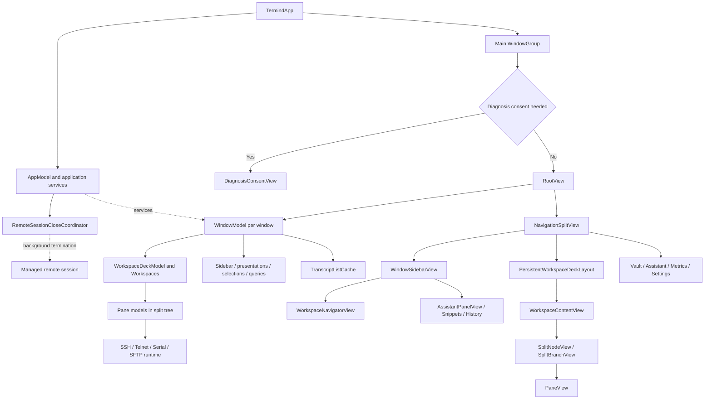
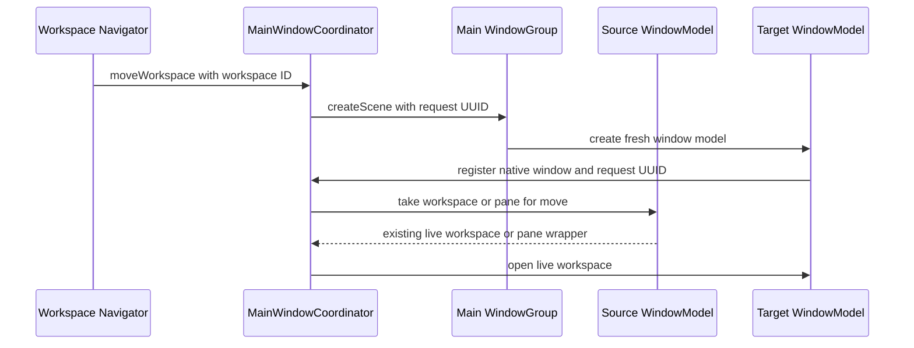
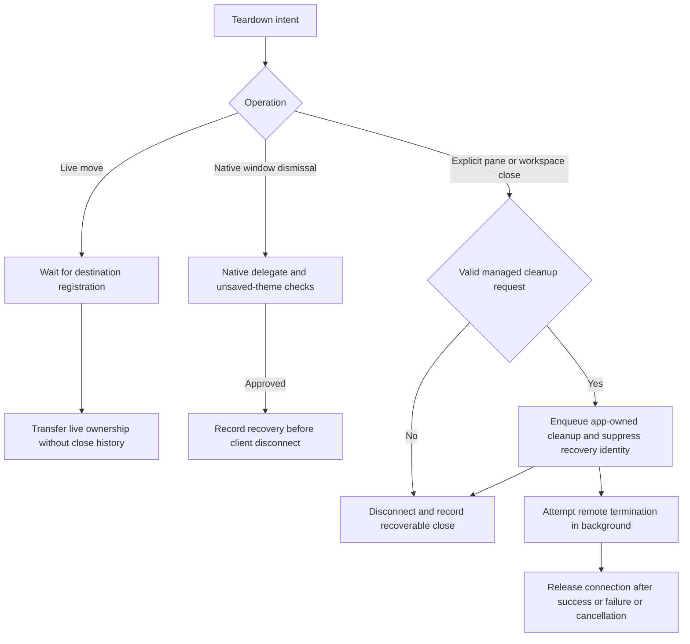
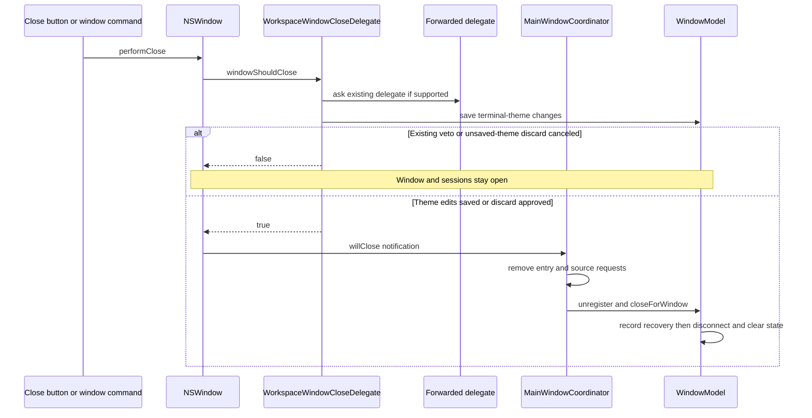
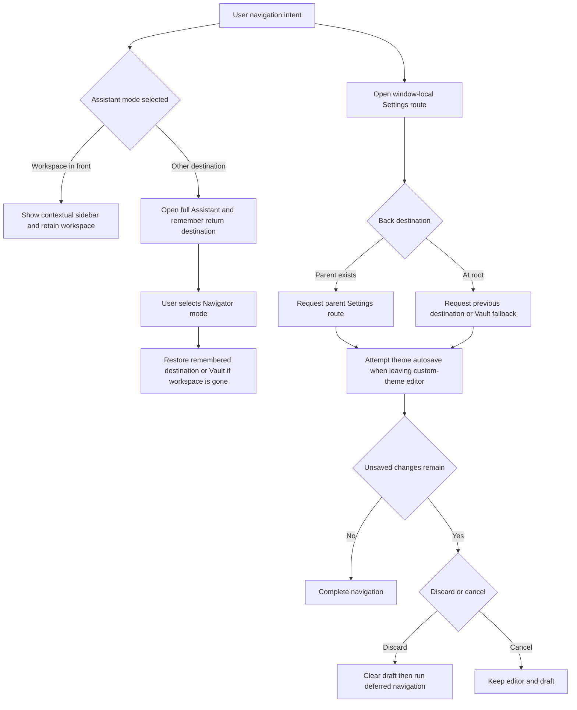
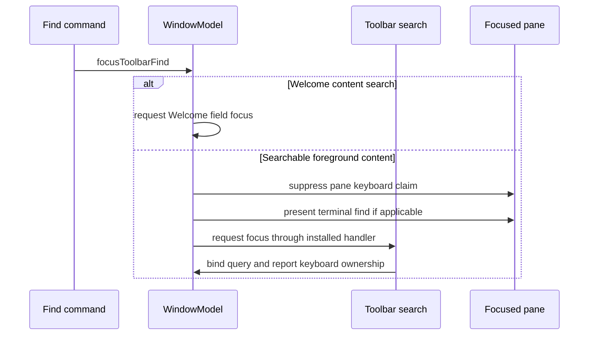
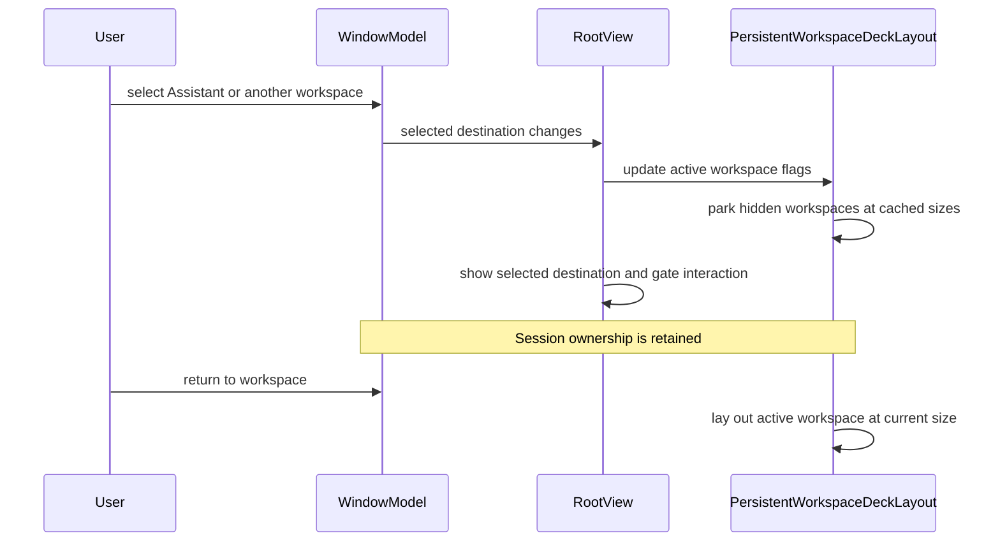
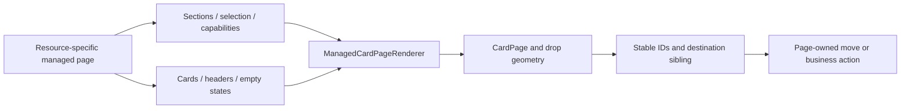

# Desktop Windows and Workspace UI

TFM uses SwiftUI for composition and AppKit-backed surfaces where native identity, focus, text handling or incremental rendering matters. Its central design is **one Navigator column and one persistent detail deck per window**, not a separate horizontal tab system for every feature.

This guide describes the current implementation. See [TFI Mobile UI Architecture](mobile-ui.md) for the different mobile shell and [UI Design Principles](../concepts/ui-design-principles.md) for the sharing boundary.

## Code structure: composition and ownership

Solid arrows below mean composition/ownership or routing, not necessarily inheritance. The model branch is shown separately because a view appearing in the diagram does not own every runtime it displays.

Window composition and state ownership; the deck stays mounted beneath foreground destinations.

The main layers are:

| Layer | Responsibility | What should not move into it |
| --- | --- | --- |
| App composition | Persistence container, shared service graph, launch locale, main and external-authentication scenes, application commands. | One window's selected pane, query, or editor route. |
| `WindowModel` | Workspace collection, selected destination, sidebar mode, presentation routes, page selection/search state, transcript cache and connection-service wiring. | A process-global assumption that all windows share the same active session. |
| Workspace and pane models | Live session ownership, pane identity, split tree, focused pane and workspace-specific command context. | Temporary divider-drag coordinates or a view's hover state. |
| Feature views | Render projected state, present interaction, dispatch intent to owners. | Recreating connections merely because a destination appears. |
| Reusable renderers and native bridges | Collection interaction, layout, focus/native mounting, terminal/transcript presentation. | Resource-specific repository mutations hidden behind generic drawing code. |

`TermindApp` builds the persistence container and shared `AppModel` once. Its `WindowGroup(id: "main", for: UUID.self)` calls `makeWindow(requestID:)` when the diagnosis consent gate is cleared: ordinary and restored windows receive a fresh `WindowModel` (which starts at Vault/Welcome), while a debug screenshot launch without a request ID can receive a demo-configured model. While consent is required, the main scene shows `DiagnosisConsentView` instead of creating the workspace root. `RootView` stores the supplied instance in `@State` and exposes it through the environment and focused scene values so commands target the correct window. `AppModel.registerWindow` wires shared connections, connection-history tracking, host and metrics services into that model and adopts the shared conversation store; its workspace list, queries, presentation routes and transcript cache remain window-local. The separate `Window` for external authentication shares app dependencies but is not a workspace scene; `.commandsRemoved()` keeps it out of normal scene-opening commands. The main scene uses the saved default window size and content minimum resizing; in debug builds XCTest normally suppresses automatic test windows unless `TERMIND_WINDOW_TESTS=1`, and tests or screenshot mode disable main-scene restoration. The device-local `MainWindowSizeStore` validates ordinary content sizes and sidebar widths before loading or saving them; without stored values it defaults to 1180×740, a 320-point sidebar and a visible sidebar. This fallback does not replace individual system-restored window frames.

`MainWindowRegistration` connects a real AppKit window to `app.mainWindows`. A **Move Workspace to New Window** action requests the UUID-valued main scene first; the source retains its live workspace until the destination registers. Only then does `MainWindowCoordinator` take it from the source and open it in the new model, preserving the running session rather than treating a move as a close/reopen. Closing a real window instead unregisters its model; `closeForWindow()` first records recoverable workspace descriptors through the app-owned close-history callback, then disconnects its workspaces and clears window-scoped caches. A restored scene has no pending move request and keeps its system-restored frame. The coordinator tracks normal-size and sidebar-width fallbacks from registered main windows, preferring the most recently used window; requested scenes inherit source layout, while restored windows are not forcibly resized. Full-screen requests carry the source's ordinary (pre-full-screen) size and wait until the new window is key before toggling; normal resizing avoids recording full-screen or transitional dimensions. Sidebar measurements only replace a requested preferred width once the native column actually reaches that width, and hiding the sidebar does not overwrite its last valid width. Main-window registration disallows native tabbing; sizing uses AppKit content/frame conversion rather than imposing custom titlebar geometry. Requested frames respect minimum content dimensions and are fitted to the available screen; auxiliary windows do not participate in the saved fallback. See [Platform Runtime](platform-runtime.md) for app lifecycle and auxiliary windows.

Scene-request handoff: the source keeps the session until the target's native window registers.

A workspace move waits for native destination registration before changing ownership. Repeated requests to move the same workspace or pane from the same source reuse the pending scene request. If no scene factory exists, the request fails without removing the source workspace; closing the source before registration cancels its pending requests and disconnects its sessions, so a late destination cannot resurrect them. A pane moved to another window uses the same request mechanism: a split pane becomes a new workspace around the existing live pane, while a lone pane carries its original workspace and name. The detailed release, cancellation and animation rules are in [TFM Drag and Drop](../workflows/desktop-drag-and-drop.md). [Source: `TFM/Platform/MainWindowCoordinator.swift` and `TFM/Features/Workspaces/WindowModel.swift`.]

### Background close cleanup and recoverable history

These operations must not be treated as synonyms:

| Operation | Visual ownership | Client connection | Managed remote session |
| --- | --- | --- | --- |
| Switch destination | Workspace stays mounted but inactive | Retained | Unchanged |
| Move to another window | Source retains ownership until target registration | Same live session transfers | Unchanged |
| Explicit pane/workspace Close | Local target removed immediately | Disconnected, except a transferred cleanup connection | Eligible identity queued for background termination and omitted from recovery |
| Native window close | Window collection cleared after native approval | Disconnected | Recovery identity preserved |
| Application termination | App-wide teardown | Shutdown | No new managed-session termination requests |

Explicit pane/workspace Close is not native window dismissal. `close`, `closePane`, `closeOthers` and ordinary `closeAll` call `closePersistentSessions` and **remove their local targets immediately**, without waiting for remote cleanup or showing confirmation UI. The app owns `persistentSessionCloser` and injects it into registered windows. Each eligible managed attachment supplies a `RemoteSessionCloseRequest` with a validated connection snapshot and, for SSH when available, a transferred live connection. Requests with connections are queued first. Accepted requests mark the old session `isRemoteSessionClosing`, making `restorableRemoteSession` nil before close history is captured. Thus reopening an explicitly closed session does not reattach to an identity scheduled for termination, even if cleanup later fails. If there is no cleanup owner or no valid request can be built, the recovery reference remains available. [Sources: `WindowModel.closePersistentSessions`, `SSHSessionModel.takePersistentSessionCloseRequest`, `WorkspaceBackgroundCloseTests`, `WorkspaceCloseConfirmationTests`.]

`RemoteSessionCloseCoordinator` owns one-shot cleanup independently of window and pane lifetime. It deduplicates pending requests by remote identity, releases transferred connections exactly once, and cancels the operation at its default 30-second deadline. Failure and cancellation are swallowed without retry; neither restores the removed workspace nor reinstates its recovery identity. There is no pending close authorization or workspace-ownership snapshot gate for moves to cancel. Live moves simply transfer existing ownership, while `closeForWindow` preserves managed attachments and application termination passes `.applicationTermination` to `closeAll` to bypass new termination requests. See [Session Persistence](../concepts/session-persistence.md) and [SSH Session Lifecycle](../workflows/ssh-session-lifecycle.md) for remote lifetime and transport enforcement.

Live transfer, native dismissal and explicit close have different effects on remote lifetime and recovery.

Recoverable close history is a separate app-owned mechanism, not the connection-event timeline. `RecentlyClosedWorkspaces` stores descriptors plus in-process workspace instances. Only records whose items all have restorable layouts are persisted; external temporary SSH workspaces have no durable layout. A split-pane close records a wrapper containing **only the removed pane**, so reopen cannot reconnect surviving panes. Reopening consumes history only after a destination exists and every requested item can be restored; window records open a new scene and restore their selected workspace. `prepareForReopen` retains pane identity but replaces the torn-down SSH model through `copyForReconnect`, while a live move keeps the original pane and session. [Sources: `AppModel.restoreClosedRecord` in `TFM/App/RecentlyClosedWorkspaces.swift`, `ClosedWorkspaceRecord`, `Pane.prepareForReopen` and `WindowModel.closePane`.]

Application **reopen** is a different operation from restoring a recently closed record. `MainWindowCoordinator.handleReopen()` first raises an existing main window. If none exists and a scene factory is registered, it requests a fresh window itself; both handled cases return `false` to suppress SwiftUI's default reopening. Only the no-window, no-factory cold-launch case returns `true`. `MetricsInteractionTests.reopenDefersToSwiftUIOnlyUntilAWindowFactoryExists` pins all three branches. [Source: `MainWindowCoordinator.swift`, lines 542–554.]

### Weak registration is discovery, not window ownership

`RootView` retains its `WindowModel` in `@State`. `AppModel` registers models in weak boxes, and `MainWindowCoordinator.Entry` holds weak references to both the native `NSWindow` and its model. Pending move requests also hold their source weakly. These registries discover and route to living windows rather than keeping abandoned scenes alive. App registration is idempotent and refuses closed models; native registration prunes dead entries and avoids duplicate window/model pairs. `RootView.onAppear` and the native bridge can therefore both register safely. The bridge retains its close-delegate proxy and attaches it when it gains a native window; this is not a view-disappearance cleanup hook.

### Native window close and application Quit have different scopes

Workspaces are session owners, **not edited documents**. `MainWindowRegistrationView` observes `isDocumentEdited` and resets it to false on its own attached window, suppressing edited decoration without disabling close confirmation. Detaching removes that observation. Native close is owned by `WorkspaceWindowCloseDelegate.windowShouldClose`, not a SwiftUI dismissal confirmation dialog that could also participate in Quit.

The proxy preserves the previous native delegate weakly, forwards other supported delegate selectors, and restores it when moving off that window. For close, it rejects reentrant checks and honors the forwarded delegate's veto first. It then flushes terminal-theme edits; only changes that remain unsaved require a discard decision. Cancel keeps the draft and window open, and a subsequent close can retry. Live connections alone never prompt, even when another destination hides the workspaces; an empty workspace collection does not bypass unsaved-theme protection. The discard alert adds Cancel first and Discard Changes second and approves only `.alertSecondButtonReturn`. [Sources: `WorkspaceCloseConfirmation.swift`, lines 4–61; `WorkspaceCloseConfirmationTests.swift`, lines 11–127.]

Window commands use `performClose(nil)` rather than bypassing the native veto. `closeSelectionOrWindow` consumes the focused pane when a workspace is selected, including its last pane; only a later invocation with no selected workspace falls back to native window dismissal. `closeWindow` resolves only that model's registered native window. Close All Windows snapshots registered windows and calls `performClose` on each, so one veto does not prevent other approved windows from closing. Transfers remains an auxiliary close target, not a workspace model.

Native window dismissal honors native vetoes and unsaved edits before the close notification triggers teardown.

Once `willCloseNotification` arrives, the coordinator records layout, removes the native entry and requests sourced from that model, unregisters the model from `AppModel`, and calls idempotent `closeForWindow()`. That method records recoverable window descriptors before marking the model closed, disconnecting its workspaces, clearing their lifecycle routers, and releasing its workspace collection, drag/presentation state, transcript cache and toolbar focus callback. Other windows' sessions remain untouched. Ordinary destination switching is not this teardown path.

**Quit** instead belongs to `AppDelegate.applicationShouldTerminate`. It returns `.terminateLater`, coalesces repeated requests, and flushes terminal-theme edits across registered windows. If any remain unsaved, it asks the same discard question; cancellation resets its waiting flag and replies false. **There is no application-wide live-workspace confirmation.** It next rechecks edited SFTP files and, if necessary, asks a separate pending-upload warning (Cancel first, Quit Anyway second; only the second response approves). After those gates, termination saves the main-window fallback and begins app-wide shutdown, replying true when cleanup finishes or its three-second bound expires. This is separate from the per-window native veto. See [Platform Runtime](platform-runtime.md) for process shutdown and [SSH Session Lifecycle](../workflows/ssh-session-lifecycle.md) for transport teardown. [Source: `TermindApp.swift`, lines 290–314 and 473–510.]

The Transfers window is an auxiliary app-owned window, not a workspace. Its open/key flags drive the View toggle and close-command routing: when Transfers is key, Close Window closes it and Close Workspace is disabled, preventing an old workspace focus value from closing a session. Its notifications do not update main-window size fallback.

SSH and SFTP context actions can open a companion session at the source session’s current directory. Dispatch resolves the owning pane again by session ID rather than using whichever pane is now focused. A live SSH session with a known directory or a connected SFTP channel with a nonempty path must still resolve to a saved host; otherwise the action cannot open a companion. Current-workspace placement first selects and focuses that source pane. For SSH directory-context tickets, dispatch asynchronously confirms the ticket and rechecks the source workspace, path and ticket currency before opening SFTP; a stale result or failed confirmation opens nothing. [Source: `WindowModel.swift`, lines 861–919.]

## The window shell owns chrome once

`RootView` owns the balanced `NavigationSplitView`: `WindowSidebarView` is the single leading column and the detail holds a persistent workspace deck with Vault, Assistant, Metrics or Settings layered above it. The sidebar visibility binding reads and writes `window.showsSidebar`; column widths and the window minimum adjust for available width. The floating status bar appears only over a selected workspace when the app-wide Show Status Bar preference is enabled (the default). The View menu and Settings share that preference; hiding it also removes reserved overlay clearance and disables its path onboarding target. The root also owns the window toolbar, search host, native window registration, title reporting, Quick Open, onboarding and presentation bridges. It supplies one leading creation area, a principal Metrics page picker when applicable, and one Find slot following the content in front. `WindowActivityReader` reports key-window activity to onboarding without tying it to a transient pane view. Window titles are projected separately through `WindowTitleCatalog` in the root’s `.navigationTitle`.

The sidebar is one column whose mode rail switches between Navigator, Assistant, Snippets and History. `WindowModel.activateSidebarMode` is an **intent operation**, not just a property assignment: choosing Navigator from the full Assistant restores its prior destination (or Vault if that workspace closed), while choosing Assistant inside a workspace opens the contextual sidebar rather than hiding the terminal. Direct mode assignment remains available for presentation/restoration without these navigation side effects. History is unavailable for focused Telnet/serial sessions; a rejected direct assignment leaves the mode unchanged, while reconciliation replaces an already-invalid History mode with Snippets.

The column's material belongs to the native split view on macOS 26 and later; `RootView` does not layer another glass sheet over it. Earlier systems receive `LegacySidebarMaterialBackground`, an AppKit visual-effect fallback that blends within the window and follows its active state. `DesignTokens.swift` centralizes fixed spacing, sidebar/card/toolbar geometry and minimum window dimensions as `Metrics`; semantic `TermindColor` roles adapt to appearance, while `Motion` and glass modifiers use system glass on macOS 26+ and native material on older systems. The split view constrains the sidebar to 260–520 points and protects a 360-point detail minimum; row selection is drawn explicitly, with key/inactive styling rather than relying on native `List(selection:)` colors. Explicit glass remains on controls: the mode rail is one capsule with a neutral moving selection highlight, readable symbols, selected accessibility traits and a separate key-window keyboard-focus outline. Reduce Motion disables its selection animation. See [UI Design Principles](../concepts/ui-design-principles.md) for row foreground and active/inactive selection roles.

The tool modes are projections of the **current window and focused pane**, not new destinations. Snippets searches the shared host-library snippets in its own footer, inserts into a live focused SSH/Telnet terminal on a single click, and double-click execution of a risky command asks for a second confirmation. History chooses a focused SSH terminal’s memory-only command history, a focused SFTP browser’s memory-only browse history, or the shared connection timeline; it uses the native `ListViewKit`-backed `SidebarNativeList` for stable card geometry and blank-area context menus. Snippet package folding is a persisted sidebar-only preference, separate from expansion on the main Snippets page. The snippet and history footer fields are not the titlebar Find field.

Keep the following coordinates distinct:

- **Destination**: Vault, a workspace, full Assistant, Metrics or Settings.
- **Sidebar mode**: what occupies the one shared left column.
- **Focused pane**: the session targeted by workspace commands.
- **Presentation route**: an editor, chooser, sheet, or other transient interaction.

They influence one another, but they are not interchangeable selections. A workspace drag adds a fifth, temporary distinction: `selectedWorkspace` remains the command/selection owner, but `displayedWorkspace` can show the next (or previous) merge-capable neighbour when the selected combinable workspace is being dragged. This is a derived preview, not a selection or session transfer; clearing the drag restores the selected workspace, and a drag without an eligible neighbour leaves it displayed. `RootView` uses the derived workspace to decide which deck child is active, while Navigator highlights the displayed row. `WindowModel` remembers return destinations for reversible trips to Assistant and Settings. If the remembered Assistant workspace has closed, Navigator falls back to Vault. Settings navigation uses a window-local `SettingsRoute` hierarchy: toolbar Back walks to the parent, then restores the prior destination, falling back to Vault if its workspace was removed. `SettingsPageView` cleans up incomplete provider, MCP and skill drafts on route changes or disappearance rather than treating a hidden Settings page as a persistent editor. Page searches, selections and archive presentation are window-local, so two windows may inspect the same shared data differently. The workspace collection lives in its `WorkspaceDeckModel`; recoverable close records are app-owned and populated by window callbacks; the `WindowSidebarState`, `WindowPresentationState` and `WorkspaceDragState` isolate the column, transient routes and live drag payload from session ownership.

Assistant and Settings return routes belong to the window; unsaved theme drafts gate Settings departures independently of live sessions.

### Settings edits are not live-session confirmation

Custom terminal themes have a separate window-owned draft lifecycle. Leaving a custom-theme route or Settings first attempts autosave; valid changes save and clear the editor, while invalid, deleted or failed-to-persist drafts keep navigation at the editor and offer discard/cancel. The deferred destination executes only after explicit discard, and discard cannot recreate a deleted theme. Native window close and Quit also attempt this save before asking about remaining unsaved changes. This protection applies even with no workspaces. `SettingsNavigationTests` covers autosave on Back and destination changes, failed-save retry, deleted drafts and preservation of spaces while typing names; `WorkspaceCloseConfirmationTests` covers window and all-window Quit flushing.

### Navigator interactions and workspace lifetime

`WorkspaceNavigatorView` is an AppKit-backed SwiftUI `List` of Welcome, Metrics, Vault pages, Workspaces and Settings. A workspace row selects its workspace without starting a drag; the close affordance closes that workspace (Option-click closes the others). Its context menu can save/update a template, rename/reset eligible names, separate split panes, duplicate or split combinable sessions, move a workspace to another window, or close one/others/all. Context actions that operate on the selected pane first select the row's workspace. Section expansion is stored with `@AppStorage` and selecting a Vault page or workspace expands the corresponding section; this is sidebar presentation state, not the workspace collection.

Inline rename seeds the editor with `workspace.title(in: app.hostLibrary, locale: locale)` **before** activating the rename field; commit sends the text to `WindowModel.rename`, cancel discards it. The model refuses non-renameable workspaces and trims whitespace: split names belong to the workspace, single-pane overrides to its pane; clearing restores an automatically allocated/derived name. This ordering matters because the native text field selects its initial text when focused. The visible-window `WorkspaceNavigatorRenameTests` exercise both the context-menu and double-click entrypoints and require the full existing title in the editable field.

Navigator layout interaction is window-scoped: `WindowModel.dragging` carries the live workspace or pane identity for the native `List` receiver, while workspace ordering and pane ownership change only on an accepted drop. The selected workspace remains the command owner during preview. The Navigator overlays the native rows with its receiver because an ancestor receiver would compete with pane targets. For drag-source behavior, geometry, cancellation and cross-window release cases, see [TFM Drag and Drop](../workflows/desktop-drag-and-drop.md).

### Toolbar commands follow the detail, not the mode rail

The window titlebar contributes creation actions from `WindowModel.creationActions` for the **foreground destination**: a single action is a plus button, several form a New menu, and Settings/Metrics detail can replace that position with Back or contextual controls. A Vault row's context menu calls `creationActions(for:)` through `creationMenu(for:locale:)`, so it can offer that page's creation verbs even when another page is in front. Switching the sidebar from Navigator to Assistant does not change the titlebar's New or Find target.

`WindowModel.findKind` resolves the foreground Vault page, full Assistant, Metrics list/process detail, Settings **terminal-theme libraries** (built-in schemes and custom themes), or the **focused** SSH/Telnet/Serial terminal or SFTP pane. Welcome has its own content search and no titlebar Find; other Settings routes and unsearchable panes offer none. `findContext()` binds the toolbar to the actual page/window query or session query, with SSH/Serial terminal navigation and cancel callbacks and SFTP query cancellation. Direct query bindings use `Bindable` projections; transformed terminal and theme-map bindings still dispatch through their owners. A focused Telnet pane reports `.terminal` from `findKind` and `focusToolbarFind()` presents its terminal search, but `findContext()` currently has no Telnet binding: unlike SSH/Serial it cannot render a usable titlebar field through that path. Vault page queries survive page switches. Built-in terminal-theme queries are retained independently for `.light` and `.dark` appearance schemes in `terminalThemeQueries`; the custom-theme library uses the separate `customThemeQuery`. Entering a custom-theme editor removes Find, and Back restores the library's retained query. `TermindCommands` routes Find to the focused window model, which stands down pane focus *before* presenting terminal search, increments the focus request and invokes the mounted toolbar field's focus handler. Welcome instead increments only `welcomeSearchFocusRequest`: it neither increments `findFocusRequest` nor calls the titlebar focus handler or claims toolbar keyboard focus. This keeps ⌘F available for Welcome's content search without adding a second toolbar field. With no searchable target it does nothing.

Find command routing and keyboard handoff in the focused main window.

Find ownership flows through the active window; the sidebar mode does not choose the query.

On macOS 26+, a background `WindowToolbarSearchHost` supplies the system `.searchable` item when `findKind` exists **except for terminal-theme libraries**, which keep an explicit visible native toolbar field on every supported OS, including empty and no-results states. Custom-theme editing instead contributes import/delete controls and no Find. The system host binds to `findContext()` and reports presentation as keyboard ownership; when its target disappears it dismisses search and releases that claim. Because the host checks `findKind` rather than `findContext()`, Telnet still installs the system search affordance although its missing query binding reads as empty and ignores edits. Its Return and Escape handlers use the context's navigation/cancel callbacks when present. The background host does not change the persistent split-view branch. On earlier macOS versions, `WindowToolbarLegacySearch` supplies a retained `NSSearchField` (or a compact Metrics-detail popover). The field owner and coordinator preserve editing/focus across toolbar bridge updates, handle terminal Return/Shift-Return and Escape, and release keyboard ownership on a real user exit so the pane can reclaim focus. Reserve toolbar height even when no Find target is available: removing the entire item would resize the content when switching destinations.

## Persistent workspace deck: hidden is not destroyed

Every open workspace remains a child of `PersistentWorkspaceDeckLayout`. The selected workspace becomes visible and interactive; parked workspaces are transparent, disabled, excluded from hit testing and hidden from accessibility. Other top-level destinations are overlaid in front of that deck.

The layout maintains a size cache keyed by workspace identity:

1. The active workspace receives the current container size and updates its cached size when usable.
2. A hidden workspace keeps its last visible size.
3. A never-visible workspace captures the first finite, positive parking size.
4. Closed workspace IDs are pruned from the cache.

This is both a lifecycle rule and a layout-performance rule. Keeping views mounted protects terminal grids, scrollback and SFTP state; parking their geometry avoids recursively resizing every hidden split tree during a sidebar animation. Merely changing opacity would not prevent hidden views from receiving new layout proposals.

Destination switching parks layout, not sessions or native workspace view identity.

Do not replace this with an `if selected { WorkspaceContentView(...) }` that recreates the terminal hierarchy. Equally, do not let parked workspaces handle invisible keyboard shortcuts: broadcast and terminal-find shortcut owners are explicitly disabled unless their workspace is active.

The floating status bar overlays the current workspace rather than docking below it. This avoids changing the pane's available height when entering a workspace. Command-generation feedback reserves clearance above that capsule instead of competing for the same bottom edge.

## Split panes: stable identities, explicit fractions

`WorkspaceContentView` renders the model's recursive `SplitNode`: a leaf produces a stable-ID `PaneView`, while a branch produces a `SplitBranchView`. Branch geometry comes from its stored fraction rather than the divider state of a native `HSplitView` or `VSplitView`. That makes drop previews and later proportional resizing use the same model.

During divider dragging, a local preview fraction drives geometry. The gesture uses global coordinates and commits the model change once, instead of publishing the entire workspace tree for every mouse event. The divider's visible hairline and its wider hit region are separate design decisions.

Pane interaction separates **preview** from **mutation**. The dragged branch is temporarily omitted from preview geometry while its source view stays mounted; the model tree changes only on an accepted drop. `RootView` deliberately has no ancestor drop target that would compete with pane and Navigator targets. See [TFM Drag and Drop](../workflows/desktop-drag-and-drop.md) for receiver mechanics.

## Vault and management pages

Vault management is a list/detail workspace, not a collection of unrelated sheets. `VaultWorkspaceContent` keeps the list and editor children stable across its width breakpoint:

- With enough space, the list and a fixed-width detail editor appear together.
- In a narrow detail region, the editor covers the list; the list retains its last visible size and state.
- Editor presentation animates position and reserved space, not the form's own width.

`WindowModel` owns the selected Vault page and optional `vaultWorkRoute`: `openPage` clears the work route, `openVaultWork` selects a page and detail route, and `closeVaultWork` dismisses the detail. `VaultWorkDetailView` dispatches the route to a resource-specific editor; its identity is keyed to the route. The view-local `VaultWorkEditingSession` protects dirty inline editors during page or editor transitions: an editor registers its route, dirty predicate, busy predicate and async commit with a token. Navigation offers Save, Discard or Cancel; explicit cancellation offers Keep Editing or Discard Changes, with resource-specific wording for new drafts. Busy editors and an in-progress commit block transitions. A clean or unmatched route proceeds immediately. Save only executes the deferred transition after a successful commit; a failed save cancels it and leaves the editor available for retry. Stale editors cannot unregister a newer editor's registration. This guard is used by the resource pages when routing away from an editor, not as a blanket guard on every direct `WindowModel` assignment.

Resource pages plug into `ManagedCardPage` using typed sections, stable item IDs, externally owned selection, capabilities and page-specific presentation modifiers. `ManagedCardPageRenderer` handles the reusable interaction machinery; the page supplies business cards, section headers, drag ghosts, empty/no-results states and blank-canvas menu entries.

Managed-page rendering computes placement intent; the feature owns the resulting mutation.

The renderer resolves a pointer to a section and insertion slot; it does not need to know what a Host, key or snippet means. Selection and deletion state stay with their appropriate owners. Creation belongs in the window toolbar and contextual blank-area menus rather than reintroducing a special “New” tile into each data grid.

### Managed interaction boundaries

- **Selection is external; gesture state is local.** The renderer intersects updates with IDs in its section items and enforces single-selection capability in section order. A selected card's actions receive the selected items in that order; an unselected card acts only on itself. `CardPage` uses native blank-canvas hit testing for marquee and blank clicks, declining cards, headers, controls and scrollbars before input begins. Blank clicks clear selection and then invoke the feature's optional primary action. Pointer-only card geometry lives in a reference store rather than publishing a layout feedback loop through SwiftUI state. [Sources: `ManagedCardPage.swift`, lines 405–451; `CardGrid.swift`, lines 20–120 and 186–218.]
- **Reordering is capability-gated, not a repository operation.** The renderer filters destination sections by `canAcceptDrop` and the page's drop policy, excludes moving IDs before finding the next sibling, and passes IDs, destination and optional sibling to the feature closure. Collapsed sections append at their end. Hosts allows cross-group moves only when neither query nor tag filtering is active; Known Hosts supplies no reordering capability. [Sources: `ManagedCardPage.swift`, lines 194–219 and 453–524; `HostsPageView.swift`, lines 87–139; `KnownHostsPageView.swift`, lines 22–39.]
- **Deletion remains feature-owned.** `ManagedCardDeletionPresentation` only coordinates pending-ID bindings, pruning callbacks, confirmation and error UI. Known Hosts supplies the actual delete/storage-error handling. Hosts instead uses its own confirmation route and offers either deleting a group with its hosts or keeping the hosts, then prunes window selections. A generic renderer must not silently turn a card gesture into resource deletion. [Sources: `ManagedCardPage.swift`, lines 71–102; `KnownHostsPageView.swift`, lines 89–99; `HostsPageView.swift`, lines 284–306 and 405–468.]

### Review invitations belong to the feature surface

The desktop review invitation is inline top content on **Hosts**, not a global RootView presenter or a modal triggered by navigation. `HostsPageView` owns an `AppReviewInvitationVisit`, captures eligibility in its presentation's `onAppear`, and renders `AppReviewInvitationView` through `managedTopContent`. The shared, device-local `AppReviewController` owns first-use and response persistence; the page owns when and where that state is projected. Normal eligibility requires an enabled controller, at least one host, no response, and seven elapsed days. Capturing eligibility on entry prevents time passing or a synchronized host arriving from inserting an invitation mid-visit. Query/tag filtering or removal of the last host hides it without consuming it; declining or an accepted store-URL open hides it across windows. An accepted open records intent, not proof of a completed rating; a rejected open leaves the invitation available. See [Commerce, Localization, and Product Surfaces](../concepts/commerce-localization-and-product-surfaces.md) for the broader product boundary. [Sources: `HostsPageView.swift`, lines 68–114 and 362–374; `AppReviewController.swift`, lines 4–95.]

The managed renderer keeps top content even when the source is empty or filters produce no results, and registers it as interactive geometry. Both native blank-area selection/menu handling and reorder targeting therefore exclude the invitation rather than treating its buttons as canvas. When extending a managed surface, use this top-content contract rather than adding another window-wide overlay. [Source: `ManagedCardPage.swift`, lines 258–309 and 491–508.]

## Assistant: route state and native rendering are separate

The full Assistant destination and the workspace's compact Assistant are different presentation surfaces. Opening a conversation **from the contextual panel** does not replace the foreground terminal; the conversation navigator shown instead when no workspace is in front deliberately opens full Assistant. The compact surface composes its transcript and interaction/composer regions separately, passing focused-terminal context/actions deliberately. Conversation list reordering has its own native receiver and hidden-list participation rules; see the brief [Assistant drag flow](../workflows/desktop-drag-and-drop.md#assistant-conversation-reordering).

The compact Sidebar and full Assistant share one window-local Chat/Archive route. `AssistantLibraryModel.selectedConversationID` identifies the open chat, while `WindowModel.isAssistantArchivePresented` overrides it for Archive; entering Archive or returning to the chat landing state clears the selected conversation so the two surfaces cannot diverge. **Contextual panel** list, Archive and Back actions (`openAssistantInSidebar`, `showAssistantArchiveInSidebar`, `closeAssistantInSidebar`) change that route without replacing the workspace. By contrast, the full Assistant navigator and its footer, the blank-area New Chat menu on either surface, and the compact panel's explicit expand button select the full Assistant destination. The compact panel's blank-area Archive menu stays in the workspace. `openAssistantFullScreen` also selects the Assistant sidebar mode. Closing the last workspace promotes a selected compact chat or Archive when Assistant mode is selected; an empty chat landing state instead returns to Vault. The contextual Sidebar draft and focused-session context remain Sidebar-owned, and transcript owners remain keyed by conversation plus surface, so navigation is shared without merging draft or native-rendering lifetimes.

Native transcript ownership adds another boundary:

- `TranscriptListCache` is window-local.
- Its key includes **conversation ID and surface** (`fullScreen` or `sidebar`), because one AppKit view cannot have two superviews.
- A persistent owner retains the native list, presentation state, measured row heights and Markdown-related caches while a short-lived SwiftUI mount comes and goes.
- The default LRU target is eight owners. Trimming evicts unmounted owners and protects the just-requested owner; if all candidates are mounted, it does not force their eviction merely to meet the target.

Do not merge this cache with the persistent workspace deck. Both preserve continuity, but workspaces remain mounted with parked geometry while transcripts can unmount their native list and remount a retained owner.

Escape handling is also scoped. In the compact Assistant, an approval or user-interaction form can own Escape; resolving it must not let the same key event fall through and close the conversation. The view captures the blocking-interaction state for that render before applying its back policy.

## Connection history projections and pane lifetime

Desktop connection history is shared app data with two deliberately different projections. Welcome shows recent Hosts derived only from events whose stable `sourceDeviceID` matches this installation, so synchronized activity from another Mac does not reorder the local launch surface. Its row timestamp is likewise the newest local event. Welcome constructs a native context menu per click rather than tracking a live SwiftUI menu, so greeting updates cannot resize the popup; the row outlines itself while the menu is presented. Deleting a Welcome recent clears every connection-history event for that Host, across protocols and synchronized devices, without deleting the Host. The contextual History sidebar instead shows the newest 100 matching events from the complete synchronized timeline. Each row keeps the protocol in its leading symbol and resolves the source device's current display name through the app-wide `DeviceDirectoryModel`; the event does not capture a hostname. Device synchronization invalidates the directory cache, and a successful local rename also invalidates it, so subsequent lookups use updated names. Directory reads and writes expose `storageError` instead of throwing into the sidebar: a failed load produces no cached devices, a failed rename leaves the old local name unchanged, and a missing device name renders as “—” in the row (the current device can fall back to its local name). Removing a row deletes only that event, while **Clear History** clears the complete timeline.

An event follows the pane's usage lifetime rather than every physical reconnect. `WindowModel` assigns history tracking only to saved-host SSH-family terminal panes (SSH, Mosh and Eternal Terminal), Telnet and SFTP panes; local Serial panes and unsaved external targets never enter this timeline. Closing a pane or workspace records `endedAt` before disconnecting its transport. Moving a live pane between workspaces preserves the same event, and reopening a closed workspace creates a new event. A process crash can leave `endedAt` absent rather than inventing an inaccurate end time.

## Desktop design principles and change checklist

The implemented patterns suggest these rules for extending TFM:

1. **One owner for each kind of state.** Shared app data, window routes, workspace sessions, native view caches and temporary gestures have different lifetimes.
2. **Preserve continuity without keeping everything active.** Park layout, disable invisible interaction, and bound expensive native caches.
3. **Make geometry predictable.** Reuse stored split fractions and stable identities; do not let an animation resize editor content incidentally.
4. **Use native desktop affordances.** Window-focused commands, keyboard equivalents, pointer selection, context menus and precise drop targets belong in the desktop composition.
5. **Keep generic renderers capability-driven.** Share interaction machinery without moving resource-specific mutation or authorization into it.
6. **Make reversible navigation explicit.** A trip to Settings or Assistant should not silently discard the workspace the user was using.

Before changing a UI owner, trace both what happens when its view disappears and what happens when the user explicitly closes its runtime. Those are different events.

## Verification map

| Change | Focused seams |
| --- | --- |
| Scene ownership, sizing, workspace moves, window close or return routes | `TermindApp`, `MainWindowCoordinator`, `MainWindowSizingTests` (stored fallback validation, source-size inheritance, restored frames, sidebar width handshake and visible full-screen behavior), `MultiWindowTests`, `WorkspaceWindowMoveTests` (live pane identity and history, lone-pane name, late-registration rejection), `WindowStateTests`, `SettingsNavigationTests`. |
| Native close veto versus Quit | `WorkspaceCloseConfirmationTests` pins theme flushing, unsaved-draft veto/retry even in empty windows, populated-window close without a connection prompt, native delegate forwarding/restoration, all-window theme flushing and managed-session recovery identity preservation. `MultiWindowTests` checks command routing, per-window isolation and native close behavior; `AppTerminationTests` covers shutdown draining and bounded reply behavior. |
| Background close cleanup and recoverable history | `WorkspaceBackgroundCloseTests.explicitCloseDoesNotWaitForRemoteCleanup` covers workspace, pane, others and all close paths, immediate removal and omission of queued identities from recovery records; its passive-close case checks termination bypass. `FrameworkTests/SessionPersistenceTests` checks one-shot failure, managed-only enqueue, pending-identity deduplication, cancellation and timeout without retry. `ClosedWorkspaceRestoreTests` checks restart restoration, live-instance reuse and history eviction. `WorkspaceCloseConfirmationTests` pins disconnect-only window semantics and recovery preservation when no cleanup owner exists. |
| Sidebar modes, Navigator rename or layout drops | `WindowSidebarTests`, `WorkspaceNavigatorRenameTests` (visible-window), `WorkspaceNavigatorDropTests` (some visible-window cases), `WorkspaceLayoutDropTests`. |
| Shared Assistant Archive state and surface-aware blank-area menus | `AssistantConversationMenuTests.archiveStateIsSharedWhileSidebarActionKeepsWorkspaceInFront` and `WindowStateTests` compact/full-screen navigation cases. |
| Hidden workspace layout or drag geometry | `PersistentWorkspaceDeckLayoutTests`; split/pane interaction and broadcast tests. |
| Narrow editor, dirty Vault route transitions or Metrics detail layout | `ResponsivePageLayoutTests` checks narrow and resized editor identity/geometry; `CardMarqueeSelectionTests.vaultEditingSessionOffersSaveDiscardAndCancelForDirtyRoutes` checks clean, dirty, token replacement and save/discard/cancel transitions. |
| Managed selection/reordering | `CardMarqueeSelectionTests` pins directional rectangles, partial overlap, Shift extension and true-canvas exclusion. `KeychainOrderTests.dropPoliciesExpressFixedAndExchangeableSections` and `dropResolverFindsGridSlotsAndCollapsedSectionEnd` check policy and placement boundaries; resource-specific move tests check mutations. |
| Feature-owned review top content | `FrameworkTests/AppReviewControllerTests` covers seven-day eligibility, entry snapshots, filtering, cross-window responses and rejected URL opens. `TFMTests/AppReviewControllerTests` checks accepted store-link handling, localized narrow/wide rendering without preference mutation, and invitation geometry excluded from blank canvas. |
| Transcript persistence, incremental updates or mounting | `TranscriptListViewTests`, rendering and performance suites. |
| Focused toolbar and terminal commands | `WindowToolbarFindTests` pins foreground/focused-pane routing and per-page queries. `themeSearchUsesToolbarAndPreservesEachAppearanceQuery` checks independent light/dark and custom-library queries, no editor Find, and restoration on Back; `welcomeOffersNoTitlebarFind` and `focusingFindOnWelcomeRequestsItsContentSearchField` check content-only Welcome search without titlebar focus requests. `focusingFindStartsTheTerminalSearch` checks terminal presentation and direct focus dispatch, while the empty-workspace case checks a no-op; `TerminalFindTests` and `UserInputModalityTests` cover terminal interaction. |
| Welcome Recents, device names, connection-history limits or pane close tracking | `ConnectionHistoryTests` checks local-only recents, stable device IDs and rename lookup; `VaultSyncTests` and workspace close/reopen tests cover synchronization and pane lifetime. |

Some rendering tests explicitly require a visible window; routine checks should not enable those globally. The narrow-editor rendering cases cover English, Simplified Chinese and Traditional Chinese. This guide was derived from implementation and tests; it does not report a new test run or visual approval. Use [Build, Test, and Release Operations](../operations/build-test-and-release.md) for the appropriate verification commands.
