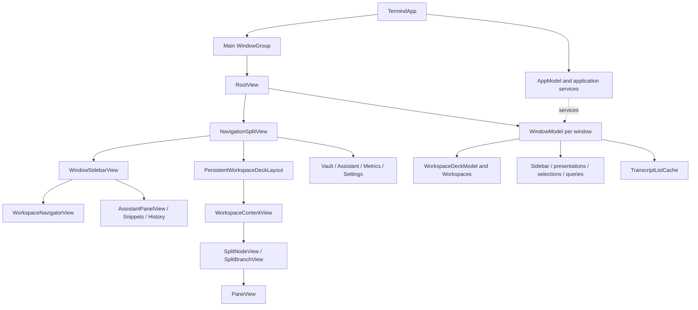
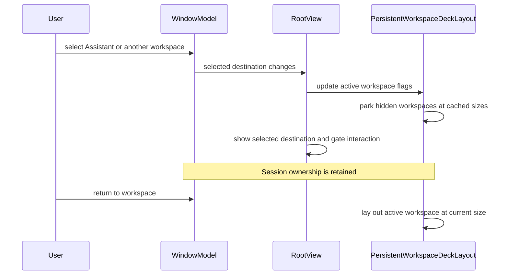
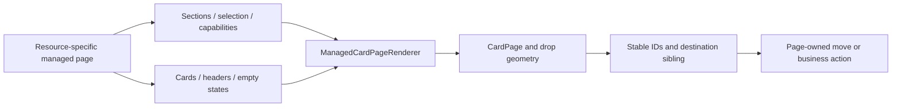

# TFM Desktop UI Architecture

TFM uses SwiftUI for composition and AppKit-backed surfaces where native identity, focus, text handling or incremental rendering matters. Its central design is **one Navigator column and one persistent detail deck per window**, not a separate horizontal tab system for every feature.

This guide describes the current implementation. See [TFI Mobile UI Architecture](/openwiki/architecture/mobile-ui.md) for the different mobile shell and [UI Design Principles](/openwiki/concepts/ui-design-principles.md) for the sharing boundary.

## Code structure: composition and ownership

Solid arrows below mean composition/ownership or routing, not necessarily inheritance. The model branch is shown separately because a view appearing in the diagram does not own every runtime it displays.

The main layers are:

| Layer | Responsibility | What should not move into it |
| --- | --- | --- |
| App composition | Persistence container, shared service graph, launch locale, main and external-authentication scenes, application commands. | One window's selected pane, query, or editor route. |
| `WindowModel` | Workspace collection, selected destination, sidebar mode, presentation routes, page selection/search state, transcript cache and connection-service wiring. | A process-global assumption that all windows share the same active session. |
| Workspace and pane models | Live session ownership, pane identity, split tree, focused pane and workspace-specific command context. | Temporary divider-drag coordinates or a view's hover state. |
| Feature views | Render projected state, present interaction, dispatch intent to owners. | Recreating connections merely because a destination appears. |
| Reusable renderers and native bridges | Collection interaction, layout, focus/native mounting, terminal/transcript presentation. | Resource-specific repository mutations hidden behind generic drawing code. |

`TermindApp` shares `AppModel` across main windows but creates a `WindowModel` for each. `RootView` exposes that model through the environment and focused scene values so commands can target the correct window. The dedicated external-authentication scene is not another normal workspace window and is removed from the ordinary scene-opening commands.

## The window shell owns chrome once

`RootView` owns the split view, the window toolbar, search host, native window registration, title reporting, Quick Open, onboarding and app-level presentation bridges. It supplies one leading creation area, a principal Metrics page picker when applicable, and one Find slot following the content in front.

The sidebar is one column whose mode rail switches between Navigator, Assistant, Snippets and History. `WindowModel.activateSidebarMode` is an **intent operation**, not just a property assignment: choosing Navigator from the full Assistant restores its prior destination, while choosing Assistant inside a workspace opens the contextual sidebar rather than hiding the terminal. Direct mode assignment remains available for presentation/restoration without these navigation side effects. History is unavailable for focused Telnet/serial sessions, and reconciliation moves away from an invalid mode.

Keep the following coordinates distinct:

- **Destination**: Vault, a workspace, full Assistant, Metrics or Settings.
- **Sidebar mode**: what occupies the one shared left column.
- **Focused pane**: the session targeted by workspace commands.
- **Presentation route**: an editor, chooser, sheet, or other transient interaction.

They influence one another, but they are not interchangeable selections. `WindowModel` remembers return destinations for reversible trips to Assistant and Settings. Page searches, selections and archive presentation are window-local, so two windows may inspect the same shared data differently.

## Persistent workspace deck: hidden is not destroyed

Every open workspace remains a child of `PersistentWorkspaceDeckLayout`. The selected workspace becomes visible and interactive; parked workspaces are transparent, disabled, excluded from hit testing and hidden from accessibility. Other top-level destinations are overlaid in front of that deck.

The layout maintains a size cache keyed by workspace identity:

1. The active workspace receives the current container size and updates its cached size when usable.
2. A hidden workspace keeps its last visible size.
3. A never-visible workspace captures the first finite, positive parking size.
4. Closed workspace IDs are pruned from the cache.

This is both a lifecycle rule and a layout-performance rule. Keeping views mounted protects terminal grids, scrollback and SFTP state; parking their geometry avoids recursively resizing every hidden split tree during a sidebar animation. Merely changing opacity would not prevent hidden views from receiving new layout proposals.

Do not replace this with an `if selected { WorkspaceContentView(...) }` that recreates the terminal hierarchy. Equally, do not let parked workspaces handle invisible keyboard shortcuts: broadcast and terminal-find shortcut owners are explicitly disabled unless their workspace is active.

The floating status bar overlays the current workspace rather than docking below it. This avoids changing the pane's available height when entering a workspace. Command-generation feedback reserves clearance above that capsule instead of competing for the same bottom edge.

## Split panes: stable identities, explicit fractions

`WorkspaceContentView` renders the model's recursive `SplitNode`: a leaf produces a stable-ID `PaneView`, while a branch produces a `SplitBranchView`. Branch geometry comes from its stored fraction rather than the divider state of a native `HSplitView` or `VSplitView`. That makes drop previews and later proportional resizing use the same model.

During divider dragging, a local preview fraction drives geometry. The gesture uses global coordinates and commits the model change once, instead of publishing the entire workspace tree for every mouse event. The divider's visible hairline and its wider hit region are separate design decisions.

Pane dragging also separates **preview** from **mutation**. The dragged branch is temporarily omitted from the preview geometry while its source view stays mounted; removing the native drag source can terminate the drag before it reaches the Navigator. The model tree changes only when the drop lands. `RootView` deliberately has no ancestor drop target that would compete with pane and Navigator targets for the same internal text payload.

## Vault and management pages

Vault management is a list/detail workspace, not a collection of unrelated sheets. `VaultWorkspaceContent` keeps the list and editor children stable across its width breakpoint:

- With enough space, the list and a fixed-width detail editor appear together.
- In a narrow detail region, the editor covers the list; the list retains its last visible size and state.
- Editor presentation animates position and reserved space, not the form's own width.

Resource pages plug into `ManagedCardPage` using typed sections, stable item IDs, externally owned selection, capabilities and page-specific presentation modifiers. `ManagedCardPageRenderer` handles the reusable interaction machinery; the page supplies business cards, section headers, drag ghosts, empty/no-results states and blank-canvas menu entries.

The renderer resolves a pointer to a section and insertion slot; it does not need to know what a Host, key or snippet means. Selection and deletion state stay with their appropriate owners. Creation belongs in the window toolbar and contextual blank-area menus rather than reintroducing a special “New” tile into each data grid.

## Assistant: route state and native rendering are separate

The full Assistant destination and the workspace's compact Assistant are different presentation surfaces. Opening a conversation in the compact sidebar does not replace the foreground terminal. Its transcript region and interaction/composer region can be composed separately, and terminal context/actions are passed deliberately.

Native transcript ownership adds another boundary:

- `TranscriptListCache` is window-local.
- Its key includes **conversation ID and surface** (`fullScreen` or `sidebar`), because one AppKit view cannot have two superviews.
- A persistent owner retains the native list, presentation state, measured row heights and Markdown-related caches while a short-lived SwiftUI mount comes and goes.
- The default LRU target is eight owners. Trimming evicts unmounted owners and protects the just-requested owner; if all candidates are mounted, it does not force their eviction merely to meet the target.

Do not merge this cache with the persistent workspace deck. Both preserve continuity, but workspaces remain mounted with parked geometry while transcripts can unmount their native list and remount a retained owner.

Escape handling is also scoped. In the compact Assistant, an approval or user-interaction form can own Escape; resolving it must not let the same key event fall through and close the conversation. The view captures the blocking-interaction state for that render before applying its back policy.

## Connection history projections and pane lifetime

Desktop connection history is shared app data with two deliberately different projections. Welcome shows recent Hosts derived only from events whose stable `sourceDeviceID` matches this installation, so synchronized activity from another Mac does not reorder the local launch surface. Its row timestamp is likewise the newest local event. Deleting a Welcome recent clears every connection-history event for that Host, across protocols and synchronized devices, without deleting the Host. The contextual History sidebar instead shows the newest 100 matching events from the complete synchronized timeline. Each row keeps the protocol in its leading symbol and resolves the source device's current display name through the app-wide `DeviceDirectoryModel`; the event does not capture a hostname. Removing a row deletes only that event, while **Clear History** clears the complete timeline.

An event follows the pane's usage lifetime rather than every physical reconnect. `WindowModel` assigns history tracking only to saved-host SSH, Telnet and SFTP panes; local Serial panes and unsaved external targets never enter this timeline. Closing a pane or workspace records `endedAt` before disconnecting its transport. Moving a live pane between workspaces preserves the same event, and reopening a closed workspace creates a new event. A process crash can leave `endedAt` absent rather than inventing an inaccurate end time.

## Desktop design principles and change checklist

The implemented patterns suggest these rules for extending TFM:

1. **One owner for each kind of state.** Shared app data, window routes, workspace sessions, native view caches and temporary gestures have different lifetimes.
2. **Preserve continuity without keeping everything active.** Park layout, disable invisible interaction, and bound expensive native caches.
3. **Make geometry predictable.** Reuse stored split fractions and stable identities; do not let an animation resize editor content incidentally.
4. **Use native desktop affordances.** Window-focused commands, keyboard equivalents, pointer selection, context menus and precise drop targets belong in the desktop composition.
5. **Keep generic renderers capability-driven.** Share interaction machinery without moving resource-specific mutation or authorization into it.
6. **Make reversible navigation explicit.** A trip to Settings or Assistant should not silently discard the workspace the user was using.

Before changing a UI owner, trace both what happens when its view disappears and what happens when the user explicitly closes its runtime. Those are different events.

## Verification map

| Change | Focused seams |
| --- | --- |
| Multi-window navigation, return routes or sidebar modes | `WindowModel`, `WindowSidebarTests`, `MultiWindowTests`, `SettingsNavigationTests`. |
| Hidden workspace layout or drag geometry | `PersistentWorkspaceDeckLayoutTests`; split/pane interaction and broadcast tests. |
| Narrow editor or Metrics detail layout | `ResponsivePageLayoutTests`, including native table identity and retained scroll positions. |
| Managed selection/reordering | `ManagedCardDropResolver`, selection and marquee tests; resource-specific move tests. |
| Transcript persistence, incremental updates or mounting | `TranscriptListViewTests`, rendering and performance suites. |
| Focused toolbar and terminal commands | `WindowToolbarFindTests`, `TerminalFindTests`, `UserInputModalityTests`. |
| Welcome Recents, connection-history limits or pane close tracking | `ConnectionHistoryTests`, `VaultSyncTests`, and workspace close/reopen tests. |

Some rendering tests explicitly require a visible window; routine checks should not enable those globally. The narrow-editor rendering cases cover English, Simplified Chinese and Traditional Chinese. This guide was derived from implementation and tests; it does not report a new test run or visual approval. Use [Build, Test, and Release Operations](/openwiki/operations/build-test-and-release.md) for the appropriate verification commands.
