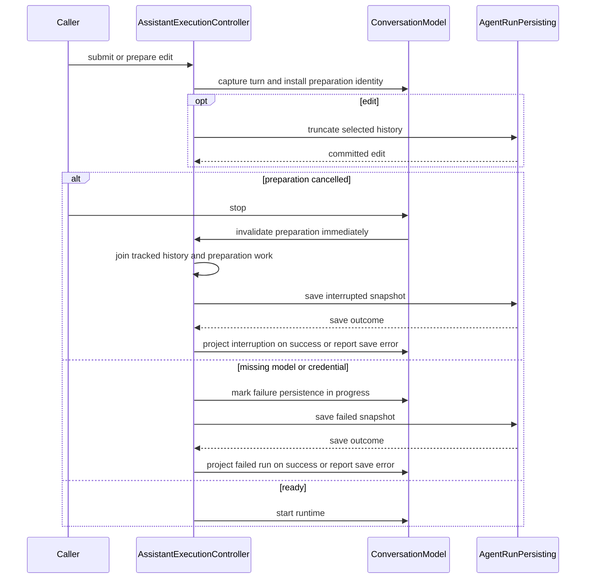
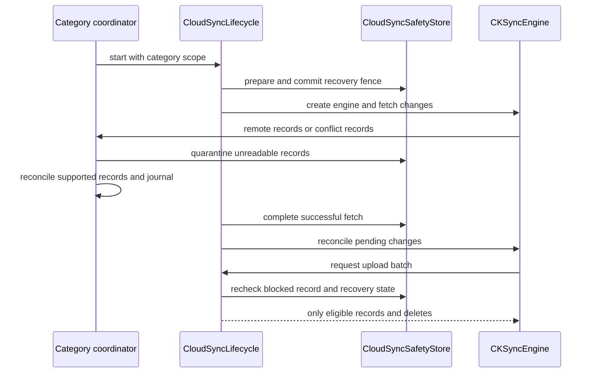
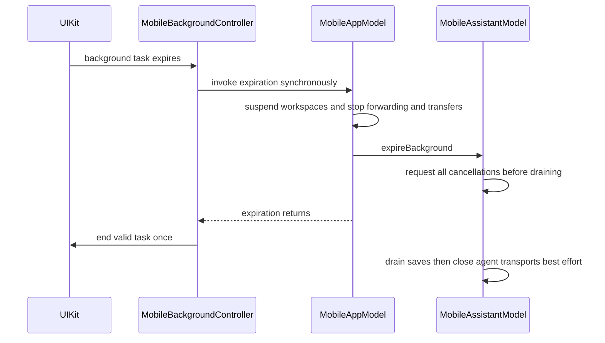

# Cross-Cutting Engineering Invariants

This is a cross-cutting change-safety guide for changes whose consequences span more than one specialized page. Source code and tests remain authoritative; when implementation intentionally changes an invariant, update the relevant focused page, this contract, and the boundary or behavioral tests together. Completed refactoring history is intentionally not retained here.

Use [System Boundaries and Dependency Ownership](/openwiki/architecture/system-boundaries.md) for layer placement, [Platform Runtime, App Composition, and Lifetimes](/openwiki/architecture/platform-runtime.md) for composition, and the linked workflow/concept pages for deeper mechanisms.

## Modules and persistence

One Xcode project builds TFM (macOS), TFI (iOS/iPadOS), separate test targets, the macOS-only `termind-mcp` bridge and
the standalone macOS `termind-port-forwarding-benchmark` tool. The benchmark depends on shared frameworks through a
narrow SPI; apps and test bundles never host or depend on it. AgentKit is a separately versioned remote package; its
sibling working tree is not the app dependency. Follow `AGENTS.md` for package releases and pinned builds.

| Owner | Responsibilities / dependencies |
| --- | --- |
| TermindDomain | Portable values/rules; Foundation, CryptoKit, AgentKit values; no UI/concrete I/O. |
| TermindApplication | Ports, feature models, connection/import policy, remote-file-system and sync/outbox use cases; Domain, AgentKit. |
| TermindInfrastructure | In-memory repositories, metrics parsing, StoreKit, Vault/History/Settings/Metrics CloudKit; Application, Domain, Persistence. |
| TermindRemoteInfrastructure | SSH/SFTP/Telnet, Keychain, keys, sampling, forwarding, transfers, scoped imports; Infrastructure, Application, Domain. C libraries stay outside portable framework tests. |
| TermindPresentation | Reusable SwiftUI policy/content, Ghostty themes, `TerminalPreferences` bridge; Application and Domain only. Its own import ban is stricter than the non-presentation shared-framework rule. |
| TermindPersistence | All SwiftData models, historical schemas, V40 live schema, migrations and container construction; no app dependency. |
| TFM / TFI | Native UI/adapters/lifetimes; shared modules never import apps. |

- Use direct owner imports/public APIs, not re-exports, forwarding aliases, `Shared` types or a generic Core module.
  Shared resources enter both app bundles; icons, metadata and signing remain platform-owned.
- Define app-facing copy as `LocalizedStringResource` under `Frameworks/TermindPresentation/Strings`, even for a single-platform
  surface. Both apps reuse semantic `AppStrings` entries and shared formatting; platform-specific wording uses explicit
  variants. Keep protocol values, identifiers and diagnostic codes with their existing owners. The string catalog remains
  in `Frameworks/Resources/Localizable.xcstrings`, not in the framework bundle. See
  [Commerce, Localization, and Product Surfaces](/openwiki/concepts/commerce-localization-and-product-surfaces.md) for
  display-time resolution and the copy checks.
- Moves preserve entity identity, fields, defaults and historical semantics. Original-module V1/V14 fixtures guard
  migration. `makeContainer` fixes the complete V40 schema/plan; one container per process serves all scenes. Never
  recreate a failed store silently: macOS fails startup on store error, while iOS displays a store-open failure view.
  macOS retains its `Termind` location; mobile uses Application Support/in-memory
  tests. Both apps share the CloudKit container and bundle-derived Keychain access group.
- `ArchitectureBoundaryTests` enumerates Swift files and fails closed on absent/empty roots. The non-presentation shared-framework import test covers Domain, Application, Infrastructure, Remote Infrastructure and Persistence: none may import `Termind`, `TermindIOS`, AppKit, UIKit, IOKit or ServiceManagement. Its additional Application check excludes Infrastructure, Persistence and SwiftData, and Persistence cannot import Infrastructure or Remote Infrastructure. **Presentation is checked separately**, against app modules, AppKit/UIKit, SwiftData/GRDB, Persistence, Remote Infrastructure, Infrastructure and StoreKit. Do not attribute Presentation's broader ban to every shared module, or assume an unlisted import is tested. Domain and Application have additional implementation-framework import checks; app Application/Feature layers and mobile UI are checked separately for direct I/O/storage dependencies and selected concrete construction tokens.
- The source tests also constrain `ListViewKit` importers to a native-list allowlist, prevent selected AgentKit type redeclarations in TFM, and look for SwiftData `@Model` and repository declarations outside Persistence. They reject an app-local `AppStrings` declaration and prohibited imports within shared Strings; dialog-title scans reject bridging a `LocalizedStringResource` to `.swiftUIKey` in `.alert`/`.confirmationDialog` titles instead of passing the resource directly. Every CloudKit `CKSyncEngineDelegate` writer (including the shared History/Device delegate) must use lifecycle batch/upload gates and remote decode/quarantine/conflict handling; there is no read-only legacy History importer exception. These are syntactic boundary guards, not behavioral proof; see [System Boundaries and Dependency Ownership](/openwiki/architecture/system-boundaries.md).
- App-copy changes require explicit keys and finished `zh-Hans`/`zh-Hant` translations in both manually managed app catalogs, `Localizable.xcstrings` and `InfoPlist.xcstrings` (bundle metadata). Do not delete a key because Xcode marks it `stale`: extraction from one target cannot establish non-use in both apps. Normalize with `Scripts/normalize-string-catalogs.py --write` after editing, then run `Scripts/check-appstrings.sh` and `Scripts/check-zh-localization.sh` (the latter checks canonical formatting, catalog validity, completed translations and spacing). Keep `STRING_CATALOG_GENERATE_SYMBOLS = NO`; `AppStrings` owns the API. The SwiftSyntax copy check detects selected UI-literal patterns in TFM/TFI, not every literal, semantic reuse or runtime presentation; use `PresentationCopyTests`, `AppLanguageTests` and platform rendering tests where applicable. AgentKit's own copy/catalog is a separate release boundary.
- The **test host is the real app**, not a generic logic runner. In DEBUG, `TermindApp` detects XCTest, uses an in-memory container, suppresses automatic main/auth windows unless `TERMIND_WINDOW_TESTS=1`, and disables restoration for tests; screenshot demo has its own exception. Ordinary offscreen tests run without focus. Window/focus tests carry `.requiresVisibleWindow` and must opt in with `TEST_RUNNER_TERMIND_WINDOW_TESTS=1` (forwarded as `TERMIND_WINDOW_TESTS=1`); manual StoreKit tests use `TERMIND_STOREKIT_TESTS=1`. Mobile uses testing dependencies in its real `TermindIOSApp` scene, while key-window suites use `TEST_RUNNER_TERMIND_MOBILE_UI_TESTS=1` and `-parallel-testing-enabled NO`. Do not solve flaky host windows by enabling them for the default suite.
- V31 adds scoped quarantine/recovery models. Released V31 stores migrate directly to V34; V32/V33 were not distributed
  schema endpoints. V34 replaces Host, connection-history and Identity models, adds device-directory and Workspace
  preference models, and backfills history with the installation ID plus its initial DeviceRecord. Local schema changes
  do not change the independently versioned CloudKit envelopes. V35 adds History journal/state, an **historical** scoped
  importer checkpoint and decode-capability checkpoints without rewriting V34 models. The live V40 schema passes through
  V36 (drops the retired importer checkpoint), V37 (cloud presence/physical deletion state), V38 (delete-handoff and
  asset-cleanup state), V39 (device-local Assistant model selections) and V40 (removes retired per-category quarantine tables,
  retaining scoped quarantine). `HistorySyncPersistence.prepare()` now bootstraps from native local History and Device rows, not
  the old Vault-to-History importer: V31/V34 reopen tests verify retired Vault history journal entries are not imported,
  and V35 reopen tests verify existing native device/history journal data survive without an importer table.

## State, navigation and editing

### Saved values

- Single-line presentation normalizes newlines only on edits; paste adapters act before native controls flatten
  breaks and rename editors preserve marked text. Reads, multiline content, secrets and validation stay unchanged;
  no bulk cleanup/migration.
- Domain optional-name defaults serve hints and saves: Host address, Identity username, key algorithm, Host plus SSH
  argument, provider protocol or model ID. Missing sources yield empty hints. Nonempty names remain stored; clearing
  requests a fresh default. Legacy blanks materialize on the next local save in its existing transaction.
- Desktop autosave uses page-owned buffers; reopening shows saved values. Mobile provider drafts merge raw names
  before defaulting at Save: explicit clearing conflicts with a concurrent rename, unlike legacy blank-to-default.

### Windows and sessions

- Desktop `AppModel` coordinates saved Hosts, settings, transfers, sync, Assistant conversation storage and process services; registered `WindowModel`s own their Workspaces and navigation/search/context panels. The app holds weak window registrations and routes Host opens into the selected window. On mobile, `MobileAppModel` owns process services, the complete Workspace descriptor snapshot and a registry of `MobileWorkspaceSessionModel`s. Each native scene session owns its ordered live Workspaces and saved descriptors through that model; `MobileSceneModel` owns the destination, selected Workspace and Assistant navigation. Workspace links activate the existing native owner rather than opening a duplicate in another scene. App-wide snapshots/preferences and `VaultStore` transactions feed narrow feature intents; sessions receive only `RemoteSessionHostStore`. Paywalls stay pinned to one window; speech belongs to one composer.
- New desktop windows start at Welcome; Dock reopen preserves destination and Metrics entry selects Metrics. Dock
  New Window uses the registered factory and activates hidden/windowless apps. Restoration never reconnects live
  Workspaces. New windows snapshot ordinary content size once, after full-size content styling; fullscreen/auxiliary
  windows cannot replace device-local last size. System-restored frames/positions win; tests use in-memory sizing.
- Quick Open claims focus only after mounting in its active window; close retires requests. It releases toolbar Find
  and suspends terminal autofocus. Batch Startup's SSH option opens selected preferred terminals or SFTP Hosts as panes in
  one new Workspace; each Host resolves independently with SSH preferred over Telnet.
- Command-W closes the focused pane, removing empty Workspaces but retaining the window; otherwise dismisses natively.
  All window-close paths confirm if that window owns any Workspaces, even hidden/disconnected. Shift-Command-W requests
  window dismissal. Clearing document-edited decoration must not change confirmation/delegate behavior.
- Moving a Workspace between registered windows preserves live panes/transports/splits/state, without close history.
  Pane title drags, and native Workspace List drags on macOS 26+, can create a new window after an unaccepted release
  outside the source window. Escape and accepted drops do not create a window. Ownership transfers only when the
  destination's native window registers; native close disconnects only owned sessions and cancels pending moves.
  Independent transfers/services survive. Mounting never repeats authentication; explicit retry/reopen may.
  Preserve the source and receiver contracts in [TFM Drag and Drop](/openwiki/workflows/desktop-drag-and-drop.md).
- Desktop Vault/Assistant, Metrics, dynamic Workspaces and Settings routes are window-local. Settings data is app-wide;
  closing it restores the replaced destination. Width changes may adapt panels, never routes/editor identity/session
  composition/monitor ownership; covered panels retain last size, native table identity, sorting and scroll.
- `AssistantLibraryModel` owns standalone conversations, not panes. Workspaces own SSH/SFTP/serial panes and session
  conversations; sessions own transports/terminal/browser state. Ordering/pinning commits metadata before publication
  and preserves instances during runs/approvals/compaction. Archive/delete keep run guards; archived chats cannot move.
- Connection/authentication/forwarding state is memory-only, excluded from domain records, sync and UserDefaults.
  Serial is local/temporary, never persisted or an Agent host. Vault-synced Workspace templates contain named
  SSH/SFTP/empty split trees/fractions; only TFM materializes them, preserving empty panes for missing Hosts.

### Trust, imports and local preferences

- Known Hosts is independent of Host records: editing/deleting a Host never changes trust. Plain and OpenSSH `|1|`
  hashed endpoints share matching; hashed records retain wire hostname and ignore the separate port.
- Saved-Host deletion is a durable request, not an immediate cascade. `SwiftDataHostRepository.requestHostDeletion` commits the pending-deletion marker, ordered outbox jobs, revision and Vault mutation together; snapshots hide the marked Host before physical removal. The outbox runs Workspace close, transfer cancellation, forwarding stop, reference/history cleanup and final Host/owned-Identity removal. Repository cleanup retries after interruption; do not replace it with only an in-memory UI removal. Desktop `AppModel.requestHostDeletion` projects the Host and clears local histories after the request succeeds; its registered runtime/outbox callbacks revoke live work. Mobile `deleteHost` also proactively disconnects Assistant and closes current and unopened Workspace entries, invalidates edits/transfers/forwardings and removes Metrics before requesting deletion, then starts its outbox. This mobile preflight is not the durable commit: an unsuccessful request returns an error, not a guarantee of restored live sessions. Remote Vault removal has its own runtime invalidation path on both platforms. Focused checks: `TFMTests/RepositoryOutboxTests.swift` for marker/jobs/reference and trust behavior; `TFITests/MobileAppTests.swift` for both current and Recent entries.
- SSH import previews are window-owned indexed public metadata. Host selection never selects credentials; imported
  identities require selected keys. The actor retains scoped descriptors/digests, not private-key text/passphrases;
  reread selected keys at unlock/commit and fail closed if changed. Picking/drop share validation; config parsing
  executes nothing. Create credentials before one Vault save, clean up failure, and never overwrite records.
- macOS appearance/language are local; System appearance clears `NSApplication.appearance`. Login launch reads
  `SMAppService`, not mirrored preferences; quiet launch hides the app without suppressing its window. Mobile uses
  Apple's per-app language settings without an injected locale override.
- Hosts group, Snippets package and both Ungrouped expansion states are device-local and survive relaunch without
  entering Vault persistence or sync. TFM's compact Snippets sidebar keeps a separate device-local expansion state.
  Legacy synced expansion values seed each installation once; new groups and packages start expanded.
- Debug visibility/logging are device-local/default-off for saving. Inject SwiftLog `Logger`; no process-global
  bootstrap. Infrastructure owns one locked writer/file per launch: disable closes but preserves, re-enable resumes,
  deletion recreates only when enabled. No retention policy or in-app viewer. Debug stderr uses the same sanitization.
  Log stable English codes/non-sensitive metadata, never credentials, prompts, identities/paths, remote output, process
  names or raw errors. Metrics always logs received byte size; capped incomplete/oversized diagnostics redact addresses.

## Remote sessions, terminals and files

### Connection and authentication

- SSH/SFTP/mobile Workspaces/Metrics share preparation/recovery policy. Host-key approval occurs inside the actual
  socket/libssh2 handshake-to-auth attempt, never a discovery connection. Generations reject retired callbacks,
  credential results and timers.
- Host-key constraints are declarative request data enforced at the transport boundary before interactive approval.
  A matching Known Hosts key bypasses the authorizer; a provisional External Link fingerprint may reject but never
  establish or override persistent trust. Unknown keys still use the shared MainActor authorization coordinator for
  one pending decision, cancellation, Continue Once and Trust and Continue; feature models retain their own Journey
  and retry lifetimes.
- Every resolved Password, software Private Key, Key Passphrase and proxy Password is one-shot per physical connection
  attempt. Runtime copies share one explicitly owned, non-copy-on-write allocation; source `Data`, proxy frames and the
  allocation are overwritten before release. The transport clears it after the authentication call and every success,
  failure and cancellation boundary clears it again. UI submissions move plaintext into that one-shot owner before
  leaving retry state; retry/session/Agent/Metrics/transfer state retains only reentry flags and non-secret Identity/Key
  provenance. Saved material is reread from Keychain for another physical connection; temporary Passwords and every
  Passphrase must be entered again. UI authentication fields clear synchronously on submission. Availability checks query
  Keychain metadata without reading secret data; the legacy software-Key JSON envelope is parsed strictly and fails closed.
- Saved iCloud Passwords and software Keys cannot be moved to device-only storage: editors disable that destination and
  application writes reject it before touching Keychain. New credentials may start device-only, and device-only credentials
  may move to iCloud. New Key and Identity storage pickers default to iCloud only while the master iCloud switch, Vault
  selection and Pro access are all enabled; otherwise they default to this device. Existing credentials keep their storage.
- A Host may own separate hidden Custom SSH, Telnet, SSH proxy and Telnet proxy Identities. They sync as Identity records but are
  excluded from reusable Identity lists, cannot be shared or copied to another Host, and are deleted with their owner Host.
  Custom Passwords start device-only while Vault sync is off and migrate once to iCloud when it becomes enabled; they never
  move back to device-only storage. The selected SSH Key remains an independently owned shared Key.
- Secret editors load an available saved value into a masked field. Clearing that field is the delete intent; reveal state is
  UI-only and resets when the field disappears or the app resigns active. Plaintext must never enter logs, sync, defaults or
  persistence, and unavailable remote credentials remain protected from replacement or deletion.
- Editors whose saved Password or software Private Key is unavailable on the current device preserve its reference and
  disable secret replacement, removal, passphrase and storage changes while still allowing public metadata edits. Key
  metadata-only saves may update the SSH certificate after validating it against the saved public key, without reading or
  writing the missing credential. Secure Enclave Keys retain their existing metadata-only editor.
- New AI Provider keys, Vertex service accounts and remote MCP tokens use iCloud Keychain only after both the master iCloud
  and Settings switches are on and account/merge authorization completes; otherwise they use device-only Keychain. Once a
  reference has entered iCloud it stays there even if either switch is later disabled.
- Desktop SSH/SFTP submission uses `RemoteSessionHostStore`: explicit password wins; custom input never borrows an
  unselected Identity password. Only explicit input changes selected credentials; custom input reuses the Host Identity.
  Identity/secret writes precede separate Host association. Keep temporary credentials, validation/passphrase ordering,
  transient Hosts and reconnect state session-owned.
- Keyboard-interactive uses the same opener for PTY/exec/SFTP/forwarding/key installation/jumps. C callbacks wait only
  on the transport queue for cancellable async responders showing literal server prompts/echo flags. Request IDs isolate
  rounds; answers are ephemeral, never autofilled/cached/logged/in Agent history. Empty answers are valid; zero prompts
  need no form. Waiting excludes network timeout; cancellation wakes the callback, cancels responder and interrupts open.
- User sessions own challenge queues; Agents use interaction queues. Desktop external auth separates app/MCP origins;
  stopping MCP preserves app requests. Mobile has no app auth sheet. Forwarding/Metrics own Journey challenges, never
  external-window fallback.
- Terminal drops/additional transfer and forwarding connections forbid password/passphrase/MFA/trust forms and system
  user-presence authorization (Touch ID or device password) throughout the route. Reusable snapshots freeze target,
  Jump Host and proxy network data but retain authentication only as Identity IDs, plus a Key ID only when no Identity
  exists. Each silent open resolves the Identity's current username/password/Key from Vault and Keychain. Protected Keys
  are skipped before their secret is read; password and other noninteractive methods remain eligible. Passphrases and
  temporary passwords never enter reusable snapshots. Username-only/SSH `none` remain eligible. Cancellation interrupts
  opening. A terminal drop tries an independent SFTP preflight when durable references are available; any non-cancellation
  failure falls back to SFTP Channels on the already authenticated PTY connection without presenting a form.
- A proxy is transport detail, not a Journey endpoint. Its connection, authentication, failure and retry remain on the
  preceding endpoint (Local for the first Host, otherwise the previous SSH Host); only the next Host's SSH connect advances
  the route. Missing local proxy passwords and explicit HTTP/SOCKS authentication rejection use the same local
  authentication surfaces across sessions, Metrics, forwarding, Assistant and external MCP requests. Proxy submissions are
  separate from SSH submissions; snapshots retain only proxy network data, username and Identity ID. An Identity whose
  password lookup is missing or failed opens as Custom with the inherited username; if manually reselected, neither
  Continue nor Save and Continue is available until the user returns to Custom or selects a usable Identity.
- Username-only Identities try `none`, then advertised methods. Device-local `lastUsedAt` tracks successful saved-secret
  reads, not authentication. Batch route reads; missing/availability/edit reads do not count. First access per Identity/
  process writes directly without Vault journal/refresh; sync strips this field and preserves local values on apply.
- Exporting several authorized Keys resolves credentials immediately before work, authenticates once per Host and opens
  one exec Channel per Key on that connection. Local validation completes before the remote account is changed.
- Welcome parses bounded SSH grammar without shell/OpenSSH config execution. Exact aliases supply metadata; overrides
  create session route snapshots, never replaced with saved endpoints. Routes cap at eight Hosts and reject cycles.
  Connect saves nothing. Explicit Save copies changed records/prerequisites in one Vault transaction, rolling back new
  passwords on failure; originals remain unchanged. Host-key decisions stay in the live handshake.
- External `ssh:`, `sftp:` and `telnet:` URLs create one process-only Host and Workspace on both platforms. They reuse
  Known Hosts only: never saved Host/Identity/proxy/jump metadata, history or restoration. SSH/SFTP URL passwords and
  SFTP text mode are rejected; RFC 4248 Telnet credentials are confirmed and consumed once. A legacy URI MD5 host-key
  fingerprint is an additional handshake constraint, never sufficient trust and never persisted; unknown hosts still
  show the SHA-256 trust form. SFTP v3 stats the URL path, opens directories, previews ordinary files and requires an
  additional user action for executable content on macOS.

### Port Forwarding

- Independent Vault library/rules, outside Host drafts, with rollback-safe save/delete and saved names unaffected by Host
  rename. V20 freezes earlier entities and adds palette color. UI selection/editor transitions do not own connections or
  challenges. Start/retry is single-rule only; no bulk start. Only explicit actions create running intent.
- macOS Hosts may allocate one to 64 physical forwarding SSH connections; the default is one. Local and SOCKS rules
  share the Host pool and dispatch each accepted TCP flow to the least-loaded healthy worker. Remote listeners use one
  worker. iOS preserves the synced Host value but always runs one connection. Pool size is snapshotted at first Start.
- The first connection owns Journey and interactive authentication. Auxiliary connections use refreshed durable trust and
  the authenticated in-memory configuration with forms forbidden; once-only trust/MFA answers never authorize them. At
  most four opens run concurrently. Transient worker loss retries after 1/2/5/10/30 seconds; interaction-required auxiliary
  failures leave a degraded pool. Old TCP streams never migrate or replay.
- Stop one rule without disturbing peers. Last stop cancels opens/prompts/retries and releases credential snapshots.
  Expiration/termination stop resources; Host/route edits and rule replacement stop affected runs. Generations reject stale
  opens/listeners; replacement awaits cleanup. A pool-level listener owns each local bind and pauses when no worker is
  healthy. Disconnect completes after source-cancellation descriptor closure. Local/SOCKS use SO_REUSEADDR for TIME_WAIT,
  never SO_REUSEPORT/live shared binds.
- One serial owner per libssh2 session across PTY, exec, SFTP, jump bridges and forwarding. Readiness, deduplicated FIFO and
  bounded fair passes replace bulk polling; Metrics and user SSH use `SSHSingleChannelAdapter` without a topology scheduler.
  Preserve immutable write buffers across EAGAIN, drain half-close, bound queues/DNS/connect deadlines and retain
  session-wide pending operations. Slice deadlines include callbacks/inner loops; protocol progress wakes peers.
- Every authenticated SSH connection has one FIFO Max Sessions budget shared by its PTY, exec and SFTP Channels.
  The synced Connections preference defaults to ten and may change from one to 100; lowering it never closes active Channels,
  and new work waits until capacity is available. Direct/forwarded TCP Channels, remote listeners and jump-host bridges are
  forwarding rather than sessions and never consume this budget.
- Public send/receive adapters accept complete encrypted packets and apply bounded backpressure outside library calls,
  avoiding pinned libssh2's lost forwarded-tcpip confirmation on EAGAIN. Teardown discards writes/returns EOF; descriptors
  close after cancellation handlers. See [Port Forwarding Benchmark Design, Results, and Reproduction](/openwiki/operations/port-forwarding-benchmarks.md) for budgets, rationale and measurement
  limits; buffers are per flow/session, never a global memory cap.

### Terminal behavior

- A Host shares its address and organization metadata across terminal protocols, while SSH and Telnet retain independent
  enablement, port, Identity, Charset and Proxy configuration. At least one protocol must be enabled. Existing stores migrate
  to SSH enabled/Telnet disabled, preserving the prior port, Identity and Charset as SSH values. Disabling SSH preserves all
  SSH-owned configuration and references while making SSH-only work unavailable; it never reroutes that work through Telnet.
- Telnet is a direct or independently HTTP/SOCKS5-proxied TCP terminal with incremental IAC negotiation, NVT line handling,
  TTYPE and NAWS. Its manually selected Charset is authoritative; Telnet control frames bypass text conversion. Telnet has
  no Shell Integration, command History, command generation, working-directory actions, SFTP, or terminal drop upload.
- Application owns the common Host use-case eligibility policy. Metrics, Port Forwarding, SFTP, Jump Hosts, Snippet batch
  execution and Key Export require SSH at both picker and execution boundaries. Agent `list_hosts` remains a protocol-neutral
  catalog and reports every enabled protocol per Host; SSH/SFTP tools independently enforce SSH availability.

- Host environment variables are ordinary Vault-synced, non-secret configuration. Interactive SSH PTY Channels send
  them as SSH environment requests before starting the shell on every connection and reconnection. Server rejection is
  non-fatal and reports variable names, never values, in local terminal output. Exec, SFTP, Metrics, Agent, forwarding
  and background probe Channels never inherit them; there is no shell-command fallback.
- Independent SSH and Telnet Charsets are Vault-synced and snapshotted by each connection attempt. SSH Charset covers
  PTY text, exec commands/output and SFTP path names; Telnet Charset covers application bytes after IAC/NVT processing.
  File contents and raw command input remain byte-transparent. Invalid terminal or Serial stream sequences are discarded
  with one session-visible error, while exec and SFTP operations fail before returning replacement text or mutating a
  different path. Serial Charset is temporary session configuration.
- SSH worker owns PTY dimensions; retain latest valid authentication-time size/pixels. EAGAIN window-change packets keep
  original dimensions and finish before the newest request without blocking other I/O. Disconnect clears resize state;
  retired auth cannot install a PTY/clear replacement dimensions. Ghostty computes grid. Resize failure is diagnostic only.
- Application owns `TerminalCommandDraftController`, `CommandGenerationCoordinator` and `TerminalFindController`; apps
  provide context/validity/insertion. Generated commands are inserted, never submitted.
- Font family/size/follow-theme-size are device-local, outside `TerminalPreferences`, Settings journal and CloudKit. Seed
  missing local size from pre-upgrade local data before remote materialization; existing mirrors win. Ignore legacy remote
  font fields and omit outgoing fields. Themes/custom text (including authored fonts) still sync. Missing fonts fall back
  without deleting choice. Apply local overrides after theme/custom commands, resetting family lists; update surfaces in place.
- Shared `TerminalFontFields` binds local typography with an 8–36 point editing range, a macOS slider and an iOS stepper;
  merely presenting the controls does not normalize saved sizes. Font discovery/refresh stays app-owned: a family qualifies
  when any loadable member is monospaced, with localized ordering rather than a shared AppKit/UIKit adapter.
- Shared theme options are appearance-filtered and name-sorted. Keep unavailable or wrong-appearance saved names as picker
  selections and show the actual fallback; opening Settings must not replace or persist them. Rendering uses the matching
  Termind default, then custom commands, then local typography. Base-theme selection remains editable with custom commands
  enabled, since commands overlay only their specified keys. Save/remote-apply and native terminal lifetimes stay with their owners.
- Desktop copy-completed-selection/right-click-paste default off and sync in the terminal record; mobile preserves without
  exposing/applying. Keep native surfaces. Copy only local completion; paste once on release through Ghostty clipboard/input
  capture. Remote mouse/Option-right-click stay Ghostty-owned; mouse reports never broadcast. Empty paste arms no capture;
  bracketed-paste classification spans chunks through terminator/ticket expiry.
- Host Shell Integration is Vault-synced Default/Enable/Disable (V22, older Hosts frozen). Each SSH attempt resolves destination
  override/global once before auth for bootstrap/History/generator/system info/directory actions. Live edits never inject or
  reconnect; new reconnects resolve again. Mobile integration/exit uses one ordered MainActor consumer retired on close/
  reconnect/expiration. Prompt markers are idempotent; Bash DEBUG excludes `__termind_*` helpers from History/busy state.
- Host Startup Snippet is a Vault-synced optional Snippet ID (V26). Every interactive SSH shell resolves the current body and
  submits it once at the authenticated prompt boundary, including automatic reconnects; explicit launch commands override only
  until submitted. Missing/empty Snippets are no-ops. SFTP, forwarding, Metrics, Agent and route connections never run it.
- History starts after authenticated start, retains optional remote status/duration (never receive-time inference), normalizes
  backslash continuation only and caps at the shared 250 rows/Host. Both UIs show first line plus ellipsis.

### SFTP and external edits

- Domain owns `RemoteFile`, Application `RemoteFileSystem`/`MobileSFTPChannelModel`, Remote Infrastructure libssh2 protocols,
  Presentation symbols/kinds. Device-local History changes only after fresh successful listings/downloads, never stale/failed/
  cancelled/type-changed work.
- `SFTPClient` is the connect/disconnect facade and owns its authenticated `SSHConnection`; `SFTPChannel` is the sole
  file-operation implementation. Standalone SFTP, Agent primary SFTP and terminal fallback therefore
  share Channel open/close/EAGAIN, atomic-write, resume, edit, streaming and copy behavior; feature owners retain their distinct
  authentication, pooling and retirement lifetimes.
- Generation-scoped `SFTPTransferContext` outlives panes. SFTP data work resolves one topology per admitted file: Channels Only
  opens sibling SFTP Channels, Connections Preferred silently probes the full route and falls back to siblings, and Smart uses
  Channels through 64 MB/64,000,000 bytes (including unknown sizes) before preferring connections. A failed silent probe degrades later work
  without replaying active operations; cancellation caches no failure. Browser control Channels stay independent. Terminal
  preflight donates a successful independent connection; only failed preflight uses the terminal's multiplexed PTY/SFTP
  libssh2 owner and fixes that generation to Channels. Closing the PTY does not retire transfers holding that transport.
  Durable trust refresh never promotes once-only trust.
- Desktop terminals accept process-local SFTP browser drag payloads and stream remote items directly into the shell's
  current directory through the remote-copy scheduler; they never materialize the provider's promised local file.
  Same-Host copies reject a source copied onto itself or into its own subtree before conflict resolution can mutate it.
- One process scheduler covers Workspace/terminal/edit transfers and Agent data operations. It defaults to 30 active files/ten
  per Host.ID (ranges 1–100 and 1–min(50, global)), rotating Hosts then Workspace/Agent-run/batch sources while retaining FIFO
  within a source. A Channel and an independent connection consume the same logical-file capacity. Cross-Host copy consumes one
  global slot and one slot on each endpoint Host. Browser and Agent metadata/control operations do not consume data slots.
  `SFTPSettingsModel` scheduling outlives Settings; new limits/topology affect queued work only. Pane close releases only its
  ownership; queued work retains the primary connection, paused work configuration/checkpoints but no connection.
- Checkpoints, references, acknowledged offsets and digests are memory-only. Pause/loss retains partial destinations; explicit
  resume verifies source/prefix. No ordinary staging/bookmarks/restart recovery or silent replay. Cancel/Host delete removes
  partials and reports failed cleanup. Mobile expiration pauses upload/download, cancels copies; desktop quit allows three seconds.
  Same-connection copies alternate bounded reads/writes, validate size/metadata/EOF and atomically commit temporary files.
- Shared planners retain directory-only batch destinations/mutation counts. In-app SFTP-to-SFTP drag/copy consumes the private
  remote payload before asking for its Finder file promise, streams directly between clients without local staging, and exposes
  exactly one `.copy` queue row per regular file. Apps own UI, cancellation/errors/refresh and deletion.
  `SFTPRemoteConflictResolver` validates recursive child paths, subtree mapping/Keep Both: upload blocks strict descendants; copy
  also blocks conflicting root. Desktop context menus snapshot reconciled selection; appearance never mutates it.
- Terminal drop preparation is cancellable/generation-scoped; late results cannot enqueue. Nonmodal notices cannot replace same-batch
  failures. Native browser alerts/conflict choices stay app-owned.
- One process-local Application external-edit model outlives browsers/Workspaces. Remote Infrastructure owns managed copies, streamed
  SHA-256, atomic-replacement observation and immutable upload snapshots. Upload is explicit; paused edit uploads retain staging until
  terminal completion. Dirty-only cards do not own edit lifetime; clean records remain reusable.
- Discard stops tracking but preserves local copy; next Open downloads anew. Running/preparing uploads cannot discard; paused uploads
  cancel/clean first. Desktop Keep Local Copy uses save panel/coordinated copy, not ShareLink, and checks edits before quit. Mobile
  promises no quit warning/restart recovery; paused uploads need explicit resume.
- Validate original kind/size/mtime/mode before write and rename, preserving permissions. Overwrite uses POSIX rename, falls back only
  if unsupported, never unlinks original on failure; non-overwrite never uses POSIX overwrite. This is best-effort, not atomic CAS.
  Missing/changed metadata needs confirmation; nonregular destinations fail closed. Acknowledge only uploaded snapshot digest so later
  saves remain dirty. Host removal/route edits invalidate records but preserve copies. All regular files use SHA-256.
- Native Quick Look/Open With remain app-owned and reuse managed copies; macOS invocation choices never change defaults. Mobile rejects
  retired/background late presentations but preserves active handoffs across deactivation. Same-format imports target valid nonbusy edit
  records, retain remote baseline and mark dirty; ordinary upload/conflict policy commits.

### Agent/MCP byte channels

- Agent SSH and the primary Agent SFTP subsystem share one pooled Host transport and one fair libssh2 owner; concurrent exec and
  SFTP work use separate Channels on it regardless of which tool connects first. Agent SFTP data work shares the process SFTP
  scheduler and resolves Smart/Channel-only/connection-preferred topology by the synced preference; metadata/control calls use
  Channels without consuming data capacity. Connection-preferred work may add silent SFTP transports, which retain the same
  180-second idle pool across conversations/MCP and fall back to Channels on the shared primary.
  `sftp_copy` belongs to Agent SFTP: regular trees to existing directories, browser conflict/merge policy and preserved sources.
  Cross-Host copies take two ordered endpoint leases; same-Host copies use two leases for Connections Preferred and one SFTP
  Channel for Channel-only/Smart-unknown work. Active exec/SFTP leases block idle sweeping; background commands
  retain only their Channel, not the whole transport. Started operations never replay. No model bytes/staging/scratch.
- macOS MCP exposes the same definition; Bearer/tool switches/Full access remain boundaries, auth uses external interaction. Stop awaits
  copies. Audit metadata/counts/endpoints/policy, never bodies. Stdio only forwards protocol; mobile has no local MCP listener.
- Separate loopback HTTP upload/download capabilities are ten-minute, session-bound 256-bit secrets for Host/path/intent, in headers only.
  Authenticate/atomically claim before body/network work. Ordinary MCP retains Bearer/4 MiB cap. Dedicated HTTP-neutral streams/leases use
  backpressure, no staging/scratch. No directory overwrite; failed cleanup reports temporary path.
- Upload commits only after exact length/incremental SHA-256. In-memory resume uses acknowledged remote offset, matching `Upload-Offset`
  and suffix Content-Length; reject parallel claims, verify prefix, never replay committed bytes. Lost responses cannot undo commit.
- Download ticket creation does no remote I/O. GET regular files only, no HEAD/bodies/query credentials; one `Range: bytes=N-` uses client
  saved length. Invalid range returns 416 without consuming ticket; resume rereads/verifies prefix/metadata before headers. Dedicated
  worker owns handles/queue; FSTAT fixes length and EOF revalidates bytes/size/mtime, not an atomic remote snapshot.
- Download pulls at most 64 KiB after each send. Success requires source validation, sent completion, checked close and lease release.
  Pre-header errors use safe JSON; post-header errors close without appended JSON. Clients must poll status and verify local size/hash;
  HTTP 200/Content-Length alone proves neither success nor persistence.
- Shared metadata/expiry policy, separate directional state/claims/errors/ordering. Four active slots, each direction at most 64 unfinished
  and 256 terminal records for thirty minutes. Live work blocks idle expiry; completion remains queryable. Disconnect/recoverable SSH
  failure pauses; explicit revocation cancels. Resume needs original active session/unexpired capability; exit loses both. Generation IDs
  reject old callbacks. Host/session retirement, stop/token rotation/direction disable revoke; release capacity after cleanup. Audits never
  include bytes/tokens. Upload expiry may clean partials; download allows valid Range after success.

## Callback isolation

Speech and service state is MainActor-isolated, external callbacks are not. Create explicitly Sendable callbacks in nonisolated factories;
actor-inherited closures can trap before dispatch. Recheck recording tokens after authorization. iOS realtime audio taps use nonisolated
factories/Sendable buffer handlers. Timers/workers enter explicit short MainActor methods; remote I/O remains async/detached.

## Agent runtime and security

Preparation has distinct cancellation and failure-save phases; `stop()` requests the first path but does not await the repository.

### Providers

- Empty credential reference means anonymous; nonempty missing/empty/unreadable secret is an error. `modelSecret(for:)` applies consistently
  to discovery/probes/Chat/Guardian/title/compact/generator/Memory. Anonymous requests neither read secrets nor inherit unrelated errors;
  providers omit empty auth headers. Vertex requires its own service account/project/location.
- Name/URL hints are not prefilled input. Application materializes blanks at save: Automatic uses full OpenAI Responses URL; explicit
  protocols use their base. Nonempty input survives type changes; legacy empty runtime rows never infer public endpoints. Desktop uses
  buffers, mobile normalizes after conflict merging; viewing/editing never contacts providers.
- Vertex is an explicit generateContent option, independent of retained ordinary URL/key; leaving type disables without deletion, never
  fallback on missing credentials. Models are manual. AgentKit owns addresses/OAuth. Bound JSON import validates Google token URLs;
  plaintext stays transient/in `AISecretStore`. Two-reference edits compare originals and roll back if metadata fails; delete removes both.
  V19's separate backing freezes older providers; sync preserves omitted old-client fields, honors explicit clears/deletes, never cloud-syncs
  private keys or reconstructs V12-discarded data.
- User-selected HTTP/HTTPS/self-hosted endpoints require ATS arbitrary loads; HTTPS still uses normal trust. No local-network exception may
  override it. Local-network descriptions are localized; App Review notes explain user-owned HTTP servers.

### Execution and authorization

- AgentKit owns loop/gate/providers/MCP/host-neutral tools; Termind owns SSH/SFTP/pools/Vault/persistence/policy/UI. Built-ins precede additive
  `TermindAgentTools`, cannot be shadowed. `AgentToolServices`/`AgentSSHInteraction` keep auth out of durable events. `ChatSlashCommandRegistry`
  owns command semantics; composers inject actions. Termind prompt/plan policy stays cache-stable, presentation raw values stay persisted.
- `AgentRuntime` actor and context pipeline modify requests, not stored history. Schema validation precedes preflight/cards/hooks/authorization/
  execution; event channel serializes durable/UI events. Tool-incapable models get none; unknown purposes default to chat. Planning/acting
  have no count ceiling; finish/stop/hooks/errors terminate. Guardian is bounded and fails closed.
- Compact/title/generator buffer streaming (never force `stream: false`), require complete validated results/terminal SSE marker, cap raw
  responses at 16 MiB and discard partials on cancellation/malformed/premature EOF. Ordinary turns retry transient transport/service failures
  five times at 1/2/4/8/16 seconds using the same logical request, discarding partial UI. Tools dispatch only after complete responses, never
  replay on retry. Final failures are error rows, not assistant text. Caller-URL fetch/scratch_fetch are Ask; enabled search is pre-approved.
- Guardian is isolated/tool-free `.reviewing`, with per-conversation serialized in-memory full-to-delta review. Only direct user text/local
  question answers authorize. Stable policy/schema/cache prefixes; native JSON schema where supported, strict local validation otherwise.
  Unavailable/timeout/malformed/recursive/inconsistent review fails closed before execution. Explicit model wins; automatic selection prefers
  codex-auto-review, then version-ranked supported families, then Chat (see resolver/tests for exact ranking).
- Immutable hidden `AgentTurnContextSnapshot` captures facts/skills/plan/surface availability at submission/steer/edit. Replay uses original
  baseline/deltas; absent legacy context is unknown, not current UI. Leave session/mode clears; retry retains, fork copies, compact rebases.
  V16 adds independent replay backing, removed on deletion/truncation while older messages remain frozen.
- `AssistantExecutionController` calls the optional `AssistantModelSelectionController.prepareForSend` before capturing a turn: it saves a resolvable conversation choice (or current default) in a device-local store and aborts capture on storage error. It then captures composed prompt/images/attachments, context, model/provider/credential, reasoning/permissions,
  search, skills/registry, Guardian and preparation settings synchronously before memory or automatic compaction awaits. First-send promotion
  follows accepted capture; edit UI captures before creating its persistence task. Plan implementation captures acting mode and consumes
  attachments/armed skills once. Historical context replay does not reconstruct old model settings or skill-package bytes.
- Preparation is distinct from streaming and from terminal-failure persistence. For a still-`preparing` capture, `stop`, global cancellation and mobile background expiration request cancellation immediately on the MainActor: the identity becomes noncurrent before async work joins, so a stale edit cannot enter history mutation or start a run. The cancellation task waits for tracked edit/history and preparation tasks, then attempts to save an interrupted snapshot before projecting interruption and retiring preparation. `stop()` itself does **not** wait for that save; use `stopAndWait()` or await `cancelPendingRuns().value` at a drain boundary. A failed interrupted save reports an error instead of claiming durable interruption. Archive/delete await preparation cancellation; manual compaction refuses active preparation, and selection alone does not cancel it. Once missing-model/credential handling enters `savingFailure`, cancellation instead joins the in-flight failure save without replacing it with an interrupted snapshot: the failure is projected only after successful persistence; a failed save leaves an error and retires preparation. Tests block memory, truncation and save independently, so do not generalize the interruption guarantee across these phases. See [Assistant Runtime](/openwiki/concepts/agent-runtime-and-assistant.md).
- History edits validate before persistence and publish their live replacement only after truncation commits. The boundary is the selected
  user message in canonical run/message order, not its whole run: retain the same-run prefix and owned tool graph with a neutral completed
  summary, remove the suffix and later runs, and prune compactions by removed message IDs. Compacted display history still informs ownership
  and opening-title preservation. See [Persistent Data](/openwiki/concepts/persistence-and-secrets.md) for graph cleanup and rollback.
- An edited replacement initially owns a staging run whose ID equals its message ID. The first real snapshot transaction adopts only that
  staged row and deletes the staging run; historical replay rows keep their owners. Live running, failed and interrupted projections use
  the same provenance and preserve the staging chronology lower bound. Retired run IDs reject late saves/events in the repository instance.
  Missing-model/credential *preparation* failures are different: they keep the preparation owned through the asynchronous save, project a failed run only after it commits, and leave staging unadopted if that save fails. An already-started runtime has its own cancellation/event-drain lifecycle; do not infer universal persist-before-publish for its streaming UI from the preparation rule.
- Project tool output once before `toolFinished`: bounded preview and scratch reference, retaining crash/replay metadata and paging offsets.
  Later completion never shortens earlier results; `sftp_read`/`scratch_read` report complete lines/truthful offsets.
- Terminal suggestions use latest delivered user snapshot, not focus. Surface availability is partial and does not restrict independent SSH/
  SFTP. Standalone Assistant can discover Hosts without sidebar attachment; ask only for ambiguity. App auth handles SSH prerequisites;
  `request_user_secret` is for command secrets. Suggestions create user-operated cards, never execute. Deterministic provider schemas/cache
  keys; cached tokens never double-count usage.
- `request_user_secret` converts the UI's unavoidable transient `String` into AgentKit-owned `AgentSecret` memory at submission. Its broker
  transfers one-shot ownership without plaintext `String` copies; `ssh_exec` copies borrowed bytes directly into a zeroizing stdin queue
  that wipes sent prefixes and all remaining bytes on teardown. AgentKit and Termind deliberately keep separate `SecretMemory`
  implementations so neither package owns the other's security boundary.
- Concurrent batches require every call parallel; preflight may tighten (`ssh_exec` proven-safe only, destructive MCP sequential). Answers stay
  model-ordered, including refusals/cancellation. Questions/approvals queue singly; hooks cannot remove structural authorization. Command
  classification unwraps bounded known syntax; unknown/complex/unsupported input fails closed as state-changing.
- Tool policy precedes permission mode: **Deny** always refuses; **Approve** needs no further approval; **Ask** goes to user or Guardian in
  Approve for me. Full access pre-approves Ask but never bypasses trust/secrets/schema/path/fetch/sandbox/capability boundaries. New MCP tools
  default Approve only when read-only and not destructive; rediscovery preserves explicit policy in both planning/acting.

### Skills, memory and durable data

- Skills are global app-managed packages/journal. Immutable application Creator/Installer merge only into runtime/catalog/reads, never Settings/
  persistence/sync. Reserved names cannot be shadowed; collisions remain visible/paused. New libraries are empty; old starters remain ordinary
  user records with identity/content/resources/deletions preserved.
- Acting-only Ask `skill_install` pins public GitHub directories to a commit, bounds/verifies bytes and rejects redirects/symlinks/submodules/
  incomplete packages. Reviewed memory staging binds source/files/name/invocation/library revision; commit package+intent atomically, no scripts/
  overwrite, available next run. Reads are bounded/paged; only SKILL.md instructs, references/frontmatter grant no permission. Mutations are
  revision-bound and running snapshots fixed. V18 backing preserves supporting files from legacy payloads; `load_skill` is replay-only.
- Hermes Memory is device-local/default-off. AgentKit owns tools/screening/learning/revocable snapshots; Application lifecycle/UI; Persistence
  alone GRDB. Separate database stores memory (2,200 Unicode scalars), user (1,375), frozen conversation snapshots/checkpoints/FTS5 history;
  SwiftData remains conversation source. Atomic tool writes/base-state-checked reviews; forks reference snapshots, planning searches only,
  skills retain approval, memory/credentials never sync.
- Disable revokes snapshots/cancels work but preserves storage. User-only Destroy persists disablement/unfinished marker, revokes leases, joins
  work, closes/removes owned DB directory; failure stays disabled/retries launch, stale writes rejected by generation. Other records/exports
  survive. Disabled startup never opens/creates DB; explicit re-enable can backfill and relearn from old chats.
- Tools never receive interactive PTYs: exec uses per-command Channels and files use exclusive leases from the Agent SFTP pool.
  Secret handles are single-use/run-tool-Host-purpose-bound;
  plaintext never reaches model/review/events/logs/SwiftData. Original arguments are projected only for pending local approval, never retained.
  Fetch requires public HTTP(S), DNS revalidation per redirect/restricted-origin reauthorization and sensitive-header redaction. MCP metadata
  only tightens safety.
- Per-conversation bounded `AgentScratchWorkspace` proves containment, rejects escape/`..`/symlinks and serializes path mutations. Pull/push
  bytes stay outside transcripts; previews are bounded, push approval binds size/digest/redacted head and rejects changed content. Persist after
  redaction/truncation. Launch marks unfinished runs interrupted, never replays; restore completed results and explicit unknown-outcome repairs,
  never assumes unanswered calls were undispatched.

## Assistant presentation

- Presentation owns summaries/status/previews/time/Markdown/disclosures; hosts inject Remote Infrastructure presenters without importing transport
  registry into Presentation. Protocol/persisted schemas remain unchanged. ListViewKit stays app-owned/allowlisted for large dynamic lists;
  bounded navigation/archive uses SwiftUI List. Native row/cache/edit/viewport lifetimes stay platform-owned.
- Mobile presentation revisions reconfigure only changed rows/heights, retaining hosting content. Measurement does not start timers; only active
  displayed content does. Deadlines never restart on reuse; completion defaults wait until the entire row exits unless reader chose disclosure.
  Desktop width changes retain lists/parsed Markdown and never follow tail. Full expansion is window-owned; Copy uses full sanitized projection.
- Approval callbacks idempotently stage the same card before response; queued events cannot erase denial irrespective of arrival order. Historical
  repair recognizes local presenter identity, never MCP/name-only matches. Bounded previews/scrollable arguments keep actions accessible without
  reading live skill/memory stores or changing authorization/results/persistence.
- Approval arguments are a **live, user-only** projection of the original in-memory request, never copied to the durable
  card or model transcript. A resolved Host name can replace `host_id` in the displayed arguments, while a presenter
  may format the remaining arguments for review; compact action titles keep commands/paths in scrollable detail.
  Result detail decodes local built-ins through an injected presenter or generic formatting, but MCP keeps its remote
  JSON output; failed/denied/interrupted knowledge results cannot be rendered by a success presenter. A denial reason
  identical to the review reason is displayed only once. Batch summaries group by tool, state and knowledge action so
  mixed failures cannot be mislabeled successful; preview keeps head/tail within 8,192 characters and 120 lines while
  Copy retains the full transformed output. Focused checks: `FrameworkTests/AssistantTranscriptPresentationTests.swift`.

## Commerce, review invitations and metrics

- `ProAccessController` is app-wide. StoreKit metadata/verified transactions alone determine offers/access; permanent wins, trial/subscribed/grace
  grant access, metadata failures do not remove it. Foreground/minutely expiration checks. Presentation derives values, native paywalls navigate.
  Workspace composition/broadcast/batch open/multi-host snippets/local templates are free; sync/other Pro features use current entitlement.
  Product IDs, localized copy and release checks are in [App Store Commerce Configuration and Release Verification](/openwiki/operations/storefront-commerce-release.md).
- App-wide/device-local `AppReviewController` records attempts before StoreKit, never claims display. Automatic criteria: seven days, three active
  dates, five foreground Workspace minutes, three quiet seconds entering Vault/Settings; input/focus/navigation/sleep/modal cancels. Once/version,
  120-day cooldown including manual review. Tests/screenshots disable live requests; native observation remains app-owned.
- `ServerMetricsModel` shares one serial sampler/saved Host across windows/menu/mobile. Publish rows before secrets/network; detached workers do
  short MainActor steps, recheck cancellation after credential reads, clear secrets on pause/removal/quit. Active monitor owns interaction.
  Screenshot fixtures inject frozen values into production WindowGroup, never real discovery/samplers/config.
- Bound procfs/optional hardened nvidia-smi XML; partial failures preserve base data, invalid deltas unknown. Rates use remote uptime, process
  identity PID+start, RSS remote page size; never collect arguments/environment. Five-minute samples memory-only; order/pause/device choices persist.
  Process/filesystem detail sampling only while needed. Prefer physical network interfaces unless explicitly selected.
- Read-only/parallel/planning-safe `get_metrics` returns existing snapshots only: validated Host IDs, timestamps/staleness, null unknown/nonfinite,
  max 20 processes. It cannot start sampling/details/auth. Monitoring does not depend on AgentKit.
- Metrics sync excludes samples/secrets/prompts/UI preferences. Each monitor owns Journey/MFA across jumps; cards signal but never navigate. Leaving
  detail retains challenge; cancel pauses/returns that window to list. Retirement cancels queued responders, generation/request IDs isolate cleanup;
  temporary trust clears on pause/removal/config change. Free cap atomically three cards including paused, never delete on downgrade; Pro unlimited.
- Desktop status item/popover receives model explicitly; last window close retains app/monitors, Quit cancels. Sleep/inactive login independently
  suspend; resume only awake/active with Data Protection Keychain available. Native lifecycle stays in `TFM/Platform`.
- On macOS Quit, the native delegate first rechecks dirty remote edits and offers Cancel/Quit Anyway; confirmed termination
  requests one idempotent `AppModel.shutdownForTermination()` task. It fences new Assistant admissions, cancels captured
  preparations and stops all stored conversations **before** awaiting saves/event drains. MCP and SFTP stop in parallel;
  Agent background commands and connections close after the Assistant drains. Windows, forwarding, metrics, speech,
  transfers and outbox are also retired. The delegate replies after cleanup or a three-second timeout, whichever wins,
  exactly once: the deadline bounds app termination, not a promise that every save has completed. See
  `TFMTests/AppTerminationTests.swift` for blocked-save, admission-fence and timeout ordering cases.

## Settings replication

- Master iCloud defaults **on** (`SettingsKey`) and controls Vault and Device directly. Optional History, Metrics and Settings retain separate selections; History inherits the old Vault choice once. Pro gates separate
  Vault, Connection History, Device, Metrics and Settings coordinators. Connection History and Device share the deployed
  `TermindConnectionHistoryV1` CloudKit zone and `HistoryRecordSyncCoordinator` implementation, **not** engine, subscription,
  journal kind, safety consumer, or enablement: History follows its optional switch and Device follows master iCloud.
  Each category owns a `CloudSyncLifecycle` with serialized generations, account consent, fetch-before-send,
  retry/reset/status; Persistence owns journal models. Only a successful current-engine fetch authorizes uploads;
  pause/retirement revokes readiness. Stale work cannot publish or clear replacements; injected transport enables
  deterministic tests.
- Unreadable supported record types are durable per-record upload restrictions, scoped by container, environment, account,
  zone and owner. Preserve the raw payload and local pending intent. Filter the journal, prune restored engine queues and
  recheck synchronous batches and final record providers; tombstones and physical-delete recreation cannot bypass the restriction.
  Fetch and save-conflict replies share validation. Only successful supported-data reconciliation clears the restriction in
  the same persistence commit; retry, pause and relaunch do not. Other records keep syncing, with separate pending/blocked
  counts and an update hint only for a recognized newer format. Upload batches deduplicate record IDs and cap combined
  saves/deletes at 250; a physical delete must have a journal-backed, durably recorded handoff before leaving the process.
  An in-flight delete cannot be replaced by another mutation for the same ID until its causal result is handled; a later
  reobservation cannot acknowledge away the new pending delete.

Shared lifecycle upload gates surround category-specific decoding and atomic persistence; a blocked record cannot be uploaded by a restored queue.

- Persist recovery intent before engines or network operations can advance cursors. Interrupted work leaves the recovery marker;
  delegate persistence failure also retires the engine. Restart requires a fresh fetch without dropping pending local edits. Overlapping explicit
  operations and automatic callbacks keep recovery active until all complete. This is not generic unknown-field preservation,
  or a retrofit for historical clients. Decoder-capability changes force scoped replay before the new checkpoint commits.
- Frozen V13 Settings; V14 terminal, V15 Metrics journal/account/quarantine, V21 SFTP. Commit data+intent atomically, then mirror defaults; remote
  apply refreshes without echo. Separate records cover providers/models/MCP/skills/roles/search/terminal/custom text/SFTP limits. First SFTP row
  imports prior local values once, missing 15/5; future preparation uses persisted truth. `v1/sftp/default` uses `SFTPPreferencesItem` in same zone/
  V1 envelope so old clients ignore it before decode. Missing strategy decodes as Smart; new/missing records default to 30/10 while
  existing saved limits remain unchanged. Invalid limits/type mismatches quarantine. Running Agent snapshots remain fixed.
- Live role records sync explicit choices, not resolved fallbacks: nil generator = Same as Chat, nil Guardian = Automatic. Read legacy
  `securityReview`, migrate to canonical `guardian` without reusing system fields. Conversations/approval mode/last-used model/listener config/
  unrelated defaults stay local. Listener token is this-device-only Data Protection Keychain.
- `AISecretStore` migration needs verified account/cloud copy/durable local marker; reads never cache, deletion markers prevent resurrection.
  Custom MCP headers/terminal text are ordinary synced settings, explicit credentials never CloudKit. Tombstones/unresolved references survive
  partial fetch; cloud beats baseline. Duplicate skill names/MCP namespaces retain all data but only lowest UUID executes. Metrics hides records
  awaiting their Vault Host. Signed-device and deployment checks are in [CloudKit Schema Deployment and Signed-Device Release Readiness](/openwiki/operations/cloudkit-release-readiness.md).

## Mobile boundaries

### Adaptive/native UI

- One sidebar-adaptable TabView per window, five stable stacks: Vault/Metrics/Workspaces/Assistant/Settings. `MobileFeatureRegistry` injects one
  ordered ID/factory set and rejects duplicates. Adaptation never replaces the tree or loses routes/search/scroll/sheets/drafts/connections/runs.
  Metrics is independent; Vault shortcuts select it. Layout follows actual placement/container width, never device idiom.
- Toolbar policy derives once from tab placement/system vertical edge. Peer switchers are distinct from app tabs; search remains native/minimized
  without focus claims on pose/sidebar change. Save/duplicate guards/dirty dismissal/errors and stable sheets survive layout changes.
- With iOS 27.1 SDK/runtime, read division/occlusion ReservedRegions after safe-area/keyboard layout, including margins/RTL. Terminal uses largest
  unobstructed rectangle (top/leading ties), resizes existing Ghostty PTY and rejects invalid sizes. Assistant keeps transcript and interaction
  surfaces mounted across regions; Metrics retains panel sizes/table/sort/scroll, using fold regions or selected page. Pose never changes ownership.
- Application owns Host/Snippet operation state/sections; Presentation labels/history/drag type; apps native selection/menus/clipboard. Metrics enters
  via `MobileMetricsServices`, both apps' host/auth/background commands via Remote Infrastructure `AgentHostServices`.

### Workspaces and activity

- One SSH session/SFTP Channel per mobile Workspace, no Welcome/pane composition even with Pro; Assistant independent. Peer switch retains connection,
  Recent opens on demand, cross-open retains live paths. Explicit close never retries; failures stay in Journey. When every tracked scene enters background, the app pauses sync, Metrics, edit monitoring, memory, outbox and speech recording, then begins a finite background task; **only on its expiration** it suspends active Workspace flows, stops forwarding, pauses transfers and expires Assistant work. Foreground resumes only existing live Workspaces with foreground-resume intent; it does not cold-open other saved descriptors. This resume can initiate a fresh connection attempt, so it is not an implicit trust approval or command replay.
- `MobileBackgroundController` delivers expiration on the MainActor **synchronously** before retiring its finite UIKit
  lease; the expiration closure immediately requests Workspace/forwarding/transfer/Assistant cancellation, but async
  Assistant persistence and transport drains remain best effort under OS suspension. Replacement/finished leases ignore
  late callbacks and each valid UIKit task ends once, even if expiration reenters `begin` before it returns; a failed
  `.invalid` begin still requests expiration without ending an invalid task. `MobileAssistantModel` fences new sends,
  edits, compaction and plan implementation while suspending, stops every conversation before awaiting any drain, then
  closes background commands and connections. Do not equate expiration-handler return with a durable interrupted save.
  Check `TFITests/MobileBackgroundControllerTests.swift` and `TFITests/MobileAssistantTests.swift`.

The finite UIKit lease ends after synchronous cancellation requests, not after asynchronous Assistant cleanup.
- `mobile.workspaces.v1` persists a version-2 snapshot of ordered, scene-session-owned local descriptors (ID/Host/kind/title), with unassigned legacy entries but no commands/secrets/paths/content/transfers. Cold launch after Hosts loads Recent only, no sessions/history/network. The first bound native scene consolidates prior scene descriptors and unassigned records into one owner in a single save; later scenes cannot claim those recovery records again. A disconnected scene is not presumed discarded: on reconciliation, orphaned live Workspaces transfer to an active scene only after the ownership snapshot saves; an explicit native session discard closes its entries. MainActor open-by-ID reuses or publishes then connects one instance in its owning scene; repeated selection does not retry a failed first attempt. Save retains unopened entries/order. Read legacy arrays/v1 and migrate on first binding rather than on read; only successful loads permit save. Corrupt/unknown bytes remain write-blocked. Prune missing Hosts; close/exit/delete removes live+Recent entries; Close All preserves connection history. Local Host deletion closes both live and unopened descriptors immediately, with outbox cleanup for surviving durable work; remote removal closes them through Vault-apply handling.
- Connection history is a separate native-field History event stream for saved-host SSH/Telnet/SFTP only; Serial and temporary targets never enter it. Each
  event carries a stable `sourceDeviceID`, start time and optional end time, but no device name. The reusable synchronized device directory maps
  installation IDs to mutable display names, so a rename updates every feature that resolves that ID without rewriting history events. `DeviceDirectoryModel`
  registers the current installation if needed, caches reads, invalidates them on reload/name update and reports storage errors;
  failure to persist a rename does not change its displayed current name. Closing a pane/workspace ends its event;
  moving preserves it. Stores retain the newest 250 deterministically. Welcome/mobile Recents use local events and
  aggregate by Host, while desktop History presents at most 100 all-device events and mobile History at most 50. Aggregated Delete clears that Host's events across
  devices; Clear History clears the complete timeline.
- One serialized Live Activity for current Workspaces only. Secret/command-free validated links select ID/list without restoring unrelated sessions;
  cold launch ends leftover activities but links may open saved entries. Explicit start intent waits for foreground; last current close clears it
  even with Recent. Foreground alone never recreates dismissed activity. Snapshot/queue is separate from observed stores and cannot keep SSH/Agent
  alive. Stale links explain unavailable; restoration cannot distinguish termination from force-quit.

### Scene interactions

- App-wide runtime/conversation store prevents duplicate runs; each scene owns navigation/commands/library selection/New Chat draft. Focused values
  route keyboards; per-window delegates consume quick actions once. Switching neither reconnects nor claims terminal focus; Find owns F3/Shift-F3
  and Escape only while active, otherwise Escape passes to Ghostty.
- Settings editors use explicit drafts; ephemeral probes cancel on config/editor changes and cannot revive discarded data. Secrets remain transient
  until atomic save/rollback. Mobile never starts local MCP. Archive persists before navigation/read-only until restored. Injected speech appends
  without send and cancels on interruption/conversation change/background. Finite background expiration cancels runs/drains events/closes Agent
  transports, never replays or auto-approves on return.
- Window drop interaction covers visible Workspaces: terminal routes files to uploads, text/links retain Ghostty behavior. Leaving restores original
  interaction/targets. File-provider data is copied inside callbacks into staging retained by queued transfers after navigation.
