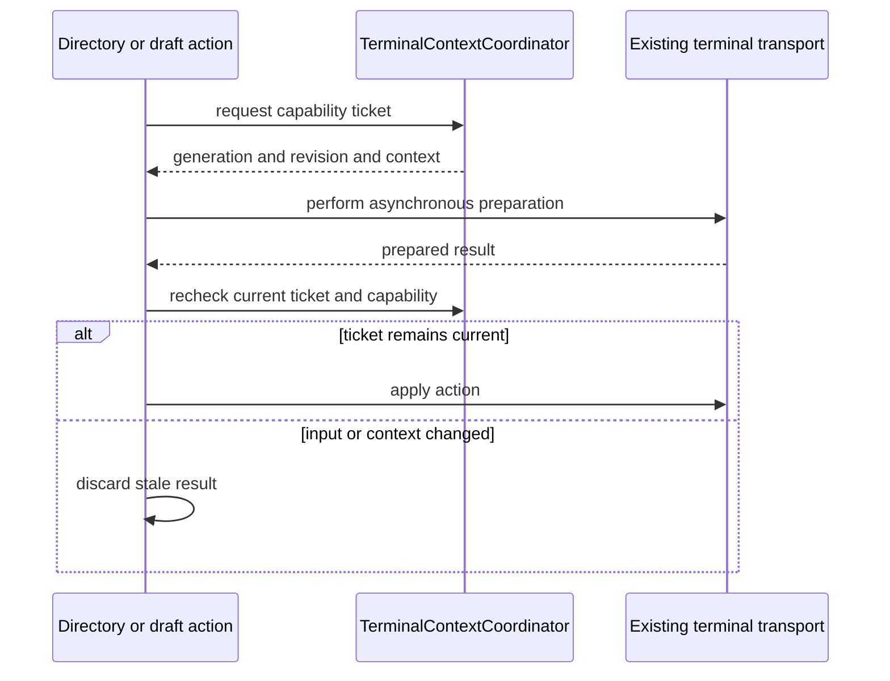
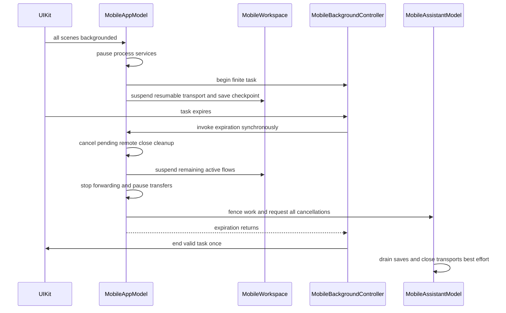

# Engineering Invariants

Use this as a **change checklist**, not an implementation guide. Source and tests are authoritative. Change the focused owner contract and its behavioral tests together; a source-token guard is not proof of runtime safety.

Detailed owners: [System Boundaries](system-boundaries.md), [Platform Runtime](platform-runtime.md), [Persistence and Secrets](../concepts/persistence-and-secrets.md), [Shell Integration](../concepts/shell-integration.md), [SSH Session Lifecycle](../workflows/ssh-session-lifecycle.md), and [Behavioral Boundaries and Fixtures](../testing/behavioral-boundaries-and-fixtures.md).

## Before changing a boundary

- Preserve layer direction and feature ownership. Native mounting, navigation and transport lifetime are different things.
- Recheck admission at execution boundaries, not just in pickers. Admission loss must not silently cancel already admitted transfers.
- Extend registered terminal engines and multiplexer dialects rather than introducing protocol switches in app lifecycle owners.
- Treat displayed directory information as observation, **not permission**. Live operations require current context tickets.
- Carry teardown intent explicitly. Window dismissal, Quit and suspension must not become explicit remote-session termination.
- Keep historical model shapes frozen and local schema, per-kind cloud wire formats and recovery formats independent. Migration tests open historical stores and verify retained data after reopening; **never assert a hard-coded latest schema number**.
- Preserve cancellation identities, one-shot secret ownership and commit-before-publication boundaries. A timeout or expiration return does not prove durable cleanup.

## Modules, build policy and test scope

[AGENTS.md](../../AGENTS.md) defines repository placement and contributor policy. TFM/TFI own native UI, adapters, composition and lifecycle. Persistence exclusively owns SwiftData models, historical schemas, migrations and container construction. Domain owns portable values, Application ports and use cases, Infrastructure concrete local/cloud services, Remote Infrastructure remote transports, and Presentation reusable UI policy/content. Use direct owner imports and public APIs rather than a generic Core module or forwarding aliases.

[ArchitectureBoundaryTests](../../TFMTests/ArchitectureBoundaryTests.swift) enforces **specified roots, imports, declarations and construction tokens**, not universal dependency purity:

- Non-presentation shared modules cannot import app modules or AppKit/UIKit/IOKit/ServiceManagement. Application additionally excludes Infrastructure, Persistence, SwiftData and RevenueCat implementations; Persistence excludes Infrastructure and Remote Infrastructure.
- Presentation has its own broader ban on app/platform, storage and implementation frameworks, including StoreKit and RevenueCat. Domain, app Application/Features and mobile Application/UI have separate scoped guards against concrete I/O/storage access.
- Native `ListViewKit` imports have an allowlist. A named subset of AgentKit declarations cannot be redeclared in TFM. SwiftData models and repository declarations stay in Persistence; declaration parsing distinguishes actual declarations from references/comments/string literals.
- Shared Strings owns `AppStrings`; dialog titles pass `LocalizedStringResource` directly rather than bridging to `.swiftUIKey`. Direct Cloud-directory Swift files with the specified `CKSyncEngineDelegate` declaration must use shared batch/upload/handling and decode/quarantine gates. Nested or differently declared delegates are not discovered by that scan.
- Forwarding authentication stays feature-owned: no defaults/external-auth fallback, and auxiliary interactions remain forbidden. Mobile app/root/session owners cannot absorb keyboard-interactive queues/forms. Pair these scans with `SSHInteractionPolicyTests` and mobile Journey tests.

Read [project and target configurations](../../Termind.xcodeproj/project.pbxproj) together: absent target settings inherit project defaults. Swift 6.0, approachable concurrency, complete strict concurrency, `ExistentialAny`, MainActor default isolation and Swift warnings-as-errors are project policy. MainActor is a declaration default, not a promise that remote work runs on the main thread. Apps/shared frameworks/tests inherit it; widgets restate it; MCP bridge and forwarding benchmark override isolation to `nonisolated` and use `-parse-as-library`. TFMTests only relaxes imported deprecated-declaration diagnostics via `-Xcc`. Debug enables testability and `-Onone`; Release uses whole-module compilation and disables assertions.

Both configurations disable generated catalog symbols. Apps emit localization strings; all six shared frameworks, FrameworkTests and TFITests explicitly do not. `TermindWidgets` uses extension-only APIs and TFIWidgets-owned native source/metadata; it is not another app composition root. The macOS forwarding benchmark uses narrow shared-framework SPI and is not hosted by apps/tests. AgentKit, libssh2-spm and libtailscale-spm are remote SPM dependencies, not Termind submodules; Ghostty is also consumed directly from remote `Lakr233/libghostty-spm`, with no local maintenance submodule. Keep Xcode requirements and `Package.resolved` pins aligned, and build with `-onlyUsePackageVersionsFromResolvedFile` to avoid silently updating pins. Termind registers its host-aware SSH/SFTP tools through `TermindAgentTools`; AgentKit remains host-neutral.

### Focus-sensitive tests are opt-in

The real macOS app is the XCTest host. DEBUG test detection selects memory-only storage, suppresses automatic windows and restoration for ordinary tests, with explicit screenshot exceptions. Window/focus tests use `.requiresVisibleWindow` and `TEST_RUNNER_TERMIND_WINDOW_TESTS=1`; do not enable them for the default suite. Mobile runs its real scene with testing dependencies. Mobile key-window suites require `TEST_RUNNER_TERMIND_MOBILE_UI_TESTS=1`, `-parallel-testing-enabled NO` and narrow suite filters. See [Build, Test, and Release](../operations/build-test-and-release.md).

## Host operation admission

**A visible unlocked row is not an execution lease.** [HostAccessPolicy](../../Frameworks/TermindDomain/Hosts/HostAccessPolicy.swift) derives locks locally: free access covers three ordinary saved Hosts ordered by creation date, with undated Hosts first and UUID tie-breaking; Tailscale-managed peers are excluded. Unresolved/failed entitlement verification is distinct from a resolved locked Host. `HostLibraryModel.requireHostAccess` checks the route, and its `connectionAccessCheck` captures the mutable operation-access owner rather than a frozen entitlement result.

[AccessControlledSFTPChannel](../../Frameworks/TermindRemoteInfrastructure/SSH/AccessControlledSFTPChannel.swift) checks each new operation and propagates the check to sibling channels. Expiry blocks a new directory read before delegation **without disconnecting the channel or cancelling an upload already admitted**; restored access admits later operations. Preserve that distinction when adding entrypoints, auxiliary connections or new paywall surfaces.

Enforcing tests: [HostOperationAdmissionTests](../../FrameworkTests/HostOperationAdmissionTests.swift), plus [RevenueCatCommerceTests](../../FrameworkTests/RevenueCatCommerceTests.swift) for production entitlement resolution. Only the configured verified RevenueCat entitlement unlocks production Pro: lifetime, active trial/subscription and grace qualify through their deadlines; failed verification, billing retry, expiration and revocation do not. Failed refresh preserves previously resolved access; newer customer-info updates outrank stale refreshes and expiry schedules a refresh. The live service uses anonymous RevenueCat StoreKit 2, current/customer-info stream updates, cached information on fetch failure and conditional one-time pre-integration purchase sync—not a parallel StoreKit transaction observer. The StoreKit file is only a manual fixture; live products/purchase/restore require RevenueCat and Sandbox checks.

## Registered engines, backends and context tickets

### Registration is the extension boundary

| Extension | Invariant | Focused tests |
| --- | --- | --- |
| [ResumableTerminalEngineRegistry](../../Frameworks/TermindRemoteInfrastructure/SSH/ResumableTerminalEngine.swift) | Immutable, coordinator-local factories register Mosh and Eternal Terminal. Engines own protocol resources; `ResumableTerminalClient` owns shared lifecycle/serialization. Missing registration fails before wake, route, bootstrap or startup side effects and the PTY facade consumes one-shot secrets. | [ResumableTerminalEngineTests](../../FrameworkTests/ResumableTerminalEngineTests.swift), [ResumableTerminalExitTests](../../FrameworkTests/ResumableTerminalExitTests.swift) |
| [RemoteMultiplexerRegistry](../../Frameworks/TermindRemoteInfrastructure/SSH/RemoteMultiplexerDialect.swift) | tmux, zellij, zmx and herdr dialects register commands, version validation, runtime inspection and pane identity. The live backend factory derives from these registrations. Backend identity is opaque versioned data, never a command. URL input cannot grant managed ownership. | [SessionPersistenceTests](../../FrameworkTests/SessionPersistenceTests.swift), [NativeTerminalContextTests](../../FrameworkTests/NativeTerminalContextTests.swift) |
| [HostTerminalTransports](../../Frameworks/TermindDomain/Hosts/HostTerminalTransports.swift) | Mosh/ET are SSH-authenticated terminal choices, not replacements for auxiliary SSH services. Disabling a default normalizes to SSH rather than guessing another enabled transport; Tailscale excludes Mosh while retaining ET preferences. | [TerminalTransportTests](../../FrameworkTests/TerminalTransportTests.swift) |

Engine retries use the existing engine without replaying startup. Suspension freezes new writes, drains in-flight writes before checkpointing, retains the newest resize, and rejects late activity that would unfreeze the checkpoint. Restore skips fresh startup/route work; failed start rolls back and closes once, and retired engine events cannot revive a closed client.

### Observation does not authorize input

[TerminalContextCoordinator](../../Frameworks/TermindApplication/Terminal/TerminalContextCoordinator.swift) owns generation, revision, active shell identity, capabilities and event high-water marks. A ticket is issued only for a prompt-ready active context with the requested capability; validity is equality against the **current** ticket. Input, active-context or capability changes and relevant shell events invalidate prior work; reset changes generation. Async inspection also checks its inspection ID, generation and revision after awaiting, so old results cannot overwrite current state. Runtime adapters may inspect only the existing authenticated terminal transport.

A captured path or prepared result is not sufficient authority to act on a later shell context.

The last reported directory may remain visible while a command runs, but draft/directory tickets are unavailable until prompt readiness returns. Native multiplexer pane cwd is display information and does not itself grant shell-history or input capabilities. Failure to bind a detected multiplexer client must not masquerade as an ordinary outer shell or retain its directory. Active pane selection is not inferred from whichever pane emitted an event.

Only new contiguous command events can complete a previously observed start. Joining an existing multiplexer establishes a high-water mark instead of replaying old commands; gaps cannot fabricate completion. Independent pane completions remain independent and must not double-count fallback OSC 133. Enforcing tests: [TerminalContextCoordinatorTests](../../FrameworkTests/TerminalContextCoordinatorTests.swift) and [NativeTerminalContextTests](../../FrameworkTests/NativeTerminalContextTests.swift). Keep the detailed control flow in [Shell Integration](../concepts/shell-integration.md).

## Teardown intent and native state lifetimes

**Client dismissal is not remote-session termination.** [TerminalTeardownIntent](../../Frameworks/TermindDomain/Sessions/SessionPersistence.swift) ends managed attachments only for `.explicitClose`; application termination, suspension, remote exit and detach preserve them. Desktop `closeForWindow()` remembers recovery and disconnects clients without terminating remote sessions; it does not cancel independently queued explicit-close cleanup. Moving a Workspace preserves live panes, transports, history and ownership until the destination native window registers; cancelled/accepted drags must not create another window. Pane-title and macOS 26+ native Workspace List drags may request a new window only for an uncancelled unaccepted release outside the source window.

[RemoteSessionCloseCoordinator](../../Frameworks/TermindApplication/Terminal/RemoteSessionCloseCoordinator.swift) owns one-shot cleanup independently of the Workspace. Explicit close queues managed references **without confirmation UI or waiting for remote termination**, deduplicating identities while pending. A transferred connection has one idempotent release owner, including skipped or duplicate requests. Cleanup attempts termination once, ignores errors and releases the connection; the default 30-second deadline requests cancellation rather than guaranteeing a hard completion bound. `cancelAll()` requests cancellation, while `waitUntilIdle()` joins tracked tasks. Quit and mobile background expiration cancel pending cleanup; ordinary window dismissal preserves remote attachments without cancelling independently queued work. Do not restore the obsolete retry/Cancel/Disconnect Only failure prompt. Enforcing tests: [SessionPersistenceTests](../../FrameworkTests/SessionPersistenceTests.swift), especially passive teardown, one-shot failure, identity deduplication, pre-start cancellation and timeout. See [Session Persistence](../concepts/session-persistence.md) for attachment and close ownership.

Desktop Quit first attempts to save terminal-theme edits and can ask to discard unsaved theme changes, then rechecks dirty remote edits before cleanup. Do not add the retired application-scoped Workspace warning back into this path. `shutdownForTermination()` is idempotent, fences Assistant admission, requests preparation/conversation cancellation before drains, stops MCP/SFTP concurrently, and closes Agent resources after drains. Windows close with `.applicationTermination`; forwarding, metrics, speech, transfers and outbox also retire. The native delegate replies once after cleanup or its three-second deadline: that bounds waiting, not persistence completion. Tests: [AppTerminationTests](../../TFMTests/AppTerminationTests.swift); native window-close policy remains separate.

### Ownership that survives view changes

- Desktop `AppModel` owns process services and weak window registrations; `WindowModel` owns navigation/live Workspaces. Mobile `MobileAppModel` owns process services, process-local recently closed entries and the scene-session registry; `MobileWorkspaceSessionModel` owns ordered live Workspaces and saved restoration descriptors. `MobileSceneModel` owns navigation with mutually exclusive Workspace/Transfers destinations and Connection Picker/Batch Startup sheets. Do not move scene routes into process services.
- Mobile keeps terminal surfaces mounted under Journey/authentication/host-key overlays, hiding/disabling covered content rather than replacing it. Native search stays on stable Workspace chrome even when SFTP shows Journey. [Mobile UI](mobile-ui.md) owns native details.
- Shared Find dismissal is idempotent and retains the query. Default dismissal restores terminal focus; a native search host uses `dismiss(restoringFocus: false)`. Changed queries dispatch only when not resize-suspended; navigation requires presentation, a nonempty query and no suspension. Resume searches only the latest still-presented query. Native dismissal fences model synchronization/text changes/presentation so Cancel cannot reopen search or clear the retained query/filter.
- [TerminalFindControllerTests](../../FrameworkTests/TerminalFindControllerTests.swift) covers shared semantics. [MobileTerminalSearchTests](../../TFITests/MobileTerminalSearchTests.swift) is opt-in and serialized: repeated dismissal/reopen and SSH/SFTP Journey host identity, with terminal identity asserted for SSH—not Telnet-specific integration coverage.
- Command history is per-live-terminal memory, capped at 250. Disconnect cancels the current read but retains a completed snapshot; close clears permanently, including in the reopen stack. Imported history follows the selected shell/file source within a generation; observed live commands remain terminal-wide. See [CommandHistoryModel](../../Frameworks/TermindApplication/FeatureModels/CommandHistoryModel.swift).

### Mobile background and restoration

All-scenes background pauses sync, Metrics, edit monitoring, memory, outbox and speech recording, then begins a finite UIKit lease. **Resumable transports suspend on background entry**, saving their checkpoint; ordinary SSH/Telnet/SFTP active connection flows suspend on lease expiration. Expiration also stops forwarding, pauses transfers and expires Assistant work. Foreground resumes eligible existing Workspaces and services; failed initial selection still needs explicit retry.

The lease ends after synchronous cancellation requests, not asynchronous persistence or transport cleanup.

`MobileBackgroundController` ignores stale/replaced callbacks and ends valid leases once even on reentrant expiration; invalid begin still expires without ending an invalid task. Assistant expiration blocks sends/edits/compaction/plan implementation, stops all conversations before awaiting any drain, then closes Agent resources. Tests: [MobileBackgroundControllerTests](../../TFITests/MobileBackgroundControllerTests.swift), [MobileAssistantTests](../../TFITests/MobileAssistantTests.swift), [MobileAppTests](../../TFITests/MobileAppTests.swift).

Retire the old `mobile.workspaces.v1` and `mobile.recentlyClosed.v2` bytes without decoding/migration, but **do not infer that cold launch has no restoration storage**. [MobileWorkspaceStore](../../TFI/Infrastructure/MobileWorkspaceStore.swift) now stores validated `mobile.restorableWorkspaces.v1` descriptors. Saved connection intent covers ordinary SSH, SFTP and Telnet as well as resumable and persistent-session terminals; transient external connections are not added to saved descriptors. Loading preserves native scene lists without creating live connections. Unknown/corrupt snapshots disable subsequent saves so unreadable bytes are not overwritten. Recently closed entries remain process-local.

[TerminalRecoveryStore](../../Frameworks/TermindRemoteInfrastructure/Security/TerminalRecoveryStore.swift) is separate device-local storage, not SwiftData/Vault/CloudKit. It encrypts checkpoint payloads with authenticated metadata and a nonsynchronizing device Keychain key; consume validates Host/transport and removes eligibility **before** returning protocol counters. Owner leases fence saves racing explicit close. Missing/incompatible resumable checkpoints fail in Journey rather than bootstrapping a replacement shell. Live Activity may select a saved descriptor and consume its checkpoint once without startup replay; it cannot recreate an explicitly closed resumable session. Separate validated saved-Host activity rebuilding requires remote-session selection and deduplicates repeated links; stale ID-only/deleted-Host/unsupported/command-bearing links cannot guess a connection. Tests: [TerminalTransportTests](../../FrameworkTests/TerminalTransportTests.swift), [MobileTerminalRestorationTests](../../TFITests/MobileTerminalRestorationTests.swift).

Native scene disconnection is not discard. Reconciliation transfers orphaned live instances, order and unread state to an active owner without reconnecting or creating history; without a recipient it waits. It commits the complete descriptor handoff before releasing any source, and save failure leaves source runtime and ownership intact. Descriptor mutations trigger persistence. Distinguish **unbound restored windows from windows used in this process**: discarding an old, unbound native session preserves its records for handoff, including a late discard after transfer. A late discard of a window used in this process removes its transferred entries and records grouped recently closed entries. Reopen creates fresh runtime/history and never replays one-shot commands. Tests: [MobileWorkspaceSessionTests](../../TFITests/MobileWorkspaceSessionTests.swift), especially `orphanedColdWindowsTransferAsOneCompleteSnapshotAndIgnoreLateDiscards`, `failedHandoffKeepsTheSourceRuntimeAndOwnership` and `missingNativeSessionHandsOffLiveWorkspacesWithoutReconnecting`.

## Persistent stores and independent wire versions

Keep the startup container for every scene in the process. Never silently substitute another store after failure: desktop reports database-in-use and exits or fails startup for other errors; iOS retains the failed startup result and renders its store-open error scene. The macOS container factory acquires a nonblocking exclusive stable store-adjacent lock **before** SwiftData opens/migrates. Same-process canonical URLs share a lease until the last container dies; other processes are refused, and forced exit releases the lock without unlinking its file. `DatabaseStartupGuard` also checks same-bundle running apps to cover old versions without the lock. Memory-only tests are chosen before opening, not a failure fallback.

Owners/tests: [TermindPersistence](../../Frameworks/TermindPersistence/TermindPersistence.swift), [PersistentStoreLockTests](../../FrameworkTests/PersistentStoreLockTests.swift), [DatabaseStartupGuardTests](../../TFMTests/DatabaseStartupGuardTests.swift), [PersistenceCompatibilityTests](../../FrameworkTests/PersistenceCompatibilityTests.swift). Preserve original-module historical fixtures and verify migration/reopen behavior. Consult the factory and migration plan for the current endpoint rather than copying its number into unrelated tests.

[SyncRecordFormats](../../Frameworks/TermindDomain/Vault/SyncRecordFormats.swift) versions **each record kind**, not app releases or local schemas. Keep old DTOs frozen; adding an optional domain field does not make old-client writes safe. Snippets read V1/V2, write V2 and reject colored V1 encoding. History reads V1/V2 for connection events and writes V2 to represent Mosh/ET; Device stays V1. History/Device use native-field records in their deployed shared zone, not legacy Vault JSON. `HistorySyncPersistence.prepare()` bootstraps native rows, not the retired Vault-to-History importer. Decoder-capability changes force scoped replay before the checkpoint commits after successful fetch. See [Persistence and Secrets](../concepts/persistence-and-secrets.md).

### Sync safety checklist

- Vault, History, Device, Settings and Metrics own separate lifecycle/journal state. History and Device share `TermindConnectionHistoryV1` and the coordinator implementation, **not** engines, subscriptions, safety consumer or enablement. Vault/Device follow master iCloud; History is optional. Successful completed current-engine fetches gate upload; failed/overlapping fetches, pause and retirement keep it fenced.
- Quarantine unreadable/unsupported records durably by full cloud/account/zone/consumer scope, retaining archived native fields and pending local intent. Journals, restored queues, batches and final providers all recheck restrictions. Only successful supported reconciliation clears them atomically; retries/relaunch cannot bypass them. If any representation of a name fails decoding in a batch, readable duplicates cannot be applied instead.
- Reject unjournaled/blocked mutations, deduplicate IDs and cap combined saves/deletes at 250. Persist physical-delete handoff before transmission; in-flight deletion blocks another handoff for that ID, and a late result cannot acknowledge away a reobserved mutation.
- Persist recovery fences before cursor/network progress; persistence failure retires the engine. Detach sync/cancellation work from CloudKit delegate task-local context. Ordinary zone deletion resets/requeues/recreates; purge/encrypted reset retires and purges without recreating in that callback, though a later explicit local write may restart.

Enforcing tests: [CloudSyncLifecycleTests](../../FrameworkTests/CloudSyncLifecycleTests.swift), [CloudSyncSafetyTests](../../FrameworkTests/CloudSyncSafetyTests.swift), [CloudSyncSafetyPersistenceTests](../../FrameworkTests/CloudSyncSafetyPersistenceTests.swift). Settings commits data plus journal intent before mirroring defaults; remote apply does not echo. Connection events retain stable source-device IDs, start/end times, not mutable names; the separate device directory resolves names. Saved-host SSH/Mosh/ET/Telnet/SFTP events retain 250, with all-device History presentation capped at 100 desktop/50 mobile. Device-directory reads cache and invalidate on reload/successful rename; a failed rename reports storage error without publishing the new name.

## Security and durable side effects

- **Secrets are one-shot connection-attempt owners.** Runtime copies share wipeable allocation; clear on auth/success/failure/cancellation and reread saved material for another physical connection. Auxiliary silent routes retain durable references, never temporary passwords/passphrases, and forbid trust/MFA/passphrase/user-presence interaction. Tests: [SSHInteractionPolicyTests](../../FrameworkTests/SSHInteractionPolicyTests.swift).
- **Host deletion is durable intent.** Commit pending marker, ordered outbox jobs, revision and Vault mutation before snapshots hide the Host. Cleanup closes runtime work, cancels transfers, stops forwarding, clears references/history and finally removes Host/owned Identities; independent Known Hosts trust survives. Desktop projects removal after commit. Mobile proactively disconnects Assistant, closes live/dormant Workspace entries, forgets closed recovery entries and invalidates edits/transfers/forwarding/Metrics before durable request. Managed-session termination is independently queued, not an authorization barrier to local removal; durable-request failure does not restore cancelled live work. Reopen records omit a remote reference whose explicit termination was queued, rather than offering to reattach to that session. Tests: [RepositoryOutboxTests](../../TFMTests/RepositoryOutboxTests.swift), mobile app/session tests.
- **Transfer state is not a durable connection.** Process-local SFTP runtime owns bounded fair admission, channel/connection topology, resumable temporary-file state, conflict/direct-copy policy and external-edit version checks. Closing a pane is not retirement of transfers retaining transport ownership; pause/resume is not silent replay. See [SSH Session Lifecycle](../workflows/ssh-session-lifecycle.md) and the focused behavioral owner page.
- **Charset continuity is not strict path validation.** `RemoteCharsetStreamConverter` converts valid sequences, passes malformed/unrepresentable bytes through, buffers incomplete bytes and flushes unchanged; unavailable iconv preserves raw bytes. The legacy recovery argument no longer selects rejection. Value APIs use Swift replacement decoding, so do not promise strict failure before returning text. SSH/Telnet/Serial emit converted/trailing data. Protocol/path validation remains separate.

## Assistant commit, replay and presentation

Keep the full runtime contract in [Assistant Runtime](../concepts/agent-runtime-and-assistant.md). Cross-system changes must preserve these boundaries:

- Optional model-selection persistence precedes synchronous capture of the complete turn/configuration before memory/compaction awaits. Capture freezes model/provider, credential availability, permission/reasoning, native search, skills, registry, guardian and compaction/review configuration; later settings changes must not reinterpret an accepted turn or revive a turn captured without credentials. Explicit payload-carrying `ContextChip`s disclose output/selection/file content; detach removes payload and accepted capture consumes attachments once. Replay keeps full tagged extraction/images; bubbles render authored text or legacy `visiblePrompt` plus references. Original non-image bytes support reopening, not implicit model upload. Tests: [AssistantExecutionControllerTests](../../FrameworkTests/AssistantExecutionControllerTests.swift), [ChatComposerStateTests](../../TFMTests/ChatComposerStateTests.swift), [AgentPersistenceTests](../../TFMTests/AgentPersistenceTests.swift).
- Preparing cancellation invalidates identity synchronously, joins tracked edit/history/preparation work, then attempts interrupted persistence before projection. `stop()` alone does not wait; drain callers await `stopAndWait()` or cancellation task. Failed save reports error. In `savingFailure`, cancellation joins the existing failed-snapshot save rather than replacing it with interruption. Archive/delete wait; manual compaction refuses preparation; selection alone does not cancel.
- History edits commit truncation before live replacement at the selected canonical user-message boundary. Preserve same-run prefix/tool ownership, neutral completed summary, title and relevant compacted display history; remove suffix/later runs and prune compactions by removed message IDs. Executed suffix tool invocation/result/review rows can be removed; legacy unowned cards belong to the suffix. Agent-provenance user messages remain uneditable. Editing history does not undo remote effects.
- Edited replacement initially owns a same-message-ID staging run. The first real saved snapshot adopts only that staged row and removes staging while preserving chronology and historical replay ownership. Missing-model/credential preparation failures project only after save; failed saves do not adopt staging. Repository-instance retired IDs reject late writes.
- Presentation is not execution data. `AgentToolPresentation` interprets descriptors, lifecycle state and injected profiles/vocabulary without rewriting original calls/results used by execution, approval, persistence or replay. `TermindToolPresentationProfiles` composes tool policies outside the generic renderer: MCP descriptors receive an empty profile before any local policy lookup; for other targets, ordinary semantics follow registered presenter IDs, not guessed tool names, and missing or unknown IDs use the default profile. The deliberate exception is local pane/chat privacy: name-based privacy rules take precedence over presenter-ID lookup and remain enforced independently of presenter availability. See [UI Design Principles](../concepts/ui-design-principles.md) and [AgentToolPresentationProfileTests](../../TFMTests/AgentToolPresentationProfileTests.swift).
- Approval arguments are a live local-only projection of original in-memory arguments, never durable cards/transcripts; resolved Host labels and injected presenters can format them without putting commands/paths in short action titles. Result detail decodes JSON and uses an injected presenter or generic formatting; both app composition roots register localized SSH result presenters through `SSHExecToolPresentation.registering(in:)`, preserving tool-owned layout and approval argument policy. Only result-less SSH cards take the dedicated pending-detail path. **MCP exclusion is a code-selection boundary, not a raw-JSON rendering requirement.** `TermindAgentTools.presenter(for:)` refuses MCP descriptors even if their metadata names a registered local presenter. With the empty MCP profile and no injected presenter, valid JSON uses generic structured items: the profile test expects `{"value":42}` to become a `Value` field containing `42`, not a raw JSON block. A trusted caller can explicitly inject an MCP presenter and its layout; remote descriptor metadata cannot select that executable code. `explicitMCPPresenterIsUsedButRemoteMetadataCannotSelectLocalCode` covers both paths, while `registeredProfileFollowsItsIDNotTheToolName` covers renamed tools and missing/unknown IDs. Failure state is passed to built-in presenters so failed knowledge results cannot render success detail; duplicate denial reasons display once. Collaboration exposes only selected fields or safe unavailable detail, never raw fallback; local pane read/list cards show metadata, not terminal output, including replay.
- Batch summaries preserve mixed tool/state/knowledge-action outcomes. `AgentToolDetailPreview` shares a five-row and `AgentTruncateLimits.maximumBytes` UTF-8 budget across collapsible text and list bodies, using the presenter's truncation strategy; `.none` bypasses folding. Fields, notices and noncollapsible text are outside that body budget. Full projected items remain available for expansion—not a promised Copy control. Display folding does not invent an output-truncation notice; actual result markers are reused verbatim. Tests: [AssistantTranscriptPresentationTests](../../FrameworkTests/AssistantTranscriptPresentationTests.swift), [AgentKnowledgeToolPresentationTests](../../TFMTests/AgentKnowledgeToolPresentationTests.swift), and [RemoteOutputToolPresentationTests](../../TFMTests/RemoteOutputToolPresentationTests.swift).

## Notifications, preferences and copy

### Notification ownership

`NotificationPreferences` is Settings-synchronized state (introduced in V41), not per-window. Defaults enable unfocused Assistant/terminal/SFTP modes, system terminal delivery and a five-second threshold. Validate/commit edits before publication; remote refresh must not echo. A failed load suppresses initial permission requests. Initial authorization occurs at most once per model instance, only when system delivery is needed; terminal bell avoids it only when other system modes are off or notifications disabled. Tests: [NotificationPreferencesTests](../../FrameworkTests/NotificationPreferencesTests.swift).

Terminal monitoring belongs to live terminals, not mounted views/history: shell or fallback OSC 133 completion owns unread state and duration/focus eligibility. The app-injected dispatcher chooses bell/system delivery and rechecks policy/target. SFTP aggregates outcomes until queued/running work finishes; paused/cancelled items do not hold a batch and resumed work is new work. Assistant observation deduplicates completion/interaction IDs even when focus suppresses delivery, retires obsolete interactions and derives badges from live unread state.

`SystemNotifications` checks authorization/currentness around enqueue, removes obsolete sends, carries target kind/ID and defers clicks until a router exists. Desktop restores Assistant history before navigation; mobile activates the existing owner and drops missing terminal targets instead of starting a connection. Tests: [TerminalNotificationCoordinatorTests](../../FrameworkTests/TerminalNotificationCoordinatorTests.swift), [SFTPNotificationTests](../../FrameworkTests/SFTPNotificationTests.swift), [AssistantNotificationTests](../../FrameworkTests/AssistantNotificationTests.swift), [SystemNotificationsTests](../../FrameworkTests/SystemNotificationsTests.swift).

### Terminal preferences

Typography is device-local, outside Settings sync: shared binding controls edit 8–36 points with macOS slider/iOS stepper, without appearance-time normalization. App-owned font catalogs accept families with **any loadable member**, not only monospaced members, and use localized ordering. Saved unavailable/wrong-appearance built-in names stay stored and summarized; available tiles are filtered/sorted and show fallback notice without browser-time writes. Named custom themes and independent appearance selections come from the theme library. Rendering resolves the base, applies custom commands and local typography; manual font size is last. Tests: [TerminalFontPreferencesTests](../../FrameworkTests/TerminalFontPreferencesTests.swift), [TerminalThemeSelectionTests](../../FrameworkTests/TerminalThemeSelectionTests.swift), [TerminalCustomThemeTests](../../FrameworkTests/TerminalCustomThemeTests.swift).

### Localization and verification

App-facing copy—including single-platform copy—belongs to `LocalizedStringResource` entries under Presentation/Strings with shared `AppStrings`; protocol values/identifiers/diagnostic codes stay with their owners. Both manually managed app catalogs live in shared Resources. Add explicit keys/translations and preserve single-target `stale` keys until actual cross-app usage is checked. Normalize with `Scripts/normalize-string-catalogs.py --write`, then run `python3 Scripts/check-localization.py`, including in the commit pipeline when no localization change was intended. The former `check-appstrings.sh`/`check-appstrings.swift` tooling is absent; do not prescribe it as a verification step.

The Python checker validates canonical manual formatting, finished zh-Hans/zh-Hant/ja/ko/de/fr translations, positional argument types/percent signs, translated plural branches and Chinese/Japanese spacing. Chinese/Japanese/Korean need only `other`; German needs `one`/`other`; French permits additional `many`. Path-filtered Ubuntu localization CI runs the Python checker on pull requests and main pushes; it does not run the removed `Scripts/Tests` unit suites, SwiftSyntax copy checks or native rendering. Keep `PresentationCopyTests`, `AppLanguageTests` and platform rendering checks: catalog validation cannot establish displayed translation correctness. See [Commerce, Localization, and Product Surfaces](../concepts/commerce-localization-and-product-surfaces.md).
