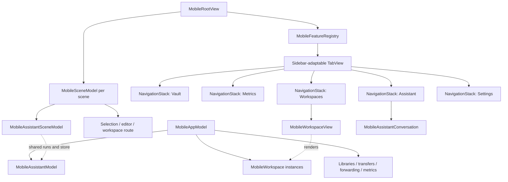
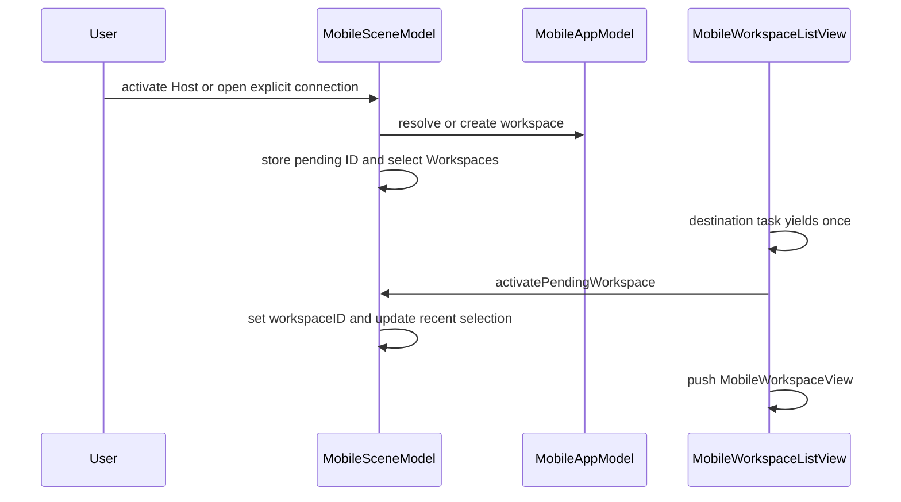
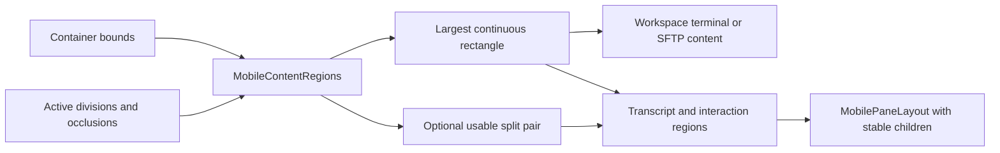

# TFI Mobile UI Architecture

TFI is not a scaled-down copy of the desktop split-pane window. It uses system-adaptive top-level tabs/sidebar, a navigation stack for each registered feature, scene-local routing, and shared application-owned sessions. Adaptation changes presentation without automatically replacing the conversation, terminal or connection being presented.

Read [TFM Desktop UI Architecture](/openwiki/architecture/desktop-ui.md) for the desktop contrast and [UI Design Principles](/openwiki/concepts/ui-design-principles.md) for shared presentation boundaries.

## Code structure and ownership

`MobileFeatureRegistry` is the single registration table for feature identity, order, localized title, symbol and view builder. Its standard order is Vault, Metrics, Workspaces, Assistant, Settings, and duplicate destination registration is rejected. `MobileRootView` iterates registrations rather than maintaining independent tab/sidebar/destination switches.

Each registered destination gets its own `NavigationStack`; the enclosing `TabView` uses `.sidebarAdaptable`. The system can change where navigation appears without the app rebuilding a different root tree for “phone” and “tablet.” `MobileLayout` supplies a compact/regular hint, defaulting to compact when size class is absent; it is not the whole adaptive layout algorithm.

### State lifetime matrix

| Owner | State or work | Expected lifetime |
| --- | --- | --- |
| `MobileAppModel` | Shared libraries, live/saved workspaces, transfers, synchronization and aggregate scene activity. | Application/service lifetime. |
| `MobileSceneModel` | Selected destination, workspace route, pending activation, editor/rename presentation, scene-local recent selection. | One scene. |
| `MobileAssistantModel` | Shared conversation store and execution services. | Survives scene navigation. |
| `MobileAssistantSceneModel` | Selected conversation and New Chat draft through its own library model. | Independent per scene over the shared store. |
| `MobileWorkspace` / `MobileTerminalSurface` | Connection/session state and owned native terminal view. | Workspace lifetime, not just the currently pushed detail. |
| Feature view state | Temporary picker, preview, drop loading and focus-request state. | Current presentation. |

Two iPad scenes can navigate independently without creating two copies of an already-running conversation. Likewise, selecting a workspace looks up the shared instance; `MobileAppModel.openWorkspace` publishes a restored workspace before connection work so scenes do not race to create separate initial instances.

## Navigation is an intent sequence

Opening a Host from another feature is deliberately staged:

When already on Workspaces, the scene can present the route directly. When changing tabs, pending activation waits for the Workspaces destination to participate before pushing its detail. Selecting another top-level destination clears pending workspace activation rather than leaving a delayed push armed.

Host activation and explicit connection actions are different:

- `activateHost` prefers this scene's most recently selected matching terminal workspace, then another existing matching workspace, before creating one.
- Explicit SSH/SFTP connection actions call the open path and can create independent workspaces.
- The workspace title switcher replaces the pushed detail by workspace identity. This resets detail-specific state such as SFTP search without treating the owned terminal/session as a newly created runtime.

Unavailable saved workspace IDs produce an explicit unavailable state; a stale route does not silently open some other Host. Root-level deep links, quick actions and focused scene commands dispatch through that scene's model.

## Adaptation has three inputs, not one device check

| Input | Mechanism | What it controls |
| --- | --- | --- |
| System navigation placement | `MobileToolbarLayout`, read from tab placement and optionally vertical toolbar edge. | Icon versus title switcher and whether workspace detail keeps tabs visible. |
| Available content geometry | `MobileRegionReader` → `MobileContentRegions`. | Continuous safe area and optional pair of regions around a division. |
| Content/input needs | Measured card width, Dynamic Type, composer height, focus and marked text. | Grid density, scrolling and retained native input surfaces. |

### Content-region algorithm

`MobileContentRegions` starts with the local container bounds, filters active intersecting reserved regions, and computes the largest usable rectangle that avoids them. It retains overlapping candidate rectangles during subtraction; forcing candidates to be disjoint could discard the largest continuous solution. Equal-area candidates prefer earlier vertical then horizontal coordinates.

A **division** can additionally yield a pair of usable regions on either side. An **occlusion** reduces usable space but does not by itself request a two-pane layout. A division with one unusable side is not a valid split. This is region-based layout, not a hard-coded assumption that a particular device always has a hinge.

Production reserved-region and vertical-toolbar queries require both the `TERMIND_HAS_IOS_27_1_SDK` compilation gate and runtime availability. On older builds/systems the reader falls back to no reserved regions, while previews/tests can inject regions through the environment. The presence of deterministic fold-like tests is not a claim of verification on every physical device.

`MobilePaneLayout` retains a valid size per child index and places the same children into their new frames. Covered content keeps a valid size rather than replacing or reparenting its native surface. The layout must be paired with opacity, hit-testing and accessibility gates: parked geometry alone does not make a covered view noninteractive.

### Examples

- A terminal workspace uses the largest **continuous** region instead of splitting one terminal across a division.
- Assistant uses the first split region for the transcript and bottom-aligns its interaction surface in the second. Without a split, it subtracts measured interaction height from the continuous transcript region.
- A top or vertical navigation arrangement uses an icon-based workspace/conversation switcher; the ordinary arrangement can use the navigation title menu.
- Cards adapt to their measured container width, not a global “iPad has two columns” rule. Accessibility Dynamic Type forces one column.

## Workspace UI: protocol-specific actions, retained terminal

`MobileWorkspaceView` composes the connection/content area, search, feedback overlays, toolbar and transient sheets. Its toolbar is capability-shaped:

| Workspace kind | Representative actions |
| --- | --- |
| SSH | Generate Command, Snippets, command History, terminal match navigation, same-directory action and workspace lifecycle. |
| Telnet | Snippets, terminal match navigation and lifecycle; it does not inherit the SSH generation/history surface. |
| SFTP | Back/forward directory, Transfers, SFTP History, upload/new folder/paste, sort/hidden files/refresh, same-directory action and lifecycle. |

These are not all enabled merely because the menu exists. Connection state, available history, refresh state and operation capability control individual actions.

`MobileTerminalSurface` owns the native terminal view even when SwiftUI navigates away. Its `MobileTerminalView` adds terminal Find key equivalents while preserving Ghostty's ordinary key commands. Escape is intercepted for Find dismissal only while Find is actually presented.

Presentation cleanup is narrower than session shutdown: workspace view disappearance disables external Open With presentation and window drop handling, clears drop targeting and cancels drop loading. It is not itself the instruction to disconnect the workspace. Drop handling is also gated by scene activity and destination changes, so an invisible detail does not accept a late upload as though it were foreground.

Command-generation and upload notices are overlays in the usable region; they do not take over hit testing. File previews, edit-copy export, transfer sheets and conflict alerts remain explicit temporary presentations over the workspace rather than new session owners.

## Assistant: stable transcript/input, independent run ownership

`MobileAssistantView` owns conversation navigation controls, library/archive routes and focus restoration requests. Replacing a conversation preserves composer focus only when it was already focused and the new state can accept focus. The asynchronous request rechecks the conversation ID after yielding, preventing an old request from focusing the wrong chat.

`MobileAssistantConversation` renders an incremental `MobileNativeList` plus a separately measured, scrollable interaction region. Stable entry IDs and per-row presentation revisions let disclosure changes target the relevant rows; viewport callbacks collapse offscreen work presentations. Transcript and interaction children remain stable through region changes, preserving native list identity and text-input composition.

The interaction region can contain more than the composer, so its height is measured rather than assumed from a fixed input-bar constant. It bottom-aligns and scrolls based on content size. Tapping the transcript can dismiss composer focus without changing the conversation or ending the run.

The application runtime owns execution, not `onDisappear` on the conversation view. The view's disappearance only removes its temporary preview directory. App background expiration is a separate boundary.

## Scene activity and background limits

`MobileRootView` reports its scene phase; `MobileAppModel` aggregates all scenes. Entering background handling occurs when **all tracked scenes** are backgrounded, not whenever one feature disappears or one scene resigns activity.

At that boundary the app pauses edit monitoring, memory/sync/Metrics/outbox work and recording, then starts its background allowance. Expiration suspends workspaces, stops forwarding, pauses transfers and expires Assistant background execution. An active scene ends the allowance and asks retained workspaces to resume, rechecks edited files, and restarts the appropriate services. This is best-effort mobile continuity, not unlimited background network execution.

Closing a workspace, navigating back from its detail, switching tabs, and exhausting background allowance are therefore four different actions with different owners. A UI refactor must preserve that distinction.

## Mobile design principles and verification

Implemented principles:

1. **Let the system adapt navigation.** Register each feature once and keep its stack stable.
2. **Adapt to usable space and capability.** Size class alone is insufficient for divisions, occlusions, vertical toolbars and large text.
3. **Preserve native input identity.** A layout transition should not discard marked text, keyboard focus or terminal scrollback.
4. **Use mobile affordances without losing desktop parity of intent.** Primary card taps, context menus, swipe actions, title menus and hardware-keyboard commands can expose the same operation differently.
5. **Keep app work out of transient view lifetimes.** Scene routes select shared work; they do not own every connection or Agent run.
6. **Hide covered interaction as well as pixels.** Hit testing and accessibility must follow the visible region.

`MobileAdaptiveLayoutTests` exercises native tab identity across compact/regular widths, all five destinations, Dynamic Type and English/Chinese variants. It also checks that region changes retain the Metrics list and scroll position, and preserve Assistant conversation identity, native transcript, composer focus and marked Chinese text. These tests validate injected geometry and navigation behavior; platform availability and real-device presentation still need appropriate device verification.

For a change, inspect scene routing tests for navigation, region/layout tests for geometry, workspace/terminal tests for session continuity, and Assistant tests for run-versus-selection ownership. See [Platform Runtime Composition](/openwiki/architecture/platform-runtime.md) and [Build, Test, and Release Operations](/openwiki/operations/build-test-and-release.md) before changing the lifetime boundary.
