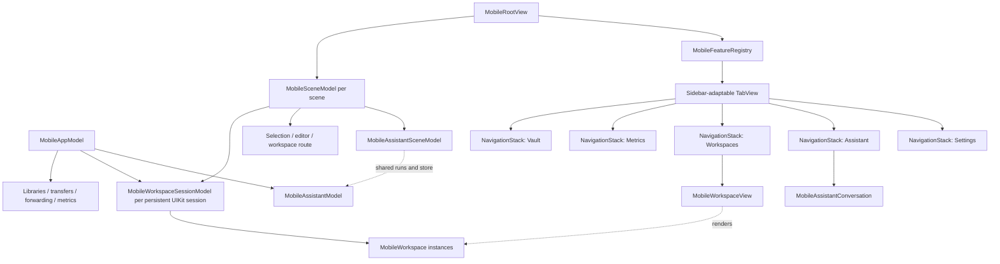
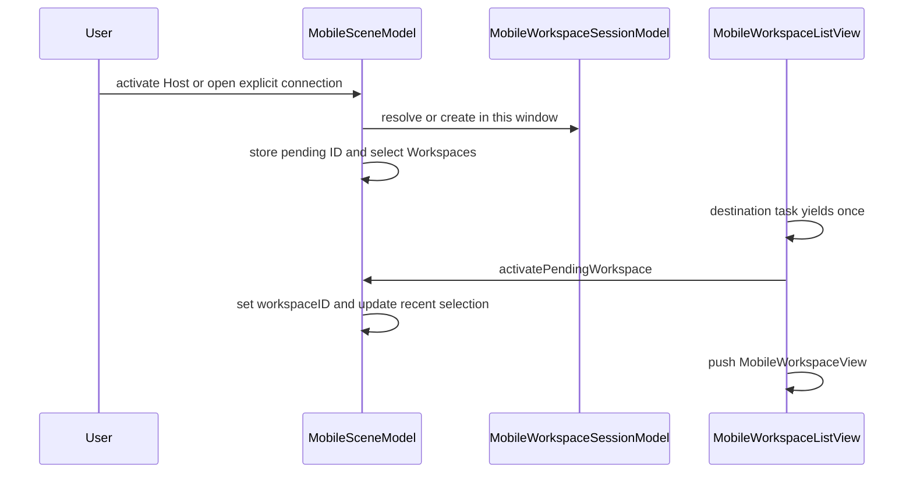
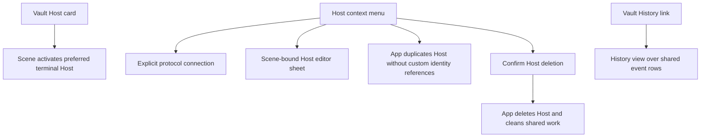
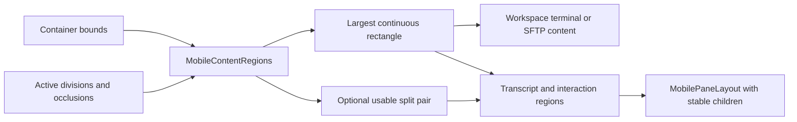
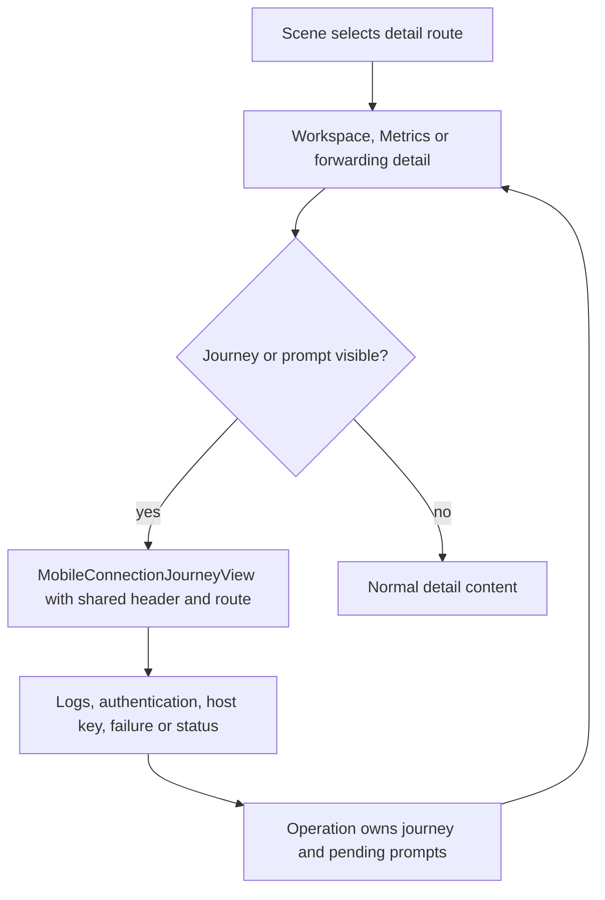
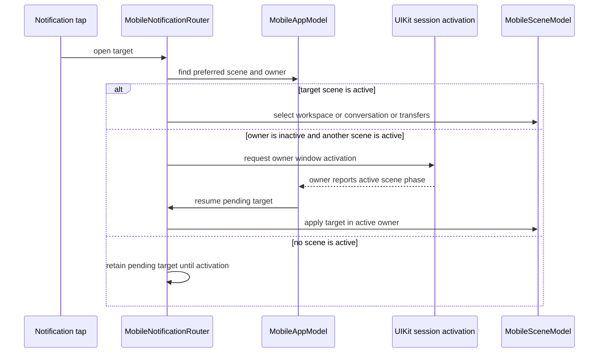

# iOS and iPadOS UI and Scene Ownership

TFI is not a scaled-down copy of the desktop split-pane window. It uses system-adaptive top-level tabs/sidebar, a navigation stack for each registered feature, and scene-local routing. Application services are shared, but terminal workspaces and their saved descriptors belong to persistent window sessions, not to one global workspace collection. Adaptation changes presentation without automatically replacing the conversation, terminal or connection being presented.

Read [TFM Desktop UI Architecture](/openwiki/architecture/desktop-ui.md) for the desktop contrast and [UI Design Principles](/openwiki/concepts/ui-design-principles.md) for shared presentation boundaries.

## Code structure and ownership

Application services are shared while each scene retains its feature navigation and Assistant selection; each workspace runtime has a window-session owner.

`MobileFeatureRegistry` is the single registration table for feature identity, order, localized title, symbol and view builder. Its standard order is Vault, Metrics, Workspaces, Assistant, Settings, and duplicate destination registration is rejected. `MobileRootView` iterates registrations rather than maintaining independent tab/sidebar/destination switches.

Each registered destination gets its own `NavigationStack`; the enclosing `TabView` uses `.sidebarAdaptable`. The system can change where navigation appears without the app rebuilding a different root tree for “phone” and “tablet.” `MobileLayout` supplies a compact/regular hint, defaulting to compact when size class is absent; it is not the whole adaptive layout algorithm.

### State lifetime matrix

| Owner | State or work | Expected lifetime |
| --- | --- | --- |
| `MobileAppModel` | Shared libraries, services, aggregate scene activity and registry of window workspace sessions; `workspaces` flattens live runtimes for cross-window operations. | Application/service lifetime. |
| `MobileWorkspaceSessionModel` | Saved descriptors, live runtimes, display order, connection creation and close operations for one persistent UIKit session ID. | Window session lifetime; survives temporary scene disconnect. |
| `MobileSceneModel` | Selected destination, workspace route, pending activation, editor/rename and picker presentation, recent selection; binds to its window's workspace session. | One scene. |
| `MobileAssistantModel` | Shared conversation store and execution services. | Survives scene navigation. |
| `MobileAssistantSceneModel` | Selected conversation and New Chat draft through its own library model. | Independent per scene over the shared store. |
| `MobileWorkspace` / `MobileTerminalSurface` | Connection/session state and owned native terminal view. | Workspace lifetime, not just the currently pushed detail. |
| Feature view state | Temporary picker, preview, drop loading and focus-request state. | Current presentation. |

Two iPad scenes can navigate independently over the same Assistant conversation store, but each window owns independent workspace/terminal instances, even when opening the same Host. Selecting a dormant descriptor publishes a runtime in its owning `MobileWorkspaceSessionModel` before connecting, so repeated selection in that session shares one initial attempt. `TermindIOSApp` constructs one app model before `WindowGroup`; `MobileStartupView` waits for the UIKit delegate's persistent session ID before `MobileBoundSceneRoot` creates a `@State` scene model. `MobileRootView` retains it and publishes it as a focused scene value for commands. Startup failure displays a data-store error instead of mounting feature navigation.

## Navigation is an intent sequence

Opening a Host from another feature is deliberately staged:

Cross-tab activation defers the push until the Workspaces destination has had a chance to mount.

When already on Workspaces, the scene can present the route directly. When changing tabs, pending activation waits for the Workspaces destination to participate before pushing its detail. Selecting another top-level destination clears pending workspace activation rather than leaving a delayed push armed.

Host activation and explicit connection actions are different:

- `activateHost` prefers this scene's most recently selected matching terminal workspace, then another matching live workspace **in this window's session**, before creating one. The same Host in another window is not reused.
- Explicit SSH, Telnet and SFTP connection actions call the session open path and can create independent workspaces. Connect presents a scene-local picker; Batch Startup holds a single pending selection until picker dismissal and then rechecks current protocol compatibility, creating new ordered workspaces only in this session without changing another scene's route. Opening Connect cancels an unfinished batch request.
- The workspace title switcher replaces the pushed detail by workspace identity. This resets detail-specific state such as SFTP search without treating the owned terminal/session as a newly created runtime.

Unavailable saved workspace IDs produce an explicit unavailable state; a stale route does not silently open some other Host. Root-level deep links, quick actions and focused scene commands dispatch through that scene's model.

The Workspaces destination presents its **own session's** saved descriptors and live runtimes as one collection. `MobileWorkspaceSessionModel` seeds display order from persisted descriptors, appends a workspace ID only once, and removes it on close, independently of live-runtime order. Cold launch restores descriptors, not connections or startup commands; a missing Host is pruned rather than recreated. Restoring a saved descriptor attaches a runtime in its owning session to the existing row instead of moving it. Newly created and process-only external workspaces append in appearance order; external links do not persist a descriptor. The same session-ordered descriptor projection drives the list and detail switcher, so choosing a dormant saved item connects it without reordering either surface.

Every row uses the same title, login address, protocol label and lifecycle actions. A live runtime shows an eight-point status dot when connected (green) or busy/reconnecting (orange); disconnected and saved-but-dormant items have no connection dot. Separately, a workspace with unread command completions or a manually marked unread state gets an unread dot and accessibility count; the Workspaces tab badge sums unread counts in **this session**, while the app badge sums across sessions and unarchived Assistant conversations. Focusing a terminal workspace in an active scene marks its completions read. Manual unread state follows a live workspace through window recovery but does not enter its saved descriptor. Rename edits either the live descriptor or the saved
descriptor directly, while Close removes the saved item and also disconnects it when a runtime exists. The detail switcher
includes both kinds, marks the selected descriptor with a checkmark, and uses the protocol symbol for every other item. Unread entries carry a dot in the native menu image, so a menu rebuild after marking read must not retain a stale badge.

### Persistent window ownership and recovery

`MobileAppModel.workspaceSession(for:)` caches a session by UIKit's persistent identifier. On a new process's first binding it consolidates legacy unassigned descriptors and previously saved window records into that first session, preserving IDs and order, and saves the ownership change before another window can claim them. If the save fails it fences the claim for this launch and reports restoration failure. Later windows get their own sessions. Merely backgrounding a scene, removing its root view, or receiving `sceneDidDisconnect` does **not** discard a restorable native session.

Workspace activity URLs carry a workspace UUID, not a Host lookup. Before routing, `MobileWorkspaceSceneRouting` reconciles `UIApplication.openSessions`; `workspaceOwner` finds the session with that ID. A link delivered to a different window requests activation of the owner with an `NSUserActivity`, rather than connecting a duplicate in the receiving window. If the owner has no native session or the ID has been removed, the receiving scene reports unavailable. When a native session is actually missing, an active window can accept its live workspace objects and descriptors **after** successfully saving the handoff; no reconnection or new history event is required. An explicit native-session discard closes its own items, including items previously handed off from it; a late discard must not wipe another window's unrelated work. Recovery with no active target waits for a later active window.

### Deleting a Host is not popping a workspace

Vault's confirmed **Delete Host** calls `MobileAppModel.deleteHost`, not the detail's back action. The app asks Assistant's connection pool to disconnect that Host, closes matching session rows across **all** window sessions and removes matching saved recovery records (both live and unopened, disconnecting matching saved live workspaces), invalidates SFTP edits, cancels transfers, stops/removes forwarding rules, removes Metrics selection, then requests repository deletion, projects the Host out of the library and starts the durable outbox. This closure enumerates saved descriptors, not every process-only external-link workspace; do not infer that an unsaved transient runtime is removed by `closeWorkspaces(for:)`. A repository error is reported through `app.error` and returns `false`; this is not an atomic rollback of the earlier cleanup. A corrupt or unsupported saved workspace snapshot likewise reports a restoration error and remains untouched on subsequent workspace mutations until a successful session bind is possible. The registered outbox deletion handlers repeat workspace/history/projection, transfer and forwarding cleanup as the durable job proceeds. Deleting a Host group with `keepHosts: false` uses this Host path for each member; remote Vault removal closes associated saved descriptors and clears histories and Metrics too. Scenes reconcile routes against their session's changed live workspace IDs rather than owning the deletion itself.

### Local Recents versus synchronized History

The Workspaces destination and Vault History expose different projections over the shared synchronized event stream. `MobileWorkspaceSessionModel.addWorkspaces` publishes the runtime after notifying the app to record a connection-history attempt for a library Host (before `connect()`); session `close` tells the app to end that event; an unsaved external-link workspace with no library Host does not record one. `MobileVaultView` provides the navigation link (and searchable link); `MobileConnectionHistoryView` owns the History list, search, row actions and clear confirmation. `MobileConnectionHistory` builds the rows rather than either view storing a separate timeline:

- Workspaces Recents appears only if **this window session's** ordered saved/live Workspace collection is empty. It uses this installation's events, aggregates protocols and attempts into one row per Host, and keeps the newest five Hosts. A primary tap resolves the Host's *current* preferred terminal protocol (SSH before Telnet); context and swipe actions offer only currently enabled SSH, Telnet or SFTP capabilities. Clearing a recent Host clears that Host's history across devices.
- Home Screen quick actions use the same local per-Host projection **regardless of whether the Workspaces list is empty**, publish at most three openable host-only `server.rack` items, and resolve the current preferred terminal protocol at activation. The scene delegate consumes each pending shortcut once; Connect opens the picker, while a shortcut to a removed or no-longer-terminal-capable Host shows workspace unavailable rather than opening the historical protocol. Older payloads carrying a protocol still decode, but that stale protocol is ignored. Root refreshes shortcuts on scene phase, history, Host and identity changes.
- Vault History follows Known Hosts in the unfiltered links and shows up to 50 individual events from all devices. Search filters by Host, login address, protocol and source-device name before applying the limit; Vault's own search can link into History with the query. The leading symbol stays protocol-specific and the device name comes from `DeviceDirectoryModel`. An event for a now-disabled protocol stays visible but cannot be tapped; row deletion removes one event, while **Clear History** clears the entire timeline, not just 50 displayed rows.

The unified Workspaces rows and local Recents align their text from the same 36-point Host distribution icon slot and
12-point gap. Workspace rows always show protocol at the common right edge and only connected or busy/reconnecting live runtimes overlay the status dot;
aggregated Recents omits both protocol and live state. Local Recents replaces the empty Workspace section rather than
appearing beside saved-but-dormant Workspaces. TFI exposes no Serial workspace or connection-history kind.

## Vault cards, search and editor ownership

`MobileVaultView` is the Vault landing page, not the owner of every Vault operation. It composes Keychain, Port Forwarding, Snippets, Known Hosts and History as links in its own feature stack. Searching replaces the normal Host/group presentation with matching Host cards and deep links to matching items or page titles; linked subpages receive the query when the match was an item. Metrics search is a cross-tab selection, not an empty Vault detail. Vault's Host sections use the library's group projection: nested groups have path titles, empty groups remain visible, collapse is stored in the library, and search still finds Hosts inside collapsed groups. New Host and New Group are in the add menu; per-group menus create Hosts/subgroups and edit or delete a group. Group deletion offers keeping Hosts (ungrouping them) or deleting the tree's Hosts through the app's Host deletion path.

`MobileCardPage` is a grouped-background scrolling page; `MobileCardGrid` measures its actual width and computes flexible columns with 12-point gaps, forcing a single column at accessibility text sizes. `MobileCard` and `MobileActionCard` share a 106-point minimum-height surface. On iOS 26 the surface uses a concentric shape and glass only when transparency/contrast settings permit; older or higher-contrast/reduced-transparency presentation uses a solid grouped surface. The action card makes the *whole card* the primary button, leaving secondary actions in a context menu. Cards keep at most two visible Host tags to avoid varying the standard height; this is a display limit, not removal of tags from the Host.

A Vault Host card opens/reuses a terminal workspace through `scene.activateHost`; its context menu offers enabled SSH/Telnet/SFTP explicit connections separately from Edit, Duplicate and Delete. The card's relative timestamp comes from app connection history. `MobileAppModel.duplicateHost` gives the copy a new ID/name and strips Host-custom identity references rather than sharing Host-specific secrets. The edit sheet binds `scene.editingHost` so a New Host command can select Vault and present the same editor; Vault keeps only temporary delete/group confirmation state. Known Hosts is a *separate* Vault-linked card page: its primary card tap edits a known SSH host key, context actions copy the fingerprint or request deletion, and its add/edit sheet saves through `app.knownHosts`, not through the Host connection editor.

Vault gestures route to scene selection or application services; a Vault page does not own a running connection or the history repository.

`MobileHostEditor` holds an in-memory Host draft plus `HostCustomIdentityDraft` (password fields live only for the editor's lifetime). Shared `TermindPresentation` Host organization, protocol-profile and connection sections provide the form, while mobile-specific sheets let the user create a group, identity or environment variable and apply that result to the draft. Selecting the SSH or Telnet profile changes which authentication, proxy and session controls appear; save requires an address, an enabled terminal protocol, valid enabled ports, identity/proxy validation and valid SSH environment variables. `HostCustomIdentityDraft.save(into:using:)` persists applicable custom identities and then the Host via the library, throwing on failure. Do not treat a profile switch or sheet dismissal as a save.

`MobileEditorSheet` owns async Save/Cancel behavior for these forms: dirty Cancel asks before discard, Save disables editing and shows progress, a thrown error stays on the sheet in an alert, and success dismisses it. Dirty or saving sheets cannot be interactively dismissed; disappearance cancels the in-flight task. Group and Known Host editors use the same wrapper with their own validation/storage boundary; the Known Host editor distinguishes Add from Edit and does not expose a port field for hashed addresses whose original address/port cannot be recovered.

## Adaptation has three inputs, not one device check

| Input | Mechanism | What it controls |
| --- | --- | --- |
| System navigation placement | `MobileToolbarLayout`, read from tab placement and optionally vertical toolbar edge. | Icon versus title switcher and whether workspace detail keeps tabs visible. |
| Available content geometry | `MobileRegionReader` → `MobileContentRegions`. | Continuous safe area and optional pair of regions around a division. |
| Content/input needs | Measured card width, Dynamic Type, composer height, focus and marked text. | Grid density, scrolling and retained native input surfaces. |

### Content-region algorithm

`MobileContentRegions` starts with the local container bounds, filters active intersecting reserved regions, and computes the largest usable rectangle that avoids them. It retains overlapping candidate rectangles during subtraction; forcing candidates to be disjoint could discard the largest continuous solution. Equal-area candidates prefer earlier vertical then horizontal coordinates.

A **division** can additionally yield a pair of usable regions on either side. An **occlusion** reduces usable space but does not by itself request a two-pane layout. A division with one unusable side is not a valid split. This is region-based layout, not a hard-coded assumption that a particular device always has a hinge.

Reserved geometry determines usable content and optional Assistant pane placement without replacing its native children.

Production reserved-region and vertical-toolbar queries require both the `TERMIND_HAS_IOS_27_1_SDK` compilation gate and runtime availability. On older builds/systems the reader falls back to no reserved regions, while previews/tests can inject regions through the environment. The presence of deterministic fold-like tests is not a claim of verification on every physical device.

`MobilePaneLayout` retains a valid size per child index and places the same children into their new frames. Covered content keeps a valid size rather than replacing or reparenting its native surface. The layout must be paired with opacity, hit-testing and accessibility gates: parked geometry alone does not make a covered view noninteractive.

### Examples

- A terminal workspace uses the largest **continuous** region instead of splitting one terminal across a division.
- Assistant uses the first split region for the transcript and bottom-aligns its interaction surface in the second. Without a split, it subtracts measured interaction height from the continuous transcript region.
- A top or vertical navigation arrangement uses an icon-based workspace/conversation switcher; the ordinary arrangement can use the navigation title menu.
- Cards adapt to their measured container width, not a global “iPad has two columns” rule. Accessibility Dynamic Type forces one column.

## Connection journeys are runtime state, not scene navigation

`ConnectionJourney` belongs to the active operation (`MobileWorkspace`, a Metrics `ServerMetric`, or a port-forwarding connection), not to `MobileSceneModel`. The scene selects a feature or workspace route; the detail chooses between its journey and its normal content. Thus changing tabs, popping a Metrics detail, or resizing does not itself answer or cancel a pending authentication challenge. The shared `TermindPresentation` header, route and status sections render the purpose-specific destination and connection phase; `MobileConnectionJourneyView` supplies mobile scrolling, a bounded content width, inline forms and logs. The route visualizes endpoints/checkpoints and scrolls toward activity except under Reduce Motion; its output is a view of the journey, not a second connection state machine.

The detail routes runtime-owned prompts into an inline connection surface and forwards user decisions back to the owning operation.

The mobile content priority matters: logs (when toggled) replace the form, then pending security-key signing, keyboard-interactive challenge, ordinary SSH authentication, host-key confirmation, failure with Retry/Cancel/Copy Logs, reconnect countdown/actions, and finally phase status. Challenge and authentication forms use prompt IDs as view identity; keyboard-interactive cancel checks that the challenge is still current. Logs can be copied to the pasteboard. The header compresses its log button for accessibility sizes, while the failure actions stack for large text and animation respects Reduce Motion. A refactor should not turn the journey into a modal sheet or a scene-global prompt: each caller supplies its own submit, trust, retry and cancel closures. Workspace Cancel closes its workspace; Metrics Cancel disables monitoring and dismisses detail; forwarding Cancel stops the rule and dismisses detail. See [SSH Session Lifecycle](/openwiki/workflows/ssh-session-lifecycle.md) for connection-side behavior.

### Metrics detail and monitoring boundary

The Metrics destination reads `app.metrics.servers` (one application-wide monitor per selected Host), not a scene-local worker. Its cards open a detail by Host ID; Pause/Resume, Retry and Remove act on the shared Metrics model. Add Hosts takes a snapshot of currently Metrics-eligible saved Hosts and configured selections, then applies the pending picker result **on dismissal** through `replaceHosts`; unavailable/out-of-selector selections are preserved by the model. Failed persistence is surfaced as `app.error`, while an admission-limit failure presents the Pro paywall. `MobileSceneModel` owns neither Metrics sampling nor this view's temporary selection sheet state.

`MobileMetricsDetailView` displays the inline journey whenever `server.requiresAuthentication` or `server.journey.isPresented`, before Metrics status/process panels. It wires authentication, host-key trust and Retry to `app.metrics.core`; its cancel disables that server and dismisses the pushed detail. When the journey is shown it stops detail observation; otherwise it registers its observer, including on the transition to live data, and removes the observer on disappearance. That observer controls detail-only sampling, **not** the lifetime of the shared monitor. Normal content keeps status and process children mounted in `MobilePaneLayout`, hiding covered children from hit testing and accessibility. A usable split shows both; without a division a sufficiently wide continuous area shows two columns, otherwise a page selection shows one. The page control is absent during the journey or when both panels fit; in a vertical toolbar it becomes a menu, otherwise a segmented picker. This separation keeps a challenge in the Metrics navigation stack instead of presenting a sheet or constructing a terminal workspace.

`MobileWorkspaceView` composes the connection/content area, search, feedback overlays, toolbar and transient sheets. Its toolbar is capability-shaped:

| Workspace kind | Representative actions |
| --- | --- |
| SSH | Generate Command, Snippets, command History, terminal match navigation, same-directory action and workspace lifecycle. |
| Telnet | Snippets, terminal match navigation and lifecycle; it does not inherit the SSH generation/history surface. |
| SFTP | Back/forward directory, Transfers, SFTP History, upload/new folder/paste, sort/hidden files/refresh, same-directory action and lifecycle. |

These are not all enabled merely because the menu exists. Connection state, available history, refresh state and operation capability control individual actions.

`MobileTerminalSurface` owns the native terminal view even when SwiftUI navigates away. Its `MobileTerminalView` adds terminal Find key equivalents while preserving Ghostty's ordinary key commands. Escape is intercepted for Find dismissal only while Find is actually presented.

Presentation cleanup is narrower than session shutdown: workspace view disappearance disables external Open With presentation and window drop handling, clears drop targeting and cancels drop loading. It is not itself the instruction to disconnect the workspace. Drop handling is also gated by scene activity and destination changes, so an invisible detail does not accept a late upload as though it were foreground.

Command-generation and upload notices are overlays in the usable region; they do not take over hit testing. File previews, edit-copy export, transfer sheets and conflict alerts remain explicit temporary presentations over the workspace rather than new session owners.

## Assistant: stable transcript/input, independent run ownership

`MobileAssistantView` owns conversation navigation controls, library/archive routes and focus restoration requests. Replacing a conversation preserves composer focus only when it was already focused and the new state can accept focus. The asynchronous request rechecks the conversation ID after yielding, preventing an old request from focusing the wrong chat.

`MobileAssistantConversation` renders an incremental `MobileNativeList` plus a separately measured, scrollable interaction region. Stable entry IDs and per-row presentation revisions let disclosure changes target the relevant rows; viewport callbacks collapse offscreen work presentations. Transcript and interaction children remain stable through region changes, preserving native list identity and text-input composition.

The interaction region can contain more than the composer, so its height is measured rather than assumed from a fixed input-bar constant. It bottom-aligns and scrolls based on content size. Tapping the transcript can dismiss composer focus without changing the conversation or ending the run.

The shared application Assistant runtime owns execution, not `onDisappear` on the conversation view. It coalesces concurrent repository loads, restores conversations into one store, and gives each scene its own library selection and draft over that store; send is gated during suspension and on authorization, archive/history/compaction and pending-attachment state. Background expiry requests cancellation across conversations before awaiting their drain, then closes Assistant background commands and Host connections. The view's disappearance only removes its temporary preview directory. App background expiration is a separate boundary.

## Native notification routing and unread state

The app installs notification coordinators for terminal command completion, Assistant activity and SFTP transfers over its shared services. A tap arrives as a `NotificationTarget` at `notifications.onOpen`, which delegates to `MobileNotificationRouter`; it does **not** mutate whichever feature view happens to be mounted. Terminal focus suppression requires the owning workspace to be the visible detail in an active scene. Assistant focus suppression uses the scene's visible conversation (not a selected conversation hidden behind the library or another tab); when a conversation becomes visible, the root marks its notifications read. Transfers use the presence of a non-background scene to suppress a foreground notification. The Workspaces and Assistant tab badges and the application badge reflect the corresponding unread projections, and app termination stops the badge and notification observers.

A notification is retained until a suitable scene is active; activation switches windows instead of relocating a terminal workspace.

A terminal notification resolves only an **existing live** workspace ID and routes to a scene in its persistent owning session; a closed or missing runtime is dropped, not reconnected from a dormant descriptor. Assistant notification selection prefers an active scene already showing that conversation, then a scene showing or holding that selection, before falling back to another active scene. It loads the shared conversation store before opening the selected chat; if the ID is missing, the scene shows its conversation library instead. Transfers open the Workspaces stack's Transfers destination in the chosen active scene, clearing its workspace detail route but not marking command output read. If another window must be raised, the router requests its UIKit session only after some scene is active, coalesces repeated activation requests, and ignores stale failure callbacks. A newer tap to the same target kind supersedes its pending ID; consumed taps do not replay on later phase changes. `stop()` cancels the pending Assistant load and discards pending routes.

## Scene activity and background limits

`MobileRootView` reports its scene phase; `MobileAppModel` aggregates all scenes. Entering background handling occurs when **all tracked scenes** are backgrounded, not whenever one feature disappears or one scene resigns activity.

At that boundary the app pauses edit monitoring, memory/sync/Metrics/outbox work and recording, then starts its background allowance. Expiration suspends workspaces, stops forwarding, pauses transfers and expires Assistant background execution. An active scene ends the allowance and asks retained workspaces to resume, rechecks edited files, and restarts the appropriate services. This is best-effort mobile continuity, not unlimited background network execution.

Closing a workspace, navigating back from its detail, switching tabs, and exhausting background allowance are therefore four different actions with different owners. Removing the last active scene while another remains backgrounded starts the allowance, but removing the last tracked scene does not create a new background lease; returning before expiration leaves a healthy connection intact. A UI refactor must preserve that distinction.

## Mobile design principles and verification

Implemented principles:

1. **Let the system adapt navigation.** Register each feature once and keep its stack stable.
2. **Adapt to usable space and capability.** Size class alone is insufficient for divisions, occlusions, vertical toolbars and large text.
3. **Preserve native input identity.** A layout transition should not discard marked text, keyboard focus or terminal scrollback.
4. **Use mobile affordances without losing desktop parity of intent.** Primary card taps, context menus, swipe actions, title menus and hardware-keyboard commands can expose the same operation differently.
5. **Keep app work out of transient view lifetimes.** Scene routes select shared work; they do not own every connection or Agent run.
6. **Hide covered interaction as well as pixels.** Hit testing and accessibility must follow the visible region.

Native-window coverage has two different execution contracts. `MobileMetricsJourneyTests` is a serialized, **not environment-gated** UIKit-hosted integration suite: it installs a temporary high-level **key** window, restores the previous key window in `defer`, and uses an injected Metrics sampler to create a real keyboard-interactive challenge without a network connection. Across en/zh-Hans/zh-Hant, 430/600/1024-point widths and accessibility text, it checks the challenge ID and two input fields survive detail pop/push and resizing, with no segmented control or presented sheet; entering the answer leads to live Metrics with one connection attempt and no extra modal. `MobileConnectionJourneyRenderingTests` likewise mounts a key window for keyboard-interactive rendering by default, but its full failure/log/authentication/reconnection screenshot matrix runs only with `TERMIND_JOURNEY_SCREENSHOTS=1`. The forwarded-connection journey rendering suite is separately gated by `TERMIND_MOBILE_UI_TESTS=1` and asks for parallel testing to be disabled. Do not infer from the opt-in suite that every test which steals the key window is opt-in, or from the default-running Metrics test that an offscreen `UIHostingController` alone proves focus, native navigation or sheet behavior. See [Behavioral Boundaries and Fixtures](/openwiki/testing/behavioral-boundaries-and-fixtures.md) for the broader test strategy.

`MobileAdaptiveLayoutTests` mounts `MobileRootView` in a UIKit window and checks the same native `UITabBarController` with five selectable destinations over simulated 1024/600/375/320-point widths, regular/compact traits, large/accessibility Dynamic Type, and English, Simplified and Traditional Chinese locales. In compact mode it asserts all five tab labels are visible; on regular iPad widths the system bar can scroll. Other tests retain Assistant conversation/draft and Metrics navigation through resizing, check title-menu/icon switchers and Settings edit sheets, and isolate two scene models. Injected division and occlusion changes verify Metrics keeps the same native list and scroll offset and Assistant keeps its conversation, transcript `ListScrollView`, focused composer and Chinese marked text; a save-in-flight test preserves a sheet and failure feedback through width changes. These are simulated layout and injected-geometry tests, not proof of every physical device or SDK availability branch.

`MobileAppTests` covers descriptor order after restoring, opening and renaming live/dormant workspaces, transient external entries, single-connect restoration routed to the owner session, explicit retry after failed connection, corrupt snapshot preservation, and local/remote Host deletion removing both open and unopened descriptors while retaining unrelated Hosts. `MobileWorkspaceSessionTests` specifically verifies independent terminal instances and close actions for two windows, first-bind consolidation, owner-window link routing, live handoff without reconnecting after loss of a native session, system-reclaim retention and explicit discard semantics; the optional serialized `MobileWorkspaceWindowIntegrationTests` exercises actual UIKit windows when `TERMIND_MOBILE_UI_TESTS=1` with parallel tests disabled. The adaptive suite also checks localized compact/regular Workspace rows and that choosing a dormant row restores only that runtime without moving the row.

`MobileWorkspaceSessionTests` also exercises native notification routing: it checks that a tap waits for an active scene, a command tap returns to its own window without changing a different window, Assistant prefers a scene already showing or selecting the chat and honors the latest click, transfer taps consume once, stale activation failures do not erase newer requests, and unread command state stays with its window through recovery. `MobileStartupViewTests` checks a transfer tap received during startup is not applied before scene activation. `MobileWorkspaceMenuTests` covers unread badge removal from native Assistant menus. `MobileHomeScreenQuickActionTests` checks the three unique local Host shortcuts, host-ID-only payload decoding (including legacy kind payloads), malformed-item rejection and single consumption by the scene delegate. `MobileBatchStartupTests` checks protocol fallback/filtering, separate workspace/history creation, confirmation revalidation, deferred once-only dismissal and scene isolation. `MobileCardTests` tests card column thresholds (one below 652 points, two from 652, three from 984, but always one for accessibility text), stable Host/action-card height with long or absent tags, the two-tag display limit, nested/empty/collapsed Host groups, Known Host add/edit titles, and Host connection timestamps. `MobileVaultFeatureTests` exercises capability-filtered Host context menus, independent duplication, keep/delete group-tree behavior and proxy validation; `MobileConnectionPickerTests` checks that History caps *matching event rows* at 50, searches device names and leaves disabled-protocol events visible but not openable. These policy tests complement, rather than replace, the UIKit-hosted adaptive tests for real navigation and sheet continuity.

For a change, inspect scene routing tests for navigation, region/layout tests for geometry, workspace/terminal tests for session continuity, and Assistant tests for run-versus-selection ownership. See [Platform Runtime Composition](/openwiki/architecture/platform-runtime.md) and [Build, Test, and Release Operations](/openwiki/operations/build-test-and-release.md) before changing the lifetime boundary.
