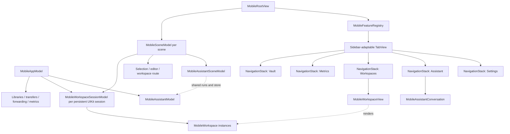
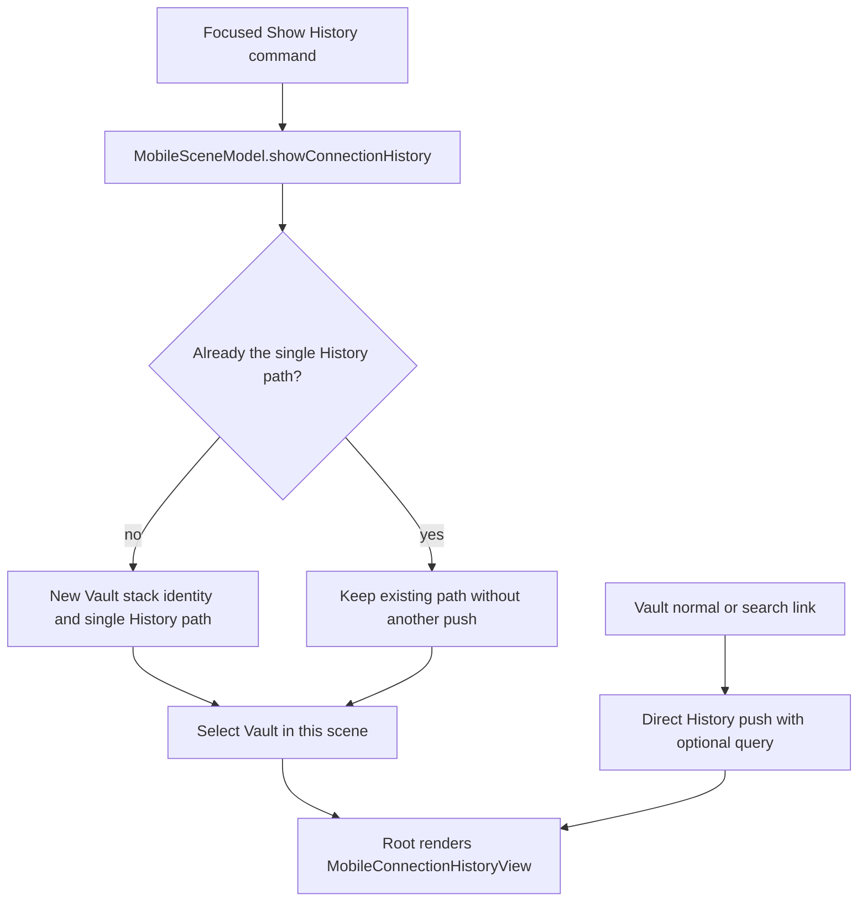
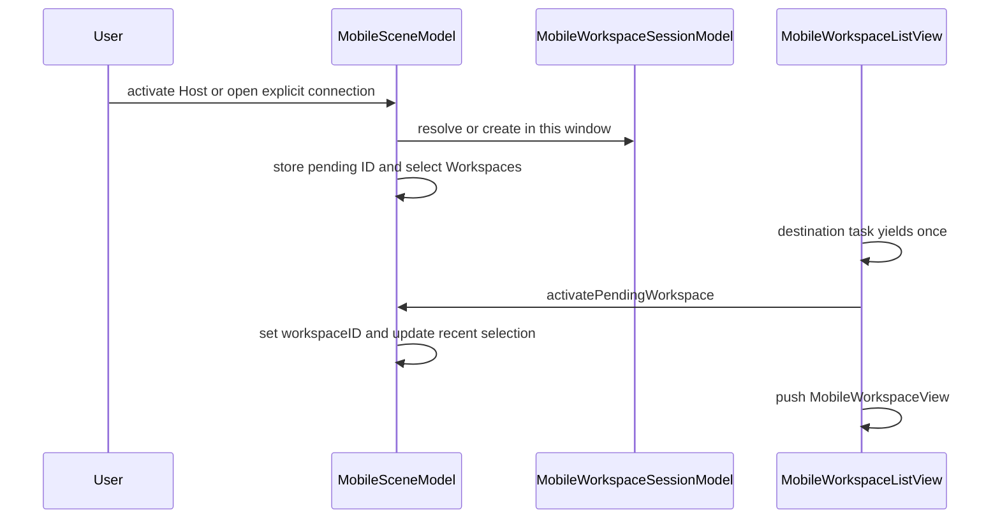
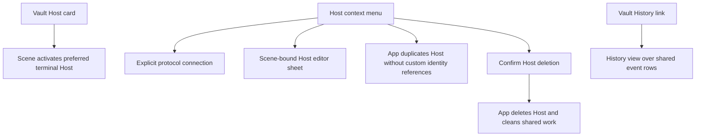
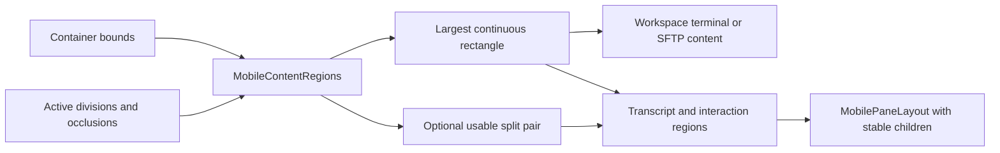
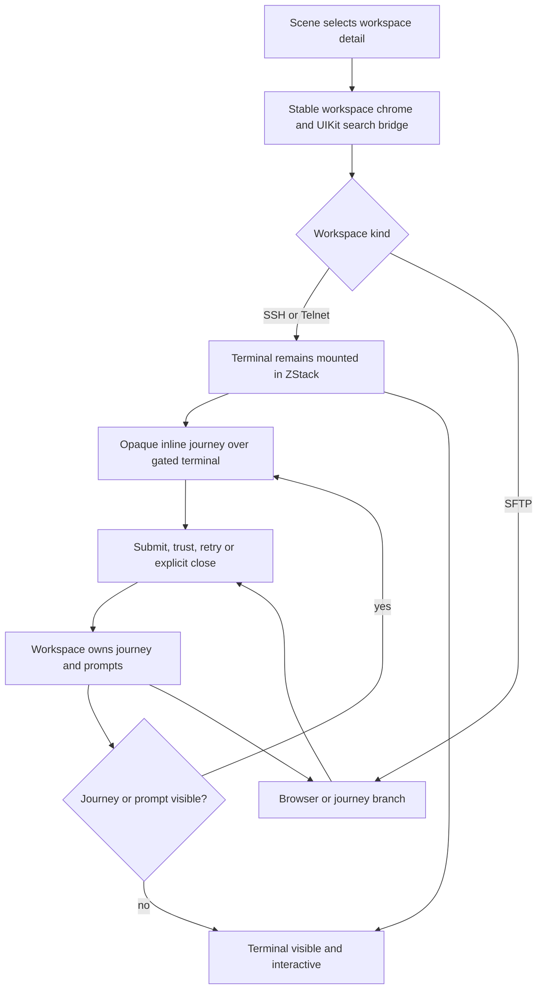
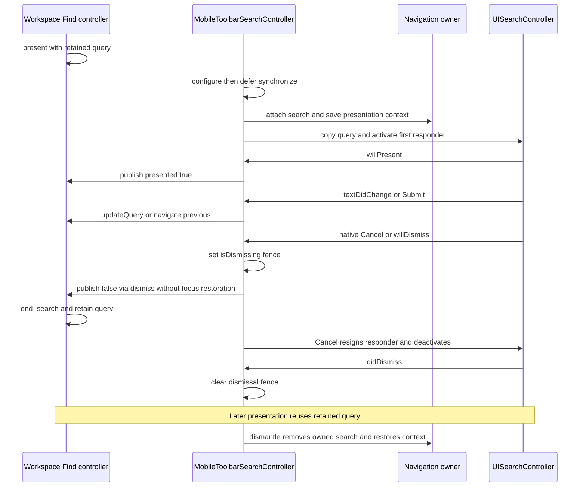
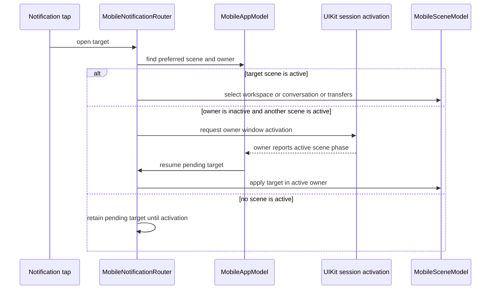
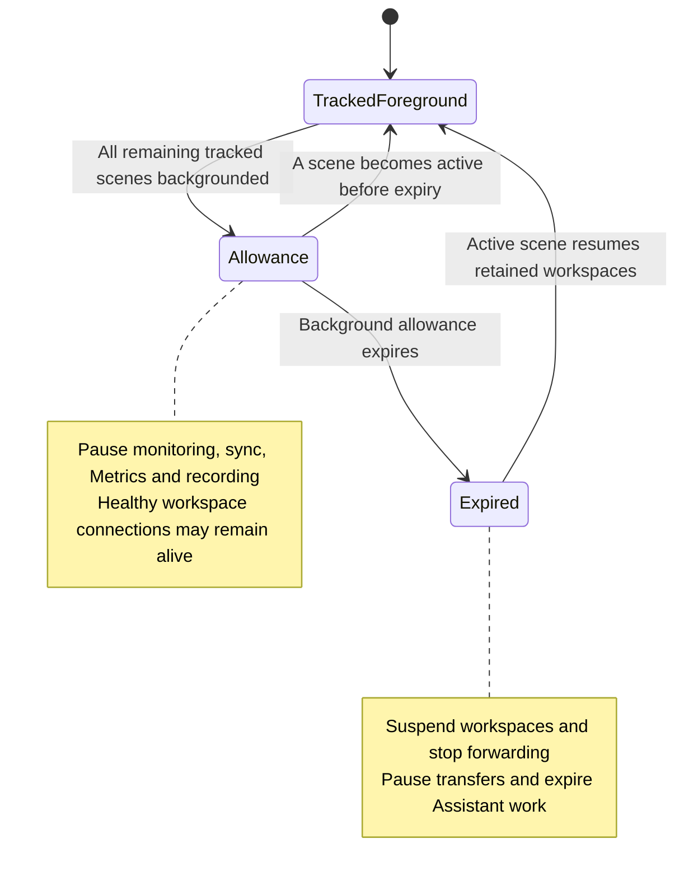

# Mobile UI Ownership and Adaptive Navigation

TFI is not a scaled-down copy of the desktop split-pane window. It uses system-adaptive top-level tabs/sidebar, a navigation stack for each registered feature, and scene-local routing. Application services are shared, but terminal workspaces and their in-process descriptors belong to window sessions keyed by persistent UIKit identifiers, not to one global workspace collection. Adaptation changes presentation without automatically replacing the conversation, terminal or connection being presented.

Read [TFM Desktop UI Architecture](desktop-ui.md) for the desktop contrast and [UI Design Principles](../concepts/ui-design-principles.md) for shared presentation boundaries.

## Code structure and ownership

Application services are shared while each scene retains its feature navigation and Assistant selection; each workspace runtime has a window-session owner.

`MobileFeatureRegistry` is the single registration table for feature identity, order, localized title, symbol and view builder. Its standard order is Vault, Metrics, Workspaces, Assistant, Settings, and duplicate destination registration is rejected. `MobileRootView` iterates registrations rather than maintaining independent tab/sidebar/destination switches.

Each registered destination gets its own `NavigationStack`; the enclosing `TabView` uses `.sidebarAdaptable`. The system can change where navigation appears without the app rebuilding a different root tree for “phone” and “tablet.” `MobileLayout` supplies a compact/regular hint, defaulting to compact when size class is absent; it is not the whole adaptive layout algorithm.

Settings is a dedicated destination, not a scene-wide settings sheet. `scene.openSettings()` selects `.settings`, including from the focused Command-comma action. Its stack links to App, Notifications, Terminal, Connections, AI and Sync settings over shared app models; `SettingsKey.debugSectionEnabled` conditionally exposes developer and logging controls. See [Settings and Cloud Sync](../workflows/settings-and-cloud-sync.md) for storage and synchronization policy.

Vault has an explicit scene-owned value path for command-driven History navigation. The root binds its Vault stack to `scene.vaultNavigationPath` and registers `MobileVaultRoute.history`; other feature stacks retain ordinary SwiftUI navigation. `showConnectionHistory()` replaces the path with exactly one History route and selects Vault. If the path differs, it also changes `vaultNavigationID`, resetting destination-based pushes that are not represented in the value path. Repeating the command with that same History path does not append duplicate routes. This deliberate reset is the exception to ordinary feature-stack retention, and affects only the receiving scene. Vault's normal and search links still push `MobileConnectionHistoryView` directly, allowing item-search links to carry their initial query.

History commands normalize only their scene's Vault stack; direct Vault links can preserve a forwarded search query.

### State lifetime matrix

| Owner | State or work | Expected lifetime |
| --- | --- | --- |
| `MobileAppModel` | Shared libraries, services, aggregate scene activity and registry of window workspace sessions; `workspaces` flattens live runtimes for cross-window operations. | Application/service lifetime. |
| `MobileWorkspaceSessionModel` | In-process descriptors, live runtimes, display order, connection creation and close operations for one persistent UIKit session ID. | Retained process/window session lifetime; survives temporary scene disconnect, not cold launch. |
| `MobileSceneModel` | Selected destination, workspace route, pending activation, editor/rename and picker presentation, recent selection; binds to its window's workspace session. | One scene. |
| `MobileAssistantModel` | Shared conversation store and execution services. | Survives scene navigation. |
| `MobileAssistantSceneModel` | Selected conversation and New Chat draft through its own library model. | Independent per scene over the shared store. |
| `MobileWorkspace` / `MobileTerminalSurface` | Connection/session state and owned native terminal view. | Workspace lifetime, not just the currently pushed detail. |
| Feature view state | Temporary picker, preview, drop loading and focus-request state. | Current presentation. |

Two iPad scenes can navigate independently over the same Assistant conversation store, but each window owns independent workspace/terminal instances, even when opening the same Host. Selecting a dormant descriptor publishes a runtime in its owning `MobileWorkspaceSessionModel` before connecting, so repeated selection in that session shares one initial attempt. `TermindIOSApp` constructs one app model before `WindowGroup`; `MobileStartupView` waits for the UIKit delegate's persistent session ID before `MobileBoundSceneRoot` creates a `@State` scene model. `MobileRootView` retains it and publishes it as a focused scene value for commands. Successful startup installs the mobile operation-confirmation renderer in the environment. Row-local anchored operations use SwiftUI's native confirmation dialog, with a visible Cancel action. Only centered collection-wide operations use the injected UIKit renderer: it creates an arrowless window-centered action-sheet popover, waits for existing context-menu/swipe transitions and runs actions after dismissal completes, so source views survive its exit transition. Startup success first gates the feature shell on diagnosis consent; a failed model construction displays a data-store error instead of mounting feature navigation. The bound root creates the scene in a task, rather than while evaluating its view body, and waits for an active scene before consuming a pending workspace activity.

## Navigation is an intent sequence

Opening a Host from another feature is deliberately staged:

Cross-tab activation defers the push until the Workspaces destination has had a chance to mount.

`MobileSceneModel.workspaceDestination` is an optional enum selecting either one Workspace UUID or Transfers; `workspaceSheet` independently selects Connection Picker or Batch Startup. `workspaceID`, `showsTransfers` and picker flags are derived accessors, not competing stored routes. The list has one item-based navigation destination and one item-based sheet. Opening Transfers or Connect clears an unfinished batch; an old sheet's dismissal cannot close a newly opened batch picker without a pending batch request.

When already on Workspaces, the scene can present the route directly. When changing tabs, pending activation waits for the Workspaces destination to participate before pushing its detail. Selecting another top-level destination clears pending workspace activation rather than leaving a delayed push armed.

Host activation and explicit connection actions are different:

- `activateHost` prefers this scene's most recently selected matching terminal workspace, then another matching live workspace **in this window's session**, before creating one. The same Host in another window is not reused.
- Explicit SSH, Telnet and SFTP connection actions call the session open path and can create independent workspaces. Connect presents a scene-local picker; Batch Startup holds a single pending selection until picker dismissal and then rechecks current protocol compatibility, creating new ordered workspaces only in this session without changing another scene's route. Opening Connect cancels an unfinished batch request.
- The workspace title switcher replaces the pushed detail in place with `.id(workspace.id)` in `MobileWorkspaceListView`. The old detail and its UIKit search bridge are dismantled before the new detail mounts, preventing an SFTP search presentation from leaking into an SSH detail. This resets **presentation** state, not the workspace-owned `sftpChannel.query`, Find query, connection or native terminal. `MobileWorkspace` supplies the retained native view through `terminal.makePlatformView`; replacing the SwiftUI detail identity is not recreating that view or reconnecting the runtime.

Unavailable saved workspace IDs produce an explicit unavailable state; a stale route does not silently open some other Host. Root-level deep links, quick actions and focused scene commands dispatch through that scene's model.

`MobileCommands` reads `FocusedValues.mobileScene`, rather than choosing an arbitrary app workspace. Settings, Connect, Batch Startup, New Host, Show History and Assistant commands therefore target the focused window. `showAssistant()` only selects its tab, preserving its conversation, draft and library/archive route; New Chat explicitly creates a fresh conversation and clears that route. Generate Command and command-menu Find are gated to an active SSH workspace.

URL entry has two different meanings. Workspace activity links select an existing UUID in its native owner (or the aggregate Workspaces list); `ssh:`, `sftp:` and `telnet:` URLs are parsed as external connection requests and create transient session-owned runtimes without saving a Vault Host or restoration descriptor. Parse errors surface through `app.error`. A Telnet URL carrying an advisory password waits in `pendingExternalConnection` for the root's Continue/Cancel alert; Continue consumes the request before opening it.

The Workspaces destination presents its **own session's** descriptors and live runtimes as one collection. `MobileWorkspaceSessionModel` seeds display order from descriptors supplied at initialization, appends an ID only once, and removes it on close, independently of live-runtime order. Production sessions start empty: `savedWorkspaceDescriptors` is an in-process projection, not a cold-launch store. Opening a dormant descriptor attaches a runtime without moving its row; new and temporary workspaces append in appearance order. The same ordered projection drives list and switcher.

Every row uses the same title, login address, protocol label and lifecycle actions. A live runtime shows an eight-point status dot when connected (green) or busy/reconnecting (orange); disconnected and saved-but-dormant items have no connection dot. Separately, a workspace with unread command completions or a manually marked unread state gets an unread dot and accessibility count; the Workspaces tab badge sums unread counts in **this session**, while the app badge sums across sessions and unarchived Assistant conversations. Focusing a terminal workspace in an active scene marks its completions read. Manual unread state follows a live workspace through window recovery but does not enter its saved descriptor. Rename edits either the live descriptor or the saved
descriptor directly, while Close removes the saved item and also disconnects it when a runtime exists. The detail switcher
includes both kinds, marks the selected descriptor with a checkmark, and uses the protocol symbol for every other item. Unread entries carry a dot in the native menu image, so a menu rebuild after marking read must not retain a stale badge.

### Window ownership, in-process recovery and cold launch

`MobileAppModel.workspaceSession(for:)` caches an initially empty session by UIKit's persistent identifier. Cold launch does not consolidate old window descriptors: initialization retires `mobile.workspaces.v1` and `mobile.recentlyClosed.v2`, including invalid snapshots, without migrating them or touching unrelated settings. Merely backgrounding a scene, removing its root view or receiving `sceneDidDisconnect` does **not** discard a session retained in this process.

Before routing, `MobileWorkspaceSceneRouting` reconciles `UIApplication.openSessions`. Existing workspace links route to their native owner rather than copying a runtime. Missing bare UUID links report unavailable. A valid Live Activity recovery payload can instead rebuild a new workspace for an existing, protocol-capable Host, with a **new UUID** and required remote-session selection. `activityRebuilds` deduplicates repeated source-link deliveries across scenes; this is explicit recovery, not automatic cold-launch restoration or startup-command replay.

When a native session is genuinely missing, an active window accepts its live objects, descriptors, display order and manual unread state directly in memory, without saving a handoff, reconnecting or recording another history attempt. If both native sessions still exist, disconnect keeps ownership unchanged. With no active target, recovery waits. Explicit native discard closes its items, including previously handed-off work, without wiping unrelated target-window work.

Recently closed records are shared across windows **only within this process**. Reopen constructs fresh runtimes with retained descriptors and applicable transient connection context, but not one-shot commands. Discarded windows form grouped records that can request a new native window; failed requests preserve the records. Relaunch starts with neither open Workspaces nor recently closed records.

### Deleting a Host is not popping a workspace

Vault's confirmed **Delete Host** calls `MobileAppModel.deleteHost`, not the detail's back action. Tailscale-managed Hosts reject direct deletion. For an ordinary Host, the app disconnects Assistant's Host pool, closes matching ordered session items across **all** windows, forgets matching recently-closed records, invalidates SFTP edits, cancels transfers, stops/removes forwarding rules and removes Metrics selection before requesting repository deletion, projecting the deletion and starting the durable outbox. Cleanup enumerates `orderedWorkspaceItems`, not only saved descriptors. A repository error surfaces through `app.error` and returns `false`; earlier cleanup is not rolled back. The registered outbox deletion handlers repeat workspace/history/projection, transfer and forwarding cleanup as the durable job proceeds. Deleting a Host group with `keepHosts: false` uses this Host path for each ordinary member, excluding Tailscale-managed Hosts; remote Vault removal closes associated saved descriptors and clears connection history and Metrics too. Scenes reconcile routes against their session's changed live workspace IDs rather than owning the deletion itself.

### Local Recents versus synchronized History

The Workspaces destination and Vault History expose different projections over the shared synchronized event stream. `MobileWorkspaceSessionModel.addWorkspaces` publishes the runtime after notifying the app to record a connection-history attempt for a library Host (before `connect()`); session `close` tells the app to end that event; an unsaved external-link workspace with no library Host does not record one. `MobileVaultView` provides the navigation link (and searchable link); `MobileConnectionHistoryView` owns the History list, search, row actions and clear confirmation. `MobileConnectionHistory` builds the rows rather than either view storing a separate timeline:

- Workspaces Recents appears only if **this window session's** ordered saved/live Workspace collection is empty. It uses this installation's events, aggregates protocols and attempts into one row per Host, and keeps the newest five Hosts. A primary tap resolves the Host's *current* preferred terminal protocol (SSH before Telnet); context and swipe actions offer only currently enabled SSH, Telnet or SFTP capabilities. Clearing a recent Host clears that Host's history across devices.
- Home Screen quick actions use the same local per-Host projection **regardless of whether the Workspaces list is empty**, publish at most three openable host-only `server.rack` items, and resolve the current preferred terminal protocol at activation. The scene delegate consumes each pending shortcut once; Connect opens the picker, while a shortcut to a removed or no-longer-terminal-capable Host shows workspace unavailable rather than opening the historical protocol. Older payloads carrying a protocol still decode, but that stale protocol is ignored. Root refreshes shortcuts on scene phase, history, Host and identity changes.
- Vault History follows Known Hosts in the unfiltered links and shows up to 50 individual events from all devices. Search filters by Host, login address, protocol and source-device name before applying the limit; Vault's own search can link into History with the query. The leading symbol stays protocol-specific and the device name comes from `DeviceDirectoryModel`. An event for a now-disabled protocol stays visible but cannot be tapped; row deletion removes one event, while **Clear History** clears the entire timeline, not just 50 displayed rows.

The unified Workspaces rows and local Recents align their text from the same 36-point Host distribution icon slot and
12-point gap. Workspace rows always show protocol at the common right edge and only connected or busy/reconnecting live runtimes overlay the status dot;
aggregated Recents omits both protocol and live state. Local Recents replaces the empty Workspace section rather than
appearing beside saved-but-dormant Workspaces. TFI exposes no Serial workspace or connection-history kind.

## Vault cards, search and editor ownership

`MobileVaultView` is the Vault landing page, not the owner of every Vault operation. It composes Keychain, Port Forwarding, Snippets, Known Hosts and History as links in its own feature stack. Searching replaces the normal Host/group presentation with matching Host cards and deep links to matching items or page titles; linked subpages receive the query when the match was an item. Metrics search is a cross-tab selection, not an empty Vault detail. Vault's Host sections use the library's group projection: nested groups have path titles, empty groups remain visible, collapse is persisted as device-local library presentation state (not a synchronized Vault group edit), and search still finds Hosts inside collapsed groups. New Host and New Group are in the add menu; per-group menus create Hosts/subgroups and edit or delete a group. Group deletion offers keeping Hosts (ungrouping them) or deleting the tree's Hosts through the app's Host deletion path.

`MobileCardPage` is a grouped-background scrolling page; `MobileCardGrid` measures its actual width and computes flexible columns with 12-point gaps, forcing a single column at accessibility text sizes. Standard columns use a 320-point minimum; compact cards use a scaled minimum of at least 76 points and at most four columns. Vault and Known Hosts read the device preference `mobile.compactCards`. Standard `MobileCard` and `MobileActionCard` surfaces have a 106-point minimum height; compact action cards use `MobileCompactCardLayout` instead, not that standard minimum. On iOS 26 the surface uses a concentric shape and glass only when transparency/contrast settings permit; older or higher-contrast/reduced-transparency presentation uses a solid grouped surface. The action card makes the *whole card* the primary button, leaving secondary actions in a context menu. Standard Host content displays at most two tags and reserves the chip's line height even with no tags, keeping the footer aligned; compact Host content uses the compact icon/title/status presentation instead.

A Vault Host card opens/reuses a terminal workspace through `scene.activateHost`; its connection indicator follows exactly that scene's matching preferred-terminal runtime, not SFTP or another window's connection. Its context menu offers enabled SSH/Telnet/SFTP explicit connections separately from Edit, Duplicate and Delete. Eligible Hosts also offer Tailscale peer details; managed Hosts disable Duplicate and Delete, with matching application guards. The card's relative timestamp comes from app connection history. `MobileAppModel.duplicateHost` gives the copy a new ID/name and strips references to Host-custom SSH, Telnet and proxy identities (and clears affected proxy usernames) rather than sharing Host-specific secrets; ordinary non-custom identity references remain on the copy. The edit sheet binds `scene.editingHost` so a New Host command can select Vault and present the same editor; Vault keeps only temporary delete/group confirmation state. Known Hosts is a *separate* Vault-linked card page: its primary card tap edits a known SSH host key, context actions copy the fingerprint or request deletion, and its add/edit sheet saves through `app.knownHosts`, not through the Host connection editor.

Vault gestures route to scene selection or application services; a Vault page does not own a running connection or the history repository.

`MobileHostEditor` holds an in-memory Host draft plus `HostCustomIdentityDraft` (password fields live only for the editor's lifetime). Shared `TermindPresentation` Host organization, protocol-profile and connection sections provide the form. Stateless `HostEditorBindings` projects identity/group/startup-snippet/proxy choices over the existing drafts; creation callbacks remain platform-owned. Mobile-specific sheets create a group, identity or environment variable and apply that result to the draft. Selecting the SSH or Telnet profile changes which authentication, proxy and session controls appear; save requires an address, an enabled terminal protocol, valid enabled ports, identity/proxy validation and valid SSH environment variables. `HostCustomIdentityDraft.save(into:using:)` persists applicable custom identities and then the Host via the library, throwing on failure. Do not treat a profile switch or sheet dismissal as a save.

`MobileEditorSheet` owns async Save/Cancel behavior for these forms: dirty Cancel shows a titleless, destructive-only discard action sheet with a resource-specific question for new drafts; clean Cancel or confirmed discard runs `onCancel` before dismissing. Save disables editing and shows progress, a thrown error stays on the sheet in an alert, and success dismisses it after checking cancellation. Dirty or saving sheets cannot be interactively dismissed; disappearance cancels the in-flight task. Becoming clean clears a pending discard prompt. Group and Known Host editors use the same wrapper with their own validation/storage boundary; the Known Host editor distinguishes Add from Edit and does not expose a port field for hashed addresses whose original address/port cannot be recovered.

## Adaptation has three inputs, not one device check

| Input | Mechanism | What it controls |
| --- | --- | --- |
| System navigation placement | `MobileToolbarLayout`, read from tab placement and optionally vertical toolbar edge. | Icon versus title switcher and whether workspace detail keeps tabs visible. |
| Available content geometry | `MobileRegionReader` → `MobileContentRegions`. | Continuous safe area and optional pair of regions around a division. |
| Content/input needs | Measured card width, Dynamic Type, composer height, focus and marked text. | Grid density, scrolling and retained native input surfaces. |

### Content-region algorithm

`MobileContentRegions` starts with the local container bounds, filters active intersecting reserved regions, and computes the largest usable rectangle that avoids them. It retains overlapping candidate rectangles during subtraction; forcing candidates to be disjoint could discard the largest continuous solution. Equal-area candidates prefer earlier vertical then horizontal coordinates.

A **division** can additionally yield a pair of usable regions on either side. An **occlusion** reduces usable space but does not by itself request a two-pane layout. A division with one unusable side is not a valid split. This is region-based layout, not a hard-coded assumption that a particular device always has a hinge.

Reserved geometry determines usable content and optional Assistant pane placement without replacing its native children.

Production reserved-region and vertical-toolbar queries use the current SDK directly and are gated by iOS 27.1 runtime availability, not a separate `TERMIND_HAS_IOS_27_1_SDK` compilation flag. On older systems the reader falls back to no reserved regions, while previews/tests can inject regions through the environment. The presence of deterministic fold-like tests is not a claim of verification on every physical device.

`MobilePaneLayout` retains a valid size per child index and places the same children into their new frames. Covered content keeps a valid size rather than replacing or reparenting its native surface. The layout must be paired with opacity, hit-testing and accessibility gates: parked geometry alone does not make a covered view noninteractive.

### Examples

- A terminal workspace uses the largest **continuous** region instead of splitting one terminal across a division.
- Assistant uses the first split region for the transcript and bottom-aligns its interaction surface in the second. Without a split, it subtracts measured interaction height from the continuous transcript region.
- Only top-bar navigation uses an icon-based Workspace/conversation switcher. Vertical toolbars keep app tabs visible but use the navigation title menu, as do ordinary bottom arrangements; sidebar placement also preserves workspace tabs. Returning to bottom placement clears the vertical presentation without changing runtime ownership.
- Cards adapt to their measured container width, not a global “iPad has two columns” rule. Accessibility Dynamic Type forces one column.

## Connection journeys are runtime state, not scene navigation

`ConnectionJourney` belongs to the active operation (`MobileWorkspace`, a Metrics `ServerMetric`, or a port-forwarding connection), not to `MobileSceneModel`. The scene selects a feature or workspace route; each detail decides how to present its runtime's journey. In `MobileWorkspaceView`, `showsJourney` is true for a presented journey, required authentication, a host-key prompt or a remote-session prompt. For **SSH and Telnet**, the terminal stays mounted in a `ZStack` beneath an opaque journey overlay: its container has opacity zero, hit testing disabled and accessibility hidden while covered. Workspace chrome, title switcher, toolbar and `MobileWorkspaceSearchModifier` remain outside this changing content and keep their identity. For **SFTP**, the journey and `MobileSFTPBrowser` are alternative branches: browser retention is not promised. Metrics likewise branches between journey and normal panels; its stable panel layout applies only within normal content. Thus changing tabs, popping a Metrics detail, or resizing does not itself answer or cancel a pending authentication challenge. The shared `TermindPresentation` header, route and status sections render the purpose-specific destination and connection phase; `MobileConnectionJourneyView` supplies mobile scrolling, a bounded content width, inline forms and logs. The route visualizes endpoints/checkpoints and scrolls toward activity except under Reduce Motion; its output is a view of the journey, not a second connection state machine.

SSH/Telnet retain the mounted terminal beneath a journey; SFTP branches its content while sharing stable workspace chrome and search.

The mobile content priority matters: logs (when toggled) replace the form, then pending security-key signing, keyboard-interactive challenge, ordinary SSH authentication, host-key confirmation, remote-session selection, failure with Retry/Cancel/Copy Logs, reconnect countdown/actions, and finally phase status. Challenge and authentication forms use prompt IDs as view identity; keyboard-interactive cancel checks that the challenge is still current. Logs can be copied to the pasteboard. The header compresses its log button for accessibility sizes, while the failure actions stack for large text and animation respects Reduce Motion. A refactor should not turn the journey into a modal sheet or a scene-global prompt: each caller supplies its own submit, trust, retry and cancel closures. Workspace Cancel closes its workspace; Metrics Cancel disables monitoring and dismisses detail; forwarding Cancel stops the rule and dismisses detail. See [SSH Session Lifecycle](../workflows/ssh-session-lifecycle.md) for connection-side behavior.

### Remote-session selection and explicit close

The workspace supplies its `sessionPersistence` coordinator to the inline journey. `RemoteSessionPromptView` offers existing-session attachment, New, Skip to a plain shell, Retry on discovery failure and Cancel, all tied to the current prompt ID. Session names can wrap, the list scrolls, and `ViewThatFits` stacks actions when horizontal space is insufficient. `RemoteSessionSelectionLayoutTests` checks long headers and expanding accessibility forms in English, German and Simplified Chinese; this is layout coverage, not a transport test.

Explicit close of a managed attachment can defer workspace removal through `app.persistentClose`. `MobileRootView` renders its close prompt as an overlay. Authorization checks that workspace ownership and the owning sessions' item snapshots remain valid before executing removal. Navigating away is not this authorization path. Host deletion requests closure too; do not interpret a requested close as immediate successful remote termination. Transport discovery, attachment and termination policy are described in [SSH Session Lifecycle](../workflows/ssh-session-lifecycle.md).

### Forwarding: local presentation over a shared runtime

`MobileForwardingView` owns its query, pushed rule ID, editor sheet, delete confirmation and operation error. Card tap pushes detail; Start/Retry from the card selects that detail and starts `app.forwardings`. Editing is disabled while a rule is active. The detail renders the shared connection's journey inline and has no disappearance-driven stop: popping it or switching tabs does not cancel pending authentication. Explicit Stop stops the rule; journey Cancel stops it and dismisses detail. Editor presentation remains a sheet, not the authentication surface.

`MobileForwardingRenderingTests` mounts a temporary key window and restores the previous key window on exit. Across English, Simplified Chinese and Traditional Chinese it renders cards, editors, named/unnamed details and the inline authentication journey. Its assertions verify the same prompt ID survives width changes and detail pop/push with no presented sheet, then explicit Stop clears the prompt and leaves the rule stopped. It uses `.requiresKeyWindow` and `.serialized`; the shared trait requires `TERMIND_MOBILE_UI_TESTS=1` and instructs disabling parallel testing.

### Metrics detail and monitoring boundary

The Metrics destination reads `app.metrics.servers` (one application-wide monitor per selected Host), not a scene-local worker. Its cards open a detail by Host ID; Pause/Resume, Retry and Remove act on the shared Metrics model. The view's `.task` starts that model idempotently, while the foreground/background lifecycle can restart or pause it independent of the Metrics tab. Add Hosts takes a snapshot of currently Metrics-eligible saved Hosts and configured selections, then applies the pending picker result **on dismissal** through `replaceHosts`; unavailable/out-of-selector selections are preserved by the model. Failed persistence is surfaced as `app.error`, while an admission-limit failure presents the Pro paywall. `MobileSceneModel` owns neither Metrics sampling nor this view's temporary selection sheet state.

`MobileMetricsDetailView` displays the inline journey whenever `server.requiresAuthentication` or `server.journey.isPresented`, before Metrics status/process panels. It wires authentication, host-key trust and Retry to `app.metrics.core`; its cancel disables that server and dismisses the pushed detail. When the journey is shown it stops detail observation; otherwise it registers its observer, including on the transition to live data, and removes the observer on disappearance. That observer controls detail-only sampling, **not** the lifetime of the shared monitor. Normal content keeps status and process children mounted in `MobilePaneLayout`, hiding covered children from hit testing and accessibility. A usable split shows both; without a division a sufficiently wide continuous area shows two columns, otherwise a page selection shows one. The page control is absent during the journey or when both panels fit; in a vertical toolbar it becomes a menu, otherwise a segmented picker. This separation keeps a challenge in the Metrics navigation stack instead of presenting a sheet or constructing a terminal workspace.

`MobileWorkspaceView` composes the connection/content area, search, feedback overlays, toolbar and transient sheets. Its toolbar is capability-shaped:

| Workspace kind | Representative actions |
| --- | --- |
| SSH | Generate Command, Snippets, command History, terminal match navigation, same-directory action and workspace lifecycle. |
| Telnet | Snippets, terminal match navigation and lifecycle; it does not inherit the SSH generation/history surface. |
| SFTP | Back/forward directory, Transfers, SFTP History, upload/new folder/paste, sort/hidden files/refresh, same-directory action and lifecycle. |

These are not all enabled merely because the menu exists. Connection state, available history, refresh state and operation capability control individual actions.

Each `MobileWorkspace` retains a `MobileTerminalSurface` and its native terminal view even when SwiftUI navigates away. The adapter binds the workspace Find controller, and appends F3/Shift-F3 Find key commands to Ghostty's existing commands. It replaces unmodified and Shift-Escape equivalents with Find dismissal only while Find is presented; ordinary terminal key handling remains with Ghostty otherwise. See [Ghostty Terminal Integration](../concepts/ghostty-terminal-integration.md) for the native menu hooks, backend and appearance flow.

Presentation cleanup is narrower than session shutdown: workspace view disappearance disables external Open With presentation and window drop handling, unbinds terminal upload-menu callbacks, clears the captured upload target and drop targeting, and cancels drop loading. UIKit search teardown separately calls `disconnect()` on its bridge. Neither is itself the instruction to disconnect the workspace: session `close` explicitly calls `workspace.close()` and removes its runtime and descriptor. Drop handling requires a visible detail and an active scene; destination or connection-generation changes cancel loading so an invisible or changed detail does not accept a late upload as though it were foreground. See [File Drag and Drop](../workflows/file-drag-and-drop.md) for payload and upload boundaries.

Command-generation and upload notices are overlays in the usable region; they do not take over hit testing. File previews, edit-copy export, transfer sheets and conflict alerts remain explicit temporary presentations over the workspace rather than new session owners. `MobileFileImportState` retains the selected download/edit target when importer dismissal arrives before its result; `takeTarget()` consumes it once, and reopening replaces a cancelled request. `MobileSFTPPreviewState` stages an exported copy while previewing or dismissing, and promotes it only in `previewDidDismiss`; dismissing the export clears it, and a new preview discards the old pending export.

SFTP context-menu previews reuse the row content at the measured list width and paint their own system background: the UIKit list background is not part of a lifted preview. Width is included in the native list refresh identity so resizing updates previews. The focused preview tests render files and directories at narrow/wide widths, light/dark appearances and English/Simplified Chinese locales, checking an opaque background rather than an arbitrary image byte count.

### Native toolbar search lifecycle

[`MobileWorkspaceSearchModifier`](../../TFI/Features/Workspaces/MobileWorkspaceSearchModifier.swift) binds SSH/Telnet search text to `workspace.find.query` via `updateQuery`, presentation to `present()` / `dismiss(restoringFocus: false)`, and Submit to `navigate(.previous)` (toward older terminal output). The workspace's `TerminalFindController` sends `search:<query>`, `navigate_search:<direction>` and `end_search` through `terminal.performBindingAction`. Presenting again reissues a nonempty retained query unless search is suspended for resize; clearing text updates the search without closing it. `MobileTerminalView.layoutSubviews` ends engine search before a native size change and cancels/replaces its delayed resume task. Resume waits through Ghostty's resize throttle plus 0.1 seconds, retaining UI/query state; the shared controller only restarts a still-presented nonempty latest query. Dismiss ends highlighting but does not erase the query. Ordinary programmatic `find.dismiss()` defaults to restoring terminal focus; **native UIKit dismissal deliberately does not**.

SFTP uses the same bridge with text bound to `workspace.sftpChannel.query`, but no model presentation binding or terminal Find action. That query filters already-loaded file names case-insensitively after hidden-file filtering, before sorting; it is not a remote search request. Closing search retains the filter in the workspace model even though the UIKit presentation is inactive.

[`mobileToolbarSearch`](../../TFI/UI/Components/MobileToolbarSearch.swift) mounts a background `UIViewControllerRepresentable` anchor with a single-line text binding. Its controller owns `UISearchController` and walks ancestors to find the child directly inside a `UINavigationController`. It attaches search to that child's `navigationItem`, captures and enables `definesPresentationContext`, and uses `.integratedButton` on iOS 26 or `.inline` on older systems. It does not obscure background content or hide the navigation bar. On owner change or dismantling it removes its own search controller and restores the captured presentation-context flag only if that navigation item still holds its controller.

Configuration from a SwiftUI update schedules synchronization on the next main-queue turn: UIKit delegate callbacks can publish back to the model, so they must not run synchronously inside the update. Parent attachment and appearance also synchronize. Synchronization attaches the navigation owner, copies retained text, and honors an optional model presentation request; activating Find makes the search bar first responder. The dismissal fence is essential: `isDismissing` blocks text synchronization, reactivation, edits and Submit callbacks until `didDismissSearchController` clears it. Do not replace this bridge with competing SwiftUI searchable/focus bindings that can reopen the integrated search mid-dismissal.

Native search delegates coordinate model state and UIKit responder transitions without clearing the workspace query or forcing terminal focus during dismissal.

Initial terminal focus is separate: `MobileTerminalInitialFocus` requests it on entry or readiness changes only when the detail is visible, the scene active, the workspace connected and no journey is showing—not on every ordinary view update. Keep layout retention, search responder ownership and connection readiness as separate responsibilities. These lifetime rules complement [Engineering Invariants](engineering-invariants.md).

## Assistant: stable transcript/input, independent run ownership

`MobileAssistantView` owns conversation navigation controls, library/archive routes and focus restoration requests. Replacing a conversation preserves composer focus only when it was already focused and the new state can accept focus. The asynchronous request rechecks the conversation ID after yielding, preventing an old request from focusing the wrong chat.

`MobileAssistantConversation` renders an incremental `MobileNativeList` plus a separately measured, scrollable interaction region. Stable entry IDs and per-row presentation revisions let disclosure changes target the relevant rows; viewport callbacks collapse offscreen work presentations. Transcript and interaction children remain stable through region changes, preserving native list identity and text-input composition.

The interaction region can contain more than the composer, so its height is measured rather than assumed from a fixed input-bar constant. It bottom-aligns and scrolls based on content size. Tapping the transcript can dismiss composer focus without changing the conversation or ending the run.

The shared application Assistant runtime owns execution, not `onDisappear` on the conversation view. It coalesces concurrent repository loads, restores conversations into one store, and gives each scene its own library selection and draft over that store; send is gated during suspension and on authorization, archive/history/compaction and pending-attachment state. Background expiry requests cancellation across conversations before awaiting their drain, then closes Assistant background commands and Host connections. The view's disappearance only removes its temporary preview directory. App background expiration is a separate boundary.

## Native notification routing and unread state

The app installs notification coordinators for terminal command completion, Assistant activity and SFTP transfers over its shared services. A tap arrives as a `NotificationTarget` at `notifications.onOpen`, which delegates to `MobileNotificationRouter`; it does **not** mutate whichever feature view happens to be mounted. Terminal focus suppression requires the owning workspace to be the visible detail in an active scene. Assistant focus suppression uses the scene's visible conversation (not a selected conversation hidden behind the library or another tab); when a conversation becomes visible, the root marks its notifications read. Transfers use the presence of a non-background scene to suppress a foreground notification. The Workspaces and Assistant tab badges and the application badge reflect the corresponding unread projections, and app termination stops the badge and notification observers.

A notification is retained until a suitable scene is active; activation switches windows instead of relocating a terminal workspace.

A terminal notification resolves only an **existing live** workspace ID and routes to a scene in its persistent owning session; a closed or missing runtime is dropped, not reconnected from a dormant descriptor. Assistant notification selection prefers an active scene already showing that conversation, then a scene showing or holding that selection, before falling back to another active scene. It loads the shared conversation store before opening the selected chat; if the ID is missing, the scene shows its conversation library instead. Transfers open the Workspaces stack's Transfers destination in the chosen active scene, clearing its workspace detail route but not marking command output read. If another window must be raised, the router requests its UIKit session only after some scene is active, coalesces repeated activation requests, and ignores stale failure callbacks. A newer tap to the same target kind supersedes its pending ID; consumed taps do not replay on later phase changes. `stop()` cancels the pending Assistant load and discards pending routes.

## Scene activity and background limits

`MobileRootView` reports its scene phase; `MobileAppModel` aggregates all scenes. Entering background handling occurs when **all tracked scenes** are backgrounded, not whenever one feature disappears or one scene resigns activity.

At that boundary the app pauses edit monitoring, memory/sync/Metrics/outbox work and recording, then starts its background allowance. Expiration suspends workspaces, stops forwarding, pauses transfers and expires Assistant background execution. An active scene refreshes the current device name, ends the allowance and asks retained workspaces to resume, rechecks edited files, and restarts the appropriate services. This is best-effort mobile continuity, not unlimited background network execution.

Background allowance and expiry are app-wide transitions derived from scene phases, not feature-view disappearance.

Closing a workspace, navigating back from its detail, switching tabs, and exhausting background allowance are therefore four different actions with different owners. Removing the last active scene while another remains backgrounded starts the allowance, but removing the last tracked scene does not create a new background lease; returning before expiration leaves a healthy connection intact. A UI refactor must preserve that distinction.

## Mobile design principles and verification

Implemented principles:

1. **Let the system adapt navigation.** Register each feature once and keep its stack stable.
2. **Adapt to usable space and capability.** Size class alone is insufficient for divisions, occlusions, vertical toolbars and large text.
3. **Preserve native input identity.** A layout transition should not discard marked text, keyboard focus or terminal scrollback.
4. **Use mobile affordances without losing desktop parity of intent.** Primary card taps, context menus, swipe actions, title menus and hardware-keyboard commands can expose the same operation differently.
5. **Keep app work out of transient view lifetimes.** Scene routes select shared work; they do not own every connection or Agent run.
6. **Hide covered interaction as well as pixels.** Hit testing and accessibility must follow the visible region.

Native-window coverage has distinct explicit opt-in contracts. `MobileMetricsJourneyTests` is a serialized, **key-window-gated** UIKit-hosted integration suite (`TERMIND_MOBILE_UI_TESTS=1`): it installs a temporary high-level **key** window, restores the previous key window in `defer`, and uses an injected Metrics sampler to create a real keyboard-interactive challenge without a network connection. Across en/zh-Hans/zh-Hant, 430/600/1024-point widths and accessibility text, it checks the challenge ID and two input fields survive detail pop/push and resizing, with no segmented control or presented sheet; entering the answer leads to live Metrics with one connection attempt and no extra modal. `MobileConnectionJourneyRenderingTests` lives under `TFITests/Screenshots/` and its entire suite, including keyboard-interactive rendering, requires `TERMIND_JOURNEY_SCREENSHOTS=1`. The forwarded-connection journey rendering suite is separately gated by `TERMIND_MOBILE_UI_TESTS=1` and asks for parallel testing to be disabled. Do not infer that an offscreen `UIHostingController` alone proves focus, native navigation or sheet behavior; run these key-window suites explicitly with parallel testing disabled. See [Behavioral Boundaries and Fixtures](../testing/behavioral-boundaries-and-fixtures.md) for the broader test strategy.

`MobileAdaptiveLayoutTests` mounts `MobileRootView` in a UIKit window and checks the same native `UITabBarController` with five selectable destinations over simulated 1024/600/375/320-point widths, regular/compact traits, large/accessibility Dynamic Type, and English, Simplified and Traditional Chinese locales. In compact mode it asserts all five tab labels are visible; on regular iPad widths the system bar can scroll. Other tests retain Assistant conversation/draft and Metrics navigation through resizing, check title-menu/icon switchers and Settings edit sheets, preserve Vault search and scroll, and isolate two scene models. Injected division and occlusion changes verify Metrics keeps the same native list and scroll offset and Assistant keeps its conversation, transcript `ListScrollView`, focused composer and Chinese marked text; a save-in-flight test preserves a sheet and failure feedback through width changes. These are simulated layout and injected-geometry tests, not proof of every physical device or SDK availability branch.

`MobileTerminalSearchIntegrationTests` (in `MobileTerminalSearchTests.swift`) is also serialized and gated by `TERMIND_MOBILE_UI_TESTS=1`. Its temporary key-window fixture tests repeated Find presentation after native, terminal-then-native and programmatic dismissal, retained queries and empty-query editing, and SFTP filter close/reopen. Its journey test checks the same search controller across journey begin/hide, retained SFTP query, and the same attached terminal for SSH. The journey fixture uses the production search modifier with a simplified content overlay; it does not prove SFTP browser retention. A separate full-`MobileWorkspaceView` SSH fixture repeatedly reopens search for empty, matching and nonmatching queries and checks the same native surface, retained output and unchanged upload connection generation.

`MobileWorkspaceRestorationTests` in `MobileAppTests.swift` now asserts an empty relaunch, retirement of both legacy workspace keys with unrelated settings retained, and explicit Live Activity rebuilding with a new identity and cross-scene deduplication. It rejects missing-Host, unsupported and command-bearing recovery links. These tests do **not** promise dormant-row cold-launch restoration. `MobileWorkspaceSessionTests` verifies independent terminals and close actions across windows, owner-window routing, in-process live handoff without reconnecting, temporary-disconnect retention and explicit discard. The optional serialized `MobileWorkspaceWindowIntegrationTests` exercises actual UIKit windows when `TERMIND_MOBILE_UI_TESTS=1` with parallel tests disabled. The adaptive Workspace-list fixture opens both runtimes before mounting and tests localized selection/layout without reordering; it is not evidence that a cold-launch dormant row connects on selection.

`MobileWorkspaceSessionTests` also exercises native notification routing: it checks that a tap waits for an active scene, a command tap returns to its own window without changing a different window, Assistant prefers a scene already showing or selecting the chat and honors the latest click, transfer taps consume once, stale activation failures do not erase newer requests, and unread command state stays with its window through recovery. `MobileStartupViewTests` checks a transfer tap received during startup is not applied before scene activation. `MobileWorkspaceMenuTests` is serialized and gated by `TERMIND_MOBILE_UI_TESTS=1`; it mounts a temporary key window and restores the previous one. It checks ordered opened/dormant descriptors in both icon and title menus, unread badge removal from native Assistant menus, and Close Others appearing only when multiple workspaces can close (not Close All in the detail lifecycle menu). `MobileHomeScreenQuickActionTests` checks the three unique local Host shortcuts, host-ID-only payload decoding (including legacy kind payloads), malformed-item rejection and single consumption by the scene delegate. `MobileBatchStartupTests` checks protocol fallback/filtering, separate workspace/history creation, confirmation revalidation, deferred once-only dismissal and scene isolation. `MobileCardTests` tests standard card column thresholds (one below 652 points, two from 652, three from 984, but always one for accessibility text), the two-tag display limit, nested/empty/collapsed Host groups, Known Host add/edit titles, and Host connection timestamps. `MobileCardLayoutTests` renders standard surfaces and checks balanced padding, minimum height and Host footer alignment across tag counts and large text; compact column policy is defined by `MobileCardLayout`. `MobileVaultFeatureTests` checks capability-filtered Host context-menu policy, duplication of a Host whose fixture has a non-custom identity (preserving the rest of its configuration), keep/delete group-tree behavior and proxy validation; the Host-custom identity stripping rule is implemented in `MobileAppModel.duplicateHost` but is not exercised by that duplication fixture. `MobileCardTests` verifies collapsed group projection/search and confirms toggling no longer changes the persisted Vault group's legacy `isExpanded` field; `MobileConnectionPickerTests` checks that History caps *matching event rows* at 50, searches device names and leaves disabled-protocol events visible but not openable. These policy tests complement, rather than replace, the UIKit-hosted adaptive tests for real navigation and sheet continuity.

Focused routing coverage starts with `MobileNavigationParityTests`, which asserts the single five-destination order, and `MobileShortcutTests`, which checks scene-local Settings/Connect/New Host/Assistant commands, nonduplicating Show History, Host activation reuse, workspace cycling and close behavior. `MobileHomeScreenQuickActionTests` covers decoding and once-only delegate consumption; `MobileAppTests` checks external connection transience and aggregate background leases. These model tests are distinct from key-window rendering coverage and do not alone prove native focus.

For a change, inspect scene routing tests for navigation, region/layout tests for geometry, workspace/terminal tests for session continuity, and Assistant tests for run-versus-selection ownership. See [Platform Runtime Composition](platform-runtime.md) and [Build, Test, and Release Operations](../operations/build-test-and-release.md) and [Engineering Invariants](engineering-invariants.md) before changing the lifetime boundary.

Command history and SFTP browse history belong to individual live Workspaces in memory. Reconnect retains their snapshots; explicit close clears them. Command-W closes the active Workspace, or requests native scene destruction when none is active; UIKit discard owns cleanup and a failed close request preserves the session.
