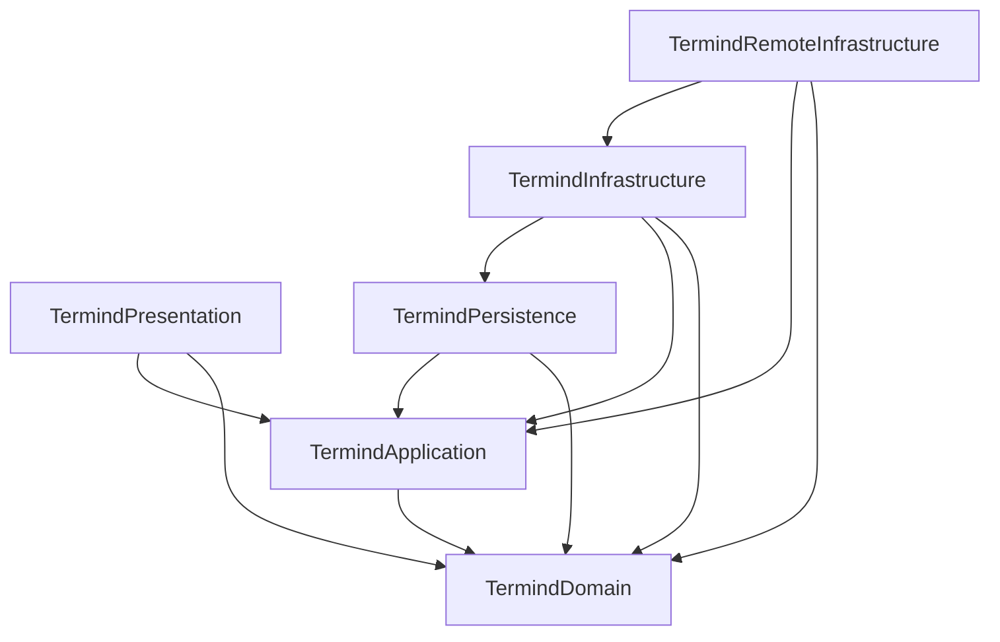
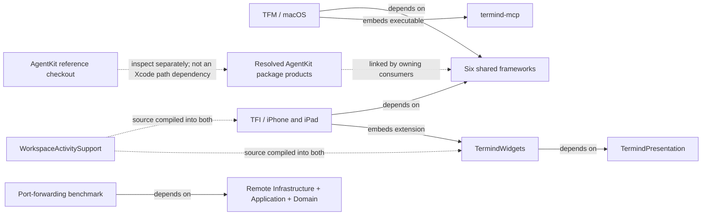

# Module and Directory Architecture Map

Termind has **two native apps and six shared frameworks**, not one framework per product feature. A feature such as SFTP crosses domain values, application policy, transport implementation, presentation, and native session ownership. Directory names describe responsibilities inside those layers; they are not necessarily independent build targets.

## Reading this map

The companion guides cover each module root and its functional children, including second-level directories such as `TFM/Features/SFTP`, `TFI/Application/Connections`, and `LandingPage/src/pages`. For frameworks, the module root is `Frameworks/Termind…`, not the enclosing `Frameworks` folder. Deeper functional divisions are included where useful. Flat modules are explicitly identified rather than assigned imaginary subdirectories. Repeated locale, device, and asset-catalog leaves are grouped.

| Guide | Scope |
| --- | --- |
| [Shared Framework Directory Responsibilities](shared-module-directories.md) | All six frameworks, every functional child directory, flat-root responsibilities, and shared resources. |
| [Native App Directory Responsibilities](native-app-directories.md) | Both apps, every feature directory, application/infrastructure subdirectories, native adapters, UI components, and resources. |
| [Supporting Products, Packages, and Tooling](supporting-system-directories.md) | AgentKit reference checkout, bridge, widgets, tests, benchmarks, website, assets, scripts, project metadata, and wiki automation. |

These are orientation guides, not replacements for [System Boundaries](system-boundaries.md) or [Engineering Invariants](engineering-invariants.md). Source locations and evidence are tracked in OpenWiki Claims; the tables intentionally describe directories rather than enumerate source files.

## Module owners

| Module or directory | Primary responsibility | Important distinction |
| --- | --- | --- |
| `Frameworks/TermindDomain` | Portable records, value types, parsing, and domain rules. | A Host or transfer record is not a live connection. |
| `Frameworks/TermindApplication` | Ports, use cases, observable feature models, connection policy, and Assistant coordination. | Defines/injects capabilities rather than constructing concrete storage or transports. |
| `Frameworks/TermindPersistence` | SwiftData models, historical schemas, migrations, stores, container factory, and GRDB-backed memory. | Owns stored representation, not a window or scene. |
| `Frameworks/TermindInfrastructure` | General concrete services: CloudKit, commerce, speech, logging, importers, and metrics parsing. | Separate from remote transport mechanics. |
| `Frameworks/TermindRemoteInfrastructure` | SSH/SFTP/Telnet, remote credentials, transfers, forwarding, sampling, and host-aware Agent tools. | Owns protocol machinery, not native interaction surfaces. |
| `Frameworks/TermindPresentation` | Reusable SwiftUI content, forms, formatting, transcript policy, and terminal appearance. | Does not own AppKit/UIKit surfaces or persistence. |
| `TFM` / `TFI` | Native composition, interaction, navigation, adapters, and runtime lifetimes. | macOS windows and mobile scenes are deliberately different owners. |
| `Frameworks/Resources` | Shared bundle assets, localization, model catalogs, and privacy metadata. | A resource group, not a seventh framework. |
| `AgentKit` | Reference checkout of the separately versioned, host-neutral agent package. | Xcode consumes the resolved remote package, not this checkout. |
| Supporting products | MCP stdio bridge, Live Activity extension, and standalone forwarding benchmark. | Different executable/extension boundaries, not app feature folders. |

## Shared-framework build dependencies

**Solid arrows mean “the source target directly depends on the destination target.”** This diagram shows the six shared Xcode targets only; external package products and app embedding are separate below. It is a build graph, not request order or data flow.

Both app targets directly depend on all six frameworks. The diagram also explains why Persistence is not interchangeable with general Infrastructure: Infrastructure can use Persistence, while Persistence must not depend on Infrastructure or Remote Infrastructure. Shared frameworks never depend on an app target.

## Product and package boundaries

Arrows here are **labeled relationships**, not a complete link graph. The shared-framework group expands into the graph above. AgentKit's package products are linked by multiple layers, including Domain, Application, Persistence, Remote Infrastructure, and app composition; the single package edge below groups those consumers rather than implying one exclusive entry point.

The MCP bridge translates stdio requests into authenticated HTTP calls to the desktop server; it is not the server itself. The widget renders a bounded workspace summary; it does not establish SSH sessions. The benchmark is a standalone executable, not app startup logic or a test-host dependency.

## How responsibilities meet

| Task | Policy / data owner | Concrete mechanism | Native owner |
| --- | --- | --- | --- |
| Connect a terminal | Domain host/session values; Application route, trust, and retry policy. | Remote Infrastructure SSH or Telnet; desktop serial adapter for serial sessions. | Desktop session/pane or mobile workspace; native terminal surface. |
| Browse or transfer files | Domain remote-file values; Application remote-filesystem and edit model. | Remote Infrastructure SFTP channels, transfer scheduler, planners, and edit service. | Native browser, conflict UI, local file access, and Open With presentation. |
| Run an Assistant turn | Application conversation/execution coordination; AgentKit generic runtime. | Termind host tools in Remote Infrastructure; persistence and memory stores. | Native composer, approval/input presentation, transcript mounting, and navigation. |
| Edit and synchronize Vault data | Domain snapshots and mutations; Application library/use-case state. | Persistence local stores and journals; Infrastructure CloudKit coordinators; Keychain secret implementation. | Platform editors and app-level service assembly. |
| Resolve this or another installation's display name | Domain `DeviceRecord`; Application device-directory port and observable model. | Persistence-owned SwiftData device records and Vault journal payloads. | Platform composition supplies the stable installation ID and system display name. |
| Display remote metrics | Domain metrics; Application sampling/snapshot interfaces and model. | Remote SSH sampler plus Infrastructure output parsers. | Native dashboards and desktop menu-bar integration. |

This split is also a placement rule: shared behavior belongs with its existing owner; native lifetime or platform API usage stays in the app. Similar names such as `Agent`, `Transfers`, `Terminal`, or `Metrics` in different modules do not imply duplicated responsibilities.

## State boundaries to keep in mind

- **Process-wide:** shared stores, service coordinators, and application models.
- **Desktop window:** navigation, workspace collection, pane selection, searches, and transcript caches.
- **Mobile scene:** navigation, selected workspace/conversation, and transient presentations; live workspace instances remain app-owned.
- **Session/workspace:** transport and terminal/browser runtime state. Disappearing views are not a general disconnect signal.
- **Durable storage:** metadata, histories, configuration, and separately governed memory; not live transports or transient credentials.

For lifetime diagrams, continue with [Native App Directory Responsibilities](native-app-directories.md) and [Platform Runtime](platform-runtime.md). For change-oriented navigation and verification, return to the [Engineering Quickstart](../quickstart.md).
