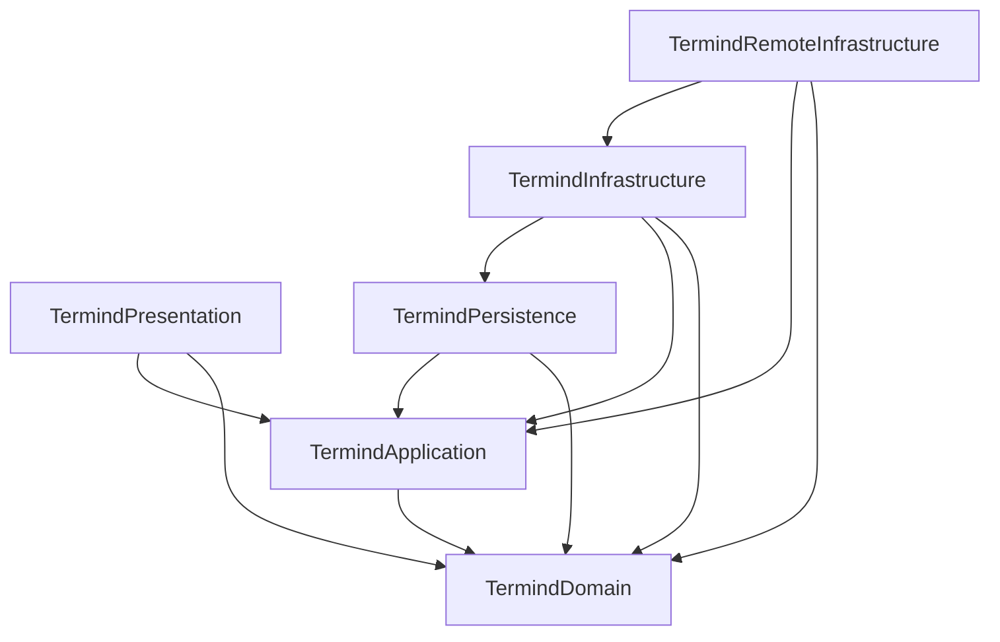
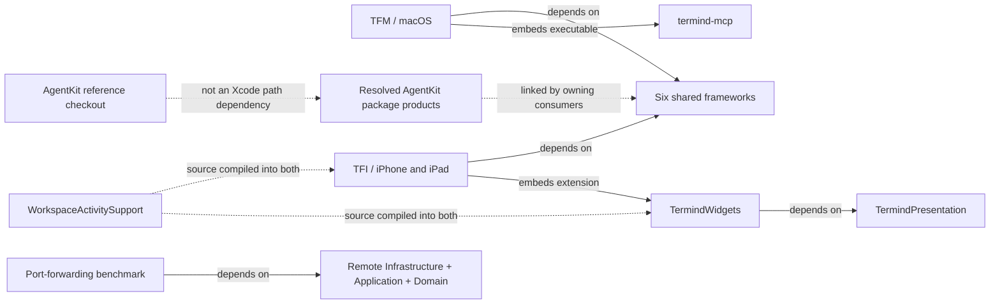
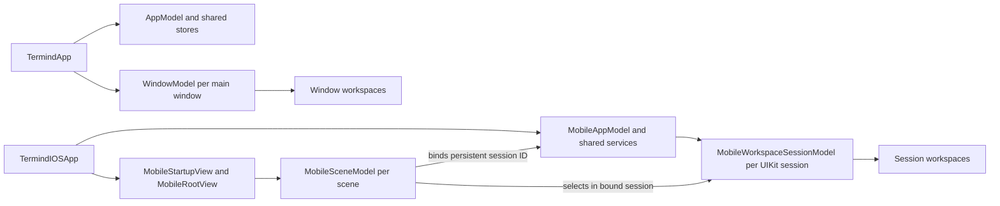

# Module and Product Map

Termind has **two native apps and six shared frameworks**, not one framework per product feature. A feature such as SFTP crosses domain values, application policy, transport implementation, presentation, and native session ownership. Directory names describe responsibilities inside those layers; they are not necessarily independent build targets.

## Reading this map

The companion guides cover each module root and its functional children, including second-level directories such as `TFM/Features/SFTP`, `TFI/Application/Connections`, and `LandingPage/src/pages`. For frameworks, the module root is `Frameworks/Termind…`, not the enclosing `Frameworks` folder. Deeper functional divisions are included where useful. Flat modules are explicitly identified rather than assigned imaginary subdirectories. Repeated locale, device, and asset-catalog leaves are grouped.

| Guide | Scope |
| --- | --- |
| [Shared Framework Directory Responsibilities](shared-module-directories.md) | All six frameworks, every functional child directory, flat-root responsibilities, and shared resources. |
| [Native App Directory Responsibilities](native-app-directories.md) | Both apps, every feature directory, application/infrastructure subdirectories, native adapters, UI components, and resources. |
| [Supporting Products, Packages, and Tooling](supporting-system-directories.md) | AgentKit reference checkout, bridge, widgets, tests, benchmarks, website, assets, scripts, project metadata, and wiki automation. |

These are orientation guides, not replacements for [System Boundaries](system-boundaries.md) or [Engineering Invariants](engineering-invariants.md). Source locations and evidence are tracked in OpenWiki Claims; the tables intentionally describe directories rather than enumerate source files.

## Module owners

| Module or directory | Primary responsibility | Important distinction |
| --- | --- | --- |
| `Frameworks/TermindDomain` | Portable records, value types, parsing, and domain rules. | A Host or transfer record is not a live connection. |
| `Frameworks/TermindApplication` | Ports, use cases, observable feature models, connection policy, and Assistant coordination. | Defines/injects capabilities rather than constructing concrete storage or transports. |
| `Frameworks/TermindPersistence` | SwiftData models, historical schemas, migrations, stores, container factory, and GRDB-backed memory. | Owns stored representation, not a window or scene. |
| `Frameworks/TermindInfrastructure` | General concrete services: CloudKit, commerce, speech, logging, importers, and metrics parsing. | Separate from remote transport mechanics. |
| `Frameworks/TermindRemoteInfrastructure` | SSH/SFTP/Telnet, remote credentials, transfers, forwarding, sampling, and host-aware Agent tools. | Owns protocol machinery, not native interaction surfaces. |
| `Frameworks/TermindPresentation` | Reusable SwiftUI content, forms, formatting, transcript policy, and terminal appearance. | Not a persistence or native-app owner; some shared views use conditional AppKit/UIKit for platform-specific rendering. |
| `TFM` / `TFI` | Native composition, interaction, navigation, adapters, and runtime lifetimes. | Desktop windows own their workspaces; on mobile each persistent UIKit scene session owns a workspace collection through an app-managed `MobileWorkspaceSessionModel`. |
| `Frameworks/Resources` | Shared bundle assets, localization, model catalogs, and privacy metadata. | A resource group, not a seventh framework. |
| `AgentKit` | Reference checkout of the separately versioned, host-neutral agent package. | Xcode consumes the resolved remote package, not this checkout. |
| Supporting products | MCP stdio bridge, Live Activity extension, and standalone forwarding benchmark. | Different executable/extension boundaries, not app feature folders. |

## Shared-framework build dependencies

**Solid arrows mean “the source target directly depends on the destination target.”** This diagram shows the six shared Xcode targets only; external package products and app embedding are separate below. It is a build graph, not request order or data flow.

Both `TFM` and `TFI` directly depend on all six frameworks; `TermindDomain` has no shared-target dependency. These are explicit `PBXTargetDependency` edges, not inferred from directory proximity or imports. The diagram also explains why Persistence is not interchangeable with general Infrastructure: Infrastructure can use Persistence, while Persistence must not depend on Infrastructure or Remote Infrastructure. Shared frameworks never depend on an app target. `FrameworkTests` depends on all six shared frameworks, while `TFMTests` and `TFITests` depend on their respective app plus selected shared frameworks; the benchmark does not depend on either app or a test target.

## Product and package boundaries

Arrows here are **labeled relationships**, not a complete link graph. The shared-framework group expands into the graph above. The remote AgentKit package supplies `AgentKit` to Domain, Application, Persistence, both apps, and tests; `AgentKitScrubber` is linked by Remote Infrastructure and desktop composition. The single package edge below groups those consumers rather than implying one exclusive entry point. `TermindPresentation` instead directly links the Ghostty and MarkdownView package products, and `TermindRemoteInfrastructure` links `CSSH2` and `OpenSSL`. Check target `packageProductDependencies` for the exact package linkage before relocating code.

The MCP bridge translates stdio requests into authenticated HTTP calls to the desktop server; it is not the server itself. `TFM` builds and embeds this separate tool. `TFI` builds and embeds the `TermindWidgets` extension, which directly depends on Presentation; `WorkspaceActivitySupport` is source-compiled in both the app and extension (and in `TFITests`), not a seventh framework. The widget renders a bounded workspace summary; it does not establish SSH sessions. The benchmark is a standalone executable linked to Remote Infrastructure, Application, and Domain, not app startup logic or a test-host dependency.

**AgentKit version boundary:** `.gitmodules` names an `AgentKit/` reference checkout, and repository guidance also describes a sibling `../AgentKit` development tree. Neither is wired into this Xcode project as a local package path: the project declares a remote `upToNextMajorVersion` requirement starting at `0.18.1`, and `Package.resolved` pins version `0.18.1` at revision `e21235d8647a780e16a1c2c3b19cc00db5c82cb7`. Use `-onlyUsePackageVersionsFromResolvedFile` when building to require that committed pin rather than silently re-resolving. A local checkout edit alone will not change the Xcode build; release the package change, update the project requirement, and re-resolve the pin together. AgentKit owns the generic agent loop and tools; Termind registers host-specific SSH/SFTP tools in Remote Infrastructure. `TermindAgentTools` builds the host tool list from narrowly injected services, restricts mutating SSH/SFTP registrations to acting while providing a separate planning SSH tool, and combines built-in and Termind presenter registrations so persisted transcript cards can still be rendered. Optional pane and scratch capabilities omit their tools when unavailable; older cards without presenter IDs use an explicit legacy-name allowlist. Do not substitute the sibling working tree's version for the resolved Xcode revision.

**Other local checkout boundaries:** `.gitmodules` also lists `libssh2-spm/` and `libghostty-spm/`, but Xcode references remote `AkinoKaede` package URLs rather than either checkout. `libssh2-spm` is required at exact version `2.0.3-termind-1` (resolved revision `c2df1cacae38d3bd8dcdd5bd9290f668b88f4257`); `libghostty-spm` is required at revision `acb252ed011d6c0168596a931f802ca69e1e139a`, which is also its resolved revision. Changing local fork source or a submodule gitlink alone is not a change to the Xcode package input: update the remote release/revision, project requirement and resolution as appropriate. For any package, the project requirement defines the allowed input and `Package.resolved` records the selected revision; keep the resolved-only build flag in verification commands (see [Build, Test, and Release](../operations/build-test-and-release.md)).

## How responsibilities meet

| Task | Policy / data owner | Concrete mechanism | Native owner |
| --- | --- | --- | --- |
| Connect a terminal | Domain host/session values; Application route, trust, and retry policy. | Remote Infrastructure SSH or Telnet; desktop serial adapter for serial sessions. | Desktop session/pane or mobile workspace; native terminal surface. |
| Browse or transfer files | Domain remote-file values; Application remote-filesystem and edit model. | Remote Infrastructure SFTP channels, transfer scheduler, planners, and edit service. | Native browser, conflict UI, local file access, and Open With presentation. |
| Run an Assistant turn | Application conversation/execution coordination; AgentKit generic runtime. | Termind host tools in Remote Infrastructure; persistence and memory stores. | Native composer, approval/input presentation, transcript mounting, and navigation. |
| Edit and synchronize Vault data | Domain snapshots and mutations; Application library/use-case state. | Persistence local stores and journals; Infrastructure CloudKit coordinators; Keychain secret implementation. | Platform editors and app-level service assembly. |
| Resolve this or another installation's display name | Domain `DeviceRecord`; Application device-directory port and observable model. | Persistence-owned SwiftData device records and a device-kind History journal; Infrastructure's `DeviceSyncCoordinator` writes native `DeviceItem` fields through its own sync engine, subject to the app's iCloud/Pro sync gate. | Platform composition supplies the stable installation ID and system display name. |
| Display remote metrics | Domain metrics; Application sampling/snapshot interfaces and model. | Remote SSH sampler plus Infrastructure output parsers. | Native dashboards and desktop menu-bar integration. |

The Assistant is a useful change-placement example: `AssistantExecutionController` accepts an injected registry factory, authorization callback, run repository, and title generator; app-specific host services provide tools without making the Application framework construct SSH machinery. On mobile the app model wires `AgentHostServices.live` with its connection coordinator and SFTP scheduler. For speech it supplies `IOSSpeechAudioInput` to the shared transcription service and cancels speech on interruption. The remote-filesystem port similarly separates file policy from the SFTP transfer coordinator; Vault sync reads Persistence-owned journals rather than moving CloudKit policy into the app.

The device directory illustrates why target edges alone are insufficient: `DeviceDirectoryModel` registers the current installation on initialization, caches lookup results, and reports storage errors. The SwiftData repository refuses to resurrect a remotely deleted device during launch registration, but an explicit rename can upsert it; successful writes notify `DeviceSyncCoordinator` through History mutations. Remote application of device records invalidates the model's cache on both platforms. The device and connection-history coordinators share a CloudKit zone but keep separate kind-filtered engines and sync state; the device coordinator is independent of the Vault **record format and journal**, not exempt from the app's Pro/iCloud start/pause policy. See [System Boundaries](system-boundaries.md) for the sync contract.

This split is also a placement rule: shared behavior belongs with its existing owner; native lifetime or platform API usage stays in the app. Similar names such as `Agent`, `Transfers`, `Terminal`, or `Metrics` in different modules do not imply duplicated responsibilities.

## Composition and state boundaries

The composition boundary is directional: app entrypoints choose concrete adapters and inject them into shared feature models. A scene or window route is not a durable store or a transport. Both platforms keep window-local workspace collections, but mobile session models are retained by the shared app model and keyed to persistent UIKit scene IDs. Initialization failures have different product behavior: desktop presents a database-in-use error and exits when another process holds the store, or aborts launch for other database-open errors; mobile renders unavailable content instead. Test composition uses in-memory stores and omits live sync, so an in-memory passing test does not verify CloudKit transport.

Composition and navigation lifetimes: desktop windows own workspaces; mobile scene navigation binds an app-retained workspace session for its persistent UIKit window ID.

`TFM/App/TermindApp.swift` is the desktop `@main` entrypoint. It opens the Persistence container, wires stores, Keychain-backed secrets, sync and connection coordinators into an app-wide `AppModel`, and injects that model and container into each `WindowGroup` root. Each main window receives its own `WindowModel`; a separate authentication window uses the shared app environment. A database-in-use failure calls `DatabaseStartupGuard.presentDatabaseInUseAndExit()`; other initialization errors end launch with `fatalError`. On mobile, `TFI/App/TermindIOSApp.swift` is the actual `@main`, **not** `MobileAppModel.swift`: it chooses live versus test dependencies and constructs one `MobileAppModel`. `MobileStartupView` installs its container for the bound scene root or displays unavailable content if initialization throws. `MobileAppModel` assembles SwiftData, Keychain or in-memory secrets, remote services, sync coordinators and Assistant; it retains the workspace sessions and a flattened view of their live workspaces. In the in-memory/test path it omits live sync and disables Live Activities by default. Each `MobileSceneModel` binds to the `MobileWorkspaceSessionModel` for its persistent UIKit session ID. That session owns live workspaces, ordered restoration descriptors and open/close operations; scene navigation selects from **its own session**, not from all app workspaces. Cross-window workspace links activate the owning native session rather than stealing its connection.

- **Process-wide:** shared stores, service coordinators, and application models.
- **Desktop window:** navigation, workspace collection, pane selection, searches, and transcript caches.
- **Mobile UIKit session:** its app-retained `MobileWorkspaceSessionModel` owns connection intent, live workspaces and persisted descriptors; the scene model owns selection, navigation, conversation and transient presentations. Backgrounding or view disappearance does not discard the session. Explicit native-session discard closes only its workspaces.
- **Session/workspace:** transport and terminal/browser runtime state. Disappearing views are not a general disconnect signal.
- **Durable storage:** metadata, histories, configuration, and separately governed memory; not live transports or transient credentials. Mobile restoration saves descriptors per session, not live connections.

On mobile, `workspaceSession(for:)` consolidates saved descriptors into the first bound window on a new process launch without opening connections. Later sessions start with their own collections. A disconnected scene can still be a restorable native session, so reconciliation against UIKit open-session IDs precedes recovery of orphaned live workspaces into an active session; the snapshot is saved before transferring the live instances. If saving fails, recovery is skipped and an error is reported instead of silently duplicating ownership. An explicit discard closes that session's workspaces (including any previously recovered from it). `TFITests/MobileWorkspaceSessionTests.swift` covers independent windows, cold-launch consolidation, reclaim versus discard, recovery, and activity-link routing; `MobileWorkspaceWindowIntegrationTests` exercises actual UIKit windows only when `TERMIND_MOBILE_UI_TESTS=1` with parallel testing disabled.

For lifetime diagrams, continue with [Native App Directory Responsibilities](native-app-directories.md) and [Platform Runtime](platform-runtime.md). For change-oriented navigation and verification, return to the [Engineering Quickstart](../quickstart.md).

## Verifying a boundary change

`TFMTests/ArchitectureBoundaryTests.swift` supplies **source-level** guards alongside the Xcode target graph, not a blanket ban on UI or platform APIs everywhere. Its import scan excludes `Termind` and `TermindIOS` plus AppKit, UIKit, IOKit, and ServiceManagement from Domain, Application, Infrastructure, Remote Infrastructure, and Persistence; the separate Presentation check excludes app imports, storage and implementation modules, StoreKit, AppKit, and UIKit. However, the import helper checks only exact `import Module` lines, and shared Presentation currently uses conditional AppKit/UIKit imports for rendering; treat those platform exclusions as test intentions, not proof that every shared view is platform-agnostic. Domain also excludes storage, transport, and UI libraries; Application excludes concrete implementation imports and selected construction tokens; Persistence excludes Infrastructure and Remote Infrastructure imports. Native UI and feature restrictions are scoped: mobile `Application` excludes UI and storage imports, mobile `UI` excludes storage and Remote Infrastructure imports, desktop `Features` excludes selected storage and transport imports, and feature directories are checked for specific direct construction/access tokens. This does **not** forbid all framework imports in every native feature. The test also rejects declarations of a named subset of AgentKit-owned runtime types in the desktop source tree, not every AgentKit-related type across the repository; Termind still owns host-specific tool registrations. Further checks protect SwiftData model/repository placement and the forwarding benchmark's independence from app/test targets. When moving a capability, inspect both target/package-product edges and the precise test scope. Use the pinned-resolution build/test commands in [Engineering Quickstart](../quickstart.md).
