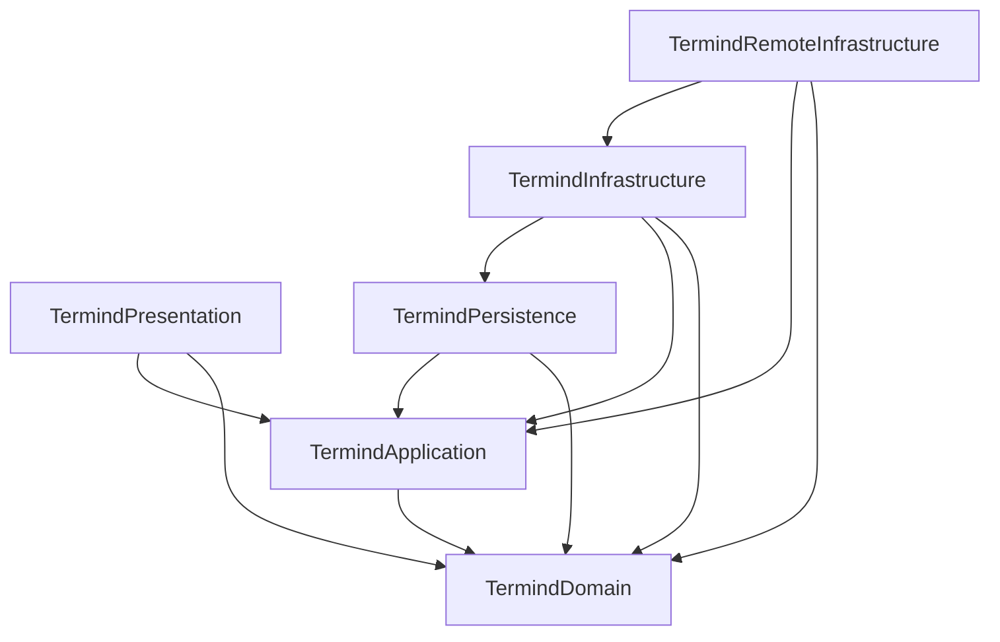
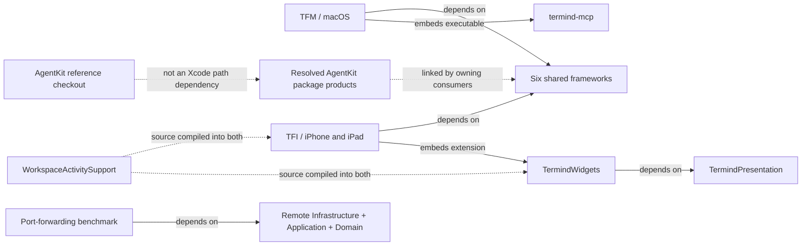
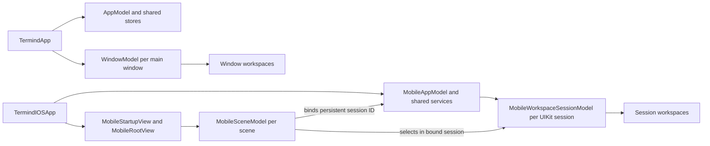

# Module Ownership and Composition Roots

Termind has **two native apps and six shared frameworks**, not one framework per product feature. A feature such as SFTP crosses domain values, application policy, transport implementation, presentation, and native session ownership. Directory names describe responsibilities inside those layers; they are not necessarily independent build targets.

## Reading this map

Start with the owner and dependency direction, not the folder with the closest feature name. The module roots are `Frameworks/Termind…`; `Frameworks/Resources` is shared input rather than another module. Native `Application` and `Infrastructure` directories are app-local policy and adapters, not additional shared framework targets.

Use [System Boundaries](system-boundaries.md) for contracts, [Engineering Invariants](engineering-invariants.md) for safe-change rules, and [Platform Runtime](platform-runtime.md) for detailed scene, session, restoration, and teardown lifetimes. Dependency update and release procedures belong in [Build, Test, and Release](../operations/build-test-and-release.md).

## Module owners

| Module or directory | Primary responsibility | Important distinction |
| --- | --- | --- |
| `Frameworks/TermindDomain` | Portable records, value types, parsing, and domain rules. | A Host or transfer record is not a live connection. |
| `Frameworks/TermindApplication` | Ports, use cases, observable feature models, connection policy, and Assistant coordination. | Defines/injects capabilities rather than constructing concrete storage or transports. |
| `Frameworks/TermindPersistence` | SwiftData models, historical schemas, migrations, stores, container factory, and GRDB-backed memory. | Owns stored representation, not a window or scene. |
| `Frameworks/TermindInfrastructure` | General concrete services: CloudKit, commerce, speech, logging, importers, and metrics parsing. | Separate from remote transport mechanics. |
| `Frameworks/TermindRemoteInfrastructure` | SSH/SFTP/Telnet, remote credentials, transfers, forwarding, sampling, and host-aware Agent tools. | Owns protocol machinery, not native interaction surfaces. |
| `Frameworks/TermindPresentation` | Reusable SwiftUI content, forms, formatting, transcript policy, and terminal appearance. | Not a persistence or native-app owner; some shared views use conditional AppKit/UIKit for platform-specific rendering. |
| `TFM` / `TFI` | Native composition, interaction, navigation, adapters, and runtime lifetimes. | Desktop windows own their workspaces; on mobile each persistent UIKit scene session owns a workspace collection through an app-managed `MobileWorkspaceSessionModel`. |
| `Frameworks/Resources` | Shared bundle assets, localization, model catalogs, and privacy metadata. | A resource group, not a seventh framework. |
| `AgentKit` | Reference checkout of the separately versioned, host-neutral agent package. | Xcode consumes the resolved remote package, not this checkout. |
| Supporting products | MCP stdio bridge, Live Activity extension, and standalone forwarding benchmark. | Different executable/extension boundaries, not app feature folders. |

Host artwork is a concrete example of shared Presentation ownership. `HostIconCatalog` loads `HostIcons.json` from the main bundle (falling back to an empty catalog on load/decode failure), resolves an explicit `iconOverrideID` before detected distribution matching, and otherwise matches the distribution ID before its `likeIDs`. An unknown explicit override returns no catalog entry rather than falling through to detection. `HostDistributionIcon` composes that choice with `HostSystemIcon`; tint precedence is the host's color tag, then `HostIconBrandColor`, then the accent color. `HostIconBrandColor` owns the conditional AppKit/UIKit semantic-color adaptation, adjusting brand foregrounds toward the label color for contrast on the tinted icon surface. `TFMTests/HostIconPresentationTests.swift` checks bundled assets, override priority, and light/dark contrast. These are shared rendering responsibilities, not connection or app-lifecycle ownership.

## Shared-framework build dependencies

**Solid arrows mean “the source target directly depends on the destination target.”** This diagram shows the six shared Xcode targets only; external package products and app embedding are separate below. It is a build graph, not request order or data flow.

Direct dependencies among the six shared framework targets.

Both `TFM` and `TFI` directly depend on all six frameworks; `TermindDomain` has no shared-target dependency. These are explicit `PBXTargetDependency` edges, not inferred from directory proximity or imports. The diagram also explains why Persistence is not interchangeable with general Infrastructure: Infrastructure can use Persistence, while Persistence must not depend on Infrastructure or Remote Infrastructure. Shared frameworks never depend on an app target. `FrameworkTests` depends on all six shared frameworks, while `TFMTests` and `TFITests` depend on their respective app plus selected shared frameworks; the benchmark does not depend on either app or a test target.

## Product and package boundaries

Arrows here are **labeled relationships**, not a complete link graph. The shared-framework group expands into the graph above. The remote AgentKit package supplies `AgentKit` to Domain, Application, Persistence, both apps, and tests; `AgentKitScrubber` is linked by Remote Infrastructure and desktop composition. The single package edge below groups those consumers rather than implying one exclusive entry point. `TermindPresentation` instead directly links the Ghostty and MarkdownView package products, and `TermindRemoteInfrastructure` links `CSSH2` and `OpenSSL`. Check target `packageProductDependencies` for the exact package linkage before relocating code.

Native products, supporting executables and extensions, and remote package consumption boundaries.

The MCP bridge translates stdio requests into authenticated HTTP calls to the desktop server; it is not the server itself. `TFM` builds and embeds this separate tool. `TFI` builds and embeds the `TermindWidgets` extension, which directly depends on Presentation; `WorkspaceActivitySupport` is source-compiled in both the app and extension (and in `TFITests`), not a seventh framework. The widget renders a bounded workspace summary; it does not establish SSH sessions. The benchmark is a standalone executable linked to Remote Infrastructure, Application, and Domain, not app startup logic or a test-host dependency.

**AgentKit version boundary:** `.gitmodules` names an `AgentKit/` reference checkout, and repository guidance also describes a sibling `../AgentKit` development tree. Neither is wired into this Xcode project as a local package path: the project declares a remote `upToNextMinorVersion` requirement starting at `0.19.2`, and `Package.resolved` pins version `0.19.2` at revision `ca325632bc91886702673a79522e3b862ac940ff`. A local checkout edit alone will not change the Xcode build. AgentKit owns the generic agent loop and tools; Termind registers host-specific SSH/SFTP tools in Remote Infrastructure. `TermindAgentTools` builds the host tool list from narrowly injected services, restricts mutating SSH/SFTP registrations to acting while providing a separate planning SSH tool, and combines built-in and Termind presenter registrations so persisted transcript cards can still be rendered. Optional pane and scratch capabilities omit their tools when unavailable; older cards without presenter IDs use an explicit legacy-name allowlist. See [Agent Runtime and Assistant](../concepts/agent-runtime-and-assistant.md).

**Maintenance versus remote dependency boundaries:** Xcode's declared requirement and its selected revision are separate from maintenance checkout HEADs:

| Remote input | Current Xcode requirement | Selected version and revision |
| --- | --- | --- |
| `AkinoKaede/libssh2-spm` | `upToNextMinorVersion` from `2.0.3-termind-4` | `2.0.3-termind-4`, `7ca39b8bcaf408351e8b6e4f449d2a39959bab49` |
| `Lakr233/libghostty-spm` | `upToNextMinorVersion` from `2.2.2026101301` | `2.2.2026101301`, `d403978c66870baa422709d1dde385730a4bdaef` |
| `AkinoKaede/libtailscale-spm` | `upToNextMinorVersion` from `1.0.3` | `1.0.3`, `b58ed45fb22e53b472ccf6febde1f4a3ab08e295` |

`.gitmodules` lists libssh2 and libtailscale maintenance checkouts, but no Ghostty checkout. Their gitlinks are not Xcode package inputs. `TailscaleKit` links directly into Remote Infrastructure and is not a shared framework target. For any package, `project.pbxproj` defines the allowed remote input and `Package.resolved` records the selected revision. Resolved-only verification uses `-onlyUsePackageVersionsFromResolvedFile`; update and release procedures are in [Build, Test, and Release](../operations/build-test-and-release.md).

## How responsibilities meet

| Task | Policy / data owner | Concrete mechanism | Native owner |
| --- | --- | --- | --- |
| Connect a terminal | Domain host/session values; Application route, trust, and retry policy. | Remote Infrastructure SSH or Telnet; desktop serial adapter for serial sessions. | Desktop session/pane or mobile workspace; native terminal surface. |
| Browse or transfer files | Domain remote-file values; Application remote-filesystem and edit model. | Remote Infrastructure SFTP channels, transfer scheduler, planners, and edit service. | Native browser, conflict UI, local file access, and Open With presentation. |
| Run an Assistant turn | Application conversation/execution coordination; AgentKit generic runtime. | Termind host tools in Remote Infrastructure; persistence and memory stores. | Native composer, approval/input presentation, transcript mounting, and navigation. |
| Edit and synchronize Vault data | Domain snapshots and mutations; Application library/use-case state. | Persistence local stores and journals; Infrastructure CloudKit coordinators; Keychain secret implementation. | Platform editors and app-level service assembly. |
| Resolve this or another installation's display name | Domain `DeviceRecord`; Application device-directory port and observable model. | Persistence-owned SwiftData device records and a device-kind History journal; Infrastructure's `DeviceSyncCoordinator` writes native `DeviceItem` fields through its own sync engine, subject to the app's iCloud/Pro sync gate. | Platform composition supplies the stable installation ID and system display name. |
| Display remote metrics | Domain metrics; Application sampling/snapshot interfaces and model. | Remote SSH sampler plus Infrastructure output parsers. | Native dashboards and desktop menu-bar integration. |

The Assistant is a useful change-placement example: `AssistantExecutionController` accepts an injected registry factory, authorization callback, run repository, and title generator; app-specific host services provide tools without making the Application framework construct SSH machinery. On mobile the app model wires `AgentHostServices.live` with its connection coordinator and SFTP scheduler. For speech it supplies `IOSSpeechAudioInput` to the shared transcription service and cancels speech on interruption. The remote-filesystem port similarly separates file policy from the SFTP transfer coordinator; Vault sync reads Persistence-owned journals rather than moving CloudKit policy into the app.

The device directory illustrates why target edges alone are insufficient: native composition supplies the installation ID from `VaultSyncJournal` and acquires the display name outside the shared model. Desktop `TermindApp` delegates to the app-owned `MacDeviceName`, which prefers a trimmed, nonempty `kern.hostname` and falls back to `Device.current.safeDescription` when that hostname is unavailable or blank; mobile supplies `Device.current.safeDescription` directly. `MacDeviceNameTests` pins hostname priority and nil, empty, and whitespace fallback behavior. `DeviceDirectoryModel` registers the current installation on initialization, caches lookup results, and reports storage errors. The SwiftData repository refuses to resurrect a remotely deleted device during launch registration, but an explicit rename can upsert it; successful writes notify `DeviceSyncCoordinator` through History mutations. Remote application of device records invalidates the model's cache on both platforms. The device and connection-history coordinators share a CloudKit zone but keep separate kind-filtered engines and sync state; the device coordinator is independent of the Vault **record format and journal**, not exempt from the app's Pro/iCloud start/pause policy. See [System Boundaries](system-boundaries.md) for the sync contract.

This split is also a placement rule: shared behavior belongs with its existing owner; native lifetime or platform API usage stays in the app. Similar names such as `Agent`, `Transfers`, `Terminal`, or `Metrics` in different modules do not imply duplicated responsibilities. Application owns `TerminalFindController` policy and state; native session/workspace owners inject binding actions and focus callbacks. Dismissal retains the query and can suppress focus restoration, while native resize can suspend engine search and later resume only a presented nonempty query. `MobileWorkspaceSearchModifier` owns the feature-level SSH/Telnet versus SFTP binding choice; the reusable UIKit search bridge does not. `TerminalFindControllerTests` covers retention, empty-query navigation, focus-free dismissal and resize suspension; native shortcut tests pin F3/Escape routing.

## Composition and state boundaries

The composition boundary is directional: app entrypoints choose concrete adapters and inject them into shared feature models. A scene or window route is not a durable store or a transport. Both platforms keep window-local workspace collections, but mobile session models are retained by the shared app model and keyed to persistent UIKit scene IDs. Initialization failures have different product behavior: desktop presents a database-in-use error and exits when another process holds the store, or aborts launch for other database-open errors; mobile renders unavailable content instead. Test composition uses in-memory stores and omits live sync, so an in-memory passing test does not verify CloudKit transport.

Composition and navigation lifetimes: desktop windows own workspaces; mobile scene navigation binds an app-retained workspace session for its persistent UIKit window ID.

`TFM/App/TermindApp.swift` is the desktop `@main` entrypoint. It opens the Persistence container, wires stores, Keychain-backed secrets, sync and connection coordinators into an app-wide `AppModel`, and injects that model and container into each `WindowGroup` root. Each main window receives its own `WindowModel`; a separate authentication window uses the shared app environment. A database-in-use failure calls `DatabaseStartupGuard.presentDatabaseInUseAndExit()`; other initialization errors end launch with `fatalError`. On mobile, `TFI/App/TermindIOSApp.swift` is the actual `@main`, **not** `MobileAppModel.swift`: it chooses live versus test dependencies and constructs one `MobileAppModel`. `MobileStartupView` installs its container for the bound scene root or displays unavailable content if initialization throws. `MobileAppModel` assembles SwiftData, Keychain or in-memory secrets, remote services, sync coordinators and Assistant; it retains the workspace sessions and a flattened view of their live workspaces. In the in-memory/test path it omits live sync and disables Live Activities by default. Each `MobileSceneModel` binds to the `MobileWorkspaceSessionModel` for its persistent UIKit session ID. That session owns live workspaces, ordered restoration descriptors and open/close operations; scene navigation selects from **its own session**, not from all app workspaces. Cross-window workspace links activate the owning native session rather than stealing its connection.

The ownership seam is **process-wide services → window or persistent UIKit-session workspace owner → live workspace runtime**. Durable storage holds metadata and restoration intent, not live transports. Detailed cold-launch consolidation, orphan recovery, discard, cross-window activity routing, and background behavior are covered in [Platform Runtime](platform-runtime.md), rather than being additional module dependencies.

For focused ownership regression coverage, use `TFITests/MobileWorkspaceSessionTests.swift` and `MobileWorkspaceWindowIntegrationTests.swift`; native-window integration is opt-in with `TERMIND_MOBILE_UI_TESTS=1` and parallel testing disabled. For change-oriented navigation and verification, return to the [Engineering Quickstart](../quickstart.md).

## Verifying a boundary change

Read the project metadata as four separate checks; none substitutes for the others:

1. **Build ordering:** follow each native target's `dependencies` IDs to the `PBXTargetDependency` objects and their `target` fields. This is the graph shown above.
2. **Linkage:** inspect `packageProductDependencies` and the corresponding `PBXFrameworksBuildPhase`. Package products such as `AgentKit`, `TailscaleKit`, and `GhosttyTerminal` are not additional shared-framework target edges.
3. **Compilation and resources:** inspect `fileSystemSynchronizedGroups`, membership exceptions, and Sources/Resources phases. `Frameworks/Resources` belongs to both apps, `FrameworkTests`, and the widget; `WorkspaceActivitySupport` belongs to `TFI`, `TFITests`, and the widget. These are shared inputs, not independent framework products. Empty explicit phase lists do not imply that synchronized inputs are absent.
4. **Embedding:** inspect the app's copy phases independently of its dependency list. `TFM` copies `termind-mcp` through **Embed MCP Bridge**; `TFI` copies `TermindWidgets.appex` through **Embed Foundation Extensions**. Building or linking a dependency is not the same as embedding an executable or extension.

For external input changes, compare the remote requirement in `project.pbxproj` with the selected version and revision in `Package.resolved`, not with a maintenance checkout's HEAD.

`TFMTests/ArchitectureBoundaryTests.swift` supplies **source-level** guards alongside the Xcode target graph, not a blanket ban on UI or platform APIs everywhere. Its import scan excludes `Termind` and `TermindIOS` plus AppKit, UIKit, IOKit, and ServiceManagement from Domain, Application, Infrastructure, Remote Infrastructure, and Persistence; the separate Presentation check excludes app imports, storage and implementation modules, StoreKit, AppKit, and UIKit. However, the import helper checks only exact, unindented `import Module` lines, and shared Presentation currently uses indented conditional AppKit/UIKit imports in `HostIconBrandColor.swift` for semantic rendering colors; treat those platform exclusions as test intentions, not proof that every shared view is platform-agnostic. Domain also excludes storage, transport, and UI libraries; Application excludes concrete implementation imports and selected construction tokens; Persistence excludes Infrastructure and Remote Infrastructure imports. Native UI and feature restrictions are scoped: mobile `Application` excludes UI and storage imports, mobile `UI` excludes storage and Remote Infrastructure imports, desktop `Features` excludes selected storage and transport imports, and feature directories are checked for specific direct construction/access tokens. This does **not** forbid all framework imports in every native feature. The test also rejects declarations of a named subset of AgentKit-owned runtime types in the desktop source tree, not every AgentKit-related type across the repository; Termind still owns host-specific tool registrations. Further checks protect SwiftData model/repository placement and the forwarding benchmark's independence from app/test targets. When moving a capability, inspect both target/package-product edges and the precise test scope. Use the pinned-resolution build/test commands in [Engineering Quickstart](../quickstart.md).
