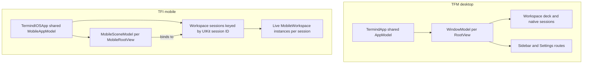
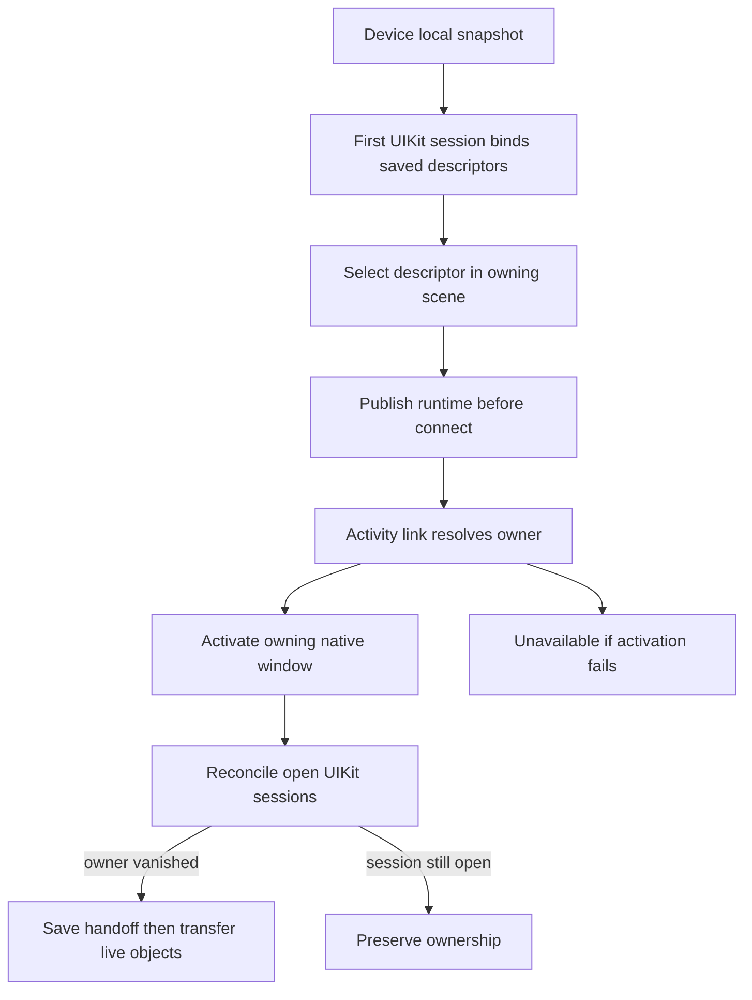
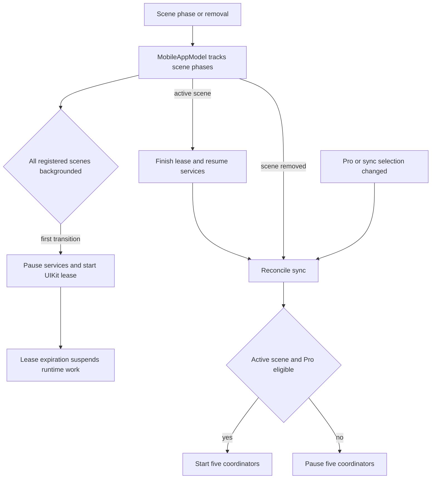

# Native App Ownership Reference

`TFM` is the macOS app and `TFI` is the iPhone/iPad app. Both compose the [shared frameworks](shared-module-directories.md), but their directories own platform-specific interaction and lifetime decisions. A directory named `Features` is **not** necessarily views only: desktop sessions live under `Features/Terminal` and window workspaces under `Features/Workspaces`, while mobile connection runtimes live under `Features/Workspaces` and their **per-native-window owner** is `App/MobileWorkspaceSessionModel`. By contrast, `Features/Shell` defines navigation values, not remote shell execution. Paths below are relative to the respective app root.

## Task-to-owner quick reference

| Coding task | Native owner and boundary |
| --- | --- |
| Change desktop startup or application Quit | `TFM/App/TermindApp.swift`: `TermindApp` composes shared state; `AppDelegate` owns application-wide confirmation and termination. |
| Change desktop window dismissal | `TFM/Platform/WorkspaceCloseConfirmation.swift`: `WorkspaceWindowCloseDelegate` vetoes native close; `MainWindowRegistrationView` attaches it. `MainWindowCoordinator` cleans up only after the window actually closes. |
| Change language selection | Desktop `Features/Settings/SettingsPageView.swift` persists through shared `AppLanguage.store` and displays a next-launch notice. `TermindApp` captures the launch locale; Settings does not own a relauncher. |
| Change desktop navigation or Settings return | `Features/Workspaces/WindowModel.swift` owns routes; `App/RootView.swift` mounts the persistent deck and destination overlays. |
| Move a running desktop workspace to another window | `Platform/MainWindowCoordinator.swift` requests the scene and transfers only on native registration. |
| Change mobile native-window ownership or restoration | `TFI/App/MobileWorkspaceSessionModel.swift`, `MobileAppModel` and `Platform/MobileWorkspaceSceneRouting.swift`, not the workspace list/detail views. |
| Change app-wide transfers or sync | App composition retains the services; feature screens command them without taking over their lifetime. See [Settings and Cloud Sync](../workflows/settings-and-cloud-sync.md). |

## Entrypoints and state ownership

| Boundary | macOS (`TFM`) | iOS/iPadOS (`TFI`) |
| --- | --- | --- |
| `App` entry | `TermindApp` assembles one `AppModel` and SwiftData container; once diagnosis consent is resolved, its `WindowGroup` mounts a fresh `WindowModel` for each `RootView`, plus a separate external-authentication window and app commands. | `TermindIOSApp` constructs one `MobileAppModel` for its `WindowGroup`; after diagnosis consent, `MobileStartupView` binds a `MobileSceneModel` to the UIKit scene's persistent session ID; `MobileRootView` mounts a `NavigationStack` per registered tab (Vault, Metrics, Workspaces, Assistant and Settings). |
| Shared versus local state | `AppModel` holds shared libraries and services; `WindowModel` owns workspace/pane collection, selection, sidebar, Settings route, queries and window presentation. | `MobileAppModel` owns shared libraries, sync, transfers, Assistant execution, scene-phase coordination and the registry of `MobileWorkspaceSessionModel` instances. Each native scene session owns its own live `MobileWorkspace` objects, saved descriptors and display order; `MobileSceneModel` owns destination, selected workspace, Assistant scene model and editor/connection presentations. |
| Startup failure | A store already in use presents a dedicated warning and exits; other local-container or composition failures abort startup. Tests and screenshot demos use in-memory composition. | Failure to construct `MobileAppModel` presents an unavailable-data-store screen instead of mounting a normal root; test composition uses testing dependencies. |

The `App` composition roots also supply the shared device directory with platform naming. `MacDeviceName` reads trimmed `kern.hostname` with `Device.current.safeDescription` fallback, refreshed on macOS application activation. Mobile uses `Device.current.safeDescription`, refreshed on active scene transition. `DeviceRecord`, directory policy and repositories remain shared, rather than becoming native-app schema types.

Native composition and workspace ownership by window or scene session.

App-level services outlive a window or scene's navigation selection; **both desktop and mobile native windows have independently owned workspaces**, whereas mobile app-level services aggregate runtime activity across those sessions.

### Desktop navigation, native windows and termination

`RootView` mounts `WindowSidebarView` beside a persistent workspace deck. Switching to Vault, Assistant, Metrics or Settings covers rather than destroys the deck and its session views. The window-local sidebar offers Navigator, compact Assistant, Snippets and History. History uses session-local memory-only command history when an SSH pane is focused, session-local browse history for an SFTP pane, and connection history otherwise. Serial/Telnet focus disables History and reconciles an invalid History selection to Snippets. Activating the Assistant mode outside a workspace also opens the full Assistant destination; activating Navigator from Assistant restores its remembered destination. Programmatically setting the sidebar mode is presentation-only.

`MainWindowCoordinator` is the process-owned AppKit bridge, not a second workspace store. `RootView` registers its native `NSWindow` with its `WindowModel`; a UUID-tagged scene request carries layout and an optional workspace/pane move until the destination registers. Only then does the coordinator take the live workspace from the source and open it in the destination, preserving session identity; a restored scene without a request retains its system-restored frame. Closing a native window unregisters and closes its window model. It saves usable size/sidebar presentation from the most recently used main window as a fallback for future windows; auxiliary windows do not participate. `AppModel` retains this coordinator, and app commands, Dock reopening, toolbar actions and menu-bar Metrics can request or activate windows through it. The menu-bar status item and popover instead belong to `MetricsMenuBarController` across window lifetimes: the preference can remove them without stopping `ServerMetricsModel`, and selecting a server closes the popover before routing to the most recent main window or requesting a new Metrics window. The last-window quit decision also considers whether menu-bar Metrics is enabled or monitoring keeps running.

Settings is a **window destination**, not a separate shared-service owner. `WindowModel.settingsRoute` remembers the destination it replaced, moves Back to a parent route before closing, then resets to index and returns to the old destination (or Vault if a workspace was removed). `SettingsPageView` assembles forms over app-owned settings: remote MCP editing is Pro-gated and a separate local MCP server route configures the app's server controller, not the HTTP listener. Leaving an editor discards qualifying empty provider, MCP and skill drafts; substantive skill drafts survive, and a new MCP server must lock a unique namespace. This makes a route change different from shutting down sync, transfers or the local server.

`AppDelegate` handles application activation, reopening, quiet login launch and termination. Window dismissal instead belongs to [`WorkspaceWindowCloseDelegate`](../../TFM/Platform/WorkspaceCloseConfirmation.swift), attached by `MainWindowRegistrationView`: it respects the existing delegate's veto, forwards other delegate methods and asks for confirmation only when that window still owns workspaces. Cancel preserves the model and live sessions. Window-close commands use `performClose` so the veto remains in the native path; `MainWindowCoordinator` unregisters and closes the model on `willClose`, not when confirmation is requested. Application Quit has a separate scope: `AppDelegate` first checks `app.hasOpenWorkspaces` across registered windows and asks the application-wide confirmation, then rechecks pending SFTP edits and can cancel again if the user refuses to discard them. Both workspace alerts default Return to Cancel and require the explicit destructive action. Once approved, Quit saves window size and begins shutdown; its reply is sent once after cleanup or a three-second timeout.

Desktop language selection is persistence, not a shutdown action. `SettingsPageView.AppSettings` calls shared `AppLanguage.store`: it writes `SettingsKey.appLanguage`, sets `AppleLanguages` for an explicit language and removes that override for Follow System. `TermindApp` captures `launchLanguage` during initialization and supplies that locale to both its main and external-authentication scenes. The picker does not automatically quit or relaunch the app; when the selection differs from the Settings view's captured language, it displays the next-launch notice in the **selected** language. Change persistence in shared `AppLanguage`, the notice in Settings, and launch-locale injection in `TermindApp`.

`TFMTests/SettingsNavigationTests.swift` tests route return, missing-workspace fallback and draft handling; `TFMTests/WindowSidebarTests.swift` tests window isolation and the serial-pane fallback. `TFMTests/MultiWindowTests.swift` covers move-on-registration and cancelled moves, `MainWindowSizingTests.swift` checks requested versus restored layout, `MetricsMenuNavigationTests.swift` checks the menu-to-window handoff, and `AppTerminationTests.swift` exercises shutdown ordering. `WorkspaceCloseConfirmationTests.swift` checks distinct window/Quit scopes, Cancel defaults, explicit approval, all-window workspace detection, veto preservation, delegate forwarding and empty-window dismissal. `AppLanguageTests.swift` checks persisted language tags, Follow System override removal and selected-language notice localization.

### Mobile navigation, restoration and lifecycle

`MobileFeatureRegistry` passes scene callbacks into Vault: tapping a host selects a recent preferred SSH/Telnet workspace **in that scene's session** or opens one there; explicit SSH, Telnet and SFTP menu actions create independent connections. `MobileSceneModel` stores one optional Workspace/Transfers destination and one optional Connection Picker/Batch Startup sheet; its old selection/picker accessors derive from those enums. `MobileSceneModel.selectWorkspace` asks its `workspaceSession` to materialize a saved descriptor, then selects the resulting runtime. When switching from another destination, it defers the workspace ID until the Workspaces destination is active; `activatePendingWorkspace` completes selection and publishes focus to Live Activities. Missing runtimes instead clear selection and show an unavailable-workspace alert. `MobileWorkspaceSessionModel.openWorkspace` first checks its own live instances and discards stale descriptors whose host is missing. Its `addWorkspaces` publishes the runtime and descriptor **before** `connect()`, so repeated selection within that window shares the first attempt. An explicit close disconnects and removes that session's saved descriptor; it does not close another window's workspaces. The app retains sessions across view disappearance or a UIKit scene disconnect: disconnect alone is not evidence that a persistent `UISceneSession` was discarded.

The single app-owned `Infrastructure/MobileWorkspaceStore` writes a device-local snapshot keyed by persistent native session ID, with legacy unassigned records; it stores connection intent only, never credentials, commands or live sessions. Cold launch consolidates saved records into the first bound session in one save, preserving IDs and order, without connecting until selected. A read failure prevents writes over the unreadable snapshot; save or restore failures surface as app errors. When UIKit reports a session **discarded**, the app closes only its workspaces and deletes its records. Conversely, when `UIApplication.openSessions` proves an owner no longer exists, reconciliation can move its live objects and descriptors to an active session **after saving the new ownership**, without reconnecting; a late explicit discard still closes the recovered objects from that former window. Activity links resolve the workspace UUID to its owning session and request native scene activation rather than opening a duplicate connection in the receiving window. If activation cannot find that window, the scene reports unavailable. The `Platform` scene delegate, routing adapter and `App` session model are the change points for native window ownership; the list/detail views only display and command their bound session.

This flow distinguishes native window recovery from creating a new connection.

`MobileRootView` reports phase, scene removal and Pro changes to the app. Only the first transition to **all registered scenes backgrounded** starts the background path: the app pauses monitoring, memory, metrics, outbox and sync, suspends Assistant recording, and acquires a UIKit background-task lease without immediately disconnecting healthy workspaces. Expiration suspends workspaces **across all sessions** and stops forwarding, transfers and Assistant background work. Active reentry finishes the lease, resumes affected workspaces and services, rechecks SFTP edits, refreshes Pro, and reconciles sync. An empty scene registry does not enter background. `MobileBackgroundController` retires a lease at most once, ignores obsolete expiry callbacks and handles synchronous expiration or an invalid task ID without leaking a UIKit end call.

`MobileAppModel.reconcileSync` starts **five** coordinators (Vault, connection History, Device, Metrics and Settings) only with an active tracked scene and Pro vault-sync eligibility; otherwise it pauses them. In-memory composition omits live cloud coordinators. `setSyncEnabled` checks Pro before enabling, persists the selection, passes History selection to its coordinator, migrates custom passwords when the iCloud master is enabled and reconciles sync. Vault and Device follow the master switch; History, Metrics and Settings additionally honor their optional selections. An inactive scene is not active for this gate.

Scene phases and Pro eligibility govern app-wide background and sync services.

Scene registration and entitlement gate app-owned services independently of whichever tab is visible. Notification routing is another app-to-native-scene handoff: `MobileAppModel` aggregates unread Assistant and command-completion counts across sessions, but terminal notification focus requires the workspace to be visible in an active owning scene. `MobileNotificationRouter` keeps a pending terminal, Assistant or transfer target until it can deliver it to an active scene, requests native activation for a different window when appropriate, and ignores failures from superseded activation requests. Assistant conversation data is shared while its selection and composer draft remain scene-local. Home Screen Connect and recent-host shortcuts are generated from app history, then consumed by the receiving scene to open its connection picker or preferred host connection; they do not select an app-global workspace. `TFITests/MobileWorkspaceSessionTests.swift` covers window isolation, legacy migration, handoff, system reclaim versus explicit discard, activity and notification routing, unread ownership and host deletion; opt-in `MobileWorkspaceWindowIntegrationTests` exercises actual UIKit windows with `TERMIND_MOBILE_UI_TESTS=1` and serialized testing. `TFITests/MobileAppTests.swift` covers background expiration/reentry and shared Assistant conversations with scene-local drafts; `TFITests/MobileBackgroundControllerTests.swift` covers lease replacement, synchronous expiry and invalid IDs; `TFITests/MobileSettingsPortTests.swift` checks the in-memory cloud boundary and settings-to-transfer preference updates.

## Placement: policy, adapters and presentation

| Directory | Desktop example | Mobile example |
| --- | --- | --- |
| `Application` | Use cases and injectable ports, including quick-connect parsing, command identities, audit and feature-library models, `Serial` contracts and external `MCPServer` tools. | `Connections` injectable SSH/SFTP and terminal-write capabilities; `Agent` Assistant coordination; `FeatureModels` editor and picker state; `Metrics` sampling contracts; `Transfers` SFTP browser state; `Workspaces` descriptor/history policy. Not a shared-framework layer and not the native window session owner. |
| `Infrastructure` | Concrete wiring: `Database` convenience adapters over `TermindPersistence` repositories, repository factories, serial and SSH adapters, import adapters, loopback `Networking`, MCP sessions and security token storage. No second SwiftData schema. | `MobileWorkspaceStore` versioned, per-session intent persistence and `SSH` implementations of mobile connection/metrics services. The app owns snapshot mutations and recovery decisions. |
| `Platform` | AppKit window/menu-bar control, login/appearance, shortcuts, file handoff, audio and native device naming. | UIKit scene delegate and scene routing, background allowance, quick actions, Live Activities, camera, document handoff, terminal surface/drop handling, speech and fonts. |
| `Design`, `DesignSystem`, `UI` | Tokens and layout helpers; reusable native components and managed card grids. Resource pages supply operations. | Tokens, available-content geometry and toolbar placement; reusable mobile cards, native lists, sheets, toolbars and input. |
| `Resources` | Desktop app icon and asset catalog (including menu-bar art). | Mobile app icon; shared catalog assets live in frameworks. |

`Application` expresses app-local policy and contracts, not the view hierarchy or the SwiftData schema. `ArchitectureBoundaryTests` prohibit SwiftUI/UIKit/SwiftData/GRDB/Persistence imports in mobile Application, implementation-framework imports and concrete construction in desktop Application, concrete implementation tokens in both apps' Features, and direct storage/transport imports in desktop Features. They also ensure `@Model` types and `SwiftData*Repository` declarations stay in `TermindPersistence`. `TFM/Infrastructure/Database` supplies convenience constructors using those shared repositories without owning another schema. Native UI and platform adapters may consume shared `TermindPresentation` content, but focus, AppKit/UIKit mounting and drag/drop policy remain native.

The desktop MCP path is a useful placement example: `App/MCPServerController` owns Pro gating, configuration, start/stop, port and token rotation; `Application/MCPServer/MCPServerTools` defines tool operations and upload/download policy. `Infrastructure/Networking` handles loopback HTTP bytes, `Infrastructure/MCP` handles protocol sessions and `Infrastructure/Security` stores tokens. An upload ticket is run-bound: `MCPUploadCoordinator.prepare` verifies origin, bearer upload token, method, headers, remaining length and acknowledged resume offset before claiming capacity or doing audit/transfer work. Interrupted or recoverable transfers may retry from the acknowledged offset; integrity failure, cancellation or expiry cannot. Commit follows remote streaming completion, and session/host revocation or server shutdown drains tickets. The Settings screen configures this service but does not own its lifetime; `TFMTests/MCPUploadTests.swift` exercises resume, digest, revocation, timeouts and early rejection. See [MCP Server and Bridge](../integrations/mcp-server-and-bridge.md).

### Mobile search: reusable UIKit bridge versus feature bindings

UIKit code does not automatically belong in `Platform`. The reusable [`UI/Components/MobileToolbarSearch.swift`](../../TFI/UI/Components/MobileToolbarSearch.swift) owns `UISearchController` mounting and native presentation; its inputs are text, an optional presentation binding, a localized prompt and a submit callback. It has no workspace or connection-kind dependency. Keep navigation-item attachment, responder coordination and dismissal guards in this UI bridge rather than duplicating them in each feature. See [Mobile UI](mobile-ui.md#native-toolbar-search-lifecycle) for detailed presentation and dismissal mechanics.

[`Features/Workspaces/MobileWorkspaceSearchModifier.swift`](../../TFI/Features/Workspaces/MobileWorkspaceSearchModifier.swift) supplies **feature policy**:

- SSH/Telnet bind text and presentation to the workspace's `TerminalFindController`; submit navigates `.previous`. Native dismissal calls `dismiss(restoringFocus: false)`, leaving the UIKit responder transition to the search host.
- SFTP binds only `sftpChannel.query`, with no terminal presentation binding or navigation callback. A file filter is not terminal Find.

The workspace constructs Find with callbacks into its `TerminalViewState` for binding actions and focus. Separately, [`Platform/MobileTerminalSurface.swift`](../../TFI/Platform/MobileTerminalSurface.swift) owns the native terminal view: the workspace retains this surface and returns the same view through `makePlatformView`. Its terminal subclass adds F3/Shift-F3 Find navigation and replaces Escape/Shift-Escape only while Find is presented, preserving ordinary terminal input otherwise. Before a size change it suspends engine search; a replaced delayed task resumes after Ghostty's resize throttle plus 0.1 seconds without recreating the terminal or clearing the query. Keep Ghostty-specific native adaptation here, not in the generic search controller. See [Ghostty Terminal Integration](../concepts/ghostty-terminal-integration.md) for the terminal boundary and binding behavior.

`MobileWorkspaceView` applies the search modifier to stable workspace chrome, outside the connection-journey branch. SSH/Telnet keep their terminal mounted beneath that journey overlay; SFTP may replace browser content, but not the search host. A change to connection progress must not accidentally recreate search or the terminal surface.

For this seam, `TFITests/MobileTerminalSearchTests.swift` provides serialized, opt-in UIKit integration coverage (`TERMIND_MOBILE_UI_TESTS=1`): repeated native and programmatic dismissal/reopening retains the terminal query, SFTP retains its filter, and connection-journey presentation preserves search-controller identity and the SSH terminal view. These are ownership/lifecycle regressions, not just visual checks.

## Where feature work belongs

- **`Features/AI`, `Assistant`, `Shell`:** `AI` holds reusable composer/transcript pieces; `Assistant` composes the full and contextual conversation destinations; `Shell` names app destinations and routes, not SSH transport. Desktop `Terminal` includes SSH/Telnet/serial session models and persistent terminal presentation; mobile `Terminal` includes keyboard/history interaction while `Workspaces` implements mobile live connections, `App/MobileWorkspaceSessionModel` owns each native window's collection, and `Platform` mounts the native terminal surface.
- **`Features/Vault` and specialist editors:** Desktop Vault is a pinned window destination: `WindowModel` retains its page, selected manager items and optional work-detail route; `VaultView` dispatches the manager page and `VaultWorkspaceView` mounts the detail without replacing the list's identity. Inline dirty navigation offers save, discard or cancel; explicit editor cancellation offers keep editing or discard, busy editors block transitions, and a failed save does not proceed. Mobile Vault renders grouped host cards and links to credentials, forwarding, snippets, known hosts and History. Local search, sheets and confirmations do not own the library or sessions. `MobileHostEditor` maintains host/custom-identity drafts and validates protocol, port, authentication and environment before saving via the host library. `MobileKnownHostsView` edits validated trust entries via `app.knownHosts` and surfaces save failures. Deleting a host through `MobileAppModel.deleteHost` closes matching workspaces **in every session and saved snapshot**, invalidates SFTP edits, cancels transfers, stops forwarding, removes metrics, requests deletion and starts the outbox; moving that into a card would omit lifecycle effects.
- **Vault History:** The SwiftUI History view is in `Features/Vault/MobileVaultView.swift`, but `Application/Workspaces/MobileConnectionHistory.swift` resolves rows against hosts and device names, filters search, limits results to 50 and permits opening only enabled host protocols. A recorded event for a now-disabled protocol remains visible but cannot be opened. Delete and clear-all call `app.connectionHistory`. Vault search forwards queries into dedicated pushed resource screens, while Metrics results switch the top-level destination. `TFITests/MobileConnectionPickerTests.swift` covers History search/limit and disabled-protocol actions; mobile Vault feature tests cover menu protocol filtering and group/host operations.
- **`Features/Settings`, `SFTP`, `Transfers`:** Mobile `MobileSettingsView` links app, notification, terminal, connection, AI and sync forms to `MobileAppModel` services; `MobileSyncSettingsView` sends toggles through `app.setSyncEnabled` instead of starting cloud coordinators itself. Desktop `SettingsPageView` switches window-local routes and reads shared `AppModel` capabilities. SFTP browser/channel models manage browsing and edit presentation; process-level `SFTPTransferCoordinator` lives in shared Remote Infrastructure and is retained by app composition. Mobile has a separate `Features/Transfers` queue surface; desktop browsers now consume the existing Host library directly; the obsolete `TransferLibraryModel` forwarding facade was removed. Closing a screen must not cancel unrelated work.
- **`Features/Sidebar` and `Workspaces`:** Desktop Sidebar is a per-window column, not an app-global navigator. Desktop Workspaces manages window layout and panes; closing a workspace disconnects its connections and records recoverable metadata through the app-owned recently-closed store. Closing a window records its grouped workspaces and selected item before disconnecting them, rather than clearing a window-local reopening stack. The shared local store retains at most 15 records; eligible layouts persist across launches, and reopening consumes a record only after a destination exists. Live transport continuity is not preserved by close/reopen; only a move keeps the running connection. Mobile `Features/Workspaces` provides the runtime and list/detail, but scene-local `App/MobileWorkspaceSessionModel` owns the collection, reconnection and descriptor mutations; `MobileAppModel` aggregates across sessions for background work and host deletion. Moving session ownership across those boundaries changes native-window lifetime, not just file organization.

The native `UI/Managed` grids and `UI/Components` interaction helpers do not acquire resource ownership merely by rendering a manager. For deeper behavior, see [Desktop UI](desktop-ui.md), [Mobile UI](mobile-ui.md), and [Platform Runtime](platform-runtime.md); return to the [Module Map](module-map.md) for dependencies.

Tailscale node lifetime is app-owned through `TailscaleModel`; native group and peer forms render shared Presentation content. Managed Hosts disable direct duplication/deletion. Closing a terminal or browser clears its memory-only history, while disconnect/reconnect preserves it.
