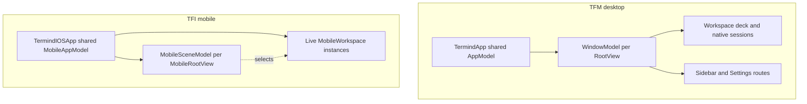
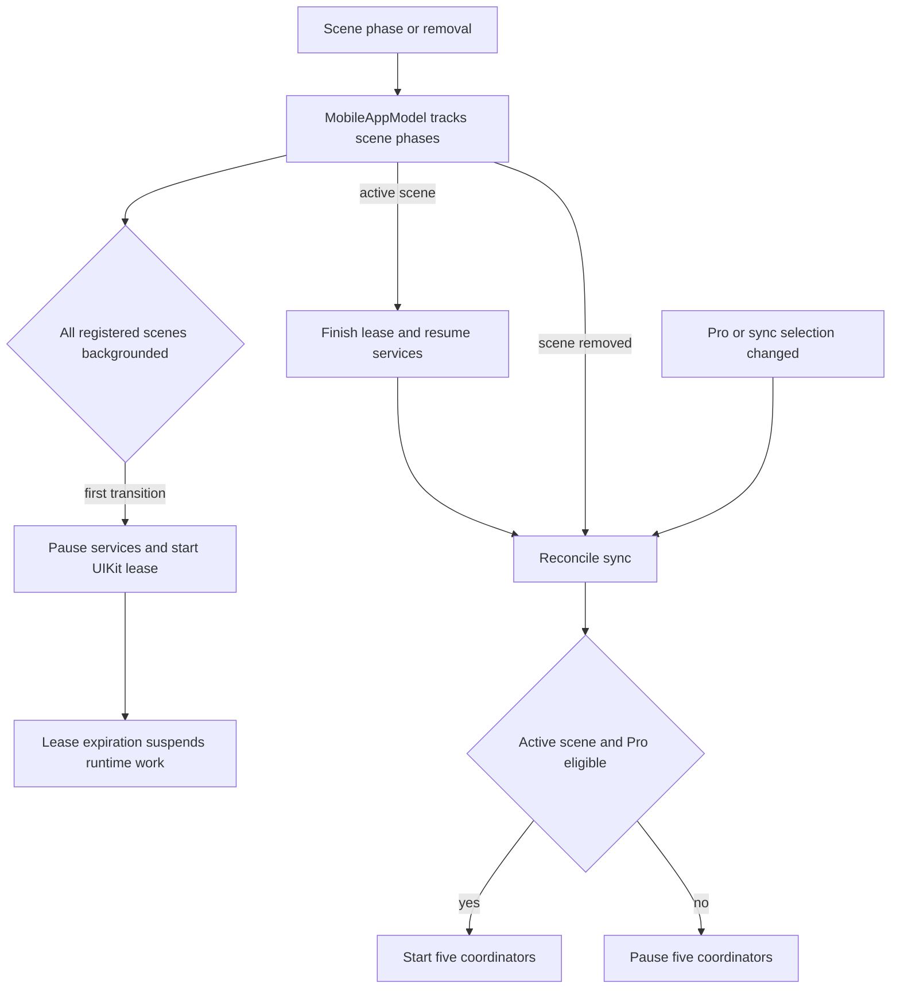

# Native App Responsibilities

`TFM` is the macOS app and `TFI` is the iPhone/iPad app. Both compose the [shared frameworks](shared-module-directories.md), but their directories own platform-specific interaction and lifetime decisions. A directory named `Features` is **not** necessarily views only: desktop sessions live under `Features/Terminal` and window workspaces under `Features/Workspaces`, while mobile live workspaces live under `Features/Workspaces`. By contrast, `Features/Shell` defines navigation values, not remote shell execution. Paths below are relative to the respective app root.

## Entrypoints and state ownership

| Boundary | macOS (`TFM`) | iOS/iPadOS (`TFI`) |
| --- | --- | --- |
| `App` entry | `TermindApp` assembles one `AppModel` and SwiftData container, mounts a `WindowGroup` with a fresh `WindowModel` for each `RootView`, plus a separate external-authentication window and app commands. | `TermindIOSApp` creates one `MobileAppModel` for its `WindowGroup`; `MobileRootView` retains a `MobileSceneModel` per scene, with a `NavigationStack` per registered tab (Vault, Metrics, Workspaces, Assistant and Settings). |
| Shared versus local state | `AppModel` holds shared libraries and services; `WindowModel` owns workspace/pane collection, selection, sidebar, Settings route, queries and window presentation. | `MobileAppModel` owns shared libraries, sync, transfers, Assistant execution and live `MobileWorkspace` objects. `MobileSceneModel` owns destination, selected workspace, Assistant scene model and editor/connection presentations. |
| Startup failure | Opening the local container can terminate startup with a fatal error; tests and screenshot demos use in-memory composition. | Failure to construct `MobileAppModel` presents an unavailable-data-store screen instead of mounting a normal root; test composition uses testing dependencies. |

The `App` composition roots also supply the shared device directory with platform naming. `MacDeviceName` reads trimmed `kern.hostname` with `Device.current.safeDescription` fallback, refreshed on macOS application activation. Mobile uses `Device.current.safeDescription`, refreshed on active scene transition. `DeviceRecord`, directory policy and repositories remain shared, rather than becoming native-app schema types.

App-level services outlive a window or scene's navigation selection; only desktop windows own their workspace collections.

### Desktop navigation and termination

`RootView` mounts `WindowSidebarView` beside a persistent workspace deck. Switching to Vault, Assistant, Metrics or Settings covers rather than destroys the deck and its session views. The window-local sidebar offers Navigator, compact Assistant, Snippets and History. History uses command history when an SSH pane is focused, SFTP browse history for an SFTP pane, and connection history otherwise. Serial/Telnet focus disables History and reconciles an invalid History selection to Snippets. Activating the Assistant mode outside a workspace also opens the full Assistant destination; activating Navigator from Assistant restores its remembered destination. Programmatically setting the sidebar mode is presentation-only.

Settings is a **window destination**, not a separate shared-service owner. `WindowModel.settingsRoute` remembers the destination it replaced, moves Back to a parent route before closing, then resets to index and returns to the old destination (or Vault if a workspace was removed). `SettingsPageView` assembles forms over app-owned settings: remote MCP editing is Pro-gated and a separate local MCP server route configures the app's server controller, not the HTTP listener. Leaving an editor discards qualifying empty provider, MCP and skill drafts; substantive skill drafts survive, and a new MCP server must lock a unique namespace. This makes a route change different from shutting down sync, transfers or the local server.

`AppDelegate` handles application activation, reopening, quiet login launch and termination. On quit it rechecks pending SFTP edits, can cancel termination if the user refuses to discard them, then saves window size and begins shutdown. Its reply is sent once after cleanup or a three-second timeout. `TFMTests/SettingsNavigationTests.swift` tests route return, missing-workspace fallback and draft handling; `TFMTests/WindowSidebarTests.swift` tests window isolation and the serial-pane fallback.

### Mobile navigation, restoration and lifecycle

`MobileFeatureRegistry` passes scene callbacks into Vault: tapping a host selects a recent preferred SSH/Telnet workspace or opens one; explicit SSH, Telnet and SFTP menu actions create connections. `MobileSceneModel.selectWorkspace` asks the app to materialize a saved descriptor, then selects the resulting runtime. `MobileAppModel.openWorkspace` first checks for an existing runtime and removes stale descriptors whose host is missing. `addWorkspaces` publishes the runtime and its descriptor **before** `connect()`, so two scenes selecting a restored descriptor share the same first attempt. An explicit close disconnects the workspace and removes its saved descriptor. Device-local `Infrastructure/MobileWorkspaceStore` stores connection intent only, never credentials, commands or live sessions; unreadable snapshots are not overwritten with an empty list. A failed restore/save sets an app error for presentation rather than silently erasing the snapshot.

`MobileRootView` reports phase, scene removal and Pro changes to the app. Only the first transition to **all registered scenes backgrounded** starts the background path: the app pauses monitoring, memory, metrics, outbox and sync, suspends Assistant recording, and acquires a UIKit background-task lease without immediately disconnecting healthy workspaces. Expiration suspends workspaces and stops forwarding, transfers and Assistant background work. Active reentry finishes the lease, resumes affected workspaces and services, rechecks SFTP edits, refreshes Pro, and reconciles sync. An empty scene registry does not enter background. `MobileBackgroundController` retires a lease at most once, ignores obsolete expiry callbacks and handles synchronous expiration or an invalid task ID without leaking a UIKit end call.

`MobileAppModel.reconcileSync` starts **five** coordinators (Vault, connection History, Device, Metrics and Settings) only with an active tracked scene and Pro vault-sync eligibility; otherwise it pauses them. In-memory composition omits live cloud coordinators. `setSyncEnabled` checks Pro before enabling, persists the selection, passes History selection to its coordinator, migrates custom passwords when the iCloud master is enabled and reconciles sync. Vault and Device follow the master switch; History, Metrics and Settings additionally honor their optional selections. An inactive scene is not active for this gate.

Scene registration and entitlement gate app-owned services independently of whichever tab is visible. `TFITests/MobileAppTests.swift` covers restoration across scenes, expiration/reentry and last-active-scene removal; `TFITests/MobileBackgroundControllerTests.swift` covers lease replacement, synchronous expiry and invalid IDs; `TFITests/MobileSettingsPortTests.swift` checks the in-memory cloud boundary and settings-to-transfer preference updates.

## Placement: policy, adapters and presentation

| Directory | Desktop example | Mobile example |
| --- | --- | --- |
| `Application` | Use cases and injectable ports, including quick-connect parsing, command identities, audit/transfer library models, `Serial` contracts and external `MCPServer` tools. | `Connections` injectable SSH/SFTP and terminal-write capabilities; `Agent` Assistant coordination; `FeatureModels` editor and picker state; `Metrics` sampling contracts; `Transfers` SFTP browser state; `Workspaces` descriptor/history policy. Not a shared-framework layer. |
| `Infrastructure` | Concrete wiring: `Database` convenience adapters over `TermindPersistence` repositories, repository factories, serial and SSH adapters, import adapters, loopback `Networking`, MCP sessions and security token storage. No second SwiftData schema. | `MobileWorkspaceStore` migration and intent persistence plus `SSH` implementations of mobile connection/metrics services. |
| `Platform` | AppKit window/menu-bar control, login/appearance, shortcuts, file handoff, audio and native device naming. | UIKit delegate/background allowance, quick actions, Live Activities, camera, document handoff, terminal surface/drop handling, speech and fonts. |
| `Design`, `DesignSystem`, `UI` | Tokens and layout helpers; reusable native components and managed card grids. Resource pages supply operations. | Tokens, available-content geometry and toolbar placement; reusable mobile cards, native lists, sheets, toolbars and input. |
| `Resources` | Desktop icon and asset catalog including menu-bar art. | Mobile app icon; shared catalog assets live in frameworks. |

`Application` expresses app-local policy and contracts, not the view hierarchy or the SwiftData schema. `ArchitectureBoundaryTests` prohibit UIKit/SwiftUI and persistence imports in mobile Application, concrete construction in both apps' Features and desktop Application, and direct persistence/transport imports in desktop Features. They also ensure `@Model` types and `SwiftData*Repository` declarations stay in `TermindPersistence`. `TFM/Infrastructure/Database` can provide constructors using those shared repositories without owning another schema. Native UI and platform adapters may consume shared `TermindPresentation` content, but focus, AppKit/UIKit mounting and drag/drop policy remain native.

The desktop MCP path is a useful placement example: `App/MCPServerController` owns Pro gating, configuration, start/stop, port and token rotation; `Application/MCPServer/MCPServerTools` defines tool operations and upload/download policy. `Infrastructure/Networking` handles loopback HTTP bytes, `Infrastructure/MCP` handles protocol sessions and `Infrastructure/Security` stores tokens. An upload ticket is run-bound: `MCPUploadCoordinator.prepare` verifies origin, bearer upload token, method, headers, remaining length and acknowledged resume offset before claiming capacity or doing audit/transfer work. Interrupted or recoverable transfers may retry from the acknowledged offset; integrity failure, cancellation or expiry cannot. Commit follows remote streaming completion, and session/host revocation or server shutdown drains tickets. The Settings screen configures this service but does not own its lifetime; `TFMTests/MCPUploadTests.swift` exercises resume, digest, revocation, timeouts and early rejection. See [MCP Server and Bridge](../integrations/mcp-server-and-bridge.md).

## Where feature work belongs

- **`Features/AI`, `Assistant`, `Shell`:** `AI` holds reusable composer/transcript pieces; `Assistant` composes the full and contextual conversation destinations; `Shell` names app destinations and routes, not SSH transport. Desktop `Terminal` includes SSH/Telnet/serial session models and persistent terminal presentation; mobile `Terminal` includes keyboard/history interaction while `Workspaces` owns mobile live connections and `Platform` mounts the native terminal surface.
- **`Features/Vault` and specialist editors:** Desktop Vault routes to managers for hosts, keys, known hosts, snippets and forwarding. Mobile Vault renders grouped host cards and links to credentials, forwarding, snippets, known hosts and History. Local search, sheets and confirmations do not own the library or sessions. `MobileHostEditor` maintains host/custom-identity drafts and validates protocol, port, authentication and environment before saving via the host library. `MobileKnownHostsView` edits validated trust entries via `app.knownHosts` and surfaces save failures. Deleting a host through `MobileAppModel.deleteHost` closes matching workspaces, invalidates SFTP edits, cancels transfers, stops forwarding, removes metrics, requests deletion and starts the outbox; moving that into a card would omit lifecycle effects.
- **Vault History:** The SwiftUI History view is in `Features/Vault/MobileVaultView.swift`, but `Application/Workspaces/MobileConnectionHistory.swift` resolves rows against hosts and device names, filters search, limits results to 50 and permits opening only enabled host protocols. Delete and clear-all call `app.connectionHistory`. Vault search forwards queries into dedicated pushed resource screens, while Metrics results switch the top-level destination. `TFITests/MobileConnectionPickerTests.swift` covers History search/limit; mobile Vault feature tests cover menu protocol filtering and group/host operations.
- **`Features/Settings`, `SFTP`, `Transfers`:** Settings assembles app-owned capabilities rather than retaining synchronization or transfer lifetime. SFTP browser/channel models manage browsing and edit presentation; process-level `SFTPTransferCoordinator` lives in shared Remote Infrastructure and is retained by app composition. Mobile has a separate `Features/Transfers` queue surface; desktop transfer-library state is in `Application/FeatureModels`. Closing a screen must not cancel unrelated work.
- **`Features/Sidebar` and `Workspaces`:** Desktop Sidebar is a per-window column, not an app-global navigator. Desktop Workspaces manages window layout and panes; mobile Workspaces combines retained live runtime with list/detail navigation. Moving session ownership across those folders changes lifetime semantics, not just file organization.

The native `UI/Managed` grids and `UI/Components` interaction helpers do not acquire resource ownership merely by rendering a manager. For deeper behavior, see [Desktop UI](desktop-ui.md), [Mobile UI](mobile-ui.md), and [Platform Runtime](platform-runtime.md); return to the [Module Map](module-map.md) for dependencies.
