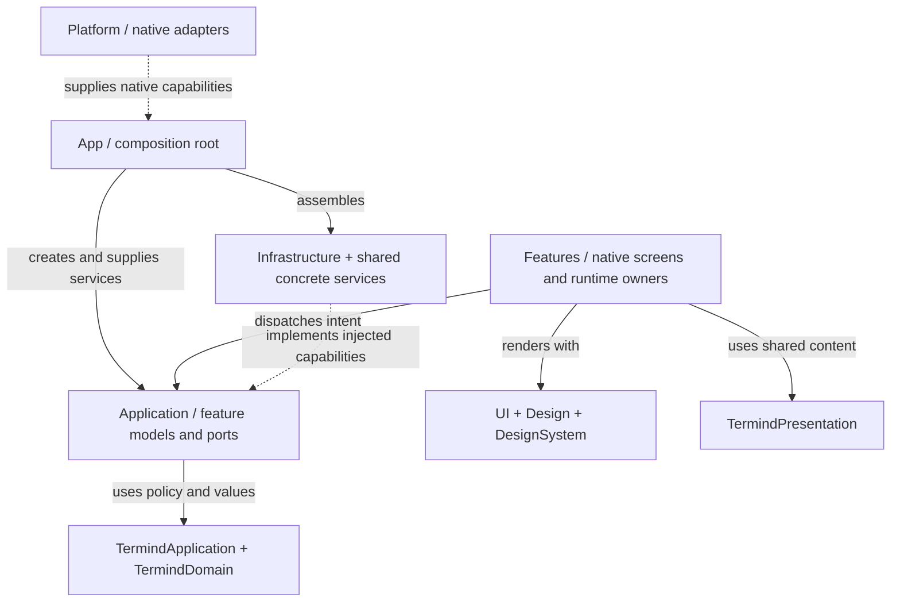
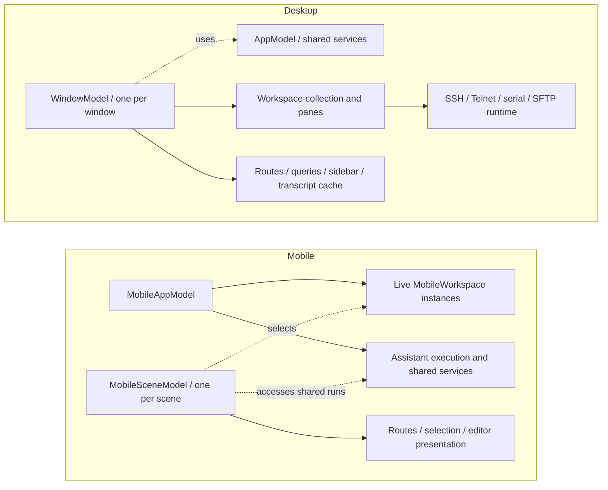

# Native App Directory Responsibilities

`TFM` is the macOS app; `TFI` is the iPhone/iPad app. They reuse the [shared frameworks](shared-module-directories.md), but keep native interaction and lifetime decisions local. The tables below use paths **relative to the app root**. “Not present” means that directory does not exist on that platform, not necessarily that the user-facing capability is unavailable.

## Common top-level organization

| Directory | TFM responsibility | TFI responsibility |
| --- | --- | --- |
| `App` | Startup, dependency assembly, app-wide model, root window composition, commands, onboarding, reviews, MCP server control, and screenshot/demo setup. | Startup/dependencies, app-wide model, scene-local routes, registered destinations, root tabs/stacks, commands, reviews, and language migration. |
| `Application` | Desktop use cases, commands, audit/transfer models, external MCP operations, and serial-service contract. Root-level quick-connect parsing is also here. | Mobile Assistant coordination, editor models, injectable connection/metrics services, SFTP browser state, and workspace descriptors. |
| `Features` | Native product screens **and some runtime owners**, including windows, workspaces, and sessions. | Native screens plus the live workspace runtime. It is not merely a view folder. |
| `Infrastructure` | Desktop concrete adapters: persistence wiring, loopback HTTP/MCP, secrets, serial ports, imports, and transfers. | Live remote-service wiring and device-local workspace-intent storage. |
| `Platform` | AppKit/system integration: windows, appearance/relaunch, login items, shortcuts, menu-bar metrics, file opening/export, speech input, fonts, and input modality. | UIKit/system integration: app/scene delegate, background allowance, quick actions, Live Activities, camera, document handoff, terminal surface/drop handling, speech input, and fonts. |
| `Design` | Desktop tokens, status/tag components, and terminal-theme presentation. | Mobile tokens and tag-field styling. |
| `DesignSystem` | Connection presentation and menu-symbol helpers. | Available-content-region geometry, layout environment, and toolbar-placement environment. |
| `UI` | Reusable native interaction/rendering components, separate from feature-specific operations. | Reusable mobile lists, sheets, toolbars, input, drop handling, and cards. |
| `Resources` | App-specific icons and desktop assets. | App-specific icon assets. |
| Root metadata | App bundle configuration and entitlements. | App bundle configuration and entitlements. |

`App`, `Platform`, `Design`, and `DesignSystem` are currently flat source directories. Their multiple concerns are listed above rather than presented as nonexistent child folders.

The app composition roots also adapt platform device naming into the shared device directory. Both TFM and TFI read DeviceKit's `Device.current.safeDescription`; TFM refreshes it when the application becomes active, and TFI refreshes it when a scene becomes active. The portable `DeviceRecord`, directory model and repositories remain in shared frameworks rather than either native app directory.

## Application subdirectories

### TFM/Application

| Directory | Responsibility |
| --- | --- |
| Root files | Parse and represent quick-connect targets without executing an OpenSSH configuration or a shell. |
| `Commands` | Register desktop command identities/actions independently of the native menu surface. |
| `FeatureModels` | Assistant conversation commands, tool-audit and transfer libraries, desktop SSH-import behavior, and demo extensions. |
| `MCPServer` | External tool operations and upload/download workflows, including transfer tickets, readers, coordinators, and budgets. This is application policy, not the HTTP socket listener. |
| `Repositories` | Desktop tool-audit repository contract. |
| `Serial` | Serial-port service abstraction and injectable I/O capabilities. |

### TFI/Application

| Directory | Responsibility |
| --- | --- |
| `Agent` | App-owned Assistant execution/conversation services plus scene-specific Assistant selection models. |
| `Connections` | Injectable closures for opening SSH/SFTP and writing terminal data. Live implementations are supplied elsewhere. |
| `FeatureModels` | Host picking; key, MCP, provider, and skill editing; secret drafts; model discovery/probes; snippet operations. “Model tests” here means provider/model probing, not the app's unit-test target. |
| `Metrics` | Mobile monitoring state and injected sampling/connection services. |
| `Transfers` | SFTP browser/channel state and remote-file operations, distinct from the process-wide transfer queue. |
| `Workspaces` | Persistable connection-intent descriptors and connection-history coordination, not live terminal surfaces. |

The mobile service contracts can mention remote types, but do not construct the live transport implementation. Architecture checks prohibit UI and persistence imports in app Application directories; they do not make every platform-local type a portable shared-framework type.

## Feature subdirectories

Every current immediate child of either `Features` directory is included here.

| Directory | TFM | TFI |
| --- | --- | --- |
| `AI` | Conversation/composer pieces, command cards, Markdown rendering, native transcript rows/cache, attachments, and slash-command UI. | Composer, conversation/transcript cards, work rows, approval/input interaction, and slash-command panel. |
| `Assistant` | Full Assistant destination, compact contextual surface, and conversation-library presentation. | Assistant destination and conversation/library navigation over shared execution services. |
| `Commerce` | Pro paywall presentation. | Mobile Pro purchase presentation. |
| `ExternalRequests` | Feature-owned external authentication coordination and its dedicated window. | Not present; mobile features retain their own authentication UI. |
| `HostChooser` | Select hosts/connections for desktop actions. | Mobile connection picker. |
| `HostEditor` | Host connection and metadata editor. | Mobile host editor. |
| `Hosts` | Host management page, host actions, and group creation. | Not present as a separate directory; host management is composed into mobile Vault. |
| `Keychain` | Saved key/identity management and identity creation. | Credential list and key editor. These are metadata/editor surfaces, not the Keychain implementation. |
| `KnownHosts` | Saved server-trust management. | Mobile saved server-trust management. |
| `Metrics` | Overview/detail dashboards, responsive layouts, server details, and connection-journey presentation. | Mobile metrics dashboard and details. |
| `Ports` | Port-forwarding library and rule interaction. | Forwarding library and editor. The connection controller remains in Remote Infrastructure. |
| `QuickOpen` | Keyboard-oriented quick navigation/connection surface. | Not present. |
| `SFTP` | Browser, channel model, file context menus, and Open With menu. | Browser, remote text editor, edit preview, and browsing/download history. |
| `SSHImport` | Desktop SSH-config/key import preview and selection UI. | Not present. |
| `Settings` | App/terminal/sync settings, AI providers/models/roles, skills, MCP client/server setup, web search, developer options, and log-file management. | App/terminal/SFTP/sync settings, AI providers/models, remote MCP configuration, skills, and logging. No desktop loopback MCP-server setup surface. |
| `Shell` | Window destination/route and title values. | Mobile destination and navigation values. **Neither folder is the remote shell protocol implementation.** |
| `Sidebar` | Desktop Navigator/contextual Assistant/Snippets/History column. | Not present; mobile uses its registered tab/sidebar navigation shell. |
| `Snippets` | Snippet library and actions. | Mobile snippet library and actions. |
| `StatusBar` | Workspace status overlay and related interaction. | Not present as a separate directory. |
| `Terminal` | SSH, Telnet, and serial session models; persistent terminal surface; serial controls and placeholders. | Terminal keyboard, selection, history, snippets, and list presentation. Live connection ownership is in `Features/Workspaces`, while the native surface adapter is in `Platform`. |
| `Transfers` | Not present as a separate feature directory; transfer-library state is in `Application/FeatureModels`. | Transfer queue presentation and actions. |
| `Vault` | Vault routing/page state and list/detail workspace composition across managed resources. | Mobile Vault entry and resource-management composition. |
| `Workspaces` | Window/workspace/pane models, split layout, persistent deck, Navigator integration, templates, and empty panes. | Workspace runtime, workspace list/detail, and rename interaction. |

### Why similarly named areas stay separate

- **AI versus Assistant:** `AI` contains reusable conversation pieces; `Assistant` composes the product destination and navigation.
- **Shell versus Terminal:** `Shell` is navigation vocabulary; `Terminal` is terminal interaction/session presentation. Remote shell bootstrap and transport execution belong to the shared remote stack.
- **SFTP versus Transfers:** browsing/control state is not the scheduler or lifetime of a queued file operation.
- **Vault versus Hosts/Keychain/KnownHosts/Snippets/Ports:** Vault composes management destinations; specialized areas own resource-specific interaction.
- **Settings versus service models:** closing Settings must not end synchronization, metrics, forwarding, or transfer work.

## Infrastructure subdirectories

| TFM directory | Responsibility |
| --- | --- |
| `Database` | App-facing SwiftData adapters and convenience wiring for history/audit models. It uses Persistence-owned entities; it does not define a second model schema. |
| `Repositories` | Factories that connect feature/library models to persistent stores. |
| `MCP` | MCP protocol/session handling on top of the local HTTP transport. |
| `Networking` | Loopback HTTP listener and request/response transport. |
| `Security` | Desktop Keychain extensions, MCP bearer-token storage, and upload-token mechanics. |
| `SSH` | Production transfer-coordinator wiring using the desktop's remote services. |
| `SSHImport` | Desktop-specific SSH-import adapter extensions. |
| `Serial` | Concrete system serial-port implementation. |

| TFI directory | Responsibility |
| --- | --- |
| Root files | Store and migrate device-local workspace descriptors. Unreadable snapshots are preserved rather than overwritten with an empty collection. Credentials, commands, and live sessions are excluded. |
| `SSH` | Live implementations of the mobile workspace-connection and metrics-service contracts. |

## UI and resource subdirectories

| Directory | TFM | TFI |
| --- | --- | --- |
| `UI/Components` | Window chrome/toolbar, native context menus, hosted list rows, sidebar rows, chooser, onboarding coach marks, connection journey, single-line editing, and file-drop bridge. | Native lists, editor sheets, sheet policy, toolbar search/overflow, single-line input, connection journey, and drop payload/target helpers. |
| `UI/Managed` | Generic card-grid/page rendering, selection, marquee and reordering; resource pages provide business operations. | Adaptive managed cards, layouts, and reusable management presentation. |
| `Resources/AppIcon.icon` | Icon Composer document; its `Assets` child contains icon layers. | Icon Composer document; its `Assets` child contains icon layers. |
| `Resources/Assets.xcassets` | Desktop accent/menu-bar assets, including the `MenuBarIcon.imageset` leaf. | Not present; shared catalog assets are supplied by `Frameworks/Resources`. |

These components can reuse `TermindPresentation`, but native mounting, focus, drag/drop, AppKit/UIKit interaction, and platform layout policy remain app-owned.

## Composition and injection

**Solid arrows describe use or assembly; dashed arrows describe implementation/injection.** This is a representative collaboration pattern, not a claim that every feature follows an identical call stack.

A dependency object supplies live/test alternatives; it does not itself become the lifetime owner of every object it creates. Some feature runtime owners legitimately retain remote services. The boundary tests prohibit direct concrete construction/storage access in feature code rather than pretending features contain only passive views.

## Runtime ownership: desktop is not mobile

**Solid arrows mean ownership; dashed arrows mean selection or access, not ownership.** This deliberately shows runtime state separately from directory containment.

Desktop destination switches park persistent workspace views; mobile route changes select retained runtime objects. Neither is equivalent to closing a connection. Mobile background expiration is a separate app-level boundary, and persisted workspace descriptors restore connection intent rather than authenticated transports.

For mechanisms and tests, continue with [Desktop UI](desktop-ui.md), [Mobile UI](mobile-ui.md), and [Platform Runtime](platform-runtime.md). `ArchitectureBoundaryTests` checks placement; window/sidebar tests, mobile scene/workspace tests, and adaptive-layout tests protect behavior. Return to the [Module Map](module-map.md) for the full dependency picture.
