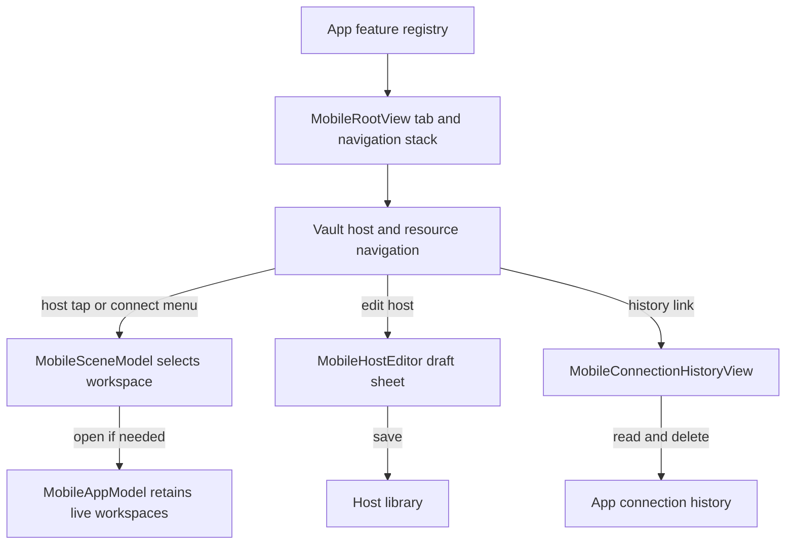
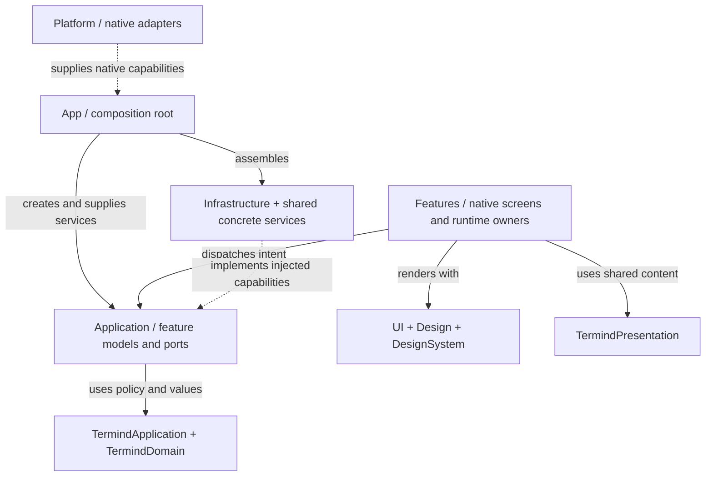
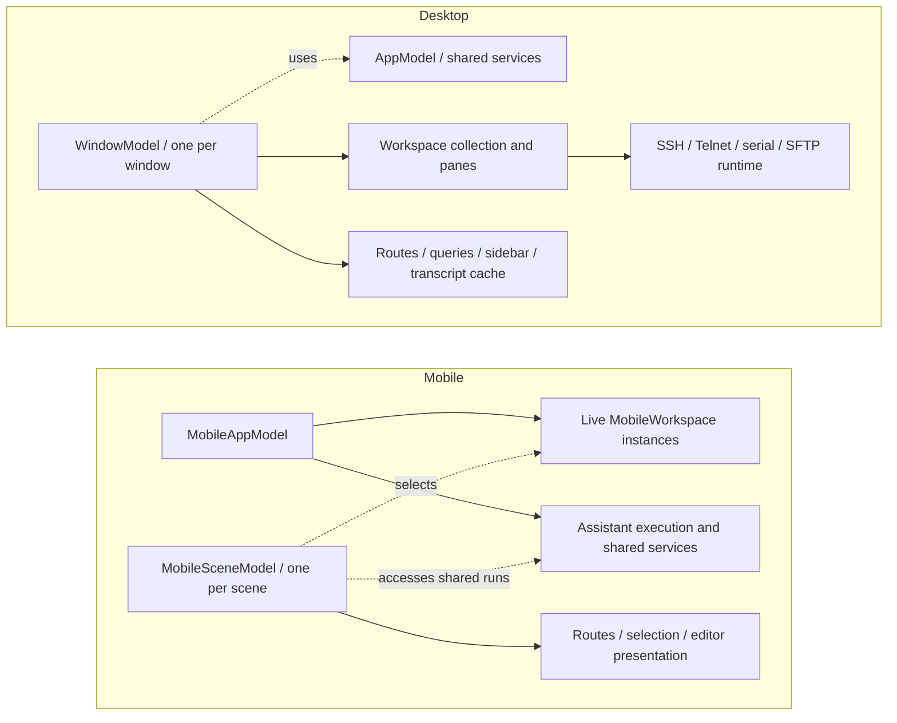
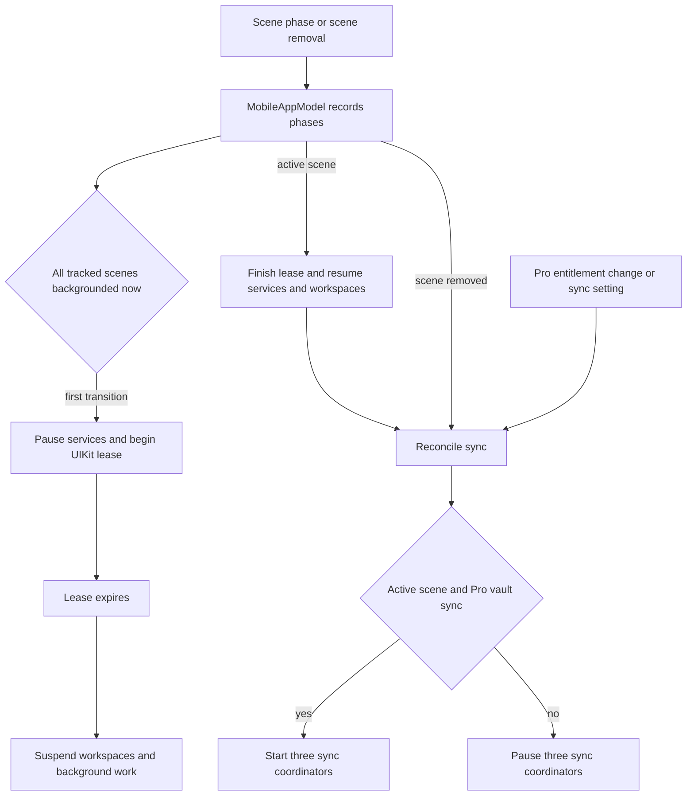

# Native App Directory Responsibilities

`TFM` is the macOS app; `TFI` is the iPhone/iPad app. They reuse the [shared frameworks](shared-module-directories.md), but keep native interaction and lifetime decisions local. The tables below use paths **relative to the app root**. “Not present” means that directory does not exist on that platform, not necessarily that the user-facing capability is unavailable.

## Common top-level organization

| Directory | TFM responsibility | TFI responsibility |
| --- | --- | --- |
| `App` | Startup, dependency assembly, app-wide model, root window composition, commands, onboarding, reviews, MCP server control, and screenshot/demo setup. | Startup/dependencies, app-wide model, scene-local routes, registered destinations, root tabs/stacks, commands, reviews, and language migration. |
| `Application` | Desktop use cases, commands, audit/transfer models, external MCP operations, and serial-service contract. Root-level quick-connect parsing is also here. | Mobile Assistant coordination, editor models, injectable connection/metrics services, SFTP browser state, and workspace descriptors. |
| `Features` | Native product screens **and some runtime owners**, including windows, workspaces, and sessions. | Native screens plus the live workspace runtime. It is not merely a view folder. |
| `Infrastructure` | Desktop concrete adapters: persistence wiring, loopback HTTP/MCP, secrets, serial ports, imports, and transfers. | Live remote-service wiring and device-local workspace-intent storage. |
| `Platform` | AppKit/system integration: windows, appearance/relaunch, login items, shortcuts, menu-bar metrics, file opening/export, speech input, fonts, and input modality. | UIKit/system integration: app/scene delegate, background allowance, quick actions, Live Activities, camera, document handoff, terminal surface/drop handling, speech input, and fonts. |
| `Design` | Desktop tokens, status/tag components, and terminal-theme presentation. | Mobile tokens and tag-field styling. |
| `DesignSystem` | Connection presentation and menu-symbol helpers. | Available-content-region geometry, layout environment, and toolbar-placement environment. |
| `UI` | Reusable native interaction/rendering components, separate from feature-specific operations. | Reusable mobile lists, sheets, toolbars, input, drop handling, and cards. |
| `Resources` | App-specific icons and desktop assets. | App-specific icon assets. |
| Root metadata | App bundle configuration and entitlements. | App bundle configuration and entitlements. |

`App`, `Platform`, `Design`, and `DesignSystem` are currently flat source directories. Their multiple concerns are listed above rather than presented as nonexistent child folders.

The app composition roots also adapt platform device naming into the shared device directory. TFM's `MacDeviceName` reads `kern.hostname`, trims whitespace and falls back to DeviceKit's `Device.current.safeDescription` when the hostname is unavailable or empty. TFI uses DeviceKit's description directly. TFM refreshes the name when the application becomes active, and TFI refreshes it when a scene becomes active. The portable `DeviceRecord`, directory model and repositories remain in shared frameworks rather than either native app directory.

## Application subdirectories

### TFM/Application

| Directory | Responsibility |
| --- | --- |
| Root files | Parse and represent quick-connect targets without executing an OpenSSH configuration or a shell. |
| `Commands` | Register desktop command identities/actions independently of the native menu surface. |
| `FeatureModels` | Assistant conversation commands, tool-audit and transfer libraries, desktop SSH-import behavior, and demo extensions. |
| `MCPServer` | External tool operations and upload/download workflows, including transfer tickets, readers, coordinators, and budgets. This is application policy, not the HTTP socket listener. |
| `Repositories` | Desktop tool-audit repository contract. |
| `Serial` | Serial-port service abstraction and injectable I/O capabilities. |

### TFI/Application

| Directory | Responsibility |
| --- | --- |
| `Agent` | App-owned Assistant execution/conversation services plus scene-specific Assistant selection models. |
| `Connections` | Injectable closures for opening SSH/SFTP and writing terminal data. Live implementations are supplied elsewhere. |
| `FeatureModels` | Host picking; key, MCP, provider, and skill editing; secret drafts; model discovery/probes; snippet operations. “Model tests” here means provider/model probing, not the app's unit-test target. |
| `Metrics` | Mobile monitoring state and injected sampling/connection services. |
| `Transfers` | SFTP browser/channel state and remote-file operations, distinct from the process-wide transfer queue. |
| `Workspaces` | Persistable connection-intent descriptors and connection-history coordination, not live terminal surfaces. |

The mobile service contracts can mention remote types, but do not construct the live transport implementation. Architecture checks prohibit UI and persistence imports in app Application directories; they do not make every platform-local type a portable shared-framework type.

The desktop MCP split illustrates **placement versus lifetime**. `MCPServerController` in `App` owns the server configuration and coordinates start/stop, Pro gating, port changes, token rotation and transfer shutdown. Its `MCPServerTools` in `Application/MCPServer` owns the exported tool registry and upload/download coordinators; it wires authenticated SFTP operations from shared remote infrastructure. `Infrastructure/Networking` serves loopback HTTP bytes, `Infrastructure/MCP` handles protocol sessions, and `Infrastructure/Security` stores the server token. A tool call creates a run-bound upload ticket; the controller routes a `PUT /uploads/{id}` stream to `MCPUploadCoordinator.prepare`, which checks origin, bearer upload token, method, headers, remaining length and acknowledged resume offset **before** claiming capacity or starting audit/transfer work. A disconnect or recoverable transfer failure can pause a ticket for retry at its acknowledged offset; integrity failure, cancellation or expiry cannot be retried. Commit succeeds only after the remote streaming operation returns; session/host revocation and server stop cancel tickets and drain tasks. The transfer budget and audit belong to application operations, not the view that exposes settings. See [MCP Server and Bridge](../integrations/mcp-server-and-bridge.md) for the external protocol.

## Feature subdirectories

Every current immediate child of either `Features` directory is included here.

| Directory | TFM | TFI |
| --- | --- | --- |
| `AI` | Conversation/composer pieces, command cards, Markdown rendering, native transcript rows/cache, attachments, and slash-command UI. | Composer, conversation/transcript cards, work rows, approval/input interaction, and slash-command panel. |
| `Assistant` | Full Assistant destination, compact contextual surface, and conversation-library presentation. | Assistant destination and conversation/library navigation over shared execution services. |
| `Commerce` | Pro paywall presentation. | Mobile Pro purchase presentation. |
| `ExternalRequests` | Feature-owned external authentication coordination and its dedicated window. | Not present; mobile features retain their own authentication UI. |
| `HostChooser` | Select hosts/connections for desktop actions. | Mobile connection picker. |
| `HostEditor` | Host connection and metadata editor. | Host draft sheet for SSH/Telnet profiles, identity/proxy, group and session settings; uses the app's host library to save rather than owning a connection. |
| `Hosts` | Host management page, host actions, and group creation. | Not present as a separate directory; host cards, groups and their actions live in mobile Vault. |
| `Keychain` | Saved key/identity management and identity creation. | Credential list and key editor. These are metadata/editor surfaces, not the Keychain implementation. |
| `KnownHosts` | Saved server-trust management. | Searchable trusted-host cards and a validated add/edit sheet backed by `app.knownHosts`, not a transport trust store owned by the view. |
| `Metrics` | Overview/detail dashboards, responsive layouts, server details, and connection-journey presentation. | Mobile metrics dashboard and details. |
| `Ports` | Port-forwarding library and rule interaction. | Forwarding library and editor. The connection controller remains in Remote Infrastructure. |
| `QuickOpen` | Keyboard-oriented quick navigation/connection surface. | Not present. |
| `SFTP` | Browser, channel model, file context menus, and Open With menu. | Browser, remote text editor, edit preview, and browsing/download history. |
| `SSHImport` | Desktop SSH-config/key import preview and selection UI. | Not present. |
| `Settings` | App/terminal/sync settings, AI providers/models/roles, skills, MCP client/server setup, web search, developer options, and log-file management. | App/terminal/SFTP/sync settings, AI providers/models, remote MCP configuration, skills, and logging. No desktop loopback MCP-server setup surface. |
| `Shell` | Window destination/route and title values. | Mobile destination and navigation values. **Neither folder is the remote shell protocol implementation.** |
| `Sidebar` | One window-local column with Navigator, contextual Assistant, Snippets and focus-sensitive History modes; the window model owns mode and visibility. | Not present; mobile uses its registered tab/sidebar navigation shell. |
| `Snippets` | Snippet library and actions. | Mobile snippet library and actions. |
| `StatusBar` | Workspace status overlay and related interaction. | Not present as a separate directory. |
| `Terminal` | SSH, Telnet, and serial session models; persistent terminal surface; serial controls and placeholders. | Terminal keyboard, selection, history, snippets, and list presentation. Live connection ownership is in `Features/Workspaces`, while the native surface adapter is in `Platform`. |
| `Transfers` | Not present as a separate feature directory; transfer-library state is in `Application/FeatureModels`. | Transfer queue presentation and actions. |
| `Vault` | Vault routing/page state and list/detail workspace composition across managed resources. | Searchable host/group cards and navigation links to credentials, forwarding, snippets, trusted hosts and connection History; contains the History view, not its persistent store. |
| `Workspaces` | Window/workspace/pane models, split layout, persistent deck, Navigator integration, templates, and empty panes. | Workspace runtime, workspace list/detail, and rename interaction. |

### Why similarly named areas stay separate

- **AI versus Assistant:** `AI` contains reusable conversation pieces; `Assistant` composes the product destination and navigation.
- **Shell versus Terminal:** `Shell` is navigation vocabulary; `Terminal` is terminal interaction/session presentation. Remote shell bootstrap and transport execution belong to the shared remote stack.
- **SFTP versus Transfers:** browsing/control state is not the scheduler or lifetime of a queued file operation.
- **Vault versus Hosts/Keychain/KnownHosts/Snippets/Ports:** Desktop Vault routes to dedicated manager pages. Mobile Vault itself renders host/group cards and owns only local search, sheet and confirmation state; its links push specialized screens. Mobile History's SwiftUI view happens to be in `Features/Vault/MobileVaultView.swift`, while row filtering/action policy lives in `Application/Workspaces` and the connection-history model is app-owned. A file location or a pushed destination does not transfer the data or session lifetime to Vault.
- **Settings versus service models:** closing Settings must not end synchronization, metrics, forwarding, or transfer work.

### Native navigation and editing boundaries

On mobile, `App/MobileFeatureRegistry.swift` registers Vault, Metrics, Workspaces, Assistant and Settings. `MobileRootView` mounts a separate `NavigationStack` for each registered tab and retains one `MobileSceneModel` per scene. Vault receives scene callbacks and a binding to `scene.editingHost`: tapping a host card asks the scene to reuse or open its preferred terminal workspace; SSH/Telnet/SFTP menu actions explicitly open a connection, while Edit presents `MobileHostEditor` as a sheet. The editor keeps a host draft and custom-identity draft, validates protocol, port, authentication and environment fields before saving through `HostLibraryModel`; nested identity/group/environment editors stay in the sheet workflow. Host deletion instead calls `MobileAppModel.deleteHost`, which closes matching workspaces, invalidates edits, cancels transfers and cleans up forwarding/metrics before deleting the host projection. Do not move these app-level effects into the Vault card or sheet.

Vault search links to resource pages can pass the search query into the pushed page; Metrics search switches the registered top-level destination. Its History link opens `MobileConnectionHistoryView` in the Vault file, showing up to 50 filtered events resolved against the host library and device directory. A history row opens only if that protocol is still enabled for its host; deletion and clear-all act on `app.connectionHistory`. The separate `MobileKnownHostsView` uses `app.knownHosts` for search, save and delete; its editor surfaces storage failure rather than silently treating a failed save as success. Neither screen owns the persisted records simply because Vault pushes it.

Mobile navigation dispatches scene-local intent to app-owned data and runtime; the Vault file is not the lifetime boundary.

On macOS, `TermindApp` creates one `AppModel` and SwiftData container, but its `WindowGroup` creates a `WindowModel` for each `RootView`. `RootView` mounts `WindowSidebarView` in a `NavigationSplitView` beside a persistent detail deck. Sidebar mode and visibility are per-window: the rail chooses Navigator, compact Assistant, Snippets or History. History shows command history for a focused SSH pane, browse history for SFTP, or connection history otherwise; it is disabled for focused serial/Telnet panes, and an invalid current History mode falls back to Snippets. Clicking Assistant outside a workspace navigates to the full Assistant destination, while Navigator returns from it; assigning a mode for presentation alone is not the same as activating its navigation behavior. `TFMTests/WindowSidebarTests.swift` covers window isolation and the focused-serial fallback; `TFITests/MobileVaultFeatureTests.swift` covers host menu filtering, duplication, group deletion and proxy defaults, and `TFITests/MobileConnectionPickerTests.swift` covers History's limit and search.

## Infrastructure subdirectories

| TFM directory | Responsibility |
| --- | --- |
| `Database` | App-facing SwiftData adapters and convenience wiring for history/audit models. It uses Persistence-owned entities; it does not define a second model schema. |
| `Repositories` | Factories that connect feature/library models to persistent stores. |
| `MCP` | MCP protocol/session handling on top of the local HTTP transport. |
| `Networking` | Loopback HTTP listener and request/response transport. |
| `Security` | Desktop Keychain extensions, MCP bearer-token storage, and upload-token mechanics. |
| `SSH` | Production transfer-coordinator wiring using the desktop's remote services. |
| `SSHImport` | Desktop-specific SSH-import adapter extensions. |
| `Serial` | Concrete system serial-port implementation. |

| TFI directory | Responsibility |
| --- | --- |
| Root files | Store and migrate device-local workspace descriptors. Unreadable snapshots are preserved rather than overwritten with an empty collection. Credentials, commands, and live sessions are excluded. |
| `SSH` | Live implementations of the mobile workspace-connection and metrics-service contracts. |

## UI and resource subdirectories

| Directory | TFM | TFI |
| --- | --- | --- |
| `UI/Components` | Window chrome/toolbar, native context menus, hosted list rows, sidebar rows, chooser, onboarding coach marks, connection journey, single-line editing, and file-drop bridge. | Native lists, editor sheets, sheet policy, toolbar search/overflow, single-line input, connection journey, and drop payload/target helpers. |
| `UI/Managed` | Generic card-grid/page rendering, selection, marquee and reordering; resource pages provide business operations. | Adaptive managed cards, layouts, and reusable management presentation. |
| `Resources/AppIcon.icon` | Icon Composer document; its `Assets` child contains icon layers. | Icon Composer document; its `Assets` child contains icon layers. |
| `Resources/Assets.xcassets` | Desktop accent/menu-bar assets, including the `MenuBarIcon.imageset` leaf. | Not present; shared catalog assets are supplied by `Frameworks/Resources`. |

These components can reuse `TermindPresentation`, but native mounting, focus, drag/drop, AppKit/UIKit interaction, and platform layout policy remain app-owned.

## Composition and injection

**Solid arrows describe use or assembly; dashed arrows describe implementation/injection.** This is a representative collaboration pattern, not a claim that every feature follows an identical call stack.

App assembly connects feature interaction to injectable services without making every feature a passive view.

A dependency object supplies live/test alternatives; it does not itself become the lifetime owner of every object it creates. Some feature runtime owners legitimately retain remote services. The boundary tests prohibit direct concrete construction/storage access in feature code rather than pretending features contain only passive views.

## Runtime ownership: desktop is not mobile

**Solid arrows mean ownership; dashed arrows mean selection or access, not ownership.** This deliberately shows runtime state separately from directory containment.

Per-window desktop state and per-scene mobile routes have different owners from the shared app services.

Desktop destination switches park persistent workspace views; mobile route changes select retained runtime objects. Neither is equivalent to closing a connection. Persisted mobile workspace descriptors restore connection intent rather than authenticated transports: `openWorkspace` publishes the shared runtime before connecting so two scenes cannot independently start the same restored session. An explicit close removes its descriptor and disconnects it. The macOS `WindowGroup` constructs a new `WindowModel` for each window and injects the shared `AppModel` and SwiftData container; its delegate handles system-level activation, window reopening, and termination, including pending SFTP edit confirmation. By contrast, iOS `TermindIOSApp` builds one `MobileAppModel` for its `WindowGroup`, while each `MobileRootView` retains its own `MobileSceneModel` for selection, Assistant drafts and presentations.

### Mobile lifecycle and sync boundary

`MobileRootView` reports each scene phase and removal to the app model, and observes Pro changes to call `reconcileSync`. The app records phases per scene. On the first transition where **all registered scenes** are backgrounded (including removal of the last active scene while another remains backgrounded), it pauses monitoring, memory, sync engines, metrics and outbox, suspends Assistant recording and asks `MobileBackgroundController` for a UIKit background-task lease. It does **not** immediately disconnect healthy workspaces. Lease expiry requests workspace suspension and stops forwarding, transfers and Assistant background execution. The controller retires a lease exactly once; stale expiry callbacks cannot affect a replacement lease, and synchronous expiry during `begin` or an invalid identifier is handled without leaking an end call.

On an active scene transition, the app finishes the lease, resumes affected workspaces, monitoring and memory, rechecks edited files, refreshes Pro, restarts outbox/metrics and Live Activities, and reconciles sync. `reconcileSync` starts vault, metrics and settings sync **only when at least one tracked scene is active and Pro permits vault sync**; otherwise it pauses all three. `setSyncEnabled` guards enabling with `pro.require(.vaultSync)`, stores the preference, migrates custom passwords when enabling vault/iCloud sync and calls `reconcileSync`—the individual coordinators still enforce their own enabled preferences. A `.inactive` scene is not an active scene for this decision, and an empty scene registry does not trigger background entry, but reconciliation pauses sync. In-memory/test composition omits the cloud coordinators altogether.

Scene registration and entitlement gate app-owned synchronization independently of the visible route.

Mobile phase transitions, lease expiration and entitlement changes operate on app-owned services, not a scene's route. For focused coverage, `TFITests/MobileAppTests.swift` tests expiration/re-entry, the last-active-scene removal, and restoration across scenes; `TFITests/MobileBackgroundControllerTests.swift` tests synchronous expiration, replacement and invalid leases; `TFITests/MobileSettingsPortTests.swift` verifies in-memory composition has no cloud engines. `TFMTests/MCPUploadTests.swift` exercises resumable offset/digest, revocation, timeout, retention and rejection before consumption. For more mechanisms continue with [Desktop UI](desktop-ui.md), [Mobile UI](mobile-ui.md), and [Platform Runtime](platform-runtime.md). `ArchitectureBoundaryTests` checks placement; window/sidebar and adaptive-layout tests protect behavior. Return to the [Module Map](module-map.md) for the full dependency picture.
