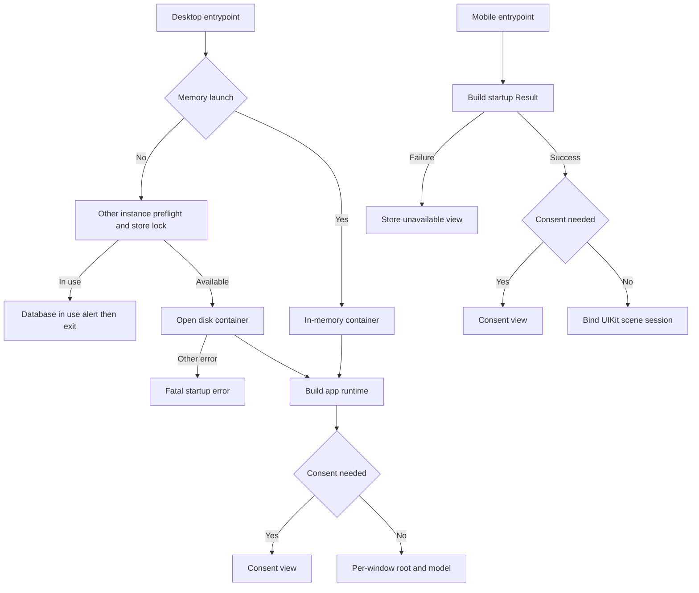
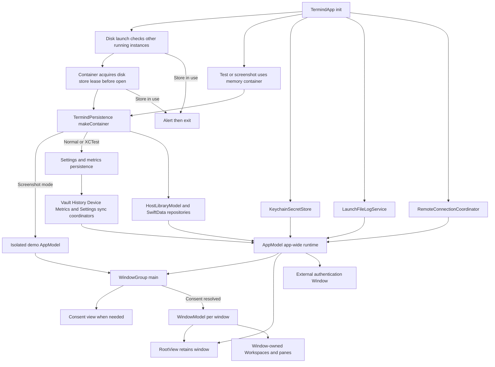
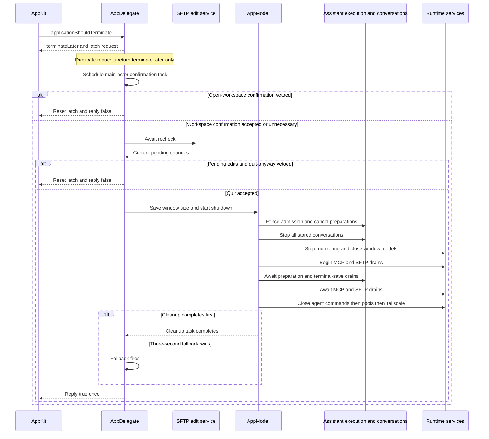
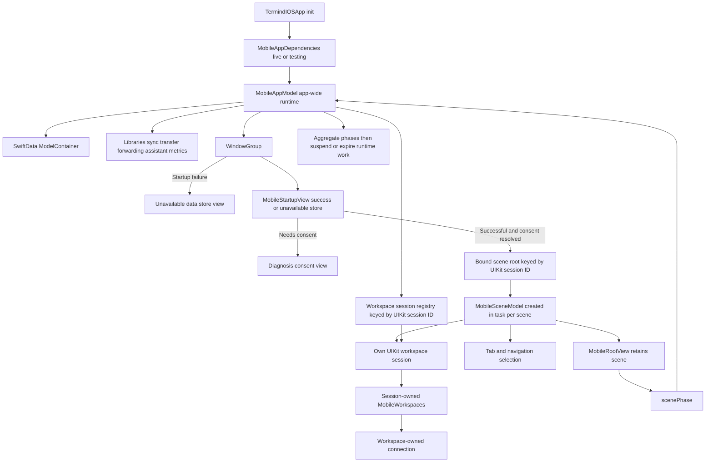
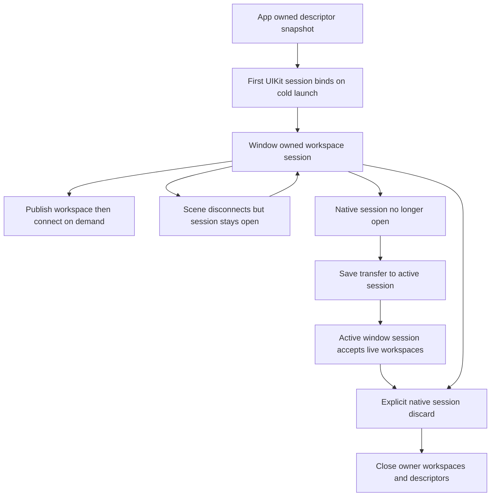
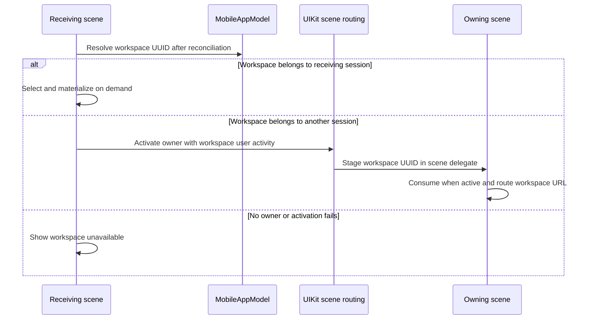
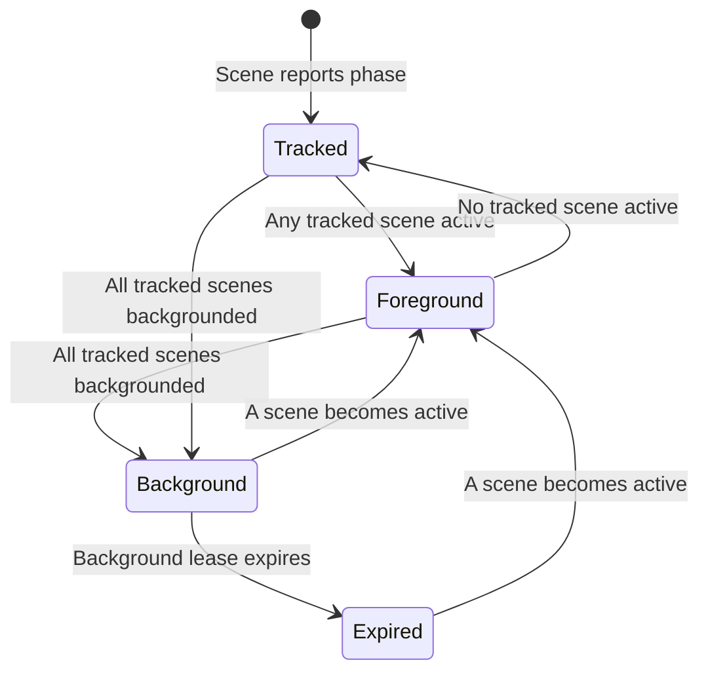

# Native Runtime and State Lifetimes

Both production entrypoints assemble a local diagnosis controller with installation-local consent and a reporter initially enabled **only** if consent was already granted. An unset choice gates the normal root UI, not container construction: the desktop `WindowGroup` shows `DiagnosisConsentView` instead of constructing `RootView`/`WindowModel`, and `MobileStartupView` shows that view instead of binding a scene session. Screenshots and default test assemblies use an inert controller without defaults or reporter, so they do not require a consent choice. On iOS, a failed model construction still takes the unavailable-store branch rather than showing consent. See [Persistence and Secrets](../concepts/persistence-and-secrets.md) for storage details.

Startup creates the shared runtime before asking for diagnostics consent; only successful, consent-cleared scene content constructs normal window or scene state.

Termind has separate native application targets—`TFM` for macOS and `TFI` for iOS/iPadOS—but both compose the same layered frameworks into a platform-owned runtime. The application target owns startup, native lifecycle hooks, dependency assembly, platform UI, and the boundary between durable app data and live UI/session state. Shared frameworks do not import either app target.

The most important lifetime rule is: **stores, coordinators, and durable-data services are app-wide; desktop workspaces belong to a window, mobile workspaces belong to a persistent UIKit scene session (managed by the app), and navigation/presentation belongs to the individual SwiftUI scene.** Live transports belong to those workspaces, not to an app-wide interchangeable workspace pool.

## UI structure and design guides

This page explains runtime composition and lifetime boundaries. For the component trees and user-facing presentation rules, continue with:

- [TFM Desktop UI Architecture](desktop-ui.md): window shell, persistent workspace deck, split panes, Vault list/detail, managed cards and native transcript ownership.
- [TFI Mobile UI Architecture](mobile-ui.md): registered feature stacks, scene-local routes, persistent window-owned workspaces, usable-region layout, mobile toolbars and native input continuity.
- [UI Design Principles and Shared Presentation Boundaries](../concepts/ui-design-principles.md): what the platforms share, where their visual/input policies intentionally differ, and how to extend them without merging runtime ownership.

## Build platforms and native capabilities

The current Debug and Release configurations keep the apps platform-specific: `TFM` uses `SDKROOT = macosx`, `SUPPORTED_PLATFORMS = macosx` and a macOS 15.0 deployment target; `TFI` uses `SDKROOT = iphoneos`, `SUPPORTED_PLATFORMS = "iphoneos iphonesimulator"`, an iOS 18.0 deployment target and `TARGETED_DEVICE_FAMILY = "1,2"` (iPhone and iPad). The `MACOSX_DEPLOYMENT_TARGET` value also present in TFI's settings does not add a macOS build platform. Do not infer a Catalyst or desktop lifecycle from that metadata: the native entrypoints remain `TermindApp` with its AppKit delegate and `TermindIOSApp` with its UIKit delegate. See [Build, Test, and Release](../operations/build-test-and-release.md) for build operations.

Capabilities authorize platform integrations; they do not own service lifetimes:

- **Desktop:** both configurations enable App Sandbox and Hardened Runtime. [TFM's entitlements](../../TFM/TFM.entitlements) permit audio input, serial devices, outgoing network connections, incoming network listeners and user-selected read/write files. These permissions support native runtime services but do not replace their window ownership or accepted-Quit cleanup contracts.
- **Shared cloud and secrets:** [TFI's entitlements](../../TFI/TFI.entitlements) and TFM's entitlements declare CloudKit container `iCloud.com.akinokaede.termind`, `webcredentials:termind.akinokaede.com`, a bundle-derived Keychain access group and platform-specific APNs entitlement keys. Both apps select development APNs/CloudKit environments in Debug and production environments in Release. CloudKit authorization is separate from the foreground, Pro and user-preference gates described below.
- **Mobile background execution:** TFI declares `UIBackgroundModes = [remote-notification]` in its Info.plist and enables Live Activities in project settings. Neither declaration is a persistent remote-session execution lease. Remote-notification registration is skipped by the XCTest host; foreground/background session work still uses the finite `UIApplication.beginBackgroundTask` lease managed by `MobileBackgroundController`, with the expiration behavior documented below.

## Native policy and adapter landmarks

The native roots are composition boundaries, not alternative shared-framework layers. `App` retains services and coordinates owners; app-local `Application` expresses policy and injectable contracts; `Infrastructure` supplies concrete persistence/transport adapters; `Platform` translates AppKit/UIKit events into those policies. `Features` is not synonymous with views: desktop terminal sessions and both platforms' workspace runtimes live there. `Features/Shell` names navigation routes, not remote shell execution. Mobile's persistent window owner remains `App/MobileWorkspaceSessionModel`, not its list/detail views. [Module Map](module-map.md) explains build dependencies; the UI pages explain mounting and layout.

The boundary is enforced by `ArchitectureBoundaryTests`: mobile Application excludes SwiftUI, UIKit and persistence imports; desktop Application excludes native UI and implementation imports/construction; Features cannot construct concrete implementations. Change native event adaptation in Platform, app-wide service admission/shutdown in App, and connection policy through the existing injectable ports rather than moving concrete storage or transports into feature screens.

## Lifetime map

| Scope | macOS | iOS/iPadOS | Examples |
| --- | --- | --- | --- |
| Process / app model | One `AppModel`, retained in `TermindApp` state | One `MobileAppModel`, created before the `WindowGroup` | SwiftData container, host library, settings and sync coordinators, shared remote coordinator, connection history, transfer and forwarding services, entitlement/review state |
| Native window / scene | `WindowModel` per main window | `MobileSceneModel` per SwiftUI scene, bound to an app-managed `MobileWorkspaceSessionModel` by UIKit session ID | destination, selection, sheets, navigation routes, focused-value command routing, scene-local assistant navigation |
| Workspace and session | Desktop `Workspace` and panes are owned by one `WindowModel` | Each `MobileWorkspaceSessionModel` owns its own ordered descriptors and live `MobileWorkspace`s; `MobileAppModel` coordinates all sessions | terminal or SFTP UI, connection journey, transport, terminal state, workspace-specific operations |
| Durable state | SwiftData, Keychain, supported UserDefaults and sync stores | Same categories, plus an app-written `MobileWorkspaceStore` snapshot keyed by persistent UIKit session ID | Hosts and settings, secret references, connection history, mobile per-window workspace descriptors |
| Ephemeral runtime state | Never restored as a live connection | Never restored as a live connection | SSH/SFTP transports, authentication journeys, one-shot URL credentials, in-flight runs/transfers |

A useful consequence is that sharing a desktop `AppModel` does **not** make its `WindowModel`s share selection, sidebar/search state, or workspaces. On mobile, two native windows opening the same Host create independent workspaces and transports. A workspace link received in another window activates the descriptor's existing native owner rather than copying or opening it there. Repeated selection *within the owner* reuses the published workspace and its initial connection attempt.

## macOS composition

`TermindPersistence.makeContainer` fixes the shared versioned SwiftData schema and migration plan for both platforms; the entrypoint chooses whether the container is memory-backed or file-backed and retains it, rather than defining separate platform model sets. `TermindApp.init()` is the desktop composition root. It sets up the scrubber web client and chooses the stored launch language (or a screenshot-demo language), then, **before opening the disk-backed store**, checks for another nonterminated app with the same bundle identifier. This protects against older installed versions that do not implement store locking. `TermindPersistence.makeContainer` independently acquires an exclusive, nonblocking `.lock` file lease **before SwiftData opens or migrates** the store. The container retains that lease for its lifetime; same-process containers for the canonical URL share it, and the lock file is not unlinked on close. Both an older running instance and a competing lock raise `PersistentStoreAccessError.inUse`: the app presents a database-in-use alert and exits after acknowledgment. Other container or preparation failures call `fatalError` instead of replacing production data with an empty store. The macOS guard and lock are skipped for in-memory launches; the iOS entrypoint instead captures startup failures as a `Result` and displays an unavailable-data screen.

The desktop root captures `launchLanguage` once during initialization and injects its locale into both main and external-authentication scenes. The Settings picker stores a new `AppLanguage` and shows a next-launch notice when it differs from the captured selection; it does **not** automatically quit or relaunch the application. The new selection applies on the next launch, rather than replacing the root's captured locale in place. See [Settings and Cloud Sync](../workflows/settings-and-cloud-sync.md).

After the container opens, the desktop entrypoint cleans previous context attachments, prepares settings and metrics persistence, makes the Keychain-backed secret store, and assembles `AppModel` with repositories, sync coordinators, logging, connection history, the device directory, and a common `RemoteConnectionCoordinator`. The directory uses the Vault journal's stable installation ID and `MacDeviceName.current`: the trimmed `kern.hostname`, falling back to DeviceKit's `Device.current.safeDescription` when unavailable or empty.

**Debug test and screenshot launches still run the real app entrypoint, but not the normal disk-backed runtime.** XCTest detection uses `XCTestConfigurationFilePath` in DEBUG; it selects an in-memory container, a private metrics defaults suite, disabled file logging, unrestricted test Pro access, no Vault/History/Device/Metrics/Settings cloud coordinators, no local host defaults or production memory store, and a window size store without persisted defaults. A screenshot-demo configuration also uses an in-memory container but returns early with demo hosts, AI, metrics and onboarding instead of constructing the normal production services. Neither path is a fallback for a failed production database open: construction errors still fail startup.

This diagram shows the desktop composition root and the split between one app runtime and per-window workspace ownership.

### Shared desktop runtime

`AppModel` is the cross-window coordinator and service owner. It owns the host and credential projections, known-hosts/snippet/forwarding libraries, terminal and SSH/SFTP settings, connection history, AI/skills/memory, metrics, entitlement and review controllers, remote connection coordination, SFTP edit/transfer services, forwarding, MCP services, and sync/outbox integration. It also owns the global conversation store and one speech transcription coordinator, avoiding duplicate conversation state and competing audio taps across windows.

The model keeps only weak registrations for open `WindowModel`s. Registration injects shared stores and coordinators into a window and attaches that window's assistant library to the process-wide conversation store. Fan-out operations—such as a host route change or deletion—find registered windows and disconnect or close the affected window-owned workspaces. A desktop deletion request first persists the repository marker/outbox jobs, clears local histories and projects the Host away; the registered outbox handlers close panes across windows, cancel transfers, stop forwarding and finalize repository cleanup. A failed request reports a storage error instead of projecting the removal. This is coordination, not ownership transfer: the window remains responsible for its own UI and workspaces.

`TermindApp` creates a `WindowGroup(id: "main", for: UUID.self)`. Once diagnosis consent is resolved, each scene receives a fresh `WindowModel` (except a request-less debug screenshot scene, which can receive demo window state), places it in `RootView`, and injects the same `AppModel` and SwiftData container through the SwiftUI environment. Until then, it shows the consent view without creating a window model. `RootView` retains that model in `@State`, registers it on appearance, and exposes it via the environment and focused scene value. The independent `Authentication Request` window shares app dependencies but is reserved for external authentication presentation; `.commandsRemoved()` prevents normal Window-menu creation.

**Scene policy is separate from store policy.** In DEBUG, a default XCTest host suppresses automatic launch of both the main and authentication scenes unless `TERMIND_WINDOW_TESTS=1` or screenshot-demo mode is active. Tests disable restoration for both scenes even when visible windows are opted in; screenshot mode disables main-scene restoration, while ordinary launches use automatic launch and restoration. The delegate also refuses Dock reopen while test-window suppression applies, refuses to quit the test host when its last fixture window closes, and skips starting metrics activity/menu in tests. Explicit window/focus tests use `.requiresVisibleWindow` and opt in with `TERMIND_WINDOW_TESTS=1` (or Xcode's `TEST_RUNNER_TERMIND_WINDOW_TESTS=1` forwarding); suppression is not a ban on explicitly created offscreen test fixtures. The default test-host checks assert no visible windows and no reopen. To exercise a gated suite, use `TEST_RUNNER_TERMIND_WINDOW_TESTS=1 xcodebuild -project Termind.xcodeproj -scheme TFM -destination 'platform=macOS' -onlyUsePackageVersionsFromResolvedFile -only-testing:TFMTests/<Suite> test`; the test host itself checks `TERMIND_WINDOW_TESTS=1`. Keep routine logic and offscreen tests on the default suppressed path.

### Window-local desktop state

`WindowModel` contains the state that may legitimately differ in another desktop window: navigator destination, dynamic workspaces and panes, sidebar and search behavior, workspace selection, local presentations, and window-specific assistant surfaces. `RootView` preserves mounted workspace-native views when a different destination becomes visible so terminal grids, scrollback, and SFTP UI state survive navigation.

A host-opening action is centralized in `AppModel`, which chooses the requested protocol, but it opens into the caller's `WindowModel`. That window assigns one connection-history event to each saved-host SSH, Telnet or SFTP pane. Closing the pane/workspace ends the event before disconnecting, while moving a live pane preserves it and reopening creates a new event. External temporary and Serial panes are not recorded; a crash may leave `endedAt` absent. A batch can deliberately create separate window-local workspaces or one workspace with several panes. External SSH/SFTP/Telnet URLs likewise create a temporary workspace in the target window without adding a saved Host; Telnet URLs containing an advisory password require explicit confirmation first.

`TermindCommands` registers SwiftUI's `openWindow(id: "main", value:)` factory with `MainWindowCoordinator`. The coordinator assigns a request UUID and keeps layout and optional move information until the new native window is registered. `RootView` installs a `MainWindowRegistration` bridge in its background; its `NSView` waits for its native `NSWindow`, then registers the native window and per-scene model using native content/frame sizing. Registration disables native tabbing; the bridge establishes `.fullSizeContentView` and a transparent titlebar before the coordinator reads or applies sizing. Registration injects app services, consumes the matching request and transfers a live workspace or pane only after the destination window exists. A restored scene has no pending request, so it retains its system-restored frame instead of inheriting the shared size fallback or replaying a move. The coordinator records normal window sizing at appropriate boundaries and unregisters and closes the model when its native window closes. Restoring a window thus does not replay a moved workspace or reopen its live connection. The AppKit delegate handles Dock reopen/new-window behavior and may retain the process after the last window according to menu-bar metrics configuration.

### Focused commands and native registration

Both platforms route commands to the focused owner, not a global selection. Desktop `TermindCommands` receives the shared app explicitly and reads `@FocusedValue(\.window)` for window-local actions; actions such as Settings and Quick Open disable without a focused window. Mobile `MobileCommands` reads `@FocusedValue(\.mobileScene)` supplied by its root, while new-window creation uses the named `main` scene. Sharing app services must not redirect a command to another window's workspace.

The current desktop registration sites are [`RootView`](../../TFM/App/RootView.swift) (`@State`, `.focusedSceneValue`, `.onAppear`) and [`MainWindowCoordinator.register`](../../TFM/Platform/MainWindowCoordinator.swift). Either appearance or native registration can call `AppModel.registerWindow`; registration is idempotent and rejects closed models. Native close—not a SwiftUI destination change—unregisters and closes the owner. The mobile root similarly reports initial and subsequent phases and removes its scene registration on disappearance; that removes phase/focus bookkeeping, not the persistent workspace session.

### Desktop lifecycle and termination

The AppKit delegate starts native appearance/login handling and, outside tests, starts metrics activity and the metrics menu once `AppModel` is available. For quiet login launches it hides the normally constructed window rather than running window-less; a one-shot key-window observer and three-second disarm prevent a later user-opened window from being hidden. On app activation it refreshes both entitlement state and the current `DeviceRecord` display name from `MacDeviceName.current`; the synchronized directory can therefore update without rewriting connection events. TFI refreshes its name directly from DeviceKit's `Device.current.safeDescription` on active-scene transitions. On Quit, the delegate schedules confirmation in a main-actor task before any cleanup begins.

`applicationShouldTerminate` returns `.terminateNow` if no app model is attached. Otherwise it latches `awaitingTermination` and returns `.terminateLater`; duplicate requests while confirmation or cleanup is pending return `.terminateLater` without scheduling another task. The task first asks `WorkspaceCloseConfirmation.application` if any nonclosed registered window has workspaces (regardless of connection status). Only explicit destructive confirmation permits quitting: Cancel is the Return-key default. Next it awaits `sftpEdits.recheck()` and, if unuploaded changes remain, asks a separate SFTP quit-anyway question. Either veto replies `false`, resets the latch and leaves shutdown unstarted, so Quit can be retried. The three-second cleanup fallback does **not** bound these confirmation or recheck stages. See [SFTP Transfer and External Edit](../workflows/sftp-transfer-and-external-edit.md).

An accepted quit saves normal window sizing before invoking `shutdownForTermination()`. Shutdown immediately fences assistant admission, stops notification observers/routing and clears the Dock badge. It cancels pending preparations and stops every conversation in the app-wide store before awaiting any of them, including conversations no longer displayed in a registered window. The preparation drain also joins captured failure persistence for conversations not yet stored. Memory and edit monitoring are suspended, metrics and speech are stopped, registered window models are closed, and SFTP transfers, external authentication, forwarding and the outbox are canceled/stopped.

The retained cleanup task concurrently starts MCP stop and SFTP cancellation waits, joins preparation cancellation and conversation terminal persistence, and awaits both service drains. Only then does it close agent background commands, then agent connection pools, then shut down Tailscale. Repeated shutdown calls reuse that task rather than repeat the asynchronous resource teardown. `AppTerminationReplyCoordinator` races task completion against a three-second fallback and replies `true` exactly once. This bounds the native quit reply after accepted confirmation, **not** completion of every drain; `applicationWillTerminate` safely invokes shutdown again and stops native metrics/appearance observers.

Quit confirmation precedes the SFTP recheck and bounded reply race; assistant persistence drains precede agent connection teardown, but the native reply may precede drain completion.

### Native window-close bridge

Closing one main window is a different scope from Quit. `MainWindowRegistrationView` attaches `WorkspaceWindowCloseDelegate` to the native window, preserves the previous delegate and forwards its other selectors. `windowShouldClose` honors the forwarded delegate's veto first, lets empty or already-closed models close without prompting, and asks the window-specific confirmation for populated models. Its reentrancy guard vetoes recursive close requests while the alert is showing. A veto preserves the workspaces and permits a later retry; detaching restores the original delegate. This native veto intentionally stays outside SwiftUI's dismissal dialog, which also participates in Quit.

The same bridge observes `NSWindow.isDocumentEdited` with initial and new values and resets `true` to `false`: workspaces are not documents, so the edited titlebar decoration is suppressed **without removing the native close confirmation**. These are separate responsibilities, not a document-unsaved-state mechanism.

## Mobile composition

`TermindIOSApp` runs language-preference migration and constructs one startup `Result<MobileAppModel, Error>`. It selects `.testing()` dependencies when XCTest is detected and `.live()` otherwise. The `WindowGroup` uses `MobileStartupView.sceneContent(for:)`, a `@Sendable` closure carrying only the result: SwiftUI can invoke lazy scene content off the main actor, so the view accesses main-actor app state only in `body`. A successful body installs the mobile operation-confirmation renderer and shared model container into scene content, and shows the diagnosis consent view if needed before binding the UIKit session; construction failure instead displays an unavailable-data screen rather than terminating the process. `MobileAppDelegate` configures UIKit window scenes, registers for remote notifications outside tests, and queues native session discards received before the model is assigned.

This diagram shows app-managed mobile workspace sessions with distinct native-window ownership and scene-local navigation.

### Dependency assembly and test seams

`MobileAppDependencies` is the mobile assembly seam. Live dependencies create a launch file logger and a single `RemoteConnectionCoordinator`, which is passed to both mobile workspace connections and metrics; the same logger is passed to forwarding. Test dependencies use in-memory mode and permit replacement of the host repository, defaults, background-task manager, workspace connection services, metrics services, review controller, container, workspace store, live-activity controller, and forwarding factory.

`MobileAppModel` creates or receives its `ModelContainer`, then builds the host repository, outbox, Keychain or in-memory secret store, settings/metrics persistence and sync coordinators, host and credential libraries, AI/skills/memory, assistant, metrics, transfers and SFTP edits, forwarding, histories, the generic device directory, and live activities. The device directory and connection history use separate repositories on the same Vault context and share the stable installation ID; each repository journals its own payload kind transactionally. Session-owned workspace publication notifies the app to start an event and explicit close ends it. Production uses `Termind.store` under Application Support; tests or supplied repositories use an in-memory container and do not enable production live activities or sync coordinators.

The app model wires cross-service invalidation at construction. Local `deleteHost` first disconnects the assistant, closes saved descriptors and live workspaces for that Host, invalidates edits, cancels transfers, retires forwarding and metrics, then requests repository deletion, projects the removal, and starts the outbox; repository failure is reported in `error` rather than completing that projection. Earlier runtime cleanup is not rolled back. The deletion request commits a hidden-host marker and ordered outbox jobs together, so durable reference cleanup and final removal can resume after a crash. Outbox handlers also close workspaces and clear histories, cancel transfers, and remove forwarding rules. Host route edits disconnect matching live protocols rather than deleting descriptors. Remote sync application computes a change plan before replacing the local projection: changed routes invalidate edits, sessions, transfers and forwarding, while removed Hosts additionally close saved workspaces and clear histories/metrics. This keeps runtime work from using stale configuration.

### Scene-local navigation and native-window workspace ownership

`MobileSceneDelegate` supplies its UIKit session's persistent identifier. `MobileQuickActionSceneRoot` waits for that ID and keys `MobileBoundSceneRoot` by it; the bound root initially renders a loading child, then creates its `MobileSceneModel` in an asynchronous `.task` if absent and retains it in `@State`. This keeps registration of observable app state out of view construction and body evaluation. `MobileRootView` retains the resulting scene in `@State`, reports `scenePhase` to the shared app model and exposes a focused scene value. The root uses a sidebar-adaptable `TabView` with a `NavigationStack` per feature. The scene model owns destination and workspace selection, presentations and assistant navigation. Its Workspace/Transfers destination and Connection Picker/Batch Startup sheet each use one optional enum with derived compatibility accessors, avoiding competing Boolean routes. It obtains its `MobileWorkspaceSessionModel` from the app by persistent session ID. Assistant conversation storage remains shared while scene-specific drafts and selection remain independent.

The UIKit `MobileSceneDelegate` holds a pending Home Screen quick action per scene; `MobileBoundSceneRoot` passes its action and one-shot consumer into `MobileRootView`. The root consumes it on change and asks its own `MobileSceneModel` to open the connection picker or open a recent Host using the Host's **current** preferred connection kind. Unknown shortcuts are rejected; a missing or unusable Host presents the workspace-unavailable alert instead of restoring a stale session. The shortcut list is refreshed from local connection history and host changes, limited to three openable recent Hosts.

`MobileAppModel` manages a registry of `MobileWorkspaceSessionModel`s, one for each persistent native scene ID. Each session owns its **own** live workspaces, ordered descriptors and open/close behavior; `app.workspaces` is an aggregate for global lifecycle and Host cleanup, not a shared pool from which scenes select. Creating a new workspace for the same Host in another window creates a distinct connection. A workspace URL resolves the owning session and asks UIKit to activate that window; if the owner is unavailable, the receiving scene shows an unavailable alert without opening a replacement. In its own session, `openWorkspace(_:)` reuses a live instance or validates a descriptor's Host, publishes the new workspace, then connects it. Repeated selection does not create another attempt, even after an initial connection failure; retry is explicit.

**Presentation is a shorter lifetime than the workspace runtime.** The pushed mobile detail is keyed by `.id(workspace.id)`, so switching workspaces tears down its native search bridge before mounting the next detail. `MobileToolbarSearch` owns a UIKit `UISearchController` and removes it on dismantling; terminal Find and SFTP search bind to `workspace.find` and `workspace.sftpChannel.query`. This presentation teardown does not replace the session-owned workspace, its connection journey or retained native terminal view, and it is not a descriptor save or a new connection startup. Keep scene navigation, persistent window ownership, runtime journey and native search presentation separate when changing the UI.

The app-owned `MobileWorkspaceStore` writes a complete snapshot of descriptor lists keyed by persistent UIKit session ID, preventing one window's save from overwriting another's. On cold launch `loadRecentWorkspaces()` reads and prunes descriptors whose Hosts are absent, publishes no live connection and clears leftover Live Activities. The first bound window consolidates unassigned and saved session descriptors into its session, preserving IDs and order even if old UIKit sessions were discarded at launch; later windows start independently. A descriptor contains only workspace ID, Host ID, title and connection kind, excluding commands, paths, credentials and transport state. Opening a saved descriptor connects on demand. Closing removes the live workspace and saved descriptor; external-link workspaces are not persisted. If a snapshot is malformed or unsupported, the store reports an error and fences subsequent saves instead of overwriting it with an empty snapshot.

**Disconnect is not discard.** UIKit may reclaim a scene while its session remains restorable: `sceneDidDisconnect` removes phase tracking but keeps its workspace owner. Reconciliation against `UIApplication.openSessions` transfers workspaces from truly missing sessions into an active session only after saving the new ownership snapshot; an unavailable save leaves them with their old owner and reports an error. A later explicit `didDiscardSceneSessions` closes that session's workspaces and descriptors, including transferred workspaces originally owned by the discarded session. The app delegate queues early discards until startup has assigned the model.

This mobile ownership flow distinguishes reconnect-free handoff of a truly missing native session from transient scene disconnection and explicit discard.

### Deep links, notifications and Live Activities

TFI registers `termind`, `ssh`, `sftp` and `telnet` URL schemes. `termind://workspaces` selects the workspace destination without opening a connection; `termind://workspace/<UUID>` resolves an existing descriptor/runtime owner. `MobileRootView` reconciles native ownership before routing a URL. External SSH/SFTP/Telnet links instead parse into temporary connections in the receiving session; an advisory Telnet password requires explicit confirmation, and parse errors surface through `app.error`. These are different intents from activating an already-owned workspace.

Workspace links select the native owner instead of cloning its connection in the receiving scene.

`MobileNotificationRouter` is an app-owned delivery adapter: it retains pending terminal, Assistant and transfer targets until an appropriate scene is active. Terminal targets must still have a live workspace and route to its owner; Assistant delivery waits for library loading. Cross-window activation requests carry identities so a late failure cannot clear a newer request. Notification delivery does not make navigation app-global.

Live Activities are summaries, not workspace owners or execution leases. Shared `WorkspaceActivityAttributes` exposes counts and at most six focused-first session summaries, with bounded titles and workspace URLs, never credentials or terminal output. `MobileLiveActivityController` serializes starts, updates and ends, adopts an active/stale system activity and ends duplicates. An explicit open can retain a pending start until foreground permits it, but ordinary updates/focus changes cannot resurrect a dismissed activity. Empty snapshots end the activity and cancel pending starts; cold app startup sends an empty snapshot while restoring descriptors, so an old card does not restore live transports. Closing the last workspace and immediately opening another waits for the previous activity's end before creating its replacement.

### Mobile foreground and background boundaries

Scene phases are aggregated by scene ID. The app only enters global background behavior when every tracked scene is backgrounded, so one backgrounded scene cannot suspend work still visible in another. Removing the last active scene can trigger that transition when other tracked scenes remain backgrounded; removing the last tracked scene does not. On that transition it stops edit monitoring, suspends memory and sync, pauses metrics and outbox work, suspends recording, and starts a finite platform background task. If the task expires, it asks each live workspace to handle background expiration, stops forwarding, pauses transfers, and expires assistant work. Expiration detaches active workspace transports, clears interactive authentication state and marks a foreground reconnect intent; returning before expiration does not force a reconnect. It updates Live Activities but does not use them to retain connections.

`MobileBackgroundController` owns one UIKit background-task lease. Beginning another lease finishes the old one; foreground `finish()` and expiration retire a valid identifier at most once. Expiration calls its cancellation callback synchronously before ending the task, even when UIKit expires during `begin`; a late callback for a retired lease is ignored. If UIKit returns `.invalid`, the controller expires immediately without trying to end an invalid identifier. Async disconnects started by the callback are best effort, not a guarantee that every drain completed before the lease ends.

When any scene becomes active, mobile refreshes its current device-directory record, reenables edit monitoring, finishes the background task, asks existing workspaces to resume, reconciles sync, restarts the outbox and metrics, refreshes entitlement asynchronously, and updates activities. `reconcileSync()` calls `start()` on Vault, History, Device, Metrics and Settings coordinators only if at least one tracked scene is `.active` **and** Pro permits Vault sync; otherwise it pauses all five. This is a foreground/entitlement gate, **not** an override of user sync choices: each coordinator's `CloudSyncLifecycle.start()` separately checks the global iCloud switch and any applicable optional preference and pauses if disabled. `setSyncEnabled(_:key:)` gates enabling on Pro, writes the selected preference, migrates custom passwords when enabling the global iCloud switch, then reconciles. `MobileRootView` also reconciles when Pro access changes. Desktop `AppModel` starts/reconciles those five coordinators against Pro access without a scene-phase gate, but their individual preferences still govern actual activation. Returning before expiration preserves healthy connections; after expiration, workspace recovery follows the workspace's reconnection journey. Expired forwarding and pending interactive authentication are stopped rather than silently restarted on foreground.

Mobile phase aggregation controls a single background lease and foreground sync eligibility; expiration retires live runtime work, not persisted workspace descriptors. An empty scene registry is not treated as all-backgrounded.

## Ownership invariants and safe extension points

### Preserve these boundaries

- **Keep the consent gate at scene content, after successful runtime construction.** New normal-root setup should not run while `diagnosis.needsConsent` is true; do not treat the consent view as a replacement for failed container creation.
- **Do not make a window or scene the owner of app services.** Inject app-wide services into per-window/per-scene presentation models; use the central model for operations that must affect all live owners.
- **Do not make app-wide navigation or workspace state.** Desktop window workspaces and mobile persistent scene-session workspaces must remain independently mutable; the app aggregates the latter only to coordinate global lifecycle and cleanup.
- **Do not persist live connection state as restoration.** Mobile descriptors are intentionally limited; desktop state restoration must not reconnect active workspaces merely because a window returns.
- **Publish a mobile workspace in its owner session before `connect()`.** Changing this order risks duplicate initial attempts on repeated selection within that window; cross-window links should activate its owner rather than make a copy.
- **Retire runtime resources before replacing configuration.** Host deletion, route changes, and remote sync need to invalidate workspace sessions, transfers, edits, forwarding, and dependent services through their existing callbacks/change plans.
- **Keep test composition explicit.** Extend `MobileAppDependencies` or `AppDependencies` when a platform integration needs a substitute; do not add test-only global singletons to production code.

### Adding a shared service

For a service that must be unique across windows or scenes, construct it at the platform composition root, place it on `AppModel` or `MobileAppModel`, and provide narrow callbacks or accessors to local UI models. Decide its shutdown/suspension contract at the same time: macOS termination must include it in `shutdownForTermination()`, while mobile must define whether it pauses on all-scenes-background, expires with the background task, or safely survives foreground transitions.

For a service that represents navigation, focus, a sheet, an editor draft, a desktop workspace/pane, or a scene-specific command target, keep it in `WindowModel` or `MobileSceneModel`. For a connection or terminal/browser state, keep it on the workspace/session and ensure the app-level lifecycle only invokes its explicit suspend, resume, disconnect, or close APIs.

## Focused verification

Tests exercise the lifetime contracts rather than merely constructing views. For startup changes, check both the production consent gate and the test-only in-memory path: these are separate from error handling and from native scene launch suppression.

- `MobileAppTests` verifies saved descriptors reopen on demand without replaying commands or paths, links route to a descriptor's existing owner for a single initial connection, failed first opens require explicit retry, and Host deletion removes opened and unopened descriptors.
- `MobileWorkspaceSessionTests` verifies separate windows create independent workspaces, cold-launch descriptor consolidation, native session reclaim versus explicit discard, and ownership transfer without reconnecting or losing saved order.
- `MobileWorkspaceConnectionRecoveryTests` verifies background expiration disconnects affected mobile workspaces and foreground resumes them, while a quick foreground return preserves a healthy connection.
- `MobileForwardingLifecycleTests` verifies all-scenes background is required before expiration, and expired forwarding/authentication does not revive merely on foreground.
- `MobileBackgroundControllerTests` covers stale callbacks, exactly-once task retirement, synchronous expiration during lease acquisition and invalid UIKit identifiers; `MobileAppTests` covers scene removal and quick versus expired foreground returns.
- `MobileLiveActivityRestorationTests` verifies duplicate retirement, retained focus, cold-start descriptor-only restoration and orphan-card cleanup, dismissed-card non-resurrection, deferred foreground starts and close-last/open-new serialization.
- `MobileWorkspaceSessionTests` also covers activity/notification owner routing; opt-in `MobileWorkspaceWindowIntegrationTests` exercises actual UIKit windows with `TERMIND_MOBILE_UI_TESTS=1`. Keep native-window integration separate from ordinary model tests.
- `MobileHomeScreenQuickActionTests` covers recent-host shortcut selection, payload decoding and one-shot consumption by the scene delegate.
- `DatabaseStartupGuardTests` checks that the macOS preflight permits the current process but refuses a second PID, including older versions without the lock. `PersistentStoreLockTests` checks refusal before open/migration, retention until all same-process containers close, release after forced exit without losing Vault data, and isolation of in-memory and separate stores.
- `AppTestHostTests` checks default test-host window suppression, Dock-reopen refusal and survival after the last fixture window closes; `.requiresVisibleWindow` gates tests that actually show windows or take focus.
- `WorkspaceCloseConfirmationTests` verifies application-wide workspace detection, distinct Quit/window alert scopes, Cancel as the Return-key default, explicit destructive acceptance, empty-window bypass, forwarded native veto, retry without workspace loss and delegate restoration. These tests cover alert and native-window contracts; `AppTerminationTests` covers cleanup/reply ordering rather than driving the delegate's modal Quit alerts.
- `AppTerminationTests` verifies shutdown cancels stored and preparing assistant work, joins even an unstored captured failure before closing agent resources, fences new work, and replies once whether cleanup or the three-second fallback wins. See [Behavioral Boundaries and Fixtures](../testing/behavioral-boundaries-and-fixtures.md) for fixture policy.
- `RepositoryOutboxTests` verifies a Host deletion request commits the hiding marker and complete outbox atomically.
- `DockMenuTests` verifies Dock-created desktop windows receive distinct `WindowModel`s in the Welcome state and retain per-window UI state independently.
- `ExternalConnectionURLTests` verifies external desktop connections are temporary and unsaved, including the Telnet-password confirmation boundary.

See [System Boundaries](system-boundaries.md) for framework ownership, [Agent Runtime and Assistant](../concepts/agent-runtime-and-assistant.md) for shared agent execution state, [Persistence and Secrets](../concepts/persistence-and-secrets.md) for storage policy, and [SSH Session Lifecycle](../workflows/ssh-session-lifecycle.md) for per-session connection behavior.

Vault and Device follow the master iCloud switch and Pro eligibility. History, Metrics and Settings retain optional selections. Both apps render shared `CloudSyncSettingsContent` with one aggregate status and the optional switches in History → Metrics → Settings order.

Both app roots construct `TailscaleModel` with a device-local store and native node factory. Memory-only compositions disable native profile storage and reject factory calls, so fixtures cannot inspect or erase live node state. Managed Host deletion is rejected by the ordinary Host path. Terminal command and SFTP browse history live in memory with their sessions; explicit close clears them and a transport disconnect preserves them.
