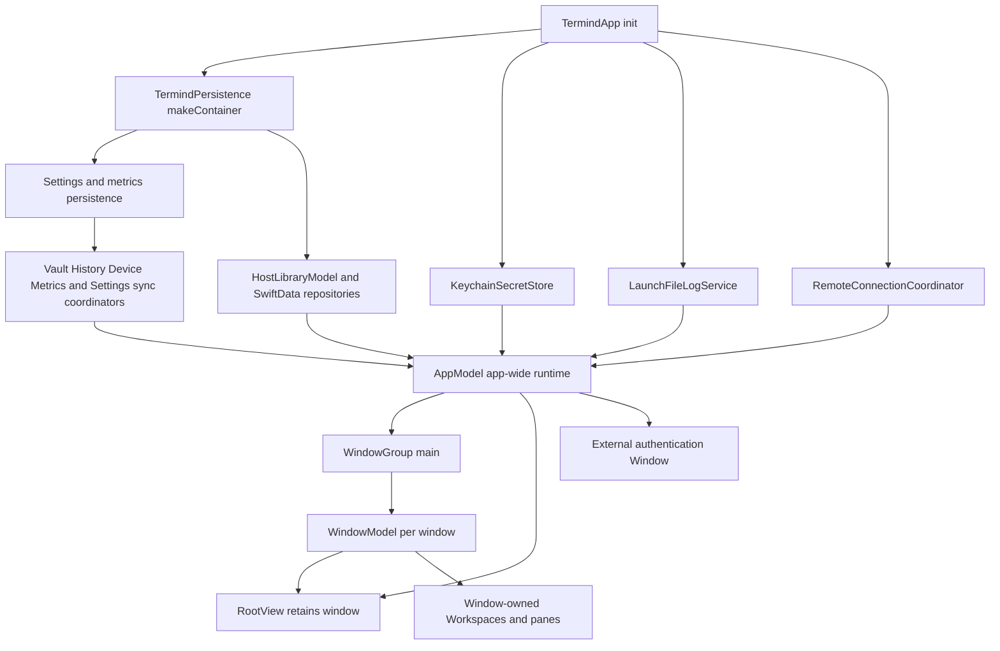
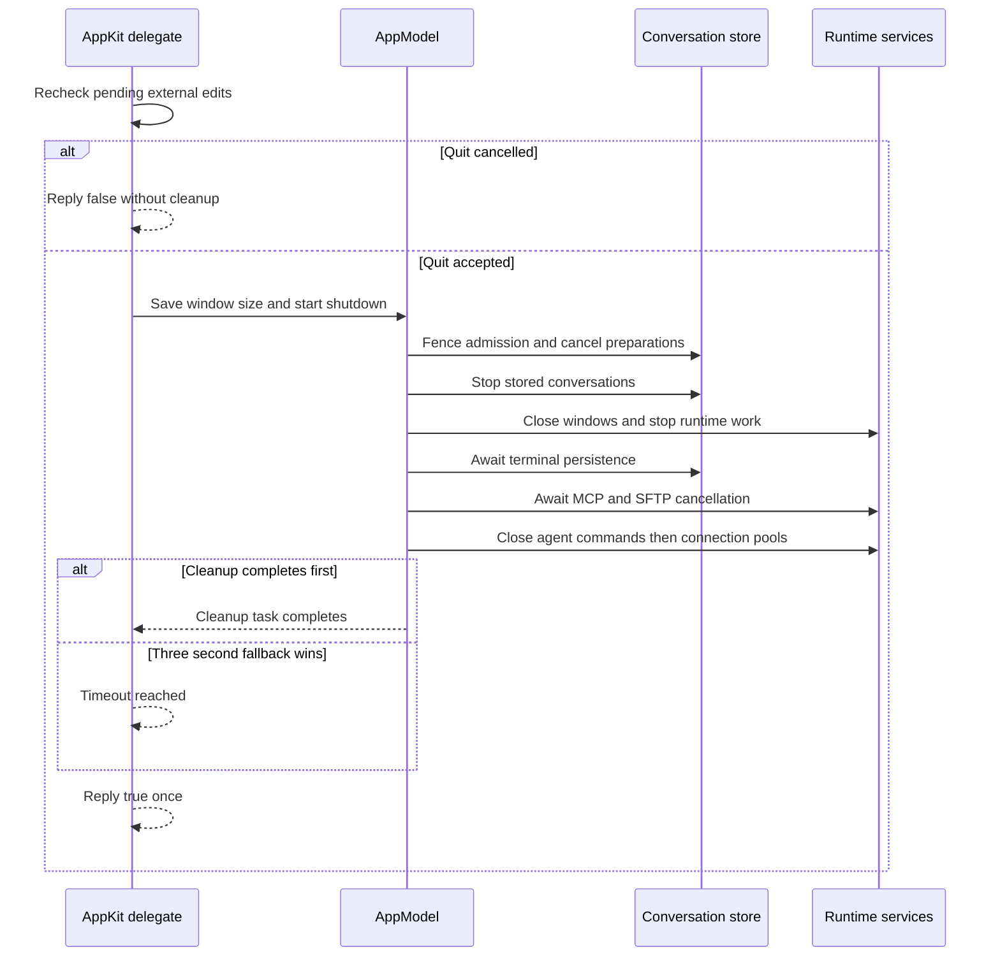
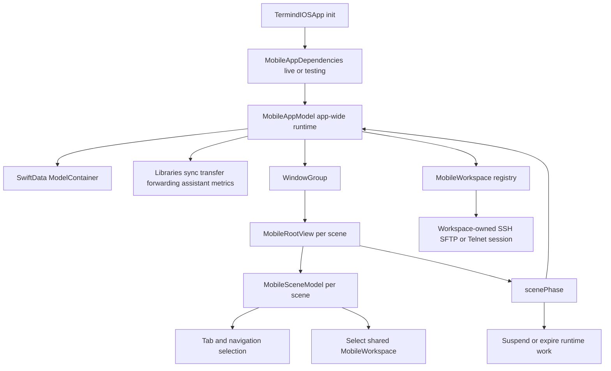
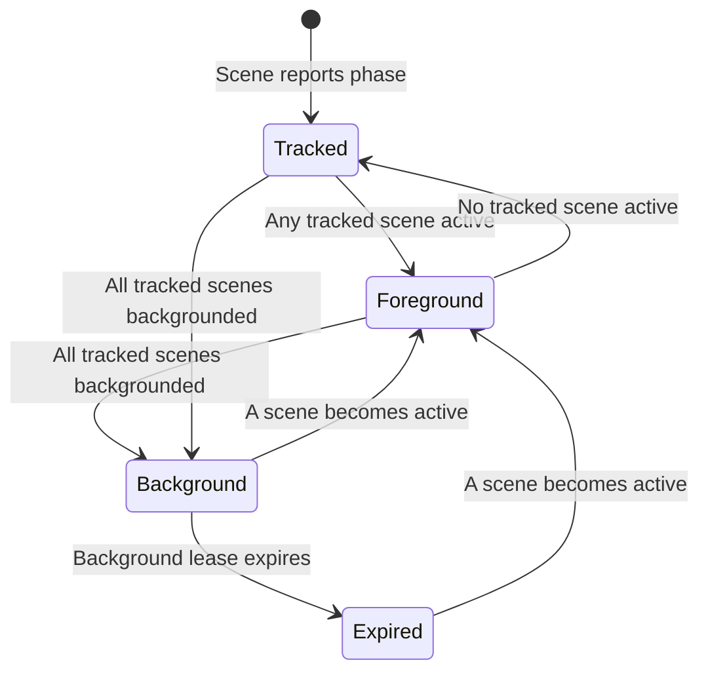

# Platform Composition and Lifetimes

Termind has separate native application targets—`TFM` for macOS and `TFI` for iOS/iPadOS—but both compose the same layered frameworks into a platform-owned runtime. The application target owns startup, native lifecycle hooks, dependency assembly, platform UI, and the boundary between durable app data and live UI/session state. Shared frameworks do not import either app target.

The most important lifetime rule is: **stores, coordinators, and durable-data services are app-wide; navigation, presentation, and desktop workspace ownership are local to a window; mobile navigation is local to a scene; live transports belong to the workspace/session that opened them.** Do not move state across those boundaries merely to make a UI path convenient.

## UI structure and design guides

This page explains runtime composition and lifetime boundaries. For the component trees and user-facing presentation rules, continue with:

- [TFM Desktop UI Architecture](/openwiki/architecture/desktop-ui.md): window shell, persistent workspace deck, split panes, Vault list/detail, managed cards and native transcript ownership.
- [TFI Mobile UI Architecture](/openwiki/architecture/mobile-ui.md): registered feature stacks, scene-local routes, shared workspaces, usable-region layout, mobile toolbars and native input continuity.
- [UI Design Principles and Shared Presentation Boundaries](/openwiki/concepts/ui-design-principles.md): what the platforms share, where their visual/input policies intentionally differ, and how to extend them without merging runtime ownership.

## Lifetime map

| Scope | macOS | iOS/iPadOS | Examples |
| --- | --- | --- | --- |
| Process / app model | One `AppModel`, retained in `TermindApp` state | One `MobileAppModel`, created before the `WindowGroup` | SwiftData container, host library, settings and sync coordinators, shared remote coordinator, histories, transfer and forwarding services, entitlement/review state |
| Native window / scene | `WindowModel` per main window | `MobileSceneModel` per SwiftUI scene | destination, selection, sheets, navigation routes, focused-value command routing, scene-local assistant navigation |
| Workspace and session | Desktop `Workspace` and panes are owned by one `WindowModel` | `MobileWorkspace` instances are shared by `MobileAppModel`; a scene selects one | terminal or SFTP UI, connection journey, transport, terminal state, workspace-specific operations |
| Durable state | SwiftData, Keychain, supported UserDefaults and sync stores | Same categories, plus local `MobileWorkspaceStore` descriptors | Hosts and settings, secret references, histories, mobile recent workspace descriptors |
| Ephemeral runtime state | Never restored as a live connection | Never restored as a live connection | SSH/SFTP transports, authentication journeys, one-shot URL credentials, in-flight runs/transfers |

A useful consequence is that sharing a desktop `AppModel` does **not** make its `WindowModel`s share selection, sidebar/search state, or workspaces. Conversely, mobile scenes share the app's live workspace registry, so opening the same saved descriptor from multiple scenes reuses one workspace and one initial connection attempt; each scene still owns its selected destination and selected workspace ID.

## macOS composition

`TermindApp.init()` is the desktop composition root. Before opening data it cleans previous context attachments, sets up the scrubber web client and chooses the stored launch language (or a screenshot-demo language). A normal launch constructs one on-disk SwiftData `ModelContainer`, prepares settings and metrics persistence, makes the Keychain-backed secret store, and assembles `AppModel` with repositories, sync coordinators, logging, histories, the device directory, and a common `RemoteConnectionCoordinator`. The directory uses the Vault journal's stable installation ID and `MacDeviceName.current`: the trimmed `kern.hostname`, falling back to DeviceKit's `Device.current.safeDescription` when unavailable or empty. Startup fails closed: an inability to open the local database calls `fatalError` rather than substituting an empty store.

**Debug test and screenshot launches still run the real app entrypoint, but not the normal disk-backed runtime.** XCTest detection uses `XCTestConfigurationFilePath` in DEBUG; it selects an in-memory container, a private metrics defaults suite, disabled file logging, unrestricted test Pro access, no Vault/History/Device/Metrics/Settings cloud coordinators, no local host defaults or production memory store, and a window size store without persisted defaults. A screenshot-demo configuration also uses an in-memory container but returns early with demo hosts, AI, metrics and onboarding instead of constructing the normal production services. Neither path is a fallback for a failed production database open: construction errors still fail startup.

This diagram shows the desktop composition root and the split between one app runtime and per-window workspace ownership.

### Shared desktop runtime

`AppModel` is the cross-window coordinator and service owner. It owns the host and credential projections, known-hosts/snippet/forwarding/transfer libraries, terminal and SSH/SFTP settings, histories, AI/skills/memory, metrics, entitlement and review controllers, remote connection coordination, SFTP edit/transfer services, forwarding, MCP services, and sync/outbox integration. It also owns the global conversation store and one speech transcription coordinator, avoiding duplicate conversation state and competing audio taps across windows.

The model keeps only weak registrations for open `WindowModel`s. Registration injects shared stores and coordinators into a window and attaches that window's assistant library to the process-wide conversation store. Fan-out operations—such as a host route change or deletion—find registered windows and disconnect or close the affected window-owned workspaces. A desktop deletion request first persists the repository marker/outbox jobs, clears local histories and projects the Host away; the registered outbox handlers close panes across windows, cancel transfers, stop forwarding and finalize repository cleanup. A failed request reports a storage error instead of projecting the removal. This is coordination, not ownership transfer: the window remains responsible for its own UI and workspaces.

`TermindApp` creates a `WindowGroup(id: "main", for: UUID.self)`. Each scene receives a fresh `WindowModel` (except a request-less debug screenshot scene, which can receive demo window state), places it in `RootView`, and injects the same `AppModel` and SwiftData container through the SwiftUI environment. `RootView` retains that model in `@State`, registers it on appearance, and exposes it via the environment and focused scene value. The independent `Authentication Request` window shares app dependencies but is reserved for external authentication presentation; `.commandsRemoved()` prevents normal Window-menu creation.

**Scene policy is separate from store policy.** In DEBUG, a default XCTest host suppresses automatic launch of both the main and authentication scenes unless `TERMIND_WINDOW_TESTS=1` or screenshot-demo mode is active. Tests disable restoration for both scenes even when visible windows are opted in; screenshot mode disables main-scene restoration, while ordinary launches use automatic launch and restoration. The delegate also refuses Dock reopen while test-window suppression applies, refuses to quit the test host when its last fixture window closes, and skips starting metrics activity/menu in tests. Explicit window/focus tests use `.requiresVisibleWindow` and opt in with `TERMIND_WINDOW_TESTS=1` (or Xcode's `TEST_RUNNER_TERMIND_WINDOW_TESTS=1` forwarding); suppression is not a ban on explicitly created offscreen test fixtures. The default test-host checks assert no visible windows and no reopen. To exercise a gated suite, use `TEST_RUNNER_TERMIND_WINDOW_TESTS=1 xcodebuild -project Termind.xcodeproj -scheme TFM -destination 'platform=macOS' -onlyUsePackageVersionsFromResolvedFile -only-testing:TFMTests/<Suite> test`; the test host itself checks `TERMIND_WINDOW_TESTS=1`. Keep routine logic and offscreen tests on the default suppressed path.

### Window-local desktop state

`WindowModel` contains the state that may legitimately differ in another desktop window: navigator destination, dynamic workspaces and panes, sidebar and search behavior, workspace selection, local presentations, and window-specific assistant surfaces. `RootView` preserves mounted workspace-native views when a different destination becomes visible so terminal grids, scrollback, and SFTP UI state survive navigation.

A host-opening action is centralized in `AppModel`, which chooses the requested protocol, but it opens into the caller's `WindowModel`. That window assigns one connection-history event to each saved-host SSH, Telnet or SFTP pane. Closing the pane/workspace ends the event before disconnecting, while moving a live pane preserves it and reopening creates a new event. External temporary and Serial panes are not recorded; a crash may leave `endedAt` absent. A batch can deliberately create separate window-local workspaces or one workspace with several panes. External SSH/SFTP/Telnet URLs likewise create a temporary workspace in the target window without adding a saved Host; Telnet URLs containing an advisory password require explicit confirmation first.

`MainWindowCoordinator` binds native `NSWindow`s to `WindowModel`s. It processes new-window and workspace-move requests, preserves system-restored frames (a restored scene has no pending move request), saves normal window size only at appropriate boundaries, and unregisters then closes a model when its native window closes. Restoring a window thus does not replay a moved workspace or reopen its live connection. The AppKit delegate handles Dock reopen/new-window behavior and may retain the process after the last window according to menu-bar metrics configuration.

### Desktop lifecycle and termination

The AppKit delegate starts native appearance/login handling and, outside tests, starts metrics activity and the metrics menu once `AppModel` is available. For quiet login launches it hides the normally constructed window rather than running window-less; a one-shot key-window observer and three-second disarm prevent a later user-opened window from being hidden. On app activation it refreshes both entitlement state and the current `DeviceRecord` display name from `MacDeviceName.current`; the synchronized directory can therefore update without rewriting connection events. TFI refreshes its name directly from DeviceKit's `Device.current.safeDescription` on active-scene transitions. On termination the desktop app first checks for pending external edits; after user confirmation, it saves window sizing and invokes `AppModel.shutdownForTermination()`.

Shutdown is deliberately idempotent and bounded by the delegate. `applicationShouldTerminate` returns `.terminateLater` while it rechecks external SFTP edits; if pending changes exist and the user cancels the alert, it replies `false`, clears the pending-termination flag and does **not** start cleanup. An accepted quit saves the ordinary window size before cleanup. `shutdownForTermination()` immediately fences assistant admission, cancels pending run preparation, stops the app-wide conversation store (including conversations no longer shown in a registered window) and awaits terminal saves; it also suspends memory and edit monitoring, shuts down metrics and speech, closes registered windows, and cancels SFTP work, external authentication, forwarding and the outbox. It concurrently awaits MCP and SFTP cancellation, then closes agent background commands and connection pools **after** the assistant drains. Repeated calls return the same cleanup task. The delegate replies `true` to macOS when cleanup finishes or after a once-only three-second fallback; that bound applies to the quit reply, **not** a guarantee that every asynchronous drain finished. `applicationWillTerminate` repeats cleanup safely.

Desktop termination orders assistant draining before agent connection teardown, but the native quit reply can precede completion of that drain.

## Mobile composition

`TermindIOSApp` runs language-preference migration and constructs exactly one startup `Result<MobileAppModel, Error>`. It selects `.testing()` dependencies when XCTest is detected and `.live()` otherwise. The `WindowGroup` either injects the shared model container into `MobileRootView` or presents an unavailable-data screen if construction failed; unlike macOS, failure is surfaced in the first window instead of terminating the process.

This diagram shows that mobile scenes have independent navigation but select from app-wide live workspace instances.

### Dependency assembly and test seams

`MobileAppDependencies` is the mobile assembly seam. Live dependencies create a launch file logger and a single `RemoteConnectionCoordinator`, which is passed to both mobile workspace connections and metrics; the same logger is passed to forwarding. Test dependencies use in-memory mode and permit replacement of the host repository, defaults, background-task manager, workspace connection services, metrics services, review controller, container, workspace store, live-activity controller, and forwarding factory.

`MobileAppModel` creates or receives its `ModelContainer`, then builds the host repository, outbox, Keychain or in-memory secret store, settings/metrics persistence and sync coordinators, host and credential libraries, AI/skills/memory, assistant, metrics, transfers and SFTP edits, forwarding, histories, the generic device directory, and live activities. The device directory and connection history use separate repositories on the same Vault context and share the stable installation ID; each repository journals its own payload kind transactionally. Workspace publication starts an event and explicit close records its end. Production uses `Termind.store` under Application Support; tests or supplied repositories use an in-memory container and do not enable production live activities or sync coordinators.

The app model wires cross-service invalidation at construction. Local `deleteHost` first disconnects the assistant, closes saved descriptors and live workspaces for that Host, invalidates edits, cancels transfers, retires forwarding and metrics, then requests repository deletion, projects the removal, and starts the outbox; repository failure is reported in `error` rather than completing that projection. Earlier runtime cleanup is not rolled back. The deletion request commits a hidden-host marker and ordered outbox jobs together, so durable reference cleanup and final removal can resume after a crash. Outbox handlers also close workspaces and clear histories, cancel transfers, and remove forwarding rules. Host route edits disconnect matching live protocols rather than deleting descriptors. Remote sync application computes a change plan before replacing the local projection: changed routes invalidate edits, sessions, transfers and forwarding, while removed Hosts additionally close saved workspaces and clear histories/metrics. This keeps runtime work from using stale configuration.

### Scene-local navigation, app-wide mobile workspaces

`MobileRootView` creates `@State` `MobileSceneModel` for its scene and reports `scenePhase` to the shared app model. It uses one sidebar-adaptable `TabView`, but each tab hosts its own `NavigationStack`; adapting the tab UI does not replace the feature tree. The scene model owns destination selection, selected/pending workspace IDs, connection-picker and editor presentation, external-link confirmation, local assistant-library route, review page, and recency used to choose an already-open workspace. Focused scene values route commands to that scene.

The UIKit `MobileSceneDelegate` holds a pending Home Screen quick action per scene; `TermindIOSApp` passes its action and one-shot consumer into `MobileRootView`. The root consumes it on change and asks its own `MobileSceneModel` to open the connection picker or open a recent Host using the Host's **current** preferred connection kind. Unknown shortcuts are rejected; a missing or unusable Host presents the workspace-unavailable alert instead of trying to restore a stale session. The system's shortcut list is refreshed from local connection history and host changes, limited to three openable recent Hosts.

`MobileAppModel`, rather than a scene, owns `workspaces` and the persisted descriptor list. `openWorkspace(_:)` first returns an already-live workspace; otherwise it validates the saved descriptor's Host, constructs the workspace, publishes it, and then starts its connection. Publishing before connecting is an invariant: multiple scenes selecting the same descriptor share an instance and cannot trigger duplicate first connections. A scene only selects/presents that shared workspace.

Mobile persistence deliberately restores **descriptors, not sessions**. On cold launch `loadRecentWorkspaces()` reads descriptors, removes those whose Hosts are absent, and publishes no live workspace or connection; it also clears leftover Live Activities. A descriptor contains only workspace ID, Host ID, title, and connection kind, while initial commands, paths, connection secrets, and transports stay outside it. Opening a saved descriptor connects it on demand. Closing removes both the live instance and descriptor; externally linked temporary workspaces are not persisted.

### Mobile foreground and background boundaries

Scene phases are aggregated by scene ID. The app only enters global background behavior when every tracked scene is backgrounded, so one backgrounded scene cannot suspend work still visible in another. Removing the last active scene can trigger that transition when other tracked scenes remain backgrounded; removing the last tracked scene does not. On that transition it stops edit monitoring, suspends memory and sync, pauses metrics and outbox work, suspends recording, and starts a finite platform background task. If the task expires, it asks each live workspace to handle background expiration, stops forwarding, pauses transfers, and expires assistant work. Expiration detaches active workspace transports, clears interactive authentication state and marks a foreground reconnect intent; returning before expiration does not force a reconnect. It updates Live Activities but does not use them to retain connections.

`MobileBackgroundController` owns one UIKit background-task lease. Beginning another lease finishes the old one; foreground `finish()` and expiration retire a valid identifier at most once. Expiration calls its cancellation callback synchronously before ending the task, even when UIKit expires during `begin`; a late callback for a retired lease is ignored. If UIKit returns `.invalid`, the controller expires immediately without trying to end an invalid identifier. Async disconnects started by the callback are best effort, not a guarantee that every drain completed before the lease ends.

When any scene becomes active, mobile refreshes its current device-directory record, reenables edit monitoring, finishes the background task, asks existing workspaces to resume, reconciles sync, restarts the outbox and metrics, refreshes entitlement asynchronously, and updates activities. `reconcileSync()` calls `start()` on Vault, History, Device, Metrics and Settings coordinators only if at least one tracked scene is `.active` **and** Pro permits Vault sync; otherwise it pauses all five. This is a foreground/entitlement gate, **not** an override of user sync choices: each coordinator's `CloudSyncLifecycle.start()` separately checks the global iCloud switch and any applicable optional preference and pauses if disabled. `setSyncEnabled(_:key:)` gates enabling on Pro, writes the selected preference, migrates custom passwords when enabling the global iCloud switch, then reconciles. `MobileRootView` also reconciles when Pro access changes. Desktop `AppModel` starts/reconciles those five coordinators against Pro access without a scene-phase gate, but their individual preferences still govern actual activation. Returning before expiration preserves healthy connections; after expiration, workspace recovery follows the workspace's reconnection journey. Expired forwarding and pending interactive authentication are stopped rather than silently restarted on foreground.

Mobile phase aggregation controls a single background lease and foreground sync eligibility; expiration retires live runtime work, not persisted workspace descriptors. An empty scene registry is not treated as all-backgrounded.

## Ownership invariants and safe extension points

### Preserve these boundaries

- **Do not make a window or scene the owner of app services.** Inject app-wide services into per-window/per-scene presentation models; use the central model for operations that must affect all live owners.
- **Do not make app-wide navigation state.** Desktop window destination/workspace collections and mobile scene selection must remain independently mutable.
- **Do not persist live connection state as restoration.** Mobile descriptors are intentionally limited; desktop state restoration must not reconnect active workspaces merely because a window returns.
- **Publish shared mobile workspaces before `connect()`.** Changing this order risks duplicate live instances and duplicate connections across scenes.
- **Retire runtime resources before replacing configuration.** Host deletion, route changes, and remote sync need to invalidate workspace sessions, transfers, edits, forwarding, and dependent services through their existing callbacks/change plans.
- **Keep test composition explicit.** Extend `MobileAppDependencies` or `AppDependencies` when a platform integration needs a substitute; do not add test-only global singletons to production code.

### Adding a shared service

For a service that must be unique across windows or scenes, construct it at the platform composition root, place it on `AppModel` or `MobileAppModel`, and provide narrow callbacks or accessors to local UI models. Decide its shutdown/suspension contract at the same time: macOS termination must include it in `shutdownForTermination()`, while mobile must define whether it pauses on all-scenes-background, expires with the background task, or safely survives foreground transitions.

For a service that represents navigation, focus, a sheet, an editor draft, a desktop workspace/pane, or a scene-specific command target, keep it in `WindowModel` or `MobileSceneModel`. For a connection or terminal/browser state, keep it on the workspace/session and ensure the app-level lifecycle only invokes its explicit suspend, resume, disconnect, or close APIs.

## Focused verification

Tests exercise the lifetime contracts rather than merely constructing views:

- `MobileAppTests` verifies saved descriptors reopen on demand without replaying commands or paths, two scenes selecting one restored workspace create only one connection, and local/remote Host deletion removes both opened and unopened descriptors.
- `MobileWorkspaceConnectionRecoveryTests` verifies background expiration disconnects affected mobile workspaces and foreground resumes them, while a quick foreground return preserves a healthy connection.
- `MobileForwardingLifecycleTests` verifies all-scenes background is required before expiration, and expired forwarding/authentication does not revive merely on foreground.
- `MobileBackgroundControllerTests` covers stale callbacks, exactly-once task retirement, synchronous expiration during lease acquisition and invalid UIKit identifiers; `MobileAppTests` covers scene removal and quick versus expired foreground returns.
- `MobileHomeScreenQuickActionTests` covers recent-host shortcut selection, payload decoding and one-shot consumption by the scene delegate.
- `AppTestHostTests` checks default test-host window suppression, Dock-reopen refusal and survival after the last fixture window closes; `.requiresVisibleWindow` gates tests that actually show windows or take focus.
- `AppTerminationTests` verifies shutdown cancels stored and preparing assistant work, joins even an unstored captured failure before closing agent resources, fences new work, and replies once whether cleanup or the three-second fallback wins.
- `RepositoryOutboxTests` verifies a Host deletion request commits the hiding marker and complete outbox atomically.
- `DockMenuTests` verifies Dock-created desktop windows receive distinct `WindowModel`s in the Welcome state and retain per-window UI state independently.
- `ExternalConnectionURLTests` verifies external desktop connections are temporary and unsaved, including the Telnet-password confirmation boundary.

See [System Boundaries](/openwiki/architecture/system-boundaries.md) for framework ownership, [Agent Runtime and Assistant](/openwiki/concepts/agent-runtime-and-assistant.md) for shared agent execution state, [Persistence and Secrets](/openwiki/concepts/persistence-and-secrets.md) for storage policy, and [SSH Session Lifecycle](/openwiki/workflows/ssh-session-lifecycle.md) for per-session connection behavior.

Vault and Device follow the master iCloud switch and Pro eligibility. History, Metrics and Settings retain optional selections. Both apps render shared `CloudSyncSettingsContent` with one aggregate status and the optional switches in History → Metrics → Settings order.
