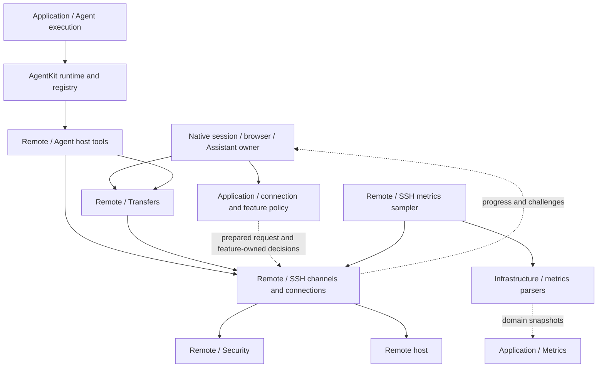
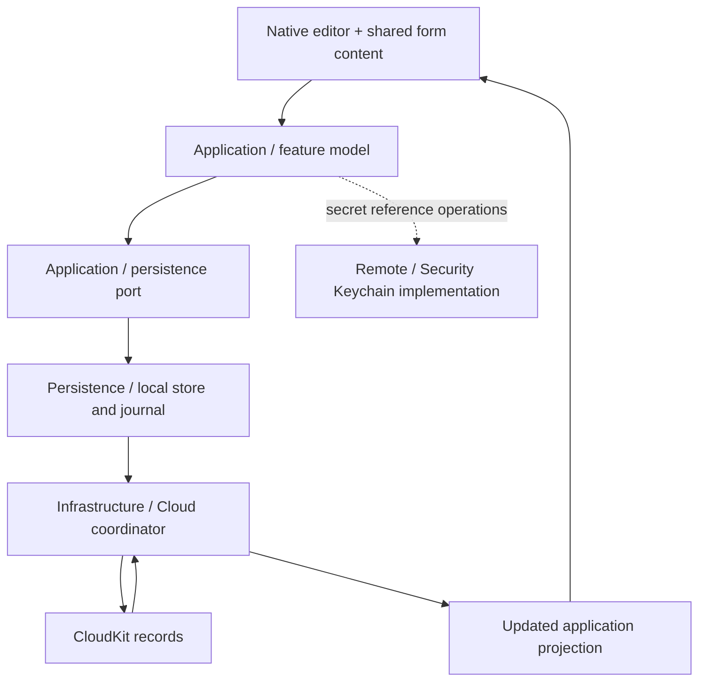

# Shared Framework Directory Responsibilities

The six module roots live under `Frameworks`. Paths in each table are **relative to the named framework root**. All current functional child directories are covered; these modules mostly stop at that level. Persistence is flat, while Presentation and Application also contain substantial root-level functionality. The “root files” rows are real responsibilities, not proposed folders.

See the [Module Map](module-map.md) for build dependencies and [Native App Directories](native-app-directories.md) for the app-owned halves of these features.

## TermindDomain — values and rules

Domain describes what the system means, not how a database, socket, or native view implements it. Its directory names denote portable concepts.

| Directory | Responsibility |
| --- | --- |
| Root files | Shared saved-name normalization/defaulting and tag-color values. |
| `AI` | Model/provider form values, API-type selection, and model-editing rules. |
| `Agent` | External tool-call audit values; the generic agent loop remains in AgentKit. |
| `Commerce` | Pro feature and entitlement/access value types. |
| `Connections` | Connection history, forwarding rules, charsets, SSH preferences/host-key identity, and temporary serial configuration. |
| `Credentials` | Identity/key references, SSH key algorithm display values, and user-certificate parsing/validation. Not secret storage. |
| `Events` | Durable outbox-job values. |
| `Hosts` | Host/group metadata, protocol capabilities, deletion descriptions, detected distributions, shell-integration preference, and Known Hosts matching. |
| `Metrics` | Server, process, filesystem, and synchronization value types plus typed read failures. |
| `SSHImport` | Parse SSH configuration/import text into previewable records; parsing does not execute the configuration. |
| `Sessions` | Session context, remote-system/shell events, terminal preferences/custom configuration, local font preferences, Find values, and palette. |
| `Settings` | Settings-sync records and synchronization policy values. |
| `Shell` | Command history, shell syntax/quoting, remote command construction, and command-risk classification/rules. |
| `Snippets` | Snippet/package values and editing rules. |
| `Transfers` | Remote file/path values, permission drafts, SFTP preferences/history, and transfer state records. |
| `Vault` | Vault snapshots, record keys, mutations, synchronization values, replica-scope identities and compatibility status/reason values. |
| `Workspaces` | Saved workspace-template structure, including pane/split configuration rather than running sessions. |

**Boundary:** a secret reference is not the secret, a transfer record is not its worker, and a workspace template is not an authenticated runtime. Domain imports are constrained by architecture tests so these values do not acquire UI, storage, or transport implementation dependencies.

## TermindApplication — ports, coordination, and feature state

Application depends on Domain and AgentKit abstractions. It exposes the capabilities that concrete adapters implement and the state/operations both apps can reuse.

| Directory | Responsibility |
| --- | --- |
| Root files | Host/Vault/AI/skill/memory/preferences persistence ports; secret-store interfaces and in-memory helpers; SSH/Telnet requests, route/proxy/secret types; reconnect policy; language/settings keys and draft merging. |
| `Agent` | Conversation/composer/library state, Assistant execution assembly, title/command generation, attachments, slash commands, tool approval/presentation policy, and memory-indexed repository wrapping. It coordinates AgentKit rather than replacing its loop. |
| `Connections` | Route preparation and snapshots, external connection URLs, connection journeys, trust/MFA prompts, shared retry state, session host-store boundary, and plans for applying remote Vault changes. |
| `Events` | Outbox store contract, retry runner, and host-deletion handlers. |
| `FeatureModels` | Observable libraries/editing policy for hosts, credentials, Known Hosts, snippets, forwarding, histories, AI, skills, memory, SSH import, settings, expansion state, and review prompting. |
| `Logging` | Application log-management contract and disabled logging support. |
| `Metrics` | Sampling clock, snapshots/read interface, and shared server-monitoring model. |
| `Repositories` | History repository contracts, SSH-import batch/reader boundary, and Vault load/save/transaction coordination. |
| `Speech` | Speech-transcription service/events and coordination contract. Native microphone capture remains injected. |
| `Terminal` | Shared terminal Find controller; the native terminal view is not here. |
| `Transfers` | Remote-filesystem port and basic file operations, remote-edit model, and workspace upload-notice state. Bulk scheduling belongs to Remote Infrastructure. |

`HostLibraryModel` is broader than its name: it projects hosts, groups, identities, keys, snippets, forwarding rules, transfers, Known Hosts, and templates. Specialized feature models provide narrower operations over that shared data. Live connection status is kept separate from the saved Host values.

## TermindPersistence — one stored-model owner

This module currently has **no functional subdirectories**. Its root spans several concerns; the rows below are responsibility groups, not physical folders.

| Root-level responsibility group | What it owns |
| --- | --- |
| Schema and migration | Current SwiftData schema, frozen historical representations, migration plan, and the sole shared container factory. |
| Vault and histories | Persistent Host/credential metadata and related Vault records; command, connection, and SFTP history repositories. |
| AI, Agent, skills, and audit | Provider/configuration records, agent-run/message replay, tool-audit storage, skill packages, and persistence redaction. |
| Preferences and sync journals | SSH/SFTP/terminal settings, metrics/settings/Vault local stores, mutation journals, scoped upload restrictions, recovery checkpoints, and sync-facing persistence adapters. |
| Secret metadata/adapters | AI secret references and storage policy bridged to the injected Keychain service; not a plaintext secret database. |
| Memory | Actor-owned GRDB/SQLite memory state, conversation snapshots, session/message indexing, and full-text search. This is distinct from SwiftData's model container. |

The container factory selects the complete versioned schema and migration plan; platform roots choose its location and lifetime. It disables automatic SwiftData CloudKit storage because the explicit CloudKit coordinators use their own records and journals. No app feature or general infrastructure module may introduce a competing `@Model` owner.

Details: [Persistent Data, Migrations, and Secrets](../concepts/persistence-and-secrets.md).

## TermindInfrastructure — general concrete services

| Directory | Responsibility |
| --- | --- |
| Root files | In-memory host repository; Linux filesystem/process/server and NVIDIA metrics parsing; provider service-account file handling; skill-package import. Parsers do not own an SSH session. |
| `Agent` | Read/import context attachments and provide the live attachment-loading adapter. Host-executing tools belong to Remote Infrastructure instead. |
| `Cloud` | Shared CloudKit lifecycle, record coding and upload-safety gates; separate Vault, Settings, and Metrics coordinators using Persistence stores/journals. |
| `Commerce` | StoreKit products, entitlement refresh, purchase/restore flows, transaction observation, and Pro access state. |
| `Logging` | Launch-scoped file logging and log-file lifecycle. |
| `Speech` | Apple speech-recognition implementation plus an audio-input abstraction; each app supplies its native audio capture. |

This layer can use Persistence. It does not depend on either native app, and a CloudKit coordinator is not a screen-level settings model. The shared safety adapter projects scoped persistent restrictions and recovery state into the lifecycle; it does not merge the categories' engines, accounts, subscriptions or journals. V31 adds the safety storage locally, without changing the existing CloudKit record formats. Both received records and save-conflict replies use the same validation path before allowing a blocked record to become uploadable again.

## TermindRemoteInfrastructure — protocol and remote-operation machinery

| Directory | Responsibility |
| --- | --- |
| `Agent` | Host resolution and connection/authentication pools, background commands, SSH/SFTP/metrics/scratch-transfer tools, and registration/presenters alongside AgentKit built-ins. |
| `Logging` | Remote-service logging helpers and sanitization-facing formatting. |
| `SSH` | Socket/proxy/jump routing, handshake/authentication, libssh2 ownership and I/O scheduling, exec/PTY/SFTP channels, charset conversion, session-channel limits, metrics sampling, and forwarding pools/controllers. |
| `SSHImport` | Concrete SSH config/key-file reading, staging, and validated import access. Parsing rules live in Domain; import use cases live in Application. |
| `Security` | Keychain secret storage, Secure Enclave operations, and software key-file import. These mechanisms implement the higher-level secret/authentication boundaries. |
| `Telnet` | Telnet transport and negotiation, separate from SSH/SFTP capabilities. |
| `Transfers` | SFTP data-operation admission, per-session transfer contexts, upload/download/copy planning, streaming, conflict handling, resume state, rename operations, and external-edit local files/observation/upload lifecycle. |

`SSH` has multiple responsibilities because it is the protocol boundary, not just a terminal client. `Transfers` builds file-operation lifecycles on top of that boundary. **A logical file permit, an SSH session-channel lease, and a physical connection are different resources.**

The following diagram shows **collaboration**, not target dependencies. A solid arrow means “requests or uses”; a dashed arrow means an injected callback/result relationship. It summarizes representative paths without claiming all features share one live transport.

Keep trust/authentication interaction with the initiating feature. Additional silent connections and queued operations have different permissions and retirement rules from a user's interactive terminal. See [SSH Lifecycle](../workflows/ssh-session-lifecycle.md), [SSH Multiplexing and Scheduling](../concepts/ssh-multiplexing-and-scheduling.md), [SFTP Workflow](../workflows/sftp-transfer-and-external-edit.md), and [Assistant Runtime](../concepts/agent-runtime-and-assistant.md).

## TermindPresentation — shared content without native ownership

| Directory | Responsibility |
| --- | --- |
| Root files | SwiftUI forms and presentation values for hosts, identities, secrets, trust, connection journeys, forwarding, snippets, providers/models, skills, memory and sync; metrics panels/formatting; Assistant transcript/tool details and disclosure state; Markdown parsing and small input/drop/speech helpers. |
| `SFTP` | Remote-file type/icon/size presentation, transfer status formatting, SFTP settings fields, and edit-upload overlays. |
| `Terminal` | Terminal appearance/theme mapping and font-selection/settings content. Actual font discovery and native terminal mounting remain app-owned. |

Reusable content is not a shared screen controller. In particular, transcript presentation state does not own the Agent runtime, terminal appearance does not own a PTY, and an identity form does not access Keychain directly. Architecture tests prohibit native AppKit/UIKit, persistence, and remote-infrastructure dependencies here.

Details: [UI Design Principles](../concepts/ui-design-principles.md).

## Frameworks/Resources — bundle data, not code ownership

| Directory or root-level group | Responsibility |
| --- | --- |
| Root catalogs and metadata | App text and bundle-metadata localization; privacy manifest; model catalog snapshot/overrides and associated license; Linux-distribution icon mapping. |
| `Assets.xcassets/AccentColor.colorset` | Shared accent-color asset. |
| `Assets.xcassets/LinuxDistributions` | Distribution-specific `LinuxDistro-*.imageset` assets used by host/system presentation. |
| `LinuxDistributionIcons` | Upstream icon license and disclaimer material, separate from the actual image sets. |

Shared resources are compiled into product bundles; platform-specific icons stay in the apps. Resource consumers such as distribution icons and model catalogs should not create a new dependency on an app target. App localization and AgentKit localization have separate ownership.

## Cross-layer flow: edit, persist, synchronize, render

**Solid arrows describe the main action/data flow; the dashed arrow is the separately injected secret-storage path.** This is not an automatic SwiftData-to-CloudKit relationship.

The editor owns interaction, the model owns the operation, Persistence owns stored representation, and the coordinator owns synchronization lifecycle. Secret bytes follow their separate storage policy; they do not become ordinary Vault/Settings record payloads.

## Verification seams

- `ArchitectureBoundaryTests`: import direction, feature construction boundaries, and single SwiftData-model ownership.
- `FrameworkTests`: portable model/policy, persistence compatibility, sync, presentation, and shared-service behavior.
- Remote/session/transfer suites: transport, authentication, admission, cancellation, and recovery semantics.
- Native test targets: screen routing, runtime lifetimes, and platform integration; those contracts are not proven by shared value tests alone.

Return to the [Module Map](module-map.md) for ownership choices or the [Engineering Quickstart](../quickstart.md) for task-specific validation.
