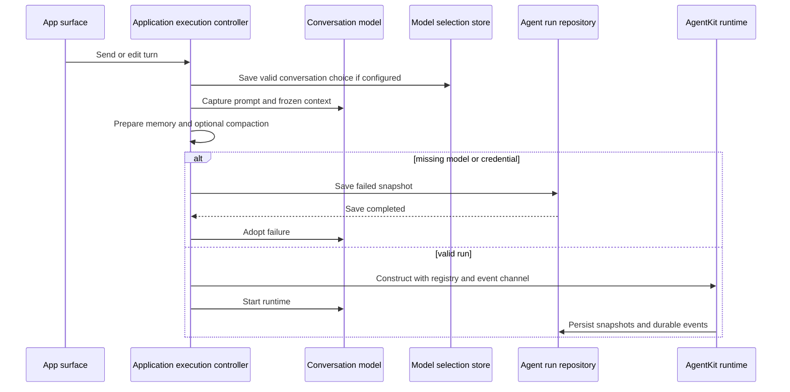
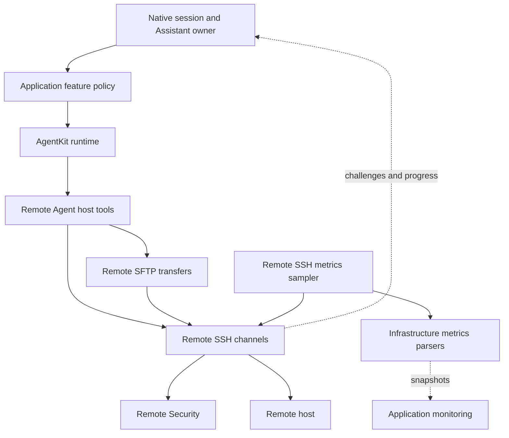
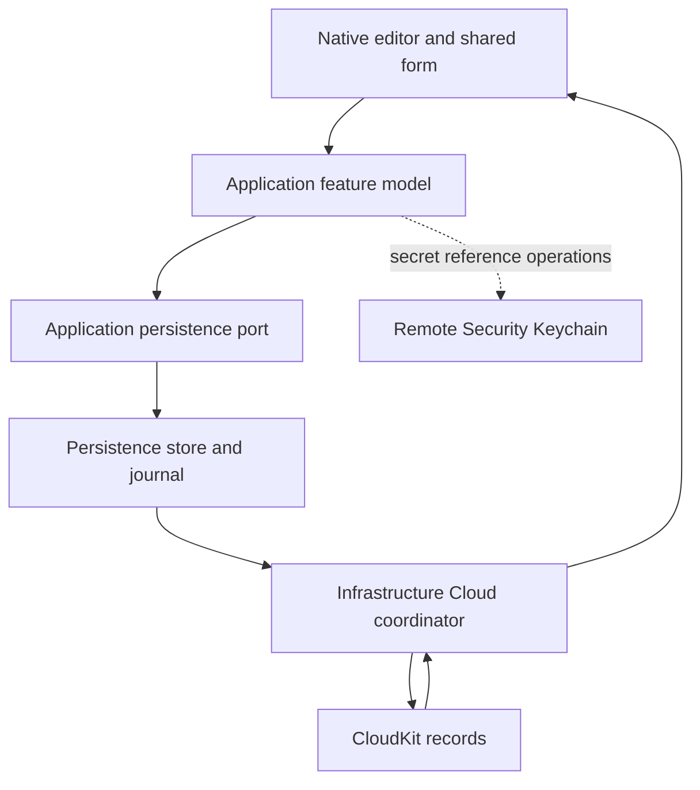

# Shared Module Ownership and Source Landmarks

Use the responsibility sections below to choose the owner before editing a shared feature. The [Module Map](module-map.md) is the authority for the full build graph; this page focuses on source seams and runtime ownership.

The six shared modules live under `Frameworks`. Directory placement expresses responsibility, but compiled target membership comes from Xcode's file-system-synchronized groups. `Frameworks/Resources` belongs to product and test bundles, **not** to every framework bundle. This is a **static build/bundle boundary**, distinct from runtime dependency injection: apps construct concrete services and pass them into Application ports; a framework's source directory does not imply that its resources live in that framework's bundle. AgentKit's loop, provider adapters, approval gate and host-independent built-ins are a separate remote Swift package. Xcode declares `https://github.com/AkinoKaede/AgentKit.git` with an up-to-next-major requirement starting at **0.19.1**, and `Package.resolved` currently pins **0.19.1**; the sibling `../AgentKit` checkout is for package development, **not** the tree Xcode builds. To ship a cross-repository change, test and release AgentKit first, then update the Xcode minimum and resolved revision together with the Termind-side integration; build with `-onlyUsePackageVersionsFromResolvedFile` to avoid silently advancing dependencies. See the [Module Map](module-map.md) for target dependencies, [System Boundaries](system-boundaries.md) for injection, and [Native App Directories](native-app-directories.md) for platform owners.

## TermindDomain — portable values and rules

Domain describes what the system means, not how a database, socket or native view implements it. Its concept directories are `AI` (model/provider editing values), `Agent` (external tool-call audit values), `Commerce` (access values), `Connections` (history, forwarding, charsets, SSH preferences and host-key identity), `Credentials` (identity and key references and certificates, not secret storage), `Events` (outbox jobs), `Hosts` (host/group, protocol and deletion metadata and Known Hosts matching), `Metrics` (snapshots and read failures), `SSHImport` (non-executing config parsing), `Sessions` (terminal/session preferences and context), `Settings` (sync values), `Shell` (command construction, quoting and risk rules), `Snippets` (package/editing values), `Transfers` (remote paths, SFTP settings/history and transfer state), `Vault` (snapshots, mutations, replica scopes and compatibility), and `Workspaces` (saved split/pane templates, not running sessions). Root values include `DeviceRecord`, saved-name rules and tag colors. A secret reference is not secret bytes, a transfer record is not its worker, and a template is not a connected workspace. Architecture tests constrain dependencies to keep these rules independent of UI, SwiftData and transports.

## TermindApplication — ports, policy and feature lifetimes

Application uses Domain and AgentKit abstractions; concrete stores, sockets and native screen owners are injected. Root-level contracts cover Vault/AI/skills/memory/preferences/notification persistence, secrets, SSH/Telnet requests and reconnect policy. Its functional directories divide responsibility:

| Directory | Shared responsibility and public seam |
| --- | --- |
| `Agent` | `ConversationModel`, library and composer state, `AssistantExecutionController`, model selection, collaboration and notification coordination, command/title generation, attachments, approval policy and `AgentRunPersisting` integration. AgentKit still runs the agent loop. |
| `Connections` | Route preparation, external URLs, session connection journeys, trust/MFA interaction and retry state; does not own libssh2. |
| `Events` | Outbox contract and retry/deletion handling. |
| `FeatureModels` | Observable host, identity, snippet, forwarding, history, device, AI, skills, memory, import and settings models. |
| `Logging`, `Metrics`, `Speech`, `Terminal` | Log contract, monitoring state, transcription coordination and portable terminal Find; microphone capture and terminal mounting stay platform-owned. |
| `Repositories`, `Transfers` | History, device-directory, import and Vault ports, and `RemoteFileSystem`/basic file and remote-edit operations; bulk SFTP scheduling belongs to Remote Infrastructure. |

`HostLibraryModel` projects saved hosts, groups, identities, keys, snippets, forwarding, transfers, Known Hosts and templates through Vault/secret ports. It holds live connection status separately from persisted `Host` values and notifies the app before host/forwarding deletion so runtime listeners can retire. `DeviceDirectoryModel` registers the installation via its repository, caches lookups until reload, and exposes storage errors rather than committing a failed rename. Persistence's device adapter journals directory changes with History and refuses registration that would resurrect a deleted device; clearing connection-event history does not erase the device directory.

### Interactive connections: shared policy, feature-owned I/O

Start at [`RemoteSessionConnectionController.swift`](../../Frameworks/TermindApplication/Connections/RemoteSessionConnectionController.swift) for the Terminal/SFTP journey and retry policy, not socket implementation. `scheduleReconnect` calls the feature's teardown closure before presenting recovery or scheduling retry; recovery is armed only after a successful connection. `disconnect` cancels pending authentication, signing, host-key decisions and retry state, clears temporary trust and hides the journey. Progress callbacks check the attempt ID before changing the journey, so replaced or cleared attempts cannot report current progress. [`RemoteSessionConnectionControllerTests`](../../TFMTests/RemoteSessionConnectionControllerTests.swift) verify teardown ordering, disconnect cancellation, route-first host lookup and stale progress rejection. For physical connection, channel and operation admission, see [SSH Multiplexing and Scheduling](../concepts/ssh-multiplexing-and-scheduling.md).

### Terminal Find: shared policy, native focus transitions

`TerminalFindController` owns the observable query and presentation state, with injected binding-action and focus callbacks rather than a native terminal view. Changed queries emit search actions when engine search is not resize-suspended; navigation also requires an open Find UI and a nonempty query. Dismissal emits `TerminalFindBinding.end` once and closes Find without clearing the query. Reopening restarts a retained nonempty search unless suspended. Resize suspension ends engine search while retaining UI state; resume searches the latest query only when still presented and nonempty. This state belongs with the session/workspace owner, not a transient mounted search field.

Focus restoration is also **shared policy**, not responder machinery: `dismiss(restoringFocus: Bool = true)` normally invokes the injected focus callback, while `dismiss(restoringFocus: false)` still ends search but lets the native UI finish its own keyboard dismissal. The mobile workspace search binding uses the latter. UIKit's search activation, `becomeFirstResponder()`/`resignFirstResponder()` transitions and dismissal guard remain in the app-owned `MobileToolbarSearchController`; do not move them into Application or Presentation. `TerminalFindControllerTests` cover default restoration, retained-query restart, empty-query navigation and repeated native dismissal without a terminal-focus request. See [Native App Directories](native-app-directories.md) for platform ownership and [Ghostty Terminal Integration](../concepts/ghostty-terminal-integration.md) for the terminal surface boundary.

### Assistant submission boundary

`AssistantExecutionController` accepts drafts, text, edited turns, plan implementation and manual compaction. Before capture, optional `AssistantModelSelectionController` persists or repairs a valid per-conversation Chat choice; failure stops the turn. It freezes model/credential, permission mode, skills, registry and context before asynchronous memory/compaction work, so later UI changes cannot rewrite that turn. A conversation owns its runtime; the controller tracks one cancellable preparation per conversation and rejects overlapping submissions. Missing model/credential becomes a saved failed run **before** the failure is projected; cancellation can save an interrupted run. It uses injected `AgentRunPersisting` rather than SwiftData.

The injected registry factory supplies host tools; the controller combines eligible AgentKit skill/memory tools for tool-capable models, an ordered `AgentEventChannel`, weak conversation interaction (closed means deny), and a frozen planning posture. Compaction is saved before changing the observable transcript. Remote Infrastructure composes AgentKit built-ins with Termind's tool catalog and MCP definitions; its SSH/SFTP writes and scratch push are acting-only, and scratch pull/push require the same conversation-scoped workspace as the runtime's scratch tools.

Assistant submission crosses Application capture and Persistence save boundaries before runtime execution or failure projection.

Submission and failure ordering: a rejected selection write stops before capture; saved failures precede observable failure. Collaboration adds an application-owned `AssistantChatCoordinator` and `AssistantChatCollaborationStoring` for created-chat relationships and delivery receipts. The SwiftData implementation deduplicates receipts by source run/tool call; the target message's provenance and queued receipt become delivered in the message-save transaction, not on an earlier in-memory runtime event. Application notification coordination consumes conversation interaction/completion events with injected preferences, focus and sender; consumed suppressed events are not replayed when focus changes.

## TermindPersistence — stored representations

Source entrypoints: [`TermindPersistence.swift`](../../Frameworks/TermindPersistence/TermindPersistence.swift) for container creation and store lifetime, [`SwiftDataAgentRunRepository.swift`](../../Frameworks/TermindPersistence/SwiftDataAgentRunRepository.swift) for durable assistant history, and [`GRDBMemoryStore.swift`](../../Frameworks/TermindPersistence/GRDBMemoryStore.swift) for the separate memory database. Keep representation changes here and submission policy in Application.

Persistence has **no functional subdirectories**. Its root owns the complete SwiftData model set, frozen historical schemas, migration plan, `TermindPersistence.makeContainer`, Vault and History journals, device-directory and settings adapters, provider/skill records, secret *metadata*, agent replay, collaboration provenance and receipts, and a separate GRDB memory store. Platform entrypoints choose the container URL/lifetime. The factory uses **V52** and explicitly disables SwiftData's automatic CloudKit storage; Infrastructure's coordinators synchronize records using journals instead. V31→V34 replaces host/history/identity shapes and backfills device attribution; V35 adds History journal and capability checkpoints; V36 removes an obsolete import checkpoint; V37 adds scoped record/replica state; V38 adds deletion handoff and asset cleanup; V39 adds conversation model selection; V40 removes retired per-category quarantine while preserving scoped quarantine; V41 adds notification preferences; V42 adds agent-message provenance, created-chat relations and durable delivery receipts; V43 adds public MCP OAuth configuration; V44 replaces the Host model; V45 replaces the SSH key model with Security Key reference metadata; V46 historically adds persisted terminal keyword-highlight preferences; V52 removes that retired preference model via a lightweight migration. These are **local** schema versions, not CloudKit record-format versions. No other module should introduce a competing `@Model` owner.

On macOS, file-backed `makeContainer` acquires a per-store nonblocking advisory lock **before** SwiftData opens or migrates the database. Containers in the same process share a lease for canonicalized URLs until the last container closes; another process gets `PersistentStoreAccessError.inUse` instead of opening the store. The stable `.lock` file is not unlinked on release. In-memory containers do not acquire this lock; passing both `inMemory: true` and a URL violates a precondition. Keep container creation through this factory so journals and migration stay under the same store lifetime.

`SwiftDataAgentRunRepository` deduplicates snapshots by message ID across runs and saves frozen replay/context and attachment backing separately from ordinary transcript messages (compaction has its own rows). Restore orders by run and sequence, projects compaction and recovers persisted tool results missing from the last transcript snapshot. Construction marks unfinished runs interrupted. Editing truncates a suffix and stages a replacement user run; a real run adopts the existing message and its replay backing in one save rather than duplicating them, including failed or interrupted preparation and cancellation before runtime dispatch. `ConversationModel` replaces the corresponding staging summary and message-to-run ownership in its live projection. Conversation deletion removes run/tool/message/replay backing and device-local model selection, and repository-local tombstones reject late saves. V42 also stores message origins; inserting an originated message advances a queued delivery receipt in the **same save**. Title writes redact model-influenced text. Application decides when to run, compact or display errors; Persistence decides what survives restart.

### Agent history changes: choose the owner by task

| Task | Shared owner and regression seam |
| --- | --- |
| Commit an edited turn before changing live history | Application's `AssistantConversationOperations.edit` calls the injected repository's `truncateConversation` before `ConversationModel.applyPersistedUserMessageEdit`. `AssistantConversationOperationsTests` exercise conversation mutation policy. |
| Preserve replacement ownership and captured payload across restart | Persistence's `SwiftDataAgentRunRepository.save` adopts staging backing; Application's `ConversationModel` projects the real run. `AgentReplayPersistenceTests` cover failed/interrupted adoption, queued cancellation without a model call, and captured configuration failure, reloading from a fresh context to check one real run and retained text, attachments and frozen context. |
| Restore recorded results and older history | `AgentReplayPersistenceTests` cover frozen tool-result model projection, snapshot deduplication/deletion and V15 migration without invented historical context. |

Keep replacement adoption and replay backing changes coordinated across Application and Persistence, not in native transcript views. For capture and cancellation control flow see [Assistant Runtime](../concepts/agent-runtime-and-assistant.md); for stored representations and transactional detail see [Persistent Data, Migrations, and Secrets](../concepts/persistence-and-secrets.md).

`GRDBMemoryStore` is an actor with a separate lazily opened `memory.sqlite` and its own migrations for full-text message search, learning activity and memory-reference dates. Constructing disabled memory creates no database files. See [Persistent Data, Migrations, and Secrets](../concepts/persistence-and-secrets.md).

## TermindInfrastructure — general concrete services

Root services include an in-memory host repository, Linux process/filesystem/server and NVIDIA parsers, provider service-account files, skill import and system notification delivery. `Agent` imports context attachments; host-executing tools live in Remote Infrastructure. `Commerce` implements the RevenueCat-backed Pro entitlement adapter, **not a direct StoreKit purchase service**: `ProAccessController.live()` reads the bundled RevenueCat configuration and exposes access/paywall state; `RevenueCatProPurchaseService` configures the SDK, resolves its `CustomerInfo` stream and fetches current status. `Logging` manages launch-scoped files, and `Speech` implements Apple recognition with an injected audio-input capability, not native app capture policy. Domain defines `ProFeature` and `EntitlementStatus`; the apps own paywall UI and inject the live controller into their models (tests can inject unrestricted access). A missing/invalid configuration fails closed as `.verificationFailed`, not a StoreKit fallback. RevenueCat itself is configured for StoreKit 2; that **SDK runtime choice** does not move purchase ownership into the framework's source code.

The service uses anonymous RevenueCat users, not a device or iCloud ID; a current fetch can sync pre-integration purchases once for an unentitled non-test user, then falls back to SDK cached customer info on a fetch error. The resolver grants access only for the configured, verified entitlement and an active purchase/trial/subscription/grace period, not an expired, refunded, billing-retry or verification-failed state. The controller coalesces concurrent refreshes, lets later customer-info updates outrank older refreshes, and schedules a refresh at an active subscription's deadline. `require` opens the paywall when access is absent; completing a paywall operation refreshes access without forcing the paywall closed. See [Commerce, Localization, and Product Surfaces](../concepts/commerce-localization-and-product-surfaces.md).

`Cloud` implements explicit CloudKit lifecycle, coding, receive validation and safety gates using Persistence's stores. Vault, History, Device, Settings and Metrics coordinators keep category-specific engines and journals; History and Device use kind-scoped records in a shared zone, excluded from Vault's receive/upload/deletion paths. `CloudSyncLifecycle` checks the enabled setting and account before binding a scoped account/environment, and requires confirmation rather than merging on an unexpected account switch. `CloudSyncLifecycleSafety` consults scoped recovery and capability checkpoints; an invalid serialized engine state, recovery requirement or replica upgrade triggers a fresh snapshot. The lifecycle saves its recovery fence **before** creating an automatically syncing engine, reconciles its queue against durable journal mutations, and fetches before enabling uploads and sending. A failed fetch keeps uploads fenced; persistence/callback failure retires the engine, while retryable CloudKit failures retain retryable status. A quarantined record blocks upload until supported reconciliation clears it in the same save; native-field decode failures retain the full record for later readers. Incoming records and server-record-changed replies use the same validation path. This is not automatic SwiftData mirroring.

## TermindRemoteInfrastructure — protocols and remote operations

| Directory | Concrete responsibility |
| --- | --- |
| `Agent` | Host resolution, authenticated connection pooling, background exec, metrics, SSH/SFTP and scratch-transfer tool definitions; durable-card presenters alongside AgentKit built-ins. |
| `Logging` | Remote-service formatting and sanitization. |
| `SSH` | Socket/proxy/jump routing, handshake/authentication, libssh2 worker and channel ownership, exec/PTY/SFTP I/O, charsets, metrics and forwarding pools. |
| `SSHImport`, `Security`, `Telnet` | Concrete config/key-file import, Keychain/Secure Enclave and software-key mechanisms, and a separate Telnet transport. |
| `Transfers` | SFTP admission, session contexts, streaming, conflict/resume/copy plans and external-edit file/upload lifecycle. |

`TermindAgentTools` registers executable definitions and presenters, including a closed legacy-name presenter fallback for cards predating persisted presenter IDs. Acting-only SSH/SFTP writes and scratch push differ from read/planning tools. `AssistantToolRegistry.make` assembles these with AgentKit's built-ins and MCP definitions only for tool-capable models; its scratch workspace is scoped per conversation across runs, not shared across chats. The remote framework imports both `AgentKit` and `AgentKitScrubber` and receives Application-level model, AI settings, event channel and host/connection collaborators from the app's execution-controller registry closure; it does not own the conversation or the agent loop. It selects native versus local web search from provider capabilities and configured preference, forwards usable MCP servers with their resolved bearer tokens, and registers built-ins before host tools and discovered MCP definitions so later catalogs cannot shadow a built-in. Physical connections, SSH session-channel leases and logical file-operation permits are distinct resources. `RemoteCharsetStreamConverter` converts valid command, PTY and SFTP bytes, preserving unconvertible bytes in both directions; incomplete multibyte bytes are buffered and flushed verbatim on finish. SSH/Telnet apply it at protocol edges; the SSH OSC 7 filter rewrites working-directory paths to percent-encoded UTF-8 for Ghostty while bounding incomplete frames. Keep interactive trust/authentication with the initiating feature, not a background pool. See [SSH Lifecycle](../workflows/ssh-session-lifecycle.md), [SFTP Workflow](../workflows/sftp-transfer-and-external-edit.md) and [Assistant Runtime](../concepts/agent-runtime-and-assistant.md).

Representative remote execution and monitoring collaboration; arrows describe requests/results, not target dependencies.

## TermindPresentation — reusable content, not runtime ownership

Source landmarks: [`AppStrings.swift`](../../Frameworks/TermindPresentation/Strings/AppStrings.swift) and semantic copy files under `Strings`, [`TerminalAppearance.swift`](../../Frameworks/TermindPresentation/Terminal/TerminalAppearance.swift) for Ghostty configuration projection, and [`LinuxDistributionIconCatalog.swift`](../../Frameworks/TermindPresentation/LinuxDistributionIconCatalog.swift) for bundle-data lookup. Check [`ArchitectureBoundaryTests.swift`](../../TFMTests/ArchitectureBoundaryTests.swift) before adding a dependency.

Root files provide shared SwiftUI forms, transcript/tool-card presentation state, Markdown, metrics, notifications, and formatting. Stateless `HostEditorBindings` projects existing Host/custom-identity drafts while apps retain creation navigation. `SnippetCardContent` shares color, eligible-target count, command risk and timestamp content without owning the surrounding platform surface or interactions; `SFTP` holds file and transfer presentation; `Terminal` maps domain palettes to Ghostty themes, applies custom configuration and typography and exposes font/theme settings. Terminal appearance does not own a PTY or native mounting. `Strings` owns semantic `AppStrings` `LocalizedStringResource` definitions and shared formatting for both apps, including single-platform copy. The `swiftUIKey` bridge preserves interpolation metadata for key-only APIs; pass resources directly to supported dialog-title overloads. Architecture tests prohibit AppKit/UIKit, persistence, infrastructure and remote-infrastructure imports here and app-local `AppStrings` declarations. See [UI Design Principles](../concepts/ui-design-principles.md) and [Ghostty Terminal Integration](../concepts/ghostty-terminal-integration.md).

## Frameworks/Resources — bundled data

`Frameworks/Resources` is a synchronized group attached to TFM, TFI, TermindWidgets and FrameworkTests, **not** to the six shared framework targets: framework code must not assume `Bundle(for:)` contains this data. It includes `Localizable.xcstrings` and `InfoPlist.xcstrings`, `PrivacyInfo.xcprivacy` (nontracking crash/diagnostic/device-ID disclosures and accessed-API reasons), shared accent/distribution assets, Linux icon JSON and separately stored upstream licensing, plus Pi model catalog/overrides; platform-specific icons remain app-owned. `LinuxDistributionIconCatalog` looks in `Bundle.main`, prefers exact distribution ID then like IDs and returns no result if the catalog/distribution is unavailable. AgentKit owns model capability resolution, so do not assume its model-file bundle search from this repository.

Keep app-facing resource definitions in `TermindPresentation/Strings` and translations in the product catalog; AgentKit text uses its own catalog in the sibling package repository, but Xcode consumes the **resolved remote release**, not edits in that checkout. Add finished `zh-Hans`/`zh-Hant`/`ja` translations, run `Scripts/check-appstrings.sh` and `Scripts/check-cjk-localization.py` together with relevant `PresentationCopyTests`/`AppLanguageTests`. These are manually managed catalogs: do not prune copy based on a single target's stale extraction flag; use `Scripts/normalize-string-catalogs.py --write` and leave generated symbols disabled. `Scripts/update-linux-distribution-icons.sh` regenerates mapping, assets and license material from an explicitly supplied Simple Icons version; no runtime icon fetch is needed.

## Change and verification seams

An editor owns interaction; its Application model operates through a repository port; Persistence commits stored values and journals; Infrastructure syncs explicit CloudKit records; Presentation renders values; secret bytes take a separate injected Remote Security/Keychain path, not ordinary Vault payloads.

Edit, journal, synchronize and render: the dashed path keeps secret bytes out of Cloud/Vault records.

- `ArchitectureBoundaryTests` guard import direction, single SwiftData ownership, shared-copy boundaries and the absence of a direct `StoreKit` import in Infrastructure Commerce.
- `FrameworkTests` exercise feature policy, migrations, Cloud safety, replay and presentation. `PersistentStoreLockTests` check refusal before opening or migration, same-process shared leases, crash release and independent/in-memory stores. `AssistantExecutionControllerTests` check frozen capture and cancellation/failure-save ordering; `AgentReplayPersistenceTests` check staged edits and tool-result recovery; `AssistantChatCollaborationEdgeTests` cover delivery and wait failures; `RemoteCharsetTests` check chunks, malformed bytes and OSC 7 rewriting. `CloudSyncLifecycleTests` cover the upload fence on failed fetch, account transitions, retired-engine callbacks and batch limits; `CloudSyncSafetyTests` cover quarantine and journal-based upload admission across categories. `RevenueCatCommerceTests` cover configuration, entitlement expiry/verification, customer-info update races and the no-StoreKit-fallback failure path; live purchase and restore behavior requires RevenueCat and App Store Sandbox validation.
- Remote/session/transfer suites cover authentication, resource admission, cancellation and recovery; native test targets cover routing and platform lifetimes. Use the [Engineering Quickstart](../quickstart.md) for build/test commands and [Cloud Sync](../workflows/settings-and-cloud-sync.md) for zone-specific behavior.

V47 introduces Tailscale group/local node models, V48 revises local node state, V49 removes persisted command and SFTP history, V50 adds profile cleanup, V51 adds Snippet colors while freezing the V1–V50 Snippet shape, and V52 removes retired terminal keyword-highlighting preferences. Snippet Vault envelopes read V1/V2 and write V2 independently of the local schema. Application owns `TailscaleModel` and group-bound dialer ports; Remote Infrastructure’s `Tailscale` directory implements native node sessions. Presentation’s `Tailscale` forms do not own node lifetime. Command and SFTP history are session-local in memory; connection history remains durable.
