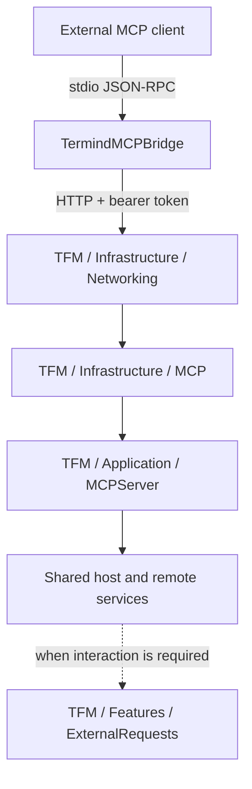
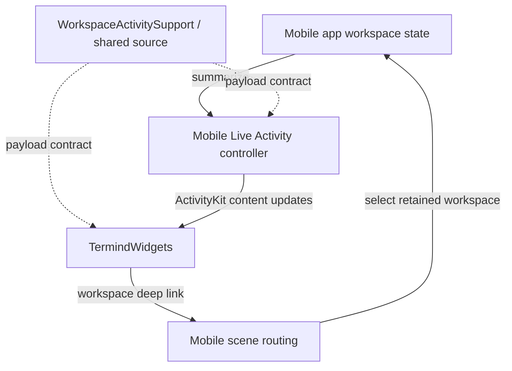
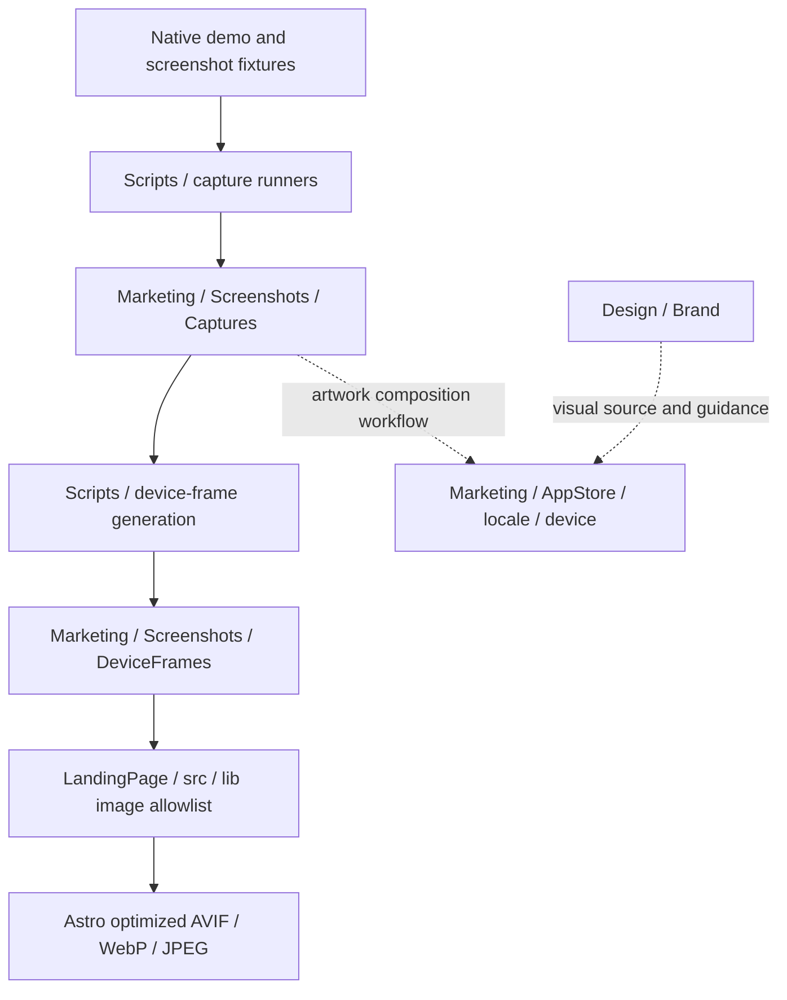

# Supporting Products, Packages, and Tooling

Not every top-level directory is an app module. This guide distinguishes separately built products, a package reference checkout, source-sharing groups, test targets, and development assets. It complements [Shared Framework Directories](shared-module-directories.md) and [Native App Directories](native-app-directories.md).

## AgentKit — separately versioned package

The repository includes an `AgentKit` Git submodule as a reference checkout. **The Xcode project still declares a remote, versioned Swift package**, with its actual revision recorded in the resolved dependency graph. Neither this checkout nor the sibling development repository automatically overrides that dependency.

The directory table describes the checked-out package's organization, not a guarantee that a future checkout and the app's resolved package revision are identical.

| Directory, relative to AgentKit | Responsibility |
| --- | --- |
| `Sources/AgentKit` | Dependency-free core product: host-neutral runtime, model-provider integration, tool contracts, security, and services. Its functional children are expanded below. |
| `Sources/AgentKitScrubber` | Optional ScrubberKit-backed web fetch/search adapter; kept out of the core product's dependency graph. |
| `Tests/AgentKitTests` | Package-level runtime, tools, security, provider, MCP, localization, and other behavioral tests. |
| `Localizations` | Authoring catalog for package-owned English and Chinese text. |
| `Scripts` | Localization compilation and Chinese-catalog validation. This directory is flat. |
| `Sources/AgentKit/Resources` | Generated runtime localization resources in `en.lproj`, `zh-Hans.lproj`, and `zh-Hant.lproj`. |

### Core product functional directories

Paths below are relative to `AgentKit/Sources/AgentKit`.

| Directory | Responsibility |
| --- | --- |
| `Core` | Agent/message/run values, localization access, memory and skill/package concepts. |
| `Runtime` | Turn loop/driver, event delivery, context building/estimation/compaction, streaming/pacing, tool execution/scheduling, run-persistence contract, and loop hooks. |
| `Providers` | Provider/model configuration, discovery/capabilities, authentication/networking, request encoding, response/stream decoding, and tool-name adaptation. |
| `Security` | Secret handles/lifecycle, redaction, approvals/security policy, and Guardian evaluation/session state. |
| `Services` | Conversation-title generation and memory-learning services over runtime/provider capabilities. |
| `MCP` | MCP client transport/protocol and configured-server values. This is not Termind's desktop HTTP server. |
| `Tools` | Tool/schema/argument contracts, validation, catalog/registry, output/detail presentation values, and injected services. |
| `Tools/MCP` | Adapt tools advertised by configured MCP servers into agent tools. |
| `Tools/BuiltIn/Plan` | Planning and task-management tools. |
| `Tools/BuiltIn/Scratch` | Scoped scratch workspace and local file/diff tools. |
| `Tools/BuiltIn/Skills` | Skill/package installation and file access, knowledge presentation, memory and session-search tools. |
| `Tools/BuiltIn/UserInput` | User-input and secret-request tools routed through run interaction handlers. |
| `Tools/BuiltIn/Web` | Web-fetch/search tools and injectable web capabilities. |
| `Resources` | Compiled package-local strings and plural resources; not app-bundle localization ownership. |

Termind adds host-specific tools through `TermindRemoteInfrastructure/Agent`. SSH, SFTP, app UI, and Termind-specific behavior must not be moved into this package. See [Assistant Runtime](../concepts/agent-runtime-and-assistant.md) and [Build and Release](../operations/build-test-and-release.md) for integration and release sequencing.

## MCP bridge and desktop server

`TermindMCPBridge` is flat: its entry point implements the `termind-mcp` executable, with executable entitlements alongside it. It reads newline-delimited JSON-RPC from stdin, sends authenticated HTTP requests to the desktop MCP endpoint, carries negotiated session/protocol headers, writes responses to stdout, and requests session deletion at EOF.

**Solid arrows are runtime requests; the dashed arrow is an interactive authorization request.** The bridge is a protocol adapter, not an SSH implementation or a second AgentKit runtime.

The server's lifetime/controller is assembled by the desktop app. Upload/download application policy, transfer tickets, bearer-token handling, and native authentication presentation stay on their respective sides of this boundary. Details: [MCP Server and Bridge](../integrations/mcp-server-and-bridge.md).

## Live Activity product and shared source

| Directory | Responsibility |
| --- | --- |
| `TFIWidgets` | Flat widget entry/presentation source and bundle metadata for the `TermindWidgets` extension. Renders Lock Screen and Dynamic Island workspace summaries and links. |
| `TFIWidgets/Assets.xcassets` | Widget-owned catalog; `TermindLiveActivityIcon.imageset` supplies its template icon. |
| `WorkspaceActivitySupport` | Flat shared source group compiled into both the mobile app and widget, **not a separate framework target**. Defines ActivityKit attributes, bounded summary payloads, and workspace deep-link encoding/decoding. |
| `TFI/Platform` | Native Live Activity controller/services that create, update, and retire activities from app-owned workspace state. |

Here solid arrows are updates/navigation and dashed arrows are shared type contracts. The payload has bounded session summaries and excludes credentials and terminal output. The extension displays state; it does not keep an SSH connection alive.

## Tests, fixtures, benchmarks, and scripts

| Directory | Responsibility |
| --- | --- |
| `FrameworkTests` | Flat shared-layer test suites for values/use cases, persistence/migration, sync, shared presentation, and other framework contracts. |
| `FrameworkTests/Fixtures` | Synthetic original-module V1/V14 SwiftData stores. They preserve cross-module migration evidence and must not be regenerated from the extracted models. |
| `TFMTests` | Flat desktop and integration suites: architecture boundaries, windows/navigation, terminal/remote flows, transfers, MCP, and rendering. Visible-window and screenshot cases have explicit opt-in gates. |
| `TFITests` | Flat mobile suites: app/scene ownership, workspace/session behavior, backgrounding, editor/Assistant behavior, adaptive layout, and screenshots. |
| `Benchmarks/PortForwarding` | Standalone forwarding benchmark executable over shared-framework SPI; not hosted by an app or test bundle. |
| `Scripts` | Flat executable utilities grouped by function below. |
| `Scripts/Tests` | Python regression tests for version bumping and forwarding-benchmark tooling. |
| `StoreKit` | Local StoreKit product/test configuration; not the production entitlement implementation. |

The script root has multiple independent workflows:

- **Release and resource maintenance:** version bumping, Chinese-localization validation, Linux-distribution icon refresh, and model-catalog refresh.
- **Remote fixtures and benchmarks:** SSH authentication, OpenSSH forwarding, and Telnet fixtures; native/external forwarding runners and their shared benchmark helpers.
- **Screenshots and assets:** Mac/mobile capture runners, screenshot-demo launcher, and reproducible device-frame generation.

Use [Behavioral Boundaries and Fixtures](../testing/behavioral-boundaries-and-fixtures.md) to choose tests and [Forwarding Benchmarks](../operations/port-forwarding-benchmarks.md) for measurement semantics. Routine documentation validation does not imply these app or wire suites have run.

## LandingPage — independent Astro website

Paths below are relative to `LandingPage`. This is a separate Node/Astro build, not a Swift framework or embedded app web view.

| Directory | Responsibility |
| --- | --- |
| `src/components` | Reused page/section content for FAQ, privacy, security, support and offers; redirects; responsive screenshot rendering. |
| `src/layouts` | Shared document shell, metadata, navigation, and site-level composition. |
| `src/lib` | Locale/path/copy helpers, Traditional Chinese conversion/term adjustments, and the explicit marketing-image import allowlist. |
| `src/pages` | English route entry points for the landing page and support/legal/information pages. |
| `src/pages/zh-hans` | Simplified Chinese routes, including the email-offer page. |
| `src/pages/zh-hant` | Traditional Chinese routes. |
| `src/pages/zh` | Legacy Chinese redirects to the current Simplified Chinese routes, not another independently authored locale. |
| `src/styles` | Global styles, tokens, typography, and responsive/interaction styling. |
| `public` | Directly served static assets such as app icon, brand mark, and favicon. |
| `public/brands` | Small third-party/product brand artwork used by the site. |
| Root configuration | Astro/TypeScript/package configuration and locked web dependencies. |

Marketing screenshots are imported from the asset pipeline, not copied wholesale into `public`. The production build runs Astro checks and asset generation. See [Commerce, Localization, and Product Surfaces](../concepts/commerce-localization-and-product-surfaces.md).

## Marketing and design assets

| Directory | Responsibility |
| --- | --- |
| `Marketing/AppStore` | Final store-ready artwork. Children `en`, `zh-hans`, and `zh-hant` divide locale; each contains `mac`, `iphone-6.5`, and `ipad-13` device sets. |
| `Marketing/Screenshots/Captures` | Full-resolution source captures grouped by feature, with platform and locale in the asset identity. Source stage, not web-optimized output. |
| `Marketing/Screenshots/DeviceFrames` | Reproducible device-framed PNGs derived from captures, likewise grouped by feature. The website imports an allowlisted subset. |
| `Design/Brand` | Brand master artwork and visual guidance; separate from app icon documents and exported marketing deliverables. |

**Arrows below mean asset production or consumption, not code dependencies.**

The App Store branch represents a separate artwork workflow, not a claim that the frame generator automatically emits final store compositions. Asset conventions and capture verification live in [Marketing Assets and App Icons](../operations/marketing-assets-and-app-icons.md).

## Project metadata and documentation tooling

| Directory | Responsibility |
| --- | --- |
| `Termind.xcodeproj` | Target definitions, build settings, source/resource membership, linking, and product embedding. |
| `Termind.xcodeproj/xcshareddata/xcschemes` | Shared build/test/run schemes for the apps, bridge, and benchmark. |
| `Termind.xcodeproj/project.xcworkspace/xcshareddata/swiftpm` | Resolved remote-package revisions. This is the app's dependency pin, independent of the AgentKit reference checkout. |
| `.github/workflows` | Scheduled/manual OpenWiki refresh and documentation-PR automation. |
| `.agents/skills/openwiki` | Repository-installed OpenWiki lifecycle instructions and integration metadata; `agents` contains host descriptors. |
| `.codex` | Coding-agent integration configuration, not application runtime configuration. |
| `openwiki/architecture`, `concepts`, `workflows` | Ownership/directory guides, mechanism explanations, and end-to-end behavior. |
| `openwiki/integrations`, `operations`, `testing` | External interfaces, release/development procedures, and verification guidance. |
| `openwiki/.claims` | Generated, page-aligned evidence sidecars; not hand-authored documentation or app state. |

Local dependency/build caches such as `node_modules`, `.build`, `build`, and website output are excluded from the source architecture map. Git internals and user-specific IDE state are also not product modules. Generated OpenWiki indexes, Claims, and lifecycle metadata are maintained through OpenWiki rather than edited as source files.

Return to the [Module Map](module-map.md) or the [Engineering Quickstart](../quickstart.md).
