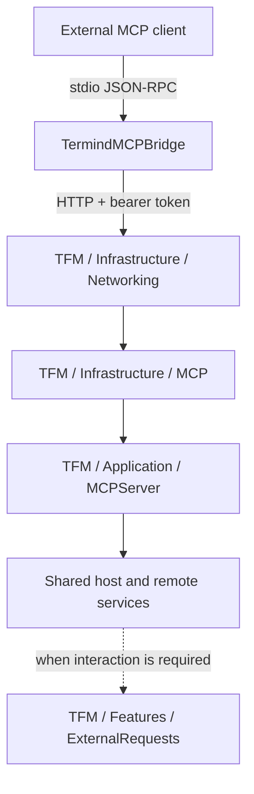
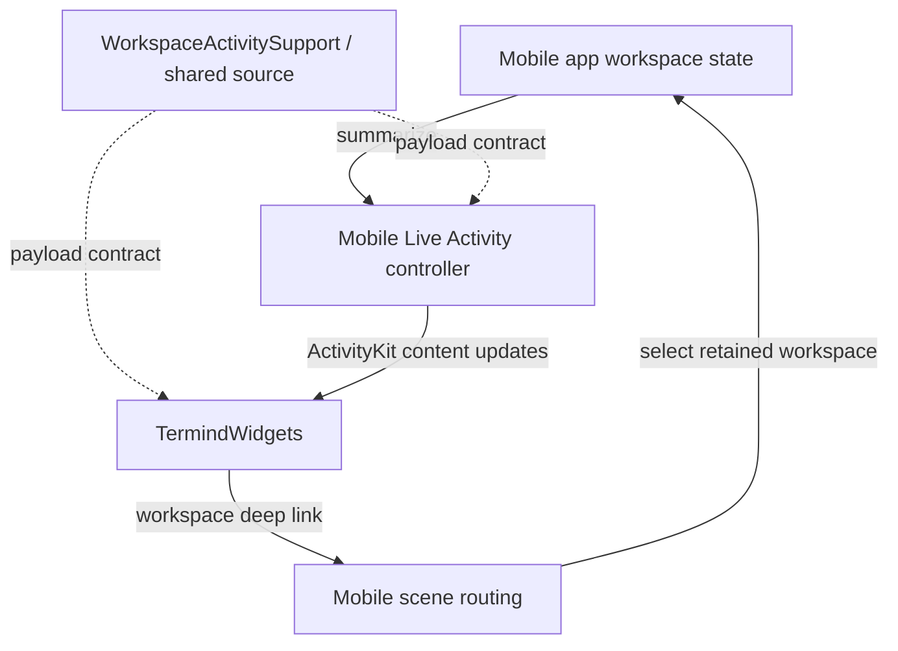
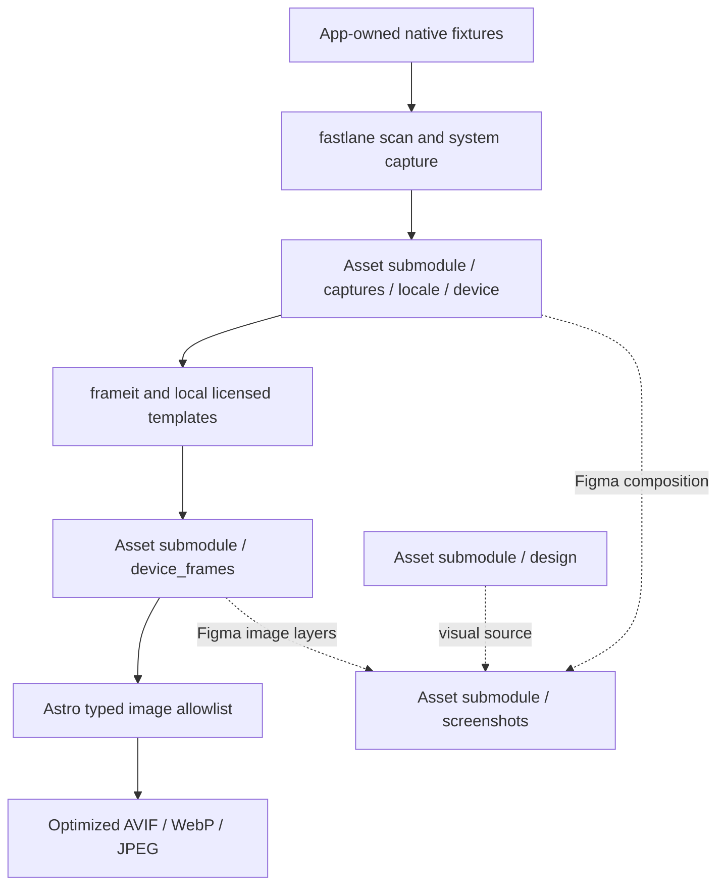

# Supporting Systems Ownership Guide

Not every top-level directory is an app module. This guide distinguishes separately built products, a package reference checkout, source-sharing groups, test targets, and development assets. It complements [Shared Framework Directories](shared-module-directories.md) and [Native App Directories](native-app-directories.md).

## AgentKit — separately versioned package

`.gitmodules` declares `AgentKit` as a submodule, but **the app builds the remote versioned Swift package, not the submodule or the sibling `../AgentKit` working tree**. `project.pbxproj` declares `https://github.com/AkinoKaede/AgentKit.git` with `upToNextMajorVersion` starting at `0.19.1`; Xcode builds the committed `Package.resolved` pin. Use `-onlyUsePackageVersionsFromResolvedFile` so ordinary app builds do not silently advance the pin. [Repository guidance](../../AGENTS.md) assigns the host-neutral loop, approvals, providers, MCP **client**, and built-in tools to the separately released package; this is an ownership contract, not an inspection of its current remote source.

The Xcode product dependencies are the verifiable local integration boundary: `AgentKit` is linked by both apps and by `TermindDomain`, `TermindApplication`, and `TermindPersistence` (as well as test targets); `AgentKitScrubber` is linked by the desktop app, `TermindRemoteInfrastructure`, and desktop tests. Both product references point to the same remote package. Do not infer the package manifest's internal target/dependency layout from product names. Termind's own `TermindAgentTools` registers host, SSH, and SFTP tools alongside runtime built-ins and composes their presenters; host-specific code stays outside AgentKit. `ArchitectureBoundaryTests` prevents app-local redefinitions of selected AgentKit-owned runtime types by scanning Swift declarations in the desktop app tree; this is a source-level guard against shadowing imports, not a test of the package's own implementation. For changes spanning repositories, test and tag/push AgentKit in `../AgentKit` first, then update the app's Xcode minimum version and resolved revision in the same app-side commit. Package localization and tests are operated from the separate AgentKit repository; verify them against the released package revision when changing that boundary. See [Assistant Runtime](../concepts/agent-runtime-and-assistant.md) and [Build and Release](../operations/build-test-and-release.md).

Maintenance checkout presence is not an Xcode build input: `libssh2-spm` tracks `termind`, while Xcode consumes its remote exact `2.0.3-termind-4` release. Ghostty is different: there is no local Ghostty maintenance submodule or staging override. Xcode consumes `Lakr233/libghostty-spm` directly, with an up-to-next-major requirement and resolved version `2.2.2026100501`. Keep its requirement and resolution aligned; see [Ghostty Dependency Updates](../operations/ghostty-fork-maintenance.md).

### Maintenance checkouts versus build inputs

Maintenance checkouts and resolved build inputs are separate. An initialized checkout may track a different maintenance commit than the released package pin; its presence alone does not change an ordinary Xcode build. `.gitmodules`, the Xcode package requirements, and `Package.resolved` establish the integration boundary; they do not verify fork manifests, patches, binary contents, or internal tests. Initialize the relevant checkout before inspecting or changing those internals. Keep the direct Ghostty dependency boundary in [Ghostty Dependency Updates](../operations/ghostty-fork-maintenance.md), and app build/release procedures in [Build and Release](../operations/build-test-and-release.md).

`libtailscale-spm` follows the same separation: `.gitmodules` declares a checkout tracking `main`, while Xcode requires the remote package through `upToNextMinorVersion` from `1.0.2`, resolved to `1.0.2` at `098e6b69ea128f3a55bc560f005a3e851123dc99`. Its `TailscaleKit` product is linked by `TermindRemoteInfrastructure`; Termind's `LibTailscaleNodeSession` is the app-side adapter that owns the embedded node. The checkout is not a native feature owner or the default source of that product.

The former keyword-highlighting local Ghostty workspace and preparation script were removed. Do not use the retired local-fork release/staging instructions for the current upstream package.

## MCP bridge and desktop server

`TermindMCPBridge` is flat: its entry point implements the `termind-mcp` executable, with executable entitlements alongside it. It reads newline-delimited JSON-RPC from stdin, sends authenticated HTTP requests to the desktop MCP endpoint, carries negotiated session/protocol headers, writes responses to stdout, and requests session deletion at EOF.

**Solid arrows are runtime requests; the dashed arrow is an interactive authorization request.** The bridge is a protocol adapter, not an SSH implementation or a second AgentKit runtime.

The diagram shows stdio-to-desktop requests and the separate interactive authorization boundary.

The server's lifetime/controller is assembled by the desktop app. The bridge takes `TERMIND_MCP_URL` (default `http://127.0.0.1:7391/mcp`) and `TERMIND_MCP_TOKEN`, overrideable by `--url` and `--token`; it refuses a missing token or invalid URL. It skips malformed stdin objects, returns JSON-RPC errors to callers with request IDs on HTTP/transport failures, and sends a best-effort DELETE for its session at EOF. For modern requests with `params._meta["io.modelcontextprotocol/protocolVersion"]`, it forwards version, method, and optional encoded name in headers without a session ID; for legacy initialization it stores the server's session ID and negotiated protocol version for subsequent requests and cleanup. `Scripts/check-mcp-bridge.py` exercises the built executable against a local test server for both header modes, error passthrough, and legacy DELETE; this is not a replacement for desktop server tests. Upload/download application policy, transfer tickets, bearer-token handling, and native authentication presentation stay on their respective sides of this boundary. Details: [MCP Server and Bridge](../integrations/mcp-server-and-bridge.md).

## Live Activity product and shared source

| Directory | Responsibility |
| --- | --- |
| `TFIWidgets` | Flat widget entry/presentation source and bundle metadata for the `TermindWidgets` extension. Renders Lock Screen and Dynamic Island workspace summaries and links. |
| `TFIWidgets/Assets.xcassets` | Widget-owned catalog; `TermindLiveActivityIcon.imageset` supplies its template icon. |
| `WorkspaceActivitySupport` | Flat shared source group compiled into both the mobile app and widget, **not a separate framework target**. Defines ActivityKit attributes, bounded summary payloads, and workspace deep-link encoding/decoding. |
| `TFI/Platform` | Native Live Activity controller/services that create, update, and retire activities from app-owned workspace state. |

The diagram shows how shared ActivityKit content connects app-owned updates, widget rendering, and workspace navigation.

Here solid arrows are updates/navigation and dashed arrows are shared type contracts. The payload has bounded session summaries and excludes credentials and terminal output. The extension displays state; it does not keep an SSH connection alive. The app controller restores one active or stale activity and ends duplicates, serializes start/update/end, ends when no workspaces remain, and only starts a missing activity after an explicit open intent and permission to start; ordinary updates cannot resurrect one dismissed by the user.

`MobileLiveActivityRestorationTests` checks duplicate cleanup and retained focus, non-resurrection after dismissal, and close-last/open-new ordering with a suspended end operation. The shared `TFI` scheme selects both `TFITests` and `FrameworkTests`; run it with an available iOS simulator rather than treating the widget as an independent connection or state owner.

## Tests, fixtures, benchmarks, and scripts

| Directory | Responsibility |
| --- | --- |
| `FrameworkTests` | Flat shared-layer test suites for values/use cases, persistence/migration, sync, shared presentation, and other framework contracts. |
| `FrameworkTests/Fixtures` | Synthetic original-module V1/V14 SwiftData stores and a V28 store generated against the historical Persistence framework. Preserve these historical model identities instead of regenerating with current models; `Scripts/generate-v28-fixture.swift` records V28 provenance. |
| `TFMTests` | Flat desktop and integration suites: architecture boundaries, windows/navigation, terminal/remote flows, transfers, MCP, and rendering. Visible-window and screenshot cases have explicit opt-in gates. |
| `TFITests` | Flat mobile suites: app/scene ownership, workspace/session behavior, backgrounding, editor/Assistant behavior, adaptive layout, and screenshots. |
| `Benchmarks/PortForwarding` | Standalone forwarding benchmark executable over shared-framework SPI; not hosted by an app or test bundle. |
| `Scripts` | Flat executable utilities grouped by function below. |
| `Scripts/Tests` | Python resource/version and benchmark checks, plus Ruby regression tests for screenshot capture/frame orchestration. |
| `StoreKit` | Local StoreKit product/test configuration; not the production entitlement implementation. |

The standalone benchmark reads fixture metadata, enforces the host's 1–64 connection limit, and exits with diagnostics on invalid inputs or workload failures. Its runner exercises local, remote, and dynamic forwarding, jump hosts, duplex/mixed traffic, and idle CPU; it waits for the connection pool before recording JSON `FORWARDING_METRIC` lines and disconnects on both success and failure. `Scripts/benchmark-port-forwarding.py` builds its own Release scheme with resolved package versions, runs repetitions and connection limits, and fails if the executable emits no metrics; `ArchitectureBoundaryTests` protects it from becoming an app dependency or a test-host workload. The `TFM` scheme tests `TFMTests` and `FrameworkTests`; use an iOS simulator for `TFITests`. Architecture guards also check cross-layer imports, persistence ownership and feature boundaries, so an ownership refactor should update the focused source-level guard and functional tests together; these guards do not execute the forwarding benchmark. Visible-window macOS, StoreKit, and mobile key-window integration suites have separate opt-in gates rather than running in routine test invocations.

The script root has multiple independent workflows:

- **Release and resource maintenance:** version bumping, CJK-localization validation, shared presentation-copy checking, Linux-distribution icon refresh, and model-catalog refresh. `Scripts/update-pi-model-catalog.sh` requires an explicit Pi version, records npm commit/integrity, preserves model type/input/output, and deduplicates `(provider, id)` entries preferring chat over image over other types; missing output defaults by model type. `Scripts/check-cjk-localization.py` checks catalog normalization and JSON structure, positional format arguments and plural shape, then rejects missing or unfinished `zh-Hans`/`zh-Hant`/`ja` translations and spacing violations; by default it checks both app catalogs, not AgentKit's catalog.
- **Remote fixtures and benchmarks:** SSH authentication, OpenSSH forwarding, and Telnet fixtures; native/external forwarding runners and their shared benchmark helpers.
- **Screenshots and assets:** `fastlane/Fastfile` runs scan over app-owned `MacScreenshotTests` / `MobileScreenshotTests`, not XCUITest snapshot helpers. The Mac lane requires macOS 27 and defaults to Workspace in four locales; its focused native-window marker, scan status and dimensions gate promotion. The iOS lane defaults to iPhone 18 Pro and iPad M5 on 27.0; Duo inner/outer are separate opt-in 27.1 display batches. A unique ready/ack handshake and exact native pixels gate each device/locale scene set. Both lanes share a nonblocking lock, preserve pinned packages and back up replaced sources with SHA-256 manifests. `Scripts/run-mac-screenshots.sh` and `run-mobile-screenshots.sh` delegate to these lanes; `fastlane frames` stages read-only source copies and publishes only after every selected frame succeeds. The full commands, licensed template imports, mask mechanics and Figma delivery contract are in [Marketing Assets and App Icons](../operations/marketing-assets-and-app-icons.md).

Use [Behavioral Boundaries and Fixtures](../testing/behavioral-boundaries-and-fixtures.md) to choose tests and [Forwarding Benchmarks](../operations/port-forwarding-benchmarks.md) for measurement semantics. Routine documentation validation does not imply these app or wire suites have run.

## Public website and asset submodule

Paths below are relative to `com.akinokaede.termind`, an independent public Git repository and Astro build. Native builds do not require it; initialize it only for website/asset work. Commit and push reviewed asset changes via SSH before updating the application's gitlink; retain the HTTPS clone URL in `.gitmodules`. It is not a Swift framework or embedded app web view.

| Directory | Responsibility |
| --- | --- |
| `src/components` | Reused page/section content for FAQ, privacy, security, support and offers; redirects; responsive screenshot rendering. |
| `src/layouts` | Shared document shell, metadata, navigation, and site-level composition. |
| `src/lib` | Locale/path/copy helpers, Traditional Chinese conversion/term adjustments, and the explicit marketing-image import allowlist. |
| `src/pages` | English route entry points for the landing page and support/legal/information pages. |
| `src/pages/zh-hans` | Simplified Chinese routes, including the email-offer page. |
| `src/pages/zh-hant` | Traditional Chinese routes. |
| `src/pages/ja` | Japanese routes, including pricing, comparisons and support. |
| `src/pages/zh` | Legacy Chinese redirects to the current Simplified Chinese routes, not another independently authored locale. |
| `src/styles` | Global styles, tokens, typography, and responsive/interaction styling. |
| `public` | Directly served static assets such as app icon, brand mark, and favicon. |
| `public/brands` | Small third-party/product brand artwork used by the site. |
| Root configuration | Astro/TypeScript/package configuration and locked web dependencies. |

Marketing screenshots are imported from the asset pipeline, not copied wholesale into `public`. `npm ci` installs locked dependencies; `npm run dev` runs local Astro, and `npm run build` performs `astro check && astro build`, transforming allowlisted frames into responsive outputs. See [Commerce, Localization, and Product Surfaces](../concepts/commerce-localization-and-product-surfaces.md).

## Marketing and design assets

| Directory | Responsibility |
| --- | --- |
| `assets/screenshots/<locale>/<platform>` | Opaque sRGB JPGs: six boards per `mac`, `iphone-6.3`, `ipad-13`, `iphone-duo` across four locales (96 current boards). iPhone's two-device Overview is named `01_overview.jpg`; other platforms retain `01_three_screens.jpg`. |
| `assets/captures/<locale>/<device>` | Full-resolution native sources in `iphone-6.3`, `ipad-15`, `mac-14`, and separate Duo inner/outer directories; source identity is locale/device/feature, not feature-first. |
| `assets/device_frames/<locale>/<device>` | Native-scale reproducible PNGs from frameit and local licensed Apple templates. Masks apply only to staged copies; website imports an allowlisted subset, including Duo. |
| `design/brand`, `design/paywall` | Brand master and remote paywall handoff artwork. Native `AppIcon.icon` documents remain with TFM/TFI. |

**Arrows below mean asset production or consumption, not code dependencies.**

The diagram distinguishes source captures, derived web frames, and separate final App Store compositions.

The App Store branch represents a separate artwork workflow, not a claim that the frame generator automatically emits final store compositions. Asset conventions and capture verification live in [Marketing Assets and App Icons](../operations/marketing-assets-and-app-icons.md).

## Project metadata and documentation tooling

| Directory | Responsibility |
| --- | --- |
| `Termind.xcodeproj` | Target definitions, build settings, source/resource membership, linking, and product embedding. |
| `Termind.xcodeproj/xcshareddata/xcschemes` | Shared build/test/run schemes for the apps, bridge, and benchmark. |
| `Termind.xcodeproj/project.xcworkspace/xcshareddata/swiftpm` | Resolved remote-package revisions. This is the app's dependency pin, independent of the AgentKit submodule and sibling repository. |
| `.github/workflows` | Scheduled/manual OpenWiki refresh and documentation-PR automation. |
| `.agents/skills/openwiki` | Repository-installed OpenWiki lifecycle instructions and integration metadata; `agents` contains host descriptors. |
| `.codex` | Coding-agent integration configuration, not application runtime configuration. |
| `openwiki/architecture`, `concepts`, `workflows` | Ownership/directory guides, mechanism explanations, and end-to-end behavior. |
| `openwiki/integrations`, `operations`, `testing` | External interfaces, release/development procedures, and verification guidance. |
| `openwiki/.claims` | Generated, page-aligned evidence sidecars; not hand-authored documentation or app state. |

Local dependency/build caches such as `node_modules`, `.build`, `build`, and website output are excluded from the source architecture map. Git internals and user-specific IDE state are also not product modules. Generated OpenWiki indexes, Claims, and lifecycle metadata are maintained through OpenWiki rather than edited as source files.

Return to the [Module Map](module-map.md) or the [Engineering Quickstart](../quickstart.md).

The website’s comparison and pricing routes share `src/lib/comparisons/` evidence and features plus `src/lib/pricing.ts` public prices across English, Simplified and Traditional Chinese, and Japanese. Legacy `/zh/` routes redirect. These public prices are separate from RevenueCat’s live purchase offering. Screenshot suites live directly under `TFMTests/Screenshots/` and `TFITests/Screenshots/`; lanes select suites by Swift type. The website Hero is Mac Workspace plus Duo outer Assistant and an iPhone SSH alternative, while App Store Overview compositions remain platform-specific.
