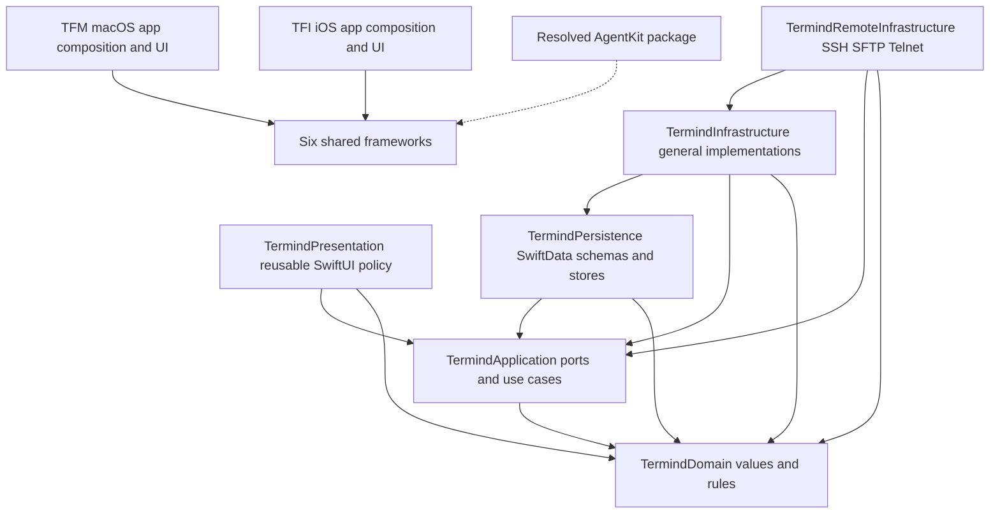

# System Boundaries and Dependency Ownership

Termind is built as two native applications around shared static frameworks. The boundary is intentional: reusable layers model policy and ports, infrastructure implements those ports, and `TFM` (macOS) and `TFI` (iOS/iPadOS) compose the result with native lifecycle and UI. A safe change starts by placing the responsibility with its owner rather than importing a convenient concrete dependency into a lower layer.



Solid arrows point from consumer to dependency (the six-framework subgraph reflects explicit Xcode target dependencies); the dotted package arrow groups external consumers rather than implying every framework links AgentKit. Both apps depend on all six frameworks; no framework depends on an app.

For a directory-oriented view, start with the [Module and Directory Architecture Map](module-map.md). Its companion guides describe the shared frameworks, native apps, and supporting systems through their second-level functional directories; the build graph there uses explicit consumer-to-dependency arrows.

## Layer responsibilities

| Owner | Put here | Keep out |
| --- | --- | --- |
| `TermindDomain` | Portable values, domain rules, records, and protocol-neutral concepts. | UI, persistence APIs, security/network frameworks, CloudKit, StoreKit, SSH C libraries, and terminal implementations. |
| `TermindApplication` | Use cases, feature models, repository and service ports, connection/import policy, and cross-feature policy. | SwiftUI/AppKit/UIKit, SwiftData/GRDB, concrete Keychain/network/SSH implementations, and concrete infrastructure construction. |
| `TermindInfrastructure` | General implementations such as in-memory repositories, CloudKit-backed sync, metrics parsers, logging, StoreKit, and settings/Vault services. | Native app targets and platform UI. It may depend on Application, Domain, and Persistence. |
| `TermindRemoteInfrastructure` | SSH, SFTP, Telnet, Keychain-backed remote credentials, host-key/authentication mechanics, transfers, forwarding, and the Termind-specific agent tools. | App targets and their UI; a feature should use its injected services rather than construct remote transports itself. |
| `TermindPersistence` | Every SwiftData `@Model`, versioned schema, migration plan, SwiftData repository/store, `ModelContainer` factory, and GRDB-backed memory store. | Application-infrastructure implementation dependencies, remote infrastructure, and app targets. |
| `TermindPresentation` | Reusable SwiftUI presentation policy and content: formatting, forms, summaries, transcript/tool-card rendering, and terminal presentation helpers. | AppKit/UIKit, SwiftData/GRDB/Persistence, remote transport infrastructure, and app targets. |
| `TFM` / `TFI` | Native UI, platform adapters, dependency assembly, lifecycle, window/scene ownership, and platform-specific resources. | Shared implementation that should be portable; no shared framework may import an app target. |

`Frameworks/Resources/` is compiled into both application bundles. It is the place for shared resources such as localization catalogs, while app-owned icons, metadata, signing, native adapters, and platform behavior remain in `TFM` or `TFI`.

### Dependency rules that are enforced

`ArchitectureBoundaryTests` scans selected production Swift source roots rather than relying on conventions alone. Domain cannot import the listed platform/UI, storage, security, network, commerce, SSH, or terminal modules. Shared Application cannot import listed UI/storage/transport modules or construct selected concrete persistence, SSH/SFTP, and URL-session symbols; desktop `Application` gets the same construction guard, while desktop `Features` gets a storage/transport import and construction guard. Mobile `Application` and `UI` have separate import restrictions, and mobile `Features` get the construction guard. Presentation is separately prohibited from importing platform UI, persistence, or Remote Infrastructure. These are exact import-string and token scans, **not** a complete compiler-enforced architecture or ban on every concrete implementation: in particular, app composition roots intentionally import SwiftData and concrete frameworks.

The checks also prohibit all shared frameworks from importing `Termind` or `TermindIOS`. Application may not import Infrastructure, Persistence, or SwiftData, and Persistence may not import Infrastructure or Remote Infrastructure. Thus depend on a port exposed by the owning higher-level module; do not repair an awkward dependency by a re-export, forwarding alias, generic “Core” module, or an app-to-framework reference.

## Persistence is a single-owner boundary

`TermindPersistence` exports the complete current schema (`TermindSchemaV34`) and builds a `ModelContainer` using its migration plan. Its factory rejects an in-memory request that also supplies a file URL and configures the store with CloudKit disabled; platform composition roots choose *where* the store lives and retain the container, but do not define the model set or construct a substitute container.

Connection history follows the same boundary: Domain owns the portable event value, Application owns the observable model and repository protocol, and Persistence owns its SwiftData shape and Vault-journal transaction. The reusable ID-to-name mapping is deliberately separate: Domain owns `DeviceRecord`, Application owns `DeviceDirectoryModel` and `DeviceDirectoryRepository`, and Persistence owns `PersistentDeviceRecord` plus the SwiftData adapter. A history event merely references `sourceDeviceID`; it does not own or capture the device name. Platform apps inject connection lifecycles, acquire their native system display name, and choose local versus all-device presentation; they do not declare stored models.

This separation matters for migrations: all SwiftData models, frozen historical schemas, migration plans, and container construction stay together in Persistence. The boundary test rejects `@Model` declarations in scanned desktop, mobile, Domain, Application, and Infrastructure roots and requires Persistence to contain Swift files; the scan does not currently include Remote Infrastructure or Presentation. A new persisted SwiftData entity therefore requires a Persistence schema/migration decision—not a model embedded in a feature, app, or general infrastructure module.

Desktop calls `TermindPersistence.makeContainer` with in-memory storage for tests and screenshot demos; an unavailable local database causes a startup `fatalError`, rather than silent replacement with an empty store. Mobile `MobileAppModel` uses an injected container when provided, otherwise calls the same factory with a file under Application Support for live storage or in-memory storage for tests/injected hosts. `TermindIOSApp` builds the model once during startup and displays an unavailable-data screen when composition fails. See [Platform Runtime, App Composition, and Lifetimes](platform-runtime.md) for the app/window/scene lifetime split and platform-specific failure handling.

## Composition, resource, and state ownership

The app targets are composition roots. `TermindApp` creates the desktop `ModelContainer`, keychain store, sync persistence/coordinators, repositories, connection coordinator, logging, and app-wide `AppModel`; it also supplies `MacDeviceName.current` to the shared device-directory port (trimmed `kern.hostname`, with DeviceKit's `Device.current.safeDescription` as fallback). It injects the shared model and container into its window scenes. `TermindIOSApp` chooses live or testing dependencies, creates one startup `MobileAppModel`, and injects that model's container into its `WindowGroup`; the mobile composition uses DeviceKit's description directly for the device-directory port. This is where a concrete implementation or platform value becomes a port supplied to shared feature code.

Do not use this as permission to move live state into the app-wide layer. Durable stores and cross-window coordinators are app-wide; desktop navigation and workspaces are window-owned; mobile navigation is scene-owned; live SSH/SFTP transports remain with the workspace/session that opened them. Refer to [Platform Runtime, App Composition, and Lifetimes](platform-runtime.md) for the detailed ownership map.

## AgentKit is an external, host-neutral boundary

`AgentKit` is a separately developed remote Swift Package dependency at `https://github.com/AkinoKaede/AgentKit.git`. The project declares `upToNextMajorVersion` from `0.14.0`, and `Package.resolved` currently pins version `0.14.0` at revision `ffc4aa41c8854142aa47c35231e57f56f961ba9f`. Xcode builds that resolved remote package, **not** a sibling `../AgentKit` working tree; an uncommitted sibling change cannot affect Termind.

AgentKit owns the host-neutral agent runtime: its loop, approval gate, provider adapters, MCP client, built-in tools, and their core types. Do not redefine AgentKit-owned runtime types in Termind, and do not edit AgentKit to add the Termind name, SSH, SFTP, app UI, or other host-specific behavior. A cross-repository change must be released and tested in AgentKit first, then consumed by bumping the project dependency and resolving `Package.resolved` in the same Termind change.

Termind owns host-aware behavior on its side of the boundary. `TermindRemoteInfrastructure` defines `TermindAgentToolEnvironment` with injected host resolution, connection pools, authentication, metrics, background commands, and optional scratch workspace. `TermindAgentTools` creates the SSH/SFTP, host-listing, metrics, and host-facing scratch tools; `AssistantToolRegistry` registers AgentKit’s built-ins first and supplies the Termind catalog as additive tools. This preserves a single runtime-owned built-in namespace while allowing Termind to supply the capabilities that actually touch Termind hosts.

## How to make a dependency-safe change

1. **Classify the responsibility.** Put stable values and rules in Domain; an abstract use case or port in Application; a concrete general service in Infrastructure; a remote transport/security implementation in Remote Infrastructure; schemas and SwiftData stores in Persistence; reusable view policy in Presentation; native assembly or lifecycle in the appropriate app.
2. **Make dependencies point inward through a port.** If an Application or feature model needs persistence, keychain, SSH, or network work, extend or inject an existing protocol/service rather than import and construct its concrete implementation.
3. **Keep persistence changes atomic.** Add models, schemas, migration behavior, and container-facing repositories under `TermindPersistence`; preserve historical schemas and do not create an independent app-level container.
4. **Keep host behavior out of AgentKit.** Add SSH/SFTP or Termind-specific agent functionality through `TermindAgentTools` and injected Remote Infrastructure services. Release AgentKit separately only for genuinely host-neutral runtime behavior.
5. **Validate the boundary, not only the feature.** Run the architecture tests after a dependency or ownership change, alongside the affected feature tests. Their source scans deliberately fail when a forbidden import or concrete construction crosses a layer.

The most common failure modes are a UI feature importing Persistence “just to fetch,” Application importing a concrete transport “just to connect,” a shared framework importing an app target for a native helper, and putting host-specific behavior in AgentKit. Each creates a reverse dependency or duplicates an owner; use injection at the existing boundary instead.

## Focused verification

`TFMTests/ArchitectureBoundaryTests.swift` is the focused regression suite for these constraints. In addition to layer imports and SwiftData ownership, it checks that AgentKit runtime type names are not redefined locally, limits `ListViewKit` to an explicit native-list allowlist, keeps forwarding/mobile authentication feature-owned, and ensures the forwarding benchmark is independent of app and test targets. The checks fail closed if an expected production root is missing or contains no Swift files, so relocating source cannot silently disable the safeguards.

For normal project validation, use the resolved dependency graph rather than allowing a fresh resolution:

```sh
xcodebuild -project Termind.xcodeproj -scheme TFM -destination 'platform=macOS' -onlyUsePackageVersionsFromResolvedFile test
```

Use the corresponding `TFI` build/test command when a change affects the mobile target. See [Build, Test, and Release](../operations/build-test-and-release.md) for the full command set.
