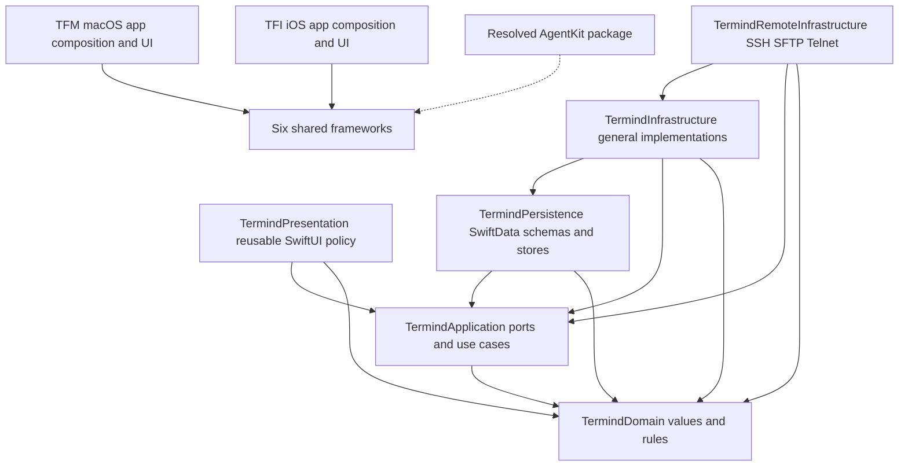
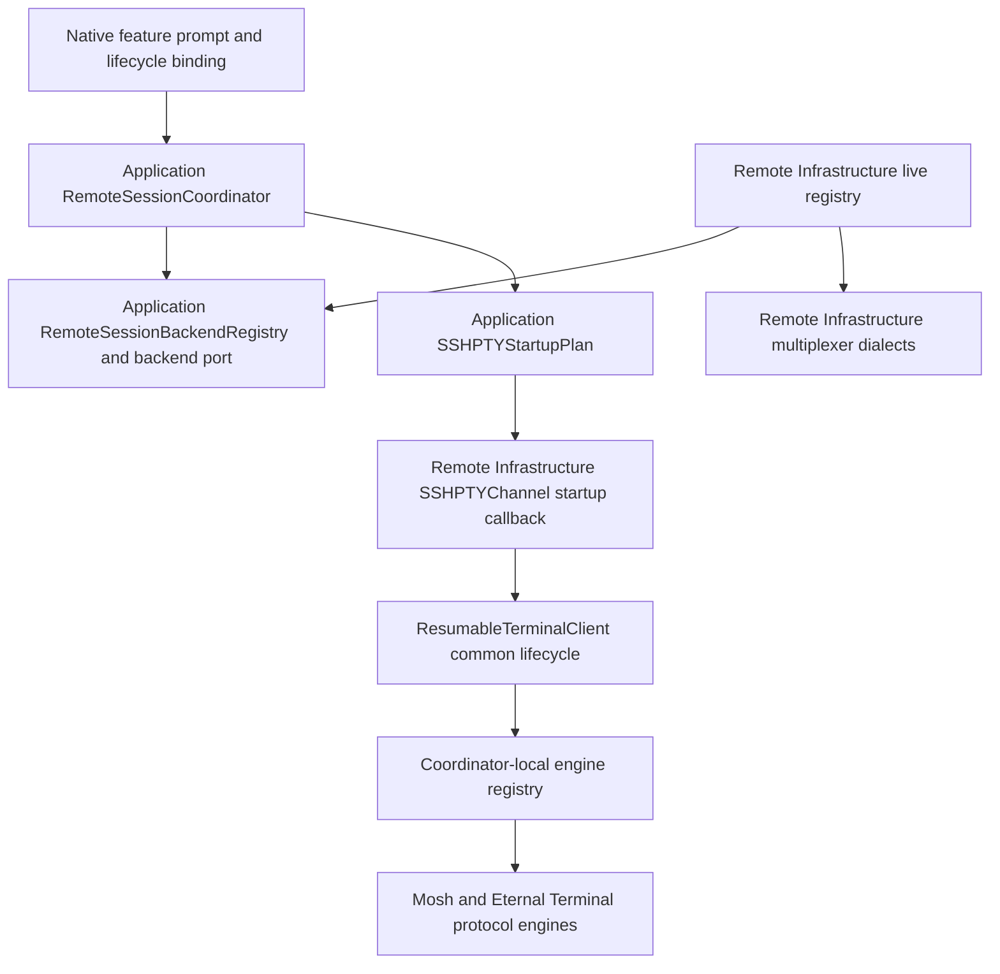
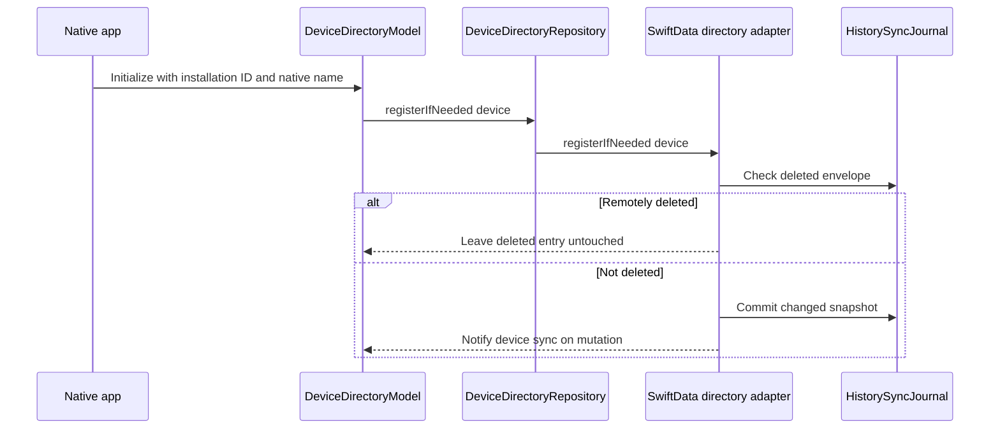
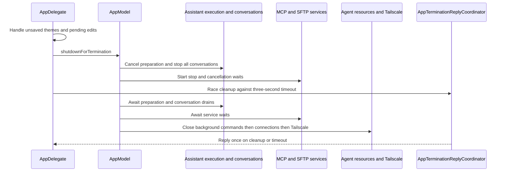
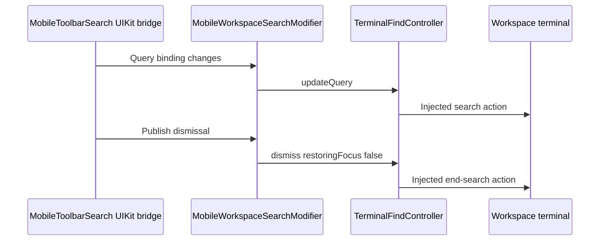
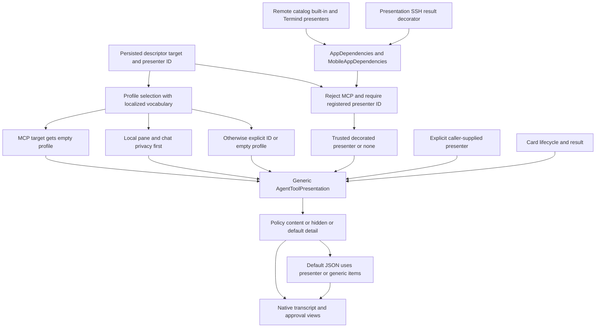
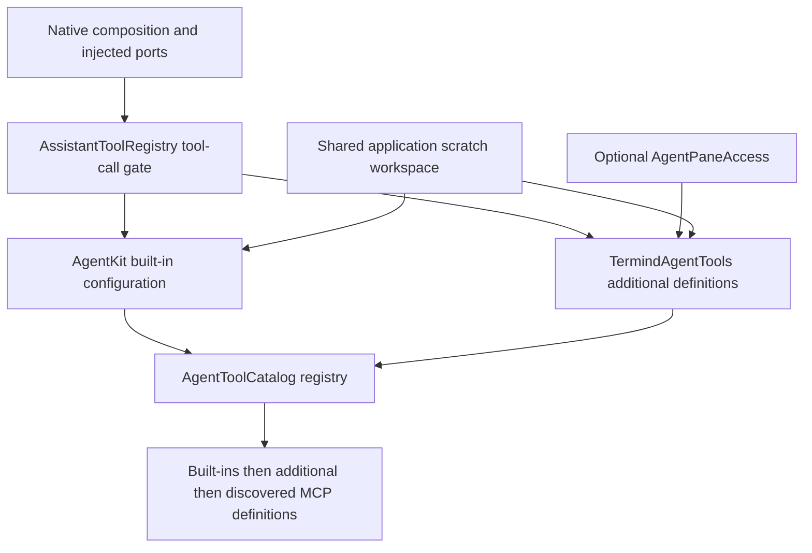

# System Boundaries

Termind is built as two native applications around six shared static frameworks. The boundary is intentional: reusable layers model policy and ports, infrastructure implements those ports, and `TFM` (macOS) and `TFI` (iOS/iPadOS) compose the result with native lifecycle and UI. A safe change starts by placing the responsibility with its owner rather than importing a convenient concrete dependency into a lower layer.



The diagram shows consumer-to-dependency arrows for explicit shared-framework Xcode target dependencies; the dotted package arrow groups external consumers rather than implying every framework links AgentKit. Both apps depend on all six frameworks; no framework depends on an app. Verify build edges in the [`PBXNativeTarget` and `PBXTargetDependency` sections](../../Termind.xcodeproj/project.pbxproj), and use the [Module and Directory Architecture Map](module-map.md) for the directory-oriented view.

## Layer responsibilities

| Owner | Put here | Keep out |
| --- | --- | --- |
| `TermindDomain` | Portable values, domain rules, records, and protocol-neutral concepts. | UI, persistence APIs, security/network frameworks, CloudKit, StoreKit, SSH C libraries, and terminal implementations. |
| `TermindApplication` | Use cases, feature models, repository and service ports, connection/import policy, and cross-feature policy. | Platform UI, SwiftData/GRDB, transport imports, concrete infrastructure construction, and dependencies on Infrastructure or Persistence. |
| `TermindInfrastructure` | General implementations such as in-memory repositories, CloudKit-backed sync, metrics parsers, logging, RevenueCat commerce integration, and settings/Vault services. | Native app targets and platform UI. It may depend on Application, Domain, and Persistence. |
| `TermindRemoteInfrastructure` | SSH, SFTP, Telnet, Keychain-backed remote credentials, host-key/authentication mechanics, transfers, forwarding, and Termind-specific agent tools. | App targets and their UI; features should use injected services rather than construct remote transports themselves. |
| `TermindPersistence` | SwiftData `@Model` declarations, versioned schemas, migration plan, SwiftData repository/store implementations, `ModelContainer` factory, and GRDB-backed memory store. | Application-infrastructure implementation dependencies, remote infrastructure, and app targets. |
| `TermindPresentation` | Reusable SwiftUI presentation policy and content: formatting, forms, summaries, transcript/tool-card rendering, and terminal presentation helpers. | AppKit/UIKit, SwiftData/GRDB/Persistence, Infrastructure/Remote Infrastructure, StoreKit, and app targets. |
| `TFM` / `TFI` | Native UI, platform adapters, dependency assembly, lifecycle, window/scene ownership, and platform-specific resources. | Shared implementation that should be portable; no shared framework may import an app target. |

`Frameworks/Resources/` is compiled into both application bundles for shared resources such as localization catalogs; app-owned icons, metadata, signing, native adapters, and platform behavior remain in `TFM` or `TFI`.

### Dependency rules that are enforced

[`ArchitectureBoundaryTests`](../../TFMTests/ArchitectureBoundaryTests.swift) checks **specific forbidden import sets per root**, not a blanket prohibition on platform APIs or concrete dependencies. The Xcode target graph expresses current build edges, while the source tests police selected imports and declarations; broader ownership guidance in this page is a convention unless a matching test or target constraint is identified. Its exact-line import scans currently enforce:

| Scanned source root | Imports rejected by the test |
| --- | --- |
| Shared `TermindDomain` | `SwiftUI`, `AppKit`, `UIKit`, `SwiftData`, `GRDB`, `Security`, `Network`, `StoreKit`, `CloudKit`, `CSSH2`, `OpenSSL`, `GhosttyTerminal`, `GhosttyTheme`, `RevenueCat`, `RevenueCatUI`; also the shared non-presentation and diagnosis rules below. |
| Shared `TermindApplication` | `TermindInfrastructure`, `TermindPersistence`, `SwiftData`, `RevenueCat`, `RevenueCatUI`; also the shared non-presentation and diagnosis rules below. Unlike desktop `TFM/Application`, this root has no separate UI/transport import list, but does have the concrete-symbol guard. |
| Shared `TermindInfrastructure` and `TermindRemoteInfrastructure` | The shared non-presentation rule below; Infrastructure's `Commerce` directory additionally rejects `StoreKit` (transactions are handled by RevenueCat), while Remote Infrastructure may use transport libraries. |
| Shared `TermindPersistence` | `TermindInfrastructure`, `TermindRemoteInfrastructure`; also the shared non-presentation and diagnosis rules below. |
| **Shared `TermindPresentation`** | Its **separate** rule rejects `Termind`, `TermindIOS`, `UIKit`, `AppKit`, `SwiftData`, `GRDB`, `TermindPersistence`, `TermindRemoteInfrastructure`, `TermindInfrastructure`, `StoreKit`, `RevenueCat`, `RevenueCatUI`. It intentionally can import `SwiftUI`; it is not covered by the other five-framework rule. The diagnosis rule also applies. |
| Desktop `TFM/Application` | `SwiftUI`, `AppKit`, `UIKit`, `AuthenticationServices`, `SwiftData`, `GRDB`, `Security`, `Network`, `CSSH2`, `OpenSSL`, `GhosttyTerminal`, `GhosttyTheme`, plus the concrete-symbol guard. |
| Desktop `TFM/Features` | `SwiftData`, `GRDB`, `Security`, `Network`, `CSSH2`, `OpenSSL`, plus the concrete-symbol guard. |
| Mobile `TFI/Application` | `SwiftUI`, `UIKit`, `SwiftData`, `GRDB`, `TermindPersistence`. |
| Mobile `TFI/UI` | `SwiftData`, `GRDB`, `TermindPersistence`, `TermindRemoteInfrastructure`. Mobile `TFI/Features` gets only the concrete-symbol guard. |

The shared non-presentation rule (Domain, Application, Infrastructure, Remote Infrastructure, Persistence) rejects `Termind`, `TermindIOS`, `AppKit`, `UIKit`, `IOKit`, and `ServiceManagement`. A separate embedded-Tailscale rule rejects `TailscaleKit` and `CTailscale` in Domain, Application, Presentation, and Persistence; it does not scan Infrastructure or either app. A separate diagnosis rule rejects `FirebaseCore`, `FirebaseCrashlytics`, and `FirebaseAnalytics` in Domain, Application, Presentation, and Persistence (but not Infrastructure or Remote Infrastructure), and checks both app plists default crash/analytics collection off. Separate tests reject app-local `AppStrings` definitions and constrain imports in Presentation's `Strings` directory. The concrete-symbol guard on shared Application, desktop Application/Features, and mobile Features looks for `ModelContext`, `FetchDescriptor`, `KeychainSecretStore`, `SFTPClient()`, `SSHConnection()`, `URLSession(`, `LANHostDiscovery`, `LANWakeOnLANSender`, and `SSHHostMACAddressResolver`; it does **not** run on mobile Application or UI. These are **source-root checks**, not blanket rules for all of `TFM` or `TFI`: desktop `App/TermindApp.swift` and mobile `App/MobileAppModel.swift` composition files can import SwiftData and concrete frameworks. The import check matches literal `import Module` lines and the token check scans a fixed list after stripping `//` suffixes; neither proves an exhaustive compiler-enforced boundary or bans all concrete code. Use injected ports across a boundary rather than a re-export, forwarding alias, generic “Core” module, or framework-to-app reference.

## Transport engines, session backends, and runtime inspection

These are three different extension seams, not one transport-specific feature API. Shared policy and observable state live in Application; concrete protocol resources and native command dialects live in Remote Infrastructure; native apps bind prompts and lifecycle callbacks.

### Resumable engine registration

`RemoteConnectionCoordinator` is the concrete construction boundary for SSH/SFTP clients and PTY channels. Its injected `ResumableTerminalEngineRegistry` is immutable and coordinator-local, with live registrations for Mosh and Eternal Terminal. `withKeyboardInteractive` preserves that registry and the shared maximum-session policy while changing the authentication handler. The coordinator's connect helpers disconnect partially opened clients before propagating failure.

`ResumableTerminalClient` implements the shared `ResumableTerminalSession` port and owns common lifecycle orchestration; each `ResumableTerminalEngine` owns protocol resources. The client resolves the registration **before wake, routing, bootstrap, or startup side effects**; a missing registration throws `unsupportedRoute`. It validates checkpoint version/transport, rolls back and closes on failed startup, freezes new writes and drains in-flight sends before checkpointing, and ignores late engine events after closure. Engines do not independently decide checkpoint eligibility or app lifecycle. Add protocol mechanics behind this registry rather than branching on concrete engines in a feature or the PTY facade.

`ArchitectureBoundaryTests.resumableProtocolEnginesStayBehindTheSharedLifecycleCoordinator` rejects concrete engine tokens in Domain, Application, Presentation, desktop Features, and mobile Features. It separately rejects concrete engine/native session tokens in `ResumableTerminalClient.swift` and `SSHPTYChannel.swift`, preventing those facades from bypassing registration. These are fixed-token checks, not a ban on every native package import everywhere.

### Session-persistence backend registration

Application owns `RemoteSessionBackend`, `RemoteSessionBackendRegistry`, `RemoteSessionCoordinator`, and the `SSHPTYStartupPlan` returned to a channel's injected `StartupPreparation`. The backend port covers discovery/probing, reference validation and matching, create, launch, and terminate. The shared coordinator owns create/attach/plain-shell/retry/cancel decisions, generation fencing, and saved attachment identity checks against host, endpoint, and username. Unsupported registration becomes a shared selection prompt rather than silently choosing a different backend. An uncertain create retains its ownership token for retry, but changing the launch intent resets that token.

Remote Infrastructure supplies `.live` by mapping `RemoteMultiplexerRegistry` dialect registrations into backend factories. `RemoteMultiplexerService` delegates through the registered dialect; tmux, Zellij, zmx, and herdr retain native command, identity, helper, and runtime-inspection differences behind that boundary. A new dialect belongs there, not in shared policy or a native UI switch. The architecture test `sessionPersistencePolicyDoesNotDependOnMultiplexerDialects` rejects its listed service/registry/command/dialect/runtime tokens in the same five source roots as the engine test. It additionally requires `SSHPTYChannel` to use `StartupPreparation` and rejects selected multiplexer implementation tokens in that channel.



The startup callback carries a shared plan across the policy/transport seam; concrete engines and dialects stay on the implementation side. See the [backend port and coordinator](../../Frameworks/TermindApplication/Terminal/RemoteSessionBackend.swift), [engine registry](../../Frameworks/TermindRemoteInfrastructure/SSH/ResumableTerminalEngine.swift), and [dialect registry](../../Frameworks/TermindRemoteInfrastructure/SSH/RemoteMultiplexerDialect.swift).

### Runtime inspection is not authentication

`TerminalRuntimeAdapter` is an Application port whose contract permits only the terminal's existing authenticated transport. `TerminalContextCoordinator` owns generation/revision fencing: an inspection arriving after newer input, reset, or another inspection is rejected as `staleContext`. Live-operation tickets require a prompt-ready active context with the requested capability; a displayed directory alone is not authorization to operate on that shell.

`RemoteMultiplexerRuntimeAdapter` implements native inspection through an injected command executor. It first tries the attachment's registered runtime (or native tmux lookup when no attachment exists), then process-based detection and helper/native runtime fallback. Cancellation propagates; failed native inspection can report a multiplexer with `inspectionUnavailable`, and no detected client yields `unknown`. Do not move dialect parsing into Application or solve inspection failure by opening a fresh authentication flow. The authenticated-channel scheduling constraints are detailed in [SSH Multiplexing and Scheduling](../concepts/ssh-multiplexing-and-scheduling.md).

Focused tests complement the source guards: `ResumableTerminalEngineTests` covers missing registration before side effects, preservation through keyboard-interactive variants, write-drain/checkpoint ordering, and rollback/one-time closure; `SessionPersistenceTests` exercises backend-independent reconnect and resumable restore without replaying startup. `TerminalContextCoordinatorTests` covers old-generation/sequence rejection, backend-neutral adapters, and capability-ticket fencing.

## Persistence is a single-owner boundary

`TermindPersistence` exports the current schema (`TermindSchemaV59`) and builds a `ModelContainer` using `TermindMigrationPlan`. V39 added persistent assistant model selection; V40 removed retired per-category quarantine tables while keeping scoped quarantine; V41 added shared notification preferences; V42 adds agent-message provenance, chat creation relations, and durable collaboration delivery receipts without changing historical model shapes. V43 adds public MCP OAuth configuration, V44 replaces the Host model, and V45 replaces the SSH key model with Security Key reference metadata, and V46 adds terminal keyword-highlight preferences. The migration plan contains lightweight stages from V38 through V59, including V47/V48 Tailscale data, V49 history-model removal, V50 profile cleanup, V51 Snippet color, V52 removal of retired terminal keyword-highlighting preferences, V53/V54 Host-model replacements, V55 terminal transport preferences, V56 Wake-on-LAN preferences, V57 custom terminal themes and appearance selections, V58 Host creation ordering without inventing dates for historical hosts, and V59 optional MCP implementation descriptions discovered from remote servers. The pre-color Snippet model is frozen for V1–V50; the colored model is substituted starting in V51 and retained by subsequent schemas. Local schema migrations do not change the independently versioned CloudKit envelopes. The factory rejects an in-memory request that also supplies a file URL and configures the store with CloudKit disabled. On macOS, before opening or migrating a disk store, it takes a nonblocking exclusive `flock` on a stable `.lock` file keyed by the canonical store URL; same-process containers share the lease and the container retains it until its lifetime ends. An in-memory container skips this lock. Platform composition roots choose *where* the store lives and retain the container, but do not define the model set or construct a substitute container. The authoritative entrypoints are the [container factory](../../Frameworks/TermindPersistence/TermindPersistence.swift) and [schema/migration plan](../../Frameworks/TermindPersistence/HostPersistence.swift); see [Persistence and Secrets](../concepts/persistence-and-secrets.md) for the storage and credential model.

Connection history follows the same boundary: Domain owns the portable event value, Application owns the observable model and repository protocol, and Persistence owns its SwiftData shape and independent History-journal transaction. The reusable ID-to-name mapping is deliberately separate: Domain owns `DeviceRecord`, Application owns `DeviceDirectoryModel` and `DeviceDirectoryRepository`, and Persistence owns `PersistentDeviceRecord` plus the SwiftData adapter. A history event merely references `sourceDeviceID`; it does not own or capture the device name. Platform apps inject connection lifecycles, acquire their native system display name, and choose local versus all-device presentation; they do not declare stored models. `DeviceDirectoryModel` registers the current installation at initialization and resolves names by ID from its cached repository snapshot, falling back to the supplied local name for the current device. The constructor defaults to an in-memory directory when no repository is supplied. Registration failure records `storageError` but still attempts a read, so already-saved names may remain visible; `reload()` clears the snapshot on read failure, records `storageError`, and increments `revision` even on failure. Explicit renaming calls `upsert` and updates the local name only after the write succeeds, then reloads the snapshot; a failed rename retains the previous local name and records the error. The SwiftData adapter's launch-time `registerIfNeeded` deliberately leaves a remotely deleted directory entry deleted, whereas an explicit `upsert` commits a changed name or new record with the History journal snapshot and notifies the injected device-sync callback after a successful mutation.



The registration path crosses the app naming, Application port, and Persistence journal boundaries; the explicit rename path can recreate an entry that launch registration will not.

This separation matters for migrations: all SwiftData models, frozen historical schemas, migration plans, and container construction stay together in Persistence. The boundary test rejects `@Model` declarations in scanned desktop, mobile, Domain, Application, and Infrastructure roots and requires Persistence to contain Swift files; the `@Model` scan does not currently include Remote Infrastructure or Presentation. That scan asserts absence of declarations in those roots, not that all models in the repository are discovered or that every historical schema is correct. A separate SwiftData-repository-declaration check covers those two roots as well as both apps, the other shared frameworks, bridge, benchmark, widget, and workspace-activity support targets; it uses a Swift declaration parser and requires at least one such declaration in Persistence. These checks still do not constitute an exhaustive ownership proof. A new persisted SwiftData entity therefore requires a Persistence schema/migration decision—not a model embedded in a feature, app, or general infrastructure module.

Desktop calls `TermindPersistence.makeContainer` with in-memory storage for tests and screenshot demos. Before live container creation it checks for another running app with the same bundle identifier (including older releases without store locks); a detected second instance or a lock contention presents a database-in-use alert and exits. Other database-open or preparation errors cause a startup `fatalError`, rather than silent replacement with an empty store. Mobile `MobileAppModel` uses an injected container when provided, otherwise calls the same factory with a file under Application Support for live storage or in-memory storage for tests/injected host repositories; it creates the directory for a live store and prepares host, settings, metrics and history persistence before wiring dependent feature models. `TermindIOSApp` builds the model once during startup and `MobileStartupView` displays an unavailable-data screen when composition fails. See [Platform Runtime, App Composition, and Lifetimes](platform-runtime.md) for the app/window/scene lifetime split and platform-specific failure handling.

## Composition, resource, and state ownership

The app targets are composition roots. `TermindApp` creates the desktop `ModelContainer`, keychain store, sync persistence/coordinators, repositories, connection coordinator, logging, and app-wide `AppModel`; it also supplies `MacDeviceName.current` to the shared device-directory port (trimmed `kern.hostname`, with DeviceKit's `Device.current.safeDescription` as fallback). It injects the shared model and container into its window scenes. `AppDependencies` packages repository, connection, sync, logging, and optional shutdown services for the desktop model and provides an in-memory host repository for tests. On mobile, `MobileAppDependencies.live()` wires logging and one connection coordinator into workspace and metrics services; `testing()` defaults to in-memory storage and replaceable dependencies. `TermindIOSApp` selects one of these at startup and creates one `MobileAppModel`; on success `MobileStartupView` attaches its container to the scene content. The mobile composition uses DeviceKit's description directly for the device-directory port. This is where a concrete implementation or platform value becomes a port supplied to shared feature code.

Do not use this as permission to move live state into the app-wide layer. Durable stores and cross-window coordinators are app-wide; desktop navigation and workspaces are window-owned; mobile navigation is scene-owned; live SSH/SFTP transports remain with the workspace/session that opened them. Refer to [Platform Runtime, App Composition, and Lifetimes](platform-runtime.md) for the detailed ownership map.

### Native confirmations versus shared operations

Native confirmation is not shared execution policy. Desktop `AssistantView` presents the destructive-delete alert and delegates the accepted action through the window commands. `AppModel` calls shared `AssistantConversationOperations`, removes the conversation from window libraries and transcript caches only when deletion succeeds, and reports storage or scratch-cleanup errors to the windows. Application owns the mutation rules: archive and delete first cancel and join pending agent preparation, refuse a streaming or compacting conversation, and serialize mutations per conversation. Metadata, order, and edited transcript changes are persisted before they are applied to observable state. Delete commits through `AgentRunPersisting` before removing the AgentKit scratch scope; a scratch-removal failure returns successful deletion with a separate cleanup error rather than undoing durable deletion.

Persistence owns the actual conversation graph deletion: `SwiftDataAgentRunRepository` removes runs, messages and their backing, tool results/invocations/reviews, conversation order, model selection, and compactions. Its in-memory deleted-conversation/run fences reject late snapshots and run events in that repository instance, preventing asynchronous writes from resurrecting deleted history. These are storage safeguards, not UI confirmation policy.

Desktop quit likewise belongs to the native app. `AppDelegate.applicationShouldTerminate` returns `.terminateLater`, saves terminal-theme changes and asks to discard only remaining unsaved drafts, rechecks edited SFTP files, and offers a separate cancel/quit-anyway alert for pending uploads. Only after acceptance does it save window size and begin `AppModel.shutdownForTermination()`. The model reuses one cleanup task, cancels pending assistant preparations and all stored conversations before awaiting their drains, and starts MCP shutdown and SFTP cancellation waiting concurrently. After preparation and conversation drains and those service waits finish, it closes agent background commands, then agent connections, then Tailscale. It also stops native notifications, window sessions, forwarding, metrics and other app services. Shared owners still implement cancellation, durable terminal saves, and resource closure; the app selects their ordering.



The native termination reply is bounded even when shared cleanup hangs: the first cleanup completion or default three-second timeout wins, and a late completion cannot reply twice. The timeout is a limit on waiting, not a guarantee that every durable save or resource close finished before process exit.

### Authentication continuation versus feature policy

`RemoteSessionConnectionController.continueAuthentication` centralizes the desktop SSH/SFTP continuation mechanics without retaining its synchronous callbacks. It resolves the prompt host and selected identity, trims the submitted username, stages SSH authentication, clears the prompt and resumes the journey, then invokes the feature's optional save policy before reconnecting. A submission or save failure calls the feature failure callback and does **not** start another attempt. Proxy authentication uses its own store operation before staging/resuming; passphrase failure keeps a prompt with the failure message. Desktop `SSHSessionModel` chooses whether to save a connection route or an individual host identity and how to reconstruct the error prompt. Thus shared continuation does not acquire native presentation or route-persistence policy.

`ArchitectureBoundaryTests.forwardingAndMobileAuthenticationRemainFeatureOwned` enforces a narrower, complementary contract: forwarding must not read `UserDefaults`, `SettingsKey`, or `ExternalAuthentication`, must use `SessionReconnectController` and enforce `.forbidden` interaction, and selected mobile app/root/session composition files must not own `SSHKeyboardInteractiveQueue` or `keyboardAuthentication`. Additional connection owners retain `SSHAdditionalConnectionSnapshot` references rather than putting `SSHConnectionConfiguration` into the transfer context. These checks do not prohibit all feature-level infrastructure imports; they protect selected policy and credential-ownership seams. See [SSH Session Lifecycle](../workflows/ssh-session-lifecycle.md) for connection-level flow and [Engineering Invariants](engineering-invariants.md) for change constraints.

Focused regressions are `TFMTests/AppTerminationTests.swift` (all-conversation cancellation, drain-before-close ordering, one-time cleanup, assistant admission fencing, and timeout reply), `TFMTests/RemoteSessionAuthenticationContinuationTests.swift` (stage/save/connect ordering and failed-save suppression), and `FrameworkTests/AssistantConversationOperationsTests.swift` (active-run/compaction guards and storage-failure preservation of visible state). The shutdown tests use injected `AppShutdownDependencies` rather than requiring live transports.

### Mobile Find: policy, presentation, and feature binding

The mobile Find path illustrates the same boundary without moving UIKit into shared code:

- **Shared Application owns query/action policy.** `TerminalFindController` holds the query and logical presentation state and emits `TerminalFindBinding` actions through an injected closure. Query changes trigger search and navigation requires a presented, nonempty query, unless engine search is resize-suspended. Suspension retains presentation/query; resume searches the latest nonempty query only if still presented. Dismissal ends search but retains the query so reopening restarts it when not suspended. Its default dismissal restores terminal focus, while `dismiss(restoringFocus: false)` lets native UI own the responder transition.
- **Mobile feature composition owns the workspace binding.** `MobileWorkspace` injects its terminal's action and focus callbacks. `MobileWorkspaceView` applies `MobileWorkspaceSearchModifier`, which binds SSH, Mosh, Eternal Terminal, and Telnet search to `workspace.find`, submits `.previous`, and dismisses without requesting terminal focus. For SFTP the same modifier binds to `sftpChannel.query` instead of terminal Find.
- **Mobile UI owns UIKit presentation.** `MobileToolbarSearch` accepts bindings and a submit callback, installs a `UISearchController` on the navigation owner, and synchronizes delegate changes back through those bindings. It defers synchronization from SwiftUI updates and blocks synchronization, edits, and submission during dismissal to avoid reopening the native search UI mid-transition. On disconnection it removes its search controller and restores the owner's prior presentation-context setting. The bridge imports only `SwiftUI`, `TermindPresentation`, and `UIKit`—neither transport nor persistence implementations. This is a concrete example of the `TFI/UI` import restriction, not a new universal ban on UIKit or a claim that mobile Features cannot import infrastructure.



The feature binds native search presentation to shared policy; UIKit retains keyboard-dismissal ownership. See [Mobile UI Architecture](mobile-ui.md) and [Ghostty Terminal Integration](../concepts/ghostty-terminal-integration.md) for platform details.

`FrameworkTests/TerminalFindControllerTests.swift` covers retained-query restart, navigation without a query, default focus restoration, and idempotent native dismissal without terminal focus. `TFITests/MobileShortcutTests.swift` checks mobile F3 direction and Escape routing through that shared controller. These tests verify the policy and shortcut paths; they are not proof of every UIKit search-controller transition.

## AgentKit is an external, host-neutral boundary

`AgentKit` is a separately developed remote Swift Package dependency at `https://github.com/AkinoKaede/AgentKit.git`. The [project requirement](../../Termind.xcodeproj/project.pbxproj) declares `upToNextMinorVersion` from `4.0.0`; the committed [Package.resolved](../../Termind.xcodeproj/project.xcworkspace/xcshareddata/swiftpm/Package.resolved) pins version `4.0.0` at revision `3481866cd47e83f6bf56b80c432c7824f61130b9`. Xcode builds that resolved remote package, not an external working tree. AgentKit is not a Termind submodule; upstream checkout paths are not repository source paths.

AgentKit owns the host-neutral agent runtime: its loop, approval gate, provider adapters, MCP client, built-in tools, and their core types. Do not redefine AgentKit-owned runtime types in Termind, and do not edit AgentKit to add the Termind name, SSH, SFTP, app UI, or other host-specific behavior. A cross-repository change must be released and tested in AgentKit first, then consumed by bumping the project dependency and resolving `Package.resolved` in the same Termind change.

Termind owns host-aware behavior on its side of the boundary. `TermindRemoteInfrastructure` defines `TermindAgentToolEnvironment` with injected host resolution, connection pools, authentication, metrics, background commands, optional pane access, and optional scratch workspace. `AssistantToolRegistry` returns an empty registry when a model lacks tool-call ability. Otherwise it obtains the shared application scratch workspace for AgentKit's scratch tools and Termind's host-facing pull/push tools, supplies the conversation ID as the Termind environment's scope, records plans through the run's ordered event channel, and passes usable MCP servers with credentials resolved from their references plus the MCP authorization client to AgentKit's built-in catalog. The built-in configuration also receives optional chat-model, chat-coordination, and chat-source ports; Termind's remote tools are registered separately as `additional` tools. Task management is supplied by the built-in catalog rather than a separate task callback in this registry. `ssh_exec_run` receives the injected authentication registry; Termind handles host login rather than asking the user-secret tool for SSH credentials. The Termind catalog constructs host listing, SSH/SFTP, metrics, pane and host-facing scratch tools from narrowly injected services; its presenter registry also combines built-in and Termind tool presenters for historical transcript rendering. The local registry resolves built-ins before additional tools and discovered MCP definitions, preventing host or MCP names from shadowing built-ins. See [Agent Runtime and Assistant](../concepts/agent-runtime-and-assistant.md) for run-level behavior.

Execution registration and localized rendering are separate extension points:

- **Execution availability belongs to the remote catalog.** `TermindAgentTools` registers separate acting and planning variants of SSH run/stdin tools. SFTP mutations and scratch push are acting-only registrations; read-oriented tools remain available without that restriction. Preserve these mode declarations when extending the catalog rather than relying on UI visibility to restrict execution.
- **Localized SSH result rendering belongs to Presentation, assembled by the apps.** Both `AppDependencies` and `MobileAppDependencies` decorate `TermindAgentTools.presenterRegistry` with `SSHExecToolPresentation.registering(in:)`. The decorator replaces selected SSH result projections while retaining persisted presenter IDs, tool-owned layout, and operation policy; argument rendering delegates to the original presenter, falling back to generic argument items if needed. Descriptor lookup first passes through the remote catalog's trusted lookup, which rejects MCP descriptors and requires an explicit registered presenter ID, then selects the decorated presenter by ID. There is no legacy tool-name fallback or separate `ssh_exec`/`ssh_wait` presenter registration. This lets shared Presentation localize results without importing Remote Infrastructure. See the [presentation decorator](../../Frameworks/TermindPresentation/SSHExecToolPresentation.swift) and [desktop composition](../../TFM/App/AppDependencies.swift).
- **Tool-family policy is injected into a generic renderer.** `AgentToolPresentation` interprets descriptor metadata and lifecycle through an injected profile resolver and activity vocabulary, rather than resolving concrete tool behavior by protocol name. `TermindToolPresentationProfiles.renderer` composes knowledge, SSH, pane, and chat profiles with localized vocabulary; profiles control summaries, phases, pending detail, approval projection requirements, and truncation notices. Rendering leaves execution, approval, and replay payloads unchanged. Profile selection first returns an empty profile for an MCP target, then checks local pane/chat privacy policy, and otherwise looks up the explicit presenter ID. Unknown or absent IDs receive an empty profile, not SSH semantics recovered from a matching tool name; generic descriptor metadata can still drive the summary.
- **Privacy suppression is distinct from generic fallback.** Profile detail can return `.useDefault`, `.content`, or `.hidden`; hidden output stops before generic JSON or error rendering. Local pane/chat privacy profiles apply by name independently of presenter availability, not as semantic presenter recovery or executable registration. MCP receives an empty profile, not a raw-JSON-preservation policy, and cannot select local presenter code through remote metadata. After profile policy permits default detail, the renderer decodes result JSON: without a presenter it uses generic items (for example, `{"value":42}` becomes a `Value` field); an explicitly caller-supplied presenter can instead project the decoded result and supply its layout. Non-JSON output follows the generic text/error path. These are display choices, not changes to the stored or model-facing payload.



The apps compose trusted presenters across the remote/presentation boundary; injected profiles control rendering without changing executable registrations.

[`AgentToolPresentationProfileTests`](../../TFMTests/AgentToolPresentationProfileTests.swift) covers injected phase/detail/approval/truncation policies and custom vocabulary. It verifies that an SSH profile follows its registered ID even after a tool rename, while unknown or absent IDs do not recover SSH behavior by name. Its MCP test supplies a local SSH presenter ID in remote metadata, verifies catalog lookup rejects it, and contrasts generic `Value` field rendering with an explicitly supplied presenter's `Projected` field and layout.

Pane integration is **optional capability injection**, not part of AgentKit's host-neutral catalog. `TermindAgentTools` constructs `list_panes` and `read_pane` only when `AgentPaneAccess` is supplied; absent access omits their executable definitions, while the presenter registry remains available for persisted cards. Similarly, host-facing scratch pull/push definitions require a supplied workspace. On mobile, `MobileSceneModel` supplies `app.paneAccess(for: self)` to its assistant scene model. The app adapter lists connected terminal workspaces with readable viewport surfaces and distinguishes closed, disconnected, and missing-surface reads; it derives active/current metadata from session and scene ownership. This keeps native terminal surfaces behind closures rather than importing UI into AgentKit or the tool catalog.



The registry assembles host-neutral runtime capabilities and separately injected Termind capabilities without allowing additional or MCP names to shadow built-ins. The external MCP-facing boundary is documented in [MCP Server and Bridge](../integrations/mcp-server-and-bridge.md).

### Remote packages versus upstream checkouts

The [submodule configuration](../../.gitmodules) contains only the public website/assets submodule. AgentKit, libssh2-spm, and libtailscale-spm are remote SPM dependencies, not maintenance submodules or local package overrides. In particular, current project requirements for AgentKit, libssh2, and Ghostty use `upToNextMinorVersion`; guidance describing Ghostty as up-to-next-major does not match the current project requirement. For dependency work, check the project requirement and resolved pin together and publish upstream changes before consumption. Do not treat a missing upstream checkout as a repository file or assume its edits affect the resolved build. See [Module and Directory Architecture Map](module-map.md) for ownership landmarks and [Build, Test, and Release](../operations/build-test-and-release.md) for validation commands.

## How to make a dependency-safe change

1. **Classify the responsibility.** Put stable values and rules in Domain; an abstract use case or port in Application; a concrete general service in Infrastructure; a remote transport/security implementation in Remote Infrastructure; schemas and SwiftData stores in Persistence; reusable view policy in Presentation; native assembly or lifecycle in the appropriate app.
2. **Make dependencies point inward through a port.** If an Application or feature model needs persistence, keychain, SSH, or network work, extend or inject an existing protocol/service rather than import and construct its concrete implementation.
3. **Keep persistence changes atomic.** Add models, schemas, migration behavior, and container-facing repositories under `TermindPersistence`; preserve historical schemas and do not create an independent app-level container.
4. **Keep host behavior out of AgentKit.** Add SSH/SFTP or Termind-specific agent functionality through `TermindAgentTools` and injected Remote Infrastructure services. Release AgentKit separately only for genuinely host-neutral runtime behavior.
5. **Validate the boundary, not only the feature.** Run the architecture tests after a dependency or ownership change, alongside the affected feature tests. Their source scans deliberately fail when a forbidden import or concrete construction crosses a layer.

The most common failure modes are a UI feature importing Persistence “just to fetch,” Application importing a concrete transport “just to connect,” a shared framework importing an app target for a native helper, and putting host-specific behavior in AgentKit. Each creates a reverse dependency or duplicates an owner; use injection at the existing boundary instead.

## Focused verification

`TFMTests/ArchitectureBoundaryTests.swift` is the focused regression suite for these constraints. In addition to layer imports and SwiftData ownership, it checks that AgentKit runtime type names are not redefined locally, limits `ListViewKit` to an explicit native-list allowlist, checks selected forwarding/mobile authentication boundaries and additional-connection references, and ensures the forwarding benchmark is independent of app and test targets. It also checks RevenueCat's commerce ownership, diagnosis SDK isolation and disabled-by-default collection, shared CloudKit upload/quarantine gates, and selected localization ownership rules. The checks fail closed if an expected production root is missing or contains no Swift files, so relocating source cannot silently disable the safeguards. `FrameworkTests/PersistentStoreLockTests.swift` exercises pre-open contention, container-lifetime and same-process leases, forced-exit recovery, and independent/in-memory stores; `TFITests/MobileAssistantTests.swift` checks built-in and remote tool presence only for tool-capable models. For the device-directory boundary, `FrameworkTests/HistoryRenderingSnapshotTests.swift` checks that a failed registration still leaves readable names visible, rendering reads do not fetch or publish changes, and reload recovers from a failed read; `TFMTests/ConnectionHistoryTests.swift` checks stable device IDs and rename projection for existing history events.

For normal project validation, use the resolved dependency graph rather than allowing a fresh resolution:

```sh
xcodebuild -project Termind.xcodeproj -scheme TFM -destination 'platform=macOS' -onlyUsePackageVersionsFromResolvedFile test
```

Use the corresponding `TFI` build/test command when a change affects the mobile target. See [Build, Test, and Release](../operations/build-test-and-release.md) for the full command set.
