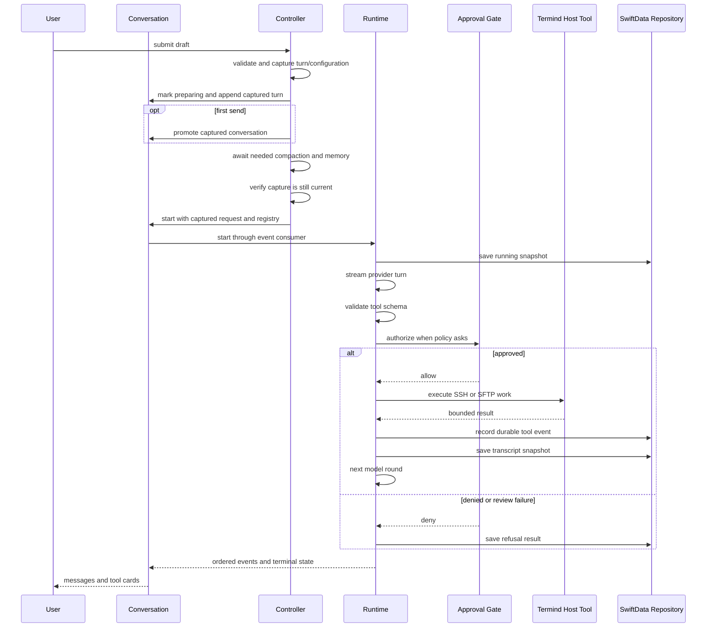
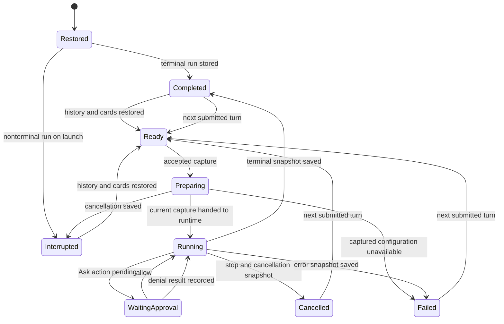

# Assistant, Agent Runtime, Skills, and Memory

Termind's Assistant is a durable conversation product built around a host-neutral agent loop. **AgentKit** owns the model-provider adapters, run loop, context pipeline, approval gate, MCP client, generic built-in tools, secret broker, and generic scratch/skill/memory tool interfaces. **Termind** owns the host-specific integration: SSH and SFTP tools and transport pools, Vault-backed host resolution, application policy and prompts, SwiftData conversation persistence, Hermes memory lifecycle, and the UI that renders events and collects approvals or SSH challenges.

This split is a security boundary as well as a modularity boundary. A model proposes tool calls; it does not gain direct access to a PTY, Keychain material, stored credentials, another conversation's workspace, or the persistence store.

## Responsibilities and assembly

`AssistantExecutionController` is the application entry point for a submitted turn. Before recording a new turn it rejects overlapping starts, archived/history-changing conversations, active compaction, unfinished attachments, and unauthorized use. Accepted submission synchronously captures the composed prompt, images and context attachments; session, plan and surface context; chat model/provider/credential; reasoning and permission mode; search choice; skills and base registry; Guardian configuration; and memory/compaction preparation settings. Only then can asynchronous compaction or memory loading begin. Runtime assembly consumes this capture instead of re-reading mutable composer or configuration state after an await. A missing model or credential remains a captured failure even if Settings changes during preparation.

A runtime is deliberately single-run. `ConversationModel` retains a per-run owner containing the runtime, immutable request, repository, start phase, cancellation intent, and ordered event consumer. The controller supplies the same repository to the runtime and this owner. Only the active owner's events update visible messages, tool cards, approval and input queues, run summaries, and the authoritative model transcript; stopped owners remain retained only until their drain finishes. The visible message list is not replay history: tool calls and results are separately rendered as cards, so replay must use `transcript`.

The tool catalog and plan posture are captured at submission; AgentKit selects that captured catalog's executable mode-specific subset when the runtime starts. A tool-capable model receives the captured skill catalog, AgentKit built-ins, and Termind tools; a model without tool-call capability does not receive the skill/tool catalog. `AgentTurnContextSnapshot` is the persistable context portion of the capture: session facts, skill catalog text, plan posture, surface availability, and memory-session identity. It is not a durable copy of provider credentials or all runtime configuration. Surface availability follows the latest delivered user snapshot rather than mutable UI focus.

Termind composes the registry in this order:

1. AgentKit generic tools, including scratch, skill, memory, fetch/search, task, plan, secret, and MCP support.
2. Termind's host tools: host/metrics discovery, `ssh_exec`, terminal suggestions, SFTP operations, and the host-facing `scratch_pull` / `scratch_push` endpoints.
3. Discovered MCP tools, which are additive and cannot shadow a built-in or Termind tool name.

### Catalog, run mode, and surface availability

`TermindAgentTools` is the shared static registration point. Its injected environment supplies host resolution, metrics, connection/authentication pools, background commands, and an optional scratch workspace. Dependencies determine which capabilities can be constructed: `scratch_pull` and `scratch_push` need that workspace, while `AssistantToolRegistry` returns an empty registry for a model without `toolCall`. A sending-surface Boolean is not a registration input; equivalent dependencies produce the same definitions for desktop and mobile Assistant surfaces.

AgentKit selects the executable registry for the run's mode. Planning retains discovery, metrics, SSH investigation, SFTP reads and `scratch_pull`; remote SFTP mutations and `scratch_push` are acting-only, and Termind contributes no tools to reviewing. Planning and acting share the `ssh_exec` descriptor and schema, but planning uses a preflight that denies destructive commands. Acting asks for those commands; commands proven safe can be approved and run in parallel in either mode.

`terminalSuggestionsAvailable` is the application argument that captures the separate execution gate in `AgentTurnContextSnapshot.toolAvailability["terminal_suggest"]`. It does not remove or change the advertised tool schema:

| Surface | Terminal suggestion execution | Tool definitions |
| --- | --- | --- |
| TFM standalone Assistant | `false` | Shared Assistant catalog. |
| TFM Workspace Assistant sidebar | `true` | Shared Assistant catalog. |
| TFI standalone Assistant | `false` | Shared Assistant catalog. |
| macOS external MCP server | Not exported | Acting host subset, `request_user_secret`, and four HTTP transfer tools. |

This snapshot dictionary is a partial override: disabling terminal suggestions does not disable independent SSH/SFTP work. The MCP server explicitly selects acting definitions, then filters by its exported-name allowlist and disabled-tool settings. It excludes terminal suggestions, scratch, web, skill, plan and task tools; its four extra tools are `sftp_upload`, `sftp_upload_status`, `sftp_download` and `sftp_download_status`. The stdio bridge forwards requests to this server and registers no second tool set; TFI has no local MCP server. See [MCP Server and Bridge](../integrations/mcp-server-and-bridge.md) for the external authorization and byte-transfer boundaries.

## Turn lifecycle

Desktop sidebar, standalone Assistant, and mobile first sends use the same controller-owned capture path as subsequent sends. A first conversation is promoted into the library only after capture and local turn append succeed. Refused sends leave the draft, attachments, armed skill and ephemeral conversation unconsumed. Accepted composer sends fold attachments and an armed skill directive into the model-facing turn once, clear those composer payloads, and clear the submitted draft. Direct text sends and plan implementation also fold those payloads once but leave unrelated ordinary draft text alone.

Edits have a separate two-stage entry point: desktop and mobile UI call `prepareAgentEdit` synchronously before creating their UI `Task`. It preserves the original attachment payload and model-facing suffix while capturing fresh context and configuration for the replacement submission. `performAgentEdit` checks the capture identity before starting a tracked history task; persistence succeeds before the live edit is applied, and another identity check precedes runtime preparation. A cancelled or superseded prepared edit cannot later enter truncation or start a runtime.

Once the runtime begins, AgentKit awaits a save attempt for the running snapshot containing the submitted prompt before model work. It streams a provider turn, emits ordered UI and durable events through a shared `AgentEventChannel`, validates any complete tool call, then schedules execution. Tool results are appended to the model transcript and their snapshot save is attempted before the following model round. This preserves a grammatically answerable transcript for refusal, cancellation, or failure paths when persistence succeeds; runtime snapshot-save errors are currently swallowed.

This sequence shows an accepted draft submission and the persistence points after runtime handoff; edits first commit their history replacement before runtime preparation.

### Preparation and cancellation ownership

`ConversationModel.isPreparingAgentRun` is distinct from `isStreaming`; `isAgentRunActive` combines them for activity guards. Preparation has no runtime that can accept steering, so it must not masquerade as streaming. When neither compaction nor memory loading is needed, preparation can hand off synchronously without an asynchronous preparation task.

Stop, controller-wide cancellation and mobile background expiration invalidate preparation identity synchronously. Cancellation cancels and joins tracked edit-history/preparation work before finishing its interrupted save; completion rechecks identity after the save so an older cancellation cannot retire a replacement capture. The concrete SwiftData truncation method checks cancellation before entering its synchronous transaction. These boundaries prevent a stopped or superseded preparation from later editing history or starting a runtime; they do not roll back a history transaction that already committed.

Archive/delete operations cancel and await pending preparation before their existing activity guards and persistence work. Manual compaction refuses preparation, while selecting another conversation leaves its preparation running. Automatic compaction uses the captured model/settings and the valid transcript available during preparation, with persistence preceding the live projection change.

### Streaming, steering, and cancellation

While a run is live, a further user message is queued as steering rather than starting another run. It becomes visible and durable only at the next model boundary, when AgentKit delivers it to the model; if the run has already ended, the UI returns queued text and attachments to the composer. This prevents history from claiming that a message was delivered when it was not.

Steering captures the sending session context and updates only the `terminal_suggest` availability entry. It preserves other tool overrides, the fixed skill catalog and plan contract, and the memory-session identity. Queuing does not change `ConversationModel.activeContextSnapshot`; delivery does. If the conversation has no legacy snapshot, steering keeps that context unknown instead of filling it from current UI state. The persisted availability key remains `terminal_suggest`.

### Runtime handoff and cancellation

`start` takes ownership synchronously before queuing runtime startup. If Stop arrives while that owner is still queued, it records cancellation intent synchronously and never calls `AgentRuntime.start`, so neither a provider nor a tool runs. Instead it creates a cancelled snapshot from the captured request, applying AgentKit's historical-secret sanitization and unanswered/orphaned-tool repairs. The snapshot retains the prompt identity, authored/model text, images, context attachments, explicit `request.contextSnapshot`, and permission mode without duplicating an existing prompt ID. This path does not reconstruct a missing context snapshot from runtime-only configuration; production assembly supplies its frozen context explicitly.

The queued owner's synthetic run ID and start time are fixed at acceptance, and its finish time is captured when cancellation is requested. The prompt keeps its existing transcript timestamp or uses that acceptance time. An independent persistence task owns the snapshot and repository, so an explicit Stop still attempts the save after the presentation model is released. Live cancellation and staging adoption are projected synchronously; visible cancelled state alone is not evidence that the save has completed.

Once startup has begun, Stop requests runtime cancellation; the consumer checks cancellation again after the awaited `AgentRuntime.start` handoff, covering cancellation that reached the actor before its run task existed. Stop immediately detaches the old owner's presentation, settles streaming text and nonterminal cards for that run, retires its approval/review presentation, and returns undelivered steering. Its event consumer remains uncancelled and drains to stream completion while ignoring events from the detached owner. A direct replacement start first cancels its predecessor. Owner identity also guards completion and late steering rejection, so old work cannot clear or stop a newer run.

`stopAndWait()` captures preparation cancellation and all retained run owners before its first await, requests cancellation of the owner active at entry, then joins preparation and those consumers. Consequently `stop()` followed by `stopAndWait()` still joins the stopped run; a replacement accepted during the wait is outside that call's cancellation scope. Completed owners are removed from the retained collection.

The join guarantees that the captured snapshot-save attempt has returned, not that storage succeeded. In pinned AgentKit, terminal events precede the terminal snapshot save, while stream completion follows it; a terminal event alone is therefore an earlier boundary. The separate durable-event recorder and run-secret disposal tasks are not joined by this consumer. These contracts do not promise recovery from a storage failure or process death before a save. Mobile background expiration uses the join before closing its background commands and Agent connections; desktop Stop keeps its immediate presentation behavior without adopting the mobile background lifecycle.

## Approval, secrets, and trust boundaries

Approval is evaluated after schema validation and tool preflight, before execution. Invalid arguments never reach the approval UI or the tool. The policy layer is stronger than permission mode:

- **Deny** always refuses the call.
- **Approve** executes without an additional approval prompt.
- **Ask** routes to the user under `askForApproval`, to Guardian under `approveForMe`, or is pre-approved by `fullAccess`.

`fullAccess` does not bypass schema validation, host-key trust, SSH authentication, secret binding, scratch containment, network/fetch restrictions, or tool-specific capability checks. Guardian review is only configured in `approveForMe`; it has a bounded timeout and failures, malformed output, inconsistent decisions, and critical-risk approvals fail closed. If the conversation disappears before a manual decision, the approval broker denies the request.

Manual approval waits check cancellation before enqueueing and install a cancellation handler that removes and denies only the matching request continuation. Stop removes the stopped run's approval/review presentation immediately; request-specific continuation cleanup then lets the runtime finish its cancellation snapshot without requiring a user decision. Other requests and a replacement run retain their own identities.

SSH authentication and host-key prompts are Termind interactions, not model-visible tool data. `AgentHostResolver` exposes public host metadata to `list_hosts`, but resolves Keychain-backed credentials into connection configuration without serializing them into tool results. Authentication context is shared only across overlapping attempts for the same destination; after successful authentication it clears staged submissions and cached secret-bearing configuration. Stale generations reject late callbacks and host-key decisions.

`request_user_secret` is only for command standard input, not SSH login. Its handle is scoped to run, tool, host, and stated purpose, single-use, and is removed from replay and durable history. Plaintext secrets must not enter model requests, Guardian review, events, logs, SwiftData, or Hermes memory.

## Host tools and plan mode

Termind tools operate through noninteractive per-command SSH channels and exclusive SFTP leases; they never type into the user's interactive terminal. `terminal_suggest` creates a user-operated command card and never executes it. The standalone Assistant can discover and target configured hosts even without a sidebar session or open PTY; session context is only an optional default target. `list_hosts` lists enabled protocols without credentials, including Telnet-only hosts. SSH/SFTP execution requires SSH to be enabled; discovering a Telnet-only host does not provide an Agent Telnet execution capability.

Plan mode freezes at submission. It permits investigation, reads, and policy-allowed commands, but host-specific planning registrations refuse direct remote writes, deletes, and scratch pushes. A plan is drafted in scratch space and presented as the final action; presenting it does not itself suspend a run awaiting a decision.

Implementing a pending plan is a new captured submission. The controller clears the captured `planContract` before capturing the run so implementation is acting work, then appends the composed implementation prompt and resolves the plan as implemented. Refusal leaves the pending plan, planning state, attachments and armed skill untouched.

## Scratch workspace containment

Each tool-capable conversation has an `AgentScratchWorkspace` keyed by its conversation ID under Termind application support. It survives later runs in that conversation, but one conversation cannot read another's scope. Scratch paths are normalized and bounded; escapes, absolute paths, parent traversal, control characters, excessive depth, and symlinks are refused. Entry and byte quotas are enforced before mutation.

The recommended remote-edit route is `scratch_pull`, local scratch editing/diffing, then `scratch_push`. File bytes remain outside the conversation/model transcript: pull reports metadata rather than file contents. Push is an Ask action; its preflight records bounded, redacted evidence and a digest. Execution re-reads the staged file and rejects it if its digest differs from the approved digest, so approval cannot be reused after content changes.

A fork copies its scratch scope before creating the forked conversation and removes that new scope if persistence fails. Deleting a durable conversation removes its scratch scope after deleting the conversation graph; cleanup failure is reported separately because the durable deletion has already succeeded.

## Durable conversations, replay, and recovery

`SwiftDataAgentRunRepository` stores conversations, runs, messages, replay backing, attachments, tool invocations/results, reviews, ordering metadata, and compaction records. It writes messages by message ID rather than run ID, so replaying prior conversation history into later run snapshots does not duplicate historical rows. Tool event persistence is restricted to durable lifecycle events rather than streamed token deltas.

A saved context snapshot preserves historical session, skill-catalog text, plan and surface facts for replay and fork history. Explicit `startAgentRun` uses the last user turn's stored snapshot, or a neutral `AgentTurnContextSnapshot()` for legacy absent context rather than inventing facts from current UI state. This is context replay, not reconstruction of historical model/provider settings, credentials or skill-package bytes: the controller still captures the current runtime configuration. An edited submission deliberately captures fresh context instead of inheriting the historical snapshot. There is no manual Retry/Resume UI or automatic recovery execution; provider retry remains AgentKit-owned.

Persisted text, tool arguments, titles, reasoning, and attachments go through redaction. In particular, secret handles are replaced with expired lifecycle content on restore, and sensitive header values are redacted.

Tool cards resolve their persisted presenter ID through the immutable presenter registry. Cards predating those IDs use the closed legacy tool-name list and its `builtin.` IDs. Registration and surface-availability changes preserve those identities and the persisted context key; they do not require a SwiftData schema change.

Compaction changes the **model-facing** transcript, not the scrollable display history. Its summary record is persisted before the live conversation applies it; after recovery the model receives a synthetic compaction summary plus recent messages while the user can still read the full original conversation.

### Message-boundary edits and replacement provenance

`AssistantConversationOperations.edit` validates an ordinary replacement user message before persistence and applies the live mutation only after truncation succeeds. SwiftData checks cancellation before its synchronous transaction and uses the same canonical order for restore and truncation: runs by start time then UUID, messages by run order then sequence, timestamp, role and UUID. The selected message and everything after it are removed, not automatically its entire run. For `opening → assistant → steering → assistant`, editing the steering turn retains the opening and preceding assistant/tool batch. The retained partial run becomes a neutral `.completed` summary with no old failure and ends at its last retained non-tool message; wholly later runs, including empty ones, are removed.

Tool cleanup follows ownership before time. Known source-message and run-local call identities distinguish retained prefix tools from removed suffix tools, with results and reviews deleted alongside removed invocations. Restore infers missing legacy source IDs from the raw assistant call grammar; deterministic recovered tool-result IDs receive run ownership. The live projection additionally uses retained result ownership and the full visible prefix when compaction has hidden raw messages from the model transcript. Only invocations/cards without recoverable ownership fall back to `createdAt >= target.createdAt`, conservatively including the exact cutoff. This includes legacy rows and modern provider-native events persisted before their source message reaches a snapshot. Compaction records are removed only when their explicit boundary message is removed; nil-boundary fork bases survive, and live compaction marks are rebuilt. Editing after a retained opening does not clear its title, even when that opening is compacted out of the model transcript; live plans at or after the cutoff are removed.

The replacement is durable before a runtime exists: its message ID also identifies an independent, completed, failure-free staging run containing that one user row and no tool graph. Its start time is placed after the latest retained run if clocks tie or move backward, including when the earlier retained run has no messages. On the first real snapshot containing that staged final user turn, `save` transactionally moves only the staged message to the real run, assigns its snapshot sequence, retains its attachments/replay backing, deletes the staging run and retires its ID. Historical messages replayed into the snapshot keep their existing owners and are not duplicated. Adoption preserves the staging start-time lower bound; subsequent snapshots cannot move it backward, and terminal time is clamped to that start when necessary.

`ConversationModel` mirrors adoption on `runStarted`, captured failure, preparation interruption, and queued-runtime cancellation; `runFinished` retains the adjusted chronology. Failed, interrupted, and cancelled replacements therefore use their actual run provenance rather than an abandoned staging summary. Publication order still depends on the path: preparation cancellation awaits the interrupted save and rechecks identity before adopting, while queued-runtime cancellation and `recordFailedRun` for a missing model/credential project live before their asynchronous save. Neither the end of preparation nor visible terminal state alone proves that persistence finished. For queued cancellation, `stopAndWait()` joins that save attempt. The persist-before-live contract above is specifically the history mutation boundary.

The repository instance retires the edited target run, removed later runs and adopted staging run so late snapshots or durable tool events cannot resurrect the discarded suffix. Truncation and snapshot save roll back SwiftData changes and restore the previous in-memory retired-ID set on error. These rules use the existing schema and Termind's Application/Persistence adapters, without changing AgentKit or its package pin. See [Persistent Data](persistence-and-secrets.md) for the storage contract.

### Restore and metadata

At repository initialization, every nonterminal persisted run becomes `interrupted`; Termind never replays unfinished execution automatically. Restore reconstructs completed tool cards and can recover a durable tool result that was recorded before its next transcript snapshot. If an outcome remains unknown, repair records an explicit unknown/refusal result rather than assuming a call was never dispatched.

This state diagram distinguishes recovery from automatic resumption: interrupted work is visible and recoverable as history, never silently rerun.

Conversation metadata mutations are persistence-first. Archive clears pinning and prevents editing; after cancelling pending preparation, archive/delete remain guarded while streaming or compaction is active. Reordering commits the whole ordering update before changing the in-memory library. These rules avoid UI state claiming a history mutation that failed to save.

Automatic titles require a real nonempty assistant reply in the authoritative transcript, not a visible failure message. A completed reply can qualify even if the run is later stopped. Title generation resolves its configuration when it runs, independently of the submitted turn's frozen configuration. Automatic post-run memory review is stricter: it requires a `.completed`, non-planning run; preparation cancellation does not trigger it.

## Skills

Skills are global app-managed packages, not per-conversation data. Submission snapshots the enabled catalog and inventory before preparation, so subsequent Settings changes do not replace that run's captured catalog. This is not archival replay of package bytes. Reserved skill names cannot be shadowed, and collisions remain visible but paused.

A skill is procedure-bearing only when read through `skill_read_file` from its `SKILL.md`. Supporting files, package frontmatter, tool output, remote files, web pages, and MCP responses are untrusted reference data—not instructions or authorization. Skill installation is acting-only, revision-bound, and subject to normal tool approval; a skill cannot grant permission to execute a command, write a file, transfer data, or bypass other policy.

## Hermes device-local memory

Hermes memory is optional and disabled by default. AgentKit supplies the memory tools, screening/learning model, revocable session snapshots, and access interface. Termind supplies Settings and lifecycle management, while `GRDBMemoryStore` alone owns the memory database at `Termind/HermesMemory`; SwiftData remains the source of truth for conversations.

The GRDB store opens lazily, so disabled memory does not create or open its database. It keeps memory state, frozen per-conversation prompt snapshots, review checkpoints, a redacted conversation/message index, and an FTS5 search index. Conversation history is copied into this separate index only after successful relevant history changes; indexed text is redacted and compaction-only synthetic messages are excluded.

A memory session receives a frozen snapshot for its conversation. Memory reviews use a compare-and-apply base state, so a stale review cannot overwrite newer memory. Disabling memory invalidates sessions, cancels indexing and reviews, and closes the database while preserving stored data. Destroying memory first persists disabled/destroy-pending state, revokes contexts and joins ongoing work, then closes and removes the owned directory; failure remains disabled and is retried on a later launch. Memory and credentials are device-local and are not synced.

New submissions capture whether they have a memory-session identity before preparation awaits. Enabling memory afterward does not add a session to that captured turn. Disabling it remains a revocation boundary: `MemoryModel` invalidates existing contexts and rejects a late snapshot load from the old generation, so capture does not override a later disable.

## Focused verification

The focused tests establish behavior that is important when changing this area:

- `TFMTests/AgentRuntimeTests.swift` covers schema-before-approval/execution, approval mode routing, Guardian timeout/failure fail-closed behavior, single-use secret handles, steering delivery, tool cancellation, registry shadowing, and durable-event filtering.
- `TFMTests/AgentPersistenceTests.swift` covers redaction, interrupted-run recovery, replay deduplication, tool-result repair, graph deletion, same-run edit prefix/tool preservation, canonical equal-time ordering, empty retained runs, staging adoption, late-write rejection, fork persistence and compaction restoration. `ChatComposerStateTests.swift` checks the compacted live prefix, tool cards, title, plans and adopted run summaries.
- `FrameworkTests/AgentReplayPersistenceTests.swift` checks failed/interrupted staging adoption and queued cancellation of an edited replacement. The cancellation fixture reloads through a fresh `ModelContext` and repository, checking one adopted run, captured text/images/attachments/context, permission mode, and staging/terminal chronology.
- `FrameworkTests/AssistantExecutionControllerTests.swift` covers capture across a memory barrier, missing credentials, first-send guards and payload folding, plan implementation, edit persistence/cancellation barriers, failed/interrupted replacement provenance, superseded captures, navigation, compaction refusal, memory revocation, and neutral legacy context. Repository snapshot waiters distinguish async save completion from a live failed state.
- `FrameworkTests/AssistantConversationOperationsTests.swift` verifies persistence-first history mutations and activity guards, plus queued Stop/Stop-and-Wait with zero provider/tool calls, captured cancelled snapshots, Stop followed by a blocked-save join, persistence after presentation release, direct queued-owner displacement, pending approval cancellation, and an old persistence drain finishing while a replacement remains running. Injected review events verify that the stopped run's review state and card do not contaminate that replacement.
- `TFMTests/AgentScratchTests.swift` verifies workspace containment, symlink refusal, inter-conversation isolation, quotas, and bounded reads.
- `TFMTests/AgentBuiltInToolAvailabilityTests.swift` checks exact Termind planning/acting/reviewing sets, the shared SSH schema with mode-specific preflight, and execution spies proving the surface gate blocks only terminal suggestions.
- `FrameworkTests/AgentSteeringTests.swift` and `TFITests/MobileAssistantTests.swift` check snapshot preservation, delivery timing, legacy unknown context, mobile send/steer availability, acting-mode plan implementation, and tool-incapable models. Mobile's SwiftData restore/edit fixture also verifies same-run prefix preservation and replacement provenance.
- `TFMTests/MCPServerToolsTests.swift` checks the exported acting subset against shared descriptors, transfer tools and disabled calls; `AgentHostProtocolListingTests.swift` checks protocol-neutral discovery, and `AgentToolPresentationTests.swift` retains legacy presentation coverage alongside the persistence suite.

The queued-cancellation SwiftData regression uses an in-memory container with a fresh read context, not a process restart or an on-disk crash test. Barrier fixtures establish save-attempt ordering; they do not exercise storage failure. The review-state fixture injects presentation events rather than contacting a Guardian provider. Preserve these distinctions when choosing additional validation.

## Change guidance

When adding a tool, define a strict schema, choose an explicit tool policy and planning registration, validate/normalize inputs in preflight, and ensure the tool returns bounded/redacted data. Host mutations must remain behind the same authorization and trust checks whether invoked directly, through MCP, a skill, or a scratch workflow. Do not add a shortcut that serializes SSH credentials, secret input, raw scratch/remote file contents, or unredacted provider data to a transcript, event, log, SwiftData, or Hermes index.
