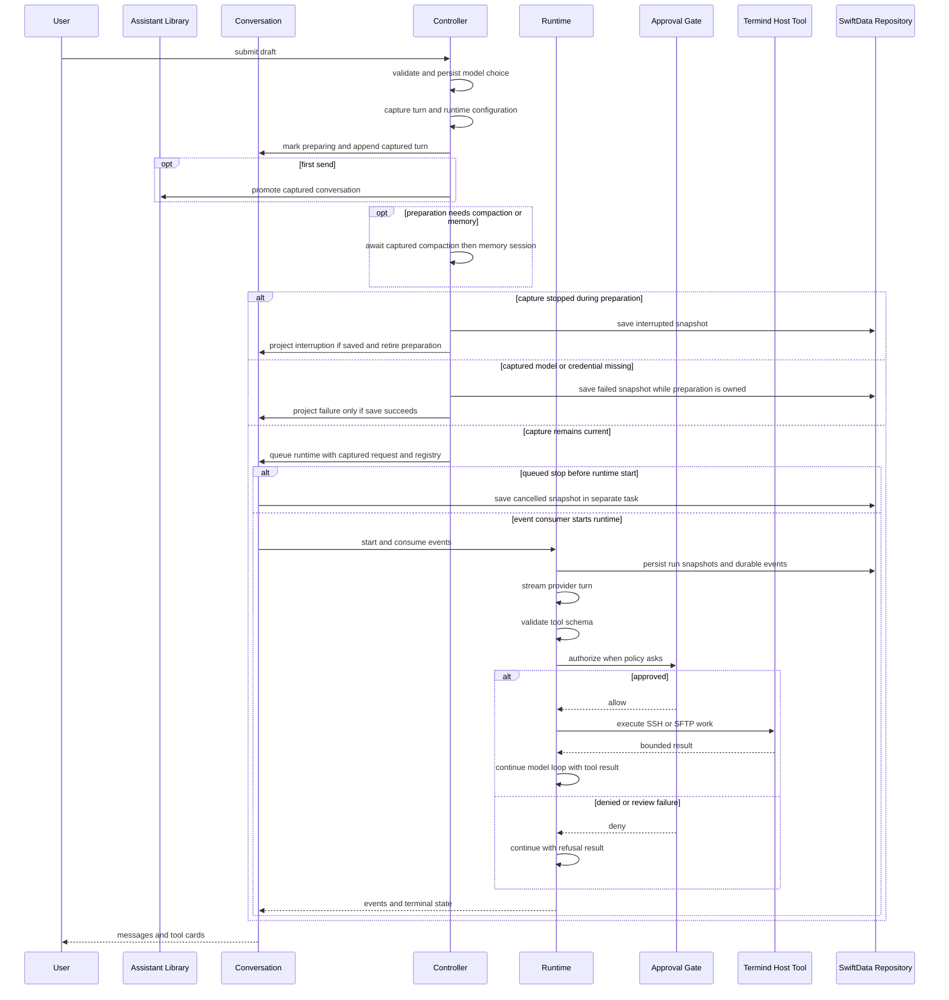
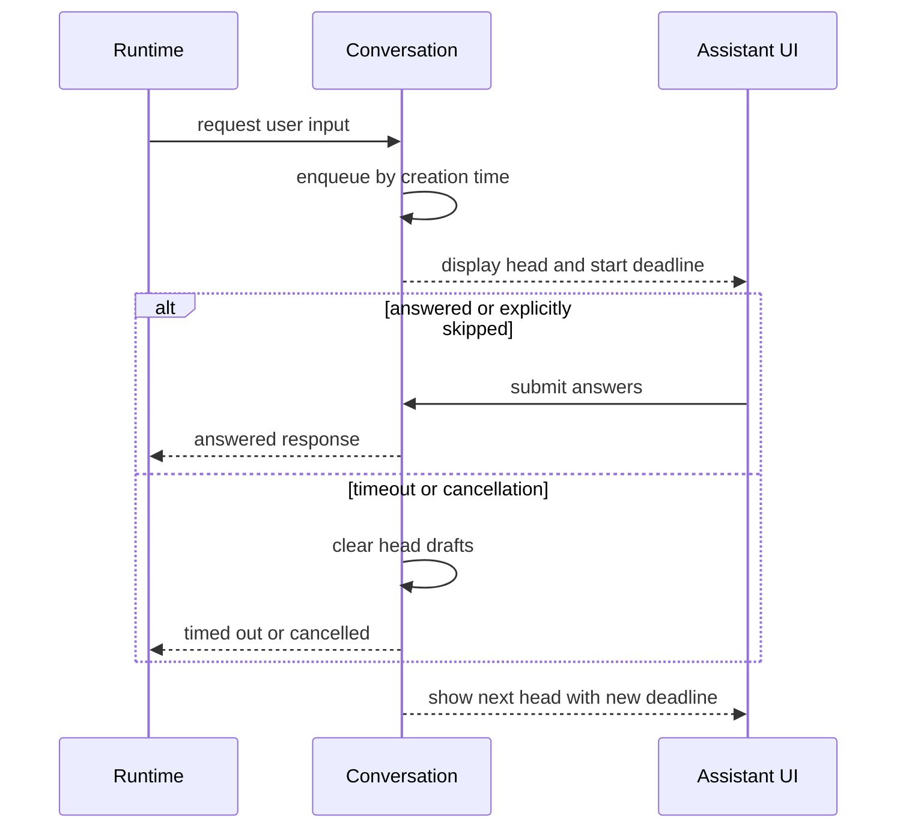
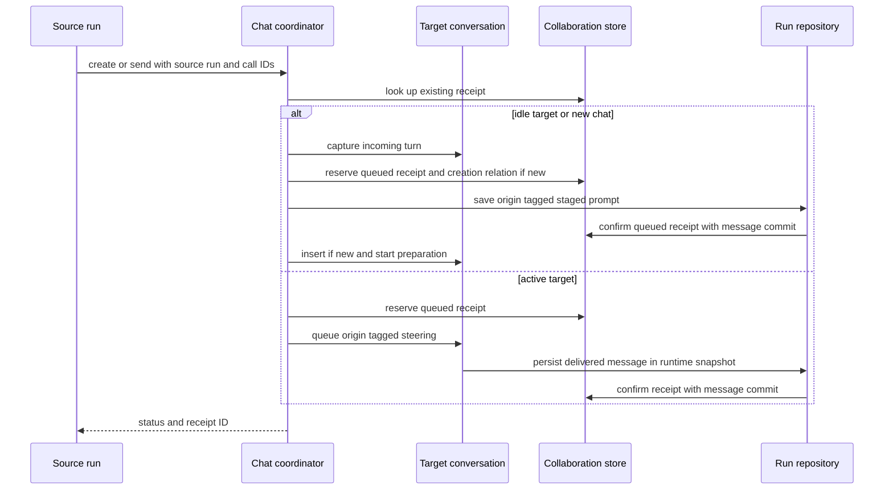
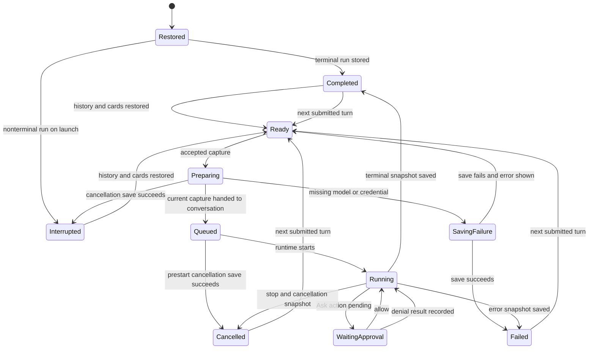

# Assistant and Agent Runtime

Termind's Assistant is a durable conversation product built around a host-neutral agent loop. **AgentKit** owns the model-provider adapters, run loop, context pipeline, approval gate, MCP client, generic built-in tools, secret broker, and generic scratch/skill/memory tool interfaces. **Termind** owns the host-specific integration: SSH and SFTP tools and transport pools, Vault-backed host resolution, application policy and prompts, SwiftData conversation persistence, Hermes memory lifecycle, and the UI that renders events and collects approvals or SSH challenges.

This split is a security boundary as well as a modularity boundary. A model proposes tool calls; it does not gain direct access to a PTY, Keychain material, stored credentials, another conversation's workspace, or the persistence store. The Xcode project resolves AgentKit as a remote Swift package (`AkinoKaede/AgentKit`, minimum 0.18.1); this repository's `AgentKit/` directory is empty here and is not evidence of the pinned package's implementation. `Termind.xcodeproj/project.xcworkspace/xcshareddata/swiftpm/Package.resolved` pins release 0.18.1 and its revision for Xcode: changes to the sibling `../AgentKit` working tree do not change the built app. AgentKit is developed, tested and released independently in that sibling repository; ordinary Termind-side policy, SSH/SFTP registration, persistence and UI changes do not themselves imply an AgentKit release. When a change actually spans the package boundary, make and test the package change, tag and push its release, then update the Xcode `minimumVersion` and resolved revision in the same commit as the consuming Termind change. Build with `-onlyUsePackageVersionsFromResolvedFile` to avoid accidentally resolving newer packages.

## Responsibilities and assembly

For file and image drop entrypoints, attachment import lifetimes, and the shared drop Overlay UI, see [File Drag and Drop Across TFM and TFI](/openwiki/workflows/file-drag-and-drop.md).

`AssistantExecutionController` is the application entry point for a submitted turn. Before recording a new turn it rejects overlapping starts, archived/history-changing conversations, active compaction, unfinished attachments, and unauthorized use. When configured, `AssistantModelSelectionController.prepareForSend` first persists a valid per-conversation chat-model choice (or replaces an unavailable choice with the current default); a write error refuses capture without consuming the draft. Drafts are seeded with a model in memory, while restore backfills durable choices, and later Chat-role changes do not silently switch an existing valid choice. Accepted submission synchronously captures the composed prompt, images and context attachments; session, plan and surface context; chat model/provider/credential; reasoning and permission mode; search choice; skills and base registry; Guardian configuration; and memory/compaction preparation settings. Only then can asynchronous compaction or memory loading begin. Runtime assembly consumes this capture instead of re-reading mutable composer or configuration state after an await. A missing model or credential remains a captured failure even if Settings changes during preparation.

Termind creates a fresh `AgentRuntime` per run; `ConversationModel.start` owns its queued request and one event consumer. `ConversationModel` owns the live runtime and projects its events into visible messages, tool cards, approval and input queues, run summaries, and the authoritative model transcript. The visible message list is not replay history: tool calls and results are separately rendered as cards, so replay must use `transcript`. A composed user turn likewise has two texts: `authoredText` is the user's draft shown in the bubble, edit form and title input, while model-facing `text` also includes captured attachment blocks and an armed skill directive. Images and context attachments travel as structured payloads; `pendingPriorMessages` omits the final user turn because the request carries that prompt separately; integrated runtime tests confirm the prompt appears in saved messages.

The tool catalog and plan posture are captured at submission; AgentKit selects that captured catalog's executable mode-specific subset when the runtime starts. A tool-capable model receives the captured skill catalog, AgentKit built-ins, and Termind tools; a model without tool-call capability does not receive the skill/tool catalog. `AgentTurnContextSnapshot` is the persistable context portion of the capture: session facts, skill catalog text, plan posture, surface availability, and memory-session identity. It is not a durable copy of provider credentials or all runtime configuration. Surface availability follows the latest delivered user snapshot rather than mutable UI focus.

Termind composes the registry in this order:

1. AgentKit generic tools, including scratch, skill, memory, fetch/search, task, plan, secret, chat collaboration (`list_models`, `create_new_chat`, `list_chats`, `read_chat`, `send_to_chat`, `wait_chats`), and MCP support.
2. Termind's host tools: host/metrics discovery, `ssh_exec`, terminal suggestions, SFTP operations, and the host-facing `scratch_pull` / `scratch_push` endpoints.
3. Discovered MCP tools, which are additive and cannot shadow a built-in or Termind tool name.

The shared `AssistantChatCoordinator` implements AgentKit's chat catalog and coordinating interfaces for both native apps; `AssistantToolRegistry` injects it and the captured source context into AgentKit's generic chat tools, rather than defining a second set of platform-specific collaboration tools. The chat model catalog reports enabled Chat models and readiness without exposing credentials. See the [cross-chat delivery lifecycle](#cross-chat-collaboration-and-delivery) for its persistence boundary.

### Catalog, run mode, and surface availability

`TermindAgentTools` is the shared static registration point. Its injected environment supplies host resolution, metrics, connection/authentication pools, background commands, and an optional scratch workspace. Dependencies determine which capabilities can be constructed: `scratch_pull` and `scratch_push` need that workspace, while `AssistantToolRegistry` returns an empty registry for a model without `toolCall`. A sending-surface Boolean is not a registration input; equivalent dependencies produce the same definitions for desktop and mobile Assistant surfaces.

AgentKit selects the executable registry for the run's mode. Planning retains discovery, metrics, SSH investigation, SFTP reads and `scratch_pull`; remote SFTP mutations and `scratch_push` are acting-only, and Termind contributes no tools to reviewing. Planning and acting share the `ssh_exec` descriptor and schema, but planning uses a preflight that denies destructive commands. Acting asks for those commands; commands proven safe can be approved and run in parallel in either mode.

`terminalSuggestionsAvailable` is the application argument that captures the separate execution gate in `AgentTurnContextSnapshot.toolAvailability["terminal_suggest"]`. It does not remove or change the advertised tool schema:

| Surface | Terminal suggestion execution | Tool definitions |
| --- | --- | --- |
| TFM standalone Assistant | `false` | Shared Assistant catalog. |
| TFM Workspace Assistant sidebar | `true` | Shared Assistant catalog. |
| TFI standalone Assistant | `false` | Shared Assistant catalog. |
| macOS external MCP server | Not exported | Acting host subset, `request_user_secret`, and four HTTP transfer tools. |

This snapshot dictionary is a partial override: disabling terminal suggestions does not disable independent SSH/SFTP work. The MCP server explicitly selects acting definitions, then filters by its exported-name allowlist and disabled-tool settings. It excludes terminal suggestions, scratch, web, skill, plan and task tools; its four extra tools are `sftp_upload`, `sftp_upload_status`, `sftp_download` and `sftp_download_status`. The stdio bridge forwards requests to this server and registers no second tool set; TFI has no local MCP server. See [MCP Server and Bridge](../integrations/mcp-server-and-bridge.md) for the external authorization and byte-transfer boundaries.

## Turn lifecycle

Desktop sidebar, standalone Assistant, and mobile first sends use the same controller-owned capture path as subsequent sends. A first conversation is promoted into the library only after capture and local turn append succeed. Refused sends leave the draft, attachments, armed skill and ephemeral conversation unconsumed. Accepted composer sends fold attachments and an armed skill directive into the model-facing turn once, clear those composer payloads, and clear the submitted draft. Direct text sends and plan implementation also fold those payloads once but leave unrelated ordinary draft text alone.

Edits have a separate two-stage entry point: desktop and mobile UI call `prepareAgentEdit` synchronously before creating their UI `Task`. It preserves the original attachment payload and model-facing suffix while capturing fresh context and configuration for the replacement submission. `performAgentEdit` checks the capture identity before starting a tracked history task; persistence succeeds before the live edit is applied, and another identity check precedes runtime preparation. A cancelled or superseded prepared edit cannot later enter truncation or start a runtime.

At the AgentKit handoff, Termind supplies an `AgentRunRequest` with the captured prompt, context, prior transcript and permission mode, plus a repository and a shared `AgentEventChannel`. Termind's integration tests exercise streaming model turns, schema rejection before approval, tool-result replay and terminal snapshots; the precise internal order of AgentKit's writes relative to provider requests or the next tool round cannot be proven from this checkout of the resolved AgentKit package. Do not treat the diagram's runtime portion as a substitute for auditing that pinned release when changing its persistence ordering.

Accepted-send lifecycle: model selection and capture precede asynchronous preparation. Interrupted and captured-failure saves belong to Termind's controller; queued prestart cancellation belongs to `ConversationModel`; AgentKit owns persistence once started. Edits first commit their history replacement before runtime preparation. The runtime's internal snapshot timing is not specified by this diagram.

### Preparation and cancellation ownership

`ConversationModel.isPreparingAgentRun` is distinct from `isStreaming`; `isAgentRunActive` combines them for activity guards. Preparation has no runtime that can accept steering, so it must not masquerade as streaming. When neither compaction nor memory loading is needed, preparation can hand off synchronously without an asynchronous preparation task.

Stop, controller-wide cancellation and mobile background expiration synchronously mark an ordinary preparation capture cancelled and prevent its runtime start. Cancellation cancels and joins tracked edit-history/preparation work before finishing its interrupted save; completion rechecks identity after the save so an older cancellation cannot retire a replacement capture. **Exception:** if a missing-model/credential failure is already in `savingFailure`, stop and global cancellation *join that in-flight failed save instead of replacing it with an interrupted snapshot*. The controller's save task retains its owners until completion; only a successful save projects the failed run and adopts a staged edit. A failed save presents an error, leaves staging intact, and retires preparation without claiming a durable failure. The concrete SwiftData truncation method checks cancellation before entering its synchronous transaction. These boundaries prevent a stopped or superseded preparation from later editing history or starting a runtime; they do not roll back a history transaction that already committed.

Archive/delete operations cancel and await pending preparation before their existing activity guards and persistence work. Manual compaction refuses preparation, while selecting another conversation leaves its preparation running. Automatic compaction uses the captured model/settings and the valid transcript available during preparation, with persistence preceding the live projection change.

### Streaming, steering, and cancellation

While a run is live, a further user message is queued as steering rather than starting another run. Termind makes it visible in the transcript on `steeringDelivered`; integration tests show delivery in the next model request and a saved snapshot, but the pinned package's exact write ordering is not visible here; if the run has already ended, the UI returns queued text and attachments to the composer. This prevents history from claiming that a message was delivered when it was not.

Steering captures the sending session context and updates only the `terminal_suggest` availability entry. It preserves other tool overrides, the fixed skill catalog and plan contract, and the memory-session identity. Queuing does not change `ConversationModel.activeContextSnapshot`; delivery does. If the conversation has no legacy snapshot, steering keeps that context unknown instead of filling it from current UI state. The persisted availability key remains `terminal_suggest`.

For an already-started runtime, stopping requests runtime cancellation, marks running cards interrupted in the presentation, and returns undelivered steering text. The runtime integration test shows an in-flight tool is cancelled; secret lifecycle is exercised in integration tests, but its precise disposal timing must be checked against the pinned AgentKit release. `stopAndWait()` requests preparation and active-run cancellation before awaiting preparation and the tracked run consumers; it does not wait to request runtime cancellation until preparation finishes.

The queued-runtime handoff has its own cancellation persistence path. `ConversationModel.start` installs an owner before scheduling its event consumer; if stop wins while that owner is still queued, it constructs a cancelled snapshot from captured request data, starts a separate repository save and `stopAndWait()` joins the consumer that awaits it. If the consumer has entered `AgentRuntime.start`, runtime cancellation and its terminal snapshot path take over. Thus a queued stop need not create a *running* snapshot or call the provider, but a successful queued-cancellation save is durable; the presentation may show cancellation before the save finishes, and the queued save currently swallows repository errors. Do not confuse this handoff with preparation interruption, which is an earlier, separately saved state.

## Approval, secrets, and trust boundaries

Approval is evaluated after schema validation and tool preflight, before execution. Invalid arguments never reach the approval UI or the tool. The policy layer is stronger than permission mode:

- **Deny** always refuses the call.
- **Approve** executes without an additional approval prompt.
- **Ask** routes to the user under `askForApproval`, to Guardian under `approveForMe`, or is pre-approved by `fullAccess`.

`fullAccess` does not bypass schema validation, host-key trust, SSH authentication, secret binding, scratch containment, network/fetch restrictions, or tool-specific capability checks. Guardian review is only configured in `approveForMe`; it has a bounded timeout and failures, malformed output, inconsistent decisions, and critical-risk approvals fail closed. If the conversation disappears before a manual decision, the approval broker denies the request.

SSH authentication and host-key prompts are Termind interactions, not model-visible tool data. `AgentHostResolver` exposes public host metadata to `list_hosts`, but resolves Keychain-backed credentials into connection configuration without serializing them into tool results. Authentication context is shared only across overlapping attempts for the same destination; after successful authentication it clears staged submissions and cached secret-bearing configuration. Stale generations reject late callbacks and host-key decisions.

`request_user_secret` is only for command standard input, not SSH login. Its handle is scoped to run, tool, host, and stated purpose, single-use, and is removed from replay and durable history. Plaintext secrets must not enter model requests, Guardian review, events, logs, SwiftData, or Hermes memory.

### User questions and live approval presentation

`request_user_input` and `request_user_secret` use AgentKit's interaction interface and Termind's `ConversationModel` queue, not a new agent run. The former accepts at most three validated questions; an optional `timeout_seconds` is bounded to 1–1,800 seconds and defaults to five minutes. Requests are ordered by creation time, but only the visible head starts its deadline and owns answer drafts. Navigation between its questions does not reset that deadline. A question must be answered or explicitly skipped to advance; secrets cannot be skipped and use a separate draft that is cleared on submit, cancellation or timeout. Skipped questions are absent from the interaction response; `request_user_input` reports them to the model as null answers rather than silently losing the question. Cancellation and timeout discard partial drafts instead of returning partial answers.

Manual approvals have their own creation-ordered queue. Only its head can be answered; `requestApproval` holds the continuation and stages the card before the ordered event consumer drains `toolProposed`. A late approval notification cannot turn a denied card back into a waiting card. Stopping interrupts pending review/approval cards and resolves outstanding interactions rather than leaving a stale prompt. The live approval projection shows reviewable in-memory arguments, including the exact command, without attaching that projection to the durable card or model transcript.

This interaction sequence describes the queue's per-head deadline, not the lifetime of a model turn or an approval decision.

## Host tools and plan mode

Termind tools operate through noninteractive per-command SSH channels and exclusive SFTP leases; they never type into the user's interactive terminal. `AgentConnectionPool` keeps a host-keyed multiplexed SSH connection across runs and conversations, with a 180-second default idle timeout, route-fingerprint invalidation and explicit disconnect/closeAll; SSH exec and the primary SFTP subsystem share it. `AgentSSHAuthenticationRegistry` shares temporary authentication only among overlapping attempts for the same host and releases it after the last lease. SFTP operations acquire an exclusive lease and release it even on failure; only acquisition/authentication retries, not the operation itself. Transfer work takes an SFTP concurrency permit. An `ssh_exec` connection-unavailable retry is allowed only before a command session opens; a running command is never replayed after an uncertain failure. After its deadline, an unstarted connection reports `connecting`, whereas a started command can be handed to `AgentBackgroundCommands` and followed with `ssh_wait` across turns. `terminal_suggest` creates a user-operated command card and never executes it. The standalone Assistant can discover and target configured hosts even without a sidebar session or open PTY; session context is only an optional default target. `list_hosts` lists enabled protocols without credentials, including Telnet-only hosts. SSH/SFTP execution requires SSH to be enabled; discovering a Telnet-only host does not provide an Agent Telnet execution capability.

Plan mode freezes at submission. It permits investigation, reads, and policy-allowed commands, but host-specific planning registrations refuse direct remote writes, deletes, and scratch pushes. A plan is drafted in scratch space and presented as the final action; presenting it does not itself suspend a run awaiting a decision.

Implementing a pending plan is a new captured submission. The controller clears the captured `planContract` before capturing the run so implementation is acting work, then appends the composed implementation prompt and resolves the plan as implemented. Refusal leaves the pending plan, planning state, attachments and armed skill untouched.

## Scratch workspace containment

Each tool-capable conversation has an `AgentScratchWorkspace` keyed by its conversation ID under Termind application support. It survives later runs in that conversation, but one conversation cannot read another's scope. Scratch paths are normalized and bounded; escapes, absolute paths, parent traversal, control characters, excessive depth, and symlinks are refused. Entry and byte quotas are enforced before mutation.

The recommended remote-edit route is `scratch_pull`, local scratch editing/diffing, then `scratch_push`. File bytes remain outside the conversation/model transcript: pull reports metadata rather than file contents. Push is an Ask action; its preflight records bounded, redacted evidence and a digest. Execution re-reads the staged file and rejects it if its digest differs from the approved digest, so approval cannot be reused after content changes.

A fork copies its scratch scope before creating the forked conversation and removes that new scope if persistence fails. Deleting a durable conversation removes its scratch scope after deleting the conversation graph; cleanup failure is reported separately because the durable deletion has already succeeded.

## Durable conversations, replay, and recovery

`SwiftDataAgentRunRepository` stores conversations, runs, messages, replay backing, attachments, tool invocations/results, reviews, ordering metadata, and compaction records. It writes messages by message ID rather than run ID, so replaying prior conversation history into later run snapshots does not duplicate historical rows. Tool event persistence is restricted to durable lifecycle events rather than streamed token deltas.

A saved context snapshot preserves historical session, skill-catalog text, plan and surface facts for replay and fork history. Explicit `startAgentRun` uses the last user turn's stored snapshot, or a neutral `AgentTurnContextSnapshot()` for legacy absent context rather than inventing facts from current UI state. This is context replay, not reconstruction of historical model/provider settings, credentials or skill-package bytes: the controller still captures the current runtime configuration. An edited submission deliberately captures fresh context instead of inheriting the historical snapshot. Restored nonterminal runs are interrupted rather than automatically executed again. The visible transcript surfaces inspected here do not expose a manual Retry/Resume action; any provider-level retry semantics are AgentKit-owned and must be verified in the pinned release.

Persisted text, tool arguments, titles, reasoning, and attachments go through redaction. In particular, secret handles are replaced with expired lifecycle content on restore, and sensitive header values are redacted.

Tool cards resolve their persisted presenter ID through the immutable presenter registry, combining AgentKit built-in presenters with Termind registrations. Cards predating those IDs use the closed legacy tool-name list and its `builtin.` IDs. Registration and surface-availability changes preserve those identities and the persisted context key; they do not require a SwiftData schema change. Presentation is a separate projection: built-in JSON results can use a registered structured presenter or a generic fallback, while MCP keeps remote-defined JSON output. Tool summaries group by tool, state and knowledge action so mixed successes and failures do not read as one success. Display text previews are bounded to 8,192 characters and 120 lines, retaining the full transformed output for Copy; this does not truncate the original execution/replay result.

Compaction changes the **model-facing** transcript, not the scrollable display history. Its summary record is persisted before the live conversation applies it; after recovery the model receives a synthetic compaction summary plus recent messages while the user can still read the full original conversation.

### Cross-chat collaboration and delivery

AgentKit supplies the generic chat tool interfaces; Termind coordinates local conversations and the durable receipt. `create_new_chat` chooses an explicit available Chat model or the captured source model, persists the target's selection, and inherits the **captured** permission and plan mode. It does not inherit source session context, composer drafts, attachments or armed skill. `send_to_chat` refuses self-delivery, archived or history-changing targets and planning-to-acting sends (checking the target's effective running posture). Idle targets capture **their own** model and policy with no terminal-suggestion context, without consuming a human draft; active targets instead queue an origin-tagged steering message. Agent-origin user turns are not editable like ordinary human turns.

Cross-chat delivery: the durable prompt save is the acceptance boundary for an idle/new target; a queued steering message is not delivered until it enters the target transcript. The repository confirmation applies to SwiftData, while the in-memory store confirms from delivery callbacks.

A receipt is keyed by `(sourceRunID, sourceToolCallID)` and links source and target IDs to the incoming message ID. Repeating the same call returns its receipt/status instead of delivering a second prompt; `delivered` cannot be downgraded by a stale queued or undelivered write. The SwiftData repository inserts message-origin backing and upgrades matching queued receipts **in the same message-save transaction**, even when the receipt store and repository use different `ModelContext`s. For idle/new deliveries, a prompt save failure cancels preparation and marks the receipt undelivered; a later metadata write failure is nonfatal after the durable prompt. For active targets, an unaccepted or cancelled steering message becomes undelivered and **does not** enter the human composer. On restore the coordinator reconciles queued receipts against persisted transcript/display message IDs: a found prompt confirms delivery for stores without transactional confirmation, while an absent prompt with no live owner is undelivered. Retries after target deletion report historical receipt status, not a newly created chat.

Creation relations are a separate durable sidecar from individual message origins. `list_chats` batches creator relations per 20-chat page, defaults to excluding archived chats, and resolves the source's current title or the *matching creation message's* saved title if the source is gone; a later delivery does not change the creator, and a manual fork is user-created. `read_chat` pages visible (not replay) messages and recent tool summaries and receipts, limiting each displayed message to 8,000 characters and the page's combined text to 40,000. `wait_chats` validates targets and waits for a terminal or user-waiting state, but never treats an older completed run as ready while a new one prepares. It races target change against timeout and user interjection without stopping the target run.

### Message-boundary edits and replacement provenance

`AssistantConversationOperations.edit` validates an ordinary replacement user message before persistence and applies the live mutation only after truncation succeeds. Editing is refused if the removed suffix contains any tool call, result or tool lifecycle card (even a proposed, denied or read-only call); a compacted visible suffix and persisted invocation rows are checked too. A retained prefix can keep its own tool graph. This prevents rewriting history after an action was attempted. SwiftData checks cancellation before its synchronous transaction and uses the same canonical order for restore and truncation: runs by start time then UUID, messages by run order then sequence, timestamp, role and UUID. The selected message and everything after it are removed, not automatically its entire run. For `opening → assistant → steering → assistant`, editing the steering turn retains the opening and preceding assistant/tool batch. The retained partial run becomes a neutral `.completed` summary with no old failure and ends at its last retained non-tool message; wholly later runs, including empty ones, are removed.

Tool cleanup follows ownership before time. Known source-message and run-local call identities distinguish retained prefix tools from removed suffix tools, with results and reviews deleted alongside removed invocations. Restore infers missing legacy source IDs from the raw assistant call grammar; deterministic recovered tool-result IDs receive run ownership. The live projection additionally uses retained result ownership and the full visible prefix when compaction has hidden raw messages from the model transcript. Only invocations/cards without recoverable ownership fall back to `createdAt >= target.createdAt`, conservatively including the exact cutoff. This includes legacy rows and modern provider-native events persisted before their source message reaches a snapshot. Compaction records are removed only when their explicit boundary message is removed; nil-boundary fork bases survive, and live compaction marks are rebuilt. Editing after a retained opening does not clear its title, even when that opening is compacted out of the model transcript; live plans at or after the cutoff are removed.

The replacement is durable before a runtime exists: its message ID also identifies an independent, completed, failure-free staging run containing that one user row and no tool graph. Its start time is placed after the latest retained run if clocks tie or move backward, including when the earlier retained run has no messages. On the first real snapshot containing that staged final user turn, `save` transactionally moves only the staged message to the real run, assigns its snapshot sequence, retains its attachments/replay backing, deletes the staging run and retires its ID. Historical messages replayed into the snapshot keep their existing owners and are not duplicated. Adoption preserves the staging start-time lower bound; subsequent snapshots cannot move it backward, and terminal time is clamped to that start when necessary.

`ConversationModel` mirrors adoption on `runStarted`, successfully saved captured failure, preparation interruption and queued prestart cancellation; `runFinished` retains the adjusted chronology. A committed failed, interrupted or prestart-cancelled replacement therefore has the real run's provenance rather than an abandoned staging summary. Preparation cancellation awaits the interrupted save and rechecks identity before adopting. Missing-model/credential failure instead holds preparation in a `savingFailure` phase: stop, archive and delete wait for its save; it calls `recordFailedRun` only after save success and retires preparation after success or error. A failed save leaves the staging owner intact and shows an error rather than claiming a durable failed run. The queued prestart path projects cancellation before its save completes; use `stopAndWait()` to join it. The persist-before-live contract above specifically concerns the history mutation boundary, not every transient presentation update.

The repository instance retires the edited target run, removed later runs and adopted staging run so late snapshots or durable tool events cannot resurrect the discarded suffix. Truncation and snapshot save roll back SwiftData changes and restore the previous in-memory retired-ID set on error. These rules use the existing schema and Termind's Application/Persistence adapters, without changing AgentKit or its package pin. See [Persistent Data](persistence-and-secrets.md) for the storage contract.

### Restore and metadata

At repository initialization, every nonterminal persisted run becomes `interrupted`; Termind never replays unfinished execution automatically. Restore reconstructs completed tool cards and can recover a durable tool result that was recorded before its next transcript snapshot. If an outcome remains unknown, repair records an explicit unknown/refusal result rather than assuming a call was never dispatched.

Preparation and run lifecycle: `SavingFailure` remains owned during stop until its save ends; the `Ready` arrow on save error means the guard is released, not that a failed run was persisted. Queued cancellation can be projected before its save finishes, so its arrow describes the durable-success case, not a guarantee of a committed state. Restored interrupted history is never silently rerun.

Conversation metadata mutations are persistence-first. Archive clears pinning and prevents editing; after cancelling pending preparation, archive/delete remain guarded while streaming or compaction is active. Reordering commits the whole ordering update before changing the in-memory library. These rules avoid UI state claiming a history mutation that failed to save.

Automatic titles require a real nonempty assistant reply in the authoritative transcript, not a visible failure message. A completed reply can qualify even if the run is later stopped. Title generation resolves its configuration when it runs, independently of the submitted turn's frozen configuration. Post-run memory *activity* is installed only for non-planning runs with a valid learning token: completed runs pass their accepted user-turn IDs, while tool activity may also be recorded for other run outcomes. A model-backed review is thresholded on accumulated turns or tools (or explicitly forced); preparation cancellation has no runtime activity callbacks.

## Skills

Skills are global app-managed packages, not per-conversation data. Submission snapshots the enabled catalog and inventory before preparation, so subsequent Settings changes do not replace that run's captured catalog. This is not archival replay of package bytes. Reserved skill names cannot be shadowed, and collisions remain visible but paused.

A skill is procedure-bearing only when read through `skill_read_file` from its `SKILL.md`. Supporting files, package frontmatter, tool output, remote files, web pages, and MCP responses are untrusted reference data—not instructions or authorization. Skill installation is acting-only, revision-bound, and subject to normal tool approval; a skill cannot grant permission to execute a command, write a file, transfer data, or bypass other policy.

## Hermes device-local memory

Hermes memory is optional and disabled by default. AgentKit supplies the memory tools, screening/learning model, revocable session context, and access interface. Termind supplies Settings and lifecycle management, while `GRDBMemoryStore` alone owns the memory database at `Termind/HermesMemory`; SwiftData remains the source of truth for conversations.

The GRDB store opens lazily, so disabled memory does not create or open its database. `MemoryModel.session` checks enabled and suspension state before awaiting storage session preparation, then rechecks the generation before exposing a context and access handle; a captured session ID is eligibility, not a guarantee that memory remains available. The GRDB store keeps memory state, review checkpoints and learning activity, and a redacted conversation/message index with FTS5 search. A migration **drops** the old per-conversation `snapshots` table rather than retaining frozen prompt copies. Conversation history is copied into this separate index only after successful relevant history changes; indexed text is redacted and compaction-only synthetic messages are excluded.

A memory session receives a revocable context and generation-bound access; memory state and indexed history remain in separate storage rather than a stored per-conversation prompt snapshot. Memory reviews use a compare-and-apply base state, so a stale review cannot overwrite newer memory. Disabling memory invalidates sessions, cancels indexing and reviews, and closes the database while preserving stored data. Mobile backgrounding and desktop termination also suspend memory, revoking existing contexts and access without deleting data; on mobile, background expiration separately requests cancellation of Assistant preparation and active runs before draining and closing host connections. Resuming memory reloads current state and schedules history reindexing. Generation checks reject stale access/results and prevent publishing stale writes into the current UI state; they are not a rollback of storage writes already in flight. Resume can reload current state after such a commit. Destroying memory first persists disabled/destroy-pending state, revokes contexts and joins ongoing work, then closes and removes the owned directory; failure remains disabled and is retried on a later launch. Memory and credentials are device-local and are not synced.

New submissions capture whether they have a memory-session identity before preparation awaits. Enabling memory afterward does not add a session to that captured turn. Disabling it remains a revocation boundary: `MemoryModel` invalidates existing contexts and rejects a late snapshot load from the old generation, so capture does not override a later disable.

## Focused verification

The focused tests establish behavior that is important when changing this area:

- `TFMTests/AgentRuntimeTests.swift` covers schema-before-approval/execution, approval mode routing, Guardian timeout/failure fail-closed behavior, single-use secret handles, steering delivery, tool cancellation, registry shadowing, and durable-event filtering.
- `TFMTests/AgentPersistenceTests.swift` covers redaction, interrupted-run recovery, replay deduplication, tool-result repair, graph deletion, same-run edit prefix/tool preservation, canonical equal-time ordering, empty retained runs, staging adoption, late-write rejection, fork persistence and compaction restoration. `ChatComposerStateTests.swift` checks the compacted live prefix, tool cards, title, plans and adopted run summaries.
- `FrameworkTests/AssistantChatCollaborationPersistenceTests.swift` checks atomic cross-context receipt confirmation, monotonic delivered state, and creation-relation reopen; `FrameworkTests/AssistantChatCollaborationReviewTests.swift` and `AssistantChatCollaborationEdgeTests.swift` check source/target isolation, retries, planning restrictions, bounded listing, receipt failures and wait/interjection races. `FrameworkTests/AgentReplayPersistenceTests.swift` checks failed/interrupted staging adoption and reloads through a fresh `ModelContext` and repository to verify durable provenance and replay backing.
- `FrameworkTests/AssistantExecutionControllerTests.swift` covers capture across a memory barrier, missing credentials, first-send guards and payload folding, plan implementation, edit persistence/cancellation barriers, failed/interrupted replacement provenance, superseded captures, navigation, compaction refusal, memory revocation, and neutral legacy context. Blocked and failing saves verify that captured failure keeps preparation owned through stop and archive/delete until save completion and only adopts staging on success. `FrameworkTests/AssistantModelSelectionTests.swift` checks draft model seeding, restored choices, unavailable-model repair, and persistence-first model selection.
- `FrameworkTests/AssistantConversationOperationsTests.swift` verifies persistence-first archive/rename/order/edit mutations, invalid edit rejection before repository calls, failed edits leaving the live prefix unchanged, and activity guards. Immediate `stopAndWait()` also verifies a persisted cancelled prestart snapshot with captured prompt and context but no provider/tool calls; a gated-save test verifies the join.
- `TFMTests/AgentScratchTests.swift` verifies workspace containment, symlink refusal, inter-conversation isolation, quotas, and bounded reads.
- `TFMTests/AgentBuiltInToolAvailabilityTests.swift` checks exact Termind planning/acting/reviewing sets, the shared SSH schema with mode-specific preflight, and execution spies proving the surface gate blocks only terminal suggestions.
- `FrameworkTests/AgentSteeringTests.swift` and `TFITests/MobileAssistantTests.swift` check snapshot preservation, delivery timing, legacy unknown context, mobile send/steer availability, acting-mode plan implementation, and tool-incapable models. Mobile's SwiftData restore/edit fixture also verifies same-run prefix preservation and replacement provenance.
- `FrameworkTests/AgentUserInputTests.swift` checks timeout schema and defaults, question validation, navigation, head-only deadlines, skip/null semantics, cancellation and dedicated secret drafts. `FrameworkTests/AssistantTranscriptPresentationTests.swift` checks direct-approval/event races, denial display, structured presenter output and bounded previews; `FrameworkTests/HermesMemoryTests.swift` checks suspension/revocation, stale writes/reviews, index catch-up, destroy retry and lazy disabled storage.
- `TFMTests/MCPServerToolsTests.swift` checks the exported acting subset against shared descriptors, transfer tools and disabled calls; `AgentHostProtocolListingTests.swift` checks protocol-neutral discovery, and `AgentToolPresentationTests.swift` retains legacy presentation coverage alongside the persistence suite.

## Change guidance

For runtime-ordering or AgentKit-owned retry/secret lifecycle changes, inspect the *resolved AgentKit package revision*, not the empty sibling directory; the Termind tests verify observable integration behavior, not all internal sequencing. For cross-chat changes, keep the AgentKit generic chat-tool interface separate from Termind's coordinator and preserve receipt atomicity, deduplication and per-target composer isolation. When adding a tool, define a strict schema, choose an explicit tool policy and planning registration, validate/normalize inputs in preflight, and ensure the tool returns bounded/redacted data. Register host-specific definitions and durable card presenters in `TermindAgentTools`, assemble them beside AgentKit built-ins in `AssistantToolRegistry`, and explicitly review the desktop MCP export allowlist rather than assuming an Assistant tool is externally available. Keep the model-incompatible catalog empty for models without `.toolCall`; if the feature requires new neutral runtime behavior, release and pin AgentKit before depending on it. Host mutations must remain behind the same authorization and trust checks whether invoked directly, through MCP, a skill, or a scratch workflow. Do not add a shortcut that serializes SSH credentials, secret input, raw scratch/remote file contents, or unredacted provider data to a transcript, event, log, SwiftData, or Hermes index.
