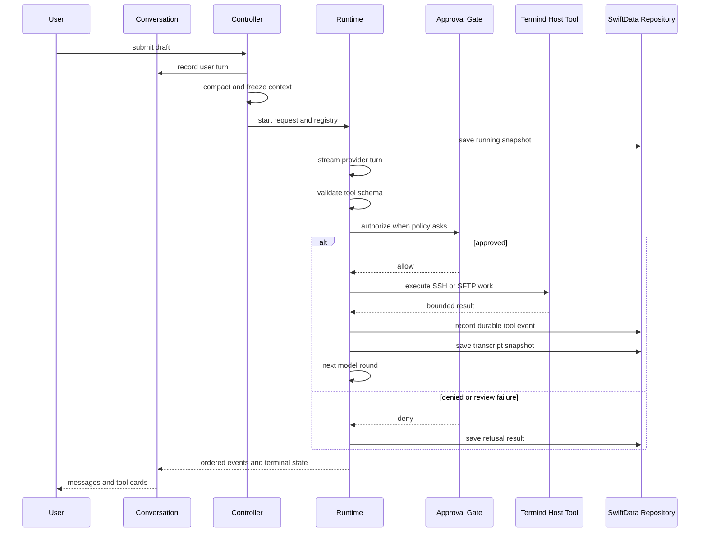
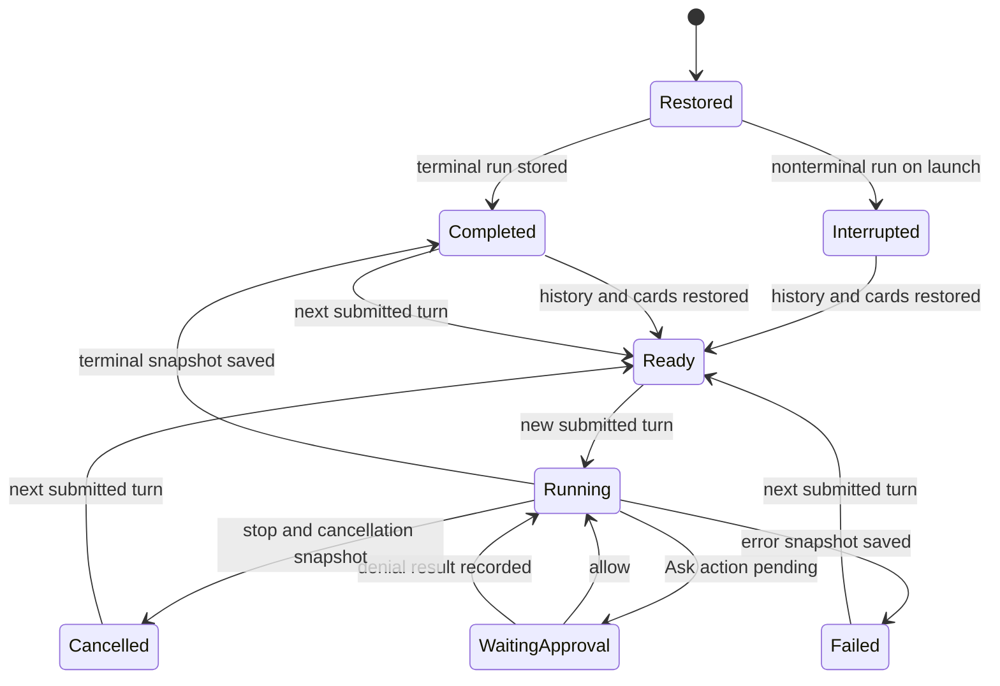

# Assistant, Agent Runtime, Skills, and Memory

Termind's Assistant is a durable conversation product built around a host-neutral agent loop. **AgentKit** owns the model-provider adapters, run loop, context pipeline, approval gate, MCP client, generic built-in tools, secret broker, and generic scratch/skill/memory tool interfaces. **Termind** owns the host-specific integration: SSH and SFTP tools and transport pools, Vault-backed host resolution, application policy and prompts, SwiftData conversation persistence, Hermes memory lifecycle, and the UI that renders events and collects approvals or SSH challenges.

This split is a security boundary as well as a modularity boundary. A model proposes tool calls; it does not gain direct access to a PTY, Keychain material, stored credentials, another conversation's workspace, or the persistence store.

## Responsibilities and assembly

`AssistantExecutionController` is the application entry point for a draft. It prevents overlapping starts, archived/history-changing conversations, unfinished attachments, and unauthorized use before it records the user turn. It compacts first when needed, resolves the chat provider and its credential, freezes run-level choices, assembles the tool registry, and starts a fresh `AgentRuntime` through the `ConversationModel`.

A runtime is deliberately single-run. It owns one event stream and one event consumer. `ConversationModel` owns the live runtime and projects its events into visible messages, tool cards, approval and input queues, run summaries, and the authoritative model transcript. The visible message list is not replay history: tool calls and results are separately rendered as cards, so replay must use `transcript`.

Tool availability is fixed at run start. A tool-capable model receives the resolved skill catalog, AgentKit built-ins, and Termind tools; a model without tool-call capability does not receive the skill/tool catalog. Session facts, plan posture, surface availability, and the memory-session identity are captured in an `AgentTurnContextSnapshot`, rather than reread from mutable UI state while the run is executing.

Termind composes the registry in this order:

1. AgentKit generic tools, including scratch, skill, memory, fetch/search, task, plan, secret, and MCP support.
2. Termind's host tools: host/metrics discovery, `ssh_exec`, terminal suggestions, SFTP operations, and the host-facing `scratch_pull` / `scratch_push` endpoints.
3. Discovered MCP tools, which are additive and cannot shadow a built-in or Termind tool name.

## Turn lifecycle

A submitted prompt is persisted as part of the run snapshot before model work begins. AgentKit streams a provider turn, emits ordered UI and durable events through a shared `AgentEventChannel`, validates any complete tool call, then schedules execution. Tool results are appended to the model transcript and persisted before the following model round. This preserves a grammatically answerable transcript even for refusal, cancellation, or failure paths.

This sequence shows one assistant turn, including the persistence points around tool execution.

### Streaming, steering, and cancellation

While a run is live, a further user message is queued as steering rather than starting another run. It becomes visible and durable only at the next model boundary, when AgentKit delivers it to the model; if the run has already ended, the UI returns queued text and attachments to the composer. This prevents history from claiming that a message was delivered when it was not.

Stopping a conversation cancels the runtime and its tool work, discards run-scoped secrets, marks running cards interrupted in the presentation, and returns undelivered steering text. `stopAndWait()` waits for the runtime's cancellation/persistence path before clearing live ownership. Termind also invalidates pending preparation when its controller is cancelled, recording an interrupted snapshot rather than launching a stale run.

## Approval, secrets, and trust boundaries

Approval is evaluated after schema validation and tool preflight, before execution. Invalid arguments never reach the approval UI or the tool. The policy layer is stronger than permission mode:

- **Deny** always refuses the call.
- **Approve** executes without an additional approval prompt.
- **Ask** routes to the user under `askForApproval`, to Guardian under `approveForMe`, or is pre-approved by `fullAccess`.

`fullAccess` does not bypass schema validation, host-key trust, SSH authentication, secret binding, scratch containment, network/fetch restrictions, or tool-specific capability checks. Guardian review is only configured in `approveForMe`; it has a bounded timeout and failures, malformed output, inconsistent decisions, and critical-risk approvals fail closed. If the conversation disappears before a manual decision, the approval broker denies the request.

SSH authentication and host-key prompts are Termind interactions, not model-visible tool data. `AgentHostResolver` exposes public host metadata to `list_hosts`, but resolves Keychain-backed credentials into connection configuration without serializing them into tool results. Authentication context is shared only across overlapping attempts for the same destination; after successful authentication it clears staged submissions and cached secret-bearing configuration. Stale generations reject late callbacks and host-key decisions.

`request_user_secret` is only for command standard input, not SSH login. Its handle is scoped to run, tool, host, and stated purpose, single-use, and is removed from replay and durable history. Plaintext secrets must not enter model requests, Guardian review, events, logs, SwiftData, or Hermes memory.

## Host tools and plan mode

Termind tools operate through noninteractive per-command SSH channels and exclusive SFTP leases; they never type into the user's interactive terminal. `terminal_suggest` creates a user-operated command card and never executes it. The standalone Assistant can discover and target configured hosts even without a sidebar session; session context is only an optional default target.

Plan mode freezes at submission. It permits investigation, reads, and policy-allowed commands, but host-specific planning registrations refuse direct remote writes, deletes, and scratch pushes. A plan is drafted in scratch space and presented as the final action; presenting it does not itself suspend a run awaiting a decision.

## Scratch workspace containment

Each tool-capable conversation has an `AgentScratchWorkspace` keyed by its conversation ID under Termind application support. It survives later runs in that conversation, but one conversation cannot read another's scope. Scratch paths are normalized and bounded; escapes, absolute paths, parent traversal, control characters, excessive depth, and symlinks are refused. Entry and byte quotas are enforced before mutation.

The recommended remote-edit route is `scratch_pull`, local scratch editing/diffing, then `scratch_push`. File bytes remain outside the conversation/model transcript: pull reports metadata rather than file contents. Push is an Ask action; its preflight records bounded, redacted evidence and a digest. Execution re-reads the staged file and rejects it if its digest differs from the approved digest, so approval cannot be reused after content changes.

A fork copies its scratch scope before creating the forked conversation and removes that new scope if persistence fails. Deleting a durable conversation removes its scratch scope after deleting the conversation graph; cleanup failure is reported separately because the durable deletion has already succeeded.

## Durable conversations, replay, and recovery

`SwiftDataAgentRunRepository` stores conversations, runs, messages, replay backing, attachments, tool invocations/results, reviews, ordering metadata, and compaction records. It writes messages by message ID rather than run ID, so replaying prior conversation history into later run snapshots does not duplicate historical rows. Tool event persistence is restricted to durable lifecycle events rather than streamed token deltas.

A saved context snapshot preserves the original session and policy baseline for replay, retry, edit, and fork behavior; legacy absent context remains unknown rather than being replaced by current UI state. Persisted text, tool arguments, titles, reasoning, and attachments go through redaction. In particular, secret handles are replaced with expired lifecycle content on restore, and sensitive header values are redacted.

Compaction changes the **model-facing** transcript, not the scrollable display history. Its summary record is persisted before the live conversation applies it; after recovery the model receives a synthetic compaction summary plus recent messages while the user can still read the full original conversation. Editing a user message truncates the target run and later runs atomically, creates the replacement turn, and removes compactions whose boundary was removed.

At repository initialization, every nonterminal persisted run becomes `interrupted`; Termind never replays unfinished execution automatically. Restore reconstructs completed tool cards and can recover a durable tool result that was recorded before its next transcript snapshot. If an outcome remains unknown, repair records an explicit unknown/refusal result rather than assuming a call was never dispatched.

This state diagram distinguishes recovery from automatic resumption: interrupted work is visible and recoverable as history, never silently rerun.

Conversation metadata mutations are persistence-first. Archive clears pinning and prevents editing; archive/delete are guarded while a run or compaction is active. Reordering commits the whole ordering update before changing the in-memory library. These rules avoid UI state claiming a history mutation that failed to save.

## Skills

Skills are global app-managed packages, not per-conversation data. A run snapshots its enabled catalog at startup, so enabling or changing a skill does not alter a run already in progress. Reserved skill names cannot be shadowed, and collisions remain visible but paused.

A skill is procedure-bearing only when read through `skill_read_file` from its `SKILL.md`. Supporting files, package frontmatter, tool output, remote files, web pages, and MCP responses are untrusted reference data—not instructions or authorization. Skill installation is acting-only, revision-bound, and subject to normal tool approval; a skill cannot grant permission to execute a command, write a file, transfer data, or bypass other policy.

## Hermes device-local memory

Hermes memory is optional and disabled by default. AgentKit supplies the memory tools, screening/learning model, revocable session snapshots, and access interface. Termind supplies Settings and lifecycle management, while `GRDBMemoryStore` alone owns the memory database at `Termind/HermesMemory`; SwiftData remains the source of truth for conversations.

The GRDB store opens lazily, so disabled memory does not create or open its database. It keeps memory state, frozen per-conversation prompt snapshots, review checkpoints, a redacted conversation/message index, and an FTS5 search index. Conversation history is copied into this separate index only after successful relevant history changes; indexed text is redacted and compaction-only synthetic messages are excluded.

A memory session receives a frozen snapshot for its conversation. Memory reviews use a compare-and-apply base state, so a stale review cannot overwrite newer memory. Disabling memory invalidates sessions, cancels indexing and reviews, and closes the database while preserving stored data. Destroying memory first persists disabled/destroy-pending state, revokes contexts and joins ongoing work, then closes and removes the owned directory; failure remains disabled and is retried on a later launch. Memory and credentials are device-local and are not synced.

## Focused verification

The focused tests establish behavior that is important when changing this area:

- `TFMTests/AgentRuntimeTests.swift` covers schema-before-approval/execution, approval mode routing, Guardian timeout/failure fail-closed behavior, single-use secret handles, steering delivery, tool cancellation, registry shadowing, and durable-event filtering.
- `TFMTests/AgentPersistenceTests.swift` covers redaction, interrupted-run recovery, replay deduplication, tool-result repair, deletion of the persistent graph, edit truncation, fork persistence, and compaction restoration.
- `FrameworkTests/AssistantConversationOperationsTests.swift` verifies persistence-first archive/rename/order mutations, activity guards, and immediate stop before a queued runtime can begin.
- `TFMTests/AgentScratchTests.swift` verifies workspace containment, symlink refusal, inter-conversation isolation, quotas, and bounded reads.

## Change guidance

When adding a tool, define a strict schema, choose an explicit tool policy and planning registration, validate/normalize inputs in preflight, and ensure the tool returns bounded/redacted data. Host mutations must remain behind the same authorization and trust checks whether invoked directly, through MCP, a skill, or a scratch workflow. Do not add a shortcut that serializes SSH credentials, secret input, raw scratch/remote file contents, or unredacted provider data to a transcript, event, log, SwiftData, or Hermes index.
