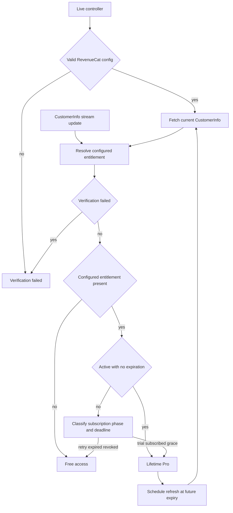
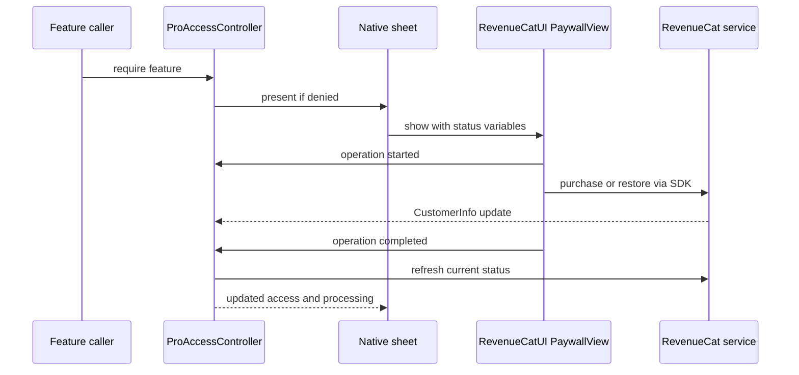

## Commerce ownership and configuration

<!-- openwiki: broken internal link [/openwiki/operations/storefront-commerce-release.md] link "/openwiki/operations/storefront-commerce-release.md" is root-absolute, which no real consumer resolves against the repository root (not a coding agent reading the page, not GitHub's Markdown renderer, not a local viewer); use a path relative to this file instead. Fix the href or restore the target, then delete this comment. -->
`ProAccessController` is the shared, observable main-actor access gate. Both production app targets construct it with `live()`; test, in-memory and screenshot setups can use unrestricted test access. Its `ProPurchaseService` is a narrow status-and-update interface, not a StoreKit purchasing API. `live()` builds `RevenueCatProPurchaseService` from the bundled `TermindRevenueCatAPIKey` and `TermindRevenueCatEntitlementID`; an absent or invalid configuration yields `.verificationFailed`, **not** free access through a second StoreKit observer. The configuration trims values, rejects unresolved placeholders and private keys, allows `test_` keys only in DEBUG and expects a public `appl_` production key. The configured entitlement (`termind_pro` in the project settings) is the unlock key: product IDs alone do not grant access. Both apps configure RevenueCat's StoreKit 2 mode with informational entitlement verification, an anonymous app user ID, device-identifier collection disabled and a preferred UI locale from the stored app language. See [Storefront Commerce Release Checks](/openwiki/operations/storefront-commerce-release.md) for production dashboard and sandbox checks.

`StoreKit/Termind.storekit` is a **local fixture**, not the live storefront or RevenueCat paywall configuration. It contains the family-shareable lifetime non-consumable `com.akinokaede.termind.pro` and yearly family-shareable subscription `com.akinokaede.termind.pro.annual`, the latter with a two-week free introductory offer and English, Simplified Chinese and Traditional Chinese product descriptions. The former `CommerceConfigurationTests` and `StoreKitTrialTests` files are removed. The fixture does **not** run the removed StoreKit entitlement/purchase integration suite or establish actual RevenueCat offerings, eligibility, price, purchase, restore or deadline behavior. Never infer a guaranteed trial or a price for every user from the fixture.

## Entitlement lifecycle and feature boundaries

The RevenueCat service consumes `customerInfoStream` (latest-buffered), and `currentStatus()` requests `customerInfo(fetchPolicy: .fetchCurrent)` to revalidate deadlines rather than trusting a still-fresh SDK cache. On a fetch failure it resolves cached customer info if available; without cache it throws. The controller coalesces concurrent refreshes; a newer streamed update cancels and supersedes an older in-flight refresh so a stale response cannot undo a grant or revocation. An initial failure becomes `.verificationFailed`; a later failure retains the last established status. On a non-test store, if an initial valid status does not grant access, the service attempts `syncPurchases()` once per anonymous app user ID (recording successful migration in defaults) to import pre-integration Apple purchases. This is distinct from an app-managed Restore Purchase button.

This is the access-resolution and refresh path, not a guarantee that a remote paywall offers a particular plan.

`RevenueCatEntitlementResolver` rejects failed CustomerInfo or entitlement verification and ignores entitlements other than the configured ID. An active entitlement without an expiration maps to lifetime purchased access (including family-shared ownership); an inactive one is free. A subscription grants access for an active trial or subscription before its deadline, and for an active billing-issue grace period before the **grace** deadline. Refund maps to revoked; after the deadline a billing issue maps to billing retry and otherwise to expiry. Cancellation disables renewal but does not itself withdraw access before expiration. Unlike the previous StoreKit `.subscribed` fallback, a cached `isActive` flag cannot extend access beyond a past deadline. `apply` cancels its prior expiration timer and schedules a re-fetch at a future granting subscription deadline; no timer is installed without a future deadline. iOS scene activation and macOS app activation also refresh access. A refresh failure without cache can retain an established controller status, so neither a timer nor an offline test proves a server-side revocation was observed.

`ProFeature` enumerates Tailscale, Assistant, remote MCP, the built-in MCP server, Vault sync, unlimited Metrics, SFTP multi-connection acceleration and port-forwarding multi-connection acceleration. `canUse` reflects the current entitlement and `require` returns false and presents the shared paywall when denied; it does **not** record a requested feature. The basic remote-workspace experience remains free. Protected callers gate Tailscale node access, Assistant execution, remote MCP operations, built-in macOS MCP availability, iCloud sync, monitoring beyond three free cards and the optional multi-connection acceleration settings. SSH terminal uploads remain available without Pro when the session and destination are ready. The mobile Metrics picker passes current access to `MobileMetricsModel.replaceHosts`; on failure it reports the core storage error, otherwise presents Pro. The shared Metrics model preserves choices outside the edited set, counts net additions and persists a replacement atomically; desktop supplies a live card limit and calls `require(.unlimitedMetrics)` on rejection. Losing access pauses Vault, connection-history, device, Metrics and Settings sync rather than deleting local data; macOS also suspends an enabled built-in MCP server. Mobile synchronization additionally requires an active foreground scene. `RootView` reconciles macOS status changes; `MobileRootView` reconciles mobile access changes and scene activity.

## Paywall presentation and copy boundary

The native wrappers present **RevenueCatUI `PaywallView`**, not the removed `ProPaywallContent`, `ProPaywallPresentation` or `ProOfferPresentation`. macOS elects one main-window sheet owner through `ProPaywallPresenter`; iOS uses a `MobileRootView` sheet. Both show a localized loading indicator until the initial access status resolves and a localized unavailable/close fallback if RevenueCat cannot be configured. With a service, both pass `ProPaywallState` custom variables to the remote paywall: `pro`, `manage`, `state`, `family`, `dated` and a locale-formatted `date` (empty when unknown). `state` is a protocol value such as `trial`, `renewing`, `ending`, `active`, `grace`, `retry`, `expired`, `revoked`, `lifetime`, `free` or `unverified`, **not** app-visible copy. `manage` is true for purchaser-owned subscriptions, not family-shared subscriptions or lifetime. Renewal cancellation yields `ending` while access can still be active; the remote dashboard owns the visible plan tiles, terms, trial and legal links. Do not claim a locally constructed annual picker, eligibility label, Metrics explanation or platform-specific MCP list. Prices and trial disclosures must be checked in RevenueCat and the storefront, not inferred from obsolete local formatting tests.

The platform views observe purchase/restore start, completion, cancellation and failure to update `isProcessing`; purchase initiation is refused if access already exists. Completion refreshes access but **does not close** the paywall: after purchase the first SDK dismissal request is ignored so the account variant can be displayed; subsequent dismissal or the close control dismisses it. Disappearing cancels the processing indicator. `ProPaywallStateTests` covers mapping of subscription phases, ownership, missing date and failed verification; `RevenueCatCommerceTests` covers remote-completion behavior, streamed grants and revocations, racing/coalesced refreshes, deadline resolution, configuration rejection and recovery from fetch errors. The old `ProOfferPresentationTests` and `ProPaywallPresentationTests` are absent. A purchase, Restore Purchase or remote layout is not integration-tested by these unit tests.

## Review and app localization

`AppReviewController` budgets StoreKit review *attempts*, not prompt presentations or ratings: after an active workspace-to-review-page transition it requires seven days since first use, three active local dates, five foreground workspace minutes, no request in the current version and a 120-day cooldown. It waits three seconds and records the attempt before calling the platform request API; navigation, focus/surface changes and blocked commerce or modal UI cancel a pending invitation. The explicit review link records an attempt as well. XCTest disables the live invitation policy.

App UI copy, including platform-specific strings and the native paywall **fallback** text, belongs to semantic `LocalizedStringResource` definitions in `Frameworks/TermindPresentation/Strings` and the shared manual `Frameworks/Resources/Localizable.xcstrings`; `InfoPlist.xcstrings` owns bundle metadata. Keep diagnostic codes, protocol values like remote paywall `state`, identifiers and user-authored content outside translated UI copy. RevenueCat's dashboard paywall text and StoreKit product metadata are **separate** copy owners. The app catalogs must have finished `zh-Hans` and `zh-Hant` units for changed English keys. `Scripts/normalize-string-catalogs.py --write` canonicalizes catalog format and manual extraction without deleting stale keys or changing translations and refuses duplicate JSON keys before writing; `Scripts/check-zh-localization.sh` checks both app catalogs by default for normalization, valid JSON, Chinese completion and spacing. The separate AgentKit runtime catalog needs its own localization build step; the Astro website does not consume native strings. `Scripts/check-appstrings.sh` detects selected app-local UI literals via SwiftSyntax and `ArchitectureBoundaryTests` guards the shared copy owner, but neither proves all UI text is localized.

`AppLanguage` writes an explicit `en`, `zh-Hans` or `zh-Hant` choice to `AppleLanguages`, clears that override for Follow System, migrates legacy Simplified Chinese tags and leaves unsupported preferences following the system. `AppLocalization` resolves imperative copy from the appropriate main-bundle localization, including regional Traditional Chinese. Resolve resources at display time, rather than caching translated strings across language changes; use the resource directly with SwiftUI APIs that accept it, especially `confirmationDialog`, and `swiftUIKey` only where `LocalizedStringKey` is required. `PresentationCopyTests` checks menu, count, accessibility and bridge resolution; current `AppLanguageTests` tests preference migration, regional catalog lookup, assistant/security-token terminology, forwarding placeholder order and selected plural resources. **It no longer tests explicit-language Pro offer copy.** Full catalog completion is the shell check, not these tests.

Ordinary product labels illustrate the split: iOS Vault search opens Snippets and Known Hosts, whose pages distinguish an empty collection from empty search results. Known Hosts offers add/edit/copy-fingerprint/delete and an editor title that changes with the entry; the macOS empty state additionally offers import or manual add and deletion warns that trust will need verifying on the next connection, with count-sensitive confirmation. Snippets has new snippet/package/subpackage actions and a keep-or-remove-snippets package deletion choice. Card timestamps use the view locale; hostnames, fingerprints, paths and scripts remain user content. `MobileCardTests` checks add/edit titles; opt-in `MobileCardRenderingTests` mounts real views in three app languages with light/dark and selected large-type captures. Inspect actual views as well as catalogs after UI changes.

## Other product surfaces and public disclosures

<!-- openwiki: broken internal link [/openwiki/operations/marketing-assets-and-app-icons.md] link "/openwiki/operations/marketing-assets-and-app-icons.md" is root-absolute, which no real consumer resolves against the repository root (not a coding agent reading the page, not GitHub's Markdown renderer, not a local viewer); use a path relative to this file instead. Fix the href or restore the target, then delete this comment. -->
`TermindWidgets` contains a workspace Live Activity, not another workspace engine. The app serializes activity updates, restores at most one active activity, starts only after explicit workspace intent and ends it when workspaces are gone. Its payload excludes credentials and terminal output, bounds focused-first summaries to six, and routes only strict workspace-list and UUID workspace deep links. DEBUG macOS `ScreenshotDemoConfiguration` binds one validated scene to `en`, `zh-Hans` or `zh-Hant` and isolated fixtures; mobile captures mount real views. Recapture affected scenes in all locales using actual platform UI rather than changing production logic for screenshots. See [Marketing Assets and App Icons](/openwiki/operations/marketing-assets-and-app-icons.md).

`LandingPage/` is a separately built Astro site (`npm run build` runs `astro check && astro build`); its explicit framed-image allowlist imports directly from Marketing and emits optimized formats rather than serving source screenshots from `public`. English `/`, Simplified `/zh-hans/` and Traditional `/zh-hant/` site copy is selected by its own `i18n.ts` (Traditional conversion plus overrides), not `.xcstrings` or `AppleLanguages`. `FAQPage.astro` owns the public free/Pro and BYOK/third-party AI billing descriptions, Family Sharing and macOS-only built-in MCP disclosure. The homepage Telegram draw offers a **chance** at a redemption code, not another plan or guaranteed trial; Apple determines redemption eligibility. Site FAQ and native gates should be reconciled whenever entitlement behavior changes.

The site serves security and privacy components through locale wrappers and `BaseLayout`, which owns navigation, canonical/alternate links and browser-local site language selection independently of app settings. The public `PrivacyPolicy.astro` covers local data, optional private iCloud/Keychain synchronization, Apple purchase handling **and RevenueCat purchase validation, entitlement synchronization and paywall service**, anonymous ID association on restoring an Apple purchase, AI/search/remote connections, camera/speech, diagnostics and data/deletion controls. It states that only site-language preference is stored locally by the website, while the host may process standard server logs. `SecurityPage.astro` describes Keychain, known-host checking, AI permissions and the Mac-only loopback MCP server and warns about authenticated clients invoking exposed tools; marketing disclosure is not a substitute for runtime security tests. iOS App Settings links to the public privacy and support pages. Do not claim native paywall privacy/EULA links from source: any legal links in the remote paywall are dashboard-owned and must be checked there. For public-copy changes run `cd LandingPage && npm run build` and inspect all three language routes; catalog checks do not validate Astro content. For privacy or commerce changes, reconcile the website statement against RevenueCat configuration and SDK behavior.

## Focused change checklist

- Entitlements: update resolver, feature gates and app reconciliation together; run `RevenueCatCommerceTests`, `ProPaywallStateTests`, `ProAccessTests`, Metrics tests and platform-specific gate tests. Check live RevenueCat entitlement configuration, account migration, remote paywall and sandbox purchases separately from the local StoreKit metadata fixture.
<!-- openwiki: broken internal link [/openwiki/testing/behavioral-boundaries-and-fixtures.md] link "/openwiki/testing/behavioral-boundaries-and-fixtures.md" is root-absolute, which no real consumer resolves against the repository root (not a coding agent reading the page, not GitHub's Markdown renderer, not a local viewer); use a path relative to this file instead. Fix the href or restore the target, then delete this comment. -->
- Language/copy: run `Scripts/normalize-string-catalogs.py --write` after app catalog edits, `Scripts/check-appstrings.sh`, `Scripts/check-zh-localization.sh`, `PresentationCopyTests` and `AppLanguageTests`; review remote RevenueCat dashboard copy and actual screens separately. See [Behavioral Boundaries and Fixtures](/openwiki/testing/behavioral-boundaries-and-fixtures.md).
- Public copy: compare FAQ, privacy policy and storefront disclosures with actual entitlement and sync behavior; build Astro and visually check all languages. Site-only copy and remote paywall content are not validated by native string tests.

Public comparison and pricing pages share `src/lib/comparisons/` and `src/lib/pricing.ts`; the current public USD labels are $2.59 annually and $7.99 lifetime. These marketing values do not establish a live storefront offer. Tailscale disclosures describe the embedded node and external control/network processing; native Pro availability follows the Tailscale feature gate.
