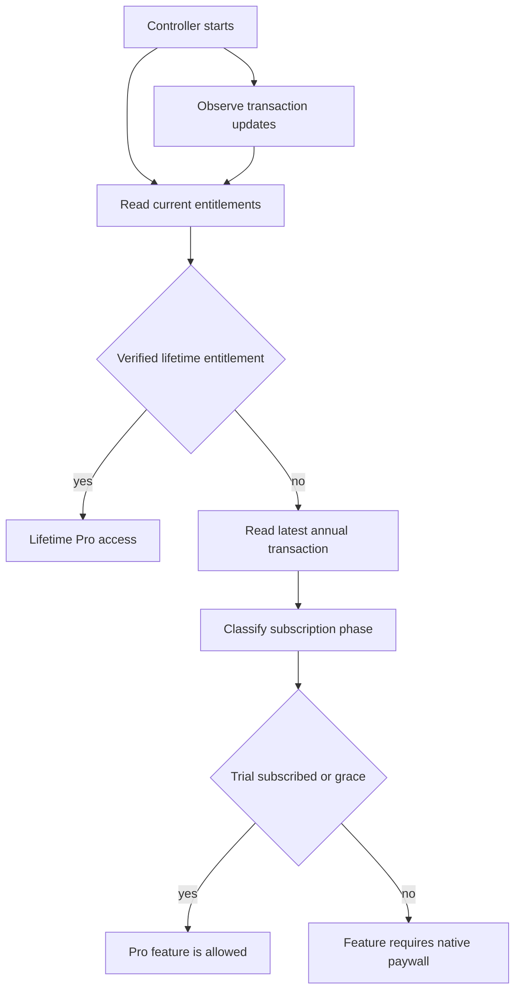

## Scope and ownership

Termind keeps the commercial decision inside the shared infrastructure and domain layers, rather than treating a screen as the source of truth. `ProAccessController` is the observable, main-actor StoreKit adapter used by both app targets; `EntitlementStatus` and `ProFeature` define the shared access contract. Native macOS and iOS views own their respective paywall presentation and subscription-management affordances, while StoreKit supplies localized products, prices, billing periods, eligibility, and purchase outcomes. The checked-in `StoreKit/Termind.storekit` configuration is a local test fixture; App Store Connect remains the production storefront authority.

The two supported products are the family-shareable lifetime non-consumable `com.akinokaede.termind.pro` and the family-shareable annual auto-renewable subscription `com.akinokaede.termind.pro.annual`. The local configuration defines the annual product as yearly with a two-week free introductory offer, but UI must use StoreKit metadata rather than hard-coded storefront price, period, or eligibility.

## Entitlement-derived Pro access

`ProFeature` is the complete gate vocabulary: AI Assistant, terminal-file upload, remote MCP, the built-in MCP server, Vault/iCloud sync, and unlimited Metrics. Callers must use `canUse` to condition state or `require` immediately before the protected action. `require` records the requested feature and raises the shared paywall flag when access is absent, preventing a caller from continuing merely because it can render a control.

This shows the entitlement resolution path used by `ProAccessController`; product metadata loading is separate from access resolution.

Access is based only on verified StoreKit transactions. A valid, non-revoked lifetime entitlement takes precedence over annual status. An annual transaction grants Pro during an introductory trial, active subscription, or verified grace period; billing retry, expiry, revocation, and verification failure do not. Cancellation does not itself remove access before expiry. The controller consumes `Transaction.updates`, including deferred Ask to Buy approval, finishes verified transactions after refresh, and schedules another entitlement check for an access-granting subscription at the earlier of expiration or 60 seconds later. Both app targets also refresh on activation, rather than waiting for a paywall visit. It refreshes independently from product metadata, so a metadata/network failure clears offers and reports a recoverable catalog error without taking away already verified access.

The controller serializes duplicate operations: it prevents a second purchase while processing or pending, tracks the specific pending product, treats user cancellation as non-error, and uses `AppStore.sync()` followed by a refresh for Restore Purchase. A successful verified purchase or restore closes the paywall; a restore without qualifying entitlement reports that no active purchase was found.

### What remains free

The gate set is intentionally narrower than the product’s general remote-workspace experience. Free users can still use the ordinary workspace, SSH/SFTP work, Vault, settings, and the first three Metrics cards. The enforced boundaries are: assistant execution; dropping files onto an SSH terminal; creating/editing/connecting remote MCP servers; enabling or resuming the built-in macOS MCP server; iCloud Vault, Metrics, and Settings synchronization; and Metrics cards beyond three. When Pro sync is unavailable, sync services pause rather than attempting background synchronization; when built-in MCP access is lost, an enabled server is suspended. Local Vault and workspace data are not erased by that transition. On macOS, `TermindApp` installs the live controller outside tests and demo mode; `RootView` reconciles sync and MCP whenever status changes. On iOS, `MobileAppModel` uses the live controller outside in-memory/test setups; active scenes refresh access and `MobileRootView` reconciles sync when Pro access changes. Sync on mobile also requires an active foreground scene, even for Pro users.

### Native paywalls

Both platforms render native SwiftUI commerce views from the same controller, but presentation is platform-owned. macOS uses a shared `ProPaywallPresenter` to elect one main-window sheet owner; iOS presents `MobileProView` as a native sheet and invokes the system subscription-management sheet. Both offer annual/lifetime selection, StoreKit-derived offer details, restore, privacy and terms links, and communicate that Family Sharing is supported and AI-provider charges are separate. On macOS, subscription management uses Apple’s account URL; only a purchaser-owned subscription is eligible for management controls, not family-shared access. `ProOfferPresentation` turns StoreKit price, billing period, free-offer duration, and eligibility into the localized button, badge, and renewal terms: it advertises a trial only when StoreKit reports an eligible free introductory offer, falls back to “Subscribe Annually” if the offer is missing or ineligible, and describes lifetime access without renewal. Both paywalls reload products when opened and disable a plan without an available validated product; the macOS paywall also exposes a price-reload action when either offer is missing.

## Review invitation policy

`AppReviewController` centralizes the cross-platform budget for asking StoreKit to show a review prompt. It persists attempts—not presentations, ratings, or completions, which StoreKit does not reveal—and is deliberately disabled under XCTest. A live controller observes active app surfaces and may arm a request only after an active workspace-to-approved-review-page transition. Mac review pages are selected Vault pages plus Settings and App Settings; mobile additionally enumerates Vault hosts, Keychain, snippets, and known-hosts pages.

Eligibility requires at least seven days since first use, three distinct active local dates, five minutes of foreground workspace time, no prior request for the current app version, and at least 120 days since the prior attempt. After the qualifying transition it waits three seconds, then records the version and attempt timestamp *before* calling `requestReview`. Interactions, navigation, blocked presentation, focus changes, surface removal, or activation of another surface cancel a pending invitation. Presenters also block while onboarding, editors/routes, errors, external authentication, or Pro commerce is active. The explicit “write a review” link records an attempt and restarts cooldown, but does not claim that a rating occurred.

## Localization as a release invariant

User-facing app strings belong in `Frameworks/Resources/Localizable.xcstrings`, which is compiled into every app bundle; bundle metadata belongs in `InfoPlist.xcstrings`. The separate AgentKit runtime owns its own `../AgentKit/Localizations/Localizable.xcstrings`; its catalog must be rebuilt with `../AgentKit/Scripts/build-localizations.sh` after changes because a plain Swift build copies those resources rather than compiling them.

Any new or changed English app string requires completed `zh-Hans` and `zh-Hant` translations in the same commit. Preserve placeholders and Chinese punctuation conventions. `Scripts/check-zh-localization.sh` requires `jq` and rejects invalid catalog JSON, missing locale entries, unfinished string units, and Chinese/Latin or punctuation spacing violations. Run it in the normal commit pipeline even when localization was not intentionally changed; run `AppLanguageTests` when behavior changes. Shared commerce copy includes the annual/lifetime selection, trial and renewal disclosures, status/error messages, and the feature list in both native paywalls; `ProOfferPresentation` localizes interpolated StoreKit values with the chosen app locale. `AppLanguageTests` checks explicit-language Pro offers and both catalogs for finished Chinese string units. Product configuration likewise carries English, Simplified Chinese, and Traditional Chinese names and descriptions, so App Store Connect updates must remain synchronized with the local fixture and the localized product copy.

### Vault labels and locale-sensitive presentation

The shared catalog is also the contract for ordinary native product surfaces, not just Pro copy. On iOS, Vault and Vault search open the Snippets and Known Hosts destinations with an optional initial query. The Known Hosts page distinguishes an empty library (“No Known Hosts”) from a search with no matches, offers “Add Known Host” in the toolbar, and exposes Edit, Copy Fingerprint, and Delete on each card. Its editor chooses “Add Known Host” or “Edit Known Host” according to whether the entry exists. The macOS Known Hosts page uses the same add/edit labels, but its empty state also offers “Import Known Hosts” and describes manual fingerprint entry; bulk deletion uses a count-dependent confirmation and warns that the next connection will require server-key verification again. Keep the platform-specific actions and warnings aligned with their `Localizable.xcstrings` keys rather than assuming the two pages have identical UI.

The iOS Snippets page likewise differentiates an empty library from an unsuccessful search. Its add menu offers “New Snippet” and “New Package”; a package menu also offers “New Subpackage”, while deletion offers either removing the package and its snippets or keeping the snippets. The catalog carries these labels and the package-tree snippet-count message in both Chinese scripts. The known-host and snippet cards render their timestamps using the view's environment locale, so an explicit app language must be checked in the actual view as well as in string lookup tests. Do not translate user-authored hostnames, fingerprints, package paths, snippet titles, or scripts as interface copy.

For focused validation, `AppLanguageTests` asserts explicit-language Pro offers, Chinese catalog completion in both `Localizable` and `InfoPlist`, and distinct Simplified/Traditional lookup; it also checks that assistant token counts use 词元/符元 without applying those terms to security-token labels. `MobileCardTests` checks the known-host editor's add/edit title selection; the opt-in `MobileCardRenderingTests` mounts the real Snippets, Known Hosts, and editor views in a UIKit window for `en`, `zh-Hans`, and `zh-Hant` (light/dark plus a large-type Known Hosts capture). When changing these labels, run the catalog check and language tests, then inspect affected on-device captures in each locale; unit-level catalog completion does not establish that search, menus, dialogs, or layouts still read correctly.

## Mobile Live Activity and widget boundary

The widget extension is an iOS product surface, not a second workspace implementation: `TermindWidgets` exposes only `WorkspaceLiveActivity`. The app serializes all activity start, update, and end operations to avoid close-last/open-new races, retains at most one restored active or stale activity, and ends duplicates. It starts only after an explicit workspace opening intent and `ActivityKit` permits it; ordinary updates cannot resurrect a user-dismissed activity. It ends the activity when no workspaces remain.

The activity payload deliberately excludes credentials and terminal output. It provides aggregate counts and up to six focused-first workspace summaries, truncating titles to fit payload/layout limits. The Lock Screen and Dynamic Island expose deep links for the focused activity or individual visible workspaces; the app accepts only strict `termind://workspaces` and UUID-shaped `termind://workspace/<id>` routes, switching to the list or selected workspace respectively. The widget adapts the session row from six to five or four entries to fit, and supplies an All Workspaces link when summaries are omitted.

## Demo, screenshots, and marketing-site boundary

Screenshot/demo data must not modify production behavior. In DEBUG macOS builds, `ScreenshotDemoConfiguration` parses exactly one `--termind-demo=<scene>:<language>` argument and fails fast on duplicate, malformed, unknown scene, or unsupported language input. It binds the fixture scene and `AppLanguage` together, supporting `en`, `zh-Hans`, and `zh-Hant`; the helper script builds the pinned TFM scheme and launches the app with matching Apple language/locale overrides. Demo content uses isolated in-memory models and bundled fixture hosts, with preconditions when required fixtures are absent.

Marketing capture uses real feature views with fixture-only data: mobile tests mount real views in system windows, while macOS captures the production `WindowGroup` through `ScreenshotDemoConfiguration`. Asset source captures are organized by feature/device/locale; the sanctioned locales are `en`, `zh-hans`, and `zh-hant`. UI chrome and marketing copy are localized, while terminal command and transcript content remains English. A UI change affecting a captured scene must be recaptured in every locale rather than fabricating missing platform UI or changing product behavior for an image.

The public site is a separate Astro app in `LandingPage/`, with strict TypeScript and `npm run build` running `astro check && astro build`. It imports an explicit allowlist of framed marketing images through `src/lib/marketingImages.ts`; do not copy marketing sources into `LandingPage/public`. Its formal routes are English `/`, Simplified Chinese `/zh-hans/`, and Traditional Chinese `/zh-hant/`; compatibility `/zh/` redirects to Simplified Chinese. Website work must validate the production build and visually check English plus Chinese routes. App Store screenshots and storefront metadata remain release artifacts, not runtime app configuration.

## Change and verification guide

- For an access change, update `ProFeature`/callers and `ProAccessController` together; test entitlement phases, verification failures, pending Ask to Buy, restore, and metadata failure separately. `StoreKitTrialTests` exercises the local `SKTestSession` configuration (opt in with `TERMIND_STOREKIT_TESTS=1`, ideally restricting to `TFMTests/StoreKitTrialTests`): it covers trial metadata and restoration, lifetime precedence, cancellation and catalog network errors, pending Ask to Buy approval, unverified transactions, annual purchase without an introductory offer, invalid annual product shape, and empty restore. `CommerceConfigurationTests` catches drift between product identifiers and the fixture.
- Treat local StoreKit testing as insufficient evidence for production: configure and verify App Store Connect metadata and use Sandbox/review environments for storefront prices, subscription lifecycle, restore, Family Sharing, and cross-device behavior.
- For paywall or review work, test both platform presenters and the shared controller’s cancellation, persistence, cooldown, and multi-surface rules. Do not infer a rating or prompt display from an attempt record.
- For text or product-copy changes, complete all three languages, run `Scripts/check-zh-localization.sh`, and run `AppLanguageTests` where applicable.
- For widget/deep-link changes, test bounded payload construction, restoration/duplicate handling, and route validation. For marketing changes, run `npm run build` in `LandingPage/`, preserve real device chrome, and recapture affected locale/platform combinations.
