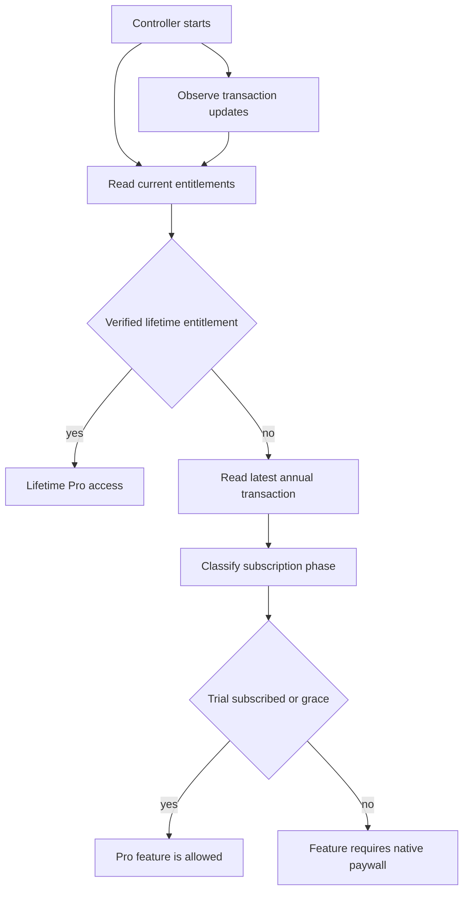
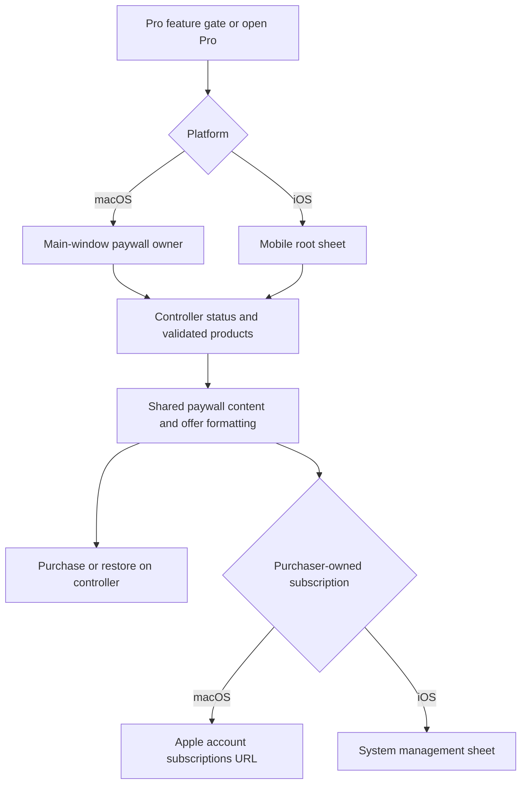

## Scope and ownership

Termind keeps the commercial decision inside the shared infrastructure and domain layers, rather than treating a screen as the source of truth. `ProAccessController` is the observable, main-actor StoreKit adapter used by both app targets; `EntitlementStatus` and `ProFeature` define the shared access contract. Native macOS and iOS views own their respective paywall presentation and subscription-management affordances, while StoreKit supplies localized products, prices, billing periods, eligibility, and purchase outcomes. The checked-in `StoreKit/Termind.storekit` configuration is a local test fixture; App Store Connect remains the production storefront authority.

The two supported products are the family-shareable lifetime non-consumable `com.akinokaede.termind.pro` and the family-shareable annual auto-renewable subscription `com.akinokaede.termind.pro.annual`. The local configuration defines the annual product as yearly with a two-week free introductory offer, but UI must use StoreKit metadata rather than hard-coded storefront price, period, or eligibility.

## Entitlement-derived Pro access

`ProFeature` is the complete gate vocabulary: AI Assistant, terminal-file upload, remote MCP, the built-in MCP server, Vault/iCloud sync, and unlimited Metrics. Callers must use `canUse` to condition state or `require` immediately before the protected action. `require` records the requested feature and raises the shared paywall flag when access is absent, preventing a caller from continuing merely because it can render a control.

This shows the entitlement resolution path used by `ProAccessController`; product metadata loading is separate from access resolution.

Access is based only on verified StoreKit transactions. A valid, non-revoked lifetime entitlement takes precedence over annual status. An annual transaction grants Pro during an introductory trial, active subscription, or verified grace period; billing retry, expiry, revocation, and verification failure do not. Cancellation does not itself remove access before expiry. The timer re-reads StoreKit rather than directly revoking access: if an expired transaction still reports StoreKit state `.subscribed`, the current fallback returns `.subscribed` despite the past expiration date. Do not infer precise loss of access at the deadline from timer scheduling alone; see [Storefront Commerce Release Checks](/openwiki/operations/storefront-commerce-release.md) for boundary validation. The controller consumes `Transaction.updates`, including deferred Ask to Buy approval, and finishes verified transactions after refresh. For an access-granting subscription with a known `expiresAt`, `apply` cancels the previous timer and schedules a refresh for the remaining time until that date (immediately if it is already past); there is **no 60-second periodic cap**. If no expiration is known, no expiration timer is installed, so transaction updates and activation refreshes matter especially for that case. Both app targets refresh on activation rather than waiting for a paywall visit. It refreshes independently from product metadata, so a metadata/network failure clears offers and reports a recoverable catalog error without taking away already verified access.

The controller serializes duplicate operations: it prevents a second purchase while processing or pending, tracks the specific pending product, treats user cancellation as non-error, and uses `AppStore.sync()` followed by a refresh for Restore Purchase. A successful verified purchase or restore closes the paywall; a restore without qualifying entitlement reports that no active purchase was found.

### What remains free

The gate set is intentionally narrower than the product’s general remote-workspace experience. Free users can still use the ordinary workspace, SSH/SFTP work, Vault, settings, and the first three Metrics cards. The enforced boundaries are: assistant execution; dropping files onto an SSH terminal; creating/editing/connecting remote MCP servers; enabling or resuming the built-in macOS MCP server; Pro-dependent Vault, connection-history, device, Metrics, and Settings synchronization; and Metrics cards beyond three. On mobile, the Metrics host picker saves a selected set via `MobileMetricsModel.replaceHosts`, passing the current Pro access into the shared metrics model as a three-card free limit (unlimited for Pro). The core preserves selections outside the picker, checks net additions against remaining slots, and persists the replacement as one operation. A failed save displays `storageError` if present, otherwise opens the unlimited-Metrics paywall. The desktop core receives a live entitlement-dependent card limit and calls `require(.unlimitedMetrics)` on limit rejection. Neither platform needs to delete existing cards when access changes. When Pro sync is unavailable, sync services pause rather than attempting background synchronization; when built-in MCP access is lost, an enabled server is suspended. Local Vault and workspace data are not erased by that transition. On macOS, `TermindApp` installs the live controller outside tests and demo mode; `RootView` reconciles sync and MCP whenever status changes. On iOS, `MobileAppModel` uses the live controller outside in-memory/test setups; active scenes refresh access and `MobileRootView` reconciles sync when Pro access changes. Sync on mobile also requires an active foreground scene, even for Pro users.

### Native paywalls

Both platforms use `ProPaywallContent` for the same status card, feature list, annual/lifetime picker, offer terms, restore, price reload, legal links, Family Sharing disclosure, and separate AI-provider charges. Native wrappers supply platform colors, actions, and a `ProPaywallPresentation` snapshot built from the shared controller. Its `ProAccessPresentation` maps entitlement phase, ownership, expiry, renewal and verification failure to a shared localized label and date meaning; a canceled renewal shows **Access Ends** while the subscription still grants access. Only purchaser-owned subscriptions expose Manage Subscription, not family-shared subscriptions or lifetime access. The content shows the free Metrics limit when that feature triggered the paywall, and chooses the MCP feature label using `supportsMCPServer`: macOS advertises remote tools **and** the built-in MCP server; iOS advertises remote MCP tools only. Processing and errors remain visible even when access already exists, while purchase actions otherwise follow `status.canPurchase`. Missing prices offer reload on **both** platforms; a plan requires its validated product, non-missing price and purchase permission and is disabled during processing.

The common paywall content consumes platform-owned presentation snapshots and delegates commerce actions back to the shared controller.

`ProPaywallPresenter` elects one macOS main-window sheet owner; `MobileRootView` binds the shared paywall flag to `MobileProView` as a native sheet. The macOS wrapper opens Apple’s subscriptions URL; iOS uses `.manageSubscriptionsSheet`. Both reload products on opening, default to annual and switch to lifetime when only that product loads, route annual/lifetime purchase and restore to the controller, and retain platform-owned close affordances. `ProOfferPresentation` formats StoreKit's annual price, billing period and eligible free introductory duration using the view locale and an explicit app-catalog localization callback. It converts `weekOfYear` trial durations into their full day count (for example two weeks becomes 14 days) because `DateComponentsFormatter` does not format StoreKit weeks; singular billing periods use localized year/month/week/day, and composite periods format one full unit. Eligibility chooses “Start Free Trial” versus “Subscribe Annually”; a missing duration suppresses the badge and trial-term detail rather than inventing a duration, even if the eligible title remains. Missing price or billing period suppresses annual detail. Lifetime copy always states one payment without renewal. The controller validates the annual product shape and free introductory offer before reporting eligibility; no hard-coded price or free-trial guarantee should replace these values.

## Review invitation policy

`AppReviewController` centralizes the cross-platform budget for asking StoreKit to show a review prompt. It persists attempts—not presentations, ratings, or completions, which StoreKit does not reveal—and is deliberately disabled under XCTest. A live controller observes active app surfaces and may arm a request only after an active workspace-to-approved-review-page transition. Mac review pages are selected Vault pages plus Settings and App Settings; mobile additionally enumerates Vault hosts, Keychain, snippets, and known-hosts pages.

Eligibility requires at least seven days since first use, three distinct active local dates, five minutes of foreground workspace time, no prior request for the current app version, and at least 120 days since the prior attempt. After the qualifying transition it waits three seconds, then records the version and attempt timestamp *before* calling `requestReview`. Interactions, navigation, blocked presentation, focus changes, surface removal, or activation of another surface cancel a pending invitation. Presenters also block while onboarding, editors/routes, errors, external authentication, or Pro commerce is active. The explicit “write a review” link records an attempt and restarts cooldown, but does not claim that a rating occurred.

## Localization as a release invariant

Define app-facing copy as semantic `LocalizedStringResource` entries in `Frameworks/TermindPresentation/Strings`, **including copy used on only one platform**. `AppStrings` groups navigation, feature and common wording for both TFM and TFI; share an entry for the same meaning and use explicit variants when the platform action or wording differs. Keep protocol values, identifiers, diagnostic codes and user-authored content with their existing owners rather than treating them as translatable UI literals. The `Strings` directory owns definitions and reusable formatting, not a shared native view or a separate resource bundle.

User-facing app strings belong in `Frameworks/Resources/Localizable.xcstrings`, which is compiled into every app bundle; bundle metadata belongs in `Frameworks/Resources/InfoPlist.xcstrings`. **Both app catalogs are manual:** every entry must have `extractionState: "manual"`. Extraction by one target cannot see all shared and platform-specific usages, so a `stale` marker is not evidence that an entry can be removed; search TFM, TFI and shared modules first. Add keys and finished translations explicitly. After any catalog edit run `Scripts/normalize-string-catalogs.py --write` for canonical Xcode ordering and formatting without changing translations; `Scripts/check-zh-localization.sh` runs the read-only `--check` first. The normalizer also rejects duplicate JSON keys before writing a batch, so translations cannot be silently lost during normalization. Do not run `jq -S` or a generic JSON formatter on the catalogs. Keep `STRING_CATALOG_GENERATE_SYMBOLS = NO` so generated names do not compete with `AppStrings`. **AgentKit-owned runtime text is a separate package concern:** the normalizer and default app check cover only the two app catalogs, not `../AgentKit/Localizations/Localizable.xcstrings`; rebuild AgentKit localization with `../AgentKit/Scripts/build-localizations.sh` after its changes because a plain Swift build copies those resources rather than compiling them. The Astro website has a third copy owner and does not consume either catalog.

`AppLanguage` stores the explicit `en`, `zh-Hans`, or `zh-Hant` choice as `AppleLanguages`, removes that override for Follow System, and migrates legacy Simplified Chinese preference tags to `zh-Hans`; unsupported stored tags follow the system rather than being silently rewritten. `AppLocalization` selects the matching main-bundle localization for explicit and system locales (including regional Traditional Chinese) so imperative presentation can use the effective language. An `AppStrings` entry produces a resource on demand; resolve it at the display boundary rather than caching a translated `String` across language changes. SwiftUI can consume the resource directly, or use `swiftUIKey` where an API needs `LocalizedStringKey` (ordinary `String` conversion loses resource localization metadata). Prefer passing the resource directly to APIs with a resource overload, especially `confirmationDialog`, whose UIKit-backed interpolation can otherwise expose locale metadata. For imperative/native menus or count-dependent messages, `AppLocalization.resolve(_:locale:)` selects the requested locale from the app's main-bundle catalog and shared formatting selects appropriate singular/plural resources while preserving literal names and paths. `PresentationCopyTests` exercises English, `zh-Hans`, and `zh-Hant` resolution, nested menus, count messages, accessibility copy and the SwiftUI key bridge.

Any new or changed English app string requires completed `zh-Hans` and `zh-Hant` translations in the same commit. Preserve placeholders and Chinese punctuation conventions. `Scripts/check-zh-localization.sh` requires `jq` and, by default, checks **both app catalogs**, first rejecting noncanonical/manual-extraction drift via the normalizer, then invalid catalog JSON, missing Chinese localizations, unfinished string units, and Chinese/Latin or punctuation spacing violations for translatable entries. It accepts an explicit catalog path for a targeted check; neither mode implicitly checks AgentKit or Astro copy. Run it in the normal commit pipeline even when localization was not intentionally changed; run `AppLanguageTests` when behavior changes. Shared commerce copy includes the annual/lifetime selection, trial and renewal disclosures, status/error messages, and the feature list in both native paywalls; `ProOfferPresentation` localizes interpolated StoreKit values with the chosen app locale. `AppLanguageTests` checks explicit-language Pro offers, preference migration, regional Traditional lookup, token terminology, placeholder ordering and selected plural structures. Catalog-wide completion and manual formatting are enforced by the shell check and normalizer, **not** by `AppLanguageTests`. Product configuration likewise carries English, Simplified Chinese, and Traditional Chinese names and descriptions, so App Store Connect updates must remain synchronized with the local fixture and the localized product copy.

`Scripts/check-appstrings.sh` runs a SwiftSyntax visitor across TFM/TFI and flags selected string literals used as first arguments or named copy arguments in UI APIs, as localized string declarations, or in localized return types. Its detection is deliberately narrower than “all app text”: it excludes macros and only recognizes specified call forms; review new copy ownership and semantic reuse even when the script passes. The script checks that `Strings/AppStrings.swift` exists. `ArchitectureBoundaryTests.presentationCopyHasOneSharedOwner` prevents an app-local `AppStrings` declaration and bans app, AppKit/UIKit, TermindInfrastructure and TermindPersistence imports in the Strings directory. Run the copy check alongside `Scripts/check-zh-localization.sh`; neither replaces language-aware rendering and behavior tests. See [Shared Framework Directory Responsibilities](/openwiki/architecture/shared-module-directories.md) for the ownership map.

### Vault labels and locale-sensitive presentation

The shared catalog is also the contract for ordinary native product surfaces, not just Pro copy. On iOS, Vault and Vault search open the Snippets and Known Hosts destinations with an optional initial query. The Known Hosts page distinguishes an empty library (“No Known Hosts”) from a search with no matches, offers “Add Known Host” in the toolbar, and exposes Edit, Copy Fingerprint, and Delete on each card. Its editor chooses “Add Known Host” or “Edit Known Host” according to whether the entry exists. The macOS Known Hosts page uses the same add/edit labels, but its empty state also offers “Import Known Hosts” and describes manual fingerprint entry; bulk deletion uses a count-dependent confirmation and warns that the next connection will require server-key verification again. Keep the platform-specific actions and warnings aligned with their `Localizable.xcstrings` keys rather than assuming the two pages have identical UI.

The iOS Snippets page likewise differentiates an empty library from an unsuccessful search. Its add menu offers “New Snippet” and “New Package”; a package menu also offers “New Subpackage”, while deletion offers either removing the package and its snippets or keeping the snippets. The catalog carries these labels and the count-dependent package-deletion message in both Chinese scripts; the section header's count is rendered as a locale-formatted number, not a separate package-tree count sentence. The known-host and snippet cards render their timestamps using the view's environment locale, so an explicit app language must be checked in the actual view as well as in string lookup tests. Do not translate user-authored hostnames, fingerprints, package paths, snippet titles, or scripts as interface copy.

For focused validation, `AppLanguageTests` asserts explicit-language Pro offers and distinct Simplified/Traditional lookup; it also checks that assistant token counts use 词元/符元 without applying those terms to security-token labels, that forwarding templates preserve placeholder order, and that selected tool-count resources retain appropriate plural forms. Use `Scripts/check-zh-localization.sh` for full-catalog Chinese completion and normalization across `Localizable` and `InfoPlist`. `FrameworkTests/ProOfferPresentationTests.swift` covers weekly trial conversion across three locales, eligibility, missing duration or price and caller-supplied localization; `FrameworkTests/ProPaywallPresentationTests.swift` checks phase/date labels, family ownership and canceled renewal, unavailable plans, and processing/error visibility. `MobileCardTests` checks the known-host editor's add/edit title selection; the opt-in `MobileCardRenderingTests` mounts the real Snippets, Known Hosts, and editor views in a UIKit window for `en`, `zh-Hans`, and `zh-Hant` (light/dark plus large-type Vault, Metrics, Keychain-editor and empty-state captures). When changing these labels, run the catalog check and language tests, then inspect affected on-device captures in each locale; unit-level catalog completion does not establish that search, menus, dialogs, or layouts still read correctly.

## Mobile Live Activity and widget boundary

The widget extension is an iOS product surface, not a second workspace implementation: `TermindWidgets` exposes only `WorkspaceLiveActivity`. The app serializes all activity start, update, and end operations to avoid close-last/open-new races, retains at most one restored active or stale activity, and ends duplicates. It starts only after an explicit workspace opening intent and `ActivityKit` permits it; ordinary updates cannot resurrect a user-dismissed activity. It ends the activity when no workspaces remain.

The activity payload deliberately excludes credentials and terminal output. It provides aggregate counts and up to six focused-first workspace summaries, truncating titles to fit payload/layout limits. The Lock Screen and Dynamic Island expose deep links for the focused activity or individual visible workspaces; the app accepts only strict `termind://workspaces` and UUID-shaped `termind://workspace/<id>` routes, switching to the list or selected workspace respectively. The widget adapts the session row from six to five or four entries to fit, and supplies an All Workspaces link when summaries are omitted.

## Demo, screenshots, and marketing-site boundary

Screenshot/demo data must not modify production behavior. In DEBUG macOS builds, `ScreenshotDemoConfiguration` parses exactly one `--termind-demo=<scene>:<language>` argument and fails fast on duplicate, malformed, unknown scene, or unsupported language input. It binds the fixture scene and `AppLanguage` together, supporting `en`, `zh-Hans`, and `zh-Hant`; the helper script builds the pinned TFM scheme and launches the app with matching Apple language/locale overrides. Demo content uses isolated in-memory models and bundled fixture hosts, with preconditions when required fixtures are absent.

Marketing capture uses real feature views with fixture-only data: mobile tests mount real views in system windows, while macOS captures the production `WindowGroup` through `ScreenshotDemoConfiguration`. Asset source captures are organized by feature/device/locale; the sanctioned locales are `en`, `zh-hans`, and `zh-hant`. UI chrome and marketing copy are localized, while terminal command and transcript content remains English. A UI change affecting a captured scene must be recaptured in every locale rather than fabricating missing platform UI or changing product behavior for an image.

The public site is a separate Astro app in `LandingPage/`, with strict TypeScript and `npm run build` running `astro check && astro build`. It imports an explicit allowlist of framed marketing images through `src/lib/marketingImages.ts` directly from `Marketing/Screenshots/DeviceFrames`; the production build resizes them and emits AVIF, WebP, and JPEG variants. Do not copy source screenshots or device frames into `LandingPage/public`. Its formal routes are English `/`, Simplified Chinese `/zh-hans/`, and Traditional Chinese `/zh-hant/`; compatibility `/zh/` redirects to Simplified Chinese. Website text does **not** come from the native `.xcstrings` catalog: `LandingPage/src/lib/i18n.ts` selects English or Simplified Chinese copy and converts Chinese to Taiwan Traditional with term overrides. `FAQPage.astro` owns the public free/Pro matrix, BYOK and third-party AI billing explanation, Family Sharing and device-specific MCP disclosure. The homepage also embeds `TelegramOffer.astro`: it describes a separate Thursday Telegram draw for a chance to win a Pro redemption code, linking to the channel, group and entry bot. It says entry is not a guaranteed win and Apple determines redemption eligibility and validity; this campaign is website copy, not an additional StoreKit plan or a guaranteed free trial. When changing entitlement gates, redemption messaging or the native paywall, check that the homepage, FAQ and storefront copy still describe the same offer, then validate the production build and visually check English plus Chinese routes. App Store screenshots and storefront metadata remain release artifacts, not runtime app configuration.

### Public security and privacy copy

The site also serves `/security/` and `/privacy/` in all three site languages; locale-specific routes reuse their respective Astro components through the page wrappers and `BaseLayout`, rather than drawing from the app catalog. `BaseLayout` sets canonical and alternate-language links, exposes localized navigation to FAQ, Security, Privacy and Support, and keeps the visitor's selected site language in browser `localStorage` (`termind.locale`). This choice is independent of the app's `AppleLanguages` setting. The native paywall's Privacy Policy link and the iOS App Settings support section both open the site's English-root `/privacy/` URL; the site language switcher can move to the translated route. The paywall's Terms of Use link instead goes to Apple's standard EULA.

`PrivacyPolicy.astro` owns the public data-handling statement: local device data and optional private iCloud/Keychain sync, StoreKit payment handling, BYOK AI/MCP and Web Search disclosures, remote connections, camera and speech, retention/deletion controls, website storage, and contact paths. In particular, its website section states that the site keeps only the language selection locally and does not use analytics cookies, advertising technology or a contact form; it does not promise that the hosting provider cannot keep standard access/security logs. Its purchase section describes Apple-signed trial eligibility and expiration, not an app-managed license server. `SecurityPage.astro` separately **describes** Apple Keychain credential storage, one-shot clearing of software secret buffers even on failed authentication, first-use and changed-key Known Hosts checks, configurable Assistant permissions, and an opt-in Mac-only loopback MCP server with a local bearer token and exposed-tool switches. The page also warns that an authenticated MCP client can invoke exposed tools without confirmation on every call. This site copy is a disclosure, **not proof of an end-to-end security guarantee**: changes to secret-handling, SSH trust, approval or server transport must be checked against their runtime implementation and tests before strengthening the wording. For example, the desktop `MCPServerController` reads a persisted enable preference, gates startup on Pro, stores its token locally and updates disabled-tool policy; the site itself cannot enforce any of those boundaries. When changing sync scope, credential storage, SSH trust, agent permissions, commerce or network egress, review the corresponding site disclosure alongside the native behavior and FAQ. For site-copy changes, run `cd LandingPage && npm run build` and inspect `/security/` and `/privacy/` in all three languages, especially Traditional conversion and legal terminology; the app catalog check does not validate website copy.

## Change and verification guide

- For an access change, update `ProFeature`/callers and `ProAccessController` together; test entitlement phases, verification failures, pending Ask to Buy, restore, and metadata failure separately. Opt-in `StoreKitTrialTests` covers local trial metadata, purchase and restoration, lifetime precedence, cancellation, catalog errors, Ask to Buy, unverified transactions, missing intro offer, invalid annual shape, and empty restore; `CommerceConfigurationTests` catches drift between product identifiers and the fixture. Neither establishes a timed post-expiry entitlement transition.
- Local StoreKit tests do not establish live storefront behavior or the precise entitlement cutoff when an expired transaction reports `.subscribed`; use the [Storefront Commerce Release Checks](/openwiki/operations/storefront-commerce-release.md) for App Store Connect and Sandbox validation rather than treating the fixture as production configuration.
- For paywall or review work, test both platform presenters and the shared controller’s cancellation, persistence, cooldown, and multi-surface rules. Do not infer a rating or prompt display from an attempt record.
- For text or product-copy changes, define semantic resource entries under `TermindPresentation/Strings` and complete both Chinese translations in the manual catalogs. Run `Scripts/normalize-string-catalogs.py --write` after catalog edits, then `Scripts/check-appstrings.sh` with `Scripts/check-zh-localization.sh`, `PresentationCopyTests`, `AppLanguageTests`, `ProOfferPresentationTests` and `ProPaywallPresentationTests` where applicable; inspect affected native screens in all three app languages and on both platforms as needed.
- For widget/deep-link changes, test bounded payload construction, restoration/duplicate handling, and route validation. For marketing changes, run `npm run build` in `LandingPage/`, preserve real device chrome, and recapture affected locale/platform combinations.
