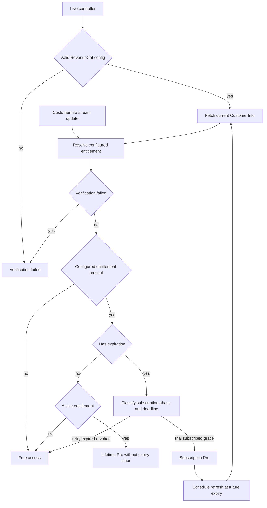
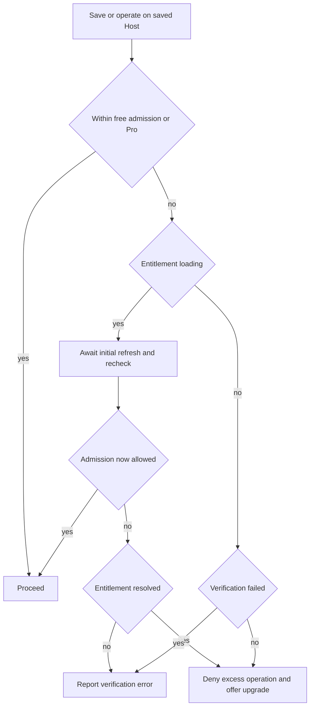
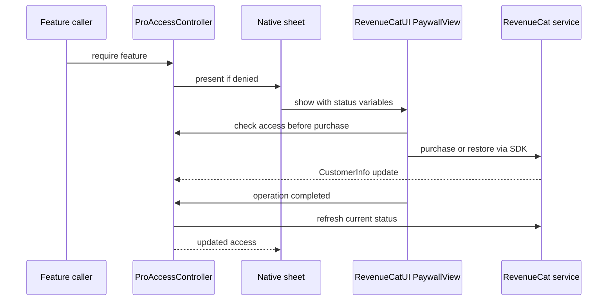
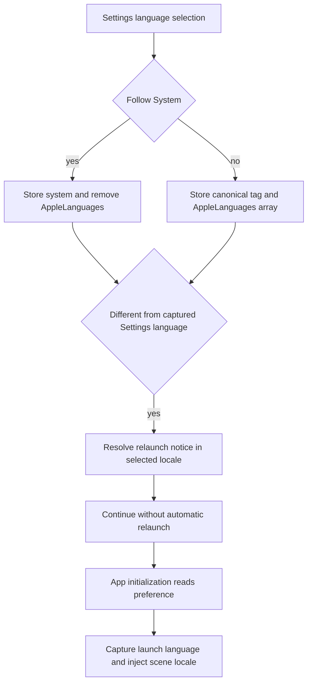

## Commerce ownership and configuration

`ProAccessController` is the shared, observable main-actor access gate. Both production app targets construct it with `live()`; test, in-memory and screenshot setups can use unrestricted test access. Its `ProPurchaseService` is a narrow status-and-update interface, not a StoreKit purchasing API. `live()` builds `RevenueCatProPurchaseService` from the bundled `TermindRevenueCatAPIKey` and `TermindRevenueCatEntitlementID`; an absent or invalid configuration yields `.verificationFailed`, **not** free access through a second StoreKit observer. The configuration trims values, rejects unresolved placeholders and private keys, allows `test_` keys only in DEBUG and expects a public `appl_` production key. The configured entitlement (`termind_pro` in the project settings) is the unlock key: product IDs alone do not grant access. Both apps configure RevenueCat's StoreKit 2 mode with informational entitlement verification, an anonymous app user ID, device-identifier collection disabled and a preferred UI locale from the stored app language. See [Storefront Commerce Release Checks](../operations/storefront-commerce-release.md) for production dashboard and sandbox checks.

`StoreKit/Termind.storekit` is a **local fixture**, not the live storefront or RevenueCat paywall configuration. It contains the family-shareable lifetime non-consumable `com.akinokaede.termind.pro` and yearly family-shareable subscription `com.akinokaede.termind.pro.annual`, the latter with a two-week free introductory offer and English, Simplified Chinese and Traditional Chinese product descriptions. The former `CommerceConfigurationTests` and `StoreKitTrialTests` files are removed. The fixture does **not** run the removed StoreKit entitlement/purchase integration suite or establish actual RevenueCat offerings, eligibility, price, purchase, restore or deadline behavior. Never infer a guaranteed trial or a price for every user from the fixture.

## Entitlement lifecycle and feature boundaries

The RevenueCat service consumes `customerInfoStream` (latest-buffered), and `currentStatus()` requests `customerInfo(fetchPolicy: .fetchCurrent)` to revalidate deadlines rather than trusting a still-fresh SDK cache. On a fetch failure it resolves cached customer info if available; without cache it throws. The controller coalesces concurrent refreshes; a newer streamed update cancels and supersedes an older in-flight refresh so a stale response cannot undo a grant or revocation. An initial failure becomes `.verificationFailed`; a later failure retains the last established status. On a non-test store, if an initial valid status does not grant access, the service attempts `syncPurchases()` once per anonymous app user ID (recording successful migration in defaults) to import pre-integration Apple purchases. This is distinct from an app-managed Restore Purchase button.

This is the access-resolution and refresh path, not a guarantee that a remote paywall offers a particular plan.

`RevenueCatEntitlementResolver` rejects failed CustomerInfo or entitlement verification and ignores entitlements other than the configured ID. An active entitlement without an expiration maps to lifetime purchased access (including family-shared ownership); an inactive one is free. A subscription grants access for an active trial or subscription before its deadline, and for an active billing-issue grace period before the **grace** deadline. Refund maps to revoked; after the deadline a billing issue maps to billing retry and otherwise to expiry. Cancellation disables renewal but does not itself withdraw access before expiration. Unlike the previous StoreKit `.subscribed` fallback, a cached `isActive` flag cannot extend access beyond a past deadline. `apply` cancels its prior expiration timer and schedules a re-fetch at a future granting subscription deadline; no timer is installed without a future deadline. iOS scene activation and macOS app activation also refresh access. A refresh failure without cache can retain an established controller status, so neither a timer nor an offline test proves a server-side revocation was observed.

`ProFeature` now enumerates **Vault sync, unlimited Hosts, Tailscale, SFTP multi-connection acceleration and port-forwarding multi-connection acceleration**. `canUse` reflects current entitlement and fails closed for `.loading`, `.verificationFailed` and `.free`; `require` returns false and presents the shared paywall when denied, without recording a requested feature. This generic feature gate does not await initial resolution or distinguish verification errors; saved-Host admission below does. Assistant execution, remote MCP and the built-in macOS MCP server are no longer independently Pro-gated. Host operations performed through those features still obey saved-Host admission. SSH terminal uploads need a ready session and destination, not a separate Pro upload entitlement.

### Deterministic free Hosts and operation admission

[`HostAccessPolicy`](../../Frameworks/TermindDomain/Hosts/HostAccessPolicy.swift) grants free access to three ordinary saved Hosts. It excludes Tailscale-managed Hosts from this quota (Tailscale has its own entitlement gate), sorts by `createdAt` ascending with undated historical records first, and breaks ties by UUID string. Names, display order and groups do not affect priority. Deleting an unlocked Host promotes the next eligible record; locks are derived locally, never synced. Pro unlocks all ordinary Hosts. Existing over-quota records can still be edited: saving counts distinct **new** ordinary IDs, not updates or duplicate proposals.

Loading and verification failure are not interchangeable with a resolved free account. The first three remain usable, but an excess operation throws `.verifyingEntitlement` or `.entitlementVerificationFailed`; unresolved states deliberately do not paint Host locks. `HostLibraryModel.resolveHostAccess` and `resolveSavingHostsAccess` await the initial refresh only when needed for an excess operation, check cancellation and recheck admission before proceeding. A resolved save quota rejection requests the paywall without manufacturing a storage error; verification failure remains an actionable localized error rather than an upgrade request. Custom identity saves and SSH import batches check quota before their identity/import side effects.

Host admission distinguishes unresolved verification from a resolved quota denial; it is not just a card overlay.

SSH-based connection admission includes the target and jump-host route; Telnet checks only its target, not the Host's independent SSH jump configuration. Prepared configurations carry a `HostOperationAccessCheck` backed by a lock-protected current policy/Host snapshot, so cached configurations do not freeze the entitlement that existed at preparation time. SSH execution, cached Agent connections, SFTP operations and forwarding admission consult these checks. The SFTP wrapper admits each new operation without cancelling a transfer already delegated to its channel. Preserve these runtime checks when adding alternate entrypoints; see [Remote Services and Forwarding](remote-services-and-forwarding.md).

Metrics no longer has an independent three-card cap or `.unlimitedMetrics` gate. The shared model retains selections outside the edited picker, deduplicates additions and persists the replacement in one operation. Collection instead follows Host access: locked Hosts surface a locked monitoring state, and the mobile locked card opens Pro rather than detail. Picker save failures report storage errors, not an automatic unlimited-Metrics paywall.

Status changes update Host policy, reconcile Tailscale and Metrics, and recompute connection acceleration preferences through the controller's app-owned `accessDidChange` callback, without requiring a visible paywall. Losing Vault sync access pauses Vault, connection-history, device, Metrics and Settings sync rather than deleting local data. Both app-owned access-change callbacks reconcile these coordinators directly; mobile sync additionally requires an active foreground scene and is also reconciled on scene activity. The built-in MCP server is not suspended merely because Pro expires.

## Paywall presentation and copy boundary

The native wrappers present **RevenueCatUI `PaywallView`**, not the removed `ProPaywallContent`, `ProPaywallPresentation` or `ProOfferPresentation`. macOS elects one main-window sheet owner through `ProPaywallPresenter`; iOS uses a `MobileRootView` sheet. Both show a localized loading indicator until the initial access status resolves and a localized unavailable/close fallback if RevenueCat cannot be configured. With a service, both pass `ProPaywallState` custom variables to the remote paywall: `pro`, `manage`, `state`, `family`, `dated` and a locale-formatted `date` (empty when unknown). `state` is a protocol value such as `trial`, `renewing`, `ending`, `active`, `grace`, `retry`, `expired`, `revoked`, `lifetime`, `free` or `unverified`, **not** app-visible copy. `manage` is true for purchaser-owned subscriptions, not family-shared subscriptions or lifetime. Renewal cancellation yields `ending` while access can still be active; the remote dashboard owns the visible plan tiles, terms, trial and legal links. Do not claim a locally constructed annual picker, eligibility label, Metrics explanation or platform-specific MCP list. Prices and trial disclosures must be checked in RevenueCat and the storefront, not inferred from obsolete local formatting tests.

The native sheet delegates purchase and restore operations to RevenueCatUI and refreshes controller access on completion.

The platform views refuse purchase initiation if access already exists and refresh access on purchase or restore completion. Purchase progress, cancellation and failure UI belong to RevenueCatUI; the controller has no app-owned `isProcessing` state. Completion **does not close** the paywall: after purchase the first SDK dismissal request is ignored so the account variant can be displayed; subsequent dismissal or the close control dismisses it. `ProPaywallStateTests` covers mapping of subscription phases, ownership, missing date and failed verification; `RevenueCatCommerceTests` covers remote-completion behavior, streamed grants and revocations, racing/coalesced refreshes, deadline resolution, configuration rejection and recovery from fetch errors. The old `ProOfferPresentationTests` and `ProPaywallPresentationTests` are absent. A purchase, Restore Purchase or remote layout is not integration-tested by these unit tests.

## Review invitation lifecycle

The shared main-actor `AppReviewController` owns **device-local invitation state**, not StoreKit prompt attempts or completed ratings. Production app models share one controller across their windows; in-memory models and XCTest live construction disable real invitations. First enabled construction persists first use in `SettingsKey.reviewFirstUse`. Eligibility requires an enabled controller, no saved response, at least one host and **seven elapsed days** (`7 * 86_400`) since first use. Legacy attempt dates, active-day counts and version budgets no longer participate; there is no workspace-minute threshold, delayed automatic prompt or cooldown reset.

The invitation appears above the desktop Hosts cards and in the unfiltered mobile Vault. `AppReviewInvitationVisit.enter` snapshots eligibility on page entry (`onAppear`): crossing seven days or receiving a synced host cannot insert it into an already-open page. Visibility also checks the current shared response, host existence and filtering. Desktop search or selected tags and mobile search hide it without consuming it; deleting the last host also hides it. A later qualifying visit can show it again.

`AppReviewInvitationView` offers a user-initiated App Store link and decline action, with horizontal-to-vertical layout fallback, shared localized copy and accessible action targets. Decline persists `.declined`. Opening `https://apps.apple.com/app/id6805856690?action=write-review` persists `.openedReview` **only when the URL handler accepts it**. Rejection leaves the invitation available. Either response hides all windows immediately and survives relaunch, without any claim that a rating was submitted. The permanent Settings review link uses the same opener independently of invitation visibility.

The presentation boundary is the shared [`AppReviewLink` and `AppReviewInvitationView`](../../Frameworks/TermindPresentation/AppReviewInvitationView.swift), not a platform review presenter or a StoreKit automatic prompt. The button delegates to SwiftUI's environment `openURL`, so acceptance is an OS URL-opening result rather than store feedback. Keep invitation eligibility in the controller/visit pair and URL handling in this presentation adapter when extending either app.

Developer preview is a separate transient path: `setPreviewEnabled` resets `previewResponse`, bypasses age, host, enabled and real-response gates, but still hides while filtering. Preview accept does **not** open an external URL; both actions change only `previewResponse`, never defaults or the real response. Toggling preview resets it, and relaunch does not restore it. [Controller tests](../../FrameworkTests/AppReviewControllerTests.swift) cover seven-day boundaries, clock rollback, persistence, rejected opens, visit snapshots, filtering, cross-window response and preview isolation. [Mobile review tests](../../TFITests/MobileAppReviewTests.swift) check that in-memory models disable invitations and share an injected controller, including preview state. They do not render localized invitations; inspect actual layouts separately.

## App localization

App UI copy, including platform-specific strings and the native paywall **fallback** text, belongs to semantic `LocalizedStringResource` definitions in `Frameworks/TermindPresentation/Strings` and the shared manual `Frameworks/Resources/Localizable.xcstrings`; `InfoPlist.xcstrings` owns bundle metadata. Keep diagnostic codes, protocol values like remote paywall `state`, identifiers and user-authored content outside translated UI copy. RevenueCat's dashboard paywall text and StoreKit product metadata are **separate** copy owners. The app catalogs must have finished `zh-Hans`, `zh-Hant`, `ja`, `ko`, `de` and `fr` units for changed English keys. `Scripts/normalize-string-catalogs.py --write` canonicalizes catalog format and manual extraction without deleting stale keys or changing translations and refuses duplicate JSON keys before writing; `Scripts/check-localization.py` checks both app catalogs by default for normalization, valid JSON, all six non-English translations, positional format arguments, language-specific plurals and spacing. The default check covers only the two shared app catalogs, not dependency-owned runtime catalogs or website copy. `ArchitectureBoundaryTests` guards the shared copy owner and its dependency boundary, and rejects `.swiftUIKey` bridges in alert and confirmation-dialog titles. It does not prove that all UI text is localized; there is no current standalone AppStrings literal checker.

### Catalog and formatting contracts

`AppStrings` is the hand-authored Swift API shared by TFM and TFI; its resources are created on demand and each app compiles the catalog into its main bundle. Keep `STRING_CATALOG_GENERATE_SYMBOLS = NO` rather than generating competing symbols for manual English keys. Every shared catalog entry uses `extractionState: "manual"`. A single target's stale extraction is not evidence of an unused key: check both apps and shared modules before removal.

The available checker is **`python3 Scripts/check-localization.py`**, not `Scripts/check-zh-localization.sh`. [Repository guidelines](../../AGENTS.md) name the current Python checker and require finished Simplified and Traditional Chinese translations in the same commit as changed English copy. Their `jq` prerequisite is stale; the checker uses Python and generic `jq -S` catalog formatting is explicitly prohibited. The Python checker imports the catalog normalizer and defaults to `Localizable.xcstrings` and `InfoPlist.xcstrings`, as does the current [localization CI workflow](../../.github/workflows/localization.yml).

- Entries marked `shouldTranslate: false` are exempt. Otherwise all six supported non-English languages must contain finished, nonempty translation units (an empty key may have an empty value).
- Interpolation must preserve the **position, type and multiplicity** of format arguments, including literal `%%`. Reordered translations need positional specifiers: `%lld on %@` may become `%2$@で%1$lld件`, but changing types or reordering implicit arguments fails. For metadata keys, the English localized value supplies the format contract rather than the key name.
- When English has plural variations, or a translation introduces them, Chinese, Japanese and Korean require exactly `other`; German requires `one` and `other`; French requires `one` and `other` with optional `many`. Selected count resources have English `one` and `other`. Translate every nested unit, not only a top-level string.
- Japanese rejects spaces between Japanese scripts and Latin text, digits or placeholders. Chinese also checks punctuation and spacing around separators when Han text is present. The `Type %@` key-card subtitle has a narrow label/value spacing exception; this is not permission to add arbitrary mixed-script spaces. These restrictions do not apply to Korean word spacing or German/French typography, including French nonbreaking spaces. Runtime tests additionally check Korean dynamic labels that cannot assume a provider name's final consonant.

The [localization workflow](../../.github/workflows/localization.yml) runs `python3 Scripts/check-localization.py` directly on Ubuntu for pull requests and pushes to `main` affecting the shared catalogs, either localization script or the workflow. It no longer runs Python localization or normalizer test suites. The checker compares normalized bytes without writing files. These are structural checks, not translation-quality or visual-layout approval.

### Language selection and launch lifecycle

`AppLanguage` offers Follow System first, then canonical choices sorted by tag: German (`de`), English (`en`), French (`fr`), Japanese (`ja`), Korean (`ko`), Simplified Chinese (`zh-Hans`) and Traditional Chinese (`zh-Hant`). Explicit choices are persisted in `SettingsKey.appLanguage` and as a one-element canonical `AppleLanguages` array. Follow System stores `system` but **removes** `AppleLanguages`, restoring Bundle negotiation rather than writing a system-language array.

Reading a legacy preference migrates only Chinese identifiers whose resolved script is `Hans` (tested examples include `zh`, `zh-CN`, `zh_CN` and regional `zh-Hans` tags). Unsupported preferences, including noncanonical regional Traditional Chinese stored values, return `.system` without rewriting the stored value. This preference migration differs from **catalog lookup**: `AppLocalization` resolves Chinese by script (`Hant` selects `zh-Hant`, otherwise `zh-Hans`), maps regional English, German, French, Japanese and Korean identifiers to `en`, `de`, `fr`, `ja` and `ko` respectively. It loads that main-bundle `.lproj` when available and otherwise falls back to the main bundle. Regional Traditional Chinese locales therefore select the Traditional catalog at lookup time even though noncanonical stored preference tags fall back to Follow System. The Traditional Chinese picker label becomes `正體中文` only for device region `TW` when the Taiwan flag can be displayed; otherwise it remains `繁體中文`.

On desktop, `TermindApp` captures the stored language at initialization and injects its locale into scene content; Settings does not replace that launch-time locale. The picker writes the preference without automatically relaunching. When its selected language differs from the Settings view's captured `launchLanguage`, it shows “The new language will be used after Termind relaunches.” resolved explicitly in the **selected** language (Follow System uses `.autoupdatingCurrent`). Normal UI adopts the new explicit choice on a subsequent launch, not an immediate whole-app language refresh.

The desktop picker persists the next launch's choice while rendering only the notice in the newly selected language.

Resolve resources at display time, rather than caching translated strings across language changes; use the resource directly with SwiftUI APIs that accept it, especially `confirmationDialog`, and `swiftUIKey` only where `LocalizedStringKey` is required. Mobile `operationConfirmation` resolves resources against the view locale before passing verbatim strings to either an anchored SwiftUI confirmation or an injected centered UIKit renderer; an explicit Cancel action remains visible. `PresentationCopyTests` checks menu, count, accessibility and bridge resolution; current `AppLanguageTests` tests unknown-preference fallback, Simplified Chinese preference migration, the region/flag-dependent Traditional Chinese name, Korean dynamic labels, localized demo conversations, and Host-access error presentation. **It no longer tests explicit-language Pro offer copy.** Full catalog completion is the Python check, not these tests.

### Library cards and compact mobile surfaces

Ordinary product labels illustrate the split: iOS Vault search opens Snippets and Known Hosts, whose pages distinguish an empty collection from empty search results. Known Hosts offers add/edit/copy-fingerprint/delete and an editor title that changes with the entry; the macOS empty state additionally offers import or manual add and deletion warns that trust will need verifying on the next connection, with count-sensitive confirmation. Snippets has new snippet/package/subpackage actions and a keep-or-remove-snippets package deletion choice. Shared `SnippetCardContent` supplies colored icons, valid SSH-target counts, risk chips and relative timestamps to both apps, while each owns the surrounding surface and actions. `SnippetTimestamp` supplies a stable local fallback for legacy baseline dates. Card timestamps use the view locale; hostnames, fingerprints, paths and scripts remain user content. `MobileCardTests` checks add/edit titles, tag bounds and connection timestamps; `MobileCompactCardTests` checks compact-card warnings, snippet risk labels and the Compact setting's translations. These behavioral tests do not establish multilingual visual approval. Inspect actual views as well as catalogs after UI changes.

On mobile, the persisted `mobile.compactCards` preference selects reduced card content for Hosts, Known Hosts and Snippets; it does not change the underlying records or per-card actions. Standard host cards show the supplied login address, at most two tags and a locale-formatted last-connection timestamp (or “Never”); compact host cards use the title, icon and status instead. Standard Known Hosts cards show the algorithm and localized added-at time, while compact cards retain the title/icon. Tests cover the two-tag bound, recording SSH/SFTP opens for host timestamps, and add/edit Known Host titles. Review both density modes rather than assuming shared Snippet content is rendered in compact mode. See [Mobile UI](../architecture/mobile-ui.md).

## Other product surfaces and public disclosures

`TermindWidgets` contains only a workspace Live Activity, not another workspace engine. The app serializes starts, updates and ends, restores at most one active/stale activity and ends duplicates before updating. Ordinary updates cannot resurrect a dismissed activity; a new explicit workspace-open intent can start one when the app can request it. **The local workspace snapshot is authoritative, not the system activity's recovery payload.** After a successful load, saved descriptors publish disconnected summaries even before live workspaces are constructed; orphaned system entries are dropped, and an empty authoritative snapshot ends the activity. A failed snapshot read does not authorize updating or ending system cards, including duplicates.

The payload excludes credentials and terminal output, but can carry a versioned host/kind recovery descriptor and an opaque encoded `RemoteSessionReference`. Snapshots order the focused session first (falling back to the last session), cap summaries at six, truncate titles and drop whole trailing entries until the encoded state fits 3,500 bytes. Do not truncate identity/reference data to meet the budget. Generated links address `termind://workspaces` or a UUID workspace without recovery queries. The parser still accepts exactly `v=1`, a host UUID and `kind` (`ssh`, `mosh`, `eternalTerminal`, `sftp` or `telnet`) on legacy workspace links, but the scene uses only the workspace ID to find its local owner. The remote-session reference stays out of URLs, and extra query parameters are rejected. Missing local ownership shows an unavailable workspace rather than rebuilding it from the link or system card. An existing owner in another scene is activated; a local saved descriptor can construct a workspace only while its host and protocol remain usable. SSH restoration can retain its remote-session attachment without forcing selection; resumable transports are marked as requiring transport recovery rather than silently recreating a session. [Restoration tests](../../TFITests/MobileLiveActivityRestorationTests.swift) cover cold launch without connecting, authoritative removal of orphaned entries, failed snapshot reads, duplicate cleanup, dismissal, explicit close and close/open races; [payload tests](../../TFITests/MobileWorkspaceStoreTests.swift) cover whole-entry budgeting and link rejection.

DEBUG macOS `ScreenshotDemoConfiguration` binds one validated scene to `en`, `zh-Hans`, `zh-Hant`, `ja`, `ko`, `de` or `fr` and isolated fixtures; mobile captures mount real views. Recapture affected scenes in all locales using actual platform UI rather than changing production logic for screenshots. See [Marketing Assets and App Icons](../operations/marketing-assets-and-app-icons.md).

### Website evidence boundary

[Repository guidelines](../../AGENTS.md) identify `com.akinokaede.termind/` as the independently maintained public website and assets submodule, with an Astro project at its root; [.gitmodules](../../.gitmodules) records its external repository. Native builds do not require that checkout. For website or asset work, initialize it with `git submodule update --init com.akinokaede.termind` and inspect the checked-out source before making claims about the site.

**The submodule directory is empty in this checkout.** This repair therefore does not verify current homepage composition, FAQ wording, promotions or redemption offers, public prices, privacy/security disclosures, locale routes or fallback behavior, browser language storage, canonical links, or the screenshot/image optimization pipeline. Previous descriptions of those surfaces are not evidence of the current public site. Native entitlement configuration and tests establish app behavior, not website promises.

Once source is available, follow the documented website workflow (`cd com.akinokaede.termind && npm ci && npm run build`) and inspect the actual routes, translations, images and disclosures. The workflow is documented in the parent repository; the submodule's build scripts and output have not been inspected here. Verify the deployed public site separately when assessing what users currently see. Do not infer website language behavior from `AppLanguage`, or legal disclosures from SDK configuration. Any privacy/EULA links and visible legal copy in the remote native paywall must also be checked in RevenueCat rather than inferred from the native wrappers.

## Focused change checklist

- Native entitlement policy and gates: update resolver, feature gates and app reconciliation together; run `RevenueCatCommerceTests`, `ProPaywallStateTests`, `ProAccessTests`, Metrics tests, `HostAccessTests` and platform-specific gate tests. Preserve deterministic Host ordering, pre-mutation quota checks, jump-host admission and current-policy checks in cached connections. Check live entitlement configuration and account migration separately from the local StoreKit metadata fixture. [RevenueCat configuration](../../Frameworks/TermindInfrastructure/Commerce/RevenueCatConfiguration.swift) and [service configuration](../../Frameworks/TermindInfrastructure/Commerce/RevenueCatProPurchaseService.swift) explain the native SDK boundary, not public-site promises.
- RevenueCat dashboard-owned paywalls and legal copy: inspect the remote layouts, visibility rules, translations, offer terms and legal destinations independently. Compare them with the native [paywall variable contract](../../Frameworks/TermindPresentation/ProPaywallState.swift), [mobile wrapper](../../TFI/Features/Commerce/MobileProView.swift), [desktop wrapper](../../TFM/Features/Commerce/ProPaywallView.swift) and [state tests](../../FrameworkTests/ProPaywallStateTests.swift). These tests verify status mapping, not remote wording or live purchases.
- Apple storefront metadata: verify live product availability, localized descriptions, prices, introductory-offer eligibility, Family Sharing and purchase/restore behavior in App Store Connect and Sandbox. Neither website prices nor the local fixture establish the offer a particular user receives. See [Storefront Commerce Release Checks](../operations/storefront-commerce-release.md).
- Review invitations: run `AppReviewControllerTests` and `MobileAppReviewTests`; preserve elapsed-time and entry-snapshot semantics, shared-window response invalidation, rejected-open behavior and preview isolation. Inspect invitation layouts separately; the mobile review suite tests injection, not localized rendering.
- Mobile cards and Live Activity: check both card densities and run `MobileCardTests`, `MobileCompactCardTests`, `MobileLiveActivityRestorationTests` and `MobileWorkspaceStoreTests`. Keep recovery references out of URLs and preserve whole-entry payload budgeting.
- App catalogs: run `python3 Scripts/normalize-string-catalogs.py --write` after app catalog edits, `python3 Scripts/check-localization.py`, `ArchitectureBoundaryTests`, `PresentationCopyTests` and `AppLanguageTests`; review actual screens separately. See [Behavioral Boundaries and Fixtures](../testing/behavioral-boundaries-and-fixtures.md) and [Build, Test, and Release](../operations/build-test-and-release.md). Language preferences and sync ownership are discussed in [Settings and Cloud Sync](../workflows/settings-and-cloud-sync.md); visual copy checks complement [UI Design Principles](ui-design-principles.md).
- Independently authored website claims: obtain the website source and inspect the deployed site before comparing its FAQ, offers, prices, privacy/security disclosures and localized routes with native entitlement and sync behavior. Build and visually check the routes actually present in that checkout. Keep unavailable content explicitly unverified; native string tests and RevenueCat state tests do not validate it.
