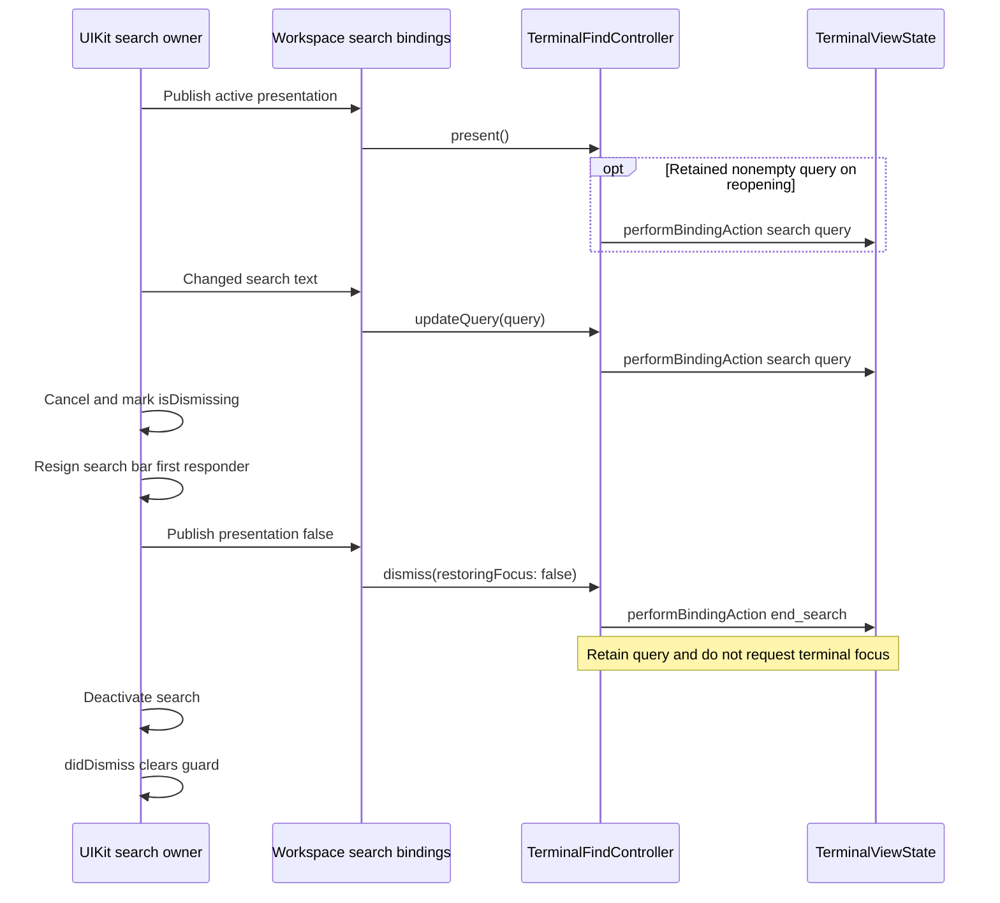
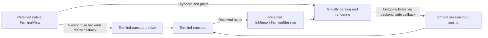

# Ghostty Terminal Integration

Termind uses the remote `libghostty-spm` package for terminal parsing, rendering and native input. SSH, Telnet and desktop serial transports remain Termind-owned. Each terminal supplies Ghostty's `InMemoryTerminalSession` with received bytes, outgoing writes and resize callbacks; a `TerminalViewState` and native view live with the session or workspace rather than with a transient SwiftUI mount. This preserves the grid, selection and scrollback across navigation and desktop pane moves.

The package is consumed directly from `https://github.com/Lakr233/libghostty-spm.git`, with no local Ghostty maintenance submodule. Xcode's package reference uses `upToNextMinorVersion` with `minimumVersion = 2.2.2026101301`; this is a compatible-version requirement, not an exact-version requirement. `Package.resolved` currently pins version `2.2.2026101301` at revision `d403978c66870baa422709d1dde385730a4bdaef`. Treat the requirement and resolved pin as separate parts of the embedding contract. See [Ghostty Dependency Updates](../operations/ghostty-fork-maintenance.md) for dependency-update procedures and requirement/resolution alignment.

## Shared Find lifecycle and native dismissal

`TerminalFindController` owns query and presentation state separately from the terminal surface. Its host-provided `perform` closure sends Ghostty binding actions, while `focus` requests terminal focus. On mobile these closures call `TerminalViewState.performBindingAction` and `requestFocus`; the retained surface is bound to the workspace's Find controller. Find is a local terminal operation, not text submitted to the remote shell.

- When not resize-suspended, a changed query emits `search:<query>`, including `search:` for an empty query, without changing presentation. Repeating the same query is a no-op.
- Transitioning from closed to presented reissues the retained nonempty query unless resize-suspended. Repeated `present()` calls while already open do not restart it.
- Navigation emits `navigate_search:previous` or `navigate_search:next` only while presented with a nonempty query and not resize-suspended. `presentAndNavigate` opens first. The app maps Find Next to `.previous`, toward older output, because the search starts at the bottom of the buffer.
- `dismiss(restoringFocus: Bool = true)` emits `end_search`, closes presentation and retains the query. It is idempotent while closed. The default then invokes the focus closure; `restoringFocus: false` ends the search without requesting terminal focus.

### Resize coordination does not close Find

`MobileTerminalView.layoutSubviews` suspends engine search before forwarding changed bounds to Ghostty, preventing search from interfering with blank-row trimming. The controller ends an active search while retaining query/presentation and suppresses search/navigation during suspension. Each size change cancels and replaces the native delayed resume task; it waits for the configured resize throttle plus 0.1 seconds. Resume searches the latest query only if Find is still presented and nonempty. Closing while resize is settling therefore cannot reopen search.

### Mobile UIKit owns search presentation

For SSH and Telnet, `MobileWorkspaceSearchModifier` binds the native search text to `workspace.find.query` and presentation to `workspace.find.isPresented`. Its **false presentation setter** calls `dismiss(restoringFocus: false)`: native cancellation must not request terminal focus during UIKit's responder transition. Submit navigates `.previous`. SFTP uses the same toolbar UI but binds its channel filter instead of Ghostty Find, with no terminal presentation binding.

`mobileToolbarSearch` embeds a `UIViewControllerRepresentable` whose `MobileToolbarSearchController` retains a `UISearchController` and installs it on the enclosing navigation owner's `navigationItem`. UIKit owns activation, first-responder changes and dismissal—not SwiftUI `searchable` focus. Configuration defers synchronization to the main queue so delegate callbacks do not publish model changes during a SwiftUI update. The search bar uses integrated-button placement on iOS 26+, inline placement otherwise.

Cancellation marks `isDismissing`, resigns the search bar, publishes false and deactivates search. `willDismissSearchController` also publishes false; `didDismissSearchController` releases the guard. While dismissing, synchronization cannot reactivate search and text/submit callbacks are ignored, protecting the retained query from dismissal-time changes. Teardown removes the owned search controller and restores the navigation owner's previous presentation-context setting.

The mobile binding ends Ghostty search while leaving native keyboard dismissal to UIKit.

This is a **native dismissal exception**, not a universal focus-policy change. Mobile terminal Escape and Shift-Escape still call default `dismiss()` while Find is presented; otherwise ordinary Escape remains Ghostty input. F3 opens/navigates `.previous`, and Shift-F3 `.next`. Desktop toolbar cancel closures for SSH and serial, and active-workspace Escape shortcuts, also still call default `dismiss()`. Desktop SSH, Telnet and serial Find controllers retain terminal-focus closures. Do not change that default to fix a UIKit cancellation problem. See [Desktop UI](../architecture/desktop-ui.md) and [Mobile UI](../architecture/mobile-ui.md) for platform chrome ownership.

## Native menu ownership

Ghostty defines the platform menu entry points and baseline terminal actions. Termind extends the native view subclass because it owns app commands, localization and SSH upload policy. The two platforms expose different seams:

| Surface | Package entry point used by the app | Termind extension |
| --- | --- | --- |
| iOS touch, no selected text | `touchMenuItems(for: TerminalTouchMenuContext)` | `MobileTerminalView` localizes the inherited actions and appends a grouped Upload File menu. |
| iOS touch, selected text | `touchSelectionMenuItems(for: TerminalTouchSelectionMenuContext)` | The separate override applies the same localization and upload composition. |
| macOS secondary click | `selectionMenuPoint(at:)` and `selectionContextMenu()` | `TermindTerminalView` permits a menu without selection and composes Copy, Paste, Select All and conditional Upload File. |

### iPhone and iPad touch menus

`MobileTerminalSurface` retains one `MobileTerminalView`. Both app overrides call their matching superclass hook and pass its results through the same customization function. The app tests directly exercise both contexts (including `selectedText` in the selection context), with and without pasteboard text: they expect Copy only in the selected case, Select only in the unselected case, optional Paste, and Select All in both. This is app/test-proven hook composition, not verification of package gesture dispatch.

`MobileTerminalView` maps Ghostty's stable action identifiers (`terminal.copy`, `.paste`, `.select`, `.selectAll`) to shared `AppStrings` resources. It preserves the package handlers, places editing actions in a medium-sized inline group, and places localized Upload File actions in a separate inline group before other inherited items. Tests supply a system AutoFill menu and assert it remains after the upload group; they do not establish when UIKit supplies it.

`MobileWorkspace.configureTerminalUpload` installs handlers only for SSH workspaces. The submenu is absent when no file-upload handler is bound, and both child actions are disabled when the live workspace cannot upload. Each handler checks availability again when invoked, so an earlier visible menu cannot submit an upload after the connection or destination becomes unavailable. `uploadTargetProblem` is the workspace's connection, transfer-configuration and working-directory gate; the shell must report a usable directory through OSC 7. This upload is available without a Pro entitlement. See [Shell Integration](shell-integration.md) for working-directory reporting.

**Package evidence boundary:** this page derives the app contract from Termind's overrides and tests, not an audit of package internals. The repository records the direct upstream remote package pin, and the host overrides/tests establish the touch-hook contract used by Termind. They do not establish the package's long-press or tap gestures, internal selection dispatch, clipboard implementation, indirect-pointer menu routing, or older-OS menu fallback. In particular, do not infer whether the touch Upload File submenu appears in an indirect-pointer menu. Inspect the pinned package source and test the targeted interaction before changing those behaviors. Group titles, localization and upload authorization belong in the Termind subclass; package interaction internals remain a separate maintenance boundary.

### macOS secondary-click menu

`TermindTerminalView.selectionMenuPoint(at:)` allows the default menu even on blank terminal space, while captured remote mouse mode suppresses the host menu. Its `selectionContextMenu()` uses Ghostty's Copy item only when Ghostty reports a selection, localizes that title, then adds Paste and Select All. Paste is disabled without pasteable text or file URLs and takes Ghostty's `paste_from_clipboard` binding. Upload File appears only while a pane has bound an upload action; its enabled state reads the current visibility and upload-target problem, and the action checks that gate again before invoking the file picker.

Desktop's **Paste on Right Click** preference changes the gesture: an ordinary secondary click pastes and does not open the menu, while Option-secondary-click still opens it. Remote mouse capture remains Ghostty-owned. The session's `PersistentTerminalViewOwner` binds upload actions with an ID; updates or teardown from an old pane cannot disable or remove the menu installed by a replacement pane. On disappearance the current pane unbinds its ID. The menu therefore follows the presenting pane even when SwiftUI reparents the same native terminal.

The desktop menu also offers **Open with SFTP** in the current or a new workspace when the SSH pane binds a companion action. Menu construction and dispatch both check current availability. Its binding uses a separate identity token, so stale pane teardown cannot remove a replacement binding. WindowModel resolves the source by session ID and requires a live session, known working directory and saved host, rather than relying on current focus. When the SSH session supplies a directory-context ticket, dispatch first confirms it asynchronously, then re-resolves the source and checks that the path, workspace and ticket remain current before opening SFTP. A failed confirmation or changed context does not open a companion.

## Surface and appearance flow

Desktop `PersistentTerminalViewOwner` creates the in-memory backend, `TerminalViewState` and `TermindTerminalView` once, then mounts the same view in a changing `NSViewRepresentable` container. Mobile `MobileWorkspace` likewise creates a backend and state once and returns its retained `MobileTerminalSurface` view through `makePlatformView`. Both pass remote output into the backend and route keyboard/paste output to their transport. Do not reset surface options on an ordinary view update: replacing the controller or backend can tear down the live surface.

Mobile keeps `TerminalSurfaceView` mounted beneath the connection-journey overlay for terminal workspaces, hiding it and disabling interaction rather than replacing it. The search modifier stays on workspace chrome outside that content branch, so a connection journey does not replace the search owner. These are lifecycle responsibilities, distinct from menu composition or upload authorization.

### Reparenting and keyboard focus

On desktop, mount ordinals prevent a late update from an older SwiftUI container from stealing the native view back from its newer destination. Dismantling uses the coordinator's original owner, and unmounting checks both the current container and native superview; an old teardown cannot detach a surface already moved elsewhere. Visibility changes update both state and native surface visibility without reconstructing the backend.

Focus is not synonymous with visibility: several split panes can render, but only the requested visible terminal should receive keyboard focus. Ordinary desktop mount updates leave the responder chain alone unless the request changes or the view is reparented. Unforced focus acquisition protects an active text field or field editor, including the deferred post-mount path. Explicit `requestFocus()` is the intentional hand-back and may take focus from a field. Desktop Find bindings also restore an active field editor and its selection synchronously if Ghostty takes first responder while handling the action.

Mobile's `MobileTerminalInitialFocus` requests focus on appearance or readiness changes, not every SwiftUI update. Readiness requires a visible workspace, active scene, connected transport and no connection journey. This initial-focus policy is separate from explicit Find dismissal focus restoration.

The retained surface bridges terminal bytes and geometry to host-owned transport callbacks, not to remote session lifetime management.

Keeping a local surface alive does not itself keep an SSH connection or managed remote shell alive. Connection coordination, shell context and remote-session selection remain separate host responsibilities; see [SSH Session Lifecycle](../workflows/ssh-session-lifecycle.md) and [Shell Integration](shell-integration.md).

Shared Presentation maps Termind palettes and the Ghostty theme catalog into light/dark terminal configurations. It applies the chosen base, optional custom commands and then device-local font overrides; app command notifications force Ghostty's `notify-on-command-finish` to `never` so the Termind notification coordinator owns delivery. The former app-owned keyword-highlighting feature and its shared modifier/rule model were retired. V52 removes the historical preference model, startup preparation retires its pending uploads and incoming legacy highlighting records are ignored without replacing other settings. This is an app migration/compatibility contract, not a claim about all upstream Ghostty configuration capabilities.

## Focused checks

- [TerminalFindControllerTests](../../FrameworkTests/TerminalFindControllerTests.swift) covers binding order, retained-query restart, empty-query navigation, default focus restoration and repeated native dismissal without focus.
- [MobileTerminalSearchTests](../../TFITests/MobileTerminalSearchTests.swift) uses a real UIWindow and UISearchController, gated by `TERMIND_MOBILE_UI_TESTS=1`. It covers repeated native, terminal-then-native and programmatic dismissal, retained queries/filters, and search-controller/native-terminal identity across connection journeys. Its full-workspace SSH fixture also checks unchanged native surface, output and connection generation through repeated reopening with empty, matching and missing queries.
- [MobileShortcutTests](../../TFITests/MobileShortcutTests.swift) covers F3 direction and Escape returning to Ghostty when Find is closed. [TerminalFindTests](../../TFMTests/TerminalFindTests.swift) covers desktop retained query and binding syntax.
- `TFMTests/TerminalContextMenuTests.swift` covers blank-space Paste/Select All, conditional Copy, right-click-paste with Option bypass, live Upload File availability and stale pane-binding teardown.
- [MobileTerminalUploadMenuTests](../../TFITests/MobileTerminalUploadMenuTests.swift) checks both touch contexts, pasteboard-dependent action expectations, editing/upload/system group ordering, absent handlers and enabled/disabled children. Package gesture mechanics require the pinned upstream package's own source and tests; they were not inspected as part of this host-adapter update.
- `FrameworkTests/RetiredTerminalHighlightingTests.swift` opens V46/V51 stores, checks cleanup after upgrading/reopening, retires pending uploads and verifies malformed legacy records do not disrupt other settings. The old highlighting/rendering suites were removed. Use resolved-only Xcode builds and test both host adapters after changing the upstream dependency; no Termind fork release is required.

For upload destination and drop behavior, continue with [File Drag and Drop](../workflows/file-drag-and-drop.md). For theme browser and settings ownership, see [UI Design and Shared Presentation](ui-design-principles.md). For test scope, see [Behavioral Boundaries and Fixtures](../testing/behavioral-boundaries-and-fixtures.md).
