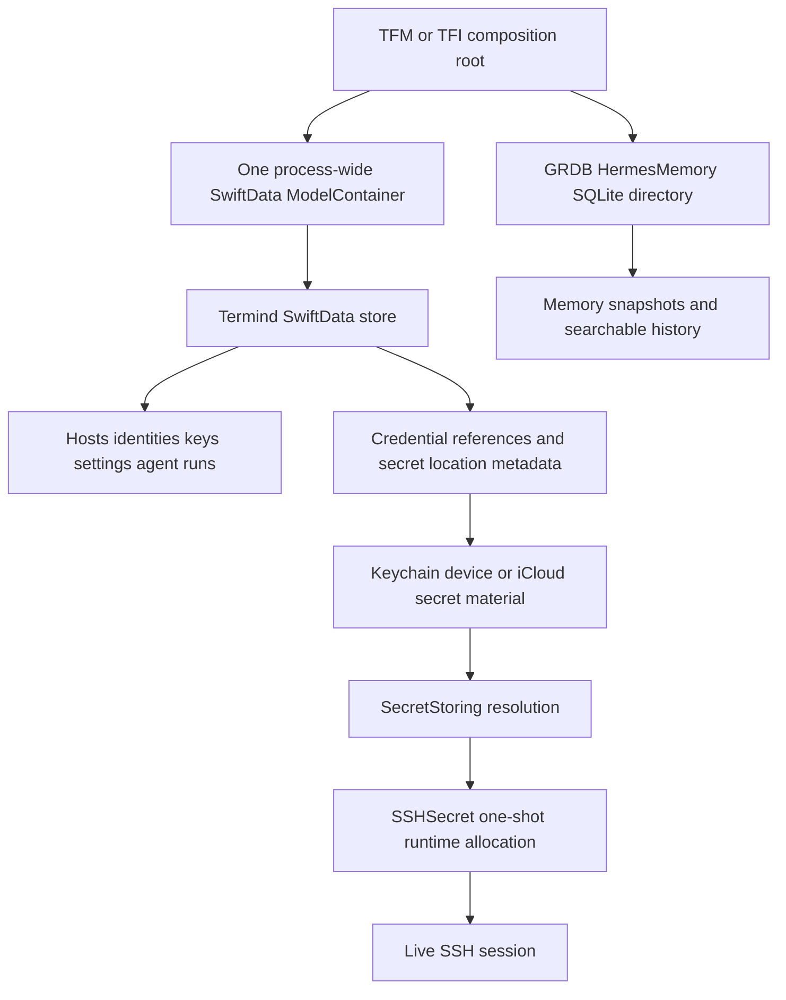

# Persistent Data, Migrations, and Secret Boundaries

Termind separates durable *metadata* from secret material and live connection state. `TermindPersistence` is the sole owner of SwiftData models, schema history, migrations, and container construction; application and platform layers select the store location and inject contexts into repositories. Credentials are represented durably by non-secret references and storage provenance, resolved only through `SecretStoring`, and converted to wipeable runtime objects only for a physical SSH connection attempt.

This is a safety boundary, not merely a storage abstraction: plaintext credentials must never enter logs, sync payloads, `UserDefaults`, or ordinary persistence. Runtime authentication state is also excluded from domain records and restoration. See [System Boundaries and Dependency Ownership](../architecture/system-boundaries.md) for the framework ownership rules and [Assistant, Agent Runtime, Skills, and Memory](agent-runtime-and-assistant.md) for assistant-specific durable data.

This diagram distinguishes durable SwiftData and GRDB records from Keychain material and session-only secret allocations.

## Store ownership and startup

`TermindPersistence.makeContainer(inMemory:url:)` is the single SwiftData entry point. It exposes the complete `TermindSchemaV34` schema, attaches `TermindMigrationPlan`, disables SwiftData CloudKit integration for this store, and rejects the invalid combination of an in-memory store and a file URL. Both apps retain one container for the process and construct separate `ModelContext` instances where independent repository contexts are needed; they do not assemble a partial schema per feature or scene.

The desktop root makes container opening part of initialization and uses a `KeychainSecretStore` for live composition. The mobile root creates its Application Support parent before opening `Termind.store`, or chooses an in-memory container and `InMemorySecretStore` for test/injected configurations. Store-open errors propagate out of these composition paths rather than being silently replaced with a new empty database: data availability is an explicit startup failure condition.

### Repository projections and atomic mutation

SwiftData rows are persistence representations, not the feature API. `SwiftDataHostRepository` projects `PersistentHost` and `PersistentHostGroup` into `HostLibrarySnapshot` values and publishes revisioned `AsyncStream` changes. Host upserts update or insert the row, then use one commit path that advances a database revision, records Vault mutation information, saves, and only then publishes the mutation. On failure it rolls the `ModelContext` back.

Deletion is a durable saga, not an immediate blind removal: `requestHostDeletion` atomically writes a pending-deletion marker, outbox jobs, and the revision. The snapshot hides marked hosts. Later steps remove dependent jump/snippet/history/forwarding references and finally remove host-owned identities, the host, and the marker. This lets a crash expose either the live host or a complete, resumable deletion intent rather than a partial state.

Agent conversations use a separate SwiftData repository with similarly deliberate projections. `SwiftDataAgentRunRepository` stores run snapshots, messages, context/replay backing, tool invocations/results, reviews, compactions, and ordering. It deduplicates replayed earlier turns by message ID, sanitizes persisted text and tool-call JSON, and marks nonterminal runs interrupted when the repository is initialized. Loading orders transcript rows by run and sequence, then restores recorded tool results that were committed before the next transcript snapshot.

### Assistant history edits: one message boundary, one transaction

Restore and truncation share a canonical ordering: runs by `startedAt` then UUID; messages by that run order, then `sequence`, `createdAt`, role rank and UUID. Timestamps alone do not identify the cutoff. `truncateConversation` checks cancellation and validates an ordinary user replacement with a fresh ID that collides with neither a stored message nor a run before mutation. It removes the selected user message and the ordered suffix, including whole later runs. When the target run still has a prefix, that run and its retained messages survive: the summary becomes neutral `.completed`, clears its previous failure and ends at the last retained non-tool message. Editing its opening removes the target run only when no prefix remains.

Graph cleanup follows the same boundary. Removed messages lose their replay and context-attachment backing. Within a partially retained run, invocation source-message ownership takes priority, followed by call identity in retained/removed transcript rows; only unrecoverable ownership uses the conservative `createdAt >= target.createdAt` fallback. This covers both legacy rows and modern provider-native events persisted before their source-message snapshot. Results and reviews follow the deleted invocation IDs. Compactions are deleted only if their explicit boundary is among the removed message IDs, so retained-prefix records and nil-boundary fork bases survive. The generated title is cleared only when the opening user turn is removed. On load, raw run-local assistant calls supply missing legacy source IDs, and reconstructed deterministic tool-result messages receive run ownership before compaction projection; this lets the live model preserve the same graph through compacted history.

The replacement is inserted with its replay/attachment backing into a standalone, failure-free `.completed` staging run whose ID equals the replacement message ID. Staging must sort after the latest retained run, including an empty run: when the replacement timestamp ties or precedes that run's start, its run start becomes the retained start plus one millisecond. The message's own timestamp is not rewritten.

The first real snapshot whose final ordinary user turn is this staged replacement adopts it in the same `save` transaction. The staging predicate requires the same conversation, the same-ID user row, a completed run without failure, exactly one message and no invocation/result/review graph. Adoption changes only the staged row's run ID and snapshot sequence, retains its backing, deletes the staging run and retires the staging ID. Other historical rows included in replay remain attached to their original runs. The real run inherits at least the staging start time; later saves preserve that lower bound and clamp `finishedAt` when necessary. Failed and interrupted first snapshots use this same path, not a separate copy of the replacement.

The repository's in-memory retired-ID set includes the edited target run even when its prefix survives, all removed later runs, and adopted staging runs. `save` and durable-event `record` ignore retired IDs, preventing late work from rebuilding the discarded suffix. This is a repository-instance guard, not a new persisted tombstone or schema migration. Both truncation and snapshot save restore the previous retired-ID set and roll back their `ModelContext` changes if the transaction fails.

`AssistantConversationOperations` applies the live history edit only after the repository commits; invalid replacements and rejected writes leave history unchanged. A captured missing-model/credential failure remains owned by preparation until its terminal save returns. Success and a current-identity check precede failed projection and staging adoption; rejection reports the persistence error and retires preparation with staging intact. Synchronous Stop preserves this one save task without cancelling it or adding interruption; `stopAndWait()` or awaiting the task returned by controller cancellation joins the attempt. Archive/delete await it, while edit supersession and direct edit/fork operations are refused until it finishes. A completed join therefore proves the attempt returned, not that storage succeeded.

Queued-runtime cancellation retains its separate immediate live projection before saving; see [Assistant Runtime](agent-runtime-and-assistant.md) for its save-attempt join and runtime-handoff contract. Shared replay tests restore failed/interrupted adoption and a controller-owned failed edit through fresh contexts; desktop and mobile fixtures compare same-run prefix history and provenance after edits. The controller rejection fixture uses an injected repository error, and fresh-context restore uses in-memory SwiftData. Neither is a real disk-full/read-only SwiftData failure or process-restart test.

## Schema evolution: preserve the past exactly

Historical SwiftData model shapes are deliberately frozen. A `VersionedSchema` hashes the types it names, so retroactively editing a type used by an already shipped schema can make an installed store unopenable rather than migrated. The migration plan retains the released endpoints V1–V27, V30, V31, and V34, with direct V27→V30 and V31→V34 stages; V28/V29 and V32/V33 were never distributed endpoints. When a persisted shape changes, introduce a version-specific model and replace it only in the new schema; do not “clean up” an old model definition.

Examples show why this matters:

- V1–V6 identity and SSH-key shapes remain represented by frozen types so their fields and defaults retain the historical schema checksum.
- V11’s provider model remains frozen while V12 changes address representation; legacy columns in the live provider model are folded on read to preserve the former endpoint behavior.
- V30 removes the obsolete persisted Known Host mismatch flag by replacing the V29 known-host model, while retaining hostname, port, algorithm, fingerprint, and date.
- V31 additively introduces scoped CloudKit quarantine and recovery models with a lightweight V30→V31 migration. The existing V1–V30 model shapes remain unchanged; the local schema increment does not change the V1 CloudKit envelope formats.
- V34 directly migrates released V31 stores to the Host/connection-history/device model types named V32 and the Identity type named V33, and adds workspace preferences. These type names do not imply intermediate released schema endpoints. Host and Identity replacements remove obsolete `lastUsedAt` columns. The custom migration preserves events, assigns the stable installation ID to their `sourceDeviceID`, and inserts a separate `DeviceRecord` for that installation. The event itself receives no hostname field, and the CloudKit envelope format remains V1.
- The V31→V34 compatibility test verifies retained Identity configuration and the independent Vault journal modification date, connection origin/backfill with no invented end time, and default workspace-preference journal bootstrap. Historical Host and Identity shapes retain the old columns solely for schema compatibility.

`PersistenceCompatibilityTests` opens original V1 and V14 fixture stores and verifies their data survives; it also checks a file store can reopen, that in-memory containers use the full schema but remain independent, and that representative version upgrades retain data while giving new fields their intended defaults. Treat these compatibility fixtures as a release contract when changing entities, defaults, migration stages, or storage enum raw values.

### Synchronized connection events and device directory

`SwiftDataConnectionHistoryRepository` stores each saved-host SSH, Telnet or SFTP attempt as an independent event with stable ID, Host ID, protocol, start time, `sourceDeviceID` and optional end time. Every insert/end/delete/clear reconciles the complete local event set with `VaultSyncJournal` inside the same `ModelContext` commit, so a successful history mutation and its envelope or tombstone cannot diverge. The repository and remote-merge path sort by start time and UUID, then deterministically retain the newest 250. The History limits of 100 desktop rows and 50 mobile rows are presentation-only.

`SwiftDataDeviceDirectoryRepository` independently persists reusable `DeviceRecord` values that map installation IDs to mutable display names. Its upsert and `.device` journal envelope commit together. Device records are not dropped when a Host is deleted, History is cleared, or the 250-event retention rule prunes old events; this lets any feature resolve the current name for a stable installation ID. A system-name change updates one directory row, so all connection events and future consumers display the new name without event rewrites.

The old Host `lastUsedAt` column is not a replacement source for this timeline. The live Host and Identity model types selected by V34 both omit usage timestamps; neither Host nor Identity usage metadata drives connection History.

## Cloud sync restrictions are durable local state

The current safety store has two responsibilities:

| Local record | Durable meaning |
| --- | --- |
| Scoped quarantine | Original payload bytes, encoded CloudKit system fields, structured failure reason and record identity; its presence prevents that record from being uploaded. |
| Recovery checkpoint | Whether the replica must fetch afresh rather than restore a possibly advanced CloudKit cursor after interrupted processing. |

A replica scope includes container, environment, account, zone and owner. The record name is scoped within that boundary, so a restriction in one account or environment neither blocks nor clears the same name in another. Category journals import their legacy quarantine rows under the prior binding/environment before deleting those legacy rows in the same successful save. Unknown historical ownership remains in a legacy scope rather than being silently attributed to a new account.

A new scope begins with recovery required. The coordinator clears its serialized engine state when recovery is required, but retains local journal envelopes and pending edits. It commits recovery intent before creating an automatically syncing engine and before network work; only safe completion clears it. A delegate persistence failure rolls back and retires that engine, so a later successful callback cannot reopen its upload gate.

Receiving a supported replacement reconciles the domain data, journal metadata and quarantine removal in one persistence commit. A failure rolls all of them back. Retry, pause, account/environment resets and relaunch are not generic quarantine-clearing operations. Physical deletion and tombstone handling preserve the same upload restriction. These are local control records, not new cloud record types or a replacement secret store.

The on-disk safety tests cover V30→V31 migration, legacy import, independent replica scopes, reopening an interrupted store with blocked and pending records intact, and rollback of a failed unblock. See [Settings and Cloud Sync](../workflows/settings-and-cloud-sync.md) for network gates and the limits of this first compatibility layer.

## Secret references, not secret persistence

A durable identity, SSH key, AI provider, or MCP record may contain `credentialRef` plus public/configuration metadata, but not the credential plaintext. The `SecretStoring` port separates string passwords from stored SSH-key credentials and resolves them by reference plus device/iCloud storage selection. Its runtime extensions turn fetched values into `SSHSecret` or `SSHResolvedKeyCredential`; `InMemorySecretStore` exists for tests and injected configurations, while app composition supplies Keychain storage.

AI secrets apply the same rule with an extra migration-location record. `PersistentAISecretLocation` stores only a reference, whether its secret is in iCloud, and a deletion marker. `AISecretStore` accepts only nonempty `termind.ai.` references; reads return no secret for pending deletions and otherwise ask Keychain directly. It never writes secret bytes to SwiftData.

For new AI secrets, iCloud use requires coordinator authorization plus both master iCloud and Settings-sync switches. A successful migration first writes and verifies the iCloud Keychain value, records `usesICloud`, then removes the device copy. Once a reference has migrated, later writes remain in iCloud even if the switches are disabled. Remote reference metadata marks the location as iCloud without treating an old device copy as authoritative. Deletion persists `pendingDeletion` before Keychain removal and retains that tombstone so delayed Keychain delivery cannot resurrect a secret.

## Runtime-only authentication material

A session receives resolved credentials, not a database record. `SSHCredentials` wraps password, private-key, and passphrase values in `SSHSecret`; `SSHConnectionConfiguration.clearSecrets()` clears target credentials, proxy secret, and jump-hop secrets while preserving non-secret network data and `SSHAuthenticationReference` provenance. The provenance contains IDs, username, and capability flags so later connections can re-resolve current Keychain material, but it does not retain a plaintext password or key.

`SSHSecret` owns a single non-copy-on-write byte allocation shared by its copies. It clears source `Data` when taking ownership, exposes its NUL-terminated bytes once through `withUnsafeCStringAndConsume`, wipes/deallocates the allocation before return, and rejects a second consumption. Explicit clearing is idempotent. Interaction-forbidden connection requests additionally replace credentials that require a passphrase or user-presence authorization with `interactionRequired`, so silent auxiliary work cannot prompt for or consume protected authentication material.

## GRDB Hermes Memory is a separate durable store

Hermes Memory does not share the SwiftData database. `GRDBMemoryStore` is an actor that lazily creates and exclusively owns a `memory.sqlite` queue and its directory, so constructing a disabled memory feature does no filesystem work. On first access it enables WAL and applies the `hermes-v1` migration, which creates memory state, frozen conversation snapshots, review checkpoints, session/message history, an FTS5 index, triggers, and an ordering index.

Memory updates run in database writes. A review is accepted only when its expected base `AgentMemoryState` still matches; otherwise it returns `nil` without recording the review. History replacement deletes no-longer-present sessions and only stores user, assistant, and tool messages after visible-text/JSON redaction. Search uses trigram FTS for queries of at least three Unicode scalars and a case-insensitive fallback for shorter queries. `close()` releases the queue; `destroy()` closes it first and removes the entire owned directory.

The focused Hermes tests prove disabled memory creates no files, snapshots survive a close/reopen, stale background reviews cannot overwrite foreground changes, indexed history is searchable and removed with history replacement, and destroy revokes old access before a later enable can backfill retained conversation history.

## Change checklist

1. **Adding SwiftData data:** put the `@Model` in `TermindPersistence`, add it to the current schema, decide whether a new frozen schema/version and migration stage are required, and extend compatibility coverage.
2. **Changing an existing persisted shape:** preserve the old type and semantics; add a new version-specific model rather than editing a historical type. Test an actual prior store or fixture, including defaults and removed fields.
3. **Adding a repository mutation:** project persistent rows to application values, save related durable state atomically, roll back on failure, and publish observations only after a successful save.
4. **Adding a credential:** persist only a stable reference and non-secret provenance. Use `SecretStoring`/Keychain for material; exclude it from logs, CloudKit/sync records, `UserDefaults`, SwiftData/GRDB ordinary records, and reusable session snapshots.
5. **Passing a secret to transport:** use the runtime secret owner, clear it at every success, error, cancellation, and teardown boundary, and retain only non-secret identifiers when a reconnectable configuration is needed.
