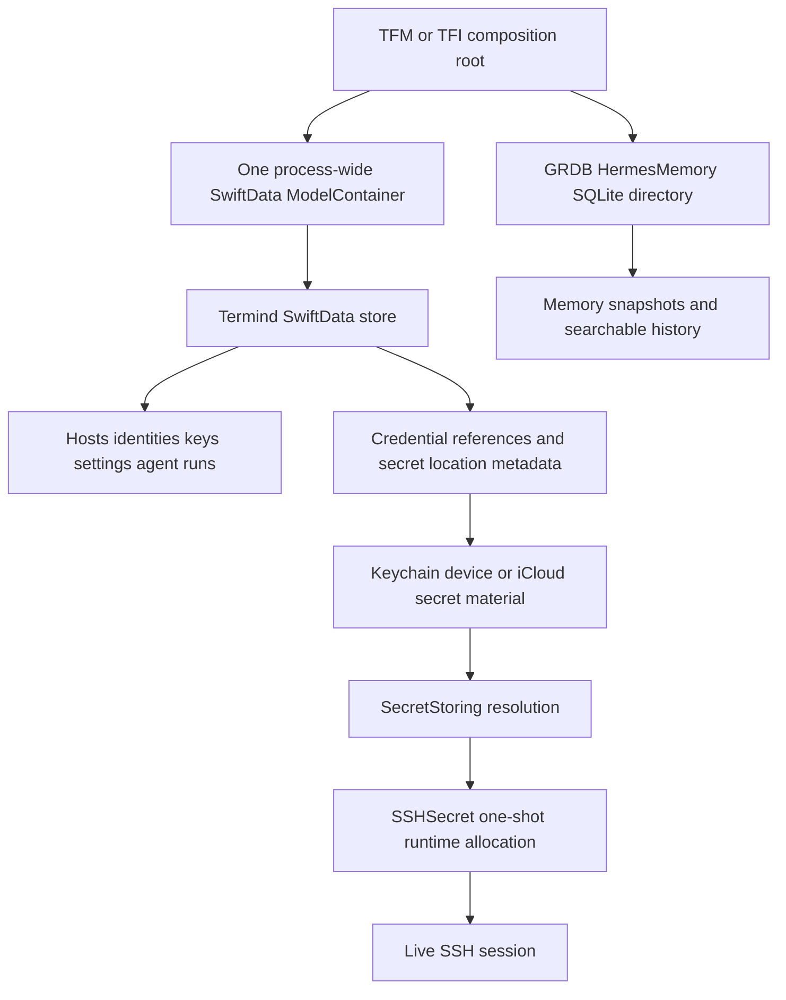

# Persistent Data, Migrations, and Secret Boundaries

Termind separates durable *metadata* from secret material and live connection state. `TermindPersistence` is the sole owner of SwiftData models, schema history, migrations, and container construction; application and platform layers select the store location and inject contexts into repositories. Credentials are represented durably by non-secret references and storage provenance, resolved only through `SecretStoring`, and converted to wipeable runtime objects only for a physical SSH connection attempt.

This is a safety boundary, not merely a storage abstraction: plaintext credentials must never enter logs, sync payloads, `UserDefaults`, or ordinary persistence. Runtime authentication state is also excluded from domain records and restoration. See [System Boundaries and Dependency Ownership](../architecture/system-boundaries.md) for the framework ownership rules and [Assistant, Agent Runtime, Skills, and Memory](agent-runtime-and-assistant.md) for assistant-specific durable data.

This diagram distinguishes durable SwiftData and GRDB records from Keychain material and session-only secret allocations.

## Store ownership and startup

`TermindPersistence.makeContainer(inMemory:url:)` is the single SwiftData entry point. It exposes the complete `TermindSchemaV30` schema, attaches `TermindMigrationPlan`, disables SwiftData CloudKit integration for this store, and rejects the invalid combination of an in-memory store and a file URL. Both apps retain one container for the process and construct separate `ModelContext` instances where independent repository contexts are needed; they do not assemble a partial schema per feature or scene.

The desktop root makes container opening part of initialization and uses a `KeychainSecretStore` for live composition. The mobile root creates its Application Support parent before opening `Termind.store`, or chooses an in-memory container and `InMemorySecretStore` for test/injected configurations. Store-open errors propagate out of these composition paths rather than being silently replaced with a new empty database: data availability is an explicit startup failure condition.

### Repository projections and atomic mutation

SwiftData rows are persistence representations, not the feature API. `SwiftDataHostRepository` projects `PersistentHost` and `PersistentHostGroup` into `HostLibrarySnapshot` values and publishes revisioned `AsyncStream` changes. Host upserts update or insert the row, then use one commit path that advances a database revision, records Vault mutation information, saves, and only then publishes the mutation. On failure it rolls the `ModelContext` back.

Deletion is a durable saga, not an immediate blind removal: `requestHostDeletion` atomically writes a pending-deletion marker, outbox jobs, and the revision. The snapshot hides marked hosts. Later steps remove dependent jump/snippet/history/forwarding references and finally remove host-owned identities, the host, and the marker. This lets a crash expose either the live host or a complete, resumable deletion intent rather than a partial state.

Agent conversations use a separate SwiftData repository with similarly deliberate projections. `SwiftDataAgentRunRepository` stores run snapshots, messages, context/replay backing, tool invocations/results, reviews, compactions, and ordering. It writes only new message IDs rather than duplicating replayed earlier turns, sanitizes persisted text and tool-call JSON, and marks nonterminal runs interrupted when the repository is initialized. Loading orders transcript rows by run and sequence, then restores recorded tool results that were committed before the next transcript snapshot.

## Schema evolution: preserve the past exactly

Historical SwiftData model shapes are deliberately frozen. A `VersionedSchema` hashes the types it names, so retroactively editing a type used by an already shipped schema can make an installed store unopenable rather than migrated. The migration plan therefore retains every schema from V1 through V30 and stages each adjacent migration. When a persisted shape changes, introduce a version-specific model and replace it only in the new schema; do not “clean up” an old model definition.

Examples show why this matters:

- V1–V6 identity and SSH-key shapes remain represented by frozen types so their fields and defaults retain the historical schema checksum.
- V11’s provider model remains frozen while V12 changes address representation; legacy columns in the live provider model are folded on read to preserve the former endpoint behavior.
- V30 removes the obsolete persisted Known Host mismatch flag by replacing the V29 known-host model, while retaining hostname, port, algorithm, fingerprint, and date.

`PersistenceCompatibilityTests` opens original V1 and V14 fixture stores and verifies their data survives; it also checks a file store can reopen, that in-memory containers use the full schema but remain independent, and that representative version upgrades retain data while giving new fields their intended defaults. Treat these compatibility fixtures as a release contract when changing entities, defaults, migration stages, or storage enum raw values.

## Secret references, not secret persistence

A durable identity, SSH key, AI provider, or MCP record may contain `credentialRef` plus public/configuration metadata, but not the credential plaintext. The `SecretStoring` port separates string passwords from stored SSH-key credentials and resolves them by reference plus device/iCloud storage selection. Its runtime extensions turn fetched values into `SSHSecret` or `SSHResolvedKeyCredential`; `InMemorySecretStore` exists for tests and injected configurations, while app composition supplies Keychain storage.

AI secrets apply the same rule with an extra migration-location record. `PersistentAISecretLocation` stores only a reference, whether its secret is in iCloud, and a deletion marker. `AISecretStore` accepts only nonempty `termind.ai.` references; reads return no secret for pending deletions and otherwise ask Keychain directly. It never writes secret bytes to SwiftData.

For new AI secrets, iCloud use requires coordinator authorization plus both master iCloud and Settings-sync switches. A successful migration first writes and verifies the iCloud Keychain value, records `usesICloud`, then removes the device copy. Once a reference has migrated, later writes remain in iCloud even if the switches are disabled. Remote reference metadata marks the location as iCloud without treating an old device copy as authoritative. Deletion persists `pendingDeletion` before Keychain removal and retains that tombstone so delayed Keychain delivery cannot resurrect a secret.

## Runtime-only authentication material

A session receives resolved credentials, not a database record. `SSHCredentials` wraps password, private-key, and passphrase values in `SSHSecret`; `SSHConnectionConfiguration.clearSecrets()` clears target credentials, proxy secret, and jump-hop secrets while preserving non-secret network data and `SSHAuthenticationReference` provenance. The provenance contains IDs, username, and capability flags so later connections can re-resolve current Keychain material, but it does not retain a plaintext password or key.

`SSHSecret` owns a single non-copy-on-write byte allocation shared by its copies. It clears source `Data` when taking ownership, exposes its NUL-terminated bytes once through `withUnsafeCStringAndConsume`, wipes/deallocates the allocation before return, and rejects a second consumption. Explicit clearing is idempotent. Interaction-forbidden connection requests additionally replace credentials that require a passphrase or user-presence authorization with `interactionRequired`, so silent auxiliary work cannot prompt for or consume protected authentication material.

A successful saved-secret read used to prepare an actual connection updates an identity’s local `lastUsedAt`; availability checks and missing reads do not. Route preparation batches target, jump, and proxy identity usage into one persistence update, and failed usage persistence rolls the local update back so it can be retried. This is intentionally usage metadata, not authentication success and not a secret cache.

## GRDB Hermes Memory is a separate durable store

Hermes Memory does not share the SwiftData database. `GRDBMemoryStore` is an actor that lazily creates and exclusively owns a `memory.sqlite` queue and its directory, so constructing a disabled memory feature does no filesystem work. On first access it enables WAL and applies the `hermes-v1` migration, which creates memory state, frozen conversation snapshots, review checkpoints, session/message history, an FTS5 index, triggers, and an ordering index.

Memory updates run in database writes. A review is accepted only when its expected base `AgentMemoryState` still matches; otherwise it returns `nil` without recording the review. History replacement deletes no-longer-present sessions and only stores user, assistant, and tool messages after visible-text/JSON redaction. Search uses trigram FTS for queries of at least three Unicode scalars and a case-insensitive fallback for shorter queries. `close()` releases the queue; `destroy()` closes it first and removes the entire owned directory.

The focused Hermes tests prove disabled memory creates no files, snapshots survive a close/reopen, stale background reviews cannot overwrite foreground changes, indexed history is searchable and removed with history replacement, and destroy revokes old access before a later enable can backfill retained conversation history.

## Change checklist

1. **Adding SwiftData data:** put the `@Model` in `TermindPersistence`, add it to the current schema, decide whether a new frozen schema/version and migration stage are required, and extend compatibility coverage.
2. **Changing an existing persisted shape:** preserve the old type and semantics; add a new version-specific model rather than editing a historical type. Test an actual prior store or fixture, including defaults and removed fields.
3. **Adding a repository mutation:** project persistent rows to application values, save related durable state atomically, roll back on failure, and publish observations only after a successful save.
4. **Adding a credential:** persist only a stable reference and non-secret provenance. Use `SecretStoring`/Keychain for material; exclude it from logs, CloudKit/sync records, `UserDefaults`, SwiftData/GRDB ordinary records, and reusable session snapshots.
5. **Passing a secret to transport:** use the runtime secret owner, clear it at every success, error, cancellation, and teardown boundary, and retain only non-secret identifiers when a reconnectable configuration is needed.
