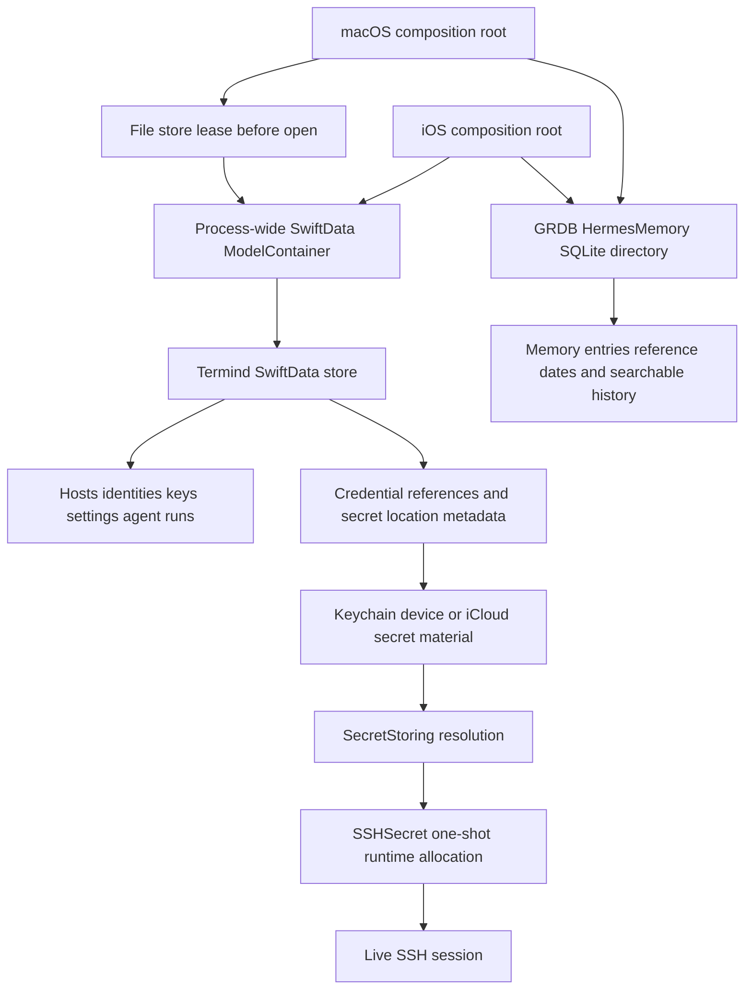
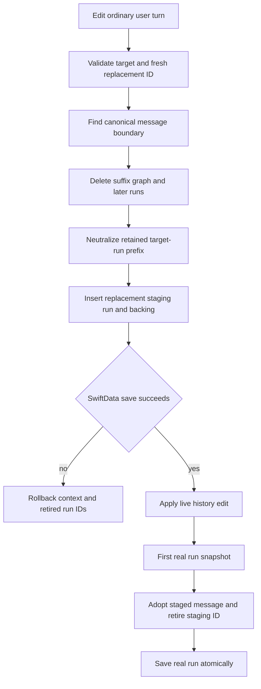
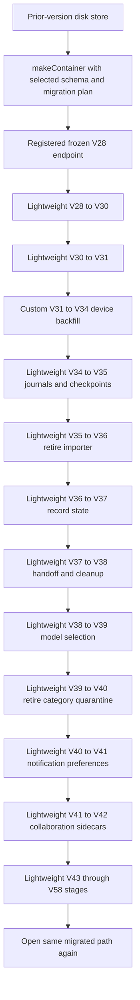
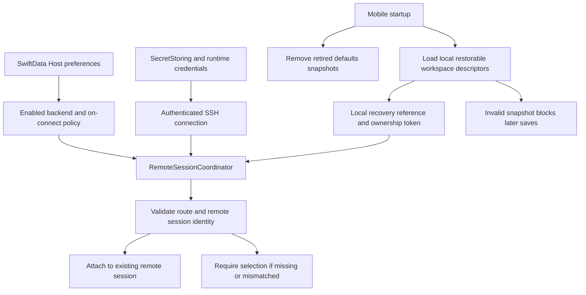
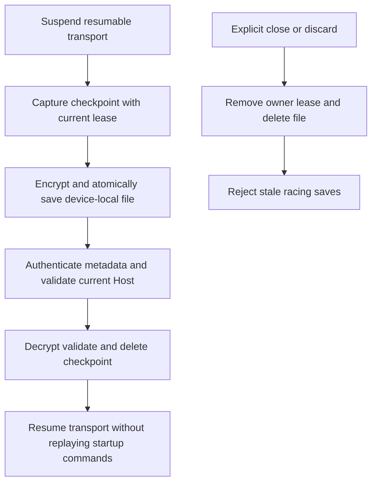
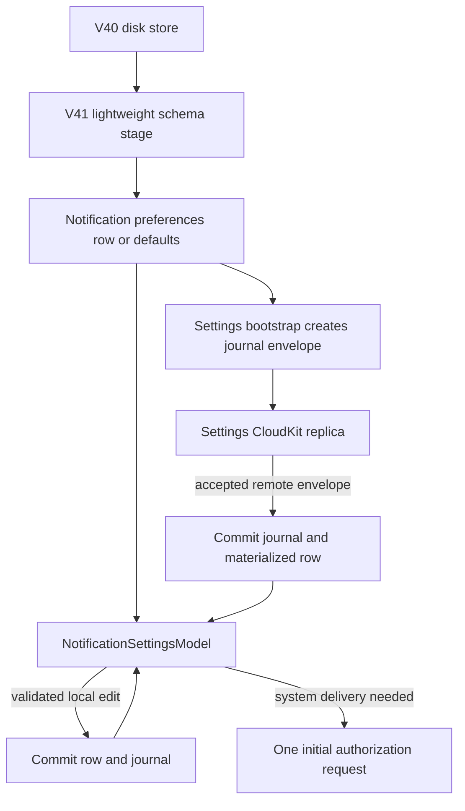
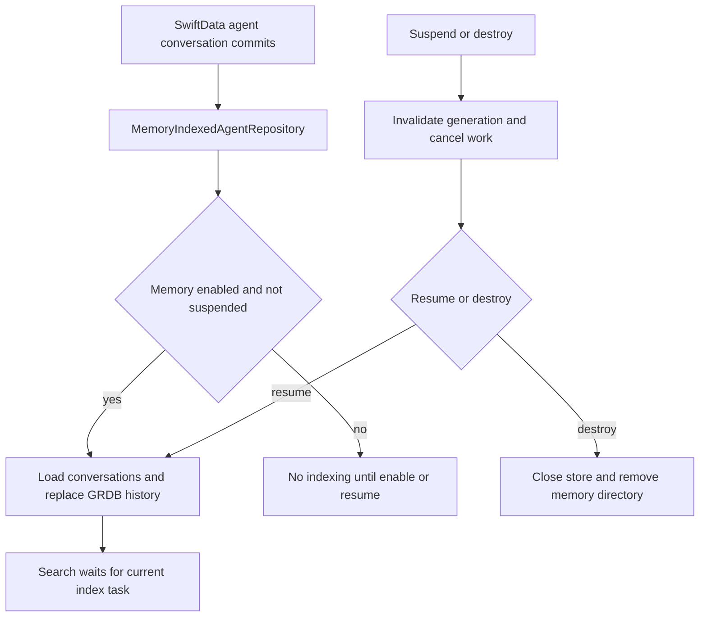

# Persistence and Secrets

Termind separates durable *metadata* from secret material and live connection state. `TermindPersistence` is the sole owner of SwiftData models, schema history, migrations, and container construction; application and platform layers select the store location and inject contexts into repositories. Credentials are represented durably by non-secret references and storage provenance, resolved only through `SecretStoring`, and converted to wipeable runtime objects only for a physical SSH connection attempt.

This is a safety boundary, not merely a storage abstraction: plaintext credentials must never enter logs, sync payloads, `UserDefaults`, or ordinary persistence. Runtime SSH authentication state is also excluded from domain records and restoration; resumable transport checkpoints use a separate encrypted device-local boundary described below. See [System Boundaries and Dependency Ownership](../architecture/system-boundaries.md) for the framework ownership rules and [Assistant, Agent Runtime, Skills, and Memory](agent-runtime-and-assistant.md) for assistant-specific durable data.

This diagram distinguishes durable SwiftData and GRDB records from Keychain material and session-only secret allocations.

## Store ownership and startup

`TermindPersistence.makeContainer(inMemory:url:)` is the shared SwiftData entry point. It selects the complete versioned schema through `TermindPersistence.schema`, attaches `TermindMigrationPlan`, disables automatic SwiftData CloudKit integration, and rejects an in-memory store combined with a file URL. Both apps retain one container for their process and do not assemble feature-specific schemas. Desktop services commonly share `container.mainContext`; mobile creates dedicated `ModelContext(container)` instances for several repositories while sharing a vault context among host, connection-history and device-directory services.

CloudKit replication is explicit rather than a side effect of declaring a SwiftData model: composition constructs Vault, Settings, Metrics, connection-History and Device coordinators, and repository/journal mutation callbacks notify the appropriate coordinator after local commits. Adding a model to the container does not automatically synchronize it. The persistence module owns row shapes and migration mechanics; application ports and value snapshots keep features independent of those rows, while platform roots own container lifetime and live secret adapters.

**macOS file-store exclusivity:** Before `ModelContainer` can open or migrate a file-backed store, the factory creates the parent directory, canonicalizes the URL (symlinks and standardized file URL), and obtains an exclusive nonblocking `flock` on a stable adjacent `.lock` file. A different process holding the lease causes `PersistentStoreAccessError.inUse` before database or WAL access; other POSIX failures propagate. Never unlink the lock file: a process may already have the inode open. The factory weakly indexes active leases by canonical URL so multiple containers for the *same store in one process* share the lease; each container retains it until deallocation, when closing the descriptor releases the kernel lock (including after forced exit). Different stores and in-memory containers do not contend. This mechanism is macOS-only, not a cross-platform mobile file lock. [PersistentStoreLockTests](../../FrameworkTests/PersistentStoreLockTests.swift) cover blocked opens before migration, symlink aliases and last-container release, a separate process killed while holding the lock followed by intact Vault/journal reopening, and noncontending stores.

The desktop root opens the container during `TermindApp.init()`: normal launches use the factory's default file-backed configuration (no explicit URL), while DEBUG XCTest and screenshot demos select an in-memory container. Before normal open, `DatabaseStartupGuard` checks for another running instance of the same bundle identifier, including older versions that do **not** use the new lock; a busy store presents an alert and exits, while other open/setup errors are fatal rather than replaced with an empty database. It supplies `KeychainSecretStore` for live composition and passes the same container to the main and authentication-window scenes. A screenshot demo instead constructs demo models and returns before live repository wiring; XCTest uses an in-memory container but disables cloud coordinators (it still constructs a Keychain secret store). The mobile root creates its Application Support parent before opening `Termind.store`, or chooses an in-memory container and `InMemorySecretStore` when `inMemory` is set or hosts are injected. A supplied container overrides factory construction; otherwise mobile initialization throws on open failure rather than replacing the store. `TermindIOSApp` retains the startup result and `MobileStartupView` injects the container on success or shows an unavailable-data-store view on failure. Data availability is an explicit startup condition.

These are app-lifetime dependencies, not per-window stores: desktop retains `AppModel` alongside the container, and passes the same `KeychainSecretStore` to the Host library, AI configuration/AI secret-location service, and built-in MCP server token storage. MCP client OAuth authorization uses its separate `MCPKeychainCredentialStore` in live composition (an in-memory authorization store in XCTest). The root prepares Settings, Metrics and History persistence before constructing their feature models. `AppDependencies` carries repositories and secret ports into `AppModel`; windows consume the shared application model rather than opening another database or allocating their own secret store.

Not all preferences belong to a cloud replica. `AppLanguage.stored()` reads the device-local `SettingsKey.appLanguage` choice at desktop launch, defaulting to `.system`; it also normalizes legacy Simplified Chinese locale spellings to `.simplifiedChinese`. `store` saves the explicit choice separately from Apple's override: an explicit language writes `AppleLanguages`, while Follow System **removes** that override to restore normal Bundle negotiation. This is not a synchronized Settings record.

The same local boundary applies to diagnosis/crash-reporting consent (`diagnostics.crashReportingConsent`), review first-use/invitation state, and debug-section/log-saving/log-level preferences. Terminal typography is also explicitly device-local. Desktop appearance, main-window geometry, sidebar state and built-in MCP listener preferences are defaults-backed local settings. In contrast, the Settings snapshot explicitly builds journal payloads for provider/MCP configuration, skills, roles, web search, terminal, SSH, SFTP, workspace and notification preferences. Neither the existence of a `SettingsKey` nor a value mirrored into defaults establishes replication; only explicit journal-backed paths do. Credentials remain in their separate secret channel. See [Settings and Cloud Sync](../workflows/settings-and-cloud-sync.md).

### Repository projections and atomic mutation

SwiftData rows are persistence representations, not the feature API. `SwiftDataHostRepository` projects `PersistentHost` and `PersistentHostGroup` into `HostLibrarySnapshot` values and publishes revisioned `AsyncStream` changes. Host upserts update or insert the row, then use one commit path that advances a database revision, records Vault mutation information, saves, and only then publishes the mutation. On failure it rolls the `ModelContext` back.

Deletion is a durable saga, not an immediate blind removal: `requestHostDeletion` atomically writes a pending-deletion marker, outbox jobs, and the revision. The snapshot hides marked hosts. Later steps remove dependent jump/snippet/history/forwarding references and finally remove host-owned identities, the host, and the marker. This lets a crash expose either the live host or a complete, resumable deletion intent rather than a partial state.

The platform projections differ around durable deletion. Desktop commits deletion before projecting removal and clearing connection history; mobile closes workspace/runtime dependencies before requesting deletion, with its outbox also clearing connection history. Command and SFTP browse history are memory-only per-session data, cleared by close rather than durable per-Host cleanup. Direct deletion of Tailscale-managed Hosts is rejected. Failure after runtime cleanup does not roll back those earlier effects.

Agent conversations use a separate SwiftData repository with similarly deliberate projections. `SwiftDataAgentRunRepository` stores run snapshots, messages, context/replay backing, tool invocations/results, reviews, compactions, and ordering. It deduplicates replayed earlier turns by message ID, sanitizes persisted text and tool-call JSON, and marks nonterminal runs interrupted when the repository is initialized. Loading orders transcript rows by run and sequence, then restores recorded tool results that were committed before the next transcript snapshot. V42 adds *sidecars*, rather than modifying historical message rows: a message origin records the source conversation/run/tool call and optional redacted title; a conversation-origin row records chat creation provenance; and a delivery receipt reserves the source run/tool-call pair. `SwiftDataAssistantChatCollaborationStore` reads and writes receipts and creation relations using fresh contexts from the shared container. When a new originated message is saved, its origin insertion marks matching queued receipts delivered in the **same snapshot save**; stale receipt saves or callbacks cannot downgrade a delivered receipt. Origin rows are removed along with message backing during edit/delete; the origin on a user message also prevents editing it as an ordinary user turn.

### Assistant history edits: one message boundary, one transaction

Replay is backing for the original turn, not a fresh reconstruction from current Host or skill configuration. `PersistentAgentMessageReplay` stores a redacted captured `contextSnapshot` and optional frozen `modelText`; attachment backing is keyed separately by message ID. Snapshot saves deduplicate messages across runs and can add missing replay backing to an already-stored user row when preparation finally freezes its context, without rewriting that historical row. Existing replay backing is not overwritten by later snapshots. Restore rejoins backing by message ID and recovers durable tool output, including its frozen model preview, before compaction projection.

This backing is additive: historical message schemas remain frozen, and missing legacy context is not reconstructed from today's configuration. `AgentReplayPersistenceTests.v15MigratesWithoutInventingHistoricalContext` opens a V15 disk store through the production factory and verifies the legacy message survives with no context snapshot or invented replay row.

Tool replay also preserves structured presentation. [`AgentPersistenceRedactor.toolResultText`](../../Frameworks/TermindPersistence/AgentPersistenceRedactor.swift) first applies `AgentSecretLifecycle` persistence policy: a `request_user_secret` result becomes an expired, single-use status envelope, not a durable secret handle. Only then does it delegate to `AgentSensitiveDataRedactor.toolResultText` to redact decoded JSON structurally and preserve untrusted-data envelope markers. Structural redaction is not a substitute for expiring runtime capabilities. Tool/runtime policy, not arbitrary truncation of serialized JSON, owns structured result sizing; non-JSON results take the visible-text redaction path. On restore, malformed JSON-looking or wrapped legacy text can use a valid structured fallback from durable result content or frozen model content. If no valid fallback exists, it retains the text rather than guessing a repair. Tool-role frozen `modelText` uses the same tool-result redaction path; other roles use visible-text redaction. The shared implementation is in [AgentSensitiveDataRedactor](../../AgentKit/Sources/AgentKit/Security/AgentSensitiveDataRedactor.swift), while the repository chooses the recovery fallbacks.

Restore and truncation share a canonical ordering: runs by `startedAt` then UUID; messages by that run order, then `sequence`, `createdAt`, role rank and UUID. Timestamps alone do not identify the cutoff. `truncateConversation` checks cancellation and validates an ordinary user replacement with a fresh ID that collides with neither a stored message nor a run before mutation. It removes the selected user message and the ordered suffix, including whole later runs. When the target run still has a prefix, that run and its retained messages survive: the summary becomes neutral `.completed`, clears its previous failure and ends at the last retained non-tool message. Editing its opening removes the target run only when no prefix remains.

Graph cleanup follows the same boundary. Removed messages lose their replay and context-attachment backing. Within a partially retained run, invocation source-message ownership takes priority, followed by call identity in retained/removed transcript rows; only unrecoverable ownership uses the conservative `createdAt >= target.createdAt` fallback. This covers both legacy rows and modern provider-native events persisted before their source-message snapshot. Results and reviews follow the deleted invocation IDs. Compactions are deleted only if their explicit boundary is among the removed message IDs, so retained-prefix records and nil-boundary fork bases survive. The generated title is cleared only when the opening user turn is removed. On load, raw run-local assistant calls supply missing legacy source IDs, and reconstructed deterministic tool-result messages receive run ownership before compaction projection; this lets the live model preserve the same graph through compacted history.

The replacement is inserted with its replay/attachment backing into a standalone, failure-free `.completed` staging run whose ID equals the replacement message ID. Staging must sort after the latest retained run, including an empty run: when the replacement timestamp ties or precedes that run's start, its run start becomes the retained start plus one millisecond. The message's own timestamp is not rewritten.

The first real snapshot whose final ordinary user turn is this staged replacement adopts it in the same `save` transaction. The staging predicate requires the same conversation, the same-ID user row, a completed run without failure, exactly one message and no invocation/result/review graph. Adoption changes only the staged row's run ID and snapshot sequence, retains its backing, deletes the staging run and retires the staging ID. Other historical rows included in replay remain attached to their original runs. The real run inherits at least the staging start time; later saves preserve that lower bound and clamp `finishedAt` when necessary. Failed and interrupted first snapshots use this same path, not a separate copy of the replacement.

The repository's in-memory retired-ID set includes the edited target run even when its prefix survives, all removed later runs, and adopted staging runs. `save` and durable-event `record` ignore retired IDs, preventing late work from rebuilding the discarded suffix. This is a repository-instance guard, not a new persisted tombstone or schema migration. Both truncation and snapshot save restore the previous retired-ID set and roll back their `ModelContext` changes if the transaction fails.

`AssistantConversationOperations` applies the live history edit only after the repository commits; invalid replacements and rejected writes leave history unchanged. Captured missing-model/credential failure now schedules a separate asynchronous save and **only then** calls `recordFailedRun` to adopt and publish the failed run; preparation remains active in its saving-failure phase until this finishes. Preparation cancellation that records interruption also saves its terminal snapshot before adopting and publishing the interrupted state. A save error appends a visible error rather than projecting a successful failed/interrupted adoption. This commit-before-projection rule does not make every stop a durability barrier: `ConversationModel`'s queued-before-start cancellation projects `.cancelled` when it launches a best-effort `prestartPersistence` task, and `stopAndWait` joins the consumer but the save error is swallowed. See [Assistant Runtime](agent-runtime-and-assistant.md) for runtime handoff. Shared replay tests reopen failed/interrupted adoption through a fresh context and cover queued cancellation and captured configuration failure; desktop and mobile fixtures compare same-run prefix history and provenance after edits. These fixtures do not inject a real disk-full or read-only SwiftData failure.

The edited suffix and replacement are handled as a transaction, not a timestamp-based overwrite:

An edit commits its graph cut before live projection; adoption later transfers the replacement without duplicating its backing.

**Whole-conversation deletion is a distinct path.** `deleteConversation` retires the conversation and its existing run IDs, explicitly deletes result/review/invocation rows and message replay, attachment and origin backing, then removes messages, runs, conversation ordering, model selection and compactions before saving. Late snapshots for that conversation are ignored, and events for its retired runs are ignored. Unlike truncation and snapshot save, this method has no local catch that rolls back the context and restores retired IDs on failure; do not assume all history operations have identical failure semantics. It also does not purge collaboration delivery receipts or conversation-creation relations as part of this graph helper. [AgentPersistenceTests](../../TFMTests/AgentPersistenceTests.swift) checks graph removal, equal-time suffix tools with and without transcript call ownership, same-run prefix retention and staging adoption, rejection of foreign message targets, and explicit compaction-boundary pruning. [AgentReplayPersistenceTests](../../FrameworkTests/AgentReplayPersistenceTests.swift) verifies captured replay/model previews and failed/interrupted adoption through a fresh context.

## Schema evolution: preserve the past exactly

Historical SwiftData model shapes are deliberately frozen. A `VersionedSchema` hashes the types it names, so retroactively editing a type used by an already shipped schema can make an installed store unopenable rather than migrated. The migration plan retains endpoints V1–V28, V30, V31, and V34–V58. Its recent path is V27→V28→V30→V31→V34 followed by successive stages through V58; all stages on this recent path are lightweight except the V31→V34 custom history backfill. V29, V32, and V33 remain absent as migration endpoints. V35 adds native History journals and capability checkpoints; V36 removes the retired importer table; V37 adds scoped cloud record-presence and deletion-acknowledgement sidecars; V38 adds deletion-handoff causality and durable asset-cache cleanup work. V39 adds per-conversation assistant model selection (provider and model IDs, not credentials). V40 removes the retired per-category Vault, AI-configuration and Metrics quarantine tables while retaining scoped quarantine. V41 adds shared notification preferences; V42 adds assistant message/conversation provenance and durable collaboration delivery receipts; V43 adds public MCP OAuth configuration, V44 replaces the Host model, and V45 replaces the SSH key model to persist Security Key reference metadata, and V46 adds terminal keyword-highlight preferences, without changing historical model shapes. These are **local SwiftData schema versions**, not revisions to independently versioned CloudKit wire envelopes; consult `TermindPersistence.schema` and `TermindMigrationPlan` for the selected endpoint and supported path rather than treating a version number in this guide as a permanent latest-schema contract. When a persisted shape changes, introduce a version-specific model and replace it only in the new schema; do not “clean up” an old model definition.

V28 remains registered for endpoint recognition. Its frozen Host model is retained alongside V30's replacement types; registration is necessary for staged migration, but is not itself a historical-fixture test. Opening uses the normal container factory, which propagates failure rather than clearing or rebuilding the database.

The diagram shows the registered local path; current tests exercise selected prior-version disk stores, not a bundled historical V28 fixture. These are **local** stages, not CloudKit wire-format upgrades.

Examples show why this matters:

- V1–V6 identity and SSH-key shapes remain represented by frozen types so their fields and defaults retain the historical schema checksum.
- V11’s provider model remains frozen while V12 changes address representation; legacy columns in the live provider model are folded on read to preserve the former endpoint behavior.
- V30 removes the obsolete persisted Known Host mismatch flag by replacing the V29 known-host model, while retaining hostname, port, algorithm, fingerprint, and date.
- V31 additively introduces scoped CloudKit quarantine and recovery models with a lightweight V30→V31 migration. The existing V1–V30 model shapes remain unchanged; the local schema increment does not change the V1 CloudKit envelope formats.
- V34 directly migrates released V31 stores to the Host/connection-history/device model types named V32 and the Identity type named V33, and adds workspace preferences. These type names do not imply intermediate released schema endpoints. Host and Identity replacements remove obsolete `lastUsedAt` columns. The custom migration preserves events, assigns the stable installation ID to their `sourceDeviceID`, and inserts a separate `DeviceRecord` for that installation. The event itself receives no hostname field, and the CloudKit envelope format remains V1.
- The V31→V34 compatibility test verifies retained Identity configuration and the independent Vault journal modification date, connection origin/backfill with no invented end time, and default workspace-preference journal bootstrap. Historical Host and Identity shapes retain the old columns solely for schema compatibility.

`PersistenceCompatibilityTests` creates prior-version disk stores with registered historical schemas and opens them through the production factory. Coverage includes V16 workspace-template defaults, V25 startup-snippet defaults, V26 environment defaults, V27 Host/charset and Known Host retention, V30 quarantine/recovery defaults, V31 identity and journal-date retention with device backfill, V35 importer retirement with native journal/account retention across two opens, and V41 collaboration-sidecar defaults. It also checks file-store reopening and independent in-memory containers against `TermindPersistence.schema`, not a hard-coded latest endpoint. The current suite does not provide historical V1/V14/V28 fixture-file coverage or a V28 mobile startup/relaunch test. Do not infer those guarantees from endpoint registration alone.

`CloudSyncSafetyPersistenceTests` separately exercises prior disk stores and scoped safety preservation; notification, Snippet color, session-persistence and Host icon suites add focused migration/reopen checks. When changing entities, defaults, stages or storage enum raw values, test retained values through the normal factory and reopen the same disk path. These are repository-level checks, not evidence of signed-device CloudKit deployment readiness.

### Host preferences, remote recovery, and retired mobile snapshots

The selected local schema is `TermindSchemaV58`, but the migration contract is the factory and registered plan, not a permanently asserted latest version. V53 replaces the V44 Host shape with a frozen Host model that adds `sessionPersistenceEnabled`, `sessionPersistenceBackend`, and `sessionPersistenceOnConnect`. V54 replaces that shape again to add optional `iconOverrideID`. Both V52→V53 and V53→V54 are lightweight stages. V55 adds SSH-authenticated terminal transport preferences, V56 adds Wake-on-LAN preferences, V57 adds native custom-theme and appearance-selection rows, and V58 replaces the Host model for creation ordering without inventing historical dates; these later stages are also lightweight and `PersistentHost` now aliases the V58 type. Existing hosts default to persistence disabled, backend `tmux`, and on-connect policy `ask`; icon override defaults to `nil` (automatic). These are non-secret durable configuration fields, alongside identity references, not saved SSH credentials or copies of a remote shell.

Remote-session recovery is a separate capability boundary. `RemoteSessionReference` carries a version, backend, opaque backend identity, Host ID, endpoint, username and optional ownership token; only the backend interprets its identity, never as an arbitrary command. `RemoteSessionCoordinator` validates an existing attachment against the current route and the backend's session inventory before reattaching. A missing or mismatched session requires selection rather than silently applying the create policy. This recovery does not restore authentication material: a connection still uses the runtime secret-resolution boundary. Only explicit-close teardown is eligible to end a managed remote session; suspension, application termination and detach are not. A failed termination does not authorize workspace removal unless the user explicitly chooses disconnect-only. See [SSH Session Lifecycle](../workflows/ssh-session-lifecycle.md) for connection handling.

Mobile's old defaults keys are **retired**, but local workspace restoration now has a separate owner. At app initialization `MobileWorkspaceStore.retire(in:)` removes `mobile.workspaces.v1` and `mobile.recentlyClosed.v2`. `MobileWorkspaceStore` reads and writes a version-1 JSON snapshot at `mobile.restorableWorkspaces.v1`, mapping scene-session IDs to workspace descriptors. Each descriptor carries its ID, Host ID, title, connection kind and optional `RemoteSessionReference`: connection intent and recovery identity, not credentials, transport checkpoint bytes or one-shot commands. Live composition uses supplied defaults or `.standard`; memory/injected-host composition uses only explicitly supplied defaults, allowing restoration tests without writing the live snapshot.

Loading validates the version, nonempty session keys and globally unique workspace IDs. A corrupt or unsupported snapshot disables subsequent saves on that store instance rather than allowing an empty projection to overwrite it. `MobileAppModel` reports the read error and does not treat it as an authoritative empty list for Live Activities. Successful loading creates session models from descriptors; orphan-session recovery saves the complete descriptor handoff before releasing source ownership. Missing Hosts can leave dormant, closable descriptors until discovery, rather than forcing their deletion.

[MobileWorkspacePersistenceTests](../../TFITests/MobileWorkspacePersistenceTests.swift) verifies that cold launch neither persists nor replays a one-shot Snippet command, and that an undiscovered Host's descriptor survives until discovery or explicit close. [MobileTerminalRestorationTests](../../TFITests/MobileTerminalRestorationTests.swift) verifies unsupported snapshot bytes cannot be overwritten. This defaults-backed intent is distinct from both SwiftData Host policy and encrypted transport recovery. See [Session Persistence](session-persistence.md).

Durable configuration selects behavior; recovery references identify remote sessions, while credentials remain on their own channel.

These changes also have independent wire representations: Host/HostGroup V4 adds session-persistence preferences and V5 adds icon overrides, including Tailscale host preferences within a group. The codec rejects older writes that would lose non-default session preferences (before V4) or a non-nil icon override (before V5). It does not infer wire safety from an optional domain property. [SessionPersistenceTests](../../FrameworkTests/SessionPersistenceTests.swift) checks V52 disk upgrade/reopen with persistence disabled, preference round trips and rejection of lossy older writes. [HostIconTests](../../FrameworkTests/HostIconTests.swift) creates a V53 disk store, migrates it through the normal factory, saves an override and reopens the same path; it also covers legacy wire defaults, tombstones and failed-save projection safety. When extending this path, assert retained values and behavior through the production factory rather than hard-coding a latest schema number as testing advice.

### Encrypted device-local terminal recovery

Resumable transport checkpoints are a narrow exception to the ordinary-record rule: they can contain protocol passkeys and counters, so they belong in `TerminalRecoveryStore`, **not** SwiftData, Vault, CloudKit, defaults snapshots, or the GRDB index. This actor owns `Application Support/Termind/TerminalRecovery` independently of the main database. It AES-GCM encrypts checkpoint JSON and authenticates the separately encoded recovery metadata as associated data. Metadata is readable in the file; it is not encrypted. `TerminalRecoveryRecord` strips environment variables because their values can contain secrets, and records the Host connection identity, username, transport and save time.

The store writes atomically with file protection until first user authentication, sets directory/file permissions to `0700`/`0600`, and excludes its directory from backup. Its 256-bit encryption key lives in a non-synchronizable Keychain item (`com.akinokaede.termind.terminal-recovery`, `device-key-v1`) with `AfterFirstUnlockThisDeviceOnly` accessibility. If that key is missing while checkpoint files remain, the store fails rather than creating a replacement key that strands existing ciphertext. Keychain and filesystem errors propagate.

**Lease fencing:** `register(id)` replaces the current owner token. A save requires that exact lease and a matching transport. `discard(id)` removes ownership before deleting the file, so an in-flight save carrying an obsolete lease cannot recreate a checkpoint after close. `invalidate(id)` only removes the file, preserving the live owner for a future suspension. The mobile workspace waits for suspension to finish and invalidates the saved checkpoint **before** resuming an already-live transport.

**Consume before resume:** `record(id)` authenticates the envelope before returning metadata; `records()` is only a metadata listing and does not authenticate/decrypt each checkpoint. `consume(id, host:)` authenticates/decrypts, validates the ID, checkpoint version and transport, and matches the current Host endpoint, SSH identity, jump route, proxy, Tailscale configuration and relevant Eternal Terminal port. It deletes the file before returning protocol state to a caller that can transmit. A failed validation leaves it unconsumed; a failed deletion prevents return. Mobile also checks the current username and enabled transport before consumption, then clears pending launch/startup commands before connecting. Once consumed, a failed or cancelled resume cannot reuse that disk checkpoint; recovery of a managed tmux attachment is a separate validation/selection path, not permission to replay the old launch command.

Recovery state is encrypted locally and removed before a restored transport can transmit; leases prevent a late save from reviving a discarded session.

[`TerminalTransportTests`](../../FrameworkTests/TerminalTransportTests.swift) checks that checkpoint payload bytes are absent from the file, endpoint mismatch fails without consumption, consumption succeeds only once, and a discarded lease cannot save again. Mobile restoration tests exercise workspace-level recovery separately from these store checks. See [SSH Session Lifecycle](../workflows/ssh-session-lifecycle.md) for transport behavior and [Behavioral Boundaries and Fixtures](../testing/behavioral-boundaries-and-fixtures.md) for test scope.

### Snippet color: local migration and independent wire evolution

V51 adds the latest `PersistentSnippet.colorTag` string with a no-color default and replaces the frozen `TermindSchemaV50SnippetModels.PersistentSnippet` starting in V51; V52 retains that colored model. The frozen type continues to represent V1–V50. The migration/reopen test creates a real V50 disk store, retains Host/package/body/targets/order after upgrading, then saves a color and reopens again to verify durability.

Domain JSON accepts legacy missing or unknown color as `.none`, and duplication preserves color. Vault Snippet records read V1/V2 but write V2; V2 adds typed color to the frozen V1 payload, and V1 encoding rejects nonempty color to avoid lossy writes. Applying a newer legacy V1 Snippet can clear color to `.none`; both V1/V2 tombstones still round-trip. `SnippetColorTests` exercises these compatibility and journal paths without claiming signed-device CloudKit verification.

### Synchronized connection events and device directory

`SwiftDataConnectionHistoryRepository` stores each saved-host SSH, Telnet or SFTP attempt as an independent event with stable ID, Host ID, protocol, start time, `sourceDeviceID` and optional end time. Every insert/end/delete/clear reconciles the complete local event set with `HistorySyncStore` inside the same `ModelContext` commit, so a successful history mutation and its envelope or tombstone cannot diverge. The repository and remote-merge path sort by start time and UUID, then deterministically retain the newest 250. The History limits of 100 desktop rows and 50 mobile rows are presentation-only. `ConnectionHistoryModel` caches readable entries even when its initial retention trim fails, reporting the write error rather than hiding existing history; failed record/end/delete/clear operations report `storageError` without publishing a successful mutation. Its recent-host projection selects the newest local event per still-present saved Host, not the newest event from another device.

`SwiftDataDeviceDirectoryRepository` independently persists reusable `DeviceRecord` values that map installation IDs to mutable display names. Its upsert and `.device` journal envelope commit together. Device records are not dropped when a Host is deleted, History is cleared, or the 250-event retention rule prunes old events; this lets any feature resolve the current name for a stable installation ID. A system-name change updates one directory row, so all connection events and future consumers display the new name without event rewrites.

The mobile Vault History screen consumes `MobileConnectionHistory.eventRows` from the shared history, device directory and Host library; it does not own another durable history store. The projection resolves the current source-device name and skips events whose saved Host is absent. Delete and Clear All call `ConnectionHistoryModel`, reaching the same repository/journal transaction described above rather than deleting only a visible row or a device name.

The old Host `lastUsedAt` column is not a replacement source for this timeline. The live Host and Identity model types selected by V34 both omit usage timestamps; neither Host nor Identity usage metadata drives connection History.

V35 added `PersistentHistorySyncEntry`, `PersistentHistorySyncState`, `PersistentHistoryImportState`, and `PersistentSyncCapability` without changing V34 domain models. V36 removes `PersistentHistoryImportState`: **current** `HistorySyncPersistence.prepare()` bootstraps native journals from current events and devices, not retired Vault History envelopes. In particular, opening a V31 or V34 store with an old Vault History tombstone does not transfer that tombstone, the old installation ID or the old bound account into the new journal. Do not restart the retired importer when extending sync. V35-on-disk and V31/V34 reopen tests exercise this boundary; Host/history rows and V31→V34 device backfill still migrate normally. Host deletion records History tombstones; ordinary configuration edits only record Vault mutations. A History tombstone is terminal for its event ID, so a late update cannot revive a cleared event.

## Notification preferences: local migration and Settings replica

V41 adds `PersistentNotificationPreferences` to the local SwiftData schema through a lightweight V40→V41 stage. It stores one JSON-encoded `NotificationPreferences` value under the `default` key; an older V40 store has no such row, so `SettingsSyncPersistence` creates the default on first load rather than reading notification settings from `UserDefaults`. `prepare()` bootstraps a Settings journal envelope for the preferences, including on stores whose older Settings bootstrap already ran. On macOS and iOS, the composition root prepares `SettingsSyncPersistence` and injects it into `NotificationSettingsModel` before the feature uses preferences.

The Settings replica carries the non-secret preference value as `v1/notifications/default` (`NotificationPreferencesItem` in CloudKit), independently of the local V41 schema number. Local edits validate a nonnegative terminal duration and commit both the row and journal intent before publishing the live model value. Remote envelopes are merged by journal version and materialized with the row in one commit, without calling the local mutation callback; an accepted deletion restores `NotificationPreferences()` defaults rather than deleting notification authorization state. `sftpMode` is optional when decoding older JSON and defaults to `.unfocused`, so adding that choice does not make existing values unreadable. This is a preferences record, **not** a credential channel: notification settings and references can sync, Keychain material cannot.

The shared `NotificationSettingsModel` does not treat a failed load as permission to prompt from defaults. It requests initial system authorization at most once for its lifetime and only when the loaded preferences need system delivery; a disabled setting or terminal bell-only delivery with assistant/SFTP disabled needs no prompt. Tests cover invalid and failed edits leaving the live value unchanged, remote records not echoing as local writes, V40 disk migration followed by a second open retaining both the new preference row and older workspace data, and the failed-load authorization gate.

Notification data is locally migrated as SwiftData state and separately replicated as a Settings envelope; authorization is a runtime decision, not a migrated secret.

## Cloud sync restrictions are durable local state

The safety and capability stores preserve these controls:

| Local record | Durable meaning |
| --- | --- |
| Scoped quarantine | Original payload bytes, encoded CloudKit system fields, structured failure reason and record identity; its presence prevents that record from being uploaded. |
| Decoder capability checkpoint | Records supported formats only after a successful full replay; expanded support forces scoped rereading before restrictions are cleared. |
| Recovery checkpoint | Whether the replica must fetch afresh rather than restore a possibly advanced CloudKit cursor after interrupted processing. |
| Record and replica state (V37) | Tracks observed cloud presence, confirmed or legacy physical deletions, and whether the replica has reconciled a full inventory independently of the engine cursor. |
| Delete handoff and asset cleanup (V38) | Remembers the exact handed-off delete incarnation across a crash and schedules category-owned cache directory removal after a committed purge. |

A replica scope includes container, environment, account, zone, owner and an optional consumer identifier. The record name is scoped within that boundary, so a restriction in one account or environment neither blocks nor clears the same name in another. Since V40, the active schema no longer includes the retired per-category quarantine rows; migration from V30 or V39 discards those tables rather than attributing their unscoped records to a new account. Existing scoped quarantine remains active and must not be cleared simply because an old table was removed.

A new scope begins with recovery required. `CloudSyncLifecycleSafety.persistent` binds the lifecycle to `CloudSyncSafetyStore` for recovery, capability and upload fences, while `CloudSyncRecordCoding.quarantine` saves either original JSON payload or a secure archive of a native record together with system fields. `CloudSyncRecordStateStore` filters pending mutations by the same quarantine boundary and retains deletion presence and causal handoff across engine resets. Its full-inventory reconciliation distinguishes a confirmed old delete from a newer explicit recreation, which must remain pending; a successful cloud delete acknowledgement clears only its matching incarnation. Cache purge work stays pending until the owned directory removal succeeds.  The coordinator discards serialized engine cursor state when recovery or replica upgrade requires a fresh snapshot (also when serialization is invalid), but retains local journal envelopes and pending edits. It commits the scoped recovery fence **before** creating an automatically syncing engine and before network work. `beginFetch` closes the upload gate and reasserts the fence; only after all overlapping fetches have succeeded does `finishFetch` complete inventory reconciliation and decoder capability, and authorize sending. Fetch failure leaves uploads fenced until a later successful fetch; a concurrently active send keeps recovery required until it finishes. A delegate persistence failure rolls back and retires that engine, so a later successful callback cannot reopen its upload gate.

Receiving a supported replacement reconciles the domain data, journal metadata and quarantine removal in one persistence commit. A failure rolls all of them back. Retry, pause, account/environment resets and relaunch are not generic quarantine-clearing operations. Physical deletion and tombstone handling preserve the same upload restriction. Native History/Device quarantine preserves a secure archive of the complete CKRecord alongside system fields; JSON-backed category records retain their payload bytes. Unsupported native records remain fenced in their own replica scope; the retired cross-zone History importer no longer supplies a new-zone target fence. These are local control records, not new cloud record types or a replacement secret store.

The on-disk safety tests cover V30→current and V39→current migration through V40 with retired quarantine tables dropped but scoped restrictions preserved, independent replica scopes, reopening an interrupted store with blocked and pending records intact, and rollback of a failed unblock. The compatibility suite additionally checks that reopening V35 drops only the retired importer table while retaining native device rows, envelopes and account binding; V31/V34 old Vault History journals are not imported into the native History journal. See [Settings and Cloud Sync](../workflows/settings-and-cloud-sync.md) for network gates and the limits of this first compatibility layer.

## Secret references, not secret persistence

A durable identity, SSH key, AI provider, or MCP record may contain `credentialRef` plus public/configuration metadata, but not the credential plaintext. The `SecretStoring` port separates string passwords from stored SSH-key credentials and resolves them from reference plus device/iCloud storage selection. Its runtime extensions turn fetched values into `SSHSecret` or `SSHResolvedKeyCredential`; mobile uses `InMemorySecretStore` for in-memory or injected-host configurations, while live composition supplies Keychain storage. Desktop XCTest still constructs `KeychainSecretStore` despite its in-memory database and disabled cloud coordinators.

SSH Security Key records are a deliberate exception to Keychain-backed private-key storage: the V45 SSH key row stores credential ID, P-256 public key, verification preference and presence flag, while the private key stays on the authenticator. `HostLibraryModel.upsert` validates the credential ID and 65-byte public key, disallows supplied secret material and replacement of a software key with the same ID, normalizes the label, clears `credentialRef`, sets `.external`, and rolls back the in-memory projection if persistence fails. Loading even an older hardware row marked `.thisDevice` or `.iCloud` normalizes it to `.external`. The `SSHRuntimeSecretResolving` overload for `SSHKeyRef` builds `.securityKey` directly from metadata without a Keychain read; availability reflects the presence of that metadata, **not** physical authenticator availability. Editing and deleting metadata likewise avoid Keychain calls. V2 Vault wire records serialize the reference, encoding `.external` as the frozen wire spelling `thisDevice`, then recovering `.external` for a Security Key on decode; software keys with external storage are rejected. V1 remains available for older categories and records; local schema and per-kind cloud wire versions are different version axes. Vault sync can move this reference, but using it still requires the physical authenticator and a local WebAuthn interaction. [WebAuthnVaultMetadataTests](../../FrameworkTests/WebAuthnVaultMetadataTests.swift) exercise jump and destination resolution with a deliberately failing Keychain, round-trip and remote merge, legacy storage normalization, invalid external software storage, rollback, and V44 software-key migration/reopen. See [SSH Security Key Authentication](ssh-security-key-authentication.md) for registration, signing and portability limits.

Live `KeychainSecretStore` separates passwords/AI strings, software SSH keys and Secure Enclave handles by service within a configured access group in the Data Protection Keychain. It validates nonempty `termind.password.` or `termind.ai.` string references and `termind.key.` key references; invalid types and Keychain status errors propagate. `.iCloud` items use synchronizable, WhenUnlocked access; device and enclave items are non-synchronizable, WhenUnlockedThisDeviceOnly. `.external` has no Keychain service and cannot be stored there. Runtime reads decode software-key JSON into wipeable `SSHSecret` values and clear temporary byte buffers, while Secure Enclave reads return a handle; the editor's legacy typed credential API is separate from this runtime byte path. This is a Keychain storage location distinction, not SwiftData CloudKit replication.

AI secrets apply the same rule with an extra migration-location record. `PersistentAISecretLocation` stores only a reference, whether its secret is in iCloud, and a deletion marker. `AISecretStore` accepts only nonempty `termind.ai.` references; reads return no secret for pending deletions and otherwise ask Keychain directly. It never writes secret bytes to SwiftData.

For new AI secrets, iCloud use requires coordinator authorization plus both master iCloud and Settings-sync switches. A successful migration first writes and verifies the iCloud Keychain value, records `usesICloud`, then removes the device copy. Once a reference has migrated, later writes remain in iCloud even if the switches are disabled. Remote reference metadata marks the location as iCloud without treating an old device copy as authoritative. Deletion persists `pendingDeletion` before Keychain removal and retains that tombstone so delayed Keychain delivery cannot resurrect a secret.

## Runtime-only authentication material

A session receives resolved credentials, not a database record. `SSHCredentials` wraps password, private-key, and passphrase values in `SSHSecret`; `SSHConnectionConfiguration.clearSecrets()` clears target credentials, proxy secret, and jump-hop secrets while preserving non-secret network data and `SSHAuthenticationReference` provenance. The provenance contains IDs, username, and capability flags so later connections can re-resolve current Keychain material, but it does not retain a plaintext password or key.

`SSHSecret` owns a single non-copy-on-write byte allocation shared by its copies. It clears source `Data` when taking ownership, exposes its NUL-terminated bytes once through `withUnsafeCStringAndConsume`, wipes/deallocates the allocation before return, and rejects a second consumption. Explicit clearing is idempotent. Interaction-forbidden connection requests additionally replace credentials that require a passphrase or user-presence authorization with `interactionRequired`, so silent auxiliary work cannot prompt for or consume protected authentication material.

## GRDB Hermes Memory is a separate durable store

Hermes Memory does not share the SwiftData database. `GRDBMemoryStore` is an actor that lazily creates and exclusively owns a `memory.sqlite` queue and its directory, so constructing a disabled memory feature does no filesystem work. On first access it enables WAL and applies `hermes-v1` (memory state, legacy snapshots, review checkpoints, session/message history, FTS5 index, triggers and ordering index), then `hermes-policy-learning-v2` (drops the old snapshots table and adds durable learning activity and reviewed-correction checkpoints), then `hermes-reference-dates-v3` (adds per-entry last-reference dates). These GRDB migration names are independent of SwiftData and cloud wire versions.

Memory updates run in database writes. A review or correction is accepted only when its expected base `AgentMemoryState` still matches; otherwise it returns `nil` without recording the review or correction. Learning activity is keyed by conversation, event and kind, and review progress is committed with accepted operations. History replacement deletes no-longer-present sessions and only stores user, assistant, and tool messages after visible-text/JSON redaction. Session search uses trigram FTS when a query admits an FTS5 plan and a case-folded substring fallback for short terms; it tries matches for all terms before falling back to any term, across the whole result set rather than just one page. Memory search separately records last-reference dates only for returned existing entry IDs, taking the maximum date on repeat visits; memory-state saves prune dates for removed entries. Editable memory text strips generated UTC date annotations before saving, preserves IDs and creation dates for unambiguously matched entries, and rejects malformed date annotations. `close()` releases the queue; `destroy()` closes it first and removes the entire owned directory.

The focused Hermes tests prove disabled memory creates no files, memory state survives a close/reopen and V1 snapshots disappear without losing entries, stale background reviews cannot overwrite foreground changes, indexed history is searchable and removed with history replacement, reference dates survive reopen without invalidating review, and destroy revokes old access before a later enable can backfill retained conversation history.

`MemoryIndexedAgentRepository` wraps agent history rather than moving it into GRDB: it requests indexing only after a successful terminal run save, conversation creation, title change, truncation or deletion. `MemoryModel` loads the SwiftData-backed conversation projection through `AgentRunPersisting` and replaces the separate searchable memory history; disabled or suspended memory does not start that work. Reindexing coalesces changes while a task is running, and a memory search waits for the current indexing task. This is a derived local index, not a second authoritative copy of agent runs. The GRDB replacement compares redacted message IDs and content, not timestamps alone, so editing a turn with an unchanged timestamp still refreshes the index.

Suspension is not deletion. Mobile suspends memory when all scenes enter the background and resumes it on foreground return; desktop suspends it on termination. Suspension rotates a generation token, invalidates session contexts and access handles, and cancels index and review tasks. A resumed session receives a new access handle; an in-flight write that committed across suspension can still finish in GRDB, but its obsolete caller receives cancellation and the current generation reloads the committed state rather than publishing a stale result. On resume the model reloads memory state and schedules history indexing; a review computed before suspension cannot apply afterward. Disabling memory closes the store without erasing it. Destroy instead disables access, cancels and joins pending work, then removes the GRDB directory; a `hermesMemoryDestroyPending` preference keeps a failed destroy disabled and triggers a retry at next initialization. Re-enabling after a successful destroy can reindex conversations that remain in SwiftData, but cannot revive destroyed memory entries or old access handles.

Memory history indexing follows committed agent data; suspension invalidates consumers while destroy removes only the separate memory store.

## Change checklist

1. **Adding SwiftData data:** put the `@Model` in `TermindPersistence`, add it to the current schema, decide whether a new frozen schema/version and migration stage are required, and extend compatibility coverage.
2. **Changing an existing persisted shape:** preserve the old type and semantics; add a new version-specific model rather than editing a historical type. Test an actual prior store or fixture, including defaults and removed fields.
3. **Adding a repository mutation:** project persistent rows to application values, save related durable state atomically, roll back on failure, and publish observations only after a successful save.
4. **Adding a credential:** persist only a stable reference and non-secret provenance. Use `SecretStoring`/Keychain for material; exclude it from logs, CloudKit/sync records, `UserDefaults`, SwiftData/GRDB ordinary records, and reusable session snapshots.
5. **Passing a secret to transport:** use the runtime secret owner, clear it at every success, error, cancellation, and teardown boundary, and retain only non-secret identifiers when a reconnectable configuration is needed.

V47 adds Tailscale groups and local node state; V48 revises local node state; V49 removes command/SFTP history models from the current schema; V50 adds profile cleanup; V51 adds persisted Snippet colors; V52 removes the retired keyword-highlighting preference model. Startup Settings preparation drops inactive highlighting journal entries, and its CloudKit receiver ignores legacy highlighting records—including malformed/conflicting/deleted ones—without replacing other preferences or creating quarantine. Historical V46/V51 shapes remain immutable; `RetiredTerminalHighlightingTests` verifies upgrade/reopen cleanup and pending-upload retirement. Tailscale group configuration is Vault data, while profile IDs, sign-in/cache state and cleanup markers stay device-local. Current Vault Host writes use V8 and read V1/V2/V4–V8 (not V3); HostGroup writes V7 and reads V1–V7. SSHKey writes V3 and reads V1–V3; Snippet writes V2 and reads V1/V2. Native History writes V2 and reads V1/V2, while Device remains V1. Reader capability and local schema versions remain independent; consult [CloudKit Release Readiness](../operations/cloudkit-release-readiness.md) for deployment checks.
