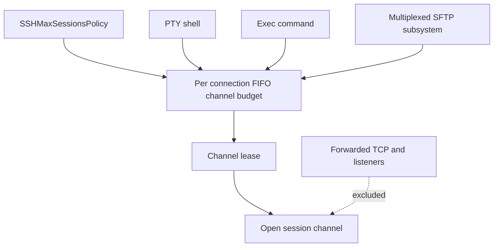
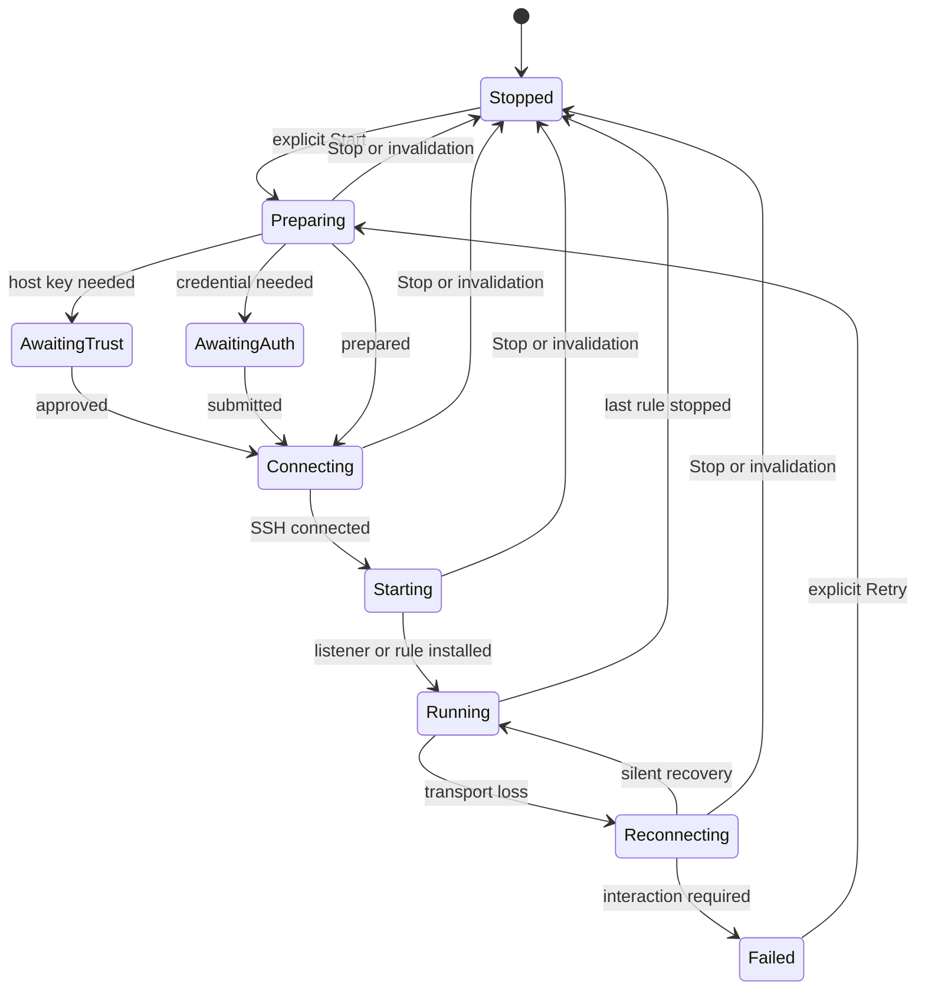
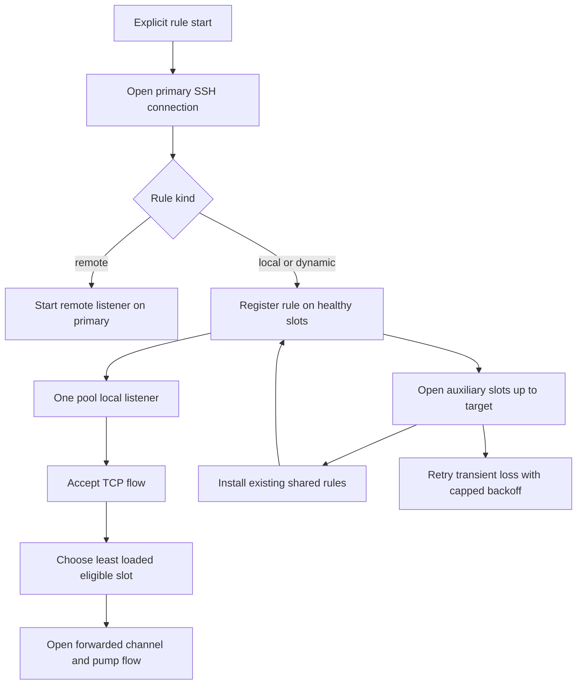

SSH is a shared transport substrate, not a single shared runtime. Terminal sessions, Metrics, port forwarding, SFTP, and Agent work can all use SSH, but each feature owns its own intent, connection lifetime, interaction surface, and recovery policy. In particular, a live authentication result or a forwarding listener is memory-only: it is not restored from saved Host or forwarding-rule data. See [SSH session lifecycle](/openwiki/workflows/ssh-session-lifecycle.md) for the general connection journey and [Agent runtime and assistant](/openwiki/concepts/agent-runtime-and-assistant.md) for Agent-specific transport ownership.

## Implementation deep dives

This page explains service ownership. Follow these guides when changing the actual algorithms:

- [SSH Multiplexing, Channel Admission, and I/O Scheduling](/openwiki/concepts/ssh-multiplexing-and-scheduling.md): distinguish a physical connection from its channels, trace exec/SFTP turns on the libssh2 owner, and understand readiness, retry buffers, and backpressure.
- [Shell Integration: Bootstrap, OSC Events, and Terminal State](/openwiki/concepts/shell-integration.md): follow probe/install timeouts, Bash/Zsh/Fish hooks, output filtering, cwd/home, command history, and compose state.
- [Port Forwarding: Multi-Connection Pool and Flow Dispatch](/openwiki/workflows/port-forwarding-pool-and-dispatch.md): follow pool warm-up, accepted-socket assignment, single-worker remote forwarding, per-flow pumping, recovery, and teardown.
- [SFTP Transfer, Scheduling, and External Edit Workflow](/openwiki/workflows/sftp-transfer-and-external-edit.md): follow file admission through context topology selection, extra-connection fallback, transfer completion, and edit ownership.

### The limits count different resources

| Control | Scope and accounting unit | It does not mean |
| --- | --- | --- |
| `SSHMaxSessionsPolicy` / `SSHChannelBudget` | A shared preference creates a separate FIFO lease budget for shell, exec, and subsystem channels on each physical connection. | A process-wide socket limit or a cap on forwarded TCP flows. |
| `SFTPConcurrencyScheduler` | One admitted logical file operation process-wide, with a slot on every distinct endpoint Host and optional exclusive borrowed resources. | One permit per SSH channel/socket; a two-endpoint copy still consumes one global permit. |
| `SSHForwardingConnectionPool` | A Host-context target for physical connections; only local/dynamic registrations require auxiliary slots. | An SFTP file limit or multiple workers for one remote listener. |

These controls compose rather than replace each other. For example, an SFTP file can already hold its global/per-host permit while waiting for a session-channel lease on a busy primary connection.

## Service boundaries

| Service | Primary owner and connection shape | Interactive behavior | What it does not inherit |
| --- | --- | --- | --- |
| Interactive terminal | `SSHPTYChannel` opens a PTY and shell on its own authenticated connection. | Its connection journey may obtain trust, credentials, and keyboard-interactive answers. | It does not make those answers durable for later physical connections. |
| Metrics | `ServerMetricsModel` runs one serial worker per selected Host; `SSHMetricsSampler` performs bounded SSH exec requests. | Metrics owns its own `ConnectionJourney`, host-key authorization, and authentication queue. | It does not start a terminal shell or use terminal environment variables/startup snippets. |
| Port forwarding | `PortForwardingController` shares a host-scoped forwarding transport among explicitly started rules; it optionally creates an `SSHForwardingConnectionPool`. | The first open can present the forwarding Journey. Recovery and auxiliary opens forbid interaction. | It does not persist a connected transport, listener, temporary password, passphrase, or once-only trust decision. |
| Agent SSH/SFTP | Agent SSH and primary Agent SFTP share an Agent-owned pooled Host transport and fair libssh2 owner. | Agent interactions use Agent queues, not a terminal or forwarding prompt. | It is not a forwarding pool or an interactive PTY session. |

A `PortForwardingRule` is a portable saved description, not a listener. It identifies a Host and has `local`, `remote`, or `dynamic` (SOCKS5) kind, bind address/port, optional target address/port, label, and color. Dynamic rules deliberately erase target fields; a valid rule needs a nonblank bind host and port in `1...65_535`, while local/remote rules also require a nonblank target and valid target port. Rules remain independent of Host renames, but Host deletion removes its rules.

## Interactive terminal channels

`SSHPTYChannel` authenticates a connection, acquires a session-channel lease, opens a libssh2 `session` channel, requests an `xterm-256color` PTY, and then starts the remote shell. It owns terminal dimensions, byte conversion, output, and teardown. An SSH channel budget is therefore per physical SSH connection, rather than a process-wide limit.

`SSHMaxSessionsPolicy` supplies that per-connection `SSHChannelBudget` from the configured ceiling (default 10, valid range 1–100). PTY, exec, and multiplexed SFTP subsystem channels acquire FIFO leases from the same budget on a connection. A policy update changes live budgets and admits queued work when capacity permits; reducing the limit does not revoke active leases. Cancelling a queued request or closing the budget resumes it with cancellation. Direct/forwarded TCP channels, remote listeners, and jump bridges are forwarding mechanics, so they do **not** consume this OpenSSH-style session budget.

This diagram shows admission of SSH session channels; forwarding traffic bypasses the session-channel budget.

### Shell-only setup

Host environment variables are encoded using the connection charset and sent as SSH environment requests **after** the PTY request and **before** the shell starts. A server denial of an individual variable is non-fatal and reports only its name through the rejection handler; another environment-request error fails the connection. This behavior is intentionally PTY-only: exec, SFTP, Metrics, Agent, and forwarding channels do not inherit these values.

Shell integration is likewise a terminal concern. When enabled, the PTY channel queues `RemoteShellIntegrationBootstrap.startCommand` after shell startup. Its state machine suppresses its probe/install exchanges from terminal output where possible, preserves ordinary banner/prompt output, and becomes non-blocking if the remote probe is late or the user types. It is not a generic SSH bootstrap mechanism and must not be added to metrics, forwarding, Agent, or SFTP routes.

## Metrics: bounded exec sampling, not a login shell

`ServerMetricsModel` stores the selected metric cards and runs a detached serial worker for each enabled SSH Host. The worker resolves an SSH connection preparation with challenge-capable trust and keyboard-interactive handlers, connects a newly made sampler, then samples on a roughly two-second cadence. It publishes the base point first; GPU, filesystem, and process details are optional follow-up work. Filesystems are refreshed only while a detail view is observed and no more often than 30 seconds. On failure it disconnects and retries with exponential delays from 2 seconds to a 60-second cap; cancellation, disabled selection, sleep, stopped model, or a changed generation retires the work.

`SSHMetricsSampler` wraps its connection in `SSHExclusiveConnectionAdapter`, so its commands have exclusive use of that sampler connection. It uses bounded exec calls rather than a PTY: the primary Linux probe has an 8-second timeout and 256 KiB payload limit; filesystem and process probes use 5 seconds with 512 KiB and 1 MiB limits respectively. It recognizes exit status `42` as unsupported primary metrics and recognizes `42` or NVIDIA's `6` as no GPU; other nonzero, truncated, malformed, or oversized output is a read failure.

Remote shells can emit banners, OSC sequences, or exit-hook text around an exec command. The sampler wraps every command in `__TERMIND_METRICS_BEGIN__` and `__TERMIND_METRICS_END__` markers, parses only the enclosed payload, and permits a small framing allowance beyond the payload limit. Invalid primary-sample diagnostics redact the address section before logging and record sizes rather than treating raw remote output as safe telemetry.

Focused tests in `FrameworkTests/SSHMetricsSamplerTests.swift` verify that framing ignores shell preamble/trailer, that absent/truncated/oversized frames fail, and that unsupported/GPU exit codes retain their special meanings.

## Forwarding: explicit intent and host-scoped runtime

A rule runs only after `PortForwardingController.start(_:)` validates the rule and confirms SSH is enabled for its Host. The controller creates or joins one `PortForwardingConnection` for that Host and route, snapshots the selected pool limit at that first start, and gives all active rules on that context the same Journey/authentication surface. Starting a later rule on an already connected context installs only that rule. Stopping one rule unregisters it without disturbing peers; the final stop retires the context and its transport.

The visible rule state moves through `stopped`, preparation/trust/authentication/connecting stages, `starting`, `running`, reconnecting, or `failed`. Each rule start has a generation, and callbacks must match both the current context and generation. This rejects stale connection counts, delayed listener creation, and late open success after stop/restart or configuration retirement.

This is the controller-facing forwarding lifecycle; a shared Host context can carry several rule generations concurrently.

### Connection pool and dispatch

On macOS, a Host-configured forwarding maximum is normalized to 1–64 (default 1). With more than one requested connection, `PortForwardingController` selects `SSHForwardingConnectionPool`; otherwise it uses one `SSHForwardingConnection`. iOS can preserve the synced Host setting but runs one forwarding connection. The pool always opens a primary connection first. Only local and dynamic rules need the fan-out pool: they register with every healthy slot but keep one pool-level local listener per rule. Accepted sockets are assigned to an eligible slot with the fewest flows for that rule, breaking ties round-robin. A remote rule stays on the primary worker, so remote forwarding remains single-worker.

After the primary opens, the controller supplies an additional-connection request resolver and the pool fills missing auxiliary slots. It limits simultaneous opening/installing work to four. A new slot installs every non-remote registration before becoming eligible; if setup fails it is disconnected rather than published. Losing an auxiliary schedules retry after 1, 2, 5, 10, then 30 seconds; a slot stable for 60 seconds resets this retry progression. Interaction-required, host-trust, credential, or cancellation failures require manual action instead of an automatic auxiliary retry, leaving the pool below target. If the primary fails, the pool promotes an existing slot and recreates remote rules there when possible; with no replacement it reports failure.

This diagram shows pool fan-out only for local and dynamic forwarding; a remote listener does not fan out.

The first physical connection may use the forwarding Journey to collect host-key approval, credentials, or keyboard-interactive answers. Its recovery and every auxiliary connection are silent opens with interaction forbidden. Their reusable snapshot keeps route/network and identity references, not temporary passwords or passphrases. A remembered host key can permit recovery, but “continue once” trust cannot. If a silent open needs interaction, recovery fails/degrades rather than showing a form; an explicit Retry starts a new interactive Journey. Existing TCP streams are never migrated or replayed to a replacement worker.

A route/Host configuration edit, deleted/replaced rule, or explicit stop invalidates the relevant runtime. Cleanup cancels retry/open work, stops listeners before closing transports, and waits for cleanup where needed so an old bind cannot race a replacement. Local/dynamic listeners use `SO_REUSEADDR` to tolerate `TIME_WAIT`, not `SO_REUSEPORT` or live shared binds.

## Operational and change guidance

- Treat port-forwarding maximum connections as a throughput/concurrency control, not a universal latency improvement. The historical loopback results, their limits, and the intentionally single-worker remote-forwarding topology are documented in [Port Forwarding Benchmark Design, Results, and Reproduction](/openwiki/operations/port-forwarding-benchmarks.md).
- Preserve readiness-driven, bounded forwarding I/O. The forwarding transport uses immutable queues and socket readiness; plaintext queues pause at 2 MiB per direction/flow and resume below 1 MiB, while encrypted output is bounded per SSH session. These are per-flow/session guardrails, not a global process memory cap.
- Do not merge service lifetimes merely because they share SSH primitives. A forwarding listener/pool, a terminal PTY, a metrics sampler, and Agent transport have different owners and retry/authentication boundaries.
- Test lifecycle changes with the focused forwarding suites. `TFMTests/PortForwardingReconnectTests.swift` covers shared-context reconnect, capped backoff, generation rejection, silent recovery, remembered versus temporary trust, and cleanup ordering. `TFMTests/PortForwardingFeatureTests.swift` covers rule normalization/validation, Host-route constraints, deletion cleanup, persistence behavior, and command rendering.
