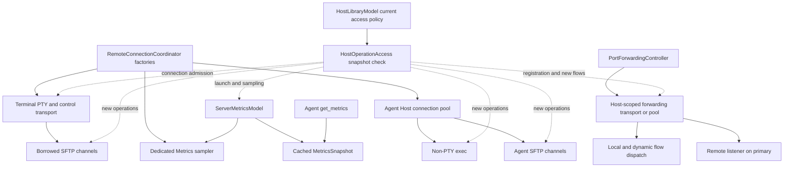
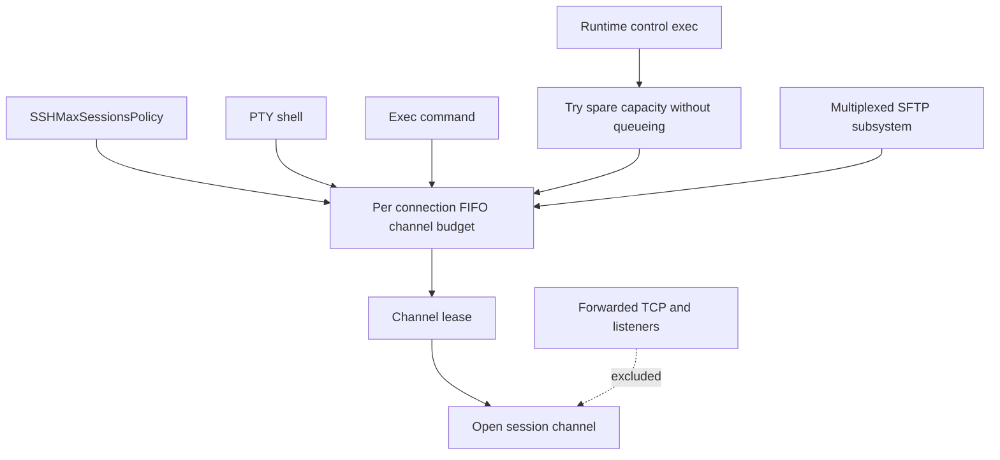
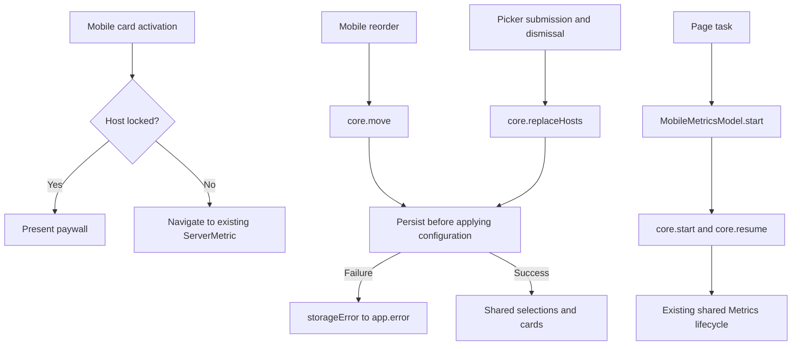
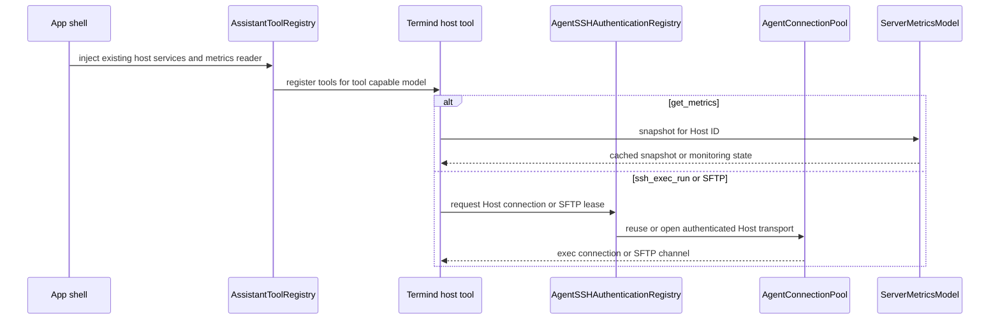
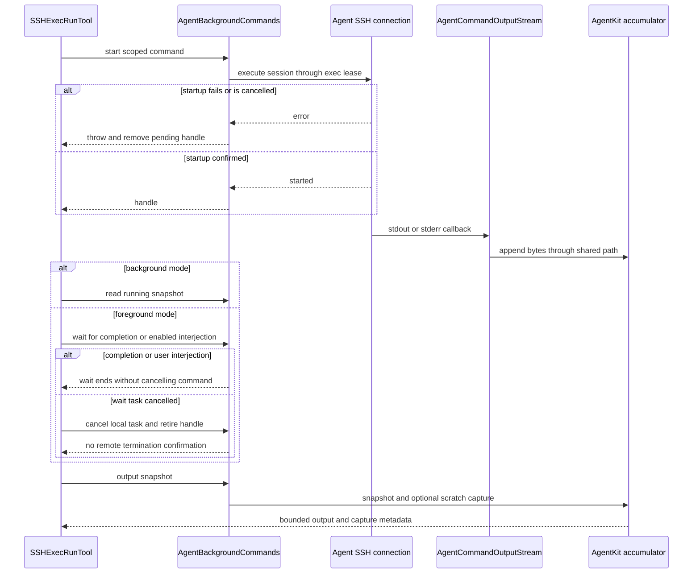
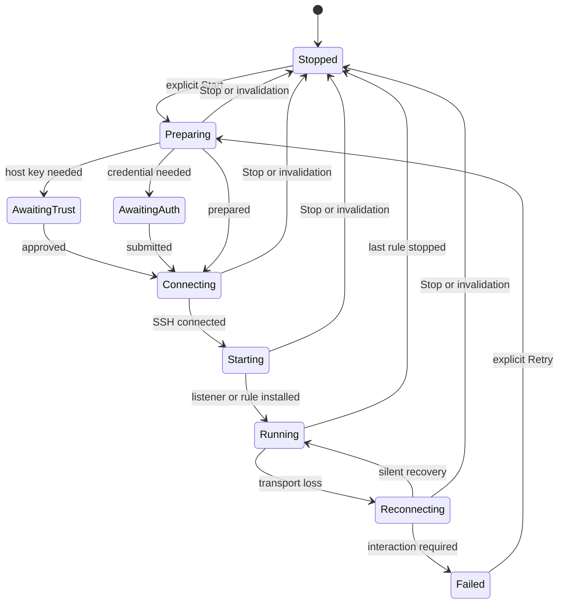

SSH is a shared transport substrate, not a single shared runtime. Terminal sessions, Metrics, port forwarding, SFTP, and Agent work can all use SSH, but each feature owns its own intent, connection lifetime, interaction surface, and recovery policy. Saved Hosts, forwarding rules, and Metrics selections describe intent; live sampler connections, authentication prompts, and forwarding listeners are not restored as connected runtimes. Explicitly saved identities or remembered host keys can be used on a later connection, unlike a one-time approval or an unpersisted submission. See [SSH session lifecycle](../workflows/ssh-session-lifecycle.md) for the general connection journey and [Agent runtime and assistant](agent-runtime-and-assistant.md) for Agent-specific transport ownership. For hardware-backed SSH credentials and their interaction boundary, see [SSH Security Key Authentication](ssh-security-key-authentication.md).

## Implementation deep dives

This page explains service ownership. Follow these guides when changing the actual algorithms:

- [SSH Multiplexing, Channel Admission, and I/O Scheduling](ssh-multiplexing-and-scheduling.md): distinguish a physical connection from its channels, trace exec/SFTP turns on the libssh2 owner, and understand readiness, retry buffers, and backpressure.
- [Shell Integration: Bootstrap, OSC Events, and Terminal State](shell-integration.md): follow probe/install timeouts, Bash/Zsh/Fish hooks, output filtering, cwd/home, command history, and compose state.
- [Port Forwarding: Multi-Connection Pool and Flow Dispatch](../workflows/port-forwarding-pool-and-dispatch.md): follow pool warm-up, accepted-socket assignment, single-worker remote forwarding, per-flow pumping, recovery, and teardown.
- [SFTP Transfer, Scheduling, and External Edit Workflow](../workflows/sftp-transfer-and-external-edit.md): follow file admission through context topology selection, extra-connection fallback, transfer completion, and edit ownership.

### The limits count different resources

| Control | Scope and accounting unit | It does not mean |
| --- | --- | --- |
| `SSHMaxSessionsPolicy` / `SSHChannelBudget` | A shared preference creates a separate FIFO lease budget for shell, exec, and subsystem channels on each physical connection. | A process-wide socket limit or a cap on forwarded TCP flows. |
| `SFTPConcurrencyScheduler` | One admitted logical file operation process-wide, with a slot on every distinct endpoint Host; obsolete borrowed-channel exclusivity was removed. | One permit per SSH channel/socket; a two-endpoint copy still consumes one global permit. |
| `SSHForwardingConnectionPool` | A Host-context target for physical connections; only local/dynamic registrations require auxiliary slots. | An SFTP file limit or multiple workers for one remote listener. |

These controls compose rather than replace each other. For example, an SFTP file can already hold its global/per-host permit while waiting for a session-channel lease on a busy primary connection.

## Service boundaries

| Service | Primary owner and connection shape | Interactive behavior | What it does not inherit |
| --- | --- | --- | --- |
| Interactive terminal | `SSHPTYChannel` owns an authenticated connection shared by its PTY, preparation/control exec requests, and borrowed SFTP channels. | Its connection journey may obtain trust, credentials, and keyboard-interactive answers. | It does not make those answers durable for later physical connections. |
| Metrics | Application-owned `ServerMetricsModel` runs one serial worker per enabled, available SSH Host selection on a dedicated sampler connection; `SSHMetricsSampler` performs bounded SSH exec requests. | Each `ServerMetric` owns its own `ConnectionJourney`, host-key authorization, and authentication queue; the mobile wrapper delegates to this same core model. | It does not start a terminal shell or use terminal environment variables/startup snippets. |
| Port forwarding | `PortForwardingController` shares a host-scoped forwarding transport among explicitly started rules; it optionally creates an `SSHForwardingConnectionPool`. | The first open can present the forwarding Journey. Recovery and auxiliary opens forbid interaction. | It does not persist a connected transport, listener, temporary password, passphrase, or once-only trust decision. |
| Agent SSH/SFTP | `AgentHostServices` supplies a Host resolver, authentication registry, background command owner and Host-keyed `AgentConnectionPool`; ordinarily exec and primary SFTP share its multiplexed connection. Agent-forwarded exec instead uses isolated per-call connections. | Tool invocations use the Agent's SSH interaction service, not a terminal or forwarding Journey. | It is not a TCP forwarding pool or an interactive PTY session. |

A `PortForwardingRule` is a portable saved description, not a listener. It identifies a Host and has `local`, `remote`, or `dynamic` (SOCKS5) kind, bind address/port, optional target address/port, label, and color. Dynamic rules deliberately erase target fields; a valid rule needs a nonblank bind host and port in `1...65_535`, while local/remote rules also require a nonblank target and valid target port. Rules remain independent of Host renames, but Host deletion removes its rules.

## Operation-time Host access is not transport ownership

A saved configuration or authenticated socket is not a permanent Host-access grant. `HostLibraryModel` supplies `connectionAccessCheck(for:)`, a closure over the lock-protected `HostOperationAccess` snapshot, so background owners can consult current policy without retaining the main-actor library. SSH preparation captures target, jump, and source Host IDs and carries the check into the resolved configuration. Access to a permitted target can therefore still fail because a jump Host is locked. This admission policy is separate from both server authentication and feature-specific multi-connection limits; see [Commerce, localization, and product surfaces](commerce-localization-and-product-surfaces.md).

| Boundary | What is checked | What denial means |
| --- | --- | --- |
| Terminal | Connection/start admission checks current Host access. | This is not a per-keystroke entitlement check or a blanket instruction to kill an admitted PTY. |
| Agent exec | Cached authentication configurations recheck access; `SSHConnectionWorker.execute` checks before delegating a new command. | Reusing an authenticated connection does not bypass admission for new exec work. |
| SFTP | `AccessControlledSFTPChannel` checks each new operation, including opening a sibling; cross-Host copy checks a wrapped destination too. | Denied work never reaches the underlying channel. An upload already delegated can complete, and disconnect remains available without access. |
| Forwarding | Rule registration and accepted local/dynamic or remote flows check current access; pool dispatch checks before assignment. | Newly accepted sockets/channels are closed on denial, rather than admitted to a worker. This does not itself replay or cancel existing flows. |
| Metrics | Launch, reconciliation, and the sampling loop consult current route access. | Metrics retires its ongoing collection worker and hides authentication UI while preserving selection and cached readings. Locked targets or jumps report `locked`; entitlement loading reports `connecting`, and verification failure reports `failed`, not a quota lock. |

Do not turn an **admission check** into **cancellation of already admitted work**. SFTP deliberately checks at the operation boundary, not inside each transfer chunk. Metrics is a continuing producer and has a different lifecycle response: denial cancels its worker and disconnects the sampler. Explicit user cancellation, shutdown, connection loss, and configuration invalidation remain separate teardown mechanisms.

Service routing separates transport owners from the shared access policy; `get_metrics` reads cached state rather than opening another SSH connection. Sources: [Host access snapshots](../../Frameworks/TermindApplication/Connections/HostOperationAccess.swift), [transport construction](../../Frameworks/TermindRemoteInfrastructure/SSH/RemoteConnectionCoordinator.swift), [Agent services](../../Frameworks/TermindRemoteInfrastructure/Agent/AgentHostServices.swift), and [forwarding pool](../../Frameworks/TermindRemoteInfrastructure/SSH/SSHForwardingConnectionPool.swift).

Focused tests: `FrameworkTests/HostOperationAdmissionTests.swift` admits an upload, expires access, proves a new directory read is rejected without disconnecting the upload, then restores access and reads again. `FrameworkTests/MetricsHostAccessTests.swift` covers locked targets and jumps, preserved cache/selection, and the distinction between a quota lock and unresolved entitlement verification.

## Interactive terminal channels

`SSHPTYChannel` owns terminal dimensions, byte conversion, output, and teardown. Its PTY acquires a session-channel lease, opens a libssh2 `session` channel, and requests an `xterm-256color` PTY. The simple path starts a remote shell; the prepared path first runs preparation/control exec on the same authenticated transport and can start an exec-based launch command on the PTY instead. Preparation temporarily retains the control connection even before a PTY exists; after startup, a supplied launch keeps that control ownership. This is transport reuse within the terminal owner, not borrowing a Metrics, Agent, or forwarding connection.

Ordinary terminal close retires its transport unless live SFTP channels retain it; pending native exec closes alone do not justify retention. A retained control connection is a separate exception: on PTY EOF it completes CLOSE/FREE and releases the PTY lease before reporting exit, so a post-exit control probe can use even a one-slot server. Each external SFTP driver retains the PTY worker through asynchronous close without the owner retaining drivers. Worker deinitialization performs cleanup on its serial queue, synchronizing only when not already there. See [Shell Integration](shell-integration.md) for terminal-context and startup details.

`SSHMaxSessionsPolicy` supplies that per-connection `SSHChannelBudget` from the configured ceiling (default 10, valid range 1–100). PTY, exec, and multiplexed SFTP subsystem channels acquire FIFO leases from the same budget on a connection. A policy update changes live budgets and admits queued work when capacity permits; reducing the limit does not revoke active leases. Cancelling a queued request or closing the budget resumes it with cancellation. Direct/forwarded TCP channels, remote listeners, and jump bridges are forwarding mechanics, so they do **not** consume this OpenSSH-style session budget.

The shared `SSHMultiplexedExecChannelOwner` implements exec state machines for both `SSHConnectionWorker` and the terminal worker. Sharing this implementation does **not** share a physical connection: each enclosing owner supplies its own serial queue, authenticated connection, buffer, and channel budget. This is the extension boundary for common exec behavior without merging service lifetimes.

Runtime control exec is deliberately non-waiting: `tryAcquire()` succeeds only with spare capacity and no queued waiters, otherwise it reports `TerminalRuntimeError.capacityUnavailable` instead of waiting behind the long-lived PTY. With a ceiling of one, terminal runtime publication marks multiplexer context unavailable and strips ordinary-context draft read/replace capabilities. This avoids presenting control features that cannot acquire a concurrent session slot.

This diagram shows admission of SSH session channels; forwarding traffic bypasses the session-channel budget.

### Shell-only setup

Host environment variables are encoded using the connection charset and sent as SSH environment requests **after** the PTY request and **before** shell or exec-based PTY startup. A server denial of an individual variable is non-fatal and reports only its name through the rejection handler; another environment-request error fails the connection. These SSH environment requests belong to the PTY channel, not its preparation exec channels or other services such as Metrics, Agent, SFTP, and forwarding.

Shell integration is likewise a terminal concern. With integration enabled, the prepared startup path probes and installs helpers through exec on the terminal's transport **before** PTY startup; an ordinary shell then launches through the helper. Optional helper-install failure disables that runtime integration rather than falling back to typing a bootstrap into the terminal. A supplied prepared launch can choose its own command. The ordinary shell-start path no longer queues the legacy bootstrap command into terminal input; integration-enabled connections use prepared startup. Do not treat integration as a generic SSH bootstrap for metrics, forwarding, Agent, or SFTP routes; follow [Shell Integration](shell-integration.md) for context frames and terminal state.

Focused regression coverage: `TFMTests/SSHMaxSessionsPolicyTests.swift` checks default admission, FIFO order, cancellation, independent transport budgets, and live limit changes without revocation. `TFMTests/TerminalContextWireTests.swift` checks non-queueing runtime admission at a one-slot ceiling. The fixture-gated `TFMTests/SSHPTYChannelLifecycleWireTests.swift` checks that stalled native exec close cannot keep an unowned transport alive and that SFTP siblings survive PTY release until their final close.

## Metrics: bounded exec sampling, not a login shell

`ServerMetricsModel` is the application-level owner, independent of windows. It persists ordered `MetricsSelection` configuration (Host ID, enabled state, disk and interface choices), not monitor connections or samples; missing Hosts stay selected but have no card/worker until available. On macOS `AppModel` constructs it with the connection coordinator's sampler factory; on iOS `MobileMetricsModel` wraps the **same `ServerMetricsModel` implementation**, delegating sampling, authentication, and retries to `core`. Neither shell injects a separate Pro-dependent Metrics card limit; current Host access is enforced by the shared Host policy. Admission and preference writes run through the core model, which rejects non-SSH Hosts and does not change runtime configuration if saving fails. UI windows share its card state; the desktop details page observes a Host only while visible outside its connection journey, and the mobile detail view uses the same observation interface.

`ServerMetricsModel` runs a detached serial worker for each enabled SSH Host with a generation guard. The worker resolves an SSH connection preparation with challenge-capable trust and keyboard-interactive handlers, connects a newly made sampler, then samples on a roughly two-second cadence. It publishes the base point first; GPU, filesystem, and process details are optional follow-up work. Filesystems are refreshed only while a detail view is observed and no more often than 30 seconds. On failure it disconnects and retries with exponential delays from 2 seconds to a 60-second cap; a failure needing authentication or an unsupported primary probe waits for attention instead of looping. Cancellation, disabled selection, sleep, stopped model, or a changed generation retires the work; periodic reconciliation notices Host/route/identity changes and invalidates its monitor. `snapshot(for:)` reads the existing monitor without starting collection, returning an explicit paused, sleeping, stopped, or awaiting-authentication state where applicable.

`SSHMetricsSampler` wraps its connection in `SSHExclusiveConnectionAdapter`, so its commands have exclusive use of that sampler connection. It uses bounded exec calls rather than a PTY: the primary Linux probe has an 8-second timeout and 256 KiB payload limit; filesystem and process probes use 5 seconds with 512 KiB and 1 MiB limits respectively. It recognizes exit status `42` as unsupported primary metrics and recognizes `42` or NVIDIA's `6` as no GPU; other nonzero, truncated, malformed, or oversized output is a read failure.

Remote shells can emit banners, OSC sequences, or exit-hook text around an exec command. The sampler wraps every command in `__TERMIND_METRICS_BEGIN__` and `__TERMIND_METRICS_END__` markers, parses only the enclosed payload, and permits a small framing allowance beyond the payload limit. Invalid primary-sample diagnostics redact the address section before logging and record sizes rather than treating raw remote output as safe telemetry.

Focused tests in `FrameworkTests/SSHMetricsSamplerTests.swift` verify that framing ignores shell preamble/trailer, that absent/truncated/oversized frames fail, and that unsupported/GPU exit codes retain their special meanings. `FrameworkTests/MetricsJourneyTests.swift` exercises background sampler callbacks, restored monitor reconciliation, independent prompts and retry behavior; `FrameworkTests/MetricsSyncTests.swift` checks that selections survive missing Hosts, sync across devices, and failed saves leave the runtime unchanged.

### Mobile entrypoints into the shared model

The mobile surface changes presentation and selection, not transport ownership:

- **Activate a card:** `MobileActionCard` calls `app.activateMetrics`. A locked Host opens the paywall instead of selecting details; otherwise `selectedID` drives navigation to the existing `ServerMetric`. An entitlement-verification failure is not treated as a quota lock by this activation gate.
- **Reorder:** `MobileReorderableCardGrid` passes the moved ID and destination to `app.metrics.core.move`. The core derives the order from persisted selections, saves before applying it, and leaves runtime order unchanged on save failure. The mobile callback copies `core.storageError` into `app.error`. Desktop `MetricsManagedCardPage` also delegates ordering to the same core operation, with reordering disabled during search.
- **Choose Hosts:** opening the picker intersects current selections with available Metrics Hosts. The picker stages the chosen IDs and the union of initial and chosen IDs as its editable set. On sheet dismissal, `saveSelectedHosts` clears staging and calls `replaceHosts` only if a selection was submitted. The core retains selections outside that editable set (including unavailable Hosts), validates new additions as SSH-enabled, and persists the replacement before applying it. Failed saves surface through `app.error` without changing runtime configuration.
- **Start collection:** the page's `.task` calls `MobileMetricsModel.start()`, which invokes `core.start()` and `core.resume()`. Core startup is guarded against repetition and loads saved selections; the view does not create a sampler or a separate collection loop.

Mobile UI actions feed the shared configuration and lifecycle owner rather than introducing another SSH service.

Detail visibility remains independent of card activation and collection startup: mobile details register an observer on appearance outside the connection journey, update it when journey visibility changes, and remove it on disappearance. Desktop details use the same observation interface. These observers gate filesystem and process probes in the existing worker; reading a snapshot neither admits a Host nor starts collection, and can report `locked`, `paused`, `sleeping`, `stopped`, or `awaitingAuthentication`.

Sources: [mobile surface](../../TFI/Features/Metrics/MobileMetricsView.swift), [mobile wrapper](../../TFI/Application/Metrics/MobileMetricsModel.swift), [shared configuration and lifecycle](../../Frameworks/TermindApplication/Metrics/ServerMetricsModel.swift), and [desktop card consumer](../../TFM/Features/Metrics/MetricsManagedCardPage.swift). See [Mobile UI](../architecture/mobile-ui.md) for shell-level presentation.

Focused coverage: `TFITests/MobileMetricsHostAccessTests.swift` verifies locked-card paywall activation without inspection or cache loss, allows inspection for verification failures, and checks that locked selections persist without samplers before resuming after upgrade. `FrameworkTests/MetricsSyncTests.swift` covers failed persistence leaving runtime configuration unchanged; that test changes enabled state rather than exercising the mobile drag or picker callbacks directly.

## Agent tools: host services, not terminal or forwarding sessions

The macOS `AppModel` and iOS `MobileAssistantModel` supply `AssistantToolRegistry.make` with the app's `AgentHostServices` components and a `MetricsSnapshotReading` implementation. **Tool registration is not remote connection ownership:** the app constructs the live Host resolver, Agent connection pool, authentication registry, and background-command owner once for its execution surfaces; making a registry for a conversation injects those existing services, rather than making a terminal, Metrics sampler, or forwarding controller. For tool-capable models the registry composes AgentKit built-ins, Termind's `TermindAgentTools`, and configured MCP tools (with bearer tokens resolved from AI settings); models without tool-call ability get an empty registry. The runtime owns scratch, web, planning, skills, and user-interaction groups, while Termind contributes host discovery, `get_metrics`, SSH execution/control tools, SFTP, pane and scratch-to-host transfer tools. The runtime and app catalogs register executable definitions and detail presenters. `TermindAgentTools.presenter(for:)` resolves a persisted presenter ID only for non-MCP descriptors; a missing ID returns no presenter, with no tool-name fallback. The catalog selects acting or planning SSH definitions: planning denies destructive commands during preflight and otherwise delegates to the ordinary exec tool. The registry requests `AgentScratchWorkspace.shared(applicationName:)` using the application policy name and injects that workspace into both runtime built-ins and host transfer tools, rather than constructing a workspace per conversation. SSH output capture paths are namespaced by conversation ID. The accessible app code establishes this shared-workspace integration, not the upstream workspace's disk location, quota, or cleanup guarantees. Plans are emitted through the ordered Agent event channel; `ssh_exec_stdin` consumes one-shot secret handles for an existing background command, **not** SSH login.

This shows why an Agent metrics read does not start a sampler and why Agent SSH/SFTP tools do not borrow terminal or forwarding transports.

`get_metrics` resolves an SSH-capable Host and reads `snapshot(for:)` from the injected metrics model; it neither connects nor refreshes samples. Its optional detail sections can be absent or stale, and its five-minute trend is based on cached history. `ssh_exec_run` instead authenticates via `AgentSSHAuthenticationRegistry`, then uses a non-PTY exec session from the Host pool. The risk preflight allows parallel safe commands but serializes commands it cannot classify safe; the libssh2 worker serializes actual session calls and applies the connection's session-channel budget. SSH login prompts come from the Agent interaction service. The authentication registry shares temporary credentials only among overlapping attempts for a Host and releases them after the last lease; the pool can reuse an authenticated Host connection across calls, runs and conversations until idle retirement or route invalidation. Concurrent cold opens for the same Host and route join one pending open; if the route changes, a cached transport is retired. A lost connection may be retried once **only before an exec channel opens**; a rejected channel or a command that already started is not replayed. SFTP operations acquire exclusive Agent channels and data transfers use the shared SFTP concurrency scheduler; overlap can use silent auxiliary connections or sibling channels. Neither that pool nor the snapshot reader starts forwarding listeners. Do not confuse TCP port forwarding with the Host's **SSH agent forwarding** switch: when that switch is enabled, Agent exec opens an isolated connection per call instead of reusing the Host pool and closes it after its exec lease, so the forwarded agent capability cannot persist across commands. The authentication registry also avoids sharing the temporary context in this mode. The ordinary pooled Agent exec path explicitly disables agent forwarding, as does the Metrics sampler. The per-connection `VaultSSHAgent` capability checks that the Host still permits forwarding, resolves keys only when used, and refuses signing that needs interaction when the connection policy forbids it. See [Agent runtime and assistant](agent-runtime-and-assistant.md) for run and approval policy and [SSH Multiplexing, Channel Admission, and I/O Scheduling](ssh-multiplexing-and-scheduling.md) for worker internals.

When changing this integration, check `TFITests/MobileAssistantTests.swift` for mobile tool availability and the no-tool-call gate, `TFMTests/AgentBuiltInToolAvailabilityTests.swift` and `TFMTests/AgentToolPresentationTests.swift` for catalog/presenter composition and restored cards, and `TFMTests/GetMetricsToolTests.swift` for snapshot-only, age and trend semantics. `TFMTests/AgentConnectionPoolTests.swift` covers reuse, concurrent opens, and agent-forwarded connection isolation; `TFMTests/SSHAgentForwardingWireTests.swift` exercises the shared host-services exec path and capability revocation on a live SSH connection.

### Exec handles, waiting, and output ownership

`AgentBackgroundCommands` owns command tasks independently of the tool's wait. `ssh_exec_run` defaults to foreground execution with stdin closed and no runtime timeout; background mode keeps stdin open and returns only after confirmed startup. Startup failure leaves no usable handle. When SSH interjection is enabled, a user interjection ends the foreground wait and returns a running snapshot without cancelling the command; cancellation of the wait instead requests local cleanup. Handles are scoped to the conversation/session, even though the connection pool and scratch workspace are shared. Running commands do not expire; finished results expire ten minutes after completion, and reads do not extend retention. Cancel removes the local handle and cancels its work but explicitly reports `remote_termination_confirmed: false`; it does not send TERM/KILL. Read any needed output before cancelling, because the retired handle cannot be read afterward.

`AgentCommandOutputStream` sends stdout and stderr bytes through the same `append` path, preserving callback-arrival order rather than separate stream transcripts. The app adapter delegates accumulation, capture, and whole-line selection to AgentKit's `AgentOutputAccumulator`; it performs no capture-file writes itself. The SSH tool descriptors promise a model-visible complete-line tail within 64 KiB / 2000 lines and truncated-output capture under `<conversationID>/outputs/ssh-exec-<UUID>.txt` in shared scratch, with explicit capture failures. `ssh_exec_output` requests a fresh `ssh-exec-output-<UUID>.txt` path on each read. Snapshots carry a capture ID, revision, truncation flag, total line count and line offset so consumers can distinguish cumulative output from newly received bytes. App integration tests verify cumulative combined output and full snapshot captures at distinct conversation-prefixed paths.

**Evidence boundary:** the AgentKit accumulator and shared-workspace implementation are not present in this checkout. The app descriptors, adapter, and tests establish the integration contract above, not the accumulator's internal byte retention, redaction ordering, external-client audience behavior, or storage durability. Do not infer a process-memory cap or unlimited archival from the model-tail limit. See the [output adapter](../../Frameworks/TermindRemoteInfrastructure/Agent/AgentCommandOutputStream.swift), [snapshot mapping](../../Frameworks/TermindRemoteInfrastructure/Agent/AgentBackgroundCommands.swift), and [integration tests](../../TFMTests/AgentBackgroundCommandTests.swift).

Exec task ownership outlives an interjected wait; output capture is separate from SSH transport pumping. Sources: [exec entrypoint](../../Frameworks/TermindRemoteInfrastructure/Agent/SSHExecRunTool.swift), [command owner](../../Frameworks/TermindRemoteInfrastructure/Agent/AgentBackgroundCommands.swift), and [output adapter](../../Frameworks/TermindRemoteInfrastructure/Agent/AgentCommandOutputStream.swift).

Focused regression coverage in `TFMTests/AgentBackgroundCommandTests.swift` checks failed and cancelled startup, cumulative snapshots, fresh capture paths, scope isolation, completion-based retention, exact stdin/EOF behavior, and interjection without command cancellation.

## Forwarding: explicit intent and host-scoped runtime

A rule runs only after `PortForwardingController.start(_:)` validates the rule and confirms SSH is enabled for its Host. The controller creates or joins one `PortForwardingConnection` for that Host and route, computes an initial effective pool limit, and gives all active rules on that context the same Journey/authentication surface. A later app-supplied limit change updates that context and its connection pool. Starting a later rule on an already connected context installs only that rule. Stopping one rule unregisters it without disturbing peers; the final stop retires the context and its transport.

The visible rule state moves through `stopped`, preparation/trust/authentication/connecting stages, `starting`, `running`, reconnecting, or `failed`. Each rule start has a generation, and callbacks must match both the current context and generation. This rejects stale connection counts, delayed listener creation, and late open success after stop/restart or configuration retirement.

This is the controller-facing forwarding lifecycle; a shared Host context can carry several rule generations concurrently.

### Connection pool and dispatch

On macOS, a Host-configured forwarding maximum is normalized to 1–64 (default 1) and capped by the app-supplied connection limit. Without Pro multi-connection access the effective limit is one; gaining or losing access updates existing contexts without changing the saved Host value. The macOS `.hostConfigured` policy uses `SSHForwardingConnectionPool` even at a one-connection target. iOS preserves the setting but uses a single-connection policy. In a pool, local/dynamic rules register on healthy slots behind one local listener per rule; accepted flows go to the least-loaded eligible slot with round-robin ties. Remote listeners remain on the primary connection. Auxiliary opens are limited to four at once and must install existing rules before becoming eligible. Transient slot loss retries at 1, 2, 5, 10, then 30 seconds, but a failure requiring interaction, trust, or credentials, or cancellation, does not automatically retry. These are transport availability policies, not restored listener intent; for slot promotion, socket dispatch and pumping details, use [Port Forwarding: Multi-Connection Pool and Flow Dispatch](../workflows/port-forwarding-pool-and-dispatch.md).

The first physical connection may use the forwarding Journey to collect host-key approval, credentials, or keyboard-interactive answers. Its recovery and every auxiliary connection are silent opens with interaction forbidden. Their reusable snapshot keeps route/network and identity references, not temporary passwords or passphrases. A remembered host key can permit recovery, but “continue once” trust cannot. If a silent open needs interaction, recovery fails/degrades rather than showing a form; an explicit Retry starts a new interactive Journey. Existing TCP streams are never migrated or replayed to a replacement worker.

A route/Host configuration edit, deleted/replaced rule, or explicit stop invalidates the relevant runtime. Cleanup cancels retry/open work, stops listeners before closing transports, and waits for cleanup where needed so an old bind cannot race a replacement. Local/dynamic listeners use `SO_REUSEADDR` to tolerate `TIME_WAIT`, not `SO_REUSEPORT` or live shared binds.

## Operational and change guidance

- Treat port-forwarding maximum connections as a throughput/concurrency control, not a universal latency improvement. The historical loopback results, their limits, and the intentionally single-worker remote-forwarding topology are documented in [Port Forwarding Benchmark Design, Results, and Reproduction](../operations/port-forwarding-benchmarks.md).
- Preserve readiness-driven, bounded forwarding I/O. The forwarding transport uses immutable queues and socket readiness; plaintext queues pause at 2 MiB per direction/flow and resume below 1 MiB, while encrypted output is bounded per SSH session. These are per-flow/session guardrails, not a global process memory cap.
- Do not merge service lifetimes merely because they share SSH primitives. A forwarding listener/pool, a terminal PTY, a metrics sampler, and Agent transport have different owners and retry/authentication boundaries.
- Test lifecycle changes with the focused forwarding suites. `TFMTests/PortForwardingReconnectTests.swift` covers shared-context reconnect, capped backoff, generation rejection, silent recovery, remembered versus temporary trust, and cleanup ordering. `TFMTests/PortForwardingFeatureTests.swift` covers rule normalization/validation, Host-route constraints, deletion cleanup, persistence behavior, and command rendering.

Tailscale-managed targets use a group-bound `SSHNetworkDialing` connection. A failed Tailnet dial does not fall back to the system network, and managed targets cannot be jump Hosts. Metrics retains Tailscale group identity in its selection and treats unavailable peers separately from durable monitor intent. `MultiConnectionPolicy` resolves saved SFTP/forwarding preferences against runtime availability: channels-only and one physical forwarding connection are the fallback, without changing saved preferences.
