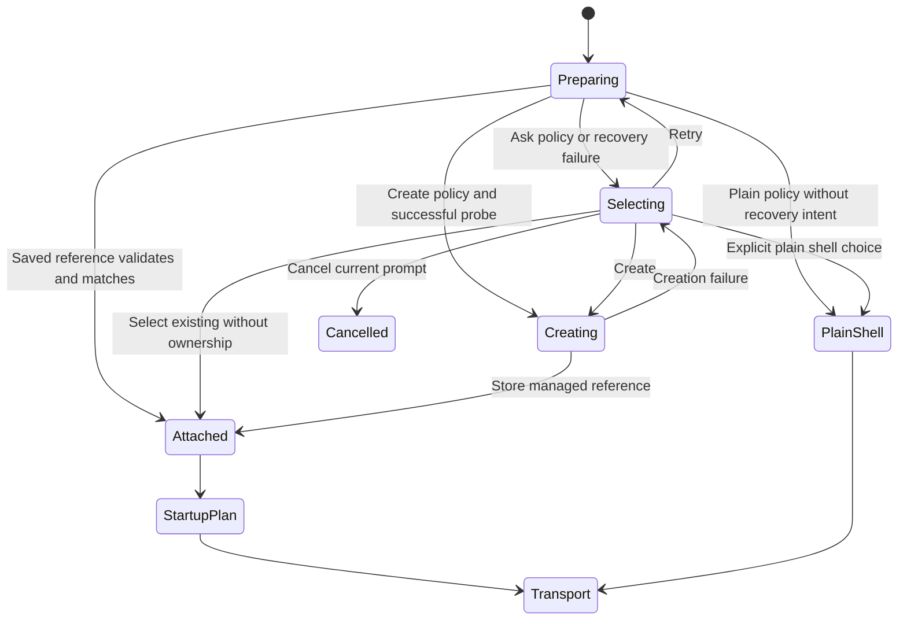
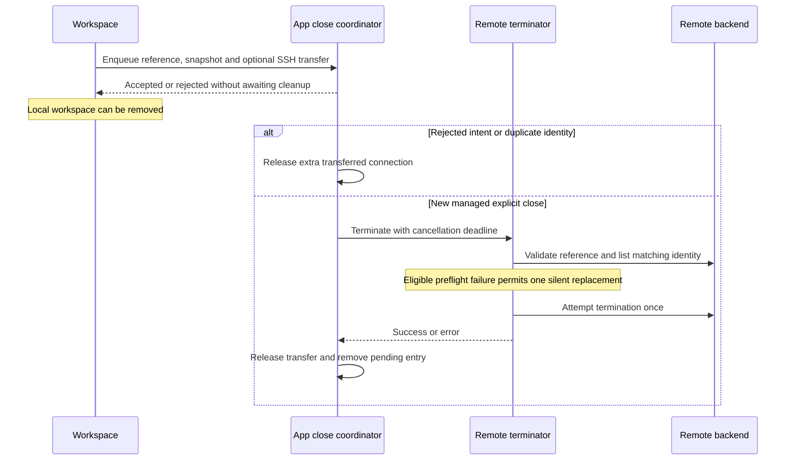
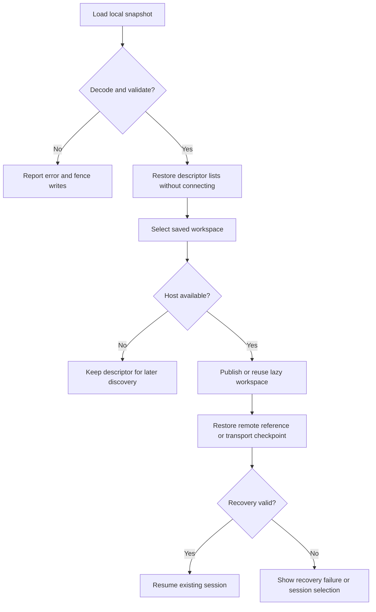

# Remote Session Persistence

Session Persistence keeps a remote shell session independently of a terminal connection. It is separate from [Mosh + Eternal Terminal](../integrations/mosh-and-eternal-terminal.md), which recover a transport and its PTY, and from local workspace restoration, which remembers what the app should reopen. None of these alone guarantees that a remote process survives server restart.

## Preferences and backend ownership

Preferences select an enabled flag, backend and on-connect policy: ask, create a managed session, or use a plain shell. Supported backend identifiers are tmux, zellij, zmx and herdr; unknown registry identifiers fail as unsupported rather than selecting another backend. The live registry constructs the backend supplied by each registered dialect.

The backend contract covers capability probing, listing sessions, validating references, matching identity, creation, launch and termination. Capabilities explicitly declare window counts, client counts and shell integration; all default to false. Native views consume the coordinator and descriptors instead of interpreting backend identity bytes or assembling shell commands.

| Backend | Window count | Client count | Shell integration |
| --- | --- | --- | --- |
| tmux | Yes | Yes | Yes |
| zellij | No | No | Yes |
| zmx | No | Yes | Yes |
| herdr | No | No | Yes |

These are declared backend capabilities, not a guarantee that an installed version is supported: probing discovers the executable and validates its version. Managed creation enables [shell integration](shell-integration.md) only when both the request and probed capability allow it. The live dialect registry supplies a dedicated tmux backend and a shared socket-multiplexer backend for the other dialects.

## Selection and startup

Selection separates attachment from managed creation before transport startup.

Selection prompts are generation-bound. Choosing against an obsolete prompt ID does nothing; cancellation clears the pending attachment and closes the connection synchronously before preparation reports cancellation. Creation intent includes backend, Host, endpoint, username, command, shell-integration choice and environment. This scopes managed creation to the actual request rather than only a display name.

`SSHPTYStartupPlan` carries a command and optional runtime attachment, not a shell-event token. A restored Mosh/ET transport skips startup preparation because its PTY already exists. Fresh attachment and restored transport must not both execute the startup command.

## References are capabilities

A reference binds version, backend, session identity, Host UUID, endpoint, username and optional ownership token. Session names and counts are presentation metadata; changing them does not change recovery identity. Backend identity is versioned data, never an arbitrary command. URL input must never grant managed ownership.

An ownership token distinguishes a managed session from an existing session merely attached by Termind. Do not infer ownership from a name, a matching Host, or the presence of a restoration descriptor. Backend validation and ownership checks still apply when ending remote work.

## Close, detach and remote exit

Only explicit close has `endsManagedSession` semantics. Application termination, suspension, remote exit and detach do not themselves authorize remote termination. Native window dismissal detaches clients; it is not interchangeable with an explicit workspace-close action.

### Background close handoff

Explicit close does not wait for remote cleanup. `takePersistentSessionCloseRequest` captures the managed reference and an `SSHAdditionalConnectionSnapshot`. On ordinary SSH, it transfers the channel and clears the workspace's `ssh` field so workspace teardown cannot also disconnect it. Mosh/ET do not transfer their potentially interactive control callback. Mobile can also build a request for an unopened saved descriptor, and prioritizes requests with transferred connections.

`RemoteSessionCloseCoordinator.enqueue` accepts only managed references with `endsManagedSession` intent. It deduplicates **pending identities**, not all concurrent work: different identities may close concurrently. A duplicate counts as accepted but releases its extra connection without another termination. Rejected requests also release any transferred connection. This is pending-operation deduplication, not a permanent record of ended sessions.

The app-owned coordinator survives workspace removal. Each operation has a default 30-second cancellation deadline; `cancelAll` and coordinator destruction cancel pending tasks. Cancellation is cooperative, not proof that a remote command was undone or a hard deadline for a non-cooperative executor. Errors are swallowed as best-effort cleanup, and the pending entry is removed after the operation finishes and its connection is released. No successful-termination result is published to the workspace.

`RemoteSessionCloseConnection` is the exactly-once release boundary: its actor sets `released` before awaiting the release closure, making repeated disconnect calls harmless and rejecting executor acquisition after release. Thus both the terminator and coordinator may request release safely, including cancellation before execution.

Explicit close separates local removal from one-shot remote cleanup ownership.

### Safe termination and reopen behavior

`RemoteSessionTerminator` first prepares the transferred channel for control, validates the backend reference and lists sessions to match identity. Only connection/preflight failure can use one silent replacement connection; a semantic `RemoteSessionFailure` other than `.timedOut` is not eligible. **Once a termination command is attempted, it is never retried**, even if its outcome is uncertain.

A replacement comes from the saved snapshot, forbids interaction, clears `beforeConnect`, disables agent forwarding, and checks Host ID, endpoint and username against the reference before connecting. It validates the remote identity again; backends recheck identity and ownership in the termination command. Both success and failure disconnect the cleanup connection. Missing credentials or mismatched identity must not turn cleanup into a prompt, a new shell, or termination of another session.

Passive window dismissal preserves mobile reopen references and skips managed termination. Explicit close clears the reference from reopen records **when cleanup was accepted**, including an unopened descriptor, so reopening cannot race an in-flight termination. Consequently a cleanup failure does not restore that reference to the reopen record; preserving identity on passive detach must not be confused with explicit-close reopen behavior.

Implementation: [close coordinator](../../Frameworks/TermindApplication/Terminal/RemoteSessionCloseCoordinator.swift), [terminator](../../Frameworks/TermindRemoteInfrastructure/SSH/RemoteSessionTerminator.swift), and [mobile workspace session](../../TFI/App/MobileWorkspaceSessionModel.swift).

A remote command exit alone is not proof of session loss. `RemoteSessionBackendRegistry.sessionExists` lists sessions and matches backend identity; it throws on lookup failure rather than converting failure to `false`. Native exit handlers retain an unknown (`nil`) result on error and ignore results belonging to an obsolete connection attempt or changed attachment.

| Inspection result | Recovery state | Close local terminal? |
| --- | --- | --- |
| Matching session exists | Preserve reference, mark detached | No |
| Lookup failed or unknown | Preserve reference, mark detached | No |
| Successful lookup confirms no match | Clear reference and require selection | Only if exit code is zero |

Thus a confirmed absence with a nonzero exit still clears recovery identity but leaves the failure visible. An ended session requires an explicit choice rather than automatic replacement, even under `createManaged` policy.

## Local restoration

Local workspace descriptors describe intent, not live clients or ownership acquired from external links. Eligible SSH persistence references and Mosh/ET descriptors can survive cold launch without initiating a connection. Transport checkpoints remain a separate encrypted, one-shot recovery mechanism. Missing Hosts, unsupported backends, stale ownership and invalid checkpoint state must remain explicit recovery failures rather than silently creating replacements.

`MobileWorkspaceStore` stores version-1 JSON under `mobile.restorableWorkspaces.v1`, mapping native session IDs to descriptor lists. Validation requires nonempty session keys and globally unique descriptor IDs. A missing value is an empty snapshot; wrong value types, decoding errors, unknown versions and invalid structure fail loading and permanently fence saves on that store instance. The original bytes are not replaced by an empty snapshot. Legacy `mobile.workspaces.v1` and `mobile.recentlyClosed.v2` keys are retired separately.

Cold launch builds `MobileWorkspaceSessionModel` lists, not live workspaces or connections. `openWorkspace` lazily constructs and publishes one workspace per descriptor, restores its reference and marks resumable transports as requiring recovery. Repeated selection returns the same live workspace. Missing or unavailable Hosts leave descriptors intact for later discovery. A failed snapshot read is also not an authoritative empty list for live-activity updates.

Restoration preserves saved intent without silently substituting a new remote shell.

For a Mosh/ET descriptor without a usable checkpoint, repeated selection must not bootstrap a fresh shell. If it also carries a saved multiplexer reference, recovery can retain that reference and return to explicit session selection instead. Commands selected for the original connection are not replayed. See [Platform Runtime](../architecture/platform-runtime.md) for native ownership boundaries.

## Verification and extensions

Start with `SessionPersistenceTests` and mobile terminal-restoration tests. Cover attach versus create, stale prompt selection, endpoint/account mismatch, deduplicated close, termination failure and startup-once behavior. A backend extension needs a dialect, bounded command parsing, capability declarations and ownership validation; implementing only a launch command is insufficient.

Focused regression coverage also includes:

- `SessionPersistenceTests`: passive teardown, immediate enqueue, per-identity batch deduplication, failure without retry, pre-start cancellation and timeout cancellation.
- `RemoteSessionTerminatorTests`: transferred-channel reuse across all four backends, one silent replacement for a dead channel, no retry after uncertain termination, identity mismatch rejection, and exactly-once release after cancellation or duplicate close.
- `MobileTerminalRestorationTests`: passive versus explicit unopened-descriptor close, no resurrection of ended references, cold-launch lists without connections, missing checkpoints without new shells, unknown-version write protection and deferred Host discovery.

These documentation changes do not constitute a real-server interoperability test. Validate each backend and version against an actual server before relying on lifecycle guarantees. See [SSH Session Lifecycle](../workflows/ssh-session-lifecycle.md).
