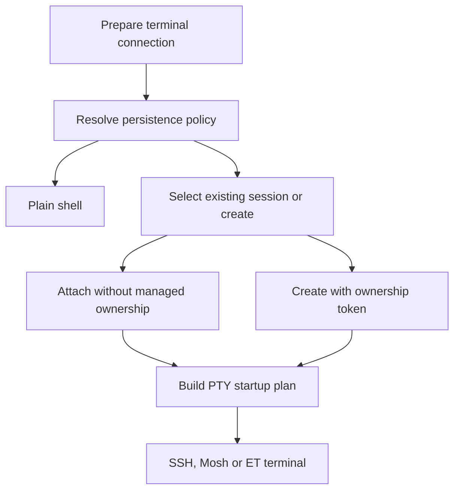

# Session Persistence

Session Persistence keeps a remote shell session independently of a terminal connection. It is separate from [Mosh + Eternal Terminal](../integrations/mosh-and-eternal-terminal.md), which recover a transport and its PTY, and from local workspace restoration, which remembers what the app should reopen. None of these alone guarantees that a remote process survives server restart.

## Preferences and backend ownership

Preferences select an enabled flag, backend and on-connect policy: ask, create a managed session, or use a plain shell. Supported backend identifiers are tmux, zellij, zmx and herdr; unknown registry identifiers fail as unsupported rather than selecting another backend. The live registry constructs a multiplexer service from each registered dialect.

The backend contract covers capability probing, listing sessions, validating references, matching identity, creation, launch and termination. Optional window/client counts are capabilities, not universal fields. Native views consume the coordinator and descriptors instead of interpreting backend identity bytes or assembling shell commands.

## Selection and startup

Selection prompts are generation-bound. Choosing against an obsolete prompt ID does nothing; cancellation clears the pending attachment and closes the connection synchronously before preparation reports cancellation. Creation intent includes backend, Host, endpoint, username, command, shell-integration choice and environment. This scopes managed creation to the actual request rather than only a display name.

The startup plan carries a command, optional shell-event token and runtime attachment. A restored Mosh/ET transport skips startup preparation because its PTY already exists. Fresh attachment and restored transport must not both execute the startup command.

## References are capabilities

A reference binds version, backend, session identity, Host UUID, endpoint, username and optional ownership token. Session names and counts are presentation metadata; changing them does not change recovery identity. Backend identity is versioned data, never an arbitrary command. URL input must never grant managed ownership.

An ownership token distinguishes a managed session from an existing session merely attached by Termind. Do not infer ownership from a name, a matching Host, or the presence of a restoration descriptor. Backend validation and ownership checks still apply when ending remote work.

## Close, detach and remote exit

Only explicit close has `endsManagedSession` semantics. Application termination, suspension, remote exit and detach do not themselves authorize remote termination. Native window dismissal detaches clients; it is not interchangeable with an explicit workspace-close action.

The close coordinator deduplicates managed references by identity, rejects concurrent close attempts and checks generation/cancellation between operations. Termination is best effort: failure falls back to disconnecting while retaining recovery identity, without force-killing a session or pretending it ended. Cancellation stops the close attempt.

A remote command exit alone is not proof of session loss. The coordinator marks a session ended only when inspection says it no longer exists; a successful exit then permits local terminal closure. Unknown or failed inspection preserves the reference as detached.

## Local restoration

Local workspace descriptors describe intent, not live clients or ownership acquired from external links. Eligible SSH persistence references and Mosh/ET descriptors can survive cold launch without initiating a connection. Transport checkpoints remain a separate encrypted, one-shot recovery mechanism. Missing Hosts, unsupported backends, stale ownership and invalid checkpoint state must remain explicit recovery failures rather than silently creating replacements.

## Verification and extensions

Start with `SessionPersistenceTests` and mobile terminal-restoration tests. Cover attach versus create, stale prompt selection, endpoint/account mismatch, deduplicated close, termination failure and startup-once behavior. A backend extension needs a dialect, bounded command parsing, capability declarations and ownership validation; implementing only a launch command is insufficient.

These documentation changes do not constitute a real-server interoperability test. Validate each backend and version against an actual server before relying on lifecycle guarantees. See [SSH Session Lifecycle](../workflows/ssh-session-lifecycle.md).
