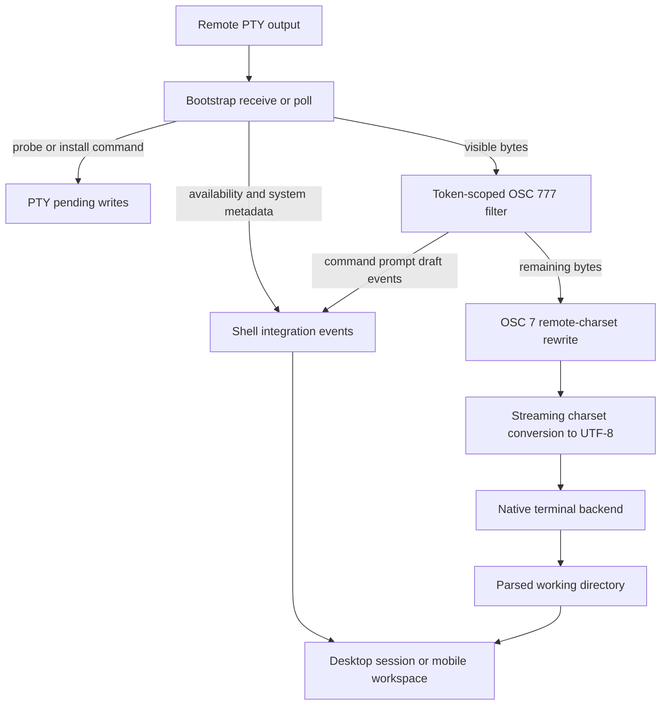
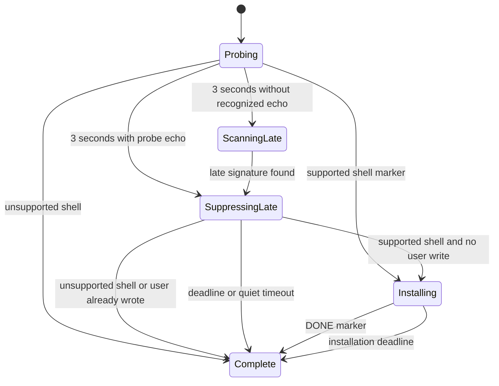

# Shell Integration: Bootstrap, OSC Events, and Terminal State

## Ownership and entrypoint

Shell integration is a **PTY feature**, not a prerequisite for authentication or a script run on every SSH connection. `SSHPTYChannelWorker.connect` opens the session channel, requests an `xterm-256color` PTY, sends configured environment requests, starts the shell, installs the nonblocking transport buffer, and only then queues `RemoteShellIntegrationBootstrap.startCommand` when enabled. Environment rejection is nonfatal only for `LIBSSH2_ERROR_CHANNEL_REQUEST_DENIED`; other errors fail setup. Non-PTY exec, SFTP, forwarding, and Metrics use their own paths rather than this bootstrap.

`HostShellIntegrationMode` resolves `followGlobalSettings`, `enabled`, or `disabled` against the global terminal preference. Desktop and mobile capture that decision at the beginning of a connection attempt; changing settings does not retrofit hooks into the live shell. `HostShellIntegrationSessionTests.connectionRetainsItsPreferenceUntilTheNextAttempt` protects this boundary.

The value-type bootstrap and event filter are driven by the PTY's queue-confined worker behind its actor facade. Keep the pure parsing/state-machine seams separate from native feature state. For authentication and teardown context, start with [SSH Session Lifecycle](/openwiki/workflows/ssh-session-lifecycle.md); for shared I/O ownership, use [SSH Multiplexing and Scheduling](/openwiki/concepts/ssh-multiplexing-and-scheduling.md).

## End-to-end byte and event path

`deliverOutput` first lets the bootstrap suppress its exchange. `applyShellIntegrationUpdate` queues any next command, emits availability/home/system events, and routes visible bytes through `deliverIntegratedOutput`. That method removes recognized OSC 777 frames, forwards remaining output, then emits its ordered event array. `emitConvertedOutput` rewrites OSC 7 before the streaming charset converter and terminal callback. Thus parsing is not performed by searching already-rendered terminal text, and ordering within the event array does not imply atomic ordering with native terminal rendering.

## Probe and install state machine

The bootstrap creates a per-instance UUID-derived token. The first command starts with an inert `__TRMD_<token>_PROBE__` argument to `command true`; that early marker survives common line-editor redraws better than matching the full command. A POSIX `sh` helper reads `/etc/os-release` or `/usr/lib/os-release` as **assignment text**, not by sourcing it, and reports selected fields plus `uname` values. A separate marker reports `$SHELL`; its basename selects Bash, Zsh, or Fish. This is detection from the environment's shell path, not an executable/process identity attestation.

The exchange uses tokenized text markers:

| Marker | Purpose |
| --- | --- |
| `__TRMD_<token>_PROBE__` | Identify probe echo, including a colorized/redrawn command line. |
| `__TRMD_<token>_SYSTEM__…__` | Carry distribution and kernel fields. |
| `__TRMD_<token>_SHELL__…__` | Select the shell-specific installer. |
| `__TRMD_<token>_HOME__…` | Carry percent-encoded remote `$HOME`. |
| `__TRMD_<token>_DONE__` | Complete installation and release the preserved banner/final prompt. |

The first probe deadline is **3 seconds**. It restores ordinary output and reports home resolution unavailable, but intentionally does **not** mark the bootstrap complete: a late-signature scanner remains active. The scanner streams unrelated output through, retains only a possible signature suffix, and flushes an unresolved suffix after **500 ms** of quiet. Recognized late-probe suppression ends at its 3-second deadline or after 500 ms of quiet. Installation gets its own 3-second deadline.

`write(_:)` calls `noteUserInput` before appending user bytes. If a supported probe arrives **late** after any user write, the bootstrap skips installation so it does not inject a hook command into the user's new input. This check is specifically the late-probe branch; it is not a general rule that any early keystroke immediately cancels bootstrap. An unsupported shell likewise gets no installation command. Successful installation emits the saved banner plus bytes after the DONE line; timeout cleanup attempts to keep the latest prompt while hiding probe/installer echo.

Home parsing percent-decodes using the configured remote charset, accepts only an absolute path, and rejects control characters/newlines. Missing or invalid home metadata does not make a supported hook installation fail. System metadata is optional as well.

## Hooks installed in each remote shell

The installer defines functions and bindings in the **current shell session**; it does not edit `.bashrc`, `.zshrc`, or a Fish configuration file. A token variable guards repeat installation for that token. The scripts report cwd as standard `OSC 7;file://localhost<percent-encoded PWD>` and use private OSC 777 frames for other events.

| Shell | Command/prompt hooks | Compose bindings and compatibility details |
| --- | --- | --- |
| Bash | Uses `bash-preexec` arrays when present; otherwise composes the existing DEBUG trap and prepends its prompt function to array/string `PROMPT_COMMAND`. | Reads `READLINE_LINE`; supports emacs-standard, vi-insertion, and vi-command maps. Internal `__termind_*` calls are excluded from command-start reporting. |
| Zsh | Adds `preexec` and `chpwd` hooks and prepends its prompt function to `precmd_functions` while retaining peers. | Reads `BUFFER`; binds emacs, viins, and vicmd. Uses `command_status`, not Zsh's read-only special parameter `status`, and returns the previous exit status. |
| Fish | Uses `fish_preexec`, `fish_postexec`, `fish_prompt`, and PWD-variable events. | Reads `commandline`; binds default, insert, and visual maps. Completion uses `$status` and `$CMD_DURATION`. |

Bash/Zsh compute duration from whole-second `SECONDS` deltas expressed in milliseconds; Fish supplies `CMD_DURATION`. Do not interpret all reported durations as equally precise. Bash/Zsh prompt hooks emit completion when active, then cwd and prompt; Fish completion is reported by its postexec hook. The runtime Zsh tests exercise real interactive preexec/precmd chains and a prompt plugin that captures startup stdout, not merely syntax validity.

## OSC event protocol and parser limits

The following are descriptions of wire frames, not strings to paste into a terminal. `ESC` is `0x1B` and `BEL` is `0x07`:

| Frame between `ESC ]` and `BEL` | Local event |
| --- | --- |
| `777;TermindCommand=<token>;<encoded text>` | `commandStarted(String)`; empty commands are rejected. |
| `777;TermindCommandFinished=<token>;<status>[;<milliseconds>]` | `commandFinished(Int32, duration:)`. |
| `777;TermindPrompt=<token>` | `promptReady`; only an empty payload is accepted. |
| `777;TermindDraft=<token>;<encoded text>` | `draft(String)`; an empty draft is valid. |

`RemoteCommandEventFilter` finds the earliest recognized prefix, preserves preceding output, waits for BEL, decodes the event, and repeats. It retains incomplete prefix suffixes across SSH reads, so a frame split at any byte still works. Command/draft payloads are percent-decoded to remote-charset bytes and then converted to text. Status must be `0...255`; a valid optional duration is an unsigned value no larger than `31_536_000_000` milliseconds and is converted to seconds. Invalid duration becomes absent rather than invalidating a valid status.

Payload retention is capped at **64 KiB** for recognized frames. An oversized unterminated frame is dropped so future output can resume; an oversized terminated frame is skipped. Ordinary output, OSC 0/2 titles, and wrong-token OSC 777 data remain on the terminal path and generate no local command events.

The token provides **session scoping and accidental/spoofed-frame rejection without the matching token**, not cryptographic authentication against the remote host: the installer sends the token to that host and stores it in shell state. Treat command text, paths, and system fields as remote input even after they pass this parser. Also, OSC 7 is a standard terminal signal and is not authenticated by the OSC 777 token.

## Cwd, home, history, and composition are different state

- **Cwd** comes through the terminal's OSC 7 handling. `RemoteOSC7CharsetFilter` recognizes `file://localhost`, decodes the remote-charset path and re-encodes it as percent-encoded UTF-8 before the terminal parses it. Desktop observes `TerminalViewState.workingDirectory`. **Home** comes from the bootstrap HOME marker and is stored separately for path display; an unresolved home is not evidence that cwd is absent.
- **Availability** means installation completed. On desktop, `.available` sets integration available but leaves `isShellPromptReady = false`; `.promptReady` sets it true and `.commandStarted` clears it. Mobile intentionally also treats `.available` and `.commandFinished` as prompt-ready recovery boundaries, because a separate prompt marker may not reach mobile state. Do not merge these policies during a shared-state refactor.
- **History** is driven by command-start/completion events, not by recording every keystroke. Both consumers normalize explicit line continuations and associate completion with the active recorded row. Their one-shot startup-command exclusion suppresses only the matching synthetic command rather than disabling subsequent history.
- **Startup submission readiness** is separate from command-generator prompt readiness. Desktop can unblock a pending startup command on `.available`, `.promptReady`, or `.homeResolutionUnavailable`, so failed/late integration does not indefinitely withhold startup work.
- **Composition** reads the current shell draft with `ESC [777;1~`. `TerminalCommandDraftController` allows one pending read, times it out after 2 seconds, and resolves it from a draft event. Replacement sends the clear binding `ESC [777;2~` followed by bracketed-paste start/content/end, with no submit newline. The feature gates reads on a live supported shell, enabled/available integration, and prompt readiness.

Desktop callbacks reject a mismatched `connectionAttemptID`. Mobile serializes exit and shell events through one `AsyncStream` consumer guarded by the workspace generation, preserving event consumption order across MainActor delivery. Closing the PTY clears bootstrap, command filter, converters, and pending input; the underlying SSH connection may remain alive if sibling SFTP channels still own it. See the transfer lifetime distinction in [SFTP Workflow](/openwiki/workflows/sftp-transfer-and-external-edit.md).

## Debugging and focused test map

| Symptom or change | First seam to inspect | Regression evidence |
| --- | --- | --- |
| Probe/installer text appears, or a slow login loses its prompt | `receiveProbe`, `scanForLateProbe`, `poll`, `cleanBufferedOutput` | `ShellIntegrationBootstrapTests`: redraw, chunked late probe, quiet timeout, user-input skip, unsupported shell. |
| Zsh prompt or ordinary output disappears | Installer's prompt hook and exit-status preservation | `zshRunsPromptHooksAndPreservesCommandOutput`, including startup-output capture. |
| History duplicates or has no completion | OSC token/parser, then feature's active history row | `CommandHistoryTests`, including split frames, order, wrong token, invalid status and oversized recovery. |
| Cwd contains mojibake | OSC 7 rewrite before output conversion, not history decoding | `RemoteOSC7CharsetFilter` and `RemoteCharsetTests`. |
| Compose is enabled while a command runs | Availability versus prompt-ready transitions | `TerminalCommandDraftControllerTests`; `MobileCommandGeneratorAndUploadTests` prompt/integration cases. |
| Settings change an already connected shell | Attempt-time preference capture | `HostShellIntegrationSessionTests`; mobile `integrationUsesConnectionSnapshotUntilManualOrAutomaticReconnect`. |

The listed tests are source evidence, not a claim that live remote shells or the test suite were executed during this documentation update. Use the pinned-package commands in [Engineering Quickstart](/openwiki/quickstart.md) for implementation changes.
