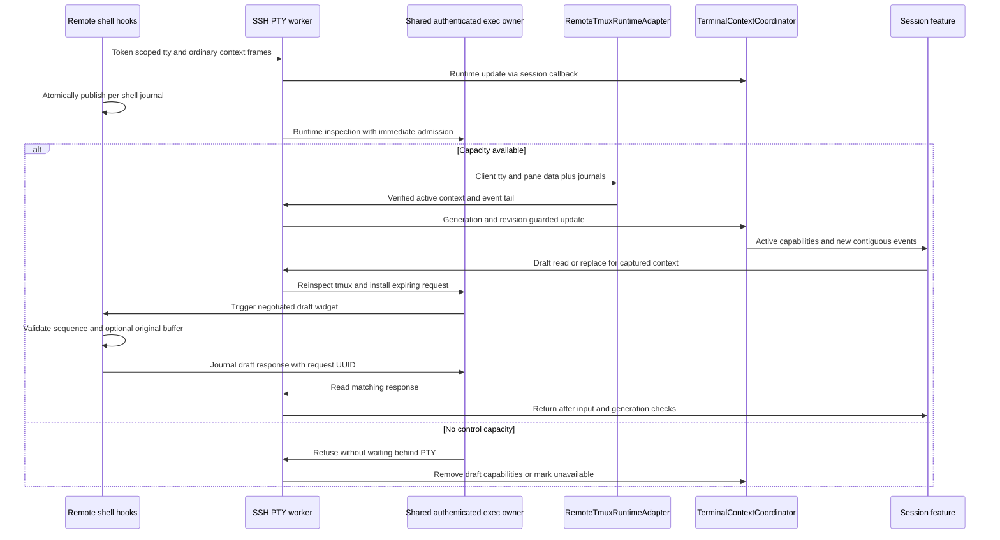
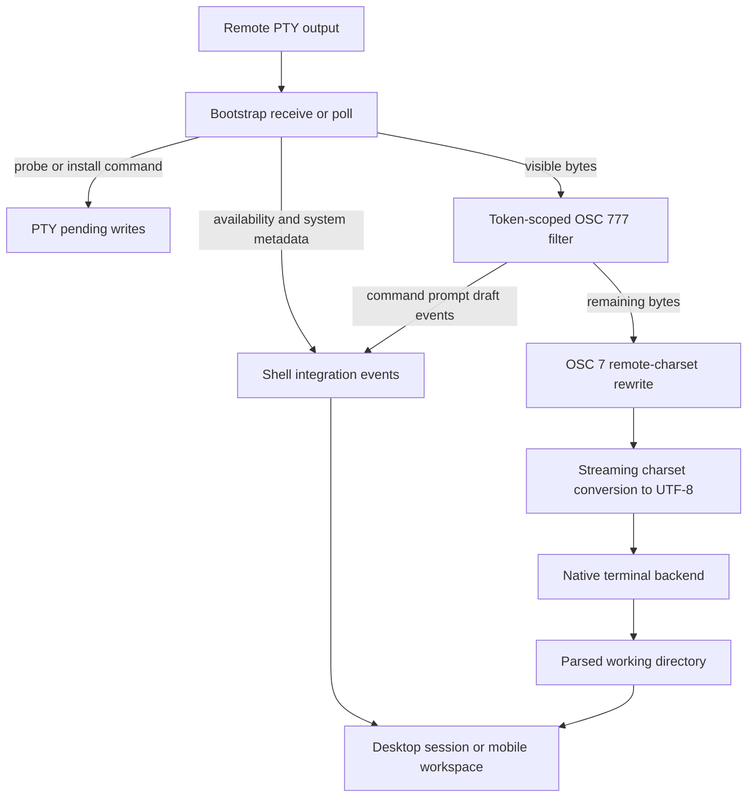
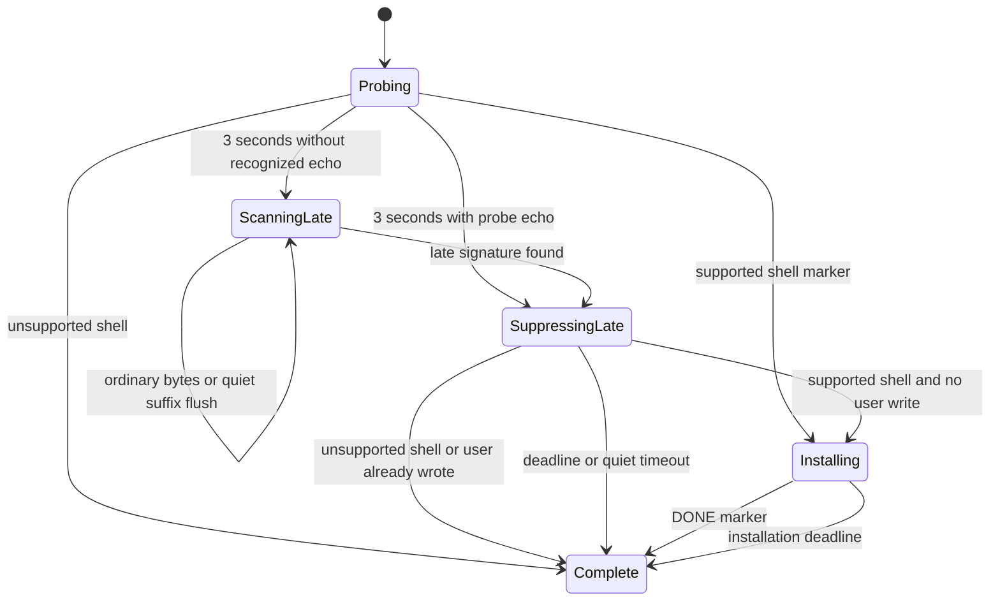
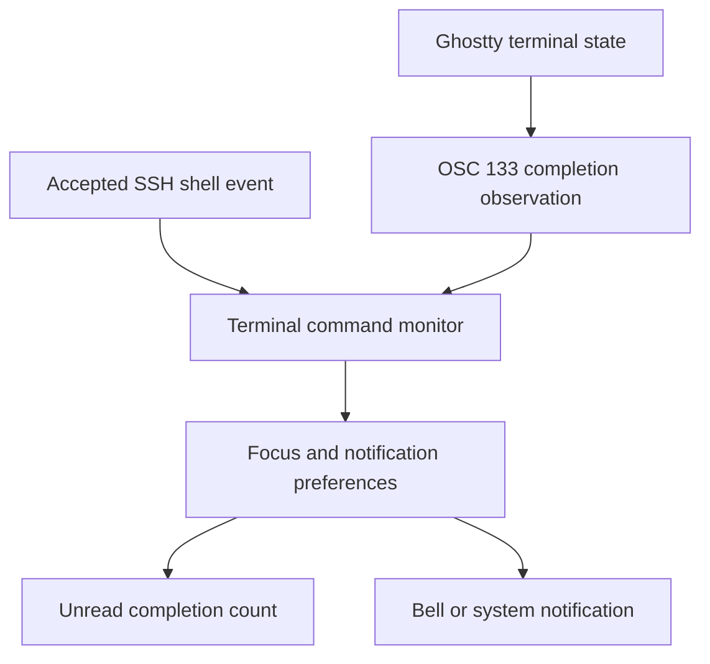
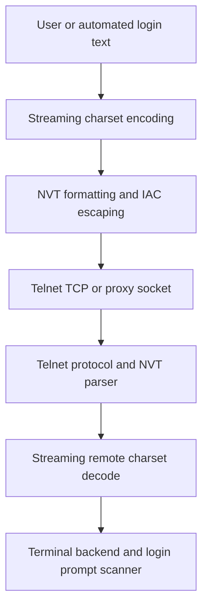

# Shell Integration and Terminal Context

## Ownership and entrypoint

Shell integration is a **PTY startup feature**, not a prerequisite for authentication. When startup preparation is configured or integration is enabled, `SSHPTYChannelWorker.connect` uses `connectPrepared`: authenticate, install the nonblocking transport/pump, run preparation and optional system probing over exec channels, prepare private shell startup helpers, then open the PTY. PTY setup requests `xterm-256color` and environment before starting either the prepared exec command or a shell. Environment rejection is nonfatal only for `LIBSSH2_ERROR_CHANNEL_REQUEST_DENIED`; other errors fail setup.

For an ordinary integrated shell, preparation creates `/tmp/termind-shell.XXXXXXXX` with `umask 077` and launches its wrapper instead of typing installer text into an attached terminal. If helper installation fails, integration becomes unavailable: it **never falls back to typing a bootstrap**. This protects login scripts that auto-attach tmux or exec a full-screen program. Without preparation and integration, the plain path simply starts the shell. The older queued bootstrap state machine remains a parsing/testing seam described below, not the normal integration-enabled entrypoint.

`HostShellIntegrationMode` resolves `followGlobalSettings`, `enabled`, or `disabled` against the global terminal preference. Desktop and mobile capture that decision at the beginning of a connection attempt; changing settings does not retrofit hooks into the live shell. `HostShellIntegrationSessionTests.connectionRetainsItsPreferenceUntilTheNextAttempt` protects this boundary.

The value-type bootstrap and event filter are driven by the PTY's queue-confined worker behind its actor facade. Keep the pure parsing/state-machine seams separate from native feature state. For authentication and teardown context, start with [SSH Session Lifecycle](../workflows/ssh-session-lifecycle.md); for shared I/O ownership, use [SSH Multiplexing and Scheduling](ssh-multiplexing-and-scheduling.md).

## Authenticated runtime and active-context ownership

`TerminalContextCoordinator` owns active shell context, not the last event emitter or rendered terminal text. `TerminalContextIdentity` separates backend, server, session, pane, and shell instance. In ordinary mode the startup token identifies server/session and the pane is `shell`; tmux inspection binds the active pane to the client whose tty matches the token-scoped `TermindTerminal` report. Events from other panes may complete commands without changing the active directory.

### Journals and inspection

Each initialized Bash, Zsh, or Fish shell has its own `ctx.*` directory. `RemoteShellContextJournal` atomically renames state/journal temporary files: metadata (`M1`) identifies token, pane, shell instance, shell, home, process and optional history path; state (`R1`) gives sequence, readiness and cwd; the bounded tail contains at most 32 `E1` events. Start clears readiness, prompt sets it, and directory updates cwd. Ordinary shells emit token-scoped `TermindContext` OSC frames with metadata, snapshot and the new event. Managed tmux shells write journals without relying on visible pane output, allowing inspection to observe completions in invisible panes.

`RemoteTerminalContextFilter` removes matching BEL-terminated terminal/context frames before display conversion, retaining split prefixes. It validates the inner token and ordinary `shell` pane. Malformed or oversized recognized frames produce `.unavailable`, not capabilities; its frame bound is 64 KiB. Wrong-token traffic remains ordinary terminal output. Journal parsing separately enforces strict percent escapes, supported shells, identity fields, contiguous tail sequences ending at the snapshot sequence, and record/event bounds. Token scoping is not authentication against a malicious remote host: the host receives the token.

Runtime inspection and draft control share the terminal's existing authenticated SSH transport; they do not open a new authentication route.

The runtime executor uses the shared exec owner with `requiresImmediateCapacity: true`, no channel-open retries, no login shell, a two-second timeout and a 1 MiB output limit. Admission must not wait behind the PTY occupying the channel budget. A server channel refusal latches control unavailable for the session. Publishing then removes ordinary-shell draft capabilities or marks tmux unavailable; terminal input/output remains usable. Observation starts after tty discovery, polls initially after 500 ms, uses 750 ms after a multiplexer result and backs off to at most five seconds otherwise. Worker generation/revision guards discard inspections overtaken by input or newer context frames.

`RemoteTmuxRuntimeAdapter` validates the client tty, client PID/creation, server PID, session ID/creation, pane PID, foreground shell, and journal instance. It does not infer activity from the latest directory event. Read-only or `active-pane` clients are unavailable. A missing journal yields an unintegrated active context with no capabilities. Copy mode, synchronized panes, a foreground non-shell, non-ready shell, or process mismatch cannot reuse a trusted directory/draft. A non-root key table (such as prefix mode) preserves an otherwise verified directory but withholds draft read/replace. Unknown/unavailable status has no active context.

### Tickets, replay and invalidation

Tickets capture coordinator **generation, revision and context identity**, and require a ready active context with all requested capabilities. Reset changes generation and clears contexts/high-water marks/running commands; input increments revision without pretending a context switch occurred. Status, client, active identity, readiness, directory, capabilities, active non-draft events and active sequence gaps can change revision. A draft response alone does not. Consequently a command that starts and finishes between polls still invalidates a draft even if cwd and prompt look unchanged. Asynchronous refresh also checks the latest inspection ID, generation and revision after awaiting the adapter.

Per-context sequence high-water marks suppress duplicate/replayed events. On first joining tmux, snapshot sequences are installed **before** replaying the journal, so past commands do not notify again. Other snapshots establish a high-water mark after processing their event tail, without inventing a command start. A gap clears that context's running-command eligibility; a completion is accepted only after a capability-authorized start and a contiguous event sequence. Old active snapshots are rejected. Independent panes retain separate running state, and an unknown foreground does not forget the outer ordinary shell's pending command (for example manual tmux attach/detach).

Desktop and mobile route runtime updates through the coordinator, then send only accepted events to history and `TerminalCommandMonitor`. They derive cwd, shell, lifecycle availability and prompt readiness from the active snapshot. A revision change cancels draft reads, pending uploads and command generation. Once runtime ownership is established, legacy shell events are ignored; desktop's Ghostty cwd observation is also gated off. Directory-sensitive operations capture and revalidate a `.directory` ticket and use `confirmContext` before committing; see [File Drag and Drop](../workflows/file-drag-and-drop.md).

### Safe draft read and replace

Runtime composition uses `.readDraft`/`.replaceDraft` tickets, `SSHPTYChannel.contextDraft`, and request/response journals—not unconditional clear plus paste. Only one runtime draft request is pending. The worker captures input revision and PTY generation, checks active identity/capability, reinspects tmux for exact snapshot equality, and revalidates after awaits. Replacement is limited to 4096 UTF-8 and encoded bytes and rejects NUL. Remote requests are atomically installed with a UUID, expected sequence, action, two-second expiry and optional original-buffer baseline. The widget consumes the request only at the matching ready sequence; replacement refuses a changed original buffer, including edits from another client. Ordinary mode queues the widget key only after request installation; tmux sends the key to the validated pane with client/session and mode/foreground guards. Neither submits a newline. Result polling reads the matching UUID from the shell-instance journal and local input/generation/context checks run again before returning; failures clear pending state and throw rather than retargeting another pane.

## End-to-end byte and event path

The diagram below preserves the **legacy bootstrap/command-filter path**. Prepared runtime sessions instead select `RemoteTerminalContextFilter` first and publish scoped runtime updates; they do not also run the legacy command filter on those bytes. Both paths feed visible bytes into OSC 7 rewriting and the streaming charset converter. The diagram is not the active-context authority for runtime sessions.

SSH PTY receive flow: event frames are removed before charset conversion, while cwd is rewritten before terminal parsing.

`deliverOutput` first lets the bootstrap suppress its exchange. `applyShellIntegrationUpdate` queues any next command, emits availability/home/system events, and routes visible bytes through `deliverIntegratedOutput`. That method removes recognized OSC 777 frames, forwards remaining output, then emits its ordered event array. `emitConvertedOutput` rewrites OSC 7 before the streaming charset converter and terminal callback. Thus parsing is not performed by searching already-rendered terminal text, and ordering within the event array does not imply atomic ordering with native terminal rendering.

## Legacy probe and install state machine

The following deadlines describe `RemoteShellIntegrationBootstrap` when driven interactively. The prepared connection path uses its probe over exec for optional system information and reuses its installer in startup files; these interactive timeout and late-input transitions do not govern ordinary runtime startup.

The bootstrap creates a per-instance UUID-derived token. The first command starts with an inert `__TRMD_<token>_PROBE__` argument to `command true`; that early marker survives common line-editor redraws better than matching the full command. A POSIX `sh` helper reads `/etc/os-release` or `/usr/lib/os-release` as **assignment text**, not by sourcing it, and reports selected fields plus `uname` values. A separate marker reports `$SHELL`; its basename selects Bash, Zsh, or Fish. This is detection from the environment's shell path, not an executable/process identity attestation.

The exchange uses tokenized text markers:

| Marker | Purpose |
| --- | --- |
| `__TRMD_<token>_PROBE__` | Identify probe echo, including a colorized/redrawn command line. |
| `__TRMD_<token>_SYSTEM__…__` | Carry distribution and kernel fields. |
| `__TRMD_<token>_SHELL__…__` | Select the shell-specific installer. |
| `__TRMD_<token>_HOME__…` | Carry percent-encoded remote `$HOME`. |
| `__TRMD_<token>_DONE__` | Complete installation and release the preserved banner/final prompt. |

Bootstrap lifecycle: a late probe can still install hooks unless the user already wrote to the PTY.

The first probe deadline is **3 seconds**. It restores ordinary output and reports home resolution unavailable, but intentionally does **not** mark the bootstrap complete: a late-signature scanner remains active. The scanner streams unrelated output through, retains only a possible signature suffix, and flushes an unresolved suffix after **500 ms** of quiet. Recognized late-probe suppression ends at its 3-second deadline or after 500 ms of quiet. Installation gets its own 3-second deadline.

`write(_:)` calls `noteUserInput` for nonempty writes before conversion and queuing. If a supported probe arrives **late** after any user write, the bootstrap skips installation so it does not inject a hook command into the user's new input. This check is specifically the late-probe branch; it is not a general rule that any early keystroke immediately cancels bootstrap. An unsupported shell likewise gets no installation command. Successful installation emits the saved banner plus bytes after the DONE line; timeout cleanup attempts to keep the latest prompt while hiding probe/installer echo.

The late scanner recognizes the full probe echo, the early PROBE token, or the SHELL marker. For a PROBE match it suppresses from the start of that line, hiding prompt prefixes and redraw escapes too. Scanning has **no overall expiry**: a 500 ms quiet flush releases a possible signature suffix without completing the bootstrap. Once a signature is recognized, suppression has a bounded deadline. A successful SHELL or DONE parse requires a terminating newline, so fragmented metadata remains buffered until its line completes.

Socket readiness drives reads, while a 100 ms pump timer advances bootstrap deadlines and keepalive. In a pump pass the worker reads PTY bytes, polls the bootstrap, then drains pending writes. Probe and installer bytes join that queue directly; they are not user writes and do not set `userDidWrite`. The deadlines are measured by monotonic uptime, not by rendered terminal activity or an acknowledgement that a queued command was transmitted.

Home parsing percent-decodes using the configured remote charset, accepts only an absolute path, and rejects control characters/newlines. Missing or invalid home metadata does not make a supported hook installation fail. System metadata is optional as well.

## Hooks installed in each remote shell

The installer defines functions and bindings in the **current shell session**. Prepared startup creates private wrapper/configuration files under the helper directory, not edits to the user's `.bashrc`, `.zshrc`, or Fish configuration. Bash explicitly sources login profiles before hooks; Zsh forwards startup files through the user's `ZDOTDIR`; Fish uses `--init-command`. A login script that execs elsewhere intentionally bypasses remaining wrapper work. A token variable guards repeat installation. Runtime installers report cwd, prompt, command and draft events through the journal; legacy installers report standard OSC 7 cwd and private OSC 777 events.

| Shell | Command/prompt hooks | Compose bindings and compatibility details |
| --- | --- | --- |
| Bash | Uses `bash-preexec` arrays when present; otherwise composes the existing DEBUG trap and prepends its prompt function to array/string `PROMPT_COMMAND`. | Reads `READLINE_LINE`; supports emacs-standard, vi-insertion, and vi-command maps. Internal `__termind_*` calls are excluded from command-start reporting. |
| Zsh | Adds `preexec` and `chpwd` hooks and prepends its prompt function to `precmd_functions` while retaining peers. | Reads `BUFFER`; binds emacs, viins, and vicmd. Uses `command_status`, not Zsh's read-only special parameter `status`, and returns the previous exit status. |
| Fish | Uses `fish_preexec`, `fish_postexec`, `fish_prompt`, and PWD-variable events. | Reads `commandline`; binds default, insert, and visual maps. Completion uses `$status` and `$CMD_DURATION`. |

Bash/Zsh compute duration from whole-second `SECONDS` deltas expressed in milliseconds; Fish supplies `CMD_DURATION`. Do not interpret all reported durations as equally precise. Bash/Zsh prompt hooks emit completion when active, then cwd and prompt; Fish completion is reported by its postexec hook. The runtime Zsh tests exercise real interactive preexec/precmd chains and a prompt plugin that captures startup stdout, not merely syntax validity.

## OSC event protocol and parser limits

The following are descriptions of wire frames, not strings to paste into a terminal. `ESC` is `0x1B` and `BEL` is `0x07`:

| Frame between `ESC ]` and `BEL` | Local event |
| --- | --- |
| `777;TermindCommand=<token>;<encoded text>` | `commandStarted(String)`; empty commands are rejected. |
| `777;TermindCommandFinished=<token>;<status>[;<milliseconds>]` | `commandFinished(Int32, duration:)`. |
| `777;TermindPrompt=<token>` | `promptReady`; only an empty payload is accepted. |
| `777;TermindDraft=<token>;<encoded text>` | `draft(String)`; an empty draft is valid. |

`RemoteCommandEventFilter` finds the earliest recognized prefix, preserves preceding output, waits for BEL, decodes the event, and repeats. It retains incomplete prefix suffixes across SSH reads, so a frame split at any byte still works. Command/draft payloads are percent-decoded to remote-charset bytes and then converted to text. Status must be `0...255`; a valid optional duration is an unsigned value no larger than `31_536_000_000` milliseconds and is converted to seconds. Invalid duration becomes absent rather than invalidating a valid status.

For command and draft text, `decodePercentEncoded` unescapes valid `%HH` triplets to bytes, then uses the configured remote charset to produce a Swift string; HOME uses the same helper, while the SHELL and SYSTEM markers decode their raw bytes with that charset. These are per-frame conversions, not the streaming display decoder. If conversion fails, the helper falls back to lossy UTF-8; even when conversion succeeds, bypassed malformed bytes may become replacement characters when converted to a Swift string. The UTF-8 `%FF` command test specifically expects `.commandStarted("�")`; the GB18030 command test establishes non-UTF-8 decoding, but neither test promises byte-perfect command history for malformed text.

Payload retention is capped at **64 KiB** for recognized frames. An oversized unterminated frame is dropped so future output can resume; an oversized terminated frame is skipped. Ordinary output, OSC 0/2 titles, and wrong-token OSC 777 data remain on the terminal path and generate no local command events.

The token provides **session scoping and accidental/spoofed-frame rejection without the matching token**, not cryptographic authentication against the remote host: the installer sends the token to that host and stores it in shell state. Treat command text, paths, and system fields as remote input even after they pass this parser. Also, OSC 7 is a standard terminal signal and is not authenticated by the OSC 777 token.

## Cwd, home, history, and composition are different state

The following legacy client behavior applies **only before runtime context takes ownership**. Runtime snapshots and tickets above supersede these unscoped readiness/draft rules.

- **Cwd** comes through the terminal's OSC 7 handling. `RemoteOSC7CharsetFilter` recognizes `file://localhost`, buffers split prefixes/frames, unescapes the path bytes, decodes using the remote charset and re-encodes them as percent-encoded UTF-8 before the terminal parses them. For malformed UTF-8 `%FF`, the resulting path is `/%EF%BF%BD`, not the original byte. Its 64 KiB unterminated payload limit passes the oversized data through instead of retaining it indefinitely; an unfinished prefix is flushed on PTY close. Desktop observes `TerminalViewState.workingDirectory`. **Home** comes from the bootstrap HOME marker and is stored separately for path display; an unresolved home is not evidence that cwd is absent.
- **Availability** reports bootstrap installation, not a universally observed prompt. On desktop, `.available` sets integration available **and explicitly sets `isShellPromptReady = false`**; only `.promptReady` sets it true, `.commandStarted` clears it, and `.commandFinished` records history without changing readiness. Mobile instead treats `.available` as ready and `.commandFinished` as a recovery boundary **only when integration is available**: its UIKit path may swallow the subsequent prompt marker. `.promptReady` also sets readiness there; command start clears it only after availability. These are client-side policies, not proof that OSC 777 authenticates the remote host. Do not merge them during a shared-state refactor.
- **History** is driven by command-start/completion events, not by recording every keystroke. Both consumers normalize explicit line continuations and associate completion with the active recorded row. Their one-shot startup-command exclusion suppresses only the matching synthetic command rather than disabling subsequent history.
- **Startup submission readiness** is separate from command-generator prompt readiness. Desktop can unblock a pending startup command on `.available`, `.promptReady`, or `.homeResolutionUnavailable`, so failed/late integration does not indefinitely withhold startup work.
- **Composition** reads the current shell draft with `ESC [777;1~`. `TerminalCommandDraftController` allows one pending read, times it out after 2 seconds, and resolves it from a draft event. Replacement sends the clear binding `ESC [777;2~` followed by bracketed-paste start/content/end, with no submit newline. The feature gates reads on a live supported shell, enabled/available integration, and prompt readiness.

Desktop callbacks reject a mismatched `connectionAttemptID`. Mobile serializes exit and shell events through one `AsyncStream` consumer guarded by the workspace generation, preserving event consumption order across MainActor delivery. Closing the PTY clears bootstrap, command filter, converters, and pending input; the underlying SSH connection may remain alive if sibling SFTP channels still own it. See the transfer lifetime distinction in [SFTP Workflow](../workflows/sftp-transfer-and-external-edit.md).

## Completion observation and notifications are not prompt readiness

`TerminalCommandMonitor` is per terminal/workspace and is **separate from command history and the prompt-ready bit**. Desktop SSH and mobile workspaces forward accepted integration events to it; desktop SSH, Telnet, Serial, and mobile terminal surfaces also attach `TerminalCommandObservation` to Ghostty's `TerminalViewState`. The observation drops the initial duration publisher value and reads the exit code in the same sink as each newly published `lastCommandDurationNanos`, including consecutive equal durations. It forwards OSC 133 completion data to the monitor without command text. This fallback can account for command completion even when no Termind hook was installed; it does not assert shell-hook availability or unlock draft composition.

Completion reporting sources converge in the per-terminal monitor; notification delivery is downstream of source selection and independent of history.

At `beginConnection` the monitor permits OSC 133 fallback and clears both unscoped and per-context running commands. Legacy `.available` selects private start/finish reporting and suppresses OSC 133; legacy private finishes require a pending start. `receiveRuntimeEvents` disables unscoped OSC 133 even for an empty event list, and pairs starts/finishes by full context identity so independent panes cannot overwrite each other. `requireScopedEvents` can disable fallback before runtime results arrive. The coordinator, not the monitor, enforces runtime sequence continuity and replay rejection. A valid nonnegative finite reported duration wins, otherwise elapsed nonnegative uptime is used. End/begin clears source and running state across connections. None of these completion paths grants prompt readiness or draft capabilities.

The monitor increments unread completions for background work **before** checking alert eligibility, even for a subthreshold completion, disabled notifications, or a `never` mode; a focused workspace clears the count at completion and `markRead` clears it explicitly. `NotificationPreferences` defaults to enabled, unfocused-only terminal delivery with a five-second minimum and system notifications; mode (`never`, `unfocused`, `always`), focus, nonnegative threshold and master switch determine whether to alert. The app's `TerminalNotificationCoordinator` then selects one delivery route: a bell or a notification targeted to the terminal identity, with live title and policy rechecked at actual system delivery. The command preview in notification content collapses control characters and whitespace and truncates at 160 characters; OSC 133 completions have no command text. Custom Ghostty `notify-on-command-finish` overrides are filtered and the terminal configuration forces it to `never`, leaving app settings in charge of delivery. See `TerminalCommandMonitorTests`, `TerminalNotificationCoordinatorTests`, and `CommandNotificationTests` for duplicate finishes, reconnect, equal-duration publication, focus/threshold and delivery-race coverage.

## Charset boundary and the separate Telnet path

`RemoteCharsetStreamConverter` maps the configured `RemoteCharset` to iconv names (UTF-8, GB18030, Big5, Shift_JIS, EUC-JP, EUC-KR, ISO-8859-1, Windows-1252). It retains incomplete source characters between `convert` calls and `finish` flushes trailing input. Encoding and decoding preserve stream continuity: valid sequences convert, unconvertible bytes pass through verbatim, incomplete characters remain buffered until more input or `finish`, and unavailable iconv falls back to unchanged bytes. `recoveringInvalidInput` remains only for source compatibility and conversion no longer rejects input. A byte stream that survives decoding is not necessarily valid UTF-8: Swift `String(decoding:as:)` used for metadata/events is lossy for invalid UTF-8, and the terminal backend may render such bytes as replacements. Do not interpret `rejectedInput == false` on decode as proof of valid text, or generalize the UTF-8 bypass test to claim all charsets take an identical byte-for-byte path.

For SSH PTY, the worker creates distinct input and output converters from the connection charset. Environment variable names and values are encoded before channel setup; user input is converted before entering the pending SSH write queue, preserving unconvertible bytes rather than rejecting the write. The receive chain in the diagram strips command events and rewrites OSC 7 on raw PTY bytes before streaming text conversion. On orderly terminal close, `finishCharsetOutput` flushes the OSC 7 filter remainder through the output converter and finishes the decoder before clearing session state. Fatal transport/read errors instead call `cleanup` directly, which discards converter/filter state without that tail flush; receive conversion exceptions fall back to raw bytes rather than halting the PTY. Cwd rewriting is installed even if shell integration is disabled, so a remote OSC 7 frame can still reach the terminal; this does not install Termind command hooks.

Telnet uses the same converter **but does not run the SSH shell bootstrap, OSC 777 filter, or OSC 7 rewrite**. Both direct TCP and proxied-socket connection paths configure encoder and decoder before opening the transport. `TelnetProtocolParser` first strips Telnet negotiations and handles NVT data, then the worker decodes application bytes for the terminal and login-prompt scanner; conversion preserves unconvertible application bytes. Input (including automated username/password) is encoded before Telnet NVT formatting and IAC escaping. Unconvertible user and automatic-login bytes are preserved by the converter. Cleanup finishes the output converter to deliver its remaining bytes and clears converter and prompt state. Desktop and mobile Telnet session models pass converted output to their terminal backends and surface charset errors, but do not consume SSH shell integration events for Telnet.

Telnet terminal data path: negotiation is removed before decoding, and outgoing text is encoded before wire escaping; there is no SSH hook installation in this route.

## Metadata disclosure and retention boundaries

Hidden control traffic is not the same as absent data collection. The probe reads `ID`, `ID_LIKE`, and `VERSION_ID` from os-release, plus `uname -s`, `uname -r`, and `uname -m`. `RemoteSystemInfo` accepts only narrow ASCII-token fields, strips matched quotes, and supports both five-field legacy and six-field current probe records. Human-readable os-release names are excluded; invalid fields can be discarded without preventing installation. See [RemoteSystemInfo](../../Frameworks/TermindDomain/Sessions/RemoteSystemInfo.swift) and the hostile-field bootstrap tests.

Installation success emits `.available` with shell, optional system information, and optional home. Unsupported-shell and late-user-input skip paths can still emit `.systemInfo` followed by `.homeResolutionUnavailable`: **metadata availability is not hook availability**. The worker stores the HISTORY source separately for the history loader, rather than exposing it as a command event. Bash/Zsh report `HISTFILE` resolved against PWD when relative; Fish derives its history path from `fish_history` and `XDG_DATA_HOME` or HOME.

Desktop and mobile hold the full remote system description as live session state and reset it for a new connection. They also send validated distribution detection to `HostLibraryModel.recordRemoteSystemInfo`, which persists only meaningful distribution transitions for host/icon presentation—not the full kernel release and architecture snapshot. This is distinct from conversational persistence:

- **Surface session context:** the focused desktop pane supplies `SessionContext` with pane/host identity, cwd, and system fact lines. The session-context chips disclose data sent with the turn; the assistant captures that context for the run. It is data-only context, not instructions, and is not an automatically created conversation attachment. Once submitted, the context snapshot can be retained as hidden replay metadata; “transient” describes the live surface state, not a promise that already-sent facts vanish from a conversation.
- **Explicit attachments:** `promptContextAttachments` come from the composed user turn and travel separately from `sessionContext`/`contextSnapshot`. Persistence stores context attachments separately from message replay metadata. Do not conflate a changing OS chip with a user-attached terminal snapshot or file.
- **Command generation:** draft generation sends shell, cwd, optional `remoteSystemInfo`, and a bounded visible viewport in its model request. Its prompt treats those values as untrusted context and uses OS facts only for platform compatibility. This is separate from assistant conversation attachments.

Follow [Agent Runtime and Assistant](agent-runtime-and-assistant.md) for turn capture and replay, and [Ghostty Terminal Integration](ghostty-terminal-integration.md) for terminal-owned state.

## Debugging and focused test map

Start runtime regressions with [TerminalContextCoordinatorTests](../../FrameworkTests/TerminalContextCoordinatorTests.swift) (active ownership, ticket expiry, replay/gaps, independent panes and unchanged-prompt command invalidation) and [TerminalContextWireTests](../../TFMTests/TerminalContextWireTests.swift) (every frame split, malformed records, unsafe modes, prefix-mode capability separation and immediate budget admission). [TerminalContextRuntimeTests](../../TFMTests/TerminalContextRuntimeTests.swift) is fixture-gated by `TERMIND_TMUX_FIXTURE`: it exercises Bash/Zsh/Fish ordinary and managed shells, invisible completions, manual attach/detach, reconnect without replay, remote draft edits, silent pane switches, capacity refusal and login-script auto-attach without bootstrap input. These are source-grounded acceptance scenarios, not evidence that this update ran the fixture.

Core implementation references: [coordinator](../../Frameworks/TermindApplication/Terminal/TerminalContextCoordinator.swift), [PTY integration](../../Frameworks/TermindRemoteInfrastructure/SSH/SSHPTYChannel.swift), [journal protocol](../../Frameworks/TermindRemoteInfrastructure/SSH/RemoteShellContextJournal.swift), [tmux inspection](../../Frameworks/TermindRemoteInfrastructure/SSH/RemoteTmuxRuntimeAdapter.swift), and [draft requests](../../Frameworks/TermindRemoteInfrastructure/SSH/RemoteTerminalDraft.swift). New runtime backends implement `TerminalRuntimeAdapter` using the existing authenticated transport and return the backend-neutral snapshot/event model; they must preserve active-client binding, capability conservatism and sequence semantics rather than teaching the coordinator tmux commands.

`RemoteShellIntegrationLifecycleLogger` correlates an attempt with host and operation IDs. It records started, delayed, completed, skipped, or timed-out outcomes with stable reasons, stage, late status, and home/system availability flags. It does **not** log the token, remote shell path, home path, or system field values. A terminal outcome consumes the logger's operation ID, so later session-end cleanup does not emit a duplicate outcome. `ShellIntegrationLoggingTests` asserts both redaction and this deduplication; use these diagnostics instead of exposing hidden bootstrap traffic.

| Symptom or change | First seam to inspect | Regression evidence |
| --- | --- | --- |
| Probe/installer text appears, or a slow login loses its prompt | `receiveProbe`, `scanForLateProbe`, `poll`, `cleanBufferedOutput` | `ShellIntegrationBootstrapTests`: redraw, chunked late probe, quiet timeout, user-input skip, unsupported shell. |
| Zsh prompt or ordinary output disappears | Installer's prompt hook and exit-status preservation | `zshRunsPromptHooksAndPreservesCommandOutput`, including startup-output capture. |
| History duplicates or has no completion | OSC token/parser, then feature's active history row | `CommandHistoryTests`, including split frames, order, wrong token, invalid status and oversized recovery. |
| Cwd contains mojibake or invalid path bytes | OSC 7 rewrite before output conversion, not history decoding | `RemoteCharsetTests`: GB18030 cwd UTF-8 rewrite and UTF-8 `%FF` lossy rewrite. |
| Text cannot be sent, or malformed incoming bytes display oddly | Outgoing and inbound byte preservation and terminal rendering; Telnet strips protocol bytes before decoding | `RemoteCharsetTests`: representative charset round-trips, every GB18030 multibyte split, ISO-8859-1 unrepresentable-byte preservation, UTF-8 bypass and legacy malformed/trailing-byte recovery. |
| Compose is enabled while a command runs | Availability versus prompt-ready transitions | `TerminalCommandDraftControllerTests`; `MobileCommandGeneratorAndUploadTests` prompt/integration cases. |
| Settings change an already connected shell | Attempt-time preference capture | `HostShellIntegrationSessionTests`; mobile `integrationUsesConnectionSnapshotUntilManualOrAutomaticReconnect`. |

The listed tests are source evidence, not a claim that live remote shells or the test suite were executed during this documentation update. Use the pinned-package commands in [Engineering Quickstart](../quickstart.md) for implementation changes.

After authentication, each terminal’s memory-only `CommandHistoryModel` loads a bounded remote history snapshot through `RemoteShellHistoryLoader`, then merges live shell events. Installer metadata supplies the shell history path. Reconnect keeps a completed snapshot; disconnect cancels an unfinished read and close clears the session history.
