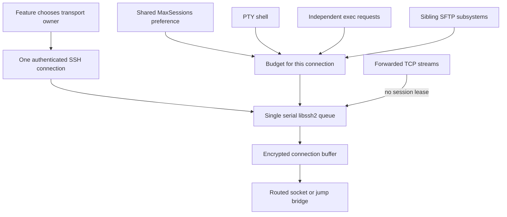
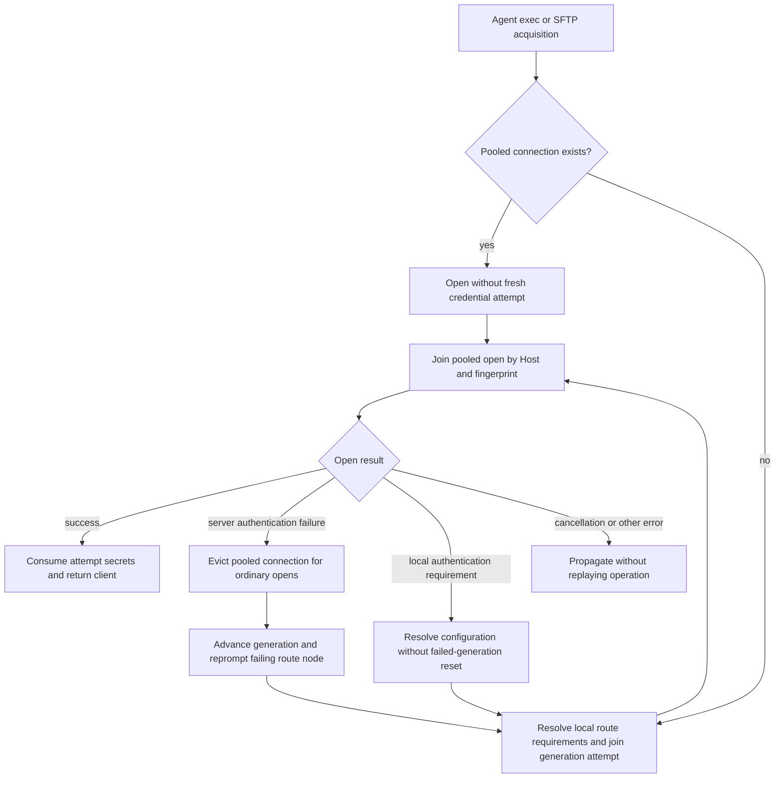

# SSH Multiplexing, Channel Admission, and I/O Scheduling

## What multiplexing means here

An authenticated **connection** owns a libssh2 session and routed byte transport. A **channel** is a protocol stream within that connection: a PTY shell, non-PTY exec, SFTP subsystem, or forwarded TCP stream. Termind's multiplexing reuses these in-process authenticated owners; the code described here is not OpenSSH `ControlMaster`/`ControlPath` process management. Opening another channel avoids another authentication exchange; opening another physical connection does not.

Concurrency therefore has several independent meanings:

| Layer | Unit and owner | Admission or scheduling |
| --- | --- | --- |
| Feature connection reuse | Terminal/session, Agent pool, forwarding Host context, or SFTP transfer context | Determines which authenticated connection an operation may use. |
| SFTP file admission | Logical file, across distinct endpoint Hosts | `SFTPConcurrencyScheduler` rotates hosts and work sources; it is not a byte scheduler. |
| Session-channel admission | PTY/exec/subsystem lease on one connection | `SSHChannelBudget` applies a FIFO ceiling, default 10. |
| libssh2 ownership | A single session handle | The owning dispatch queue serializes every library call. |
| I/O progression | Exec command, forwarding flow, or SFTP operation | Bounded nonblocking turns yield to peers; the exact wake/retry mechanism depends on the owner. |

Do not conflate an `SSHChannelLease` with an SFTP file permit or with a pool slot. More admitted files need not mean more sockets; more forwarding sockets do not increase the channel ceiling on an existing connection. The file scheduler grants one global permit per logical file operation and consumes one per-host slot for each distinct endpoint (so a cross-host copy uses one global slot and two host slots). It rotates eligible hosts before work sources within a host; the `smart` strategy chooses channels at unknown size or at most 64,000,000 bytes and prefers connections above that threshold. This mode is a selection hint for the transfer context, not permission to exceed a connection's channel budget.



This is a conceptual layering diagram, not a claim that every owner supports every channel type. The PTY worker owns terminal plus sibling SFTP channels; `SSHConnectionWorker` owns exec plus SFTP; forwarding has its own worker.

## Serial ownership is not serial completion

`SSHConnection` is an actor facade, but `SSHConnectionWorker.queue` is the actual libssh2 owner. Async callers can have several outstanding exec commands; they do not each receive a blocking thread that independently enters the shared session. The worker delegates per-command state and progression to `SSHMultiplexedExecChannelOwner` on its serial queue. The PTY worker uses the same exec owner for non-PTY requests such as remote history reads. SFTP drivers submit short operations to that same queue. The PTY worker constructs the same `SSHMultiplexedSFTPChannelOwner` with its own context/queue instead of creating a second libssh2 owner for the terminal transport. Worker destruction also obeys that boundary: a last reference released on the owning queue cleans up there, while release elsewhere synchronously enters that queue; it must not synchronously reenter the queue that is already executing it.

Metrics deliberately opts out of concurrent operations: `SSHExclusiveConnectionAdapter.withConnection` uses a busy flag and FIFO continuations to serialize complete operations on its owned connection. That adapter has no topology/fallback policy. Similar-looking SSH usage does not authorize merging Metrics, terminal, Agent, and forwarding lifetimes.

The Agent has a separate higher-level reuse policy: `AgentConnectionPool` keeps one primary SSH connection per Host ID and route fingerprint across tool calls, runs, and conversations. Exec and primary SFTP share it; same-fingerprint connection opens and primary SFTP opens are joined rather than duplicated. A changed route retires the old connection and its SFTP state; failure to resolve a deleted/closed target disconnects it. A successful open is bound to the **post-authentication** route fingerprint, so saving an identity during a prompt does not immediately invalidate that new connection. This is an Agent-owned pool, not the terminal or forwarding pool.

Idle retirement defaults to 180 seconds (swept every 30 seconds in the app). Active exec or SFTP operation leases block whole-host retirement; idle auxiliary SFTP connections can be retired separately. Idle expiry then closes the primary and its SFTP state. `openConnectionCount` includes pooled primaries and auxiliary SFTP connections, not sibling subsystem channels. `disconnect(hostID:)` and `closeAll()` also cancel pending opens and SFTP activity. The Agent's `withSFTP` acquires an exclusive channel lease for an operation; overlap can use silent auxiliary connections or sibling channels according to scheduling mode, but the operation itself is never replayed.

## Session-channel budget: local FIFO, not server discovery

`SSHMaxSessionsPolicy` shares the configured ceiling across weakly tracked budgets, but `makeBudget()` creates independent accounting for each connection. `SSHPreferences` normalizes the ceiling to `1...100`, default `10`. This is a **client-side ceiling**, not a discovered or negotiated value of the remote server's `MaxSessions`; the server can still reject a channel below the local limit.

`SSHChannelBudget.acquire` immediately grants only when capacity is available **and** no waiter is ahead. Otherwise it queues a continuation. Lease release is idempotent, and deinit also releases. Increasing the ceiling drains FIFO waiters; decreasing it does not revoke active channels. Task/token cancellation removes a queued waiter, and closing a budget fails all remaining waiters with cancellation. A waiter does not busy-spin inside libssh2 while it lacks a lease.

PTY setup retains one lease for the shell; exec retains one in its command object; each SFTP subsystem retains one beside its native pointer. Direct/forwarded TCP channels and remote listeners are outside this session-channel accounting. Consequently a terminal with ceiling 10 already uses one slot, leaving at most nine additional session channels on that transport under this local policy. Creating a sibling SFTP channel at capacity waits for admission; it does not itself trigger an extra connection.

## Exec: opening → starting → running → closing → freeing

`SSHConnectionWorker.execute` delegates to `SSHMultiplexedExecChannelOwner`, which rejects an empty command, gets the current budget, acquires a lease, and checks on the queue that the connection still uses that same budget. It then creates `SSHExecChannel` and enqueues its ID in `pendingOpens`. The post-acquire identity check prevents admission on an old budget from attaching to a replacement connection.

Each command owns:

- A stable, charset-encoded C command string. It executes `/bin/sh -lc '<command>'`, optionally preceded by a shell-quoted `cd -- '<cwd>' &&`; there is no shared interactive shell cwd between exec channels.
- Its own stdin byte queue with consumed-byte zeroization, stdout/stderr decoders and buffers, truncation counters, deadline, cancellation token, and completion continuation.
- A deadline clamped to 1–900 seconds and created **after** channel-budget admission. Time waiting for admission is therefore not included in that command deadline.

Only one `opening` command is advanced through `libssh2_channel_open_ex` at a time; an EAGAIN leaves that pending open in place. Once opened, the command advances to exec startup and then running. A running turn writes queued stdin, sends EOF when appropriate, drains stdout/stderr within the quantum/deadline, and moves to closing when remote EOF arrives. Closing captures exit status/signal and freeing retries channel release before completing the continuation. Stream output limits count accepted **remote bytes per stream**, not a single combined decoded-character limit; excess is drained but marked truncated. The output callback runs on the serial owner and must return promptly.

The main pump can be read as this reduced control flow (not replacement code):

```text
begin bounded encrypted-buffer pass; flush queued ciphertext
if encrypted high-water reached: arm socket write, stop this pass
advance one pending channel open
while time remains and ready IDs exist: advance each command state
advance pending open again; service keepalive; flush again
detect socket loss; update read/write interest
if anything progressed or receive budget yielded: wake another sweep
```

`SSHReadyQueue` deduplicates IDs, pops FIFO, and places reinserted hot work behind peers. Socket readiness wakes commands; a 100 ms timer also checks command deadlines and keepalive. Thus exec scheduling is readiness-assisted **with periodic safety/deadline wakes**, not a promise of strict equal byte bandwidth or entirely timer-free progress.

## SFTP: the same owner, a different retry path

`SFTPClient.connect` opens an `SSHConnection`, creates its primary subsystem channel, and publishes both only if its generation still matches. `SFTPChannel.openSiblingChannel` reuses the driver's identity and open closure: a sibling gets another subsystem on the same transport, not another socket/login. Channel disconnect closes only that subsystem; client disconnect closes its primary channel and connection.

`SSHMultiplexedSFTPChannelOwner` centralizes this sequence:

1. Serialize subsystem initialization with `reserveOpen`/`releaseOpen`; acquire the connection's session-channel lease.
2. On the owning queue, start a bounded buffer pass and flush encrypted output. Return `.again` under backpressure or `libssh2_sftp_init` EAGAIN; on success retain pointer and lease in `channels[id]`.
3. For each raw SFTP operation, enter the same queue, validate the channel/context, begin/flush a pass, perform the operation, flush again, and update socket interest.
4. On `.again`, leave the queue and **asynchronously sleep for 2 ms** before retrying. Shutdown uses the same retry interval. Closing releases the lease and can notify a PTY owner when its last sibling is gone.

This is important when reasoning about fairness: SFTP does **not** live in the exec worker's `ready` dictionary. Queue confinement and short retry turns allow PTY/exec and other channel calls to interleave; the SFTP path currently uses async retry sleeps rather than a single unified readiness queue for all operations. Do not describe every transport user as fully event-driven or as receiving a common weighted scheduling guarantee.

<!-- openwiki: broken internal link [/openwiki/workflows/sftp-transfer-and-external-edit.md] link "/openwiki/workflows/sftp-transfer-and-external-edit.md" is root-absolute, which no real consumer resolves against the repository root (not a coding agent reading the page, not GitHub's Markdown renderer, not a local viewer); use a path relative to this file instead. Fix the href or restore the target, then delete this comment. -->
For file-level fairness, extra physical connections, and fallback after silent authentication failure, continue with [SFTP Transfer Scheduling](/openwiki/workflows/sftp-transfer-and-external-edit.md). Those choices happen above this channel owner.

## Bounded turns, immutable retry bytes, and backpressure

`SSHForwardingTuning.current` supplies a **256 KiB quantum**, **256 KiB encrypted receive allowance**, **2 ms slice**, **2 MiB high-water**, and **1 MiB low-water**. These are distinct controls: the receive allowance limits what libssh2 consumes during a pass; the deadline limits owner occupancy; the queue watermarks control accumulated bytes. `SSHStreamPump` resets its quantum for individual directional phases, so 256 KiB is not a hard total byte ceiling for a whole bidirectional turn.

`SSHByteQueue` uses separately allocated chunks so appending later data cannot move the pointer/length of a write awaiting libssh2 retry. A positive write consumes only acknowledged bytes. Forwarding-to-channel and exec-input chunks use 32,700 bytes because the pinned libssh2 write path clamps there; generic socket chunks use 32 KiB. Vectored socket flush uses up to 16 chunks without coalescing them.

There are two buffer layers:

| Buffer | Mechanism | Scope/caveat |
| --- | --- | --- |
| Plaintext flow queues (`SSHStreamPump.toChannel` / `toSocket`) | Stop source reads at high-water; resume at or below low-water; retain bytes across partial writes and EAGAIN. | Per direction of one forwarding flow, not a global process cap. |
| Encrypted connection output (`SSHConnectionBuffer`) | Send callback accepts the full libssh2 packet, queues any unsent remainder, and applies backpressure **between** library calls. Receive callback returns EAGAIN when backpressured, out of read allowance, or past deadline. | Per SSH connection; packet acceptance can overshoot the watermark, so it is not an exact hard 2 MiB cap. |

The encrypted buffer is not merely a throughput optimization: its source comment documents a pinned-library forwarded-tcpip confirmation retry problem when the send callback returns EAGAIN. Accepting whole encrypted writes avoids losing that pending channel while later bounded flushes honor socket backpressure. Teardown switches the buffer into disposal mode: writes are discarded and reads return EOF so session freeing cannot wait for a remote peer.

## Wakeups and retirement are correctness mechanisms

<!-- openwiki: broken internal link [/openwiki/workflows/port-forwarding-pool-and-dispatch.md] link "/openwiki/workflows/port-forwarding-pool-and-dispatch.md" is root-absolute, which no real consumer resolves against the repository root (not a coding agent reading the page, not GitHub's Markdown renderer, not a local viewer); use a path relative to this file instead. Fix the href or restore the target, then delete this comment. -->
Any libssh2 read can decode packets for another channel. The forwarding worker therefore services opens/listeners both before and after stream I/O, checks already-buffered channel data/EOF, and schedules another sweep on progress or budget exhaustion instead of requiring a new socket edge. A zero-window writer can be rescheduled after a window update even if no payload was read. See the exact forwarding algorithm in [Pool and Flow Dispatch](/openwiki/workflows/port-forwarding-pool-and-dispatch.md).

Socket dispatch sources are queue-confined. `SSHSocketEvents.cancel` resumes suspended sources after cancellation and runs the descriptor-close completion only after **both** cancellation handlers have retired. The exec worker increments its generation on cleanup, clears queued work, closes SFTP and the channel budget, and rejects stale scheduled pumps/events. Transport errors report connection failure once and fail outstanding commands; one command's channel-local error follows its own close/free path instead.

## Agent authentication and pool retry boundaries

`AgentSSHAuthenticationRegistry` leases one `AgentSSHAuthenticationContext` per destination to overlapping calls, including exec and SFTP. It removes the context when the last call finishes; temporary passwords/passphrases are **not** a cross-run credential cache even though the authenticated pool connection can persist. A missing connection first resolves local route checkpoints (proxy credentials, identity, required key passphrase) before opening a socket. Configuration attempts and prompts join by generation; cancelling a waiter removes it without cancelling another waiter's work, and the last waiter cancels the shared attempt. Host-key prompts and keyboard-interactive answers are carried on the attempt request, not returned as tool content.



Agent authentication retry and pool acquisition; `withSFTP` uses the same auth loop with pooled eviction disabled during lease acquisition.

For an authentication rejection (`shouldRequestAuthentication`), `openAuthenticated` normally evicts the pooled connection, calls `retry(after:generation:)`, and obtains a new attempt; `withSFTP` deliberately disables that eviction while acquiring a lease. The failed generation alone may clear staged secrets and force a new prompt for the failing route node (including proxy failures); late failures cannot erase a newer answer. A **local** requirement (`isLocalAuthenticationRequirement`, such as missing credentials, username, or key passphrase) instead re-resolves configuration without treating it as a rejected server attempt. Cancellation is checked before each open and after a rejection for transfer tokens; unrelated errors propagate. Authentication success consumes one-shot secrets. `withSFTP` releases its lease on success or failure, disconnects on SFTP connection loss, and never retries the already-running file operation.

A separate, narrower safety net lives in `AgentConnectionPool.execute`: it retries **once** only for `SSHCommandExecutionError.connectionUnavailable`, after disconnecting and replacing the connection. `SSHConnectionWorker` emits that error when the session budget is gone or the connection/budget changed before the exec channel was enqueued. Channel rejection or an error after command start is not a safe replay. When an in-flight pool open loses its only waiter, it cancels the open and disconnects any late successful socket; cancelling just one of multiple waiters leaves their shared open alive. Multiplexing is not permission to replay a command or an established TCP stream.

## Focused verification and diagnostic routing

| Question | Source/tests to inspect |
| --- | --- |
| Why is the eleventh session channel waiting? | `SSHMaxSessionsPolicyTests`: default capacity, FIFO, live decrease/increase, cancellation, independent transport budgets. |
| Is a worker safe to release from its own queue? | `SSHConnectionWorkerLifecycleTests`: last reference released on the connection queue and from outside it; guards against synchronous self-reentry during cleanup. |
| Are file permits fair or identical to channel leases? | `SFTPConcurrencySchedulerTests`: host/source rotation, five slots split across two workspaces, cross-host copy accounting and the 64,000,000-byte smart boundary. |
| Does EAGAIN preserve bytes and pointers? | `SSHForwardingPumpTests`: blocked write stability, partial writes, encrypted packet buffering and shared flush allowance. |
| Can a busy/slow flow starve or corrupt a peer? | `SSHForwardingPumpTests`: ready-queue rotation, watermarks, window updates, half-close; `SSHForwardingWireTests`: concurrent streams and slow consumer. |
| Why did SFTP open another socket rather than a sibling? | File permit's selected mode and `SFTPTransferContext.capability`, not the exec ready queue. |
| Why does closing the terminal not close SSH yet? | PTY `closeTerminalSession` and last-sibling callback; an SFTP subsystem can still own the transport. |
| Why was an Agent connection retained or rebuilt? | `AgentConnectionPool` route fingerprint, in-flight join, active leases and idle sweep; `AgentConnectionPoolTests`. |

<!-- openwiki: broken internal link [/openwiki/operations/port-forwarding-benchmarks.md] link "/openwiki/operations/port-forwarding-benchmarks.md" is root-absolute, which no real consumer resolves against the repository root (not a coding agent reading the page, not GitHub's Markdown renderer, not a local viewer); use a path relative to this file instead. Fix the href or restore the target, then delete this comment. -->
Tests cited here are implementation evidence; they are not a performance guarantee for arbitrary servers/routes. Keep the pinned dependency graph when validating changes, and do not turn the [historical forwarding benchmarks](/openwiki/operations/port-forwarding-benchmarks.md) into general WAN latency claims.
