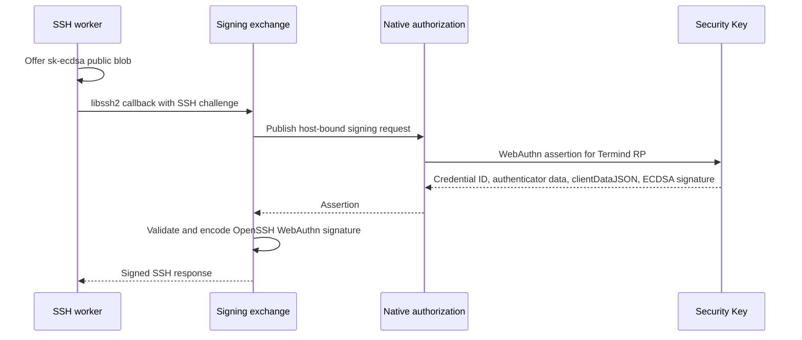

# SSH Security-Key Authentication

Termind supports hardware-backed SSH authentication through Apple's Security Key WebAuthn API on macOS and iOS/iPadOS. The supported SSH public-key algorithm is **`sk-ecdsa-sha2-nistp256@openssh.com`** (WebAuthn ES256 / P-256). The authenticator owns the private key; Termind keeps an RP-bound credential ID, public key, verification preference, and presence requirement. It does not implement `sk-ssh-ed25519@openssh.com` or import an OpenSSH private-key file as a Security Key reference.

This page covers the hardware credential path. See [SSH Session Lifecycle](../workflows/ssh-session-lifecycle.md) for route/trust/session ownership, [Persistent Data and Secrets](persistence-and-secrets.md) for the Vault boundary, and [Remote Services and Forwarding](remote-services-and-forwarding.md) for other SSH connection owners.

## Set up and use a key

1. In Vault's key creation flow, choose **Security Key**, name it, and choose **User Verification** (`Preferred` by default, or `Required`/`Discouraged`). Both native apps call `ASAuthorizationSecurityKeyPublicKeyCredentialProvider` with a random 32-byte registration challenge, ES256, and a discouraged resident-key preference. The OS prompt must have a presentation anchor; canceling the editor cancels the authorization request.
2. Copy the generated SSH **public key** from the key editor and add it to the intended server user's `authorized_keys`. Select the saved key through the Host's identity. The public-key offer can be rejected by the server before any authenticator prompt; the connection then reports that the username or key should be checked.
3. Connect. The SSH attempt offers the public blob, requests a WebAuthn assertion only when the server proceeds to signing, and shows the native Security Key prompt. Touch or verify as requested by the authenticator. An interactive signing card is bound to the current connection, metrics monitor, Agent interaction, or external authentication window rather than to a global reusable approval.

Registration and assertion both use the fixed relying party **`termind.akinokaede.com`**. Both app entitlements ([iOS/iPadOS](../../TFI/TFI.entitlements), [macOS](../../TFM/TFM.entitlements)) declare `webcredentials:termind.akinokaede.com`, and the website publishes its webcredentials association. The key is therefore a Termind RP credential, not a generic SSH Security Key handle that another app can claim through its own RP. Keep the associated-domain deployment and OS presentation anchor working on each platform: an unanchored or overlapping authorization request fails with `SSHInteractionRequired` rather than silently attempting authentication.

## What is saved and portable

`SecurityKeyCredential` contains the credential ID, uncompressed P-256 public key, verification policy, and a user-presence flag; it contains no private key. `WebAuthnSSH.keyReference` derives the OpenSSH public blob and fingerprint from that metadata. `HostLibraryModel.upsert` saves Security Keys as **`.external`** Vault metadata with an empty `credentialRef`, no passphrase or certificate, and no Keychain credential lookup; software keys cannot use `.external`. The V45 SwiftData SSH-key model and V2 Vault sync record encode the reference fields, so metadata can sync while the physical authenticator remains necessary for every new signature. V2 retains its frozen **`thisDevice` wire spelling** for external keys; decoding V2, loading V45 rows, and decoding legacy `SSHKeyRef` JSON normalize Security Keys to `.external`. Availability means the reference is present, **not** that the physical authenticator is connected. Saving or deleting hardware metadata rolls back on persistence failure without Keychain operations.

The editor displays a **Termind reference** of the form `termind-fido2-v1:` followed by Base64-encoded credential metadata. Export/import accepts only that validated RP-bound format; it rejects an OpenSSH private-key header and malformed or oversized input. File import reads a regular UTF-8 file of at most 1 MiB and validates its contents before saving. The import path checks the `termind-fido2-v1:` envelope, JSON decoding, a nonempty credential ID of at most 1023 bytes, and a valid uncompressed P-256 public point; it does **not** re-attest the original registration or discover whether the authenticator is plugged in. This reference is sufficient to identify the authenticator credential and regenerate the public key, but it cannot sign without the hardware key and an allowed local system prompt. Treat it as account metadata when sharing it; it is not a backup of private key material. On iOS the import editor can choose a different verification preference before saving; editing an existing reference updates metadata without replacing its credential ID or public key.

## Signing and validation path

Signing flow: a server-accepted public-key offer leads to a local assertion, which is verified before SSH wire bytes are returned.

`SSHPTYChannel.authenticate` is the shared authentication entrypoint: its `.securityKey` branch derives the public blob and calls `libssh2_userauth_publickey_signed` with `securityKeySignCallback`. The exchange's name does **not** make this keyboard-interactive login: signing uses the separate `SecurityKeySigningHandler` and returns an assertion, whereas keyboard-interactive uses server-supplied questions and string answers. The authentication loop filters credentials against the server's advertised methods and refreshes those methods after unsuccessful attempts, allowing additional factors or an available fallback. Native signing errors are thrown immediately rather than falling through to another credential. Shell integration starts only after authentication and shell-channel startup; it does not participate in hardware signing.

The signing callback extends a positive libssh2 timeout by the elapsed callback time so waiting for local authorization does not consume the transport's normal timeout budget; the `.securityKey` branch restores the original timeout afterward.

The libssh2 callback cannot suspend. `SSHKeyboardInteractiveExchange` waits on the connection's dedicated transport queue while the injected asynchronous signing handler drives the platform presenter; cancellation wakes the wait and rejects late results. The presenter allows only the selected credential ID, passes the stored verification preference to AuthenticationServices, and refuses requests whose interaction policy is forbidden or whose presentation anchor is unavailable. Each macOS `NSViewRepresentable` or iOS `UIViewRepresentable` anchor tracks its window; when ready, its signing card automatically starts **once**, while Continue also remains available. The coordinator permits one pending signing request for that owner and clears it on cancellation. The signing session responds exactly once, including on card disappearance or system cancellation; presenter cancellation ends its current operation, cancels the OS controller, and ignores a subsequent delegate response from that controller. Cancellation is not a successful connection checkpoint.

`WebAuthnSSH` checks registration `webauthn.create` client data against the challenge and fixed HTTPS origin, parses the attestation object's `authData`, requires the attested-credential flag, matching credential ID, RP hash and presence (plus verification when required), and extracts an ES256 P-256 COSE point. It bounds and validates CBOR including duplicate map keys, checks a declared extension map if present, and validates the resulting public point. Registration extracts public material; it does not validate an attestation trust chain.

For `webauthn.get`, conversion checks matching credential ID, challenge encoded as unpadded base64url, exact origin, and `crossOrigin` absent or false. Authenticator data must have the RP hash, allowed presence and required verification flags, no attested-credential flag, and either no trailing bytes or exactly one well-formed extension map when the extension flag is set. The DER ECDSA signature must verify over **authenticator data plus SHA-256 of the original signed `clientDataJSON` bytes** using the saved P-256 public key; never reserialize that JSON. OpenSSH compatibility additionally requires those bytes to **start** with `{"type":"webauthn.get","challenge":"...","origin":"https://termind.akinokaede.com"` in that order. The `webauthn-sk-ecdsa-sha2-nistp256@openssh.com` wire response contains ECDSA `r`/`s` SSH mpints, authenticator flags and counter, origin, original JSON, and extension bytes. Malformed CBOR, unsupported key formats, stray extension bytes, wrong challenge or signature, and noncanonical leading JSON fail closed; a response may be cryptographically valid but SSH-incompatible. `requiresUserPresence: false` relaxes the assertion UP-bit check, **not** the interaction policy or native prompt requirement.

## Connection owners and interaction policy

`SSHRuntimeSecretResolving.sshKeyCredential(for:)` maps Security Key Vault metadata directly into `.securityKey` instead of resolving an account in Keychain; `SSHConnectionPreparation` then resolves the same credential for destination and jump Hosts on a detached worker before opening transport. Other credential types may still need Keychain access. PTY, exec, and SFTP connection requests carry a `SecurityKeySigningHandler`; a real prompt belongs to the requesting session or service. Agent SSH/SFTP uses its own authentication interaction, and Metrics has a monitor-local signing coordinator. A silent auxiliary or recovery connection uses [`SSHInteractionPolicy.forbidden`](../../Frameworks/TermindApplication/SSHConnectionTypes.swift), which replaces **every** Security Key credential for both destination and jumps with `interactionRequired` even when its metadata sets `requiresUserPresence` to false, rather than presenting a hardware prompt unexpectedly. Transport policy enforcement also blocks host-key and interactive forms; it does not remove an available password fallback.

When SSH agent forwarding is enabled, `VaultSSHAgent` can advertise the Vault public key and sign a matching forwarded request. It requires an allowed interaction policy and an active interaction surface, then rechecks key-library revision and availability after the assertion before releasing the SSH signature. A forwarded request with unsupported flags or a nonmatching public blob is rejected. Forwarding never exports the authenticator private key.

Failures are reported at the appropriate stage: invalid reference, unverifiable response, incompatible SSH response, canceled interaction, and server rejection are distinct outcomes. The SSH path logs stage and error codes; a rejected public-key offer is logged before the signing stage. Avoid logging credential IDs, assertion contents, or challenge bytes when extending diagnostics.

## Focused verification

- `TFMTests/WebAuthnSSHTests.swift` covers registration parsing and truncation, public/reference round trips, exact SSH signature fields including unmodified JSON, challenge/RP/signature tampering, verification and presence flags, and malformed or duplicate-key CBOR extensions.
- `FrameworkTests/WebAuthnVaultMetadataTests.swift` covers destination/jump resolution without Keychain, V45 persistence and V2 Vault sync round trips, legacy `.thisDevice`/`.iCloud` normalization to `.external` (while preserving V2's `thisDevice` wire value), rejection of software `.external` keys, rollback on failed metadata writes/deletes, and reopening a V44 software-key store. `FrameworkTests/SSHInteractionPolicyTests.swift` verifies that forbidden policy blocks even UP-optional Security Keys on both route nodes. `FrameworkTests/SecurityKeySigningCoordinatorTests.swift` covers silent requests, cancellation, auto-start and exactly-once responses; `TFITests/MobileVaultFeatureTests.swift` covers mobile generation/import and selectable verification metadata.
- `TFMTests/SecurityKeySSHWireTests.swift` exercises OpenSSH direct, jump, SFTP and forwarded-agent authentication with a local fixture. It is **opt-in** behind `TERMIND_SECURITY_KEY_FIXTURE`; its software P-256 fixture verifies wire compatibility, not a physical key or the native system prompt. The rejection test runs both directly and through a jump, asserts that the signing handler is never called, preserves libssh2's `-18` failure detail, and checks stage logging without credential/public-key leakage.
- Keep the two authentication fixtures distinct. [The Security Key fixture](../../Scripts/ssh-security-key-fixture.py) launches a disposable loopback OpenSSH server with a generated P-256 authorized key, disables password and keyboard-interactive authentication, and writes mode-`0600` metadata containing the **simulated private key**. Start it with `python3 Scripts/ssh-security-key-fixture.py --metadata /tmp/security-key-fixture.json` and pass that path as `TEST_RUNNER_TERMIND_SECURITY_KEY_FIXTURE` to Xcode (the test process reads `TERMIND_SECURITY_KEY_FIXTURE`). Metadata is removed on exit. [The general authentication fixture](../../Scripts/ssh-authentication-fixture.py) instead uses Paramiko (`paramiko==4.0.0`) for password/public-key fallback, multi-round keyboard-interactive, zero-question push approval and partial-success factor transitions. Its Xcode variable is `TEST_RUNNER_TERMIND_SSH_FIXTURE`, read as `TERMIND_SSH_FIXTURE` by `SSHKeyboardInteractiveWireTests`. It never executes client commands and its SFTP files stay in memory; it is not evidence of WebAuthn signing. See [Behavioral Boundaries and Fixtures](../testing/behavioral-boundaries-and-fixtures.md) for the broader testing boundary.
- Platform editor and authentication-presentation tests should be paired with a manual hardware-key run when changing OS authorization, associated domains, or user-visible signing behavior.
