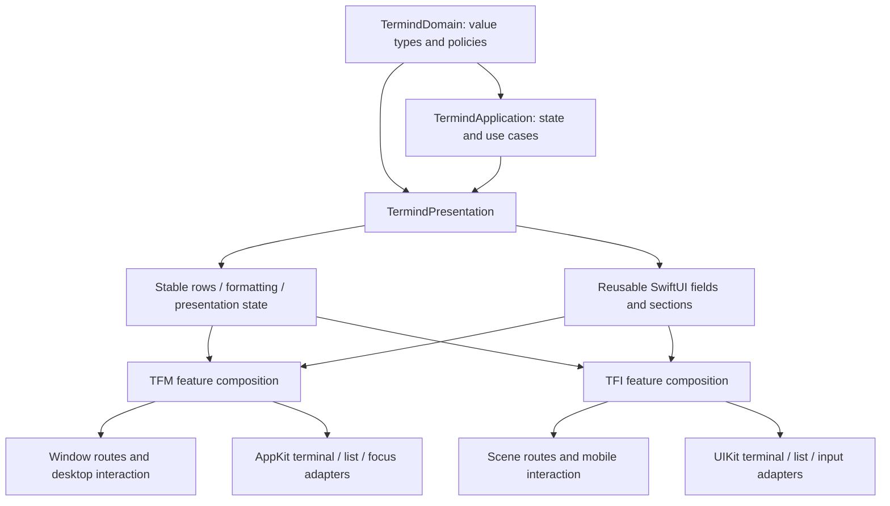
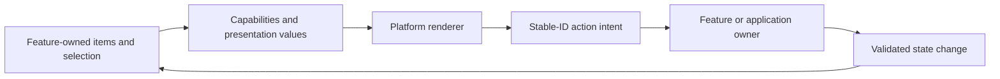
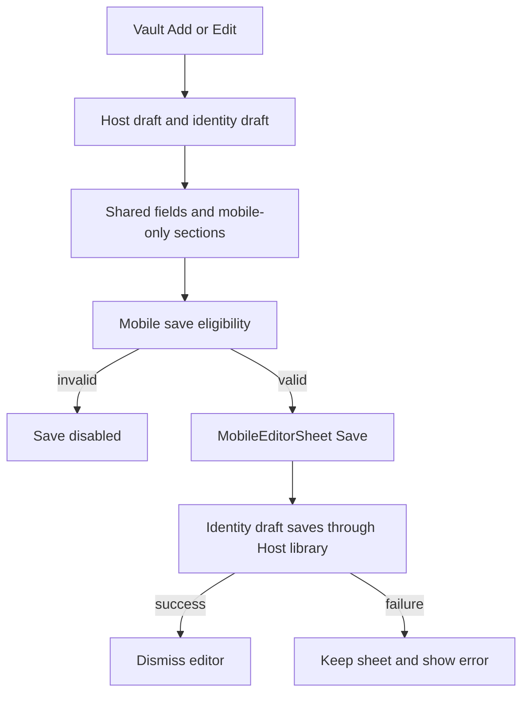
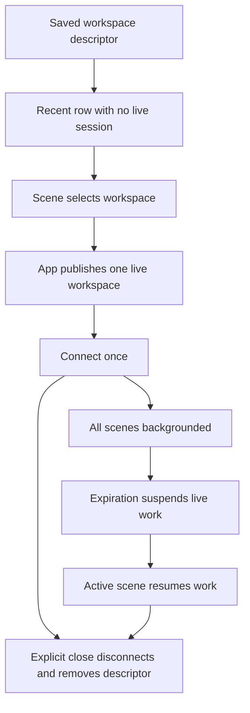

# UI Design Principles and Shared Presentation Boundaries

Termind aims for consistent meaning and behavior across platforms, not identical view trees. macOS uses a window-local Navigator, persistent workspace deck and pointer/keyboard-oriented interaction. iPhone/iPad uses registered feature stacks, scene-local routing, touch-native presentation and system-adaptive navigation.

This page separates **implemented policies** from **extension guidance inferred from them**. It is not a new visual redesign or a claim that every screen already enforces every principle uniformly. Start with [TFM Desktop UI Architecture](/openwiki/architecture/desktop-ui.md) or [TFI Mobile UI Architecture](/openwiki/architecture/mobile-ui.md) for the full component diagrams.

## 1. Share meaning; retain platform ownership

The useful sharing boundary is below the app shell but above repeated feature formatting and form fragments.

The shared layer supplies values and fields; each app composes and owns its native shell.

These arrows show conceptual dependencies and consumption, not an exhaustive target dependency graph. See [System Boundaries](/openwiki/architecture/system-boundaries.md) for the broader module structure.

`TermindPresentation` is allowed to contain SwiftUI views. It is **not** a transport-free name attached to an arbitrary bag of platform code: architecture tests forbid it from importing either app, AppKit, UIKit, SwiftData, GRDB, Persistence or RemoteInfrastructure. Native adapters remain app-owned. Shared non-presentation frameworks have their own boundaries; do not apply one blanket “no UI anywhere in Frameworks” rule.

Useful shared pieces include:

- Binding-driven Host, identity, forwarding, snippet and settings form sections.
- Stable Assistant transcript entries and presentation/disclosure state.
- Formatting and presentation values for history, metrics, remote files and tool output.
- Shared input-editing policies and environment hooks through which an app supplies native behavior.

Not suitable for moving into a generic shared view are a window's selected pane, a scene's navigation stack, a native terminal owner, credential resolution, connection teardown or repository mutation. Sharing a form does not make its save, authorization or lifetime policy shared automatically.

## 2. Use semantic visual roles, not per-feature themes

### Desktop vocabulary

`Metrics` centralizes desktop spacing, radii, minimum sizes and feature geometry as plain constants. They are not a runtime theme object; terminal palettes are a separate user-controlled concern. The spacing vocabulary includes 2/4/6/8/12/16/24-point values, and related controls share rhythm rather than choosing unrelated literals.

Examples of deliberate geometry:

| Role | Implemented constraint | Design purpose |
| --- | --- | --- |
| Shared sidebar | 260 minimum, 320 ideal, 520 maximum before window-width constraints. | The same column must work as Navigator or compact Assistant without resetting its width. |
| Navigator rows | 44-point row rhythm and fixed glyph column. | Align labels despite different SF Symbol widths. |
| Split divider | 1-point visual line, 8-point hit band. | Thin appearance without an impractically thin pointer target. |
| Desktop cards | 240–380 width range, 80-point minimum height. | Readable metadata and aligned rows. |
| Full Assistant | Shared 840-point reading-column maximum. | Transcript, decisions and composer read as one conversation. |

`TermindColor` uses semantic AppKit colors for neutral surfaces, foregrounds, separators, accent and success/warning/danger roles. User-authored Host colors and terminal ANSI palettes are deliberate exceptions. When a native layer needs a concrete color, `resolvedNative` resolves it against the owning appearance rather than assuming a dynamic `NSColor` will remain correct after conversion to `CGColor`.

Selection is contextual, not one universal tint formula. Generic `Highlight` uses a quiet accent wash for selection and a neutral hover wash. Sidebar rows instead use a neutral `Color.primary` fill at 10% opacity in the key window and 6% otherwise. Selected key-window text stays primary rather than reversed, leading row icons remain accent-colored, and inactive row text/icons become secondary. Inline rename fields follow the same active/inactive readability rule. The native context-menu outline is still accent-colored; it is not the selection fill. Read the implementation rather than assuming an older `Highlight` comment describes every surface.

### Mobile vocabulary

Mobile surfaces use system/grouped UIKit colors through SwiftUI and a smaller set of mobile layout policies. `MobileCardLayout` supplies a 106-point minimum height, at most two visible tags and a column calculation based on measured width with 12-point spacing. Accessibility text sizes force one column. These are mobile choices, not desktop token values copied into an iPhone layout.

For example, desktop card density and mobile card density deliberately differ. The invariant is recognizable hierarchy and usable content, not identical point dimensions.

## 3. Prefer real system materials and explicit fallbacks

TFM's explicit glass controls use system Liquid Glass on macOS 26 and native material backgrounds on older systems. The Sidebar column itself is different: on macOS 26 and later, `NavigationSplitView` supplies its background and `RootView` adds no second glass surface. Before macOS 26, `LegacySidebarMaterialBackground` supplies an `NSVisualEffectView` using `.windowBackground`, `.withinWindow` blending and window-active-state following. Do not restore an extra full-column glass layer merely because custom native rows sit inside the split view.

The mode rail shares one glass capsule; selection is a neutral moving capsule behind primary symbols, with a separate keyboard-focus outline only in the key window. Its selection animation respects Reduce Motion, and selected accessibility traits remain explicit. Assistant's footer keeps New Chat as an interactive glass capsule and Archive as an interactive glass circle, grouped in `GlassEffectContainer` on macOS 26+. Archive selection uses a neutral fill and semibold primary symbol rather than accent fill with reversed content. These controls and row selections serve different roles even though both avoid an emphasized accent background.

TFI's card surface similarly uses system glass where available, but keeps a nearly opaque grouped background behind dense text. Reduce Transparency or increased contrast selects an opaque fallback. Increased contrast also strengthens the border. The clipping, interaction shape and context-menu-preview shape are coordinated, so the visible card and the tappable/previewed object agree.

**Extension guidance:** add visual roles at the platform's existing semantic surface boundary. Do not give each feature its own arbitrary gradient, selection color or radius, and do not remove readability fallbacks to make screenshots look more translucent.

## 4. Reuse interaction machinery, not business ownership

Desktop `ManagedCardPage` is a protocol-oriented page composition seam. It supplies typed sections, externally owned selection, capabilities, card/header/ghost views and presentation modifiers to `ManagedCardPageRenderer`. The renderer handles geometry, selection and drag mechanics, then reports stable IDs back to the page's actions.

Mobile uses a simpler `MobileCardPage` / `MobileCardGrid` / `MobileActionCard` composition. A card's primary action fills the card, while secondary actions live in its context menu. Other mobile lists use swipe actions and navigation links. There is no requirement to reproduce the desktop marquee-selection renderer on touch devices merely because both display Hosts. For a Vault Host, tapping the card invokes the scene's host activation; its context menu is instead grouped into connection protocols (SSH/SFTP only if SSH is enabled, Telnet only if Telnet is enabled), Edit/Duplicate, and destructive Delete. Even a Host with no enabled protocol retains the editing and deletion groups. The menu delegates opening to the scene, duplication to `MobileAppModel` (with a fresh ID and without reusing Host-custom identities), and deletion to confirmation before the app-owned delete path. Desktop `HostContextMenu` has its own Quick Connect, Connect submenu and Copy SSH Command; do not assume the two platforms have an identical set of verbs or move these operations into shared card rendering.

The intended separation is:

A card reports intent; the feature/application owner decides whether and how to perform it.

Use capabilities to say what a renderer may offer; keep the operation's actual validity check with its owner. Disabled UI is useful feedback, not a replacement for business validation.

Native menu structure can differ without changing the operation. A single desktop Port Forwarding card groups **Address** and **SSH Command** under **Copy**, before the Edit/Duplicate group. Mobile keeps flat **Copy Address** and **Copy SSH Command** actions in the equivalent position. Both write through their native pasteboard adapter and disable SSH-command copying when the library cannot generate a command; copying never starts forwarding.

Snippet library cards expose one **Run** action instead of separate Execute and Execute on Hosts actions; the mobile detail and host-selection surfaces use the same Run vocabulary. Target selection and destructive confirmation remain in the existing feature flow: desktop fills missing saved targets through its chooser, while mobile asks when no valid targets remain. Renaming the action and removing the duplicate override affordance does not remove the host validation or destructive-script confirmation boundary.

### Keep toolbar commands attached to the content in front

Desktop titlebar Find is a window-level control, not a second search field in each feature. `WindowModel.findContext()` binds it to the active Vault page, Assistant, Metrics or focused terminal/SFTP query; terminal Find additionally supplies Return/Shift-Return navigation and Escape cancellation. `NativeSearchField` retains an AppKit field owner and a keyboard-focus claim across toolbar bridge rebuilds as filtering changes the page. The command installs a direct focus callback because a toolbar-item refresh is not guaranteed to deliver a focus counter change; the field releases that claim on actual user exit so panes can regain focus. On older macOS versions a compact Metrics layout uses a toolbar popover; the toolbar slot remains chosen by OS availability rather than changing the page's view parent on navigation. The leading New menu similarly resolves actions from the front destination, while Navigator row menus can request the same page-specific verbs without first navigating there. This is an example of sharing *intent and ownership*, not making every feature implement its own titlebar.

## 5. Share form fields; keep draft and route lifetimes explicit

Both Host editors reuse `HostOrganizationSection`, `HostProtocolProfileControls` and `HostConnectionFields`, but their containers are intentionally different:

- TFM edits a local Host draft in the Vault work column. Nested editing stays in that column; introducing another `NavigationStack` there can promote its destination into the enclosing split detail and cover the collection.
- TFI presents `MobileHostEditor` from Vault's `editingHost` sheet route. It seeds a local Host draft from the selected or newly created Host; the shared protocol control switches which SSH/Telnet connection fields are edited. Group/tag controls are injected by each platform into the shared organization section rather than forcing one platform's picker into the other. Shared connection fields apply iOS URL/number keyboards and no autocorrection for addresses.
- The mobile editor passes draft dirtiness and save eligibility to `MobileEditorSheet`. Its save gate requires a nonblank address, at least one enabled terminal protocol, enabled-port ranges, valid custom SSH/Telnet/proxy identities and SSH environment variables. `HostCustomIdentityDraft` holds temporary custom credentials separately from the Host draft, loads them once on appearance and saves them through the Host library along with the Host only when Save runs. Desktop additionally checks SSH route and SFTP initial-path validity in its own commit policy; do not infer identical validation just because the visible fields are shared.
- Child editing on mobile uses item-based sheets for identities, groups and environment variables; saved children update the parent draft or its selections. Desktop instead keeps nested routes in the Vault work column. The mobile sheet owns Cancel/discard confirmation, disabled Save and content during an in-flight save, error alert and dismissal only after successful save. A failed save leaves the editor visible for correction.

The mobile form's draft, child routes, validation gate and save lifecycle are distinct from the shared field fragments. The data path is draft binding → shared fields → platform validation/save action, not shared fields → database or transport.

### Terminal preferences: shared fields, native adapters

`TerminalFontFields` receives a `TerminalFontPreferences` binding and an app-supplied family list. Both apps reuse its family and Follow Theme/Custom controls and the 8–36 size-editing range; macOS uses a native `Slider`, while iOS uses a `Stepper`. Font discovery remains app-owned: AppKit/UIKit catalogs include a family when any loadable member is monospaced, sort with `localizedStandardCompare`, and refresh on settings appearance and active-scene transitions. The picker previews available families and retains an unavailable family name; resolving a renderable copy does not rewrite the saved choice.

Typography is device-local through `TerminalFontSettings`/`@AppStorage`, separate from synchronized `TerminalPreferences`. Theme edits go through `TerminalSettingsModel`, which persists before publishing new preferences and exposes storage errors on failure. Sharing these fields does not move persistence or native font enumeration into the shared view.

`TerminalThemePicker` uses the shared appearance-filtered, name-sorted catalog. Missing, empty, or wrong-appearance selections remain selected values, with a localized fallback hint; the renderer chooses the matching default without saving a replacement merely because Settings appeared. Custom configuration overlays the selected base theme, and explicit local font overrides apply last. The base picker remains editable while the overlay is enabled. Editor workflows remain native: desktop configuration editing autosaves and supports file import; mobile uses a draft sheet with explicit Save.

Focused tests cover complete macOS monospaced-family membership, typography precedence and controller identity, appearance filtering and fallback, base-theme changes beneath an overlay, and opening the actual desktop settings page without a preference write. Mobile rendering cases exercise the font controls in English, Simplified Chinese and Traditional Chinese.

`SingleLineTextInput` illustrates a narrow shared policy. It replaces runs of newline scalars with one space, preserves attributed paste content, and normalizes only edits through the binding setter. Reading the original bound value does not rewrite stored data. This is not a general sanitizer for secrets, multiline commands, snippets or existing repository records. Native paste/input insertion is supplied by app-owned environment adapters so selection and input-method handling can stay platform-specific.

### Shared presentation must not change execution data

`AgentToolPresentation` converts Assistant tool calls/results into localized human-readable summaries, batch tints and details for both apps. A live approval projection uses the in-memory request's unredacted arguments for the person reviewing it, but does not attach those arguments to the durable tool card or model transcript. Built-in tool results become structured detail where possible; remote-defined MCP output keeps its JSON presentation, and failed/denied results cannot select a success-shaped knowledge presenter. The display preview bounds long output while retaining the full transformed text for Copy. These are display policies, not approval, execution, replay or persistence policies. When adding a tool or localized label, change its presentation metadata/projector and test the visible wording and failure state without rewriting protocol payloads.

## 6. Native rendering is a deliberate workload boundary

SwiftUI composes pages, but terminal and high-update list workloads use native adapters. `ArchitectureBoundaryTests` restricts ListViewKit importers to a specific set of native-list workloads rather than permitting it throughout every feature.

Assistant is a useful example:

- `AssistantTranscriptEntry` shares stable IDs and typed row content derived from the timeline. Edit/fork eligibility is passed in rather than inferred by a renderer.
- Desktop mounts persistent AppKit transcript owners from a window-local, surface-aware cache.
- Mobile uses `MobileNativeList`, supplying locale, Dynamic Type, appearance, motion/scene state, row revisions and viewport callbacks through the adapter.

Sharing transcript values does not justify sharing AppKit/UIKit view instances or their caches. Native views have platform and mounting constraints; their owners must be reviewed separately from the value model.

**Extension guidance:** first extract deterministic row construction, formatting or policy. Only then consider shared SwiftUI content. Leave platform focus, mounting, text selection, scroll retention and lifecycle in the platform adapter unless there is concrete evidence that their contracts match.

## 7. Accessibility and localization are layout inputs

The implementation already treats accessibility as behavior, not a final label pass:

- Parked desktop workspaces and unusable mobile panes disable hit testing and hide from accessibility as well as becoming transparent.
- Selected sidebar controls expose selected traits and accessible names; icon-only menus expose the current title as their accessible value.
- Mobile card grids change density for accessibility text sizes; card materials respond to transparency/contrast preferences.
- Motion helpers accept Reduce Motion, and native-list adapters propagate motion and scene activity into hosted rows.
- Mobile geometry tests retain marked Chinese text and first responder status during region changes, not just the final draft string.

Localization likewise affects measurement and identity-sensitive presentation. The existing adaptive/rendering cases exercise English, Simplified Chinese and Traditional Chinese, including narrow desktop editors and the mobile tab set. A layout that works only with the shortest English label is not proven by a source-level logic test. On mobile, `MobileRootView` keeps a scene-owned destination binding and a `NavigationStack` per registered tab under `.sidebarAdaptable`, rather than rebuilding a compact-only tab set. The adaptive test checks the *same* native `UITabBarController` with five available tabs through regular and compact widths with both ordinary and accessibility text sizes; it selects every tab and checks that scene selection, selected native tab identity and a visible title agree. At regular width the system bar may scroll, whereas compact width requires all five titles to be visible. Other tests retain the same Assistant navigation/conversation/draft, Metrics page and native list/scroll offset, Vault search controller, nested Settings editor draft and in-flight Save sheet across width changes. They also exercise Assistant title/switcher and Metrics detail toolbar placement, including vertical menu layout and iPad sidebar transitions. These are behavioral identity checks and captured layout regressions, not a promise that every screen is pixel-identical at every width.

Do not claim all animation sites are already Reduce Motion-aware: the helpers make that policy available, but each changed call site still needs inspection. Likewise, an accessibility label does not prove that focus order, clipping, menu reachability or large-text layout is correct.

## 8. Continuity has a cost budget

The platform guides describe several different retention strategies. `MobileContentRegions` subtracts active divisions and occlusions, chooses the largest unobstructed continuous rectangle and only offers a split when both sides are usable. Assistant assigns transcript to the first region and composer to the second; Metrics displays both panels when the split is usable (or on sufficiently wide continuous space), otherwise keeps the selected panel. `MobilePaneLayout` places the *same* children even when a frame disappears, caching their last usable sizes rather than giving a covered native surface a zero-size proposal. Usability gates visibility, hit testing and accessibility together. The fold tests check that the Assistant transcript native scroll view and focused composer with marked input remain the very same objects through horizontal and vertical divisions, occlusion and reopening; Metrics retains its native list and offset when the segmented picker becomes a vertical toolbar menu and returns.

| Mechanism | What is preserved | How unnecessary work is limited |
| --- | --- | --- |
| Desktop workspace deck | Mounted session views and native terminal state. | Hidden geometry is parked and invisible controls are disabled. |
| Desktop transcript owner cache | Native list, measurements and presentation caches across remounts. | LRU trimming of unmounted owners; separate keys for sidebar/full screen. |
| Mobile workspace registry | `MobileAppModel` publishes live workspaces independently of scenes; saved descriptors are recent rows, not connected sessions at cold launch. | Explicit close disconnects and removes the descriptor; when all scenes background, expiration suspends workspaces, while foreground activity resumes them. |
| Mobile region layout | Native child identity during adaptive geometry changes. | Only usable regions accept input/accessibility; covered children keep valid sizes. |

The mobile registry saves descriptors separately from live workspaces, publishes a restored workspace before calling `connect()` so scenes share one instance and attempt, and removes missing-Host descriptors rather than trying to connect them. A cold launch lists recent descriptors without opening every session; selecting one connects only that workspace. Closing a live workspace disconnects it, removes its saved row and updates activity state. Background expiration suspends live sessions; returning to an active scene resumes them without reconstructing the tab hierarchy.

Saved rows and live workspaces follow different lifetimes; only selection connects and explicit close removes the descriptor.

Mobile descriptor and live-session lifetimes are separate; a fold or tab switch is not a close operation.

Desktop continuity includes an interaction constraint as well as a layout cache. `WorkspaceContentView` keeps a dragged pane mounted but temporarily omits its branch from split geometry, disabling hit testing and accessibility for that pane; removing its native drag source would end AppKit's session prematurely. Its pane-level native receiver reads the live `WindowModel` and displayed workspace at drag time, previews the nearest edge on an occupied pane (whole-area replacement on an empty slot), and only mutates the model on drop. `WorkspaceNavigatorView` overlays its native List with one receiver for workspace-section insertion, using measured global row frames; preview boundaries include the dragged row while the move index excludes it. The source session is cleaned up after mutation, and unrelated pasteboard data or a destination that became hidden must not commit a layout change. `WorkspaceLayoutDropTests` cover edge merges, live pane rearrangement, empty slots, stale drags and the changed-destination rejection; `PersistentWorkspaceDeckLayoutTests` cover parked sizes and sidebar insertion indices.

“Keep state” does not mean “keep every view measuring, animating and accepting events forever.” Conversely, unmounting a view does not by itself authorize terminating the work it displays.

For changes at these seams, use focused tests rather than only visual snapshots: `MobileCardTests` measures tag-insensitive card height and container-width columns (including one column at accessibility sizes); `MobileVaultFeatureTests` checks proxy defaults, preserved custom ports and credential validity; and the opt-in, serialized `MobileEditorToolbarTests` exercises Cancel, in-flight Save, failed Save and overflow actions with English and Chinese toolbar labels. The last suite needs `TERMIND_MOBILE_UI_TESTS=1` and nonparallel key-window testing. Shared Assistant presentation tests cover preview shortening; a new projector needs cases for localized wording, approval detail and failure handling as well as the app's native row rendering.

## Practical extension checklist

Before adding or refactoring a UI feature:

1. Name its app, window/scene, workspace and temporary-view owners.
2. Choose the existing platform shell and presentation style; do not create a second navigation system for one feature.
3. Reuse semantic surfaces and sizing policies, checking actual implementation rather than comments alone.
4. Share values and field fragments where contracts match; preserve native adapter and runtime boundaries.
5. Verify hidden/disabled/accessibility behavior together with geometry and focus.
6. Check compact and spacious containers, large text, light/dark appearance, transparency/contrast, and relevant language variants.
7. Add deterministic policy/identity tests first, then targeted native rendering or device verification where necessary.

This is engineering guidance derived from current patterns, not an additional runtime subsystem. Use the [platform runtime guide](/openwiki/architecture/platform-runtime.md), [engineering invariants](/openwiki/architecture/engineering-invariants.md) and [build/test guidance](/openwiki/operations/build-test-and-release.md) when the change crosses ownership or verification boundaries.
