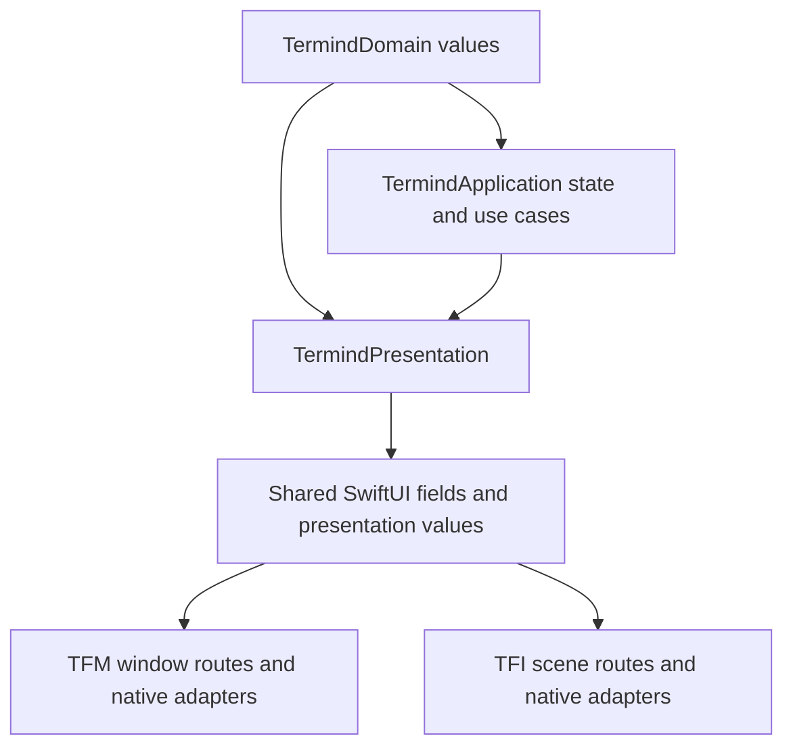
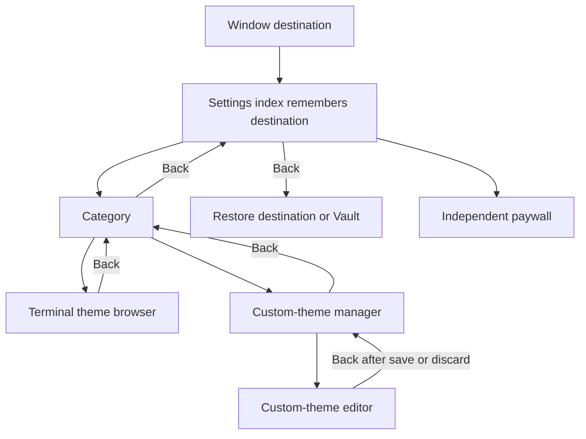
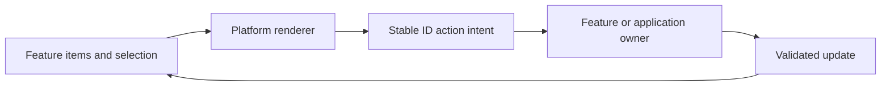
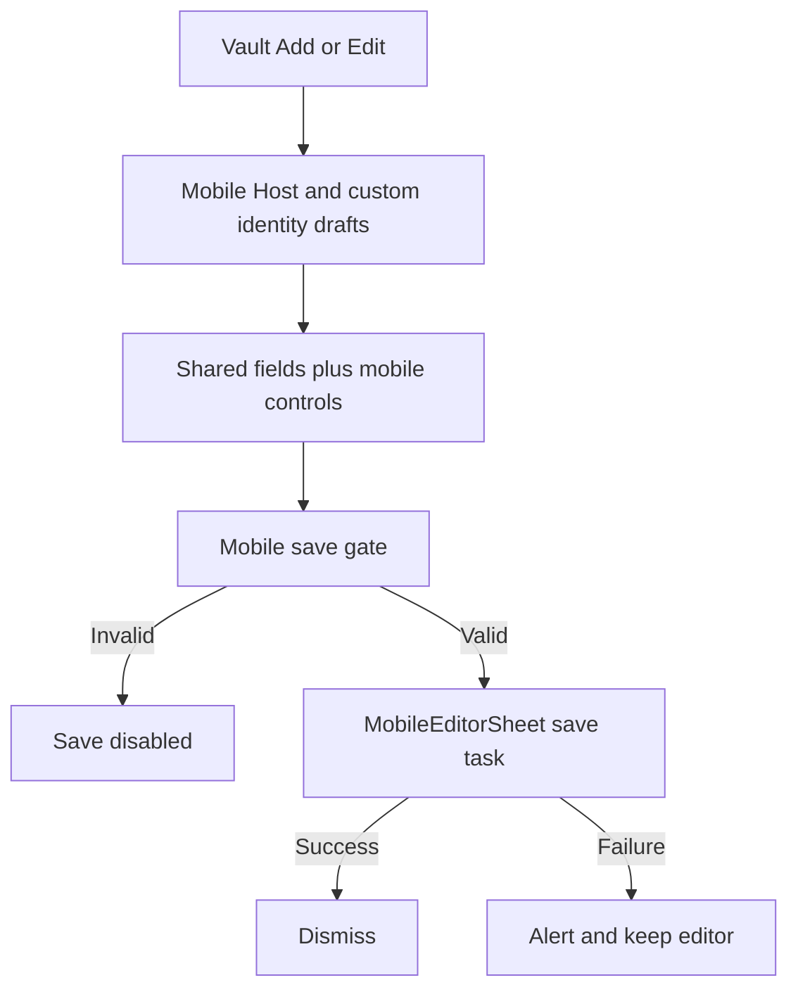
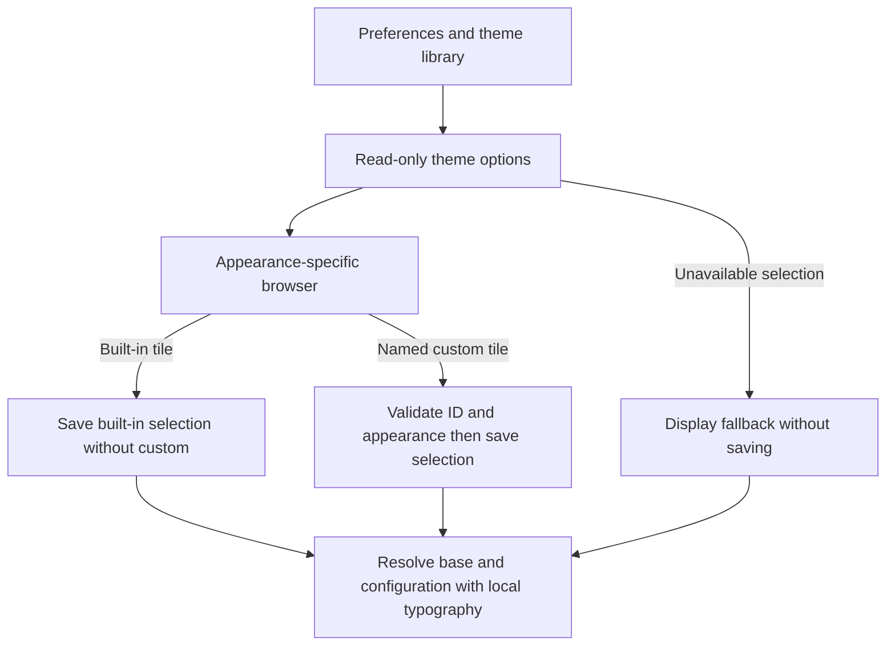

# UI Design and Presentation Contracts

Termind shares the *meaning* of actions, copy, form fragments and display values, not a cross-platform view tree. TFM owns window routing, persistent workspace views and pointer/keyboard controls; TFI owns scene destinations, native navigation stacks and touch-oriented sheets. See [Desktop UI](../architecture/desktop-ui.md), [Mobile UI](../architecture/mobile-ui.md), and [Commerce and Localization](commerce-localization-and-product-surfaces.md) for the surrounding ownership boundaries.

## Shared presentation is not a shared application shell

Shared values and fields are consumed by two independently owned UI shells.

`TermindPresentation` contains reusable SwiftUI sections, rows, formatting and localized resources. `ArchitectureBoundaryTests` bans app, AppKit/UIKit, storage, remote infrastructure and commerce-framework imports in this layer, but does **not** ban SwiftUI; another test restricts `ListViewKit` to approved native-list workloads. Native terminal, list, pasteboard and focus adapters belong to the apps. Share deterministic row construction and binding-based fields, not window selection, scene stacks, connection teardown, credential resolution or repository mutation.

`AppStrings` supplies resource-backed, on-demand copy to both apps; app-local `AppStrings` declarations are prohibited. `.swiftUIKey` bridges a `LocalizedStringResource` for SwiftUI APIs requiring `LocalizedStringKey` without discarding interpolation metadata. When an API accepts the resource itself, use that overload: `confirmationDialog` titles should receive the resource directly, not `.swiftUIKey`, because UIKit-backed presentation can otherwise expose interpolated locale metadata. For native menus, `AppLocalization.resolve` uses the requested locale and matching app-bundle localization rather than freezing copy at declaration time. Presentation tests exercise English, Japanese, Simplified Chinese and Traditional Chinese menus, interpolation and SwiftUI rendering. Keep wording variants separate from route and save policy.

### Language choice is separate from copy ownership

The desktop App settings picker offers Follow System, German, English, French, Japanese, Korean and both Chinese scripts. `AppLanguage.store` writes the explicit choice and `AppleLanguages`; Follow System removes `AppleLanguages` to restore bundle negotiation. Desktop displays a relaunch notice in the newly selected locale when it differs from the launch choice. Mobile App settings has appearance controls but no equivalent in-app language picker. Do not infer the supported language set from a particular rendering test's smaller parameter matrix. `AppLocalization` currently maps all seven explicit languages to app-bundle localizations, falling back to the main bundle when a matching localization is unavailable. See [Commerce and Localization](commerce-localization-and-product-surfaces.md) for broader product-copy ownership.

### Settings navigation belongs to each shell

Desktop `RootView` mounts `SettingsPageView` at the window's Settings destination. `WindowModel.openSettings(route:)` remembers the displaced destination; toolbar Back follows `SettingsRoute.parent` to the index, then restores that destination, or Vault if its workspace has disappeared. The index has App, **Notifications**, Terminal, Connections, AI and Sync categories, Developer in DEBUG, optional separate Logging, and a Pro paywall action instead of a Pro route. Category and Logging routes return to index; provider model lists return to their provider, other AI details to AI. Built-in theme browsers and the custom-theme manager return to Terminal. A custom-theme editor returns to the custom-theme manager, then Terminal, then the index. Paywall presentation does not consume the return destination. Both apps use `NotificationSettingsFields` with their own settings-opening adapter; desktop places it in the Notifications route and mobile places it inside a native link.

Desktop Back traverses the route hierarchy before restoring the previous destination; AI details have their own parent routes.

`SettingsPageView` handles provisional AI draft cleanup on route changes or disappearance: an empty provider is discarded outside provider/model-list transitions; a new invalid MCP server or one without a lockable namespace is discarded; a skill with useful written content survives as a draft. This is route-owner policy, not form-field behavior. On TFI, Settings is a registered scene-owned tab with its own `NavigationStack`, native category `NavigationLink`s and an app-pro-state paywall sheet; it does not use desktop `SettingsRoute`. `SettingsNavigationTests` checks parent routes, destination restoration and paywall independence.

## Semantic surfaces with platform-specific geometry

TFM's `Metrics` provides a 2/4/6/8/12/16/24-point spacing rhythm, 260 minimum / 320 ideal / 520 maximum sidebar widths subject to window size, 44-point Navigator rows, a one-point divider with an eight-point hit band, 240–380-width cards with an 80-point minimum height, and an 840-point full-Assistant reading-column maximum. `TermindColor` uses semantic AppKit-backed surfaces, separators and status roles; host-authored colors and terminal palettes are exceptions. Resolve native conversions for the owning appearance. Generic `Highlight` retains an accent wash, but Sidebar selection uses neutral primary fill (10% key-window, 6% inactive), primary selected key-window text, accent leading icons and secondary inactive foregrounds, including readable inline renaming. Native context-menu outline stays accent-colored.

Explicit TFM glass controls use system glass on macOS 26 and native material fallbacks earlier. The Sidebar column itself relies on `NavigationSplitView` material on 26+, adding a legacy `NSVisualEffectView` background only before 26: do not stack a second whole-column glass layer. Its mode rail is one glass capsule with animated neutral selection, selected accessibility traits, Reduce Motion handling and key-window-only focus outline. The mode and visibility belong to the window: the rail reconciles on destination or focused-pane changes, and History is disabled for a focused serial pane (falling back to Snippets rather than silently activating unavailable History). The Assistant footer groups interactive New Chat/Archive controls in a glass container on 26+, with neutral Archive selection and a primary-colored, semibold selected glyph. These are implemented choices, not a universal accent rule.

The compact Snippets and History shelves use `SidebarListItem` with stable record IDs and AppKit `ListView` hosting, not a shared mobile list. History card heights are uniform except while naming a command; presentation changes such as a renamed address do not change its row ID. Snippets shelf expansion is stored separately from the full Snippets page and collapsing a section removes rows without replacing its header identity. Native blank-area menus have their own container target, distinct from row menus; the shelf's local search footer filters the sidebar, whereas titlebar Find targets foreground content.

Mobile card columns follow available width and accessibility text sizes force one column; cards use a 106-point minimum height and show at most two tags. System glass, when available, sits over nearly opaque grouped backing under dense text; Reduce Transparency or increased contrast selects opaque backing and contrast strengthens the border. Clipping, interaction and context-menu preview shapes agree. Reuse a surface's semantic role and check contrast, hit area and large-text legibility rather than copying another platform's geometry.

### Host artwork is a presentation contract

`HostIconCatalog` loads `HostIcons.json` from the app bundle and degrades to an empty catalog on missing or invalid data. Automatic artwork matches the detected distribution ID, then related IDs, then Linux. Explicit general-icon overrides resolve to system symbols; catalog overrides resolve to assets. An unknown explicit override is preserved by the picker as Unknown Icon and renders the generic server symbol rather than silently switching to detected artwork. The picker separates Automatic, general icons and sorted catalog entries into native menu sections. `HostDistributionIcon` gives a Host color tag priority over contrast-adjusted brand color, then accent fallback; artwork is independent of connection state. Asset production and app-icon generation belong to [Marketing Assets and App Icons](../operations/marketing-assets-and-app-icons.md), not the UI shell.

Sources: [catalog resolution](../../Frameworks/TermindPresentation/HostIconCatalog.swift), [picker](../../Frameworks/TermindPresentation/HostIconPicker.swift), [distribution artwork](../../Frameworks/TermindPresentation/HostDistributionIcon.swift).

## Native actions report intent to their owners

Desktop `ManagedCardPage` consumes typed sections, externally owned selection, capabilities and cards, manages geometry/selection/drag and reports stable IDs. Mobile `MobileCardPage` / `MobileCardGrid` / `MobileActionCard` use taps for the primary action and context menus for secondary actions; other lists use swipe actions or links. Renderer enablement is feedback, not a replacement for operation validation. Shared `operationConfirmation` resolves text with the view locale and keeps an explicit Cancel action. Anchored operations use native SwiftUI confirmation dialogs; centered collection-wide operations use the app-injected UIKit renderer. The latter waits for existing presentation transitions, uses an arrowless window-centered popover on iPad, and runs actions after dismissal completes rather than deleting their source views during exit.

Cards offer intents; the feature or application owner performs the operation.

A mobile Vault Host card taps into scene-owned host activation. Its context menu offers SSH/SFTP only when `sshEnabled` and Telnet only when `telnetEnabled`, separated from Edit/Duplicate and destructive Delete; a Host with no enabled protocol still has edit and delete. The Vault also renders grouped, collapsible Host sections and native links to Keychain, Forwarding, Snippets, Known Hosts and History; search can find Hosts or links into those features, passing the query to the destination where appropriate. `MobileVaultView` passes connections through its `open` callback, edits through an item-based `editingHost` sheet and confirms deletion before `MobileAppModel.deleteHost`. Duplication creates a new ID, clears Host-custom SSH, Telnet and proxy identity references and clears the proxy username when its custom identity is removed. TFM's `HostContextMenu` instead has Quick Connect, Connect submenu and Copy SSH Command, retaining desktop-owned editing/deletion.

Desktop forwarding rules group Address and SSH Command under Copy; mobile presents flat Copy Address and Copy SSH Command before Edit/Duplicate. Both use app-native pasteboards, disable command copying when unavailable and start/stop forwarding separately. Shared `SnippetCardContent` supplies colored icons, valid-target counts, risk and timestamp content while native cards retain surfaces and actions. Snippet cards expose one **Run** action. Desktop resolves missing saved targets with a chooser and checks destructive multi-selection; mobile filters targets to valid Hosts, chooses when none remain and confirms destructive execution before its injected scene callback. `MobileWorkspaceSessionModel.execute` opens one workspace per allowed target using that Host's preferred terminal transport, passing the snippet command as live startup state, never into its restoration descriptor.

Desktop `WindowModel.findKind` selects the foreground Vault, Assistant, Metrics, appearance-specific terminal theme browser or focused workspace pane's query; Welcome owns search in content, while other Settings routes and unsearchable workspaces have no titlebar Find. Theme browser queries live in `WindowModel.terminalThemeQueries` per light/dark scheme; the custom-theme manager has a separate `customThemeQuery`. These filters survive navigation, but the custom-theme editor has no Find. Theme libraries keep a visible `WindowToolbarFindField`, including empty/no-results states; other searchable destinations use the OS-selected search slot. macOS 26 uses a background `WindowToolbarSearchHost` with system `.searchable`, while older systems use a native field and `NSSearchField` owner (or compact Metrics popover). The legacy owner and direct focus handler protect keyboard intent when SwiftUI replaces toolbar content. Both paths use window query and terminal find navigation/cancellation; `focusToolbarFind()` stands panes down before requesting focus so rebuilding terminal content cannot reclaim the caret. Leading New actions follow foreground content rather than sidebar mode; Navigator rows can offer page-specific verbs without first navigating there.

### Inline review invitations must not interrupt work

Both Host pages embed the shared `AppReviewInvitationView` inline: desktop uses managed top content; mobile places it between Vault links and Host sections when search is empty. The app-owned `AppReviewController` holds device-local response state shared by windows; the feature owns its `AppReviewInvitationVisit`. Eligibility requires an enabled controller, no previous response, at least one Host and seven elapsed days since first use. The visit captures eligibility on entry, so elapsed time or a newly synced Host cannot insert an invitation into an already active page. Filtering or removing the last Host hides it without consuming it; either response hides it across windows.

The invitation uses horizontal `ViewThatFits` fallbacks to vertical message/action layouts, vertically wrapping text, a header accessibility trait, contained accessible children and actions with a 44-point minimum height. Accept opens the review URL only after a user action. A successful URL-open callback records `openedReview`, **not a completed rating**; a rejected open leaves the invitation available. Decline records `declined`. The permanent Settings review link remains separate from invitation eligibility. Developer preview bypasses eligibility but does not open the store or change the real response. These are source-backed behavior and accessibility contracts, not a claim that one visual style is universally preferable.

Sources: [review state and visit policy](../../Frameworks/TermindApplication/FeatureModels/AppReviewController.swift), [shared invitation and link](../../Frameworks/TermindPresentation/AppReviewInvitationView.swift), [desktop placement](../../TFM/Features/Hosts/HostsPageView.swift), [mobile placement](../../TFI/Features/Vault/MobileVaultView.swift).

## Shared Host fields, distinct editor lifecycles

`HostOrganizationSection`, `HostProtocolProfileControls` and `HostConnectionFields` bind to a platform-owned Host draft. The organization section accepts platform-supplied group/tag controls; profile selection exposes SSH or Telnet fields. iOS connection fields select URL/number keyboards and suppress address autocorrection. These shared fields do not save. Stateless `HostEditorBindings` projects the existing Host/custom-identity drafts and reports platform-owned creation callbacks, without storing a second selection model.

TFM edits a local draft inside the Vault work column: nested identity/group/environment routes must stay there rather than promoting into the outer split detail. `VaultWorkEditingSession` tracks dirty transitions and commit; desktop validity checks SFTP initial paths and validated SSH routes. TFI opens `MobileHostEditor` as an item-based Vault sheet for new or existing Hosts. It seeds a local Host draft, loads a separate `HostCustomIdentityDraft` once, and feeds child identity/group/environment changes back into the parent. Save persists custom identities and Host through the library. Mobile eligibility requires a nonblank address, enabled terminal protocol, valid enabled ports and terminal transports, valid custom SSH/Telnet/proxy identities and valid SSH environment variables. Managed Tailscale drafts bypass ordinary custom SSH validation and save through `saveTailscaleHost` with a separately loaded username; both platforms disable managed name/group, protocol and connection fields while retaining icon, tags and color editing.

`MobileEditorSheet` owns the enclosing `NavigationStack`, Form and toolbar. Clean Cancel runs `onCancel` and dismisses; dirty Cancel presents a titleless, destructive-only action sheet with resource-specific copy for new drafts, and confirmed discard runs `onCancel` before dismissal; invalid or already-saving Save is disabled; an in-flight save disables editing, actions and interactive dismissal. Successful save checks cancellation before dismissal; becoming clean clears any discard prompt, while failure alerts without dismissing, and disappearance cancels an outstanding task. Desktop and mobile save gates intentionally differ.

The sheet owns dismissal and error feedback; the app-owned library owns persistence.

`SingleLineTextInput` replaces newline-scalar runs with one space only on binding edits, preserves attributed paste and leaves reads unchanged. App-injected native input/paste adapters preserve selection and input-method behavior (`singleLineInputAdapter` in TFI, `singleLinePasteAction` in TFM). This is not a stored-data, secret or multiline-command sanitizer.

### Terminal preferences and Assistant output

`TerminalFontFields` shares a `TerminalFontPreferences` binding, family selection and 8–36 editing range, but uses Slider on macOS and Stepper on iOS. AppKit/UIKit catalogs include every family with a loadable member, including proportional families, sort in localized order and refresh on settings appearance or scene activation. Unavailable family selections remain stored; rendering resolves a fallback copy without overwriting them. Typography is device-local through `TerminalFontSettings` / `@AppStorage`, separate from synchronized `TerminalPreferences`. `TerminalSettingsModel` persists preference edits before publishing and reports storage errors without replacing old preferences on failure.

`TerminalThemeOptions` is a read-only projection of preferences plus `TerminalThemeLibrary`. Missing, empty or wrong-appearance built-in names and missing custom selections produce a localized availability notice and display-time fallback, not storage repair. Each light/dark browser lists compatible named custom themes and built-in themes; custom themes are managed separately, with name, appearance, base theme and configuration. Built-in selection uses a native library selection when supported (or when selections already exist), clearing custom selection; the legacy preferences path saves the base name and disables its overlay in one edit. Selecting a custom tile validates its ID and appearance before saving a library selection. Both browsers leave only after a successful save and otherwise show `storageError`.

Rendering resolves the base, applies enabled configuration and incorporates local typography without rewriting stored choices. Local family is prepended as the preferred family while theme families remain fallbacks; empty theme family resets reinsert that preference. Manual local size is appended last unless size follows the theme. Desktop `TerminalCustomConfigurationEditorPage` debounces edits by 300 ms and imports UTF-8 text; `WindowModel` attempts saving before Back or changing destinations. Invalid, deleted or failed-save drafts protect navigation with discard confirmation. Cancelling keeps the draft; discarding clears the owner before deferred navigation, preventing pending autosave from resurrecting it. Autosave avoids trimming a trailing name-space while typing; navigation can normalize the name. Mobile `MobileCustomThemeEditorSheet` explicitly saves its draft and can import UTF-8 text. Deleted themes cannot be overwritten by stale drafts; editors offer Save Copy instead. Tests cover loadable font membership (including proportional families), family fallback/reset ordering, size precedence, controller identity, nonmutating theme fallback and zero writes on opening desktop Settings. Mobile font rendering covers English and both Chinese scripts.

Sources: [theme projection](../../Frameworks/TermindPresentation/Terminal/TerminalThemeOptions.swift), [selection and persistence](../../Frameworks/TermindApplication/FeatureModels/TerminalSettingsModel.swift), [desktop editor](../../TFM/Features/Settings/TerminalCustomConfigurationEditorPage.swift), [mobile editor](../../TFI/Features/Settings/MobileCustomThemeEditorSheet.swift), [navigation regressions](../../TFMTests/SettingsNavigationTests.swift).

The app-owned keyword-highlighting editor, rule model and shared runtime modifier were retired. Terminal Settings now exposes theme, local typography and shell-integration choices, not synchronized highlighting rules. V52 removes historical highlighting storage, and Settings preparation/receipt excludes inactive legacy records without replacing other preferences. Preserve historical schema shapes rather than recreating the deleted UI; see [Ghostty Terminal Integration](ghostty-terminal-integration.md) and [Persistent Data and Secrets](persistence-and-secrets.md).

Native terminal menus belong to the platform adapters. On iOS `MobileTerminalView` overrides Ghostty's **separate** touch hooks for unselected and selected text, localizes inherited action identifiers through `AppStrings`, and groups SSH upload choices as Photos and Files. On macOS `TermindTerminalView` combines Ghostty's selected-text Copy with localized Paste, Select All and a conditional Upload File action; its optional Open with SFTP submenu offers current/new workspace destinations and rechecks availability on invocation. Both platforms recheck upload availability when an action is invoked. See [Ghostty Terminal Integration](ghostty-terminal-integration.md) for the exact menu paths, pointer distinction and ownership rules.

Selection is a persisted user action; a missing stored theme is a display-time fallback, not a migration.

`AgentToolPresentation` projects localized Assistant tool summaries and details from original execution data without owning approval or replay. Live approval shows reviewable request arguments from memory, not a durable tool card or model transcript; sensitive chat collaboration arguments use a restricted presenter. MCP output keeps its remote-defined JSON presentation. Failed or denied knowledge results bypass success-shaped presenters. A bounded head/tail display preview carries the full transformed text for desktop native Copy. Extend presentation metadata/projectors and test failures and copying rather than changing protocol payloads.

## Native rendering, accessibility and continuity

`AssistantTranscriptEntry` shares timeline-derived typed rows with stable IDs and caller-supplied edit/fork eligibility, not mounted native views. Desktop caches surface-aware AppKit transcript owners and LRU-trims unmounted owners. Mobile `MobileNativeList` supplies locale, Dynamic Type, appearance, motion/scene state, row revisions and viewport callbacks to its UIKit adapter. Extract row policy first; keep focus, scrolling, mounting and lifecycle in the platform adapter.

Hidden content must stop receiving input and accessibility focus: parked desktop panes and covered mobile panels gate hit testing and accessibility with visibility. Mobile layout subtracts active divisions/occlusions, chooses the largest continuous usable region and splits only if both regions fit. `MobilePaneLayout` retains native children and their cached usable sizes under occlusion; Assistant allocates transcript and composer regions and Metrics presents two panels when feasible or its selected panel otherwise. Adaptive tests assert *the same* native transcript scroll view, marked input/composer focus, Metrics list and offset, Vault search controller, editor draft and in-flight save/alert across folds and width changes, not just final strings.

`MobileRootView` binds tab selection to `MobileSceneModel` and constructs one `NavigationStack` per `MobileFeatureRegistry` registration under `.sidebarAdaptable`; the standard registry has Vault, Metrics, Workspaces, Assistant and Settings. Adaptive tests check the same native tab controller, five available tabs, scene/native selection and visible selected title across compact/regular widths, Dynamic Type and all three languages. Regular-width tab bars can scroll; compact tests require all five titles simultaneously visible. Reduce Motion and selected accessibility traits exist, but new animation or clipped controls still require call-site checks.

The registry is the extension point for destination identity, order, title, symbol and builder, and rejects duplicate IDs; do not maintain separate compact-tab and regular-sidebar destination lists. Vault's stack additionally binds its path and identity to scene state for History routing, and its Host editor binding comes from the scene. Settings category links stay inside their feature stack, while the root presents the paywall from `app.pro.isPaywallPresented`. Keep feature-local editors and confirmations near their initiating content rather than moving every presentation into the shell. These ownership rules do not require identical geometry or colors across platforms.

Workspace presentation must distinguish layout changes from explicit close. `MobileWorkspaceSessionModel` owns in-process connection intent and live workspaces for a native scene; its ordered items supply the workspace or descriptor, Host and login address to render. Scene disconnection alone is not an explicit discard. Persistence, recovery, close confirmation and background execution policy belong to [Mobile UI](../architecture/mobile-ui.md), not to reusable card or layout code. Desktop mounted-pane and transcript retention budgets belong to [Desktop UI](../architecture/desktop-ui.md).

Desktop drag similarly protects native identity: a dragged pane stays mounted but leaves temporary split geometry. Native receivers check current displayed workspace and matching pasteboard identity at drop time, preview edge insertion on occupied panes and replacement in empty slots, and reject stale/hidden destinations. The Navigator overlays its native List with a receiver using measured row frames; preview boundaries include the dragged row while move indices exclude it. See [Desktop Drag and Drop](../workflows/desktop-drag-and-drop.md) before changing source mounting or preview placement. Continuity does not mean every hidden view keeps measuring or accepting events.

## Verification and extension

`ArchitectureBoundaryTests` protects imports and copy ownership including direct-resource dialog titles; `PresentationCopyTests` resolves one resource into four languages, checks localized nested native menus, plural/interpolated deletion copy and compares `ImageRenderer` pixels for direct resources versus `.swiftUIKey` under each locale. `WindowSidebarTests` checks mode persistence and serial-pane fallback; `ListViewMigrationTests` checks stable row IDs, editing height and independent shelf expansion. `WindowToolbarFindTests` pins foreground Find, separate light/dark theme-browser queries and New mapping; `SettingsNavigationTests` pins custom-manager Back routing, autosave-before-navigation, failed/invalid/deleted draft protection and discard safety. `TerminalThemeTests` and `TerminalThemePageRenderingTests` check nonmutating fallback and browser rendering. `AgentToolPresentationTests` covers review arguments and tool details. `MobileVaultFeatureTests` asserts the menu section order and all protocol-availability combinations and independent Host duplication; `MobileCardTests` checks the two-tag limit and distribution-brand contrast. `MobileCardLayoutTests` measures balanced minimum-height padding, stable Host headers/timestamps across 0–2 tags in English and both Chinese scripts at 320/600 points, light/dark appearance and large text, plus snippet header stability with/without a folder. `MobileCompactCardTests` pins standard/compact column counts, scaled widths, accessibility one-column layout, square-or-taller sizing, mounted preference updates and persistence, warning badges and snippet risk. Serialized `MobileEditorToolbarTests` checks Cancel, in-flight and failed Save with localized labels and requires a key window; `MobileAdaptiveLayoutTests` checks object identity, marked text and focus; snapshots alone cannot prove continuity. The opt-in `MobileCardPageLayoutReviewTests` (`TERMIND_CARD_LAYOUT_REVIEW=1`) attaches non-Host consumer renders at 352/800 points in English/Simplified Chinese and light/dark appearance; it is visual review coverage, not an assertion that every control fits.

For review changes, `MobileAppReviewTests.invitationFitsPhoneAndTabletWidths` renders English and both Chinese scripts at 320, 430 and 768 points, comparing light/standard text with dark/accessibility3 and requiring the accessible layout to grow vertically without recording a response. `TERMIND_REVIEW_PREVIEW=1` records PNG attachments; it does not enable the controller's developer preview. `FrameworkTests/AppReviewControllerTests` separately verifies elapsed-time gates, visit capture, cross-window hiding, rejected URL opens, relaunch persistence and isolated preview responses. Rendering checks do not establish these state semantics. The adaptive tab regression covers 320/375 compact and 600/1024 regular widths at `.large` and `.accessibility3`, including round trips; preserve native controller identity, not merely a matching screenshot. These are inspected test contracts, not a report that the suites were executed for this documentation update. See [Behavioral Boundaries and Fixtures](../testing/behavioral-boundaries-and-fixtures.md) for test ownership.

For changes, identify the window/scene owner, use its existing route and native adapter, share only matching field/value contracts and verify the operation owner beyond UI enablement. Check widths, language variants, large text, contrast/transparency, keyboard focus and Reduce Motion. See [Platform Runtime](../architecture/platform-runtime.md) and [Build and Test](../operations/build-test-and-release.md) when changing ownership or verification boundaries.

Tailscale peer details are an eligible Host menu section; managed Hosts disable duplication and deletion with matching application guards. The iOS terminal menu puts editing actions in a medium inline group and upload actions in their own group. History belongs to each terminal/browser in memory and clears on explicit close.
