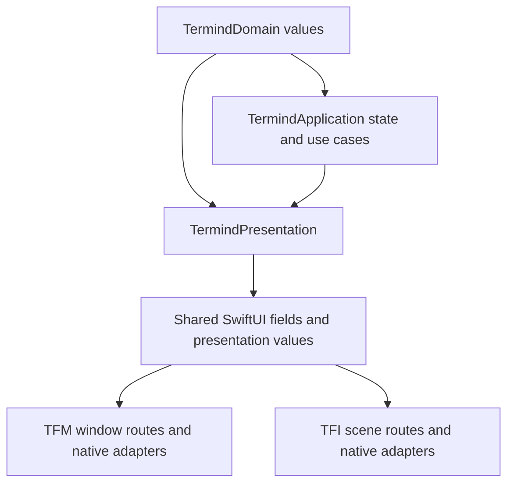
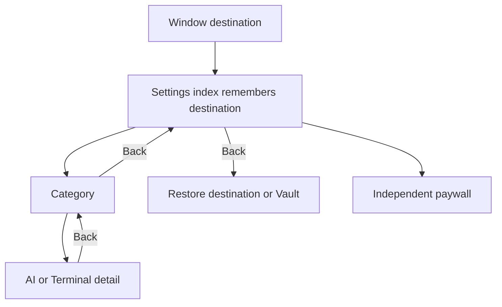
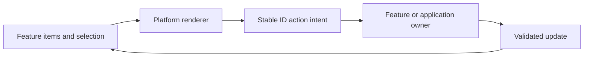
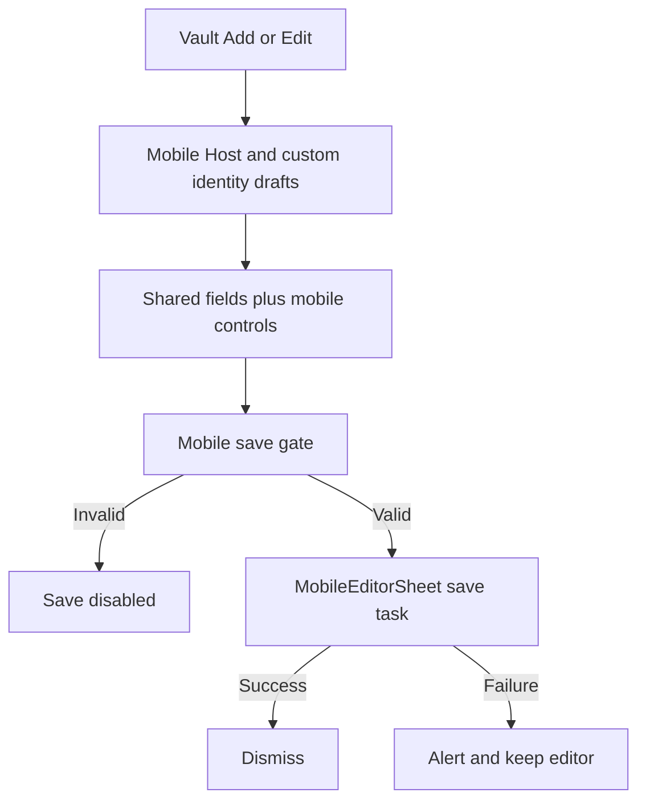
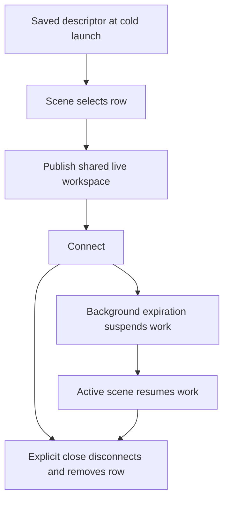

# UI Design Principles and Shared Presentation Boundaries

Termind shares the *meaning* of actions, copy, form fragments and display values, not a single cross-platform view tree. TFM has window-local routing, a persistent workspace deck and pointer/keyboard controls; TFI has scene-owned destinations, native navigation stacks and touch-oriented sheets. The distinctions below describe implemented contracts, not a mandate to make screens pixel-identical. For shell ownership see [Desktop UI](/openwiki/architecture/desktop-ui.md) and [Mobile UI](/openwiki/architecture/mobile-ui.md); for language and purchase surfaces see [Commerce and Localization](/openwiki/concepts/commerce-localization-and-product-surfaces.md).

## Shared presentation is not a shared application shell

Shared values and fields are consumed by two independently owned UI shells.

`TermindPresentation` contains reusable SwiftUI sections, rows, formatting and localized resources. The `sharedPresentationHasNoPlatformOrStorageDependency` architecture test bans imports of `Termind`, `TermindIOS`, AppKit, UIKit, SwiftData, GRDB, `TermindPersistence`, `TermindRemoteInfrastructure`, `TermindInfrastructure` and StoreKit there; it does **not** ban SwiftUI. A separate test limits `ListViewKit` imports to specified native-list workloads. Other framework layers have their own import rules: do not infer a global ban from this presentation-specific test. Native terminal, list, pasteboard and focus adapters remain in the apps. Move deterministic row construction or binding-based fields into presentation, not a window selection, scene stack, connection teardown, credential resolution or repository mutation.

`AppStrings` in shared presentation supplies resource-backed, on-demand copy to both apps; the architecture test rejects app-local `AppStrings` declarations. For a SwiftUI API requiring `LocalizedStringKey`, `.swiftUIKey` bridges a `LocalizedStringResource` without first flattening its interpolation metadata to an ordinary string. **When an API accepts `LocalizedStringResource` directly, use that overload**: `confirmationDialog` in particular should receive the resource, not `.swiftUIKey`, because UIKit-backed presentation can expose interpolated locale metadata. An architecture test scans confirmation titles for the incorrect bridge. At native menu boundaries, `AppLocalization.resolve` resolves against a requested locale and the corresponding app-bundle localization (English, Simplified or Traditional Chinese where present), rather than caching a translated label at declaration time. Presentation-copy tests check native nested menus, counts/interpolation and SwiftUI bridge rendering across all three language variants. Keep app-specific wording in explicit variants without making copy decide route or save policy.

### App-owned Settings routes

Desktop `RootView` mounts `SettingsPageView` for the window's Settings destination. `WindowModel.openSettings(route:)` remembers the displaced destination; toolbar Back follows `SettingsRoute.parent` until the index, then restores that destination or falls back to Vault if the workspace has gone away. The index has App, Terminal, Connections, AI and Sync categories, Developer in debug builds, optional separate Logging and a Pro paywall action rather than a Pro route. Provider model lists return to their provider, other AI details to AI, terminal configuration to Terminal, and categories/Logging to the index. The paywall does not consume the window's Settings return destination.

Desktop Back traverses the route hierarchy before restoring the previous destination.

`SettingsPageView` also handles provisional AI drafts on route changes or disappearance: an empty provider is discarded outside provider/model-list transitions; an invalid new MCP server or one without a lockable namespace is discarded; a skill with useful written content survives as a draft. That is route-owner cleanup, not form-field behavior. On TFI, Settings is a registered feature in a scene-owned tab `NavigationStack`, with native category `NavigationLink`s and a paywall sheet; it does not use the desktop `SettingsRoute`. `SettingsNavigationTests` exercises desktop parent routes, restoration and paywall independence.

## Semantic surfaces with platform-specific geometry

TFM's `Metrics` is a set of geometry constants, not a runtime theme: spacing uses a 2/4/6/8/12/16/24-point rhythm, the shared sidebar has 260 minimum / 320 ideal / 520 maximum widths subject to window size, Navigator rows have a 44-point rhythm, the divider has a one-point line and eight-point hit band, cards use a 240–380 width range and 80-point minimum height, and the full Assistant uses an 840-point reading-column maximum. `TermindColor` uses semantic AppKit-backed surface, separator and status roles. Host-authored colors and terminal ANSI palettes are exceptions; native conversions use the owning appearance (`resolvedNative`). Generic `Highlight` retains an accent selection wash, but Sidebar selection uses neutral primary fill (10% key-window, 6% inactive); selected key-window text remains primary, leading glyphs accent, inactive foregrounds secondary, including inline rename readability. The native context-menu outline remains accent-colored.

TFM glass controls use system glass on macOS 26 and native material fallbacks earlier. The Sidebar column itself uses `NavigationSplitView`'s background on macOS 26+, with a legacy `NSVisualEffectView` background only before 26: do not add a duplicate whole-column glass layer. Its mode rail is one glass capsule with animated neutral selection, explicit selected accessibility traits, Reduce Motion handling and key-window-only focus outline. The Assistant footer groups interactive New Chat/Archive glass controls on 26+, with neutral Archive selection and primary, semibold selected glyph. These are actual implementations, not a universal selection-color rule.

Mobile card layout derives columns from available width and forces one column at accessibility text sizes; it uses a 106-point minimum card height and shows at most two tags. Mobile cards use system glass where available with nearly opaque grouped backing under dense text; Reduce Transparency or increased contrast chooses opaque backing, and contrast strengthens the border. Clipping, interaction and context-menu preview shapes agree. Desktop and mobile geometry intentionally differs. When extending a surface, reuse its semantic role and check contrast, hit area and legibility rather than treating one feature's visual choice as a project-wide invariant.

## Native actions report intent to their owners

Desktop `ManagedCardPage` supplies typed sections, externally owned selection, capabilities and card views to a renderer that manages geometry, selection and drag and reports stable IDs back. Mobile `MobileCardPage` / `MobileCardGrid` / `MobileActionCard` use card taps for the primary action and context menus for secondary actions; some lists instead use swipe actions or links. A renderer's enabled state is feedback, not a substitute for the feature owner's operation validation.

Cards offer intents; the owning feature or application performs the operation.

A TFI Vault Host card taps into the scene's host activation. Its context menu filters SSH/SFTP by `sshEnabled` and Telnet by `telnetEnabled`, then separates connection actions from Edit/Duplicate and destructive Delete; Hosts without any enabled protocol still have editing and deletion. `MobileVaultView` passes connection requests to its `open` callback, edits via the item-based `editingHost` sheet and confirms deletion before `MobileAppModel.deleteHost`. Duplication in `MobileAppModel` allocates a new ID and clears Host-custom SSH, Telnet and proxy identity references rather than sharing private credentials. TFM's `HostContextMenu` instead offers Quick Connect, a Connect submenu and Copy SSH Command, and retains desktop-owned editing/deletion. Do not move those operations into a shared card.

For one forwarding rule, desktop groups Address and SSH Command under a Copy submenu; mobile presents flat Copy Address and Copy SSH Command before Edit/Duplicate. Both use their app's native pasteboard path, disable SSH-command copying when command generation is unavailable, and start/stop forwarding via separate actions. Snippet cards expose a single **Run** action, not a second Execute on Hosts menu affordance. Desktop routes missing saved targets to a chooser and checks destructive scripts; mobile filters to valid targets, chooses Hosts if none remain and confirms destructive execution. A label change does not bypass those owner-controlled gates.

Desktop titlebar Find is bound by `WindowModel.findContext()` to the foreground Vault, Assistant, Metrics or focused terminal/SFTP query; terminal Find includes next/previous navigation and cancellation. `NativeSearchField` maintains its native owner and focus claim across toolbar rebuilds, and a direct focus handler preserves command intent; the leading New menu likewise derives actions from the foreground destination, with Navigator menus able to request those page-specific verbs without first navigating. Keep toolbar commands attached to the actual active content.

## Shared Host fields, distinct editor lifecycles

`HostOrganizationSection`, `HostProtocolProfileControls` and `HostConnectionFields` bind to a Host draft. The organization section accepts platform-supplied group/tag controls; profile selection edits SSH or Telnet fields. On iOS connection fields use URL/number keyboards and suppress autocorrection for addresses. Neither the shared fields nor their conditional UI saves the Host.

TFM edits a local draft inside the Vault work column. Its nested identity/group/environment-variable routes stay there: a nested `NavigationStack` would promote a destination into the outer split detail and cover the collection. `VaultWorkEditingSession` tracks dirty transitions and commit; desktop validity also checks an absolute-or-empty SFTP initial path and `validatedRoute` for SSH before commit. TFI presents `MobileHostEditor` as an item-based Vault sheet for a new or existing Host, with a local Host draft, child item sheets and a separate `HostCustomIdentityDraft` loaded once. Child identity/group/environment-variable edits flow back into the parent selections/draft. On Save, the temporary custom-identity draft persists identities and Host through the library.

Mobile Host Save eligibility requires a nonblank address, enabled terminal protocol, valid enabled ports, custom SSH/Telnet/proxy identity configuration and valid SSH environment variables. `MobileEditorSheet` owns the enclosing `NavigationStack`, Form and toolbar: clean Cancel dismisses, dirty Cancel asks to discard, Save is disabled when `canSave` is false or already saving, and an in-flight save disables form/toolbar actions and interactive dismissal. Successful save dismisses; a thrown error alerts without dismissing; disappearance cancels the outstanding task. Desktop and mobile gates are deliberately not identical.

The sheet owns dismissal and error feedback; the app-owned library owns persistence.

`SingleLineTextInput` is a narrower shared policy: it replaces runs of newline scalars with a space only on binding edits, preserves attributed paste content and does not rewrite the original bound value on read. App-supplied native insertion adapters preserve platform selection and input-method behavior. It is not a general sanitizer for stored records, secrets or multiline commands.

### Terminal preferences and Assistant output

`TerminalFontFields` shares a `TerminalFontPreferences` binding, family selection and 8–36 size range, but uses a native Slider on macOS and Stepper on iOS. AppKit/UIKit font catalogs include families with any loadable monospaced member, sort with `localizedStandardCompare`, and refresh on settings appearance and scene activation. Unavailable selected families remain saved; a renderable fallback copy does not overwrite them. Typography is device-local through `TerminalFontSettings` / `@AppStorage`, separate from synchronized `TerminalPreferences`. `TerminalSettingsModel` persists theme preference edits before publishing and reports storage errors without replacing the old preferences on failure.

`TerminalThemePicker` filters and sorts the shared catalog by appearance. Missing, empty or wrong-appearance selected values retain a localized fallback hint: rendering chooses the matching default without a write merely because Settings appeared. Rendering applies base theme, custom configuration overlay, then local font overrides; the base picker stays editable under an overlay. Desktop custom configuration autosaves and supports file import, while mobile explicitly saves a draft sheet. Focused desktop tests cover font-family membership, precedence, controller identity, theme fallback/overlay and no write when Settings opens; mobile font controls are exercised in English and both Chinese scripts.

`AgentToolPresentation` projects localized Assistant tool summaries, detail and preview from execution data without owning approval or replay. Live approval uses in-memory unredacted request arguments for review but does not attach them to durable tool cards or the model transcript. MCP output retains its remote-defined JSON presentation, failures cannot select a success-shaped knowledge presenter, and long display previews retain the full transformed text for Copy. Extend metadata/projectors and test visible failure/copy behavior, not protocol payloads.

## Native rendering, accessibility and continuity

`AssistantTranscriptEntry` shares timeline-derived typed rows with stable IDs and caller-provided edit/fork eligibility; it does not share mounted native views. Desktop caches surface-aware AppKit transcript owners with LRU trimming for unmounted owners. Mobile `MobileNativeList` supplies locale, Dynamic Type, appearance, motion/scene state, row revisions and viewport callbacks to its UIKit adapter. Extract row policy first; keep native focus, scroll retention, mounting and lifecycle with the app adapter.

Hidden content must also stop receiving input and accessibility focus: parked desktop panes and covered mobile panels gate hit testing and accessibility together with visibility. Mobile adaptive layout subtracts active divisions/occlusions, selects the largest continuous usable region and splits only if both regions fit. `MobilePaneLayout` retains the same native children and cached usable sizes when a panel is covered. Assistant allocates transcript and composer regions; Metrics shows two panels when feasible and otherwise its selected panel. Adaptive tests check the *same* transcript scroll view, marked input and composer focus, Metrics list and offset, search controller, editor draft and in-flight save across folds and widths rather than only the final strings.

`MobileRootView` keeps a scene-owned destination and a `NavigationStack` for each registered tab under `.sidebarAdaptable`. Adaptive tests check the same native tab controller, five available tabs and scene/native selection across regular and compact widths, text sizes and English/both Chinese variants. Regular-width system tab bars may scroll; compact tests require all titles visible. Reduce Motion helpers and selected accessibility traits exist, but a new animation, clipped large-text control or menu still needs call-site verification.

Mobile workspace descriptors and live sessions are different lifetimes. At cold launch `MobileAppModel` loads recent descriptors without reconnecting everything. Selecting a descriptor publishes one shared live workspace before `connect()` so scenes reuse the same initial attempt; a missing Host descriptor is removed. Explicit close disconnects and removes its saved row. Once all scenes background, expiration suspends live work; an active scene resumes it without reconstructing tabs. A fold or tab switch is not a close.

Descriptor persistence and live-session lifetime must not be conflated.

Desktop workspace drag similarly preserves native identity: a dragged pane remains mounted but leaves temporary split geometry; native receivers use the live window/displayed workspace and matching pasteboard identity at drop time, preview edge insertion on occupied panes and replacement in empty slots, and reject stale/hidden destinations. The Navigator overlays its native List with a receiver using measured row frames; preview boundaries include the dragged row while move indices exclude it. See [Desktop Drag and Drop](/openwiki/workflows/desktop-drag-and-drop.md) before changing drag source mounting or previews. Continuity does not mean every hidden view keeps measuring or accepting events.

## Verification and extension

`ArchitectureBoundaryTests` protects import and copy ownership, including direct-resource confirmation titles. `PresentationCopyTests` exercises native menus and locale-specific presentation; `MobileVaultFeatureTests` covers Host policy and credential cases; `MobileCardTests` measures card height/columns including accessibility sizes. Serialized opt-in `MobileEditorToolbarTests` covers Cancel, in-flight and failed Save and overflow actions with key-window integration; set `TERMIND_MOBILE_UI_TESTS=1` and disable parallel testing for that suite. Adaptive layout tests check object identity, marked text and focus; snapshots alone cannot prove lifecycle continuity.

For a change, identify the app/window/scene owner, use its existing route and native adapter, share only values or fields whose contracts really match, and verify the operation owner after a UI capability check. Test relevant widths, language variants, large text, contrast/transparency, keyboard focus and Reduce Motion. These are engineering heuristics derived from implemented seams, not extra runtime policies; consult [Platform Runtime](/openwiki/architecture/platform-runtime.md) and [Build and Test](/openwiki/operations/build-test-and-release.md) when changing ownership or verification boundaries.
