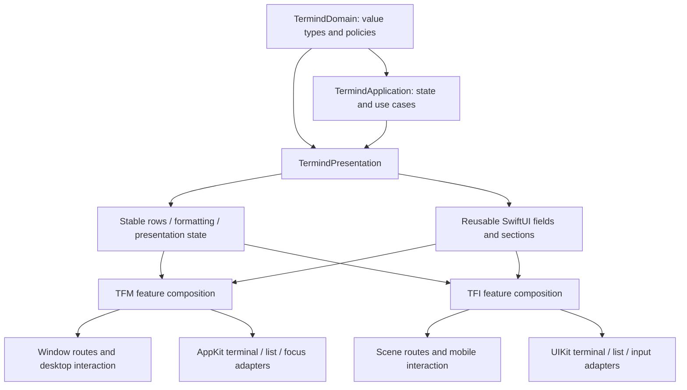
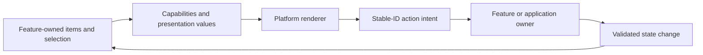

# UI Design Principles and Shared Presentation Boundaries

Termind aims for consistent meaning and behavior across platforms, not identical view trees. macOS uses a window-local Navigator, persistent workspace deck and pointer/keyboard-oriented interaction. iPhone/iPad uses registered feature stacks, scene-local routing, touch-native presentation and system-adaptive navigation.

This page separates **implemented policies** from **extension guidance inferred from them**. It is not a new visual redesign or a claim that every screen already enforces every principle uniformly. Start with [TFM Desktop UI Architecture](/openwiki/architecture/desktop-ui.md) or [TFI Mobile UI Architecture](/openwiki/architecture/mobile-ui.md) for the full component diagrams.

## 1. Share meaning; retain platform ownership

The useful sharing boundary is below the app shell but above repeated feature formatting and form fragments.

These arrows show conceptual dependencies and consumption, not an exhaustive target dependency graph. See [System Boundaries](/openwiki/architecture/system-boundaries.md) for the broader module structure.

`TermindPresentation` is allowed to contain SwiftUI views. It is **not** a transport-free name attached to an arbitrary bag of platform code: architecture tests forbid it from importing either app, AppKit, UIKit, SwiftData, GRDB, Persistence or RemoteInfrastructure. Native adapters remain app-owned. Shared non-presentation frameworks have their own boundaries; do not apply one blanket “no UI anywhere in Frameworks” rule.

Useful shared pieces include:

- Binding-driven Host, identity, forwarding, snippet and settings form sections.
- Stable Assistant transcript entries and presentation/disclosure state.
- Formatting and presentation values for history, metrics, remote files and tool output.
- Shared input-editing policies and environment hooks through which an app supplies native behavior.

Not suitable for moving into a generic shared view are a window's selected pane, a scene's navigation stack, a native terminal owner, credential resolution, connection teardown or repository mutation. Sharing a form does not make its save, authorization or lifetime policy shared automatically.

## 2. Use semantic visual roles, not per-feature themes

### Desktop vocabulary

`Metrics` centralizes desktop spacing, radii, minimum sizes and feature geometry as plain constants. They are not a runtime theme object; terminal palettes are a separate user-controlled concern. The spacing vocabulary includes 2/4/6/8/12/16/24-point values, and related controls share rhythm rather than choosing unrelated literals.

Examples of deliberate geometry:

| Role | Implemented constraint | Design purpose |
| --- | --- | --- |
| Shared sidebar | 260 minimum, 320 ideal, 520 maximum before window-width constraints. | The same column must work as Navigator or compact Assistant without resetting its width. |
| Navigator rows | 44-point row rhythm and fixed glyph column. | Align labels despite different SF Symbol widths. |
| Split divider | 1-point visual line, 8-point hit band. | Thin appearance without an impractically thin pointer target. |
| Desktop cards | 240–380 width range, 80-point minimum height. | Readable metadata and aligned rows. |
| Full Assistant | Shared 840-point reading-column maximum. | Transcript, decisions and composer read as one conversation. |

`TermindColor` uses semantic AppKit colors for neutral surfaces, foregrounds, separators, accent and success/warning/danger roles. User-authored Host colors and terminal ANSI palettes are deliberate exceptions. When a native layer needs a concrete color, `resolvedNative` resolves it against the owning appearance rather than assuming a dynamic `NSColor` will remain correct after conversion to `CGColor`.

Selection is contextual, not one universal tint formula. Generic `Highlight` uses a quiet accent wash for selection and a neutral hover wash. Sidebar rows use a stronger accent fill and reversed foreground in the key window, then an accent wash/tinted foreground when inactive. Do not infer actual behavior from an older nearby comment claiming all selections ignore active-window state.

### Mobile vocabulary

Mobile surfaces use system/grouped UIKit colors through SwiftUI and a smaller set of mobile layout policies. `MobileCardLayout` supplies a 106-point minimum height, at most two visible tags and a column calculation based on measured width with 12-point spacing. Accessibility text sizes force one column. These are mobile choices, not desktop token values copied into an iPhone layout.

For example, desktop card density and mobile card density deliberately differ. The invariant is recognizable hierarchy and usable content, not identical point dimensions.

## 3. Prefer real system materials and explicit fallbacks

TFM's glass modifiers use system Liquid Glass on macOS 26 and native material backgrounds on older systems. The shared sidebar background covers the whole column, including empty space, so custom native rows do not look pasted over a separate background. Native material is the fallback rather than a hand-painted imitation highlight.

TFI's card surface similarly uses system glass where available, but keeps a nearly opaque grouped background behind dense text. Reduce Transparency or increased contrast selects an opaque fallback. Increased contrast also strengthens the border. The clipping, interaction shape and context-menu-preview shape are coordinated, so the visible card and the tappable/previewed object agree.

**Extension guidance:** add visual roles at the platform's existing semantic surface boundary. Do not give each feature its own arbitrary gradient, selection color or radius, and do not remove readability fallbacks to make screenshots look more translucent.

## 4. Reuse interaction machinery, not business ownership

Desktop `ManagedCardPage` is a protocol-oriented page composition seam. It supplies typed sections, externally owned selection, capabilities, card/header/ghost views and presentation modifiers to `ManagedCardPageRenderer`. The renderer handles geometry, selection and drag mechanics, then reports stable IDs back to the page's actions.

Mobile uses a simpler `MobileCardPage` / `MobileCardGrid` / `MobileActionCard` composition. A card's primary action fills the card, while secondary actions live in its context menu. Other mobile lists use swipe actions and navigation links. There is no requirement to reproduce the desktop marquee-selection renderer on touch devices merely because both display Hosts.

The intended separation is:

Use capabilities to say what a renderer may offer; keep the operation's actual validity check with its owner. Disabled UI is useful feedback, not a replacement for business validation.

## 5. Share form fields; keep draft and route lifetimes explicit

Both Host editors reuse `HostOrganizationSection`, `HostProtocolProfileControls` and `HostConnectionFields`, but their containers are intentionally different:

- TFM edits a local Host draft in the Vault work column. Nested editing stays in that column; introducing another `NavigationStack` there can promote its destination into the enclosing split detail and cover the collection.
- TFI edits a local Host draft in `MobileEditorSheet`, with mobile routes, dirty-state checking and save eligibility. Shared fields add platform-appropriate keyboard/autocorrection behavior where needed.
- Group/tag controls are injected by each platform into the shared organization section rather than forcing one platform's picker into the other.

The data path is draft binding → shared fields → platform validation/save action. It is not shared fields → database or transport.

`SingleLineTextInput` illustrates a narrow shared policy. It replaces runs of newline scalars with one space, preserves attributed paste content, and normalizes only edits through the binding setter. Reading the original bound value does not rewrite stored data. This is not a general sanitizer for secrets, multiline commands, snippets or existing repository records. Native paste/input insertion is supplied by app-owned environment adapters so selection and input-method handling can stay platform-specific.

## 6. Native rendering is a deliberate workload boundary

SwiftUI composes pages, but terminal and high-update list workloads use native adapters. `ArchitectureBoundaryTests` restricts ListViewKit importers to a specific set of native-list workloads rather than permitting it throughout every feature.

Assistant is a useful example:

- `AssistantTranscriptEntry` shares stable IDs and typed row content derived from the timeline. Edit/fork eligibility is passed in rather than inferred by a renderer.
- Desktop mounts persistent AppKit transcript owners from a window-local, surface-aware cache.
- Mobile uses `MobileNativeList`, supplying locale, Dynamic Type, appearance, motion/scene state, row revisions and viewport callbacks through the adapter.

Sharing transcript values does not justify sharing AppKit/UIKit view instances or their caches. Native views have platform and mounting constraints; their owners must be reviewed separately from the value model.

**Extension guidance:** first extract deterministic row construction, formatting or policy. Only then consider shared SwiftUI content. Leave platform focus, mounting, text selection, scroll retention and lifecycle in the platform adapter unless there is concrete evidence that their contracts match.

## 7. Accessibility and localization are layout inputs

The implementation already treats accessibility as behavior, not a final label pass:

- Parked desktop workspaces and unusable mobile panes disable hit testing and hide from accessibility as well as becoming transparent.
- Selected sidebar controls expose selected traits and accessible names; icon-only menus expose the current title as their accessible value.
- Mobile card grids change density for accessibility text sizes; card materials respond to transparency/contrast preferences.
- Motion helpers accept Reduce Motion, and native-list adapters propagate motion and scene activity into hosted rows.
- Mobile geometry tests retain marked Chinese text and first responder status during region changes, not just the final draft string.

Localization likewise affects measurement and identity-sensitive presentation. The existing adaptive/rendering cases exercise English, Simplified Chinese and Traditional Chinese, including narrow desktop editors and the mobile tab set. A layout that works only with the shortest English label is not proven by a source-level logic test.

Do not claim all animation sites are already Reduce Motion-aware: the helpers make that policy available, but each changed call site still needs inspection. Likewise, an accessibility label does not prove that focus order, clipping, menu reachability or large-text layout is correct.

## 8. Continuity has a cost budget

The platform guides describe several different retention strategies:

| Mechanism | What is preserved | How unnecessary work is limited |
| --- | --- | --- |
| Desktop workspace deck | Mounted session views and native terminal state. | Hidden geometry is parked and invisible controls are disabled. |
| Desktop transcript owner cache | Native list, measurements and presentation caches across remounts. | LRU trimming of unmounted owners; separate keys for sidebar/full screen. |
| Mobile workspace registry | Shared session and native terminal across navigation. | Explicit close and app background-expiration policy, not unconditional foreground work. |
| Mobile region layout | Native child identity during adaptive geometry changes. | Only usable regions accept input/accessibility; covered children keep valid sizes. |

“Keep state” does not mean “keep every view measuring, animating and accepting events forever.” Conversely, unmounting a view does not by itself authorize terminating the work it displays.

## Practical extension checklist

Before adding or refactoring a UI feature:

1. Name its app, window/scene, workspace and temporary-view owners.
2. Choose the existing platform shell and presentation style; do not create a second navigation system for one feature.
3. Reuse semantic surfaces and sizing policies, checking actual implementation rather than comments alone.
4. Share values and field fragments where contracts match; preserve native adapter and runtime boundaries.
5. Verify hidden/disabled/accessibility behavior together with geometry and focus.
6. Check compact and spacious containers, large text, light/dark appearance, transparency/contrast, and relevant language variants.
7. Add deterministic policy/identity tests first, then targeted native rendering or device verification where necessary.

This is engineering guidance derived from current patterns, not an additional runtime subsystem. Use the [platform runtime guide](/openwiki/architecture/platform-runtime.md), [engineering invariants](/openwiki/architecture/engineering-invariants.md) and [build/test guidance](/openwiki/operations/build-test-and-release.md) when the change crosses ownership or verification boundaries.
