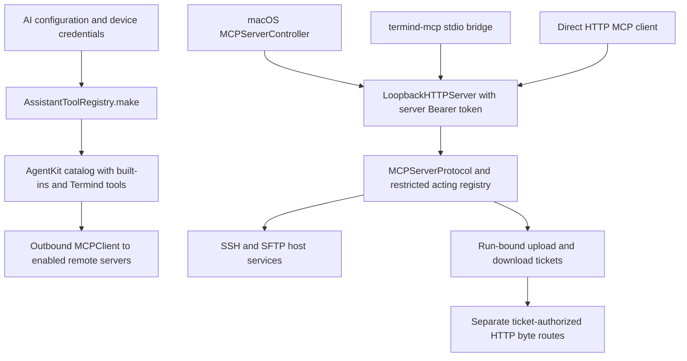
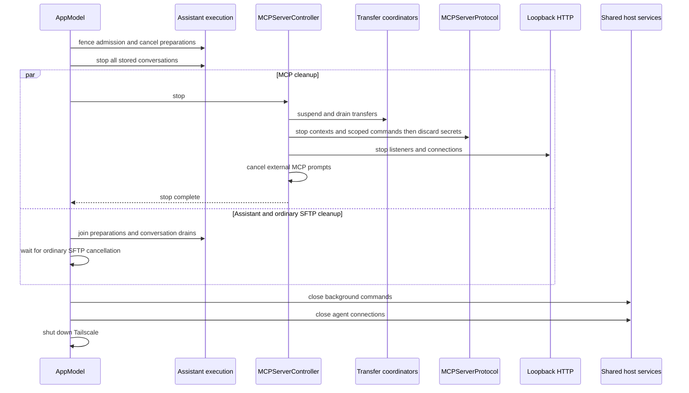
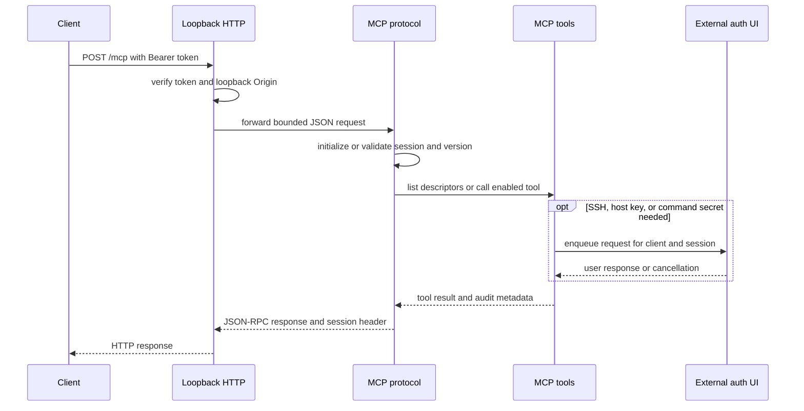
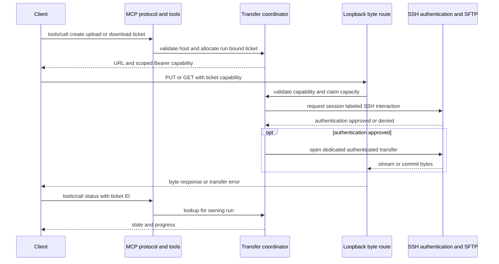
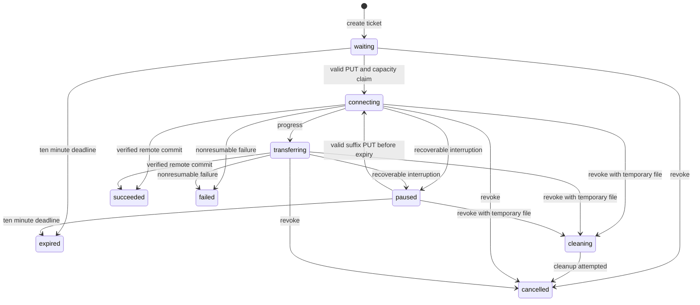
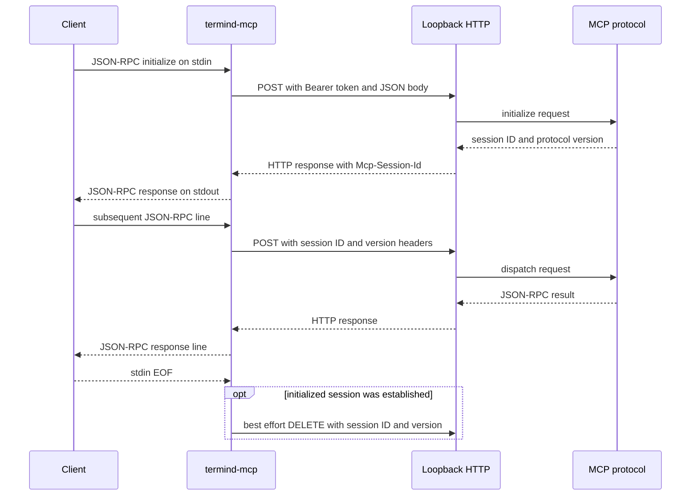

# MCP Server and Bridge

Termind’s built-in MCP **server** is a **macOS-only, local integration boundary**. `TFM/App/AppModel.swift` constructs `MCPServerController`, which owns the listener and tool/transfer lifecycle and injects the app's external authentication coordinator and audit model; an MCP client supplies JSON-RPC requests. The listener accepts only loopback connections and authenticates normal MCP traffic with a device-local Bearer token. It is not a remote-access server. The iOS `MobileAppModel` instead composes a mobile Assistant and ordinary SFTP transfers, not this listener. iOS **does** support the other side of MCP: its remote MCP settings/editor can discover HTTP(S) servers with `MCPClient`, configure a manual Bearer credential or OAuth, set per-tool permissions, and make their tools available to the Assistant. Do not confuse the mobile outbound client with the desktop inbound server or its `/uploads` and `/downloads` routes.

The shared `AgentHostServices.live(...)` composition is not a shared MCP listener: macOS passes its resolver, connection pool, authentication registry, and background commands to `MCPServerController`, while iOS passes its host services to `MobileAssistantModel` and separately creates its app SFTP transfer coordinator. Both composition roots pass the same app-local `SFTPConcurrencyScheduler` to `AgentHostServices.live(...)` and the ordinary transfer coordinator, using SFTP preferences constrained by `.sftpMultiConnection` access. Separate transfer ownership therefore does not mean independent SSH/SFTP scheduling: MCP byte transfers use the injected agent authentication/pool with `schedulesDataTransfer: true`. macOS also constructs a separate ordinary `SFTPTransferCoordinator` for its own file-transfer UI; the MCP upload/download ticket coordinators and their HTTP byte routes belong to the desktop server, not either app's ordinary transfer coordinator. The mobile MCP editor performs outbound discovery with `MCPClient` and preserves per-tool policies across rediscovery; mobile MCP settings allow adding/editing remote servers without a `.remoteMCP` Pro gate. Discovery uses the configured manual Bearer token or device-local OAuth authorization, with a user-driven browser interaction when authorization is needed. OAuth grants and client secrets are stored per server in this-device Keychain, not in synced AI settings. Editor authorization is staged in an in-memory draft: cancelling discards newly acquired grants, while committing saves credentials alongside the configuration change and restores the previous credentials if that change fails; refreshes of already-saved grants persist immediately. Changing a saved server's endpoint or authorization binding, or deleting it, clears its old grants and cancels in-flight authorization. Runtime token requests recheck that binding before and after authorization, so a retired tool configuration cannot start or finish a new login.

Both platforms' Assistant can instead construct an **embedded AgentKit MCP client**: when the selected model supports tool calls, `AssistantToolRegistry.make` builds a catalog from AgentKit built-in groups, Termind host tools, and enabled remote MCP servers without conflicting namespace IDs, passing each server's configured Bearer secret (if present) and the device's OAuth-capable `MCPClient`. It supplies `AgentScratchWorkspace.shared(applicationName: TermindAgentPolicy.scratchDirectoryName)`: the scratch actor is shared across the application's runs and conversations, not keyed by conversation. In contrast, the injected background-command scope is `conversation.id`. The catalog registers local built-ins before Termind definitions and joins discovered remote definitions in the resolved registry afterward; built-in names cannot be shadowed by Termind or remote names (see the registration comment in `AssistantToolRegistry`). That client calls *out* to configured servers; it is not `MCPServerController`, and the desktop inbound registry does not inherit its remote tools, scratch files, or permissions.

Assistant outbound discovery and desktop inbound serving are separate catalogs and authorization paths; the bridge is only a transport adapter to the inbound listener.

The desktop app explicitly revokes MCP tickets when a host is deleted (including host-deletion outbox handling and remotely applied vault removals), alongside cancelling ordinary SFTP work and SSH connections. Mobile host-deletion handling instead cancels its ordinary SFTP transfers; there are no inbound MCP sessions to revoke there.

### Shutdown boundary

The Assistant and inbound MCP server share app-owned host services, so **stopping the listener alone is not sufficient to close the shared SSH resources safely**. `AppModel.shutdownForTermination()` fences new Assistant admissions with `isTerminating`, cancels pending Assistant preparations, and calls `stop()` on every stored conversation before awaiting any of them—not just conversations visible in live windows. It creates `stopAndWait()` drains for those conversations. The preparation cancellation join also covers captured preparation-failure persistence for conversations not yet in the store.

MCP stop and ordinary SFTP cancellation waiting run concurrently with those drains. Only after preparation cancellation, every conversation drain, and both MCP/SFTP stop tasks complete does the app close shared background commands, then shared agent connections, then Tailscale. Repeated termination calls reuse the same cleanup task. The app also synchronously cancels ordinary transfers and external authentication, closes windows, and stops forwarding and other UI/background producers. `MCPServerController.stop()` itself drains transfer coordinators, stops protocol contexts, stops HTTP, then cancels external MCP prompts; it does not close the app-wide agent connection pool.

Desktop termination joins Assistant work and both inbound MCP and ordinary SFTP cleanup before tearing down their shared host resources.

This is the intended cleanup ordering, not an unlimited guarantee that every operation can finish before process exit: the app delegate hands the task to a bounded termination reply coordinator. See [Platform runtime](../architecture/platform-runtime.md) for the wider application lifecycle.

The endpoint is normally `http://127.0.0.1:7391/mcp`, but the port is configurable. The server is off by default. Its controller and settings no longer require MCP Server Pro access to enable, configure, rotate its token, or change exported tools. These inbound-server preferences are device-local rather than synced AI or remote MCP client settings.

## Components and ownership

| Component | Responsibility |
| --- | --- |
| `MCPServerController` | Desktop lifecycle, device-local settings, device token, port restarts, listener status, and attaching HTTP/protocol/transfer handlers. |
| `LoopbackHTTPServer` | TCP listener on `127.0.0.1` and `::1`, Bearer and Origin checks, bounded ordinary request handling, and byte-route dispatch. |
| `MCPServerProtocol` | Modern operation-handle calls, initialized streamable HTTP JSON-RPC sessions, legacy SSE compatibility, protocol negotiation, tool discovery and invocation. |
| `MCPServerTools` | Deliberately limited external tool registry, executor, audit registration, injected external authentication routing, and transfer coordinators; the protocol session owns its `SecretBroker`. |
| `ExternalAuthCoordinator` | Queues UI-mediated SSH login, host-key confirmation, and secret requests separately from Termind-origin authentication. |
| `MCPUploadCoordinator` / `MCPDownloadCoordinator` | Issue and track distinct, scoped byte-transfer capabilities rather than placing file contents in MCP JSON-RPC. |
| `termind-mcp` | A separate macOS executable that translates newline-delimited JSON-RPC on stdin/stdout to the loopback HTTP session protocol. |

This division keeps AgentKit’s execution machinery from becoming the network or UI owner: Termind injects its host resolver, pooled SSH/SFTP connections, authentication registry, background commands, metrics reader, and audit model.

## Startup, gating, and token operations

`MCPServerController` reads enabled state, port, and disabled-tool names from `UserDefaults`; disabled names are intersected with the known export set. These mutations do not request Pro access. The port setter clamps to 1024–65535. Startup checks enabled state and requires a usable token and a `UInt16` port, configures transfer URLs with the selected port, then starts the HTTP server with separate protocol, upload, and download handlers. A port change restarts the listener, stopping existing sessions and tickets. A persisted enabled preference schedules startup during controller initialization; there is no entitlement-loss stop/resume hook in this controller.

The bridge has an independent startup: an external client launches the bundled executable with its URL/token configuration. It does not enable or launch the desktop listener; Termind must already be running with its server enabled.

The long-lived server token is generated from 32 secure random bytes and encoded as URL-safe Base64. It is stored only in this-device Keychain storage. Older iCloud-stored values are migrated only after a verified local copy exists, then the cloud copy is removed; a failed migration remains retryable rather than silently losing the credential.

**Rotation is a revocation event, not just a preference update.** The controller stops transfers and all MCP sessions, replaces the HTTP token, and disconnects existing HTTP connections. Clients must update their configuration with the new token; a token/port change invalidates copied setup commands.

## Listener security boundary

`LoopbackHTTPServer` creates listeners specifically bound to IPv4 loopback (`127.0.0.1`) and IPv6 loopback (`::1`) with `acceptLocalOnly`; it does not bind an externally reachable interface. It limits connections to 64, headers to 64 KiB, and ordinary MCP request bodies to 4 MiB. Normal routes require `Authorization: Bearer <server-token>` and compare token bytes in constant time.

If an `Origin` header is present, it must be a bare HTTP(S) loopback origin: `localhost`, `::1`, or a `127.x.x.x` address. Clients without `Origin` remain supported. Unauthenticated/invalid-origin requests are closed after their response so an unconsumed body cannot be reused on a persistent connection.

The two file byte routes are intentionally different:

* `/uploads/<id>` and `/downloads/<id>` do **not** accept the long-lived MCP token. They are authorized by a per-transfer capability in the `Authorization` header.
* Upload authorization and atomic claim occur before the body is drained; download handling receives a cancellation token tied to the TCP connection.
* Capability values are not query parameters, and a browser `Origin` must pass the loopback rule.

## MCP session request handling

Clients `POST` JSON-RPC 2.0 to `/mcp`. The modern `2026-07-28` path uses `server/discover`, `tools/list`, and `tools/call` without an `initialize` session. Requests must carry matching protocol version metadata and `MCP-Protocol-Version`/`MCP-Method` headers; calls also match `MCP-Name`. Discovery advertises the modern version alongside supported initialized versions, and listing adds `operation_handle` to each tool's input schema. A call creates an isolated operation context unless it supplies a live handle. The server retains the context and returns `operation_handle` for successful `request_user_secret`, `sftp_upload`, `sftp_download`, or `ssh_exec_run` calls, for `ssh_exec_run` results containing a command handle, or when a caller supplied an operation handle. The operation handle is distinct from the SSH command handle: preserve both for subsequent command control. That opaque value binds subsequent secret, command, or transfer work to the same run and expires when the operation is removed or the server stops. The server limits live operations and sessions together to 64.

The initialized streamable path remains available for `2025-11-25`, `2025-06-18`, `2025-03-26`, and `2024-11-05`. `initialize` creates an independent session, returns `Mcp-Session-Id`, and negotiates a supported version. Thereafter the client sends the session header and matching `MCP-Protocol-Version`; the March 2025 variant also accepts an absent version header and bounded JSON-RPC batches. `notifications/initialized` enables tool listing and calls. Notifications receive `202`; malformed JSON-RPC and invalid call parameters receive protocol errors.

The inbound request crosses the loopback token and Origin boundary, then the MCP session and enabled-tool boundary; SSH and secret interactions cross into the desktop UI only when needed. The embedded Assistant's outbound AgentKit `MCPClient` is a different flow and is not a participant here.

This shows the initialized streamable MCP request path. Modern requests use the same listener, tool registry, and external authentication UI, but carry request metadata and, for related calls, an operation handle instead of an initialized session header.

There is also a legacy compatibility transport: `GET /sse` opens an SSE stream and emits an endpoint event for `/messages?sessionId=...`; clients post messages there and receive responses as SSE messages. `GET /mcp` is deliberately rejected because streamable HTTP does not expose a standalone SSE stream.

Each initialized session or modern operation owns a UUID run ID and a `SecretBroker`. The protocol supports at most 64 live contexts and sweeps idle contexts after 30 minutes. Capacity exhaustion returns HTTP `503`; absent or expired initialized session IDs return `400` or `404`, and a mismatched negotiated version returns `400`. Initialized `tools/list` and `tools/call` require `notifications/initialized`; unknown or disabled tools and non-object call arguments return JSON-RPC `-32602`. Tool execution errors are represented in tool results or JSON-RPC errors, not authorization to call a hidden tool. A context with active transfer work is retained rather than expired. Explicit `DELETE /mcp` for initialized sessions, listener stop, token rotation, or expiry finishes applicable legacy streams and invokes scoped cleanup. `endSession` cancels tracked call tasks, revokes both transfer directions, closes background commands for that run, drains transfer cleanup, cancels external prompts, and joins the call tasks. It closes the background scope again after that join to catch late command registration, then unregisters audit state and discards all brokered secrets. This does not close other MCP contexts' or the Assistant's background scopes.

## Tools, policy, and external authentication

The exposed registry is an allowlist—not the complete AgentKit catalog. To extend it, add the host or transfer implementation and dependencies, explicitly opt the name into `exportedNames`, verify its acting-mode descriptor and MCP schema, and decide whether disabling it must revoke a capability. Adding a tool to the Assistant catalog or configuring a remote MCP server alone does not export it through the desktop listener. It includes host discovery and cached metrics; `request_user_secret`; `ssh_exec_run`, `ssh_exec_output`, `ssh_exec_stdin`, `ssh_exec_cancel` and `ssh_exec_list`; ordinary SFTP inspection/mutation/copy operations; and four upload/download ticket/status tools, for 21 exported names. `terminal_suggest` is not exported. Scratch workspaces and generic fetch tools are intentionally excluded because an external MCP client has no Termind conversation backing them.

`MCPServerTools.makeRegistry` composes AgentKit's user-interaction group, the same `TermindAgentTools` definitions used by Assistant, and the four MCP transfer tools. It supplies no scratch workspace, so the dependency-based factories cannot construct `scratch_pull` or `scratch_push`. It then explicitly selects `.available(in: .acting)` **before** applying the exported-name allowlist and disabled-tool filter. Thus MCP uses the acting `ssh_exec_run` implementation, not Assistant's planning wrapper; mode selection, dependency injection, and export policy are distinct boundaries. The stdio bridge forwards requests to this registry rather than building another catalog. Calls rebuild the executable registry with the context's `runID` as its background-command scope. Command lookup and listing enforce that scope, so a command handle from another context cannot be used just because the app shares one `AgentBackgroundCommands` instance. Active command work also keeps the context alive during the idle sweep, alongside tracked calls and transfer activity.

Disabled tools are removed from discovery **and** invocation, not merely hidden. Changing a tool switch rebuilds the registry immediately; `sftp_upload` and `sftp_download` also enable or revoke their directional transfer coordinators. This makes disabling a transfer direction revoke existing tickets rather than allowing old URLs to revive after re-enablement. Disabling any exported tool also asynchronously revokes all modern operation contexts, invalidating their handles and ending their run-bound secrets, transfers, and prompts; this additional sweep does not remove initialized sessions.

Calls execute with `permissionMode: .fullAccess`, but this is not a bypass of system safety boundaries: tool schemas, path validation, host key checks, SSH/SFTP authentication, one-shot secret handling, and capability rules still apply. The MCP executor uses an approval broker whose manual fallback denies external calls; individual tool preflight policy still classifies safe/read-only versus changing operations.

When SSH credentials, keyboard-interactive answers, host-key trust, or a command’s secret stdin are needed, the tool creates a request in `ExternalAuthCoordinator`. Its handler is labeled with the MCP client name and session run ID and presents through the desktop UI. External requests are queued and independently cancelable by session; stopping MCP cancels external requests while preserving app-origin authentication requests. This is a critical boundary: `request_user_secret` is for secret standard input through `ssh_exec_stdin` with `type=secret`, not SSH login. It returns a one-shot handle from the context’s secret broker, never plaintext to the MCP client. The current request schema contains prompt, purpose and timeout, not host/tool binding fields.

Tool audit records are registered per MCP session. The UI can show client, tool, host, summarized arguments, duration and byte counts, but deliberately excludes file bodies, stdin, stdout, and stderr.

## Capability-based SFTP transfers

Large or binary data does not travel in the 4 MiB MCP body. An MCP call creates a transfer ticket and returns a loopback URL, method, scoped Bearer capability, and identifier; status is queried using the ticket ID through MCP. Ticket creation validates the arguments and configured host and allocates a ticket through the normal tool executor; it does **not** open SSH, SFTP, a local file, or the remote source. The client owns its local file and sends or saves its bytes separately. Only a valid HTTP `PUT` or `GET` claims an active transfer slot and starts the dedicated SFTP operation. The byte route authenticates the ticket capability rather than a second MCP session header, but the server checks that the issuing run remains registered. Status lookup requires that same run ID; knowing another session's ticket ID is insufficient.

Ticket creation and byte delivery are separate authorization and I/O phases; status remains tied to the originating MCP run. Transfer closures obtain the session-labeled `ExternalAuthCoordinator` SSH interaction only when the byte route runs, then open SFTP through the injected authentication registry and connection pool. A declined SSH or host-key prompt prevents the remote transfer, while ending a session revokes its ticket and cancels its pending prompts. Upload cleanup uses a fresh cancellation token and a separate task to attempt removal of an uncommitted remote temporary file even after the HTTP attempt was cancelled.

Upload and download are separate state machines and separate capabilities, even though they share a global budget of four active slots. Each ticket is bound to the creating MCP session/run, host, remote path, direction and intent; its 256-bit token expires after ten minutes. Waiting and paused tickets expire, while active work is allowed to finish. Each direction permits up to 64 unfinished tickets, retains up to 256 terminal records for 30 minutes, and terminal status remains queryable during that retention interval **while the owning session still exists**. Host/session revocation, server stop, token rotation, or disabling the matching direction cancels/revokes work. Ticket creation only validates request/host and allocates a capability; the subsequent HTTP claim acquires a shared active slot (or returns `429` without consuming a waiting ticket). The session activity check covers live work, unexpired paused tickets, and recently audited completions so a long-running transfer and its status remain queryable past normal session idle expiry.

### Upload: `sftp_upload` then `PUT /uploads/<id>`

The upload ticket binds the expected byte count (up to 10 GiB), SHA-256 digest, target path, and overwrite intent. Its MCP result includes `upload_id`, `upload_url`, `upload_token`, `expires_at`, method `PUT`, and the initial `Authorization`, `Content-Type`, `Content-Length`, and `Upload-Offset` headers. The byte route accepts only its capability and required binary request shape: no URL query/fragment, a loopback `Origin` if supplied, `application/octet-stream`, decimal suffix `Content-Length`, matching decimal `Upload-Offset` (default `0`), no chunked transfer encoding, and only `Expect: 100-continue` if an expectation is sent. Header/token/offset failures leave the ticket waiting or paused; `100 Continue` is sent only **after** authorization and the atomic claim, before body reading. The route streams bounded chunks with backpressure into a dedicated SFTP operation—no scratch workspace or whole-file staging. A duplicate/parallel claim cannot replay committed bytes.

Upload ticket states and representative transitions in `MCPUploadCoordinator`; cleanup can also run on a failed attempt before it becomes terminal, and expired/revoked tickets cannot resume.

Interrupted uploads can resume only from the coordinator’s acknowledged remote `upload_offset`. Poll `sftp_upload_status` in the same live MCP session after an interruption or a lost HTTP response; if `paused` and `resumable`, PUT only the suffix with matching `Upload-Offset` and remaining `Content-Length`. The remote prefix is verified before continuation. A successful remote commit sets `succeeded` even if a late disconnect loses the HTTP response; never repeat a succeeded upload. The remote write commits only after exact length and incremental full-file digest verification. Digest mismatch (`422`), invalid/truncated body (`400`), changed partial (`409`), or timeout (`504`) must not be interpreted as success; recoverable connection loss/timeout or disconnect can pause when not explicitly revoked and before expiry. Cancellation/revocation (`410`) and integrity failures cannot resume. Failure cleanup runs outside the failed HTTP attempt's cancellation context; `temporary_file_may_remain` reports a possible remote partial path if cleanup fails, not the file body. Uploads never overwrite directories; `overwrite` is only meaningful for an existing regular file.

### Download: `sftp_download` then `GET /downloads/<id>`

Creating a download ticket performs no remote I/O. On GET, the coordinator accepts regular files only, opens a dedicated SFTP stream, fixes the length, and returns binary bytes without local staging. It does not support `HEAD`, body/query credentials, or arbitrary ranges. A client may use a single open-ended `Range: bytes=N-` continuation from its saved length; malformed range syntax returns `400` before claim, while an out-of-bounds offset returns `416` after opening the source (and restores the prior ticket state). A resume verifies the existing prefix and source metadata before binary headers.

The server pulls no more than 64 KiB per send and revalidates bytes, size, and modification state at EOF. Success requires source validation, completion of the HTTP send, checked remote close, and lease release. A failure before headers is safe JSON; after headers the connection closes without appending JSON to binary content. Consequently, clients must poll transfer status and verify their local size/hash—an HTTP `200` and `Content-Length` alone do not prove persistent success.

## The `termind-mcp` stdio bridge

Some MCP clients expect a stdio command rather than HTTP. The bundled `termind-mcp` executable is a protocol forwarder only: it does not expose another listener or implement Termind tools. It reads one JSON-RPC object per stdin line, sends its original bytes to the configured loopback URL as HTTP POST, and writes each JSON response as one stdout line. Diagnostics go to stderr. It forwards JSON-RPC and session headers only; a client must separately perform ticket-authorized `PUT`/`GET` for file bytes, not send them over bridge stdin.

By default it uses `TERMIND_MCP_URL` or `http://127.0.0.1:7391/mcp`, and requires `TERMIND_MCP_TOKEN`; `--url` and `--token` override those values. Invalid stdin lines are ignored with an error on stderr. For a non-2xx HTTP response containing a JSON-RPC error envelope, the bridge forwards that envelope as-is; other HTTP failures or reachability failures produce a JSON-RPC `-32000` error for requests with an `id`. Notifications produce only stderr diagnostics on these failures. Empty responses and HTTP `202` do not produce stdout lines. On EOF, it best-effort sends `DELETE` with the established session ID.

This shows bridge-side negotiation for initialized clients: it captures `Mcp-Session-Id` from the initialize response and `protocolVersion` from its result, then supplies both on subsequent requests. For modern requests, the bridge forwards the caller's version metadata and matching method/name headers without retaining an initialized session. Modern-only EOF therefore sends no DELETE and does not itself revoke operation handles: their lifetime remains governed by the server's context cleanup, expiry, and revocation rules. The bridge processes each stdin line to completion before reading the next, uses an ephemeral `URLSession`, and is not a credential store.

In macOS settings, `MCPServerSettings` obtains the bridge path via `Bundle.main.url(forAuxiliaryExecutable: "termind-mcp")`, displays a masked preview until the token is revealed, and copies the real generated command. Commands register the current `http://localhost:<port>/mcp` endpoint (the listener supports both loopback families); **only Codex and Hermes Agent need the bridge**. The commands are shell-quoted, including path and credential values:

| Client | Generated registration shape |
| --- | --- |
| Claude Code | `claude mcp add --scope user --transport http --header 'Authorization: Bearer <token>' termind 'http://localhost:<port>/mcp'` |
| GitHub Copilot CLI | `copilot mcp add --transport http --header 'Authorization: Bearer <token>' termind 'http://localhost:<port>/mcp'` |
| OpenClaw | `openclaw mcp add termind --url 'http://localhost:<port>/mcp' --transport streamable-http --header 'Authorization=Bearer <token>'` |
| Codex | `codex mcp add termind --env 'TERMIND_MCP_URL=http://localhost:<port>/mcp' --env 'TERMIND_MCP_TOKEN=<token>' -- '<bridgePath>'` |
| Hermes Agent | `hermes mcp add termind --command '<bridgePath>' --env 'TERMIND_MCP_URL=http://localhost:<port>/mcp' 'TERMIND_MCP_TOKEN=<token>'` |

Missing token disables all generated commands; a missing bundled bridge disables only Codex and Hermes registration. `MCPClientSetupCommandTests` parses every command through inert CLI functions in real `/bin/sh` and checks metacharacter-safe arguments in both `/bin/sh` and `/bin/zsh`; it also verifies that changing the port or token updates all five commands. The commands are configuration snippets, not a running connection: copying one does not enable the listener, and changing the token or port requires updating previously registered clients.

## Operations and focused verification

* Enable the server in macOS settings, generate or rotate a token, then copy a client registration command. Treat that token like a local credential and update every client after rotation, port change, or moving the app when using the bridge.
* Use the server status to distinguish stopped, starting, ready, and failed listener state. A thrown HTTP startup error drains transfers; asynchronous listener failure updates the failed status and cancels listeners. Invalid port/token storage disables activation rather than exposing a partially configured server.
* To immediately cut off an external client, disable the server or rotate its token. To reduce surface area, disable individual tools; disabling either transfer tool revokes its tickets.
* Test changes at the correct seam: `MCPAuthorizationTests` checks device-local grant separation, draft rollback and saved-token refresh, endpoint rebinding and retirement, and cancellation of browser authorization callbacks without adding a transcript message. `MCPServerSessionTests` exercises initialization, version/session requirements, tool discovery, legacy SSE, and deletion cancellation without session resurrection; `MCPServerToolsTests` verifies all 21 exports, shared descriptor parity with the acting host subset, excluded tools, disabled invocation, one-shot session-bound secrets, and upload/download ticket creation with connection openers that would fail if called. Its cross-run status lookups fail, and `endSession` removes ticket access and discards secrets/cancels prompts. `MCPUploadTests` and `MCPDownloadTests` cover resume, claim, digest, cancellation, status, and wire behavior; `MCPClientSetupCommandTests` checks exact, shell-safe client registration arguments.

* For a built bridge executable, run `python3 Scripts/check-mcp-bridge.py /path/to/termind-mcp`. Its deterministic loopback server checks non-2xx JSON-RPC error passthrough in both modes, modern version/method headers and encoded non-ASCII tool names without a session header or EOF DELETE, and initialized session/version forwarding followed by EOF DELETE. This tests the adapter, not the real desktop listener or SSH authorization.
* `AppTerminationTests` guards the shared-resource shutdown boundary: all stored conversations are cancelled even without a live window, terminal saves finish before background commands/connections close, repeated shutdown does not duplicate cleanup, post-fence Assistant admissions and prepared edits cannot start, and an unstored captured failure is joined before resource closure.

## Source entrypoints

* [Desktop controller](../../TFM/App/MCPServerController.swift) and [settings](../../TFM/Features/Settings/MCPServerSettings.swift) — listener assembly, local configuration, token rotation and stop ordering.
* [Shared host services](../../Frameworks/TermindRemoteInfrastructure/Agent/AgentHostServices.swift) and [inbound tool assembly](../../TFM/Application/MCPServer/MCPServerTools.swift) — reuse without transferring ownership of the app pool.
* [Bridge](../../TermindMCPBridge/main.swift) and [bridge smoke check](../../Scripts/check-mcp-bridge.py) — transport adaptation and deterministic verification.
* [Mobile settings](../../TFI/Features/Settings/MobileMCPSettings.swift) and [editor model](../../TFI/Application/FeatureModels/MobileMCPEditorModel.swift) — outbound discovery and authorization, not an inbound listener.

## Related pages

* [Platform runtime](../architecture/platform-runtime.md) — desktop and mobile composition and shutdown ownership.
* [System boundaries](../architecture/system-boundaries.md) — inbound desktop integration versus embedded outbound client ownership.
* [Agent runtime and assistant](../concepts/agent-runtime-and-assistant.md) — tool execution, approval, and secret-handle semantics.
* [Persistence and secrets](../concepts/persistence-and-secrets.md) — Keychain and local-secret ownership.
* [SFTP transfer and external edit](../workflows/sftp-transfer-and-external-edit.md) — shared SFTP channel and transfer behavior.
* [SSH session lifecycle](../workflows/ssh-session-lifecycle.md) — SSH authentication, trust, and pooled connection lifecycle.
