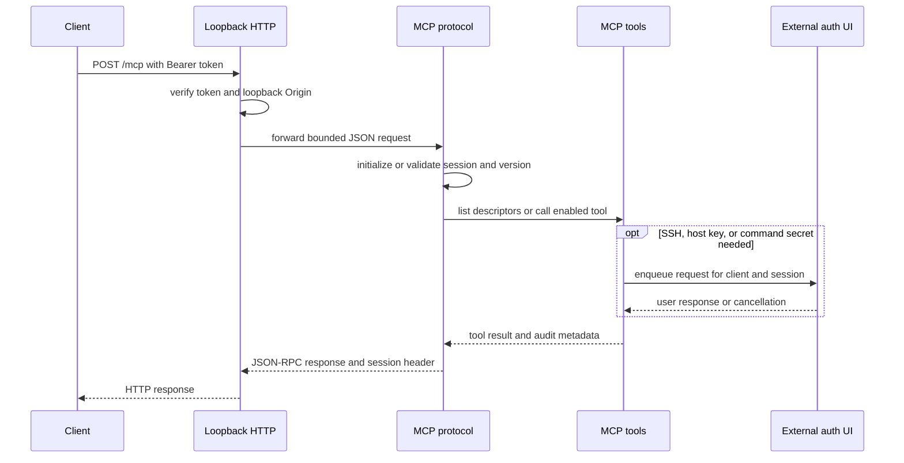
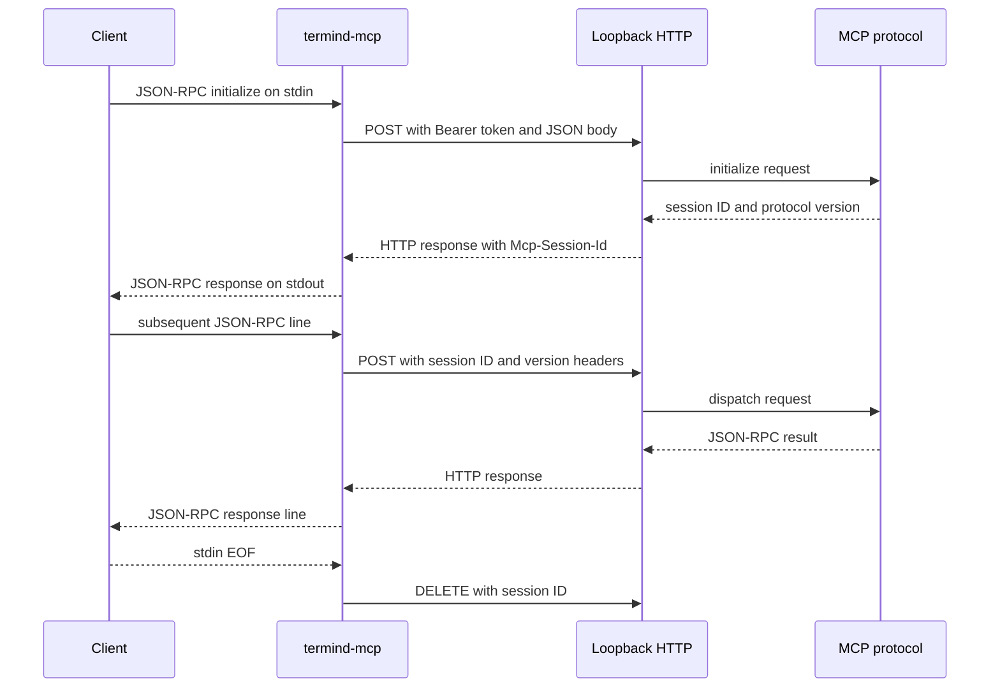

# MCP Server, Transfer APIs, and Stdio Bridge

Termind’s built-in MCP endpoint is a **macOS-only, local integration boundary**. The desktop app owns the listener, the tool registry, external authentication UI, audit trail, and transfer lifecycle; an MCP client supplies JSON-RPC requests. The listener accepts only loopback connections and authenticates normal MCP traffic with a device-local Bearer token. It is not a remote-access server and iOS does not start a local MCP listener.

The endpoint is normally `http://127.0.0.1:7391/mcp`, but the port is configurable. The server is off by default and requires the MCP Server Pro entitlement to enable, configure, rotate its token, or change exported tools.

## Components and ownership

| Component | Responsibility |
| --- | --- |
| `MCPServerController` | Desktop lifecycle, settings, Pro gating, device token, port restarts, status/client count, and attaching HTTP/protocol/transfer handlers. |
| `LoopbackHTTPServer` | TCP listener on `127.0.0.1` and `::1`, Bearer and Origin checks, bounded ordinary request handling, and byte-route dispatch. |
| `MCPServerProtocol` | Streamable HTTP JSON-RPC sessions, legacy SSE compatibility, protocol negotiation, tool discovery and invocation. |
| `MCPServerTools` | Deliberately limited external tool registry, executor, audit registration, per-session secret broker, external authentication routing, and transfer coordinators. |
| `ExternalAuthCoordinator` | Queues UI-mediated SSH login, host-key confirmation, and secret requests separately from Termind-origin authentication. |
| `MCPUploadCoordinator` / `MCPDownloadCoordinator` | Issue and track distinct, scoped byte-transfer capabilities rather than placing file contents in MCP JSON-RPC. |
| `termind-mcp` | A separate macOS executable that translates newline-delimited JSON-RPC on stdin/stdout to the loopback HTTP session protocol. |

This division keeps AgentKit’s execution machinery from becoming the network or UI owner: Termind injects its host resolver, pooled SSH/SFTP connections, authentication registry, background commands, metrics reader, and audit model.

## Startup, gating, and token operations

`MCPServerController` reads enabled state, port, and disabled-tool names from `UserDefaults`; disabled names are intersected with the known export set. Enabling, choosing a port, changing a tool, and rotating a token request Pro access. Startup refuses to run without both entitlement and a usable token, configures transfer URLs with the selected port, then starts the HTTP server. A port change restarts the listener. Loss of Pro access stops it; returning access resumes it only when the user had enabled it.

The long-lived server token is generated from 32 secure random bytes and encoded as URL-safe Base64. It is stored only in this-device Keychain storage. Older iCloud-stored values are migrated only after a verified local copy exists, then the cloud copy is removed; a failed migration remains retryable rather than silently losing the credential.

**Rotation is a revocation event, not just a preference update.** The controller stops transfers and all MCP sessions, replaces the HTTP token, and disconnects existing HTTP connections. Clients must update their configuration with the new token; a token/port change invalidates copied setup commands.

## Listener security boundary

`LoopbackHTTPServer` creates listeners specifically bound to IPv4 loopback (`127.0.0.1`) and IPv6 loopback (`::1`) with `acceptLocalOnly`; it does not bind an externally reachable interface. It limits connections to 64, headers to 64 KiB, and ordinary MCP request bodies to 4 MiB. Normal routes require `Authorization: Bearer <server-token>` and compare token bytes in constant time.

If an `Origin` header is present, it must be a bare HTTP(S) loopback origin: `localhost`, `::1`, or a `127.x.x.x` address. Clients without `Origin` remain supported. Unauthenticated/invalid-origin requests are closed after their response so an unconsumed body cannot be reused on a persistent connection.

The two file byte routes are intentionally different:

* `/uploads/<id>` and `/downloads/<id>` do **not** accept the long-lived MCP token. They are authorized by a per-transfer capability in the `Authorization` header.
* Upload authorization and atomic claim occur before the body is drained; download handling receives a cancellation token tied to the TCP connection.
* Capability values are not query parameters, and a browser `Origin` must pass the loopback rule.

## MCP session request handling

The primary transport is streamable HTTP: clients `POST` JSON-RPC 2.0 to `/mcp`. `initialize` creates an independent session, returns `Mcp-Session-Id`, and negotiates the supported streamable protocol version. Thereafter the client must send both that session header and the exact negotiated `MCP-Protocol-Version`. `notifications/initialized` enables tool listing and calls. Notifications receive `202`; malformed JSON-RPC and invalid call parameters receive protocol errors.

This shows the normal streamable MCP request path. Authentication is routed to the local Termind UI rather than returned as an interactive protocol prompt.

There is also a legacy compatibility transport: `GET /sse` opens an SSE stream and emits an endpoint event for `/messages?sessionId=...`; clients post messages there and receive responses as SSE messages. `GET /mcp` is deliberately rejected because streamable HTTP does not expose a standalone SSE stream.

A session owns a UUID run ID and a `SecretBroker`. The protocol supports at most 64 sessions, sweeps idle sessions after 30 minutes, and reports client count to the UI. A session with active transfer work is retained rather than expired. Explicit `DELETE /mcp`, listener stop, token rotation, or expiry finishes legacy streams, cancels session copies/transfers and external prompts, unregisters audit state, and discards all brokered secrets.

## Tools, policy, and external authentication

The exposed registry is an allowlist—not the complete AgentKit catalog. It includes host discovery and cached metrics; `request_user_secret`; `ssh_exec` and `ssh_wait`; ordinary SFTP inspection/mutation/copy operations; and upload/download ticket/status tools. Scratch workspaces and generic fetch tools are intentionally excluded because an external MCP client has no Termind conversation backing them.

Disabled tools are removed from discovery **and** invocation, not merely hidden. Changing a tool switch rebuilds the registry immediately; `sftp_upload` and `sftp_download` also enable or revoke their directional transfer coordinators. This makes disabling a transfer direction revoke existing tickets rather than allowing old URLs to revive after re-enablement.

Calls execute with `permissionMode: .fullAccess`, but this is not a bypass of system safety boundaries: tool schemas, path validation, host key checks, SSH/SFTP authentication, secret bindings, and capability rules still apply. The MCP executor uses an approval broker whose manual fallback denies external calls; individual tool preflight policy still classifies safe/read-only versus changing operations.

When SSH credentials, keyboard-interactive answers, host-key trust, or a command’s secret stdin are needed, the tool creates a request in `ExternalAuthCoordinator`. Its handler is labeled with the MCP client name and session run ID and presents through the desktop UI. External requests are queued and independently cancelable by session; stopping MCP cancels external requests while preserving app-origin authentication requests. This is a critical boundary: `request_user_secret` is for secret standard input to `ssh_exec`, not SSH login. It returns only a one-shot handle bound to the session, host, tool, and stated purpose—never plaintext to the MCP client.

Tool audit records are registered per MCP session. The UI can show client, tool, host, summarized arguments, duration and byte counts, but deliberately excludes file bodies, stdin, stdout, and stderr.

## Capability-based SFTP transfers

Large or binary data does not travel in the 4 MiB MCP body. An MCP call creates a transfer ticket and returns a loopback URL, method, scoped Bearer capability, and identifier; status is queried using the ticket ID through MCP. Ticket creation itself does not open SSH, local files, or the remote source.

Upload and download are separate state machines and separate capabilities, even though they share a global budget of four active slots. Each ticket is bound to the creating MCP session/run, host, remote path, direction and intent; its 256-bit token expires after ten minutes. Waiting and paused tickets expire, while active work is allowed to finish. Each direction permits up to 64 unfinished tickets, retains up to 256 terminal records for 30 minutes, and terminal status remains queryable during that retention interval. Host/session revocation, server stop, token rotation, or disabling the matching direction cancels/revokes work.

### Upload: `sftp_upload` then `PUT /uploads/<id>`

The upload ticket binds the expected byte count, SHA-256 digest, target path, and overwrite intent. The byte route accepts only its capability and required binary request shape, claims the ticket atomically, and streams with backpressure into a dedicated SFTP operation—no scratch workspace or whole-file staging. The remote write commits only after exact length and incremental digest verification. A duplicate/parallel claim cannot replay committed bytes.

Interrupted uploads can resume only from the coordinator’s acknowledged remote offset. The client must provide matching `Upload-Offset` and suffix `Content-Length`; the remote prefix is verified before continuation. Digest mismatch, truncation, cancellation, or cleanup failure does not publish a successful remote file. The status may report a possible temporary remote path if cleanup fails. Uploads never overwrite directories; `overwrite` is only meaningful for an existing regular file.

### Download: `sftp_download` then `GET /downloads/<id>`

Creating a download ticket performs no remote I/O. On GET, the coordinator accepts regular files only, opens a dedicated SFTP stream, fixes the length, and returns binary bytes without local staging. It does not support `HEAD`, body/query credentials, or arbitrary ranges. A client may use one `Range: bytes=N-` continuation from its saved length; invalid range returns `416` without consuming a waiting ticket, and a resume verifies the existing prefix and source metadata before headers.

The server pulls no more than 64 KiB per send and revalidates bytes, size, and modification state at EOF. Success requires source validation, completion of the HTTP send, checked remote close, and lease release. A failure before headers is safe JSON; after headers the connection closes without appending JSON to binary content. Consequently, clients must poll transfer status and verify their local size/hash—an HTTP `200` and `Content-Length` alone do not prove persistent success.

## The `termind-mcp` stdio bridge

Some MCP clients expect a stdio command rather than HTTP. The bundled `termind-mcp` executable is a protocol forwarder only: it does not expose another listener or implement Termind tools. It reads one JSON-RPC object per stdin line, sends its original bytes to the configured loopback URL as HTTP POST, and writes each JSON response as one stdout line. Diagnostics go to stderr.

By default it uses `TERMIND_MCP_URL` or `http://127.0.0.1:7391/mcp`, and requires `TERMIND_MCP_TOKEN`; `--url` and `--token` override those values. Invalid stdin lines are ignored with an error on stderr. For HTTP failure or reachability failure, requests with an `id` receive a JSON-RPC `-32000` error; notifications produce only stderr diagnostics. On EOF, it best-effort sends `DELETE` with the established session ID.

This shows bridge-side negotiation: it captures `Mcp-Session-Id` from the initialize response and `protocolVersion` from its result, then supplies both on subsequent requests. It uses an ephemeral `URLSession` and is not a credential store.

For direct HTTP clients, settings generates quoted setup commands for Claude Code, GitHub Copilot CLI, and OpenClaw. Codex and Hermes use the bridge and pass the URL/token through environment variables. Missing token disables all generated commands; missing bundled bridge disables only those bridge-based registrations.

## Operations and focused verification

* Enable the server in macOS settings only after Pro access is available, generate or rotate a token, then copy a client registration command. Treat that token like a local credential and update every client after rotation, port change, or moving the app when using the bridge.
* Use the server status and connected-client count to distinguish stopped, starting, ready, and failed listener state. Listener failures stop transfers; invalid port/token storage disables activation rather than exposing a partially configured server.
* To immediately cut off an external client, disable the server or rotate its token. To reduce surface area, disable individual tools; disabling either transfer tool revokes its tickets.
* Test changes at the correct seam: `MCPServerSessionTests` exercises initialization, version/session requirements, tool discovery, legacy SSE, and deletion cancellation; `MCPServerToolsTests` verifies allowlisting, disabled tools, session-bound secrets, and ticket creation; `MCPUploadTests` and `MCPDownloadTests` cover resume, claim, digest, cancellation, status, and wire behavior; `MCPClientSetupCommandTests` checks exact, shell-safe client registration arguments.

## Related pages

* [Agent runtime and assistant](/openwiki/concepts/agent-runtime-and-assistant.md) — tool execution, approval, and secret-handle semantics.
* [Persistence and secrets](/openwiki/concepts/persistence-and-secrets.md) — Keychain and local-secret ownership.
* [SFTP transfer and external edit](/openwiki/workflows/sftp-transfer-and-external-edit.md) — shared SFTP channel and transfer behavior.
* [SSH session lifecycle](/openwiki/workflows/ssh-session-lifecycle.md) — SSH authentication, trust, and pooled connection lifecycle.
