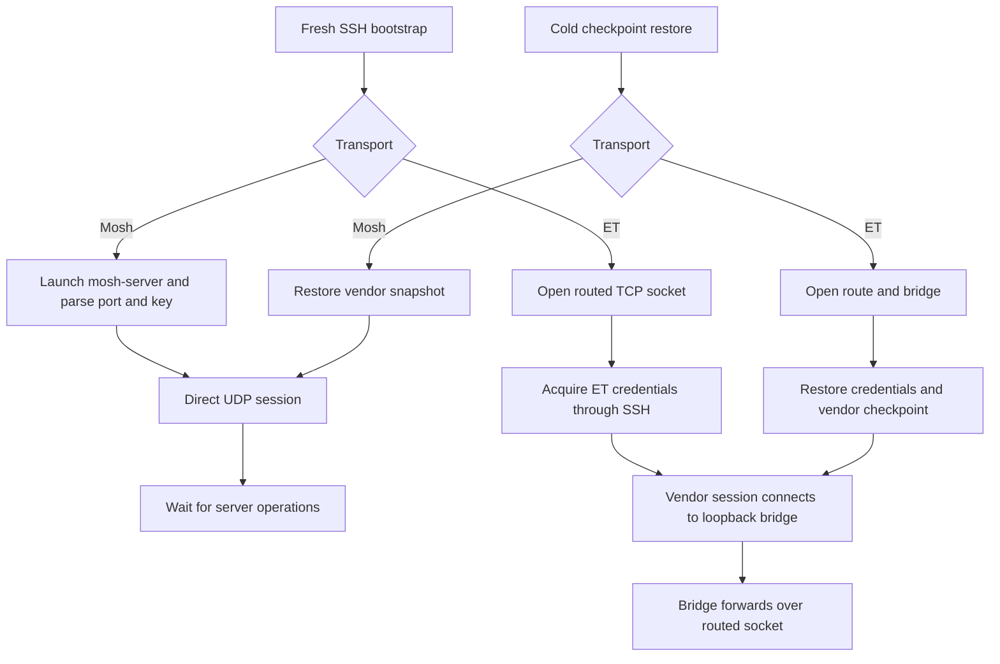
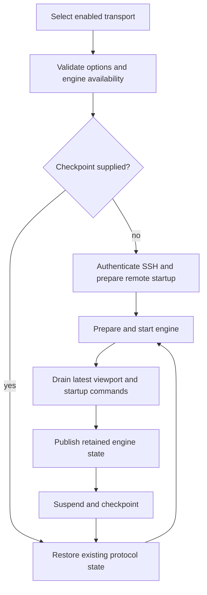
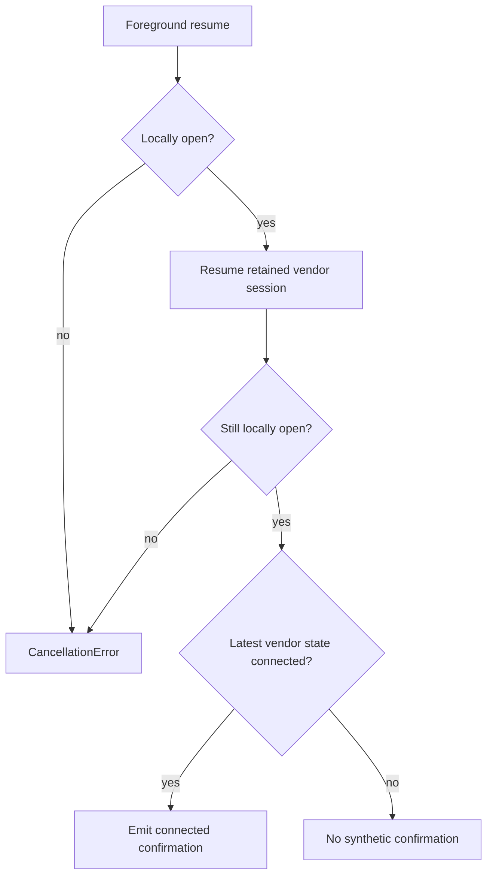

# Mosh and Eternal Terminal

Mosh and Eternal Terminal (ET) are alternative terminal transports authenticated through SSH. They do not replace auxiliary SSH services such as SFTP, Agent execution or forwarding. Transport recovery preserves a remote PTY; [Session Persistence](../concepts/session-persistence.md) separately controls the remote multiplexer session inside that PTY.

## Configuration and routing

Hosts enable transports individually and choose a default. SSH remains available; an unavailable default falls back to SSH. Mosh accepts an empty UDP port specification, one port or an inclusive ascending range within 1–65535. ET defaults to TCP port 2022. Tailscale-managed Hosts do not offer Mosh, but may offer ET.

Mosh bootstraps `mosh-server` through SSH, parses the returned UDP port and key, and then connects directly to that UDP endpoint. A successful SSH connection does not prove UDP reachability: the engine waits for server operations before announcing connection and fails after a bounded startup wait. Do not assume an SSH proxy or jump route tunnels Mosh UDP.

ET uses an SSH bootstrap executor to acquire credentials and a local TCP bridge to reach a routed socket. The socket route carries the configured proxy, jumps, network adapter, host-key constraints and authentication interaction policy. The vendor session connects to the local bridge rather than bypassing Termind routing.

Fresh bootstrap creates protocol state; cold restoration reuses saved state without rerunning remote startup or attaching another multiplexer client.

ET opens its initial data route before acquiring fresh bootstrap credentials. Initial route failure retires that route attempt and preserves the original error. Route snapshots are separate from protocol readiness: `.ready` means the socket route is ready, not that the terminal is connected. The client forwards increasing route revisions even while recovery is frozen, ignores reordered older revisions, and ignores all engine events after close. See [Tailscale](tailscale.md) for the network integration boundary.

## Connection lifecycle

The resumable transport lifecycle separates fresh SSH bootstrap from recovery of existing protocol state.

The resumable client owns transport state, queued lifecycle requests, maintenance and network monitoring. Engines own protocol-specific state. Engine availability is checked before wake, routing or bootstrap side effects. Failed preparation invokes engine rollback, disconnects bootstrap SSH and closes the client. Network recovery reuses protocol state rather than bootstrapping another shell.

A fresh startup may receive a backend-neutral PTY startup plan. Mosh appends its quoted shell command to server startup; ET sends a quoted `exec /bin/sh -c` command to its terminal. Restoration skips startup preparation because the restored transport already owns its PTY and attached remote session. Replaying startup would risk duplicate commands or duplicate sessions.

### Startup acceptance and publication ordering

`ResumableTerminalClient.connect` validates the checkpoint envelope before constructing an engine. Both fresh start and cold restore hold `startupNeedsCompletion` while preparation and start run. `resize` still accepts the latest viewport during this interval but does not concurrently send it to the engine. Start uses the latest dimensions accepted during preparation; afterward a drain loop rechecks dimensions across every await, sends startup input and shell-integration commands, disconnects bootstrap SSH, and only then releases the startup barrier and publishes the retained engine state. An early `.connected` or `.activity` event is therefore not permission to publish connected before the latest viewport has been applied.

Startup is not a blanket write freeze: `write` permits early terminal protocol replies (for example, a cursor-position report) while the host gates interactive input on connected state. Queued lifecycle work, suspension and incomplete recovery still reject writes with `TerminalTransportError.suspended`. Shell-integration commands generated while frozen are buffered for the drain rather than sent concurrently. Cancellation during startup draining rolls back and closes without admitting connected.

### Shared lifecycle barrier

Suspend, resume and retry are serialized, coalescing only adjacent matching requests so a checkpoint remains an ordering barrier. Admitted operations wait for in-flight sends, including startup, to finish. Suspension prepares protocol state before capturing shell state; resume/retry flush the latest viewport and pending integration command before reopening admission and publishing retained engine state. Cancelling one waiter does not cancel already-admitted session work. A failed recovery keeps admission frozen until recovery succeeds or the client closes.

## Recovery and security

Recovery payloads contain protocol capabilities, not merely navigation state. Keep them within the encrypted local recovery store; do not put credentials or opaque checkpoint payloads in URLs or diagnostics. Recovery leases prevent an old owner from overwriting newer state. Consuming a disk checkpoint validates its identity and route and removes it before returning usable state; deletion failure must not produce a second owner.

Live foreground resume is distinct from cold restoration: the former resumes retained engine state after suspension, while the latter consumes saved state. Neither guarantees that a remote server is still alive. A failed transport recovery must not silently create another remote shell.

### Eternal Terminal foreground confirmation

On mobile, `resumeAfterBackground()` waits for the pending suspension/checkpoint save, invalidates the disk recovery record, and only then calls `resumeTransport()` on the retained session. Generation checks reject stale work; invalidation or resume errors become transport recovery failures. This avoids leaving a consumable disk checkpoint alongside the resumed live owner.

The resumable client publishes `.recovering` before calling the engine's resume operation. ET can keep its connection alive during suspension without emitting another vendor `.connected` event. `EternalTerminalEngine` therefore remembers the latest vendor connection state and, after `resumeFromApplicationBackground()`, explicitly emits `.connected` **only if that retained state is still `.connected`**. This confirms recovery without requiring new output or a duplicate vendor notification; it is not an unconditional success signal or a fresh server probe.

ET foreground confirmation uses the retained vendor state and checks local closure before and after the asynchronous resume call.

A disconnected, reconnecting, failed, never-connected, or ended session gets no synthetic confirmation. Lost connections require a subsequent vendor `.connected` event to report connectivity again. A locally closed engine throws `CancellationError`; foreground resume must not revive it.

### Terminal end is not recovery

ET maps vendor `.reconnecting` and `.disconnected` to recovery, `.failed` to failure, and `.sessionEnded` to terminal end. On terminal end it waits for its output reader to drain before emitting `.ended`. The resumable client publishes `.ended` and closes resources without replacing that terminal state with `.closed`.

Mobile workspaces retain the terminal during recovery rather than scheduling ordinary SSH reconnect. A connected confirmation completes the recovery journey; duplicate connected notifications do not repeat it. On `.ended`, the workspace clears foreground resume intent and its recovery lease, cancels pending suspension, discards saved recovery state, and handles a successful remote exit. Ended or closed workspaces ignore later transport state notifications, so a late connected event cannot reopen them. Recovery and failure alone do not request workspace closure.

## Ownership and extension seams

Domain owns Host options and recovery descriptors; Application owns startup plans and backend interfaces; Remote Infrastructure owns SSH routing, resumable clients and engines. Native workspaces retain terminal views and decide when to suspend, restore or detach. Add a transport through the engine registry and capability checks, not by adding protocol branches throughout native views.

## Verification

Review `ResumableTerminalEngineTests`, `TerminalTransportTests` and mobile restoration tests for startup, rollback, checkpoint validation and stale-owner behavior. These are test entrypoints, not a claim that this documentation update ran them. Real-server validation should separately exercise blocked UDP, ET route reconnection, foreground/background transitions and server-side session loss.

Focused regression coverage:

- [ResumableTerminalEngineTests](../../FrameworkTests/ResumableTerminalEngineTests.swift) gates preparation, start, resize and integration writes to verify latest-viewport acceptance, early protocol replies, connected publication ordering and cancellation rollback. It also checks route revisions independent of readiness, lifecycle coalescing, send barriers and recovery failure admission.

- [EternalTerminalResumeTests](../../FrameworkTests/EternalTerminalResumeTests.swift) checks retained-connection confirmation without a new vendor event, no confirmation after connection loss or before initial connection, and no revival after terminal end or local close.
- [MobileTerminalRestorationTests](../../TFITests/MobileTerminalRestorationTests.swift) checks recovery journey completion while retaining the terminal, duplicate-event handling, missing/incompatible checkpoint failure without opening a new shell, and exactly-once workspace closure on remote end for both transports.

See also [Ghostty Terminal Integration](../concepts/ghostty-terminal-integration.md), [SSH Session Lifecycle](../workflows/ssh-session-lifecycle.md) and [Session Persistence](../concepts/session-persistence.md).
