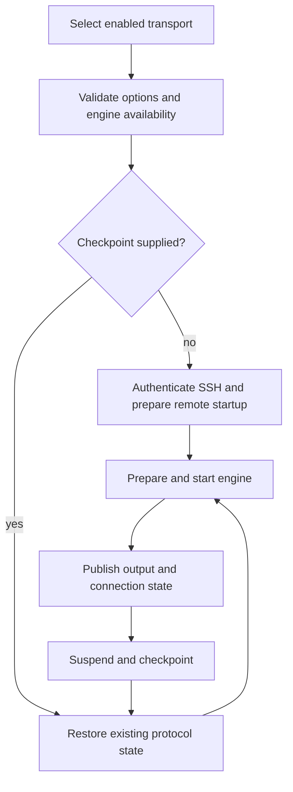

# Mosh + Eternal Terminal

Mosh and Eternal Terminal (ET) are alternative terminal transports authenticated through SSH. They do not replace auxiliary SSH services such as SFTP, Agent execution or forwarding. Transport recovery preserves a remote PTY; [Session Persistence](../concepts/session-persistence.md) separately controls the remote multiplexer session inside that PTY.

## Configuration and routing

Hosts enable transports individually and choose a default. SSH remains available; an unavailable default falls back to SSH. Mosh accepts an empty UDP port specification, one port or an inclusive ascending range within 1–65535. ET defaults to TCP port 2022. Tailscale-managed Hosts do not offer Mosh, but may offer ET.

Mosh bootstraps `mosh-server` through SSH, parses the returned UDP port and key, and then connects directly to that UDP endpoint. A successful SSH connection does not prove UDP reachability: the engine waits for server operations before announcing connection and fails after a bounded startup wait. Do not assume an SSH proxy or jump route tunnels Mosh UDP.

ET uses an SSH bootstrap executor to acquire credentials and a local TCP bridge to reach a routed socket. The socket route carries the configured proxy, jumps, network adapter, host-key constraints and authentication interaction policy. The vendor session connects to the local bridge rather than bypassing Termind routing.

## Connection lifecycle

The resumable client owns transport state, queued lifecycle requests, maintenance and network monitoring. Engines own protocol-specific state. Engine availability is checked before wake, routing or bootstrap side effects. Failed preparation invokes engine rollback, disconnects bootstrap SSH and closes the client. Network recovery reuses protocol state rather than bootstrapping another shell.

A fresh startup may receive a backend-neutral PTY startup plan. Mosh appends its quoted shell command to server startup; ET sends a quoted `exec /bin/sh -c` command to its terminal. Restoration skips startup preparation because the restored transport already owns its PTY and attached remote session. Replaying startup would risk duplicate commands or duplicate sessions.

## Recovery and security

Recovery payloads contain protocol capabilities, not merely navigation state. Keep them within the encrypted local recovery store; do not put credentials or opaque checkpoint payloads in URLs or diagnostics. Recovery leases prevent an old owner from overwriting newer state. Consuming a disk checkpoint validates its identity and route and removes it before returning usable state; deletion failure must not produce a second owner.

Live foreground resume is distinct from cold restoration: the former resumes retained engine state after suspension, while the latter consumes saved state. Neither guarantees that a remote server is still alive. A failed transport recovery must not silently create another remote shell.

## Ownership and extension seams

Domain owns Host options and recovery descriptors; Application owns startup plans and backend interfaces; Remote Infrastructure owns SSH routing, resumable clients and engines. Native workspaces retain terminal views and decide when to suspend, restore or detach. Add a transport through the engine registry and capability checks, not by adding protocol branches throughout native views.

## Verification

Review `ResumableTerminalEngineTests`, `TerminalTransportTests` and mobile restoration tests for startup, rollback, checkpoint validation and stale-owner behavior. These are test entrypoints, not a claim that this documentation update ran them. Real-server validation should separately exercise blocked UDP, ET route reconnection, foreground/background transitions and server-side session loss.

See also [SSH Session Lifecycle](../workflows/ssh-session-lifecycle.md) and [Session Persistence](../concepts/session-persistence.md).
