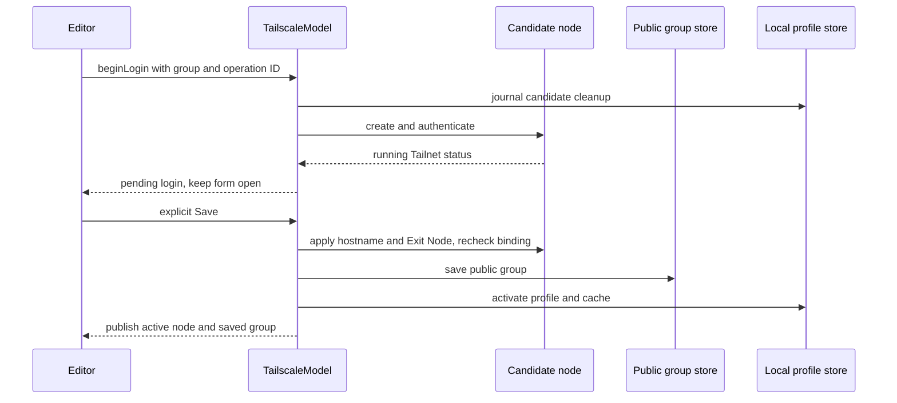

# Tailscale Integration

Termind runs an embedded userspace Tailscale node through `libtailscale-spm` and `TailscaleKit`; it does not require the system Tailscale VPN or daemon. Each enrolled Vault group has its own device-local profile and node. The app owns that lifetime through `TailscaleModel`, while SSH, SFTP, Metrics and Assistant acquire group-bound network capabilities. This guide is the starting point for Tailscale changes; use [SSH session lifecycle](../workflows/ssh-session-lifecycle.md) for general transport ownership and [Cloud Sync](../workflows/settings-and-cloud-sync.md) for replication mechanics.

## Dependency ownership and safe updates

The product build and maintenance checkout are separate boundaries:

- **Built dependency:** [the Xcode project](../../Termind.xcodeproj/project.pbxproj) assigns the remote `TailscaleKit` product to `TermindRemoteInfrastructure`, from `https://github.com/AkinoKaede/libtailscale-spm.git`. Its `upToNextMinorVersion` requirement has minimum `1.0.3` (the `1.0.x` range, below `1.1.0`). [Package.resolved](../../Termind.xcodeproj/project.xcworkspace/xcshareddata/swiftpm/Package.resolved) currently locks `1.0.3` at revision `b58ed45fb22e53b472ccf6febde1f4a3ab08e295`.
- **Maintenance checkout:** [.gitmodules](../../.gitmodules) also declares `libtailscale-spm/` from the same repository, tracking `main`. That gitlink is not the package product reference used by the Xcode target. Updating or initializing it alone does not change the remote package requirement or resolved revision used for the product build.

For a dependency update, review both the Xcode requirement and lockfile rather than inferring the shipped package version from the maintenance checkout. Keep native API adaptation at `LibTailscaleNodeSession`; do not use a package bump as a reason to rewrite group enrollment or routing semantics. For module ownership, follow [Module Map](../architecture/module-map.md); for SSH/SFTP/Metrics and forwarding relationships, follow [Remote Services and Forwarding](../concepts/remote-services-and-forwarding.md). Use [Build, Test, and Release](../operations/build-test-and-release.md) for resolved-only validation, with the focused suites below and live enrollment checks when native behavior changes.

## Owners and state boundaries

| Owner | Responsibility |
| --- | --- |
| Domain `TailscaleNetwork` and `TailscaleGroupConfiguration` | Canonical control service and DNS suffix, group-scoped peer identity, remote username, Exit Node and per-peer preferences. |
| Application `TailscaleGroupEditor` | Draft configuration, editor-owned login operation, pending logout and explicit Save/Cancel. |
| Application `TailscaleModel` | Active profiles and nodes, login candidates, discovery polling, access-checked dialers, cleanup and shutdown. |
| Application `HostLibraryModel` | Nearest-group routing, projection of discovered SSH peers, managed-host edit restrictions and runtime invalidation callbacks. |
| Remote Infrastructure `LibTailscaleNodeSession` | Native node creation, LocalAPI status/preferences/login, dialing, peer host keys and discovery ping. |
| Persistence | Public group configuration, separate local enrollment/cache rows and durable profile cleanup intent. |
| Apps and shared Presentation | App composition and native group/detail routes; shared login, peer, Exit Node and ping forms. Forms do not own app-wide node lifetime. |

Both app roots inject the local store, node factory, current device name and `.tailscale` Pro check. Memory-only compositions disable native profile storage and reject native factory calls. Losing Pro blocks new operations, including retained dialers, without immediately closing existing nodes. It is an admission boundary rather than a promise to terminate every established SSH stream.

## Enrollment is separate from saving a group

The control URL must be HTTPS without embedded credentials, query or fragment. Normalization lowercases the host, removes default port/trailing slashes, and maps the standard login URL to the controlplane URL. The Tailnet DNS suffix comes from native status, not from a guessed peer name.

1. `TailscaleGroupEditor.login` starts an operation bound to its group draft. `beginLogin` allocates a fresh profile and journals cleanup intent before creating the node. An Auth Key goes to the factory; otherwise the node starts interactive browser login.
The shared Exit Node field owns selection validation: a committed menu choice is rechecked against current online candidates even if the menu was already open, and saving editors reject changes. Disabled or no-longer-present choices remain displayable without being selected as new values.

2. The model polls status once per second for up to 600 seconds. Success produces `TailscalePendingLogin` and transfers the candidate node to the editor's pending operation. It does not create a Vault group or dismiss the form. A blank draft name may adopt the Tailnet name or DNS suffix; a name typed during login is preserved.
3. Explicit Save applies hostname and Exit Node to the candidate and rechecks generation, Pro access and the original public group binding after suspension. The public group saves first, then local profile/cache activation saves. Only successful activation publishes the node and managed peers.
4. A local activation failure can follow a successful public save. The editor retains the candidate and advances its baseline so Save can retry without another browser login, or the binding can be disabled. A failed public save never publishes a new group.
5. Cancel or disabling an unsaved candidate retires that candidate. Operation IDs prevent an older editor from cancelling a newer login. A changed or removed group binding invalidates pending work; late results cannot activate it.



The editor keeps enrollment pending until explicit Save activates the local profile after the public group is saved.

Logout of an already saved enrollment is an editor draft until Save. Cancelling keeps the original connection. Saving logout ends only that local enrollment and keeps the public Tailnet binding unless Tailscale was also disabled. Logout of an unsaved candidate cancels immediately. The deferred operation carries the original profile ID so it cannot log out a replacement enrollment created by another editor.

## Discovery, identity and managed preferences

The native status decoder requires the `Peer` field: a missing map is not an authoritative empty discovery result, while a null map represents an empty list. It retains offline peers, filters out sharee nodes and entries outside the network map, and requires stable IDs and DNS names. Diagnostic peer data can include nodes without SSH; the library projects only peers advertising SSH keys as managed Hosts.

Managed Host identity is a UUIDv5 over a versioned, length-delimited name containing the group UUID, Tailnet DNS suffix and stable node ID. Peer names and addresses do not identify a node. Two groups enrolled into the same Tailnet get independent Host IDs and preferences; renaming a group/peer preserves identity. Changing the DNS suffix changes the projection's IDs. The canonical control URL participates in connection binding and invalidation, but is not an extra component of this Host ID.

### Stable ID is a persisted compatibility contract

Three IDs serve different purposes:

| ID | Source and use |
| --- | --- |
| Peer stable node ID | Native status `Peer.*.ID`, carried as `TailscalePeer.stableID` and `TailscaleHostReference.stableNodeID`; used to find current peer host keys. It is not the map key, hostname or IP address. |
| Managed Host UUID | Deterministic group-scoped projection, used by history, Metrics and the group's `hostPreferences`. |
| Local profile UUID | Random UUID per enrollment attempt, used for native state and cleanup; it does not enter the managed Host identity. |

The exact Host UUID construction is:

```text
components = ["groupHostV2", lowercase(groupUUID), normalizedDNSSuffix, stableNodeID]
nameBytes = UTF8("termind.tailscale.v1:")
          + concatenate(decimal(UTF8(component).count) + ":" + UTF8(component))
hostUUID = UUIDv5(URL namespace, nameBytes)
URL namespace = 6ba7b811-9dad-11d1-80b4-00c04fd430c8
```

The implementation hashes namespace bytes plus `nameBytes` with SHA-1, takes the first 16 bytes, and sets the UUID version/variant bits. SHA-1 here implements UUIDv5 identity, not trust or authentication. Byte lengths, rather than character counts or an unescaped delimiter, preserve distinct Unicode and colon-containing inputs. For group `aaaaaaaa-aaaa-aaaa-aaaa-aaaaaaaaaaaa`, suffix `example.ts.net` and node `n123`, the independently generated regression vector is `75e53f16-003f-5fa1-87f3-663b8726f413`.

| Change | Managed Host UUID consequence |
| --- | --- |
| Rename group/peer or change DNS hostname/IP | Unchanged. |
| Re-enroll the same group into the same DNS suffix with the same stable node ID | Unchanged despite a new local profile UUID. |
| Same peer in another group | Different UUID; preferences and enrollment remain independent. |
| Change DNS suffix or stable node ID | Different UUID. |
| Change only control URL, retaining group/suffix/node | Same UUID, but network binding changes invalidate the old runtime/cache. |
| Switch suffix, then restore the original group/suffix/node | Original UUID returns. |

`hostIdentityVersion: groupScopedV2` is explicitly encoded in group configuration. `hostPreferences` wire keys use lowercase UUID strings and decoding rejects invalid or noncanonical keys. Changing the UUID algorithm or its input set can orphan saved preferences, Metrics references and history associations, so it requires deliberate compatibility work rather than a cosmetic refactor. `TailscaleHostIdentityTests` checks independently generated vectors, UTF-8 length framing, excluded control URLs and rename/rebinding behavior. Its network-switch test preserves the old event but excludes it from current Recents until the original identity is projected again; it never attaches that event to the replacement network.

Managed Hosts are rebuilt from discovery and group preferences, not persisted as ordinary Vault Host rows. Their address, name, port 22, authentication and trust remain managed. Saving allows username, tags, color, artwork override, charset, initial SFTP path, session persistence, shell integration, startup snippet and environment preferences through the group. It rejects ordinary Identity, proxy, jump, Telnet and agent-forwarding configuration. Managed Hosts cannot be duplicated or directly deleted and are unavailable for jump-host, key-export and port-forwarding use cases. Group removal/disablement owns their retirement.

### Detected artwork is a preference, not a transport capability

`replaceTailscalePeers` replaces a group's discovery snapshot and rebuilds managed Hosts. Discovery supplies the current peer name, MagicDNS address and stable node reference; `TailscaleGroupConfiguration.hostPreferences[hostID]` supplies detected distribution, artwork override and the other editable preferences. A refresh therefore preserves these values instead of replacing them with the peer's diagnostic operating-system string.

Live session system information reaches `HostLibraryModel.recordRemoteSystemInfo`. Only a changed, resolved distribution result is persisted. For a managed Host it updates the current group's preference entry and rebuilds the projection after persistence succeeds; failure restores the previous group state. This changes only detection, so it cannot overwrite artwork or other edits made while a connection was starting. Conversely, `saveTailscaleHost` copies editable fields into the current preference entry without copying a draft's detected distribution, preserving newer detection. Failed preference saves restore the previous groups and do not publish a rebuilt draft.

Presentation's `HostIconCatalog` resolves a non-nil `iconOverrideID` first; nil means automatic artwork from the latest detected distribution. Manual artwork does not change detection, SSH identity, host-key trust or network routing. Detection and artwork choices travel with group preferences and survive rediscovery, including discovery on another device after sync; the embedded node and its transport remain owned by `TailscaleModel`. See [Persistence and Secrets](../concepts/persistence-and-secrets.md) for the broader storage boundary.

## Two connection paths

| Target | Network route | SSH authentication and trust |
| --- | --- | --- |
| Ordinary Host under a Tailscale group | Nearest Tailscale-configured ancestor supplies the dialer; a nearer configured subgroup overrides its parent. | Ordinary username/Identity/key and Known Hosts rules still apply. Tailscale membership alone does not make this Tailscale SSH. |
| Discovered managed peer | Its bound group supplies the dialer and stable node ID. | Selected remote username, an empty ordinary credential list, and host keys obtained from the node's current peer status. |

`connection(for:)` checks Pro access, a running node, matching group network/profile and applied Exit Node. Its returned `AccessDialer` rechecks those conditions on every dial and host-key lookup. Pending Exit Node application reports `settingsPending`; missing enrollment reports `loginRequired`. Failed Tailnet dialing never retries through the system network. Additional ordinary SSH connections must retain their required Tailnet route; managed additional connections do not resolve ordinary credentials.

For a managed peer, `SSHConnectionOpener` refreshes expected host keys before dialing and requires the handshake key to match them. An absent advertised key reports `peerSSHUnavailable`; a mismatch fails rather than offering an ordinary Known Hosts override. Managed peers cannot be jumps. Authentication uses Tailscale SSH's username-based `none` exchange. If the server requires browser approval, a nonempty banner becomes an explicit `isTailscaleApproval` challenge even though it has no credential prompts. The UI may open a credential-free HTTPS approval link; it does not treat this as an informational round and auto-dismiss it. New banners are presented once, authentication polls at 50 ms intervals with a 600-second deadline, and cancellation retires the exchange. A forbidden-interaction additional connection fails if browser approval is needed.

Terminal PTY, non-PTY exec/SFTP and Metrics use this shared opener. Assistant username requests use the Tailscale prompt and can save a group preference without creating an ordinary Identity. Workspace and transfer lifetimes still belong to their existing owners; an embedded node is not a shared terminal session.

## Persistence, sync and retirement

| Data | Location and replication |
| --- | --- |
| Network binding, group/peer username, Exit Node and per-peer preferences, including detection and artwork override | Public HostGroup configuration, synchronized through the current Vault HostGroup V5 writer. |
| Profile UUID, local hostname, discovered peer cache | Device-local SwiftData enrollment row; not a Vault envelope. |
| Native node state | Application Support `Termind/Tailscale/<profile UUID>` with the native Keychain service namespace `com.akinokaede.termind.tailscale.<profile UUID>` passed consistently to node creation and erasure. |
| Pending erasure | Device-local durable `PersistentTailscaleProfileCleanup`; never synchronized. |
| Metrics selection | Separate Metrics V2 record, with V1/V2 readers and decoder-capability refetch. |

V47 introduced Tailscale group/local-state models; V48 revised local state; V50 added profile cleanup. These local schema endpoints are independent of cloud format versions. Vault refuses encoding managed peers as ordinary Host envelopes. HostGroup readers accept V1–V5 and the current writer emits V5; historical V3 remains readable and supports independent groups for the same Tailnet. V5 layers artwork overrides onto the V4 group payload as an `iconOverrides` map keyed by canonical lowercase Host UUID strings, each referencing an existing peer preference. Encoding an artwork override into a pre-V5 envelope is rejected rather than silently losing it; non-default session persistence similarly requires V4 or later. Reader upgrades refetch previously quarantined records before clearing restrictions. Per-peer preferences can sync before the other device discovers its matching Host. Missing peers do not erase saved preferences or monitor intent; explicit group deletion also removes related Metrics selections and runtime references.

Retirement saves removal of the active local row and cleanup intent atomically before releasing the last runtime reference. Erasure excludes active and in-use profiles, including candidates suspended inside Save. Cleanup closes retired nodes, erases native state, then removes the durable marker; erasure failure remains retryable across database reopening. Startup enumerates only canonical UUID directories that are real directories, not symlinks, and rechecks active enrollments after enumeration before scheduling orphan cleanup. Cleanup can proceed without Pro and does not need to start a node. Shutdown cancels login/monitors, closes active nodes and joins cleanup work; it does not erase saved enrollment merely because the app exits.

## Diagnostics and failure routing

The active-node monitor polls every three seconds, applies changed Exit Node preferences before admitting new connections, publishes status/peers, and persists changed peer cache. Network mismatch retires the enrollment; status failure removes running availability and exposes an error while retaining recovery data.

Peer forms show MagicDNS, addresses, online state, operating system, expiry and last-seen information. Discovery ping distinguishes a direct endpoint, peer relay, DERP region and unknown route; invalid/nonfinite latency or server error fails. The presented form owns its once-per-second ping task and last 30 latency samples; dismissal cancels it. Ping success proves discovery reachability, not SSH permission or a successful login.

When debugging, first distinguish Pro denial, device enrollment, pending Exit Node, missing SSH advertisement, host-key mismatch, browser policy approval and remote username. For external-service data handling, inspect `com.akinokaede.termind/src/components/PrivacyPolicy.astro`; its Tailscale disclosure is separate from optional Termind Crashlytics reporting.

## Focused verification

- `TailscaleGroupEditorTests`: login without Save, candidate cancellation, partial-save retry, deferred logout, replacement-enrollment guards and concurrent cloud edits.
- `TailscaleHostIdentityTests`: independent same-Tailnet groups, rename-stable IDs and network rebinding; `TailscaleIntegrationTests`: nearest ancestor routing, managed credential isolation, local-store reopen, discovery/metadata, username, Exit Node and retained-dialer Pro revocation.
- `HostIconTests.tailscaleChoicesSurviveRediscoveryAndWireRoundTrips`: manual/automatic artwork and detected macOS survive managed projection rebuilding and HostGroup sync. `TailscaleIntegrationTests.tagsAndColorSyncBeforeAnotherDeviceDiscoversTheHost` additionally verifies detected distribution arrives before discovery, survives incomplete Linux metadata, and clears on a resolved unsupported OS.
- `TailscaleProfileCleanupTests`: durable erasure retry, orphan discovery, active-profile protection and cleanup without Pro. `TailscaleSyncSafetyTests`: reader-capability refetch/unblock for independent same-Tailnet groups and Metrics selections (the historically named `v3ReplayAcceptsIndependentConnectionsToTheSameTailnet` helper constructs envelopes using the current writer).
- `TailscaleMultiConnectionTests` and `TailscaleMetricsAvailabilityTests`: additional-connection routing, access revocation and availability/recovery boundaries. `MetricsSyncTests` also checks historical V1 records and preservation of pending local edits during refetch.
- `TailscaleSSHWireTests`: real SSH/SFTP fixture through an injected loopback Tailnet dialer, gated by `TERMIND_SSH_FIXTURE` or `TERMIND_SSH_FIXTURE_JSON`. This does not exercise live control-service enrollment, WireGuard/DERP, browser policy approval or a physical multi-device Tailnet.

Use resolved-only Xcode builds/tests from [Build, Test, and Release](../operations/build-test-and-release.md). This documentation update checks source and evidence; it does not claim the wire suite or a live Tailnet test ran. Pair connection/authentication changes with actual macOS and iOS enrollment, policy approval and SFTP checks.
